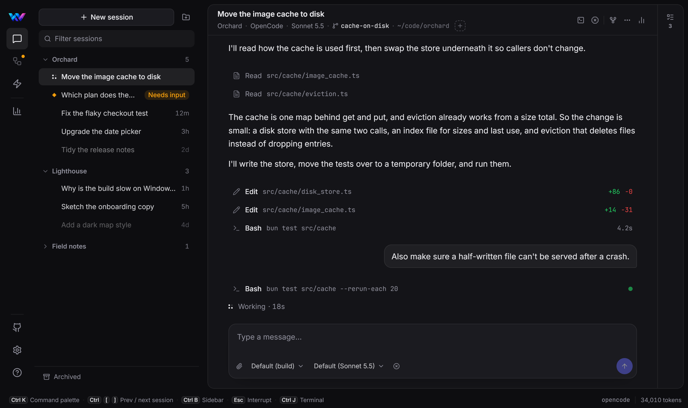
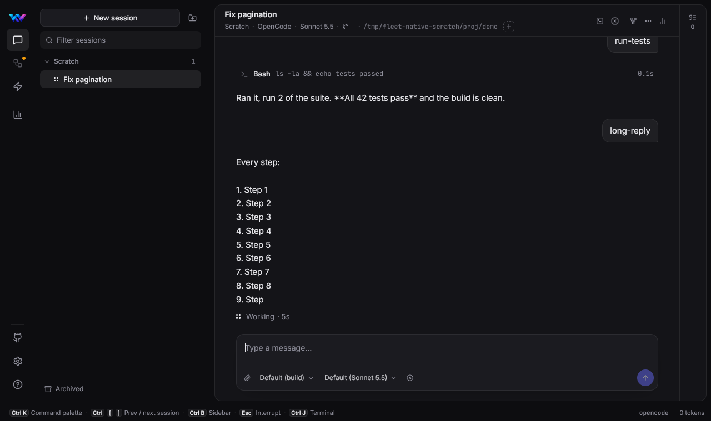

# fleet-native

[Weave Fleet](https://github.com/pgermishuys/weave-fleet)'s desktop app, rebuilt as a native app
with [Rune](https://github.com/anomalyco/rune), a GPU-rendered UI framework written in Rust. No
browser engine under it.

**This is an experiment.** Fleet's desktop app is the Electron one in weave-fleet; that is the one
to install. This repository exists to find out whether a native Fleet is enough better to be worth
building. So far it draws Fleet's shell, from invented data or, with `--server`, from a Fleet
server: its sessions, the open conversation (text and tool rows) and what you send to the agent.

| Read | For |
|---|---|
| [`docs/PORT.md`](docs/PORT.md) | The plan: what gets built in what order, and what is undecided |
| [`docs/FLEET.md`](docs/FLEET.md) | Fleet's server contract, and where each part lives in weave-fleet |
| [`docs/RUNE.md`](docs/RUNE.md) | What Rune has, what it lacks, what we learned |
| [`AGENTS.md`](AGENTS.md) | How to work in this repository (written for coding agents; people too) |





## Run it

You need [rustup](https://rustup.rs). The first build downloads and compiles Rune, which takes
minutes; after that a change rebuilds in seconds.

```sh
cargo run             # a debug build: quick to build, fine for work
cargo run --release   # to feel how fast it is
```

- **macOS and Windows** need nothing else (on Windows, the Visual Studio C++ build tools that
  rustup asks for).
- **Linux** needs two development packages to build, and one library to open a window:
  `sudo apt-get install libxkbcommon-dev libwayland-dev libxkbcommon-x11-0`
  (Fedora: `dnf install libxkbcommon-devel wayland-devel libxkbcommon-x11`).

**Without Rust:** every push to `main` builds the app for Windows, macOS and Linux on GitHub.
Open the latest [CI run](../../actions/workflows/ci.yml?query=branch%3Amain), sign in, and
download `fleet-native-windows-x64`, `fleet-native-macos-arm64` or `fleet-native-linux-x64`.
Nothing is signed, so Windows asks once before it runs, and macOS needs
`xattr -d com.apple.quarantine fleet-native` first.

### Against a Fleet server

```sh
cargo run -- --server http://127.0.0.1:6411
```

Loopback and no token only so far: the server must be on this machine, and `http://`. Never point
it at a Fleet you use: sending a message makes its agent act. `scripts/scratch-fleet.sh` starts a
throwaway Fleet in an empty home with a scripted model instead of a real one (it needs a released
server, a weave-fleet checkout for the model's script, and `opencode`; its header says how).
With no `--server`, the invented sessions are shown, which is what the tests and scenes use.

The window opens at the desktop app's size (1360 x 880, no smaller than 720 x 480) and follows the
system's light or dark theme.

## What works

| Part | What it does |
|---|---|
| Rail | Sessions is the shell. Workflows, Automations, Analytics, GitHub and Settings each take the whole context area with a notice. Help does nothing. |
| Session list | Click a session to open it. Click a project to fold it. Type in the filter. Drag the gutter to resize the list (200 to 500). |
| Header | The open session's title, project, harness, model, branch and path. The buttons show their tooltips and do nothing, except Abort. |
| Conversation | Scrolls, and stays at the bottom as messages arrive. Text can be selected. |
| Composer | Type and press Enter (or click Send). The message joins the conversation and a canned reply follows 2.5 seconds later. With `--server` the message goes to the agent and the reply streams in as it is written. Shift+Enter adds a line; the field grows to seven lines. |
| Content panel | Click the collapsed rail on the right to open the session's plan; the chevron closes it. In a sheet too narrow for a third column the panel opens over the conversation, as in Fleet. |
| Status bar | The keyboard hints, the harness and the open session's token count. |

Keys (Cmd on macOS, Ctrl elsewhere):

| Key | Does |
|---|---|
| Cmd/Ctrl+B | Show or hide the session list |
| Cmd/Ctrl+[ and ] | Previous and next session |
| Esc | Interrupt the working session |
| Cmd/Ctrl+Shift+L | Switch between light and dark (the prototype's own key, not one of Fleet's) |

## What isn't built

Everything behind the shell: older history and the rest of the reducer's events, New session, the command
palette, the terminal, Settings and the other rail views, menus and dialogs, markdown and code
blocks in messages, tool call details and the content panel's tabs. [`docs/PORT.md`](docs/PORT.md)
has the order they get built in.

## Tests and pictures without a window

```sh
cargo test                    # drives the app with no window and no GPU
bash scripts/snap-scenes.sh   # draws every scene to shots/out/<scene>.png
```

A scene is a named state of the app (`light`, `dark`, `sidebar-closed`, `content-open`,
`needs-input`, `automations`). On Linux without a GPU, install `mesa-vulkan-drivers`; if a picture
still fails, set `VK_ICD_FILENAMES` to `/usr/share/vulkan/icd.d/lvp_icd*.json`.

One picture, or a scripted run, by hand:

```sh
cargo build
target/debug/fleet-native --list-scenes
target/debug/fleet-native --snap plan.png --scene content-open --size 1280x760 --scale 2 --at 0.3
```

`scripts/tour.json` clicks and types through the shell (opens sessions, sends a message, opens the
plan, drags the gutter, hides the list, switches theme). Take a picture at one of its marks
(`sent`, `replied`, `plan`, `dragged`, `end`), or record the whole run (needs `ffmpeg`):

```sh
target/debug/fleet-native --script scripts/tour.json --snap replied.png --at mark:replied
target/debug/fleet-native --script scripts/tour.json --video tour.mp4
```

## How it's put together

| File | Holds |
|---|---|
| `src/lib.rs` | The state, the keys, Send and Interrupt, and the app's `AppSpec` |
| `src/theme.rs` | Fleet's colours and type sizes, copied from weave-fleet's `client/src/assets/main.css` |
| `src/mock.rs` | The invented projects, sessions and messages |
| `src/mock/long.rs` | The 2,000-message "Long conversation" and the reply that streams into it |
| `src/script.rs` | The scripted reply (no server): grows the last message on the app's clock |
| `src/view.rs` | `[rail][context]` over the status bar, and the resize gutter |
| `src/view/rail.rs` | The rail |
| `src/view/sessions.rs` | The session list |
| `src/view/conversation.rs`, `prose.rs` | The message type, the virtual list of messages, and a message's markdown |
| `src/view/sheet.rs` | The workspace sheet: header, conversation, composer, content panel |
| `src/view/status.rs` | The status bar |
| `src/view/parts.rs` | The working glyph, the running dot and the toolbar button |
| `src/icons.rs` | Lucide icons, generated |
| `src/tests.rs` | Tests that click, type and read the state with no window |

Sizes are Fleet's CSS pixels at its 14px root font size, taken from the Vue components (in
weave-fleet's `client/`) named at the top of each file.

`Cargo.toml` pins Rune to one commit. Rune is pre-release and its API changes, so move the pin on
purpose (the `rev` appears five times).

### Icons

`src/icons.rs` is generated from the same lucide package Fleet's client uses. To add an icon, add
its name to this command and run it again. It reads the package from a weave-fleet checkout
(after `bun install` in its `client/`):

```sh
python3 tools/gen-icons.py ../weave-fleet/client/node_modules/lucide-vue-next \
  message-square workflow zap chart-column github settings circle-question-mark plus folder-plus \
  search chevron-down chevron-right archive square-terminal octagon-x git-fork ellipsis \
  chart-no-axes-column git-branch terminal file-text pencil paperclip circle-x arrow-up list-todo \
  circle circle-check check x chevron-left chevron-up folder folder-git-2 refresh-cw loader-circle bug \
  copy panel-left-close panel-right-close layout-grid monitor moon-star scroll-text file-search \
  text-search maximize-2 zoom-in zoom-out puzzle power-off download eraser focus git-branch-plus \
  square-dashed-bottom menu undo-2 arrow-up-to-line arrow-down-to-line sun file-down trash-2 \
  app-window book-open camera code globe layers lightbulb lightbulb-off list-checks \
  message-circle-question-mark messages-square monitor-up package-check panels-top-left send server wrench brain history corner-down-right bot arrow-up-right circle-alert star star:filled triangle-alert rotate-cw play arrow-down activity ban circle-stop list-end
```

## Licences

This repository has no licence yet (`docs/PORT.md`, "Open decisions"). What it borrows:

- Rune: MIT.
- Inter (`assets/fonts/InterVariable.ttf`): SIL Open Font License, `assets/fonts/Inter-LICENSE.txt`.
- JetBrains Mono (`assets/fonts/JetBrainsMono-Variable.ttf`): SIL Open Font License,
  `assets/fonts/JetBrainsMono-OFL.txt`.
- Lucide icons (`src/icons.rs`): ISC, `tools/lucide-LICENSE.txt`.
