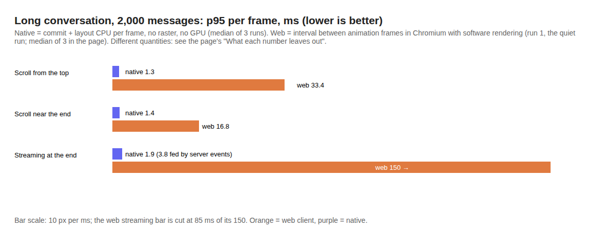

# The long conversation: native app and Fleet's web client

Slice A's measurement (`docs/PORT.md`). One conversation of 2,000 messages (1,000 user and 1,000
assistant: prose, lists, tables, rust/ts/json/sh code, tool calls; invented text), opened and
scrolled while a reply streams in at the end. Measured 14 November 2026 on a four-core i3-8109U
laptop with **no GPU**, shared with other sessions.

**What this does and doesn't show.** The machine has no GPU, so neither side's frame times include
real rasterising or presenting. The two sides also measure different things (below). They show that
the native app's own work per frame is small and flat on a long conversation, and that the web
client's is not. They do **not** show frame rates on a display. Owner: run
`scripts/measure-conversation.sh` (Windows: `scripts/measure-conversation.ps1`) on real hardware
with the CI `fleet-native-windows-x64` artifact and add the file it writes here.

## Native app (release build)

`fleet-native --bench-conversation`: a headless runtime runs the frames a window would (poll, view,
commit, layout, scroll), each timed. 3 runs, values stable to a few percent. Milliseconds per frame.

| Case | frames | mean | p50 | p95 | p99 | max | over 16.7 ms |
|---|--:|--:|--:|--:|--:|--:|--:|
| Open (click, then 0.5 s) | 32 | 1.1 | 0.6 | 1.2 | 14.0 | 14.0 | 0 |
| Stream at the end, 18 s | 1,080 | 1.3 | 1.5 | 1.9 | 2.4 | 14.1 | 0 |
| Scroll up and down at 1,800 px/s, stream running, 20 s | 1,200 | 0.8 | 0.65 | 1.4 | 2.1 | 8.7 | 0 |
| Scroll from the first message at 1,800 px/s, 20 s | 1,200 | 0.45 | 0.33 | 1.3 | 1.6 | 2.2 | 0 |
| Stream fed by reducer events (4 word deltas a frame), 18 s | 1,080 | 2.4 | 2.1 | 3.8 | 4.5 | 11.6 | 0 |
| Same, one reply that is a single 25 KB paragraph | 1,080 | 6.3 | 2.2 | 26 | 27 | 30 | about 177 |

- Peak memory of the headless process: about 125 MB (RSS), with 2,000 messages in `State`.
- The first frame after opening costs 14 ms (the visible rows' first build and text layout); the
  scripts' one slow frame is that.
- The last row is a worst case no real reply has: one paragraph growing to 25 KB is re-laid-out in
  full on each frame. Real replies break into paragraphs (row above), and Rune's markdown keeps
  earlier blocks mounted. It is a known limit, not hidden.

**Leaves out:** rasterising, the GPU, presenting and the display wait (a real frame adds those);
text shaping caches are warm after the first pass; input is Rune's synthetic wheel; one machine.
Run on a GPU-less laptop with the software Vulkan path, Rune's own full-frame numbers are 70 ms
median, which says only that software rasterising is slow (`scripts/bench/*.json` reproduce it).

## Fleet's web client (v0.72.0 server, Chromium 156, Playwright)

The same Vue client the desktop app wraps, in plain headless Chromium with software rendering, on a
scratch Fleet seeded with the same shape of conversation (2,000 messages). Full method, raw
samples and scripts: see "Reproducing". Frame intervals are `requestAnimationFrame` gaps. Three
runs; **run 1 ran on a calm machine, runs 2 and 3 with the load average near 10**, so the spread is
mostly contention. Median of three, run 1 in brackets.

| Measurement | median (run 1) |
|---|---|
| Open: click to first frame at the end | 658 ms (324) |
| Open: click to settled | 824 ms (491) |
| Load the other ~1,900 messages ("Load older messages", about 20 clicks) | 8.2 s (5.8) |
| Scroll from the top: frame interval p50 / p95 / max | 16.7 / 50 / 200 ms (16.7 / 33.4 / 100) |
| Scroll from the top: long tasks | 35, 2.5 s total (13, 0.85 s) |
| Scroll near the end: p50 / p95 / max | 16.7 / 50 / 117 ms (16.7 / 16.8 / 67) |
| Streaming at the end: p50 / p95 / max | 83 / 183 / 550 ms (67 / 150 / 550) |
| Streaming at the end: long tasks | 185, 18.8 s over a 21 s stream (185, 14.8 s) |
| Streaming: browser CPU | 0.89 CPU-s per second (1.11) |
| Streaming: Fleet server CPU | 0.02 (0.03); with its agent child 0.54 (0.60) |
| Memory, all 2,000 loaded (PSS / RSS) | 552 / 862 MB (588 / 833) |
| Memory, peak over the run (PSS / RSS) | 1,244 / 1,577 MB (1,509 / 1,766) |

**Leaves out:** Electron's window, main process and IPC; a real GPU (Chromium here rasterises in
software, so its frame times include that cost and the native numbers above don't); the cause of
the slow streaming wasn't profiled; messages are short (median 312 characters); input is synthetic
CDP wheel events; the web client only loads the newest page when a session opens, so "all 2,000
mounted" took about 20 clicks, where the native app has all 2,000 as rows from the start.
`Tracing.start` wasn't used.

## What follows from it

- Per frame, the native app's work is a few milliseconds at most for scrolling and streaming, with
  or without events through the reducer, and about 125 MB. The web client's frame intervals while
  streaming are 70 to 150 ms and it uses 550 to 1,250 MB.
- Not comparable, and the plan's stop rule needs real hardware to settle: "scrolling can't hold the
  display's frame rate" (native CPU is far under 16.7 ms; raster and present are unmeasured here)
  and "streaming costs more CPU than the web app" (native commit and layout is about 0.08 of a core
  at 60 fps against the browser's 0.9 with software raster; the native number leaves out the
  raster). **The stop rule is not triggered by anything measured here, and not cleared on a
  display either.**

## Reproducing

- Native: `bash scripts/measure-conversation.sh` (needs a release build), or `.ps1` on Windows.
  `--bench-conversation` is `src/bench.rs`; `scripts/bench/*.json` drive the GPU-path runs.
- Web: scratch Fleet via `scripts/scratch-fleet.sh`; the 2,000 messages were written with
  `opencode import` (Fleet has no endpoint to adopt an existing session, so the session's resume
  token was set in the scratch database); a copy of the scripted model streams at about 70 tokens a
  second; Chromium driven by Playwright records frame gaps, long tasks, `/proc` CPU and PSS every
  250 ms. The scripts weren't committed (a 30-minute run, machine-specific); ask for them.
