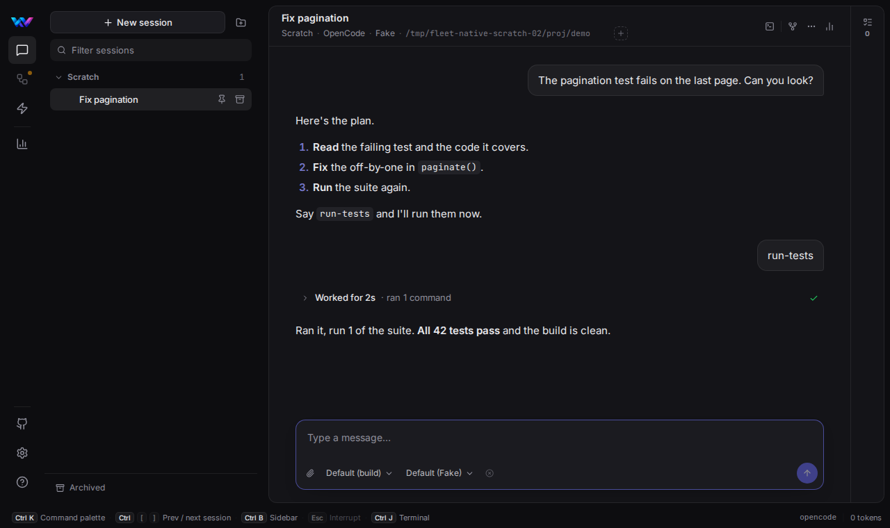
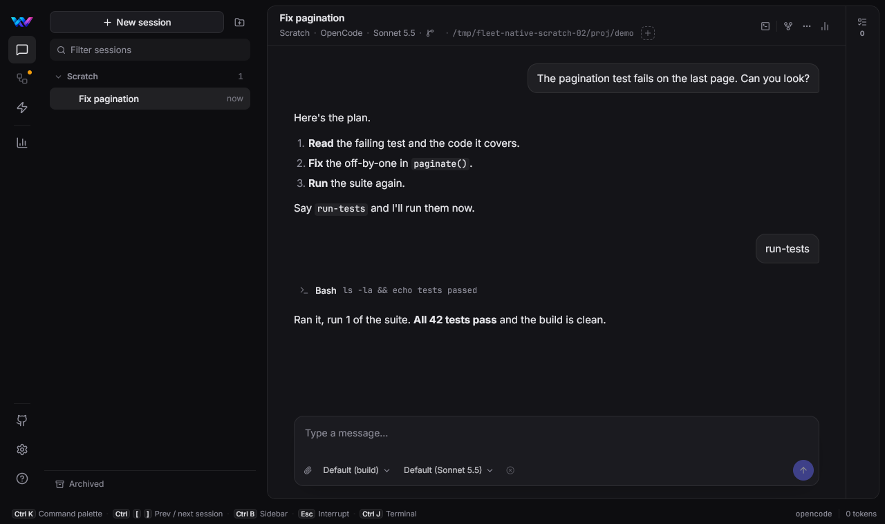

# Component 2: Connect and every event

The parity checklist for component 2 of `docs/PORT.md`, and the pieces it is built in.

- **weave-fleet commit read:** `82cb3ed1e01a17a6cb06071feeb297da5550a4b6` (`main`, 14 November 2026).
  The server the live checks run against is v0.72.0; where `main` has moved past it, a row says so.
- **Native app read:** `main` at `de2dbc1`, `src/fleet/` (about 2,000 lines with tests). Piece J re-read weave-fleet `main` at `c74198a` (15 November 2026) for the tests and `event-state.ts`.
- **Paths** below are weave-fleet's unless they start with `src/` or `docs/`. `client/src/` is
  shortened to `…/`.

## What "done" means

1. Started with no `--server`, the window finds the Fleet running on this machine and shows it, as
   Fleet's desktop app does (`desktop/src/instance.ts`). With none running it says so.
2. When the connection drops, it reconnects on the Vue client's delays and every open conversation
   gets a fresh snapshot, with nothing shown twice and nothing lost.
3. A conversation whose snapshot says `hasMore` loads older messages on request.
4. The server is told whether the window is visible (presence) and which session is in front (focus).
5. Every event the hub sends is read, and each one either changes state or is handed to the
   component that owns it, with nothing dropped silently. The reducer's state is the Vue
   reducer's: messages, delegations, running work, context, explicit and derived status.
6. Every Fleet reducer test in the list at "Tests to port" passes here under the same name, except
   the ones marked as another component's.
7. The session list's rows follow the `sessions` topic (state only; how the list looks is component 6).

## What the native app already has

From slice B (`src/fleet/`), read file by file. Checked against the code, not the README.

| Part | State | Where |
|---|---|---|
| `--server <url>`, loopback `http://` only | Done | `src/lib.rs` (`split_args`), `link.rs` (`host_of`) |
| `POST …/negotiate`, WebSocket, handshake, ping, JSON frames | Done | `http.rs`, `signalr.rs`, `link.rs` (`connect`, `serve`) |
| Subscribe to `sessions`, subscribe/unsubscribe the open session | Done | `link.rs` (`serve`) |
| Reconnect loop on 1, 2, 5, 10 s; re-subscribes the open session, so a fresh snapshot arrives | Written, not exercised against a dropped connection (`PORT.md`) | `link.rs` (`run`) |
| Events batched to one hand-over per 16 ms; events before the snapshot kept and applied after it | Done | `link.rs` (`serve`) |
| Reducer: `message.created`, `message.updated`, `user.prompt.committed` (as a plain message update), `message.part.updated`, `message.part.delta.streamed` (text, with `offset` in UTF-16 units), `turn.started`, `turn.ended`, `turn.failed`, `session.idled` | Done | `reducer.rs` |
| Ordering by message id (`compareMessageIds`, counted fork copies), snapshot-part merging, steered mark | Done | `reducer.rs` |
| Explicit status `idle`/`busy`/`retry` and the derived status (without delegations) | Done | `reducer.rs`, `model.rs` |
| `activity_status` on `sessions` updates the row's status; any other `sessions` event refetches the list after 400 ms | Done (crude, see row 7.4) | `link.rs`, `sessions.rs`, `state.rs` |
| `GET /api/sessions?limit=200` parsed into projects and rows (hides hidden, archived, sub-agent rows) | Done | `sessions.rs` |
| `POST …/prompt` (text only, no correlation id, no agent/model/effort), `POST …/abort` | Done | `http.rs`, `link.rs` |
| Fixtures from a real Fleet (v0.72.0), invented content | `api-sessions.json`, `hub-snapshot-after-turn.jsonl`, `hub-turn-run-tests.jsonl` | `tests/fixtures/` |

Seen on the native picture with the server down (`native-server-down-dark.png`): the status bar
shows "Reconnecting: …" in red (good), but the header, the "OpenCode · Sonnet 5.5" line and the
status bar's "1,840 tokens" are still the invented data's. With a server, nothing invented should
show. That is row 5.5 below.

### Reducer tests: which are done

Counted by exact name, with the apostrophe in "doesn't" dropped as `src/fleet/tests/mod.rs` does.

| Fleet file | Cases | Done here under the same name | Left |
|---|---|---|---|
| `lib/__tests__/domain-event-reducer.test.ts` | 56 | 20: the first four of the main group (equal timestamps, part update before lifecycle, longer streamed text, snapshot without parts), "hydrates a retrying snapshot as working", "shows work for every status but idle", "becomes idle when a session idles with no delegations", "transitions to idle when turn.ended arrives…and no active delegations", all 5 of "joining a reply mid-stream", all 7 of "turn.failed" | 36 (list below) |
| `message-ordering.test.ts` | 7 | 0 by name. "orders_messages_by_id_wherever_they_arrive" and "orders_a_forks_counted_copies_by_their_counter" cover the idea under other names | 7: rename and port the rest |
| `event-state.test.ts` | 29 | 1 (`preserves_longer_streamed_text_when_shorter_final_lifecycle_snapshot_arrives`) | 28 |
| `reopened-session.test.ts` | 3 | 0 | 3 (see "Tests to port": two need component 3's tool card) |
| `running-work.test.ts` | 11 | 11 (piece C) | 0 |
| `late-tool-update.test.ts` | 2 | 2 (piece C) | 0 |
| `history-merge.test.ts` | 7 | 7 (piece F) | 0 |
| `merge-messages.test.ts` | 7 | 0 | 7 |
| `context-usage.test.ts` | 11 | 5 (piece C) | 0 here; 6 belong here (`toContextUsage`), 6 to component 5's ring |

`FLEET.md` says 56 + 3 + 4 + 11. Message ordering now has 7 cases (a Pi group of 3 was added), so its 4 is out of date; the reducer file's 56 holds.

## The wire: 31 domain events, and the rest

`src/WeaveFleet.Domain/Events/DomainEvent.cs` lists **31** polymorphic domain events. The Vue client's union
(`…/lib/domain-events.ts`, `DomainEvent`) has **64** `type` strings (counted by script on `82cb3ed1`: 71 in the file, minus seven part types; an earlier count of 59 was wrong), because the server also pushes
other records on the `sessions` topic (`activity_status`, `session_created`, …) and on `session:<id>`
(`context.updated`, `work.*`, `permission.*`, …) outside that class. "All 31 events" in `PORT.md`
means the first list. The checklist covers the second, which is a superset: a native client that only
read 31 would drop events Fleet's UI reacts to. Names that `FLEET.md` lists but `DomainEvent.cs` does
not (`mods.*`, `mod.ui`, `mod.pane`) are in the table.

Who consumes each event in the Vue app, and where it lands here. "Reducer" means
`lib/domain-event-reducer.ts` (this component). "Owner" is the component that draws what the event
changes; this component's part is to read the event and hand it over.

### Applied by the stream reducer (`session:<id>` topic, this component)

| # | Event | Vue handling | Native today | Row |
|---|---|---|---|---|
| 1 | `message.created` | `applyMessageLifecycle`; ordered insert, merge | Done | |
| 2 | `message.updated` | same; parts kept when payload has none | Done | |
| 3 | `user.prompt.committed` | same, plus `confirmSentPrompt` (optimistic prompt) | Message part done; confirmation missing | 3.3 |
| 4 | `message.part.updated` | `applyPartUpdate` (late tool update by call id, no duplicate) | Done except the late-update and file-part cases' tests | 3.4 |
| 5 | `message.part.delta.streamed` | text only, offset-aware | Done | |
| 6 | `turn.started` / `turn.ended` | explicit status busy / idle | Done | |
| 7 | `turn.failed` | idle plus failure pinned on the turn's message | Done | |
| 8 | `session.idled` | idle | Done | |
| 9 | `delegation.created` / `.updated` / `.completed` | upsert; background flag sticky; status derivation | **Missing** | 2.1 |
| 10 | `work.started` / `.updated` / `.ended` | `applyWorkItem`; items by id, kept ended | **Missing** | 3.1 |
| 11 | `context.updated` | `toContextUsage`, replaces whole | **Missing** | 3.2 |
| 12 | `activity_status` (sessions topic) | child's status on its delegation (`withChildActivity`) | Row status only | 2.3 |

### Read from `session:<id>` and used by other components (this component hands them over)

| Event | Consumer in Vue | Owner | Row |
|---|---|---|---|
| `session.recap` | `use-session-recap.ts` (banner; snapshot also carries `recap`) | 8 | 4.1 |
| `permission.asked` / `permission.replied` | `use-session-permissions.ts` | 4 | 4.1 |
| `session.queue` | `use-session-queue.ts` | 5 | 4.1 |
| `session.permission-rules` | `use-session-permission-rules.ts` | 4 | 4.1 |
| `session.retry` (also on `sessions`) | `use-session-retry.ts`, `use-session-activity-updates.ts` | 3, 6 | 4.1, 7.1 |
| `session.interrupted` / `session.failure` (also on `sessions`) | `use-session-interruption.ts`, `use-session-activity-updates.ts` | 3, 6 | 4.1, 7.1 |
| `session.pages` | `use-session-activity-updates.ts` (row's page count) | 6, 14 | 4.1, 7.1 |
| `files.changed`, `files.written` | `use-file-live-updates.ts`, `use-diffs.ts` | 11, 12 | 4.1 |
| `canvas.updated` / `.closed` / `.focused` | `stores/canvases.ts`, `use-server-canvases.ts` | 10, 14 | 4.1 |
| `terminal.opened` / `.closed` | `stores/terminals.ts`, `use-session-terminals.ts` | 13 | 4.1 |
| `app.updated` | `use-app-runs.ts` (store `app-runs.ts`) | 10 | 4.1 |
| `browser.step` | `use-agent-browser.ts` | 10 | 4.1 |
| `todos.reported`, `session.messaged`, `session.reported`, `session.status` | no consumer found in the client's `.ts`/`.vue` outside the type file. Read and ignored | | 4.1 |
| `progress.updated`, `session_progress` | `lib/session-progress.ts`, `use-session-progress.ts` | 10 | 4.1 |
| `mods.changed`, `mods.runtime`, `mod.ui`, `mod.pane` | `stores/mods*.ts`, `use-session-mod-panes.ts` | 22 | 4.1 |
| `smart_link.updated` | `use-smart-link-updates.ts` | 8 | 4.1 |
| `session_notification` | `use-session-notifications.ts` | 9 (desktop notifications: 24) | 4.1 |

### `sessions` topic: the session list's live updates

| Event | Vue handling (`use-session-activity-updates.ts` and friends) | Row |
|---|---|---|
| `activity_status` | row's `activityStatus` and `sessionStatus` (`deriveSessionStatus`, lifecycle states kept), retry attempt / max / message / next while retrying, clears the optimistic override | 7.1 |
| `session.retry` | `scheduledRetry` on the row | 7.1 |
| `session.pages` | `pageCount`, `lastPageShownAt` | 7.1 |
| `session.interrupted` | `interrupted` | 7.1 |
| `session.failure` | `failed` | 7.1 |
| `session_tokens` | `totalTokens`, `totalCost` (`use-session-token-updates.ts`) | 7.1 |
| `session_branch` | `branch` on every session of the workspace (`use-session-branch-updates.ts`) | 7.1 |
| `session_checkout` | checkout fields (`use-session-checkout-updates.ts`) | 7.1 |
| `session_created`, `session_archived`, `session_unarchived`, `session_deleted`, `session.archived`, `session.deleted`, `session.started` | **no handler in the Vue client**. The list finds them by polling `GET /api/sessions` every 15 s (`composables/use-sessions.ts`, `DEFAULT_POLL_INTERVAL_MS`) and on in-page actions (`lib/session-sync.ts`) | 7.2 |
| `update.rollout`, `memory.saved`, `memory.dreamed`, `workflow_run`, `harness.usage`, `usage.limits`, `harness.catalog_changed` | read by their own stores (`use-fleet-updates.ts`, `lib/agent-memory.ts`, `lib/dreaming.ts`, `lib/workflows.ts`, `lib/usage-limits.ts`, `lib/harness-catalog-changes.ts`) | 4.1 |
| any `sessions` event while the machine feed is up (`lib/machine-feed.ts`) | `scheduleRefresh(300 ms)` of that machine's session list, plus a 60 s safety refresh and a 15 s poll while the hub is down | 7.3 |

## Rows

Each row: what Fleet does, its source, the native state. `[ ]` open, `[x]` done by slice B.

### 1. Finding the Fleet (`desktop/src/instance.ts`, `main.ts`, `paths.ts`)

- [x] **1.1 The instance file.** `<dataDir>/fleet.instance.json`; `dataDir` is `FLEET_DESKTOP_DATA_DIR` or `~/.weave`
  (`paths.ts`, `resolvePaths`). Parsed by `parseInstance`: needs an integer `pid > 0` and a `url`; `url` trailing
  slashes stripped; `version`, `databasePath`, `desktop`, `startedAt` default to `"unknown"`, `""`, `false`, `""`.
  Anything that isn't a JSON object gives nothing.
- [x] **1.2 Loopback only.** `isLoopbackHttpUrl`: `http:` and host `127.0.0.1`, `[::1]` or `localhost`. The file sits in a
  user-writable folder; a remote URL in it is never loaded. (The `--server` path takes whatever it's given and
  `host_of` takes `http://` only: `[::1]` must work here too.)
- [x] **1.3 Alive and answering.** `isProcessAlive(pid)` (`kill(pid, 0)`; EPERM counts as alive), then `GET <url>/readyz`
  within 1,500 ms (`isReady`). Both, or no Fleet (`findRunningFleet`).
- [x] **1.4 When it runs.** Desktop: at launch (`connect()` in `main.ts`), and again after "taken" (another Fleet took the
  database while this one started: poll `findRunningFleet` every 500 ms for 60 attempts, then
  "Another Fleet is using your data, but it isn't answering."). Native: at launch only; the retry belongs to
  component 24, which starts a server.
- [x] **1.5 Nothing running.** Desktop starts its own server (component 24). Until then the window must say so. Wording
  is ours (Fleet's splash says "Starting Fleet…"): "No Fleet is running on this machine." with the mock data
  kept so scenes still draw. *Decision needed: see "Decisions this plan makes".*
- [x] **1.6 `--server` wins** over discovery; a `--server` that doesn't answer keeps retrying (it does today).
- [x] **1.7 Scenes, tests and `--snap`/`--script` never discover.** Headless runs must come out the same every time
  (`AGENTS.md`, "Mock data stays").
- [x] **1.8 Tests (`desktop/src/__tests__/` has instance tests; port those cases):** `parseInstance` valid, defaults,
  not JSON, not an object, bad pid (0, negative, fractional, string), remote URL, `localhost`, `[::1]`, trailing slash;
  `isReady` true on 200, false on refused and on timeout; `findRunningFleet` with a dead pid and with a live one.
  Check names with `ls desktop/src/__tests__` on the day.
- **Done by piece I** (`src/fleet/instance.rs`, tests in `src/fleet/tests/instance.rs`, under the Vue tests' names where there is
  one). Gaps and notes: the pid check is `libc::kill` on Unix only; off Unix (Windows) `is_process_alive` says yes and `/readyz`
  alone decides, so a stale file whose port something else now answers on would be believed there (no `windows-sys` named as a
  direct dependency). Fleet's `desktop/test/desktop.test.ts` only has the `parseInstance`, `isLoopbackHttpUrl` and `resolvePaths`
  cases; `isReady` and `findRunningFleet` have no Vue tests, so the cases above are written here from `instance.ts`. The data
  folder is Fleet's own (`FLEET_DESKTOP_DATA_DIR`, else `<home>/.weave`, home from `HOME`/`USERPROFILE`); a scratch Fleet with
  `Fleet__DatabasePath=$H/fleet.db` writes its file at `$H/fleet.instance.json`, so a check sets `FLEET_DESKTOP_DATA_DIR=$H`.
  A URL with a user name (`http://127.0.0.1@host`) is refused outright. Discovery is skipped when Rune's `--snap`, `--script`,
  `--scene`, `--video`, `--frames`, `--tree` or `--trace` is given (1.7). Row 1.5 uses the wording "No Fleet is running on this
  machine." in the status bar with the mock data kept (the plan's default; the owner can overturn it).
- Was out of reach: nothing. A pid check needs `libc::kill` on Unix and `OpenProcess` on Windows; `libc` and `windows-sys`
  are already in `Cargo.lock`. If naming either as a direct dependency is more than the rule below allows, `readyz`
  alone (1,500 ms) gives the same answer for a stale file.

### 2. Reducer: delegations and the derived status (`lib/domain-event-reducer.ts`, `lib/delegation-state.ts`)

- [x] **2.1 State.** `delegations: Vec<Delegation>` (`delegationId`, `parentToolCallId`, `childSessionId`, `title`,
  `status` pending/running/completed/error/cancelled with unknown → pending, `createdAt`, `childActivityStatus`,
  `background`). From the snapshot's `delegations` (`mapSnapshotDelegation`) and `delegation.created/updated/completed`.
- [x] **2.2 Upsert rules.** `applyDelegationCreated` merges over an existing id; `applyDelegationUpdated` keeps
  fields the event doesn't carry, never drops `background` once set, returns the same list when nothing changed;
  `delegation.updated/completed` for an unknown id creates it (`upsertDelegation`).
- [x] **2.3 Child status.** `activity_status` on the `sessions` topic whose `sessionId` is a delegation's
  `childSessionId` sets `childActivityStatus`; any other session's leaves the state alone. The stream also hears
  `sessions` events for the open session (`use-session-stream.ts`, `unsubscribeActivity`), held until the snapshot
  and applied after it.
- [x] **2.4 Derived status** (`SessionStreamStatus`: idle, busy, retry, delegating, waiting_input). `deriveSessionStatus`:
  a waiting child → `waiting_input`; else explicit busy / retry; else an active non-background delegation → `delegating`;
  else idle. Snapshot hydration (`deriveSnapshotSessionStatus`): an active, not-waiting delegation → `delegating` even
  if the snapshot says busy. A background delegation isn't work. `isDelegationWaiting`, `isStreamWorking`
  (anything but idle).
- [x] **2.5 `withActivityStatus`**: the kept state of a reopened session takes the list's current status.
- **Done in piece B** (`src/fleet/delegations.rs`, `reducer.rs`, `link.rs`, `state.rs`, `sessions.rs`, `tests/delegations.rs`).
  Notes: `Event::Delegation{kind,event}` and `Event::ActivityStatus` are applied variants (12 now, 52 `Other`); the reducer
  derives status with `delegations::derive_status` (and `derive_snapshot_status` for a snapshot); `reducer::with_activity_status`
  (2.5) is written and tested but nothing calls it until piece E keeps streams (`open_session` still clears). The hub thread
  hands the open session's `sessions`-topic `activity_status` to `State::on_stream_events` (held until the snapshot, then
  applied after the batch). The open row shows the derived status (`sessions::stream_status_of`: waiting_input is the amber
  diamond). All 27 reducer cases and `reopened-session` case 1 pass under Fleet's names; case 3 is covered by an existing
  tool-merge test, case 2 needs component 3's tool card. **Gap:** `upsert` ports `upsertDelegation` but an unchanged update
  does not fall through to `applyDelegationCreated` (Fleet's fallthrough would blank a title the event omits); no test of Fleet's depends on it.
  **Pictures:** the scripted model (`fakellm.py`) can't call the task tool, so Fleet's own client can't be shown delegating;
  the native scenes `delegating` and `sub-agent-asks` (both themes) derive the row's status through the reducer from a snapshot.
- Tests (domain-event-reducer.test.ts, 27 left that belong here, same names): "derives delegating status from idle
  snapshots with active delegations", "hydrates as delegating from busy snapshots with active delegations", "keeps busy
  status while turns are active even with delegations", "enters delegating when an active delegation is created while
  explicitly idle", "keeps a session non-idle when a turn ends with an active delegation", "stays delegating after
  explicit idle until the final active delegation completes", "returns to idle when the final active delegation
  completes", "stays busy when the final active delegation completes before explicit idle", "does not return to idle
  until all active delegations are terminal", "treats error and cancelled delegations as terminal states", "initializes
  as delegating from an idle snapshot when any delegation is active", "does not oscillate to idle when the child idles
  before parent delegation completion", "stays delegating when turn.ended arrives with active delegations"; the 7 of
  "a sub-agent waiting on a question" (makes the parent wait on input, goes back to working once answered, keeps the
  child's status when its delegation is updated, leaves the state alone for a session that isn't one of its sub-agents,
  stops counting once the delegation has finished, hydrates from a snapshot taken while the child waits, hydrates as
  delegating when the child is only working); the 7 of "a sub-agent in the background" (reads idle once its turn is
  over, stays in the background when a later update doesn't say so, still works through its own turn, waits on input when
  the sub-agent asks, counts a foreground sub-agent beside it as work, hydrates as idle…, hydrates as waiting on input…).
  Take the exact names from the file; the lists above are paraphrases.

### 3. Reducer: work, context, prompts and marks

- [x] **3.1 Running work** (`lib/running-work.ts`). State `running_work: Vec<RunningWorkItem>` from the snapshot's
  `runningWork` (`toRunningWorkItems`: drop non-items, unknown kind → `task`, unknown status → `running`, defaults for
  missing fields, sorted by `startedAt` then `id`), kept current by `work.started/updated/ended` (`withWorkItem`,
  `applyWorkItem`: replace by id; an item that ended doesn't come back to running; same item returns the same list).
  Background work isn't the session's own, so it doesn't change the derived status. Helpers the strip and the status
  bar use: `isWorkRunning`, `workElapsedMs`, `formatElapsed`, `formatAgo`, `workResult`, `workFailed`, `turnStartedAt`
  (the prompt that began the turn; a steered prompt doesn't restart it). The strip itself is component 9; its state
  and these helpers are here.
- [x] **3.2 Context usage** (`lib/context-usage.ts`). `context: Option<ContextUsage>` from the snapshot's `context`,
  replaced whole by each `context.updated`; a payload that isn't one is ignored (`toContextUsage`: needs a session,
  counts sent as strings accepted, missing window = unknown, `splitKnown` defaults true, a harness giving only the
  total marks it). The ring, percent, tone and "turns before compaction" are component 5; `formatTokens` is shared.
- [x] **3.3 Optimistic prompts** (`composables/use-send-prompt.ts`). A sent prompt is shown at once with a generated
  `prompt-<uuid>` correlation id, status `pending`; the server's `user.prompt.committed` carries `correlationId`,
  `info.id` and the event id and confirms it (`confirmSentPrompt`: matched by correlation id or server message id;
  idempotent when confirmed twice; adopts the server message id and event id). Not confirmed in 15 s
  (`PROMPT_CONFIRMATION_TIMEOUT_MS`) → `needs_retry`. Reconciled against the snapshot's messages by id and by body
  (`reconcile`, lines ~200-280), so it never shows twice. `mergeMessagesByTimestamp` puts delivered messages first and
  the optimistic ones after, in their own order. Native today sends text with no correlation id (`http.rs`), and
  `user.prompt.committed` is applied as `message.updated`. The send path is the composer's (component 5); the registry,
  confirmation, timeout and merge are here.
- [x] **3.4 Marks and parts on messages** (`lib/event-state.ts`): slash `command` (name, arguments dropped when empty,
  ignored on an agent message, taken from a later update), `mod` mark (sent / rewritten), `steered` (set by a later
  update too), `compactionSummary`, file parts kept from a snapshot and accumulated ones kept when a snapshot has none,
  compaction part from live and snapshot, `step-start` / `step-finish` totals, late tool update by call id under another
  part id, pending-message update with no parts. Native has `steered` and compaction; it has no `command` or `mod` marks.
- [x] **3.5 `reuseUnchangedMessages`** (`lib/reuse-unchanged-messages.ts`): a fresh snapshot keeps the unchanged
  messages' identity so the view rebuilds only what changed. Native does the same with `version()` in `sync_open`
  (`src/fleet/state.rs`); keep that, add a test that a snapshot after a reconnect rebuilds nothing that didn't change.
- Tests: domain-event-reducer.test.ts "reconciles_optimistic_prompt_when_committed_event_has_matching_correlation_id",
  "confirming_same_correlation_id_twice_is_idempotent", "keeps the mod mark on the prompt, live and from a snapshot, and
  leaves the others alone", "keeps the mark on a prompt sent into a running turn, live and from a snapshot", "marks a
  prompt the server says was steered after it was first shown without the mark", "reconciles_text_delta_placeholder…",
  "keeps_live_stream_and_reconnect_snapshot_plus_pending_events_equivalent_without_duplicate_messages", "context.updated"
  (2); `running-work.test.ts` (11); `context-usage.test.ts` `toContextUsage` (5); `merge-messages.test.ts` (7);
  `event-state.test.ts` the remaining 28 (compare ids, ensureMessage ordering, applyPartUpdate, applyTextDelta,
  mergeMessageUpdate, slash commands, compaction dividers); `message-ordering.test.ts` (7, rename);
  `late-tool-update.test.ts` (2).

Piece C built 3.1, 3.2, 3.4 and 3.5 (`work.rs`, `context.rs`, `command`/`mod` marks on `Msg`). Gaps, with reasons:

- Times in a work item stay the server's ISO text, as in Fleet; `parse_iso_ms` reads them (no time crate in the
  lockfile, none added). It reads `Z` and `±hh:mm`, not every form `Date.parse` accepts.
- 3.4: native's `event-state` file-part cases are two in Fleet (the plan said three); both are ported. Native's
  `PartData::File` has no more than id, mime, filename, url, as before.
- 3.5: native has no object identity to reuse as the Vue client does; the check is that a snapshot taken again keeps
  the view rows of unchanged messages (`a_snapshot_after_a_reconnect_rebuilds_only_what_changed`). The last message is
  always rebuilt, by design (`sync_open`).

Piece D built 3.3 (`prompts.rs`; `PromptCommitted` event; `send_to_server`, `on_prompt_receipt`, `on_prompt_refused` in `state.rs`;
the retry line in `view/conversation.rs`). Gaps, with reasons:

- The send path is the composer's text only, as the piece says. Fleet's `userMessageId`, agent, model, attachments,
  effort, `steer` and the `@`-session references are component 5's. So `reconcile` compares the trimmed body, without
  `stripSessionReferences`, and a prompt has no images and no `steered` mark yet.
- The pending and confirmed prompts look the same, as in Fleet (only `needs_retry` draws anything: the line
  "Not confirmed yet. Retry from the composer if this did not send."). Fleet's "Send now" / queue and the retry button
  of a failed turn are component 5's.
- Fleet's `seedSentPrompt` (a new session's first message) and `showSentPrompt` (`/btw`) belong to the new-session and
  side-conversation components; the registry's `add` is what they will call. Fleet's `getPromptTrackingState` is a
  diagnostic and isn't ported.
- A refused send removes the prompt and puts its text back in the composer if that is empty, and says why in the
  status bar (Fleet shows `sendError` under the composer: the composer's component moves it). Fleet also puts back the
  session's status from before the send; native's status comes from the stream, so there is nothing to put back.
- The native send waits 60 s for the receipt (Fleet's fetch waits for as long as the server takes), so the 15 s
  `needs_retry` is not pre-empted by the request giving up. Every other call keeps 15 s.
- Under a software renderer (Xvfb, lavapipe), a picture taken 0.2 s after Enter, against a stopped server, showed the
  new row clipped; 2 s later it was whole. The sheet measures one frame late, so this is likely that. Not looked into
  further, and not looked at on a GPU.
- Tests: `domain-event-reducer.test.ts` 2 of 2 and `merge-messages.test.ts` 7 of 7 under the same names (the reducer
  two run through `State`, because the registry is not in the stream's state); the three pending-count cases and the
  textless-copy case of `use-send-prompt.test.ts`. Not ported: the cases that need `useSendPrompt` itself (draft,
  model, session references: component 5).
- Neither the work state nor the context is drawn yet: the strip is component 9, the ring component 5. `command`
  and `mod` marks aren't drawn either (component 4's message rendering).
- Check in a live Fleet not done: the scratch Fleet's scripted model starts no background work.

### 4. Every event is read

- [x] **4.1 A complete event type.** `Event::from_wire` returns `None` for anything it doesn't apply, so 55 of the 64
  event types vanish (`reducer.rs`, the `_ => return None`). Replace it with an `Event` that has a variant for every
  type in the union (typed fields for those the reducer applies, the raw `properties` for the rest) and an
  `Event::Unknown { kind, properties }` for a type this build doesn't know (a newer Fleet), which is logged once and
  never an error. Frames that fail to parse in the middle of a batch skip that one frame
  (`use-session-stream.ts`, `applySafely`: "a malformed event must not take the rest of a frame's events down").
- [x] **4.2 A place to hand them to.** The hub thread posts `session:<id>` and `sessions` events that aren't the
  reducer's to a small subscriber list in `State` (a `Vec<Box<dyn FnMut(&Event)>>` or an enum of channels), the shape of
  `onGlobalEvent` / `onDomainEvent` (`composables/signalr`, `on-domain-event.ts`), so components 3-22 attach without
  touching `link.rs`. Subscribers get events for the open session and for `sessions`; a component that wants another
  session's `session:<id>` topic asks for it (the Files canvas keeps listening to a session while you're on another;
  `use-signalr-socket.ts`, `topicListenersV2`).
- [x] **4.3 `toDomainEvent`**: the wire calls the payload `properties`; the hub's `eventId` argument may be `null`
  (live) or negative; `lastEventId` is taken from a live event's id when it's a number (`getDomainEventCursor`).
  Native keeps `last_event_id` from the snapshot only.
- [x] **4.4 Fixtures.** One captured frame per event type in `tests/fixtures/` (invented content), and a test that each
  parses into its own variant. Weave-fleet's `tests/contracts/fleet-api-events.json` has samples of the
  server's shapes; read them as the starting point and rewrite the content.
- **Done in piece A** (`src/fleet/events.rs`, `state.rs`, `tests/events.rs`). Notes: the 64 types are one `Kind` table; the
  nine the reducer applies have `Event` variants, the other 55 are `Event::Other(kind, properties)`, and a type not in the
  table is `Event::Unknown`, logged once. `user.prompt.committed` is still a `MessageUpdated` (piece D gives it a variant).
  Subscribers: `State::subscribe(only, listener)` and `State::dispatch(topic, events)`; the hub thread dispatches every
  `sessions` event and the open session's whole batch (applied events too, so a listener needs no second path). **Left for
  later:** subscribing to *another* session's topic (4.2's last sentence) is not built; it needs the topic set of piece E
  (row 5.2). The `eventId` argument is read as Vue reads it (any number moves the cursor), but the captured frames carry `0`
  where the payload's own `eventId` is `null`, so a live cursor can read 0: `last_event_id` has no reader yet; piece E decides.
  Fixture: `tests/fixtures/hub-events-all.jsonl` (64 frames, 65 since `session_terminal` joined in 26 D; invented content, shapes from `domain-events.ts` payloads, not
  captured: the fields beyond the ones the reducer reads are placeholders).
- Tests to port: none exist in Fleet for the dispatch itself. New tests here: every type in the union parses; an
  unknown type is kept as `Unknown`; a malformed frame between two good ones leaves both applied.

### 5. Connection, reconnect and the open session (`composables/use-signalr-socket.ts`, `use-session-stream.ts`)

- [x] **5.1 Reconnect schedule.** Two layers in Vue: SignalR's own `withAutomaticReconnect([1000, 2000, 5000, 10000])`,
  and after it gives up (or the first start fails) `RECONNECT_DELAYS_MS = [2000, 5000, 10000, 30000]` while anything
  still listens, the attempt counter reset by a good start. Native has one loop on 1, 2, 5, 10 s. Keep one loop, use the
  longer tail (30 s), say in a comment why: native has no in-socket retry to hide behind.
- [x] **5.2 Fresh snapshot after every reconnect**, for every open topic, with the events that arrived before it applied
  after it. Native resubscribes only the open session; the Files/Progress canvases (components 10-12) will add
  topics, so the subscription set must be a set, not one `Option`.
- [x] **5.3 Snapshot cache per topic** (`lastSnapshotsV2`, `eventCount`): a second listener on a topic reuses the last
  snapshot only if no event arrived since it was asked for, else asks again.
- [x] **5.4 Kept streams** (`keptStreams`, `KEPT_SESSIONS = 8`): leaving a session keeps its state; opening it again shows
  that at once, with the session list's current status (`withActivityStatus`), while the fresh snapshot is on its
  way, which then replaces it keeping unchanged messages. Native sets `self.stream = None` when opening, so
  switching back and forth waits on the server every time.
- [x] **5.5 Connection state on screen.** "Connecting to <url>…" and, in Fleet's own wording for an unreachable server, "Can't reach Fleet at <url>. Trying again…" appear in the status bar (the raw error is no longer shown); discovery looks in every place a Fleet records itself (`fleet::discover`, README "Try it").
  Fleet's own client has no banner of this kind for the desktop hub (only phone's "Can't reach"); keep ours small.
  With a server given, **no invented value may show**: header, model line, token total, and the list stay empty or
  blank until the Fleet answers (seen in `native-server-down-dark.png`).
- [x] **5.6 Partial snapshot.** `isPartial` (the harness is unavailable): banner "Connection to live session is
  temporarily unavailable. Showing cached data." (`ActivityStream.vue`, `partial-snapshot-banner`). The state lives here;
  the banner is a one-line row in the conversation.
- [x] **5.7 Frame batching.** Vue applies live events once per animation frame with a 100 ms fallback
  (`FRAME_FALLBACK_MS`); native batches per 16 ms. Same effect; keep it.
- [x] **5.8 Back on the network / the app regains focus** (`window` `online`, `visibilitychange`): reconnect now, skip the
  backoff (`reconnectIfClosed`). Native: on window focus, reconnect if down. Rune must report window focus; check.
- [x] **5.9 The hub's address and `https`** are component 17's: nothing to do here (named owner).
- **Done in piece J (5.8):** the hub thread's wait between attempts ends at once when the window gains focus and starts again from the first delay (`link.rs`, `run`); test `coming_back_to_the_window_while_the_hub_is_down_reconnects_at_once` (the port is empty, the first retry is a second away, a hub appears and focus comes: back in 0.12 s). Rune reports window focus but, as far as piece J found, no network change, so only focus counts; coming back to a network with the window already in front waits out its delay (30 s at most).
- Tests: a scratch hub that drops the socket, the app reconnects and takes a new snapshot; a kept stream shows at once;
  `src/fleet/tests/wire.rs` is the pattern (a fake server on a thread).

- **Done in piece E** (`src/fleet/topics.rs`, `link.rs`, `state.rs`, `model.rs`, `view/conversation.rs`, `tests/reconnect.rs`).
  Notes: **5.1** one loop on 1, 2, 5, 10, 30 s (`topics::reconnect_delay`), reset by a good connect; the list is fetched
  after a connect, not before (a list asked for while the server is down failed and left its notice up). **5.2** `Topics` is
  a set (the open session plus watched ones, `Link::watch`/`unwatch`); every topic is subscribed again on each connect and
  watched topics' events go to `State::subscribe` listeners (4.2's last sentence, now built). **5.3** `Topics::fresh_snapshot`
  reuses a snapshot only while no event arrived since; used when the open session was already watched. Nothing consumes a
  watched topic's snapshot yet (component 11). **5.4** `Kept` (8, evicting the one left longest ago; only conversations with
  messages) is shown at once on return with the list's current status (`with_activity_status`, so 2.5 is now called); the
  snapshot replaces it, and `State::loading` says it is still on the way. **5.5** with `--server`, the list starts empty and
  the header's agent/model and the status bar's agent/token total are hidden until a session is open. **5.6**
  `StreamState::is_partial` and the banner (`partial-banner`), text glyph instead of the emoji. **5.7** unchanged, 16 ms.
  **Tests:** the main-group reconnect case under Fleet's name; a hub that hangs up after the first snapshot, the app
  returns with the conversation a fresh open shows and no message twice; kept stream before its snapshot; ninth evicts
  first; status taken from the list; snapshot cache; schedule; partial banner on and off.
  **Gaps:** the snapshot's `isPartial` is never retried (neither does Fleet); the header's agent and model (Fleet shows
  "OpenCode · Fake") are left out on a server until the session row carries them (component 6); `theme.rs`'s light `idle`
  is `#d97706` but weave-fleet `main` has `#D27306` (`idle_text` is added from `main`); 5.8 (reconnect now on focus) is piece J's.
  **Pictures:** `shots/parity/02e-reconnect/`: native up, down (killed server: refused at once; SIGSTOP would hold requests
  open and show nothing), back, both themes, beside Fleet's own client for the up state; the partial banner as a scene (Fleet
  can't be made to send a partial snapshot).

### 6. Older history, presence and focus

- [x] **6.1 State.** `has_more`, `cursor`, `is_loading_older`, `load_older_failed` on `StreamState` (`model.rs`), from the
  snapshot's `hasMore`, `cursor`; `is_partial` was piece E's; `is_loading` (before the first snapshot) is `State::loading`,
  also piece E's. The two transient flags are cleared when a conversation is kept, as Fleet resets them on leaving.
- [x] **6.2 `loadOlder`** (`use-session-stream.ts`): ignored while disabled, loading, no `hasMore`, a page in flight, or no
  cursor. Invokes `LoadHistoryAsync(sessionId, cursor)` with a 30 s timeout (`HISTORY_PAGE_TIMEOUT_MS`); a
  page for a cursor a newer snapshot replaced is dropped; a failure or timeout keeps the cursor and sets
  `loadOlderFailed` so the next try asks for the same page; leaving the session drops the answer.
  Native: `State::load_older`, `State::on_history_page`, `Link::load_older`, `history::Pending` (invocation id → session and
  cursor, 30 s per request, all failed when the connection drops, failed at once while it is down). "Disabled" has no
  native counterpart (a conversation is always enabled).
- [x] **6.3 `prependHistoryPage`** (`lib/history-merge.ts`): older messages go before the current ones, in the page's
  order, deduplicated by id keeping the current copy, no repositioning, empty page and empty state handled; converts the
  page's payloads (text, reasoning, tool, file, compaction, `step-*` parts) like a snapshot's. `src/fleet/history.rs`.
  Like Fleet's conversion, a page's message doesn't read the `command` mark, the failure or the finish reason (a Fleet gap,
  not fixed here: an older prompt that came from a slash command shows without its mark).
- [x] **6.4 Control.** "Load older messages" (a button at the top of the stream), "Loading older messages…" with a
  spinner while it runs, "Couldn't load older messages · Try again" after a failure (`ActivityStream.vue` 645-665). The
  Turns canvas and phone use shorter labels; they are other components'. The button is drawn in
  `src/view/conversation.rs`, which component 3 owns afterwards; keep the change here to the row and its key.
  Native: keys `load-older` (the button, and its retry wording) and `load-older-loading`; scenes `older-ask`, `older-loading`,
  `older-failed` (+ light). New token `accent_text` (`--accent-text`) for the spinner. Gaps, both for component 3: (a) Fleet
  also asks by itself when the stream is scrolled to within 100 px of the top (`use-stream-scroll.ts`, `SCROLL_TOP_THRESHOLD`),
  so its button is mostly seen only in the failed state; native waits for the press, because reading the scroll offset
  is component 3's scroll port. (b) Fleet's spinner turns; native's fades (Rune has no looping rotation, `RUNE.md`). The
  v0.72.0 client words the failure "Couldn't load older messages · Retry"; `main` says "· Try again", which native follows.
- [x] **6.5 `SetPresenceAsync(visible, formFactor)`** (`use-desk-presence.ts`): `formFactor` is `"desktop"` here, always;
  sent at launch, on each connect and reconnect, every 30 s (`PRESENCE_INTERVAL_MS`; the server forgets a window after
  90 s), and whenever visibility changes. `visible` is whether the window is on screen (`document.visibilityState`):
  native uses "not minimized and not fully hidden". An older Fleet has no such method: swallow the error.
- [x] **6.6 `SetSessionFocusAsync(sessionId, focused)`** (`use-session-recap.ts`): only when recaps or desktop
  notifications are enabled (preferences `session recap` and `desktop notifications`: those are Settings, component 16;
  until then send it always, behind one constant). Sent after the session's snapshot arrives (the server forgot this tab),
  when the window gains or loses focus (settled over `FOCUS_SETTLE_MS`), on leaving a session (`false`), and not repeated
  when unchanged. After a reconnect, again once the snapshot is back.
  Native (piece G): `src/fleet/presence.rs` is the rule (no socket, a clock passed in); `link.rs` sends its calls
  (`SetPresenceAsync(visible, "desktop")`, `SetSessionFocusAsync(id, focused)`), and `lib.rs` feeds it Rune's `on_focus` and
  `on_visibility`. Presence goes out on each connect, every 30 s and at once when visibility changes; focus goes out after
  the open session's snapshot (a first one or one restored after a reconnect), 250 ms after a focus or visibility
  change, with `false` on leaving a session, and not when unchanged. "Looking" is on screen and focused. The recap/notification
  gate is the constant `REPORT_FOCUS` (true) until Settings. The answer to either call is never read, so an older Fleet's
  error changes nothing. Gaps: (a) Rune's `on_visibility` is "minimised, hidden, or covered whole where the system says so"; under
  Xvfb with no window manager, unmapping or covering the window sent no event (presence stayed `true`, focus still went `false`
  from the focus-out). Not checked on a real desktop, so on Windows and macOS it is untested. (b) A new window counts as
  focused until Rune says otherwise; under Xvfb it says "not focused" about a second after the first snapshot, so the first
  focus call can be `true` and then `false`. (c) Fleet's `focus`/`blur` also fire when focus moves into an iframe of the same
  page; native has no such nesting, so a focused web canvas (component 14) needs to count as focused when it exists.
- Tests: `history-merge.test.ts` (7) under their names; a fake hub that answers `LoadHistoryAsync`; timeout and
  stale-cursor cases; presence is sent on connect and again on the 30 s tick (a fake clock); focus is sent once per
  change and `false` on leaving.
- Out of reach: the recap banner and recap text (`session.recap`) are component 8's.

### 7. The session list follows the hub (state only)

- [x] **7.1 Row patches from `sessions` events:** `activity_status` (status, retry attempt / max / message / next while
  `retry`, deriveSessionStatus with lifecycle states `stopped`/`completed`/`error`/`disconnected` kept), `session.retry`,
  `session.pages`, `session.interrupted`, `session.failure`, `session_tokens`, `session_branch` (all rows of the
  workspace), `session_checkout`. Native `mock::Session` has `status`, `age`, `branch` and `tokens` only; add the fields as
  data (`retry`, `interrupted`, `failed`, `page_count`), drawn by component 6.
- [x] **7.2 Create, archive, delete, rename.** Vue has no event handler for these: polling every 15 s and the in-page
  actions keep the list true. Native refetches 400 ms after any non-`activity_status` event. Keep that (it is better than
  polling) and also poll every 15 s while the window is visible, and refetch when the window regains focus
  (`use-sessions.ts`: `visibilitychange`). A session that disappears while open: the open conversation falls back to the
  first one (native does) and the stream is dropped; Fleet shows a "Session not found" page (component 6/9).
- [x] **7.3 The feed's states.** Vue's machine feed (`lib/machine-feed.ts`) has `connecting`, `live`, `polling`,
  `unreachable`; one machine here, so: Connecting, Online, Down(why), mapped to the status bar's note as now.
- [x] **7.4 Status mapping.** The list's glyph from `activityStatus`: busy, working, retry, delegating → working,
  `waiting_input` → needs input, else idle (`sessions.rs::status_of`, matches `session-row-status.ts`; check that file
  when porting 2.4 so a delegating child shows the same on the row).
  **Native (piece H):** `src/fleet/rows.rs` holds `Row` (the list item's fields beyond the glyph: `sessionStatus`, `activityStatus`,
  workspace, retry wording, scheduled retry, interruption, failure, pages, cost, checkout) on `mock::Session::row`, and `RowPatch`
  (one `sessions` frame read, then applied to the rows). `refresh.rs` is the fetch schedule. Gaps, each with its reason:
  - `session_checkout` `restoring` only sets the flag (Vue's `checkoutRestoring` is client-only too); the removal time stays until `restored`.
  - `toScheduledRetry`, `toSessionInterruption` and `toSessionFailure` check a time with `Date.parse`; here only the shape `YYYY-MM-DD…` is
    checked (no date crate; component 6 parses what it draws).
  - A lifecycle status (`error`, `completed`, `stopped`, `disconnected`) gives the idle glyph; the words ("Error", "Done", "Offline",
    "Failed", "Cut off", "Retry 10:32") and tones are `session-row-status.ts`, drawn by component 6 from `Row`.
  - Rename has no event in Fleet's union (read in `domain-events.ts`, not tested alone live): the title changes on the next fetch, which an
    unexplained `sessions` event or the 15 s poll triggers. In the pictures it showed within 4 s, together with an archive.
  - While the hub is down there is no 15 s poll (Vue polls then): a fetch would only fail; the list is fetched when the hub answers again.
  - The open session that is archived or deleted falls back to the first row (as before); "Session not found" is component 6/9.
  - `Cmd::Refresh` (an in-page action's refetch, `lib/session-sync.ts`) is still unused: nothing in the app creates or archives yet.
- Tests: an event of each kind patches its row; a lifecycle status isn't clobbered by an activity one; an event for a
  session not in the list is ignored; the list refetch is debounced.

## What cannot be done, and why

| Part | Why |
|---|---|
| `https` and tokens on the hub, several machines, address picking | Component 17. |
| Starting a server when none runs, the single-instance lock, the "taken" retry | Component 24. |
| `window.online` / `visibilitychange` | Replaced by Rune's focus events; whether Rune reports them is checked in piece 5. If not, `docs/RUNE.md` gets the smallest case. |
| The Vue client's mock hub (`vite-plugin-mock-api.ts`) | A development aid of the web build. `src/mock.rs` is ours. |
| `window.__WEAVE_SOCKET_TEST_API` | Test hook of the browser; `src/tests.rs` drives the runtime directly. |
| `describeSocketForReport` | Used by "Report a problem" (component 9); the state it reads (`state`, `topics`, `withSnapshot`, `retrying`) must stay readable: keep these four as accessors on the link. |
| `tests/contracts/*.json` (harness→Fleet message and event conversions) | They test the server's conversion code, not the client. Used only as samples for fixtures. |

## Decisions this plan makes (the owner can overturn)

1. **Discovery runs only for a real window with no `--server`, `--scene`, `--snap` or `--script`.** That keeps scenes
   and tests the same every run. With none found, the mock data stays and a notice says no Fleet is running, until
   component 24 starts one.
2. **The reducer's "31 events" are the 64 in the client's union.** The server's `DomainEvent.cs` has 31; Fleet's UI reacts to more.
3. **`reopened-session.test.ts` is split.** Case 1 ("links the sub-agent card to its delegation") and case 3 ("updates a tool still running…")
   test the reducer and are ported here; case 2 uses `toToolCardItem` (component 3) and moves there.
4. **Presence and focus are always on** until Settings (component 16) has the two preferences that gate focus.

## Pieces, in build order

Each piece is one pull request, from this file alone. Pictures for a visual piece: the native app beside Fleet's own
client from a scratch Fleet (`scripts/scratch-fleet.sh`), same state, 1280x760, both themes; for a piece with no
visual change, the app showing the behaviour (a status-bar state, a conversation) or a scripted run
(`--script`, `--snap … --at mark:<name>`). Every piece updates the component's row in `docs/PORT.md`, ticks its
rows above, and adds what it learned to `docs/RUNE.md`. Size is Rust added, tests included.

| # | Piece | Rows | Size |
|---|---|---|---|
| A | Event catalogue and dispatch | 4.1-4.4 | ~450 |
| B | Delegations and derived status | 2.1-2.5 | ~500 |
| C | Work, context and the marks | 3.1, 3.2, 3.4, 3.5 | ~650 |
| D | Optimistic prompts | 3.3 | ~400 |
| E | Reconnect, kept streams, partial | 5.1-5.7 | ~550 |
| F | Older history | 6.1-6.4 | ~450 |
| G | Presence and focus | 6.5, 6.6 | ~250 |
| H | The session list follows the hub | 7.1-7.4 | ~450 |
| I | Finding the Fleet | 1.1-1.8 | ~350 |
| J | Sweep: remaining tests, live check, pictures | rest of 3, 5.8, 5.9 | ~300 |

Order: A before B, C, H (they add variants to what A defines). B, C, D can run side by side after A if they touch
different files (B: `delegations` in `model.rs` and `reducer.rs`; C: `work.rs`, `context.rs`, `event_state`;
D: `prompts.rs` and `state.rs`), but they all edit `reducer.rs`'s `apply`, so merge them one at a time and rebase.
E needs A. F needs E's state. G needs E. I needs nothing and can go first if the session
wants a quick win. J is last.

### A. Event catalogue and dispatch

- **Covers:** 4.1, 4.2, 4.3, 4.4.
- **Creates:** `src/fleet/events.rs` (the `Event` enum for every type in the union, `from_wire`, `Unknown`), a
  `tests/fixtures/hub-events-*.jsonl` file with one invented frame per type. **Touches:** `reducer.rs` (it matches on the
  new enum; behaviour unchanged), `link.rs` (post the events that aren't the reducer's to the subscriber list),
  `state.rs` (the list), `tests/mod.rs`.
- **Depends on:** nothing.
- **Tests:** every type in the union parses (a table over the fixture); `Unknown` for a made-up type; a malformed frame
  between two good ones skips only itself; the existing 31 tests still pass unchanged (the proof the refactor
  is behaviour-neutral).
- **Pictures:** a refactor shows the app still draws the same: `native-dark.png` and `native-light.png` from the scratch
  Fleet before and after, identical.

### B. Delegations and derived status

- **Covers:** 2.1-2.5.
- **Creates:** `src/fleet/delegations.rs` (`Delegation`, `apply_created`, `apply_updated`, `upsert`, status
  derivation). **Touches:** `model.rs` (`delegations`, `StreamStatus` becomes live), `reducer.rs` (the events, the snapshot,
  `with_activity_status`, `child activity`), `link.rs` (give the stream the open session's `activity_status` events too),
  `state.rs` (`working_since` and the row's status use the new statuses).
- **Depends on:** A.
- **Tests (by name):** the 27 listed under row 2; and the status → list-glyph mapping.
- **Pictures:** a scratch Fleet session with a sub-agent (a scripted model that asks for the task tool; if
  `fakellm.py` can't, use a captured snapshot with `delegations` in a `--script` run): the native app and Fleet's own
  client showing the session as delegating and as waiting on input, both themes. If the scripted model can't produce
  it, say so, and show the unit tests' status table in the PR with the native app idle beside Fleet's.

### C. Work, context and the marks

- **Covers:** 3.1, 3.2, 3.4, 3.5.
- **Creates:** `src/fleet/work.rs` (`RunningWorkItem`, `to_item`, `apply_item`, the elapsed and result helpers,
  `turn_started_at`), `src/fleet/context.rs` (`ContextUsage`, `to_context_usage`). **Touches:** `model.rs`, `reducer.rs`
  (`work.*`, `context.updated`, `command` and `mod` marks), `tests/mod.rs`, `tests/state.rs`.
- **Depends on:** A.
- **Tests:** `running-work.test.ts` (11), `context-usage.test.ts` `toContextUsage` (5), the context.updated
  pair, "reconciles_text_delta_placeholder_with_lifecycle_without_duplicating_final_snapshot_text", the 3 mod/steered cases, `event-state.test.ts` slash-command (3) and compaction (2) and file-part (3) cases, `late-tool-update.test.ts` (2).
- **Pictures:** none visual until component 9 draws the strip. Show the app against a scratch Fleet whose session has a
  background shell, with the state read out in the status bar's note (one line, removed in the same PR) and Fleet's own
  strip beside it; or a unit-test table in the PR with the usual native and Fleet pictures, as for piece A.

### D. Optimistic prompts

- **Covers:** 3.3.
- **Creates:** `src/fleet/prompts.rs` (registry per session, `confirm`, `reconcile`, 15 s timeout as an event on the
  state's clock, `merge_by_timestamp`). **Touches:** `lib.rs` (the send handler gives a correlation id and shows the prompt
  at once), `http.rs` (send `correlationId` with the prompt), `reducer.rs` (`user.prompt.committed` confirms), `state.rs`
  (merge into the open conversation), `view.rs` of the fleet module if the pending / needs-retry look is drawn.
- **Depends on:** A. Works with the composer unchanged; component 5 widens what is sent.
- **Tests:** the two optimistic tests of the reducer file, `merge-messages.test.ts` (7), timeout to `needs_retry`,
  a prompt never shows twice after a reconnect snapshot.
- **Pictures:** type a message in the native app against the scratch Fleet: the message appears at once, then confirmed;
  and one with the scratch Fleet stopped, showing `needs_retry`. Fleet's own client with the same states beside it,
  both themes. (Fleet's wording for `needs_retry` is in `components/session/ActivityStream.vue`; read it on the day.)

### E. Reconnect, kept streams, partial

- **Covers:** 5.1-5.7.
- **Creates:** `src/fleet/topics.rs` (the subscription set, the snapshot cache, kept streams as an 8-entry LRU).
  **Touches:** `link.rs` (the schedule with the 30 s tail, resubscribing every topic, reconnect now on focus), `state.rs`
  (`open_session` shows the kept stream, `on_snapshot` replaces it), `model.rs` (`is_loading`, `is_partial`),
  `view/conversation.rs` (the partial row only), `tests/wire.rs` (a hub that drops).
- **Depends on:** A.
- **Tests:** the main-group test "keeps_live_stream_and_reconnect_snapshot_plus_pending_events_equivalent_without_duplicate_messages"
  and a wire test that kills the socket mid-stream, the app comes back and the conversation equals the one
  from a fresh open; a kept stream shows before its snapshot; the ninth session opened evicts the first.
- **Pictures:** the native app against the scratch Fleet; stop the Fleet process; the status bar says "Reconnecting: …";
  start it; the conversation is current. Three pictures (up, down, back), both themes, and the same session in Fleet's own
  client for the up state. Also the `isPartial` banner against a captured partial snapshot.

### F. Older history

- **Covers:** 6.1-6.4.
- **Creates:** `src/fleet/history.rs` (`prepend_page`, conversion of a page's payloads). **Touches:** `model.rs`,
  `link.rs` (an invocation with a 30 s timeout and the answer routed by invocation id), `state.rs` (apply the page),
  `view/conversation.rs` (the button row).
- **Depends on:** E (the cursor and `has_more` live in its stream state).
- **Tests:** `history-merge.test.ts` (7), stale cursor dropped, timeout then retry asks the same page, leaving the session
  drops the answer.
- **Pictures:** a scratch Fleet session long enough to page (the `long-reply` model, or enough prompts; if the server's
  page size is larger than what the scripted model can make, a captured snapshot with `hasMore: true`): the native app and
  Fleet's own client at "Load older messages", while loading, and after, both themes.

### G. Presence and focus

- **Covers:** 6.5, 6.6.
- **Creates:** `src/fleet/presence.rs` (the 30 s tick, what was last said, the focus rule). **Touches:** `link.rs` (two
  commands, re-sent after a reconnect), `lib.rs` (window focus/visibility events from Rune, if it has them).
- **Depends on:** E.
- **Tests:** as under row 6 (fake clock and a fake hub).
- **Pictures:** none visual. Show the behaviour: the scratch Fleet's log (or a hub frame capture) with
  `SetPresenceAsync` / `SetSessionFocusAsync` arriving as the window is focused and blurred under Xvfb, pasted in the PR
  with the native app's picture so the PR has an image of the app running.

### H. The session list follows the hub

- **Covers:** 7.1-7.4.
- **Touches:** `sessions.rs` (the extra row fields), `mock.rs` (`Session` gets them, mock values neutral), `state.rs`
  (`on_row_event`), `link.rs` (route every `sessions` event, the 15 s poll, refetch on focus), `src/fleet/tests/state.rs`.
- **Depends on:** A (events), B (the status derivation the row uses).
- **Tests:** as under row 7.
- **Pictures:** the native list next to Fleet's own while a session is working (a prompt sent through the API),
  idle, and retrying if the scripted model can; both themes.

### I. Finding the Fleet

- **Covers:** 1.1-1.8.
- **Creates:** `src/fleet/instance.rs` (`parse_instance`, `is_loopback_http_url`, `is_process_alive`, `is_ready`,
  `find_running_fleet`). **Touches:** `lib.rs` (`split_args` stays; with no `--server`, a window launch runs the discovery on a
  thread and then starts the `Link`, else the notice), `http.rs` (`GET /readyz` with a 1.5 s timeout), `link.rs` (`host_of`
  accepts `[::1]`).
- **Depends on:** nothing.
- **Tests:** row 1.8, with the instance file in a temp folder.
- **Pictures:** start a scratch Fleet with `FLEET_DESKTOP_DATA_DIR` pointing at its own folder, launch the native app
  with the same variable and no `--server`: it shows that Fleet. And with nothing running: the notice. Both themes, Fleet's
  own client beside the first.
- **A new crate?** Not expected. A pid check by `libc` (Unix) and `windows-sys` (Windows) means naming two crates already in
  `Cargo.lock` as direct dependencies; if the PR prefers none, drop the pid check and keep `/readyz`.

### J. Sweep

- **Covers:** whatever of rows 3, 5.8 and 5.9 the other pieces left; every test in "Tests to port" still not
  ported; a live check; the component's final pictures.
- **Does:** renames the message-ordering tests to Fleet's names, ports the `event-state.test.ts` cases no piece took,
  runs the app against a scratch Fleet through a conversation with a tool call, a failure, a kill and restart of the
  Fleet, and a long history; writes the result into `docs/PORT.md` and ticks this file.
- **Depends on:** A-I.
- **Pictures:** the whole component, native beside Fleet's, both themes: connected, down, back, older history.

## Tests to port, all of them

Piece J's result is the table at the end of this file ("Every Fleet test case"): 135 cases, 128 pass here under Fleet's names, 7 belong to named later components. The counts below are from the day this plan was written.

Counted from weave-fleet `82cb3ed1`. Names are the `it(...)` strings; Rust names are the same with spaces and punctuation
as underscores, apostrophes dropped. A case marked "done" passes today.

| File (`…/lib/__tests__/`) | Total | Done | Piece | Notes |
|---|---|---|---|---|
| `domain-event-reducer.test.ts` | 56 | 20 | B (27), C (6), D (2), E (1) | 36 left: 13 delegation + 7 waiting + 7 background in B; 3 mod/steered, 2 `context.updated`, "reconciles_text_delta_placeholder…" in C; the two optimistic-prompt ones in D; "keeps_live_stream_and_reconnect…" in E |
| `message-ordering.test.ts` | 7 | 0 | J | 4 plain cases and the Pi group's 3; two Rust tests cover the first idea under other names: rename them |
| `event-state.test.ts` | 29 | 1 | C, J | the slash-command, compaction, file-part and `applyPartUpdate` cases in C; `compareMessageIds`, `ensureMessage`, `applyTextDelta`, `mergeMessageUpdate` ordering cases in J |
| `reopened-session.test.ts` | 3 | 0 | B (2), component 3 (1) | case 2 needs `toToolCardItem` |
| `running-work.test.ts` | 11 | 11 | C | done |
| `late-tool-update.test.ts` | 2 | 2 | C | done |
| `history-merge.test.ts` | 7 | 7 | F | done |
| `merge-messages.test.ts` | 7 | 0 | D | |
| `context-usage.test.ts` | 11 | 5 | C (5), component 5 (6) | `toContextUsage` here; percent, tone, turns before compaction and `formatTokens` are the ring's |

Native-only tests that stay (they test things Fleet's tests don't): UTF-16 delta offsets, a tool call's state
merged key by key, a step-finish's tokens and cost, the SignalR frame round trip, the fixtures, the list parser,
`--server` argument splitting.

## Checks for every piece

`cargo fmt`, `cargo clippy --all-targets -- -D warnings`, `cargo test`, the scenes, and a run against a scratch Fleet
(`scripts/scratch-fleet.sh`, ports of your own: another session may hold 6411). Say in the pull request which of these ran on
which system, and what wasn't checked.

### Piece J, what it found and did

- **Tests.** The 135 cases of the nine Fleet files are in the table at the end. Fleet's reducer file now has 58 cases (two new
  ones about a delegation update without its details, added after the plan); `message-ordering.test.ts` 7 and `event-state.test.ts`
  29 are all here (`src/fleet/tests/ordering.rs`, 27 tests, same names). **Two Fleet changes since the port was written were real
  gaps, fixed here:** (1) Fleet's `insertMessageSorted` no longer binary-searches and sends non-`msg_` ids to the end: a message goes
  after what is there and moves back only past messages it provably comes before (`comesAfter`: two `msg_` ids by id, any other pair
  by creation time, no time = no move), which is what keeps a Pi session's own ids in order; native still had the old rule and
  `reducer.rs` `insert_sorted` now has the new one. (2) A `delegation.updated` without a `status` keeps the delegation's status
  (Fleet's `mapDelegationEvent`: a missing status stays missing); native read "no status" as `pending` and would have reopened a
  finished sub-agent. `DelegationEvent.status` is an `Option`. Both would have failed the new tests.
- **5.8** is done (see row 5.8). 5.9 is component 17's.
- **The live check** (scratch Fleet v0.72.0, scripted model, fake model "Fake"; an ignored test, `src/fleet/tests/live.rs`, connects the
  app's own link to the Fleet, subscribes to every event and prints the state each time it changes: `FLEET_LIVE_URL=… cargo test
  live_watch -- --ignored --nocapture`). One session, prompted in turn through the API:
  - `run-tests`: busy on `turn.started`, a permission asked (`permission.asked` reached the subscribers; the level was "ask"), allowed by the
    API, `permission.replied`, idle on `session.idled`. Messages 2 → 5, none twice.
  - `spawn-agent`: `delegation.created` (`Running`, child status unknown), then `activity_status` from the child gave `child=busy`, then
    `delegation.updated`/`completed` (`Completed`, child `idle`); the stream stayed `Busy` while the parent's turn was open (the
    derived status is `delegating` only with the parent idle, as in Fleet), and a running work item of kind sub-agent went to `Completed`.
  - `background-work`: a second delegation and work item, `Running` then `Completed` (this server ended it in under 40 s, not at 30 s; the
    parent's turn blocked on it, as `fakellm.py` says OpenCode 1 does, so `background` stayed false and the status was `Busy`: the
    "stays in the background" rules are covered by the unit tests only).
  - `ask-permission`: `permission.asked` arrived (`external_directory`; the harness named a folder outside the scratch one, which is
    why no picture shows it).
  - **Server restart in the middle of that permission**: `Down("IO error: Connection reset by peer")` at once, `Connection refused` next,
    `Online` again about 18 s later (the 1, 2, 5, 10 s delays), a fresh snapshot: messages 17 before and after, no duplicates, the
    two delegations and work items back, the status `Idle` (the turn did not survive the restart: the harness restarted), the permission
    gone. A prompt sent afterwards (`hello`) ran: busy, idle, 17 → 19 messages.
  - `ask-me`: the server (v0.72.0) drops the harness's `question.asked` ("Dropping unknown harness event type question.asked", in
    its log), so nothing can answer it through the API and the session stops on it; `activity_status` and the row's `sessionStatus`
    do go to `waiting_input`. **Bug found and fixed:** the open row stayed on the working glyph because `sync_open` let the stream's
    `busy` (the turn has not ended) override the list's `waiting_input`; Fleet's rows follow the list. The row is now the amber
    diamond ("Needs input" is the list row's text, drawn by an earlier slice); test
    `a_session_stopped_on_its_own_question_stays_the_amber_diamond_while_its_turn_is_open`.
  - **Not drawn yet, read from the state:** running work (strip, component 9), delegations (component 3's card), the events handed to
    subscribers (permission, question, session.failure, …).
- **Seen and left, with reasons.**
  - Two event types the v0.72.0 server sends are not in `main`'s union: `session.idle` and `session.updated`. Each is logged once and
    kept as `Unknown`, as designed (4.1). Nothing to do.
  - `context.updated` never arrived (the scripted model reports no usage), so `context` stayed `None`: the ring is component 5, the
    parsing is unit-tested.
  - The live cursor (`Event::Cursor`) reads negative numbers and 0 from this server (`-15`, `-86`, `0`), because the hub's `eventId`
    argument is not the domain event's id; nothing reads `last_event_id` yet, and Fleet's own `getDomainEventCursor` takes it the
    same way. Whichever component first reads it to resume must not trust a live value; open.
  - The `isPartial` snapshot and older history paging beyond one page were not reproducible against the scripted model (it never
    sends a partial snapshot; one page holds more than it can write); they are shown as scenes (earlier pieces' pictures) and unit tests.
    Aborting a turn did send `session.failure` and the conversation showed "The turn failed: Aborted" (the failure pinned on the turn's message).
  - Fleet's client shows the open session's header as "Scratch · OpenCode · Fake · folder"; native leaves the agent and model out
    (row 5.5, component 6). The tool cards ("Worked for 4s · ran 1 command", the sub-agent card with "Done") are components 3 and 4.
- **Pictures** (`shots/parity/02j-sweep/`): `fleet-up-*` / `native-up-*` (after the whole run: tool call, sub-agent, plain reply),
  `native-down-*` and `native-back-*` (Fleet stopped by its port and started again), `fleet-asking-*` / `native-asking-*` (the session
  stopped on `ask-me`: the row is the amber diamond in both), both themes. Older history, the partial banner, the retry line and
  "No Fleet is running" are in `shots/parity/02f-older-history/`, `02e-reconnect/`, `02d-optimistic-prompts/` and
  `02-connect-and-events/i/`; every scene was drawn again with `scripts/snap-scenes.sh` for this piece (all of them drew; not compared pixel by pixel with the earlier pictures, which were taken in other states).
- **Out of component 2, written down, not fixed:** the question card, the tool and sub-agent cards, the error card ("This turn stopped
  early"), the header's agent and model, the strip (components 3, 4, 6, 9); the server dropping `question.asked` (Fleet itself, v0.72.0:
  `main` may have it).

## Every Fleet test case

Generated from `weave-fleet` `c74198a`'s `it(...)` strings against the Rust test names (same words, apostrophes dropped, lower case).
**128 of 135 pass here; 7 belong to later components** (1 to component 3, 6 to component 5).

| Fleet file (`lib/__tests__/`) | Case | Rust test | Result |
|---|---|---|---|
| `domain-event-reducer` | keeps the mod mark on the prompt, live and from a snapshot, and leaves the others alone | `work.rs`: `keeps_the_mod_mark_on_the_prompt_live_and_from_a_snapshot_and_leaves_the_others_alone` | pass |
| `domain-event-reducer` | keeps the mark on a prompt sent into a running turn, live and from a snapshot | `work.rs`: `keeps_the_mark_on_a_prompt_sent_into_a_running_turn_live_and_from_a_snapshot` | pass |
| `domain-event-reducer` | marks a prompt the server says was steered after it was first shown without the mark | `work.rs`: `marks_a_prompt_the_server_says_was_steered_after_it_was_first_shown_without_the_mark` | pass |
| `domain-event-reducer` | keeps_user_prompt_before_assistant_response_when_lifecycle_events_have_equal_timestamps | `mod.rs`: `keeps_user_prompt_before_assistant_response_when_lifecycle_events_have_equal_timestamps` | pass |
| `domain-event-reducer` | does_not_duplicate_assistant_message_when_part_update_arrives_before_lifecycle_events | `mod.rs`: `does_not_duplicate_assistant_message_when_part_update_arrives_before_lifecycle_events` | pass |
| `domain-event-reducer` | reconciles_text_delta_placeholder_with_lifecycle_without_duplicating_final_snapshot_text | `work.rs`: `reconciles_text_delta_placeholder_with_lifecycle_without_duplicating_final_snapshot_text` | pass |
| `domain-event-reducer` | preserves_longer_streamed_text_when_shorter_final_lifecycle_snapshot_arrives | `mod.rs`: `preserves_longer_streamed_text_when_shorter_final_lifecycle_snapshot_arrives` | pass |
| `domain-event-reducer` | keeps_live_stream_and_reconnect_snapshot_plus_pending_events_equivalent_without_duplicate_messages | `reconnect.rs`: `keeps_live_stream_and_reconnect_snapshot_plus_pending_events_equivalent_without_duplicate_messages` | pass |
| `domain-event-reducer` | keeps_the_snapshot_when_a_pending_message_update_has_no_parts | `mod.rs`: `keeps_the_snapshot_when_a_pending_message_update_has_no_parts` | pass |
| `domain-event-reducer` | reconciles_optimistic_prompt_when_committed_event_has_matching_correlation_id | `prompts.rs`: `reconciles_optimistic_prompt_when_committed_event_has_matching_correlation_id` | pass |
| `domain-event-reducer` | confirming_same_correlation_id_twice_is_idempotent | `prompts.rs`: `confirming_same_correlation_id_twice_is_idempotent` | pass |
| `domain-event-reducer` | derives delegating status from idle snapshots with active delegations | `delegations.rs`: `derives_delegating_status_from_idle_snapshots_with_active_delegations` | pass |
| `domain-event-reducer` | hydrates a retrying snapshot as working | `mod.rs`: `hydrates_a_retrying_snapshot_as_working` | pass |
| `domain-event-reducer` | shows work for every status but idle | `mod.rs`: `shows_work_for_every_status_but_idle` | pass |
| `domain-event-reducer` | hydrates as delegating from busy snapshots with active delegations | `delegations.rs`: `hydrates_as_delegating_from_busy_snapshots_with_active_delegations` | pass |
| `domain-event-reducer` | keeps busy status while turns are active even with delegations | `delegations.rs`: `keeps_busy_status_while_turns_are_active_even_with_delegations` | pass |
| `domain-event-reducer` | enters delegating when an active delegation is created while explicitly idle | `delegations.rs`: `enters_delegating_when_an_active_delegation_is_created_while_explicitly_idle` | pass |
| `domain-event-reducer` | keeps a session non-idle when a turn ends with an active delegation | `delegations.rs`: `keeps_a_session_non_idle_when_a_turn_ends_with_an_active_delegation` | pass |
| `domain-event-reducer` | stays delegating after explicit idle until the final active delegation completes | `delegations.rs`: `stays_delegating_after_explicit_idle_until_the_final_active_delegation_completes` | pass |
| `domain-event-reducer` | returns to idle when the final active delegation completes | `delegations.rs`: `returns_to_idle_when_the_final_active_delegation_completes` | pass |
| `domain-event-reducer` | stays busy when the final active delegation completes before explicit idle | `delegations.rs`: `stays_busy_when_the_final_active_delegation_completes_before_explicit_idle` | pass |
| `domain-event-reducer` | does not return to idle until all active delegations are terminal | `delegations.rs`: `does_not_return_to_idle_until_all_active_delegations_are_terminal` | pass |
| `domain-event-reducer` | treats error and cancelled delegations as terminal states | `delegations.rs`: `treats_error_and_cancelled_delegations_as_terminal_states` | pass |
| `domain-event-reducer` | becomes idle when a session idles with no delegations | `mod.rs`: `becomes_idle_when_a_session_idles_with_no_delegations` | pass |
| `domain-event-reducer` | initializes as delegating from an idle snapshot when any delegation is active | `delegations.rs`: `initializes_as_delegating_from_an_idle_snapshot_when_any_delegation_is_active` | pass |
| `domain-event-reducer` | does not oscillate to idle when the child idles before parent delegation completion | `delegations.rs`: `does_not_oscillate_to_idle_when_the_child_idles_before_parent_delegation_completion` | pass |
| `domain-event-reducer` | transitions to idle when turn.ended arrives without a preceding session.idled and no active delegations | `mod.rs`: `transitions_to_idle_when_turn_ended_arrives_without_a_preceding_session_idled_and_no_active_delegations` | pass |
| `domain-event-reducer` | stays delegating when turn.ended arrives with active delegations | `delegations.rs`: `stays_delegating_when_turn_ended_arrives_with_active_delegations` | pass |
| `domain-event-reducer` | skips a delta the snapshot already has | `mod.rs`: `skips_a_delta_the_snapshot_already_has` | pass |
| `domain-event-reducer` | adds only the part of a delta the snapshot doesn't have | `mod.rs`: `adds_only_the_part_of_a_delta_the_snapshot_doesnt_have` | pass |
| `domain-event-reducer` | adds a delta that starts where the snapshot ends | `mod.rs`: `adds_a_delta_that_starts_where_the_snapshot_ends` | pass |
| `domain-event-reducer` | adds a delta without an offset whole, as from a Fleet that doesn't send one | `mod.rs`: `adds_a_delta_without_an_offset_whole_as_from_a_fleet_that_doesnt_send_one` | pass |
| `domain-event-reducer` | streams on from the snapshot with no text twice | `mod.rs`: `streams_on_from_the_snapshot_with_no_text_twice` | pass |
| `domain-event-reducer` | pins the failure to the assistant message the turn produced | `mod.rs`: `pins_the_failure_to_the_assistant_message_the_turn_produced` | pass |
| `domain-event-reducer` | falls back to the last assistant message when the failure names none | `mod.rs`: `falls_back_to_the_last_assistant_message_when_the_failure_names_none` | pass |
| `domain-event-reducer` | gives the failure a message of its own when the turn produced none | `mod.rs`: `gives_the_failure_a_message_of_its_own_when_the_turn_produced_none` | pass |
| `domain-event-reducer` | gives a failure before the reply its own message after the prompt, even when it names an earlier reply | `mod.rs`: `gives_a_failure_before_the_reply_its_own_message_after_the_prompt_even_when_it_names_an_earlier_reply` | pass |
| `domain-event-reducer` | stops the session looking busy | `mod.rs`: `stops_the_session_looking_busy` | pass |
| `domain-event-reducer` | keeps a failure that arrived on the message when it is rebuilt from a snapshot | `mod.rs`: `keeps_a_failure_that_arrived_on_the_message_when_it_is_rebuilt_from_a_snapshot` | pass |
| `domain-event-reducer` | keeps the failure when a later message.updated carries nothing new | `mod.rs`: `keeps_the_failure_when_a_later_message_updated_carries_nothing_new` | pass |
| `domain-event-reducer` | makes the parent wait on input, over its own busy turn | `delegations.rs`: `makes_the_parent_wait_on_input_over_its_own_busy_turn` | pass |
| `domain-event-reducer` | goes back to working once answered, then idle as before | `delegations.rs`: `goes_back_to_working_once_answered_then_idle_as_before` | pass |
| `domain-event-reducer` | keeps the child's status when its delegation is updated | `delegations.rs`: `keeps_the_childs_status_when_its_delegation_is_updated` | pass |
| `domain-event-reducer` | keeps a finished delegation as it was when an update that changes nothing arrives without its details | `delegations.rs`: `keeps_a_finished_delegation_as_it_was_when_an_update_that_changes_nothing_arrives_without_its_details` | pass |
| `domain-event-reducer` | creates a delegation from an update only when it doesn't exist yet | `delegations.rs`: `creates_a_delegation_from_an_update_only_when_it_doesnt_exist_yet` | pass |
| `domain-event-reducer` | leaves the state alone for a session that isn't one of its sub-agents | `delegations.rs`: `leaves_the_state_alone_for_a_session_that_isnt_one_of_its_sub_agents` | pass |
| `domain-event-reducer` | stops counting once the delegation has finished | `delegations.rs`: `stops_counting_once_the_delegation_has_finished` | pass |
| `domain-event-reducer` | hydrates from a snapshot taken while the child waits | `delegations.rs`: `hydrates_from_a_snapshot_taken_while_the_child_waits` | pass |
| `domain-event-reducer` | hydrates as delegating when the child is only working | `delegations.rs`: `hydrates_as_delegating_when_the_child_is_only_working` | pass |
| `domain-event-reducer` | reads idle once its turn is over, while the sub-agent works | `delegations.rs`: `reads_idle_once_its_turn_is_over_while_the_sub_agent_works` | pass |
| `domain-event-reducer` | stays in the background when a later update doesn't say so | `delegations.rs`: `stays_in_the_background_when_a_later_update_doesnt_say_so` | pass |
| `domain-event-reducer` | still works through its own turn | `delegations.rs`: `still_works_through_its_own_turn` | pass |
| `domain-event-reducer` | waits on input when the sub-agent asks | `delegations.rs`: `waits_on_input_when_the_sub_agent_asks` | pass |
| `domain-event-reducer` | counts a foreground sub-agent beside it as work | `delegations.rs`: `counts_a_foreground_sub_agent_beside_it_as_work` | pass |
| `domain-event-reducer` | hydrates as idle from a snapshot taken while the sub-agent works | `delegations.rs`: `hydrates_as_idle_from_a_snapshot_taken_while_the_sub_agent_works` | pass |
| `domain-event-reducer` | hydrates as waiting on input from a snapshot taken while the sub-agent asks | `delegations.rs`: `hydrates_as_waiting_on_input_from_a_snapshot_taken_while_the_sub_agent_asks` | pass |
| `domain-event-reducer` | starts from the snapshot's context and takes each update whole | `work.rs`: `starts_from_the_snapshots_context_and_takes_each_update_whole` | pass |
| `domain-event-reducer` | is null until the harness reports, and ignores a payload that isn't one | `work.rs`: `is_null_until_the_harness_reports_and_ignores_a_payload_that_isnt_one` | pass |
| `message-ordering` | sorts_messages_by_message_id | `ordering.rs`: `sorts_messages_by_message_id` | pass |
| `message-ordering` | keeps_an_assistant_message_created_by_a_delta_where_it_arrived | `ordering.rs`: `keeps_an_assistant_message_created_by_a_delta_where_it_arrived` | pass |
| `message-ordering` | sorts_snapshot_messages_by_message_id | `ordering.rs`: `sorts_snapshot_messages_by_message_id` | pass |
| `message-ordering` | reorders_when_lifecycle_backfills_createdAt | `ordering.rs`: `reorders_when_lifecycle_backfills_createdat` | pass |
| `message-ordering` | keeps_the_snapshots_order_after_a_reload | `ordering.rs`: `keeps_the_snapshots_order_after_a_reload` | pass |
| `message-ordering` | keeps_the_order_the_messages_arrive_in_live | `ordering.rs`: `keeps_the_order_the_messages_arrive_in_live` | pass |
| `message-ordering` | keeps_the_order_when_the_replies_have_no_time | `ordering.rs`: `keeps_the_order_when_the_replies_have_no_time` | pass |
| `event-state` | creates_a_message_for_the_first_tool_part | `ordering.rs`: `creates_a_message_for_the_first_tool_part` | pass |
| `event-state` | merges_sequential_tool_state_updates | `ordering.rs`: `merges_sequential_tool_state_updates` | pass |
| `event-state` | overwrites_existing_tool_state_keys_with_latest_values | `ordering.rs`: `overwrites_existing_tool_state_keys_with_latest_values` | pass |
| `event-state` | keeps_user_prompt_before_assistant_response_when_assistant_timestamp_arrives_late | `ordering.rs`: `keeps_user_prompt_before_assistant_response_when_assistant_timestamp_arrives_late` | pass |
| `event-state` | does_not_duplicate_assistant_message_and_preserves_longer_part_when_lifecycle_arrives_after_part_update | `ordering.rs`: `does_not_duplicate_assistant_message_and_preserves_longer_part_when_lifecycle_arrives_after_part_update` | pass |
| `event-state` | does_not_duplicate_assistant_message_and_replaces_shorter_part_when_lifecycle_arrives_after_part_update | `ordering.rs`: `does_not_duplicate_assistant_message_and_replaces_shorter_part_when_lifecycle_arrives_after_part_update` | pass |
| `event-state` | reconciles_text_delta_placeholder_with_lifecycle_without_duplicating_final_snapshot_text | `work.rs`: `reconciles_text_delta_placeholder_with_lifecycle_without_duplicating_final_snapshot_text` | pass |
| `event-state` | preserves_longer_streamed_text_when_shorter_final_lifecycle_snapshot_arrives | `mod.rs`: `preserves_longer_streamed_text_when_shorter_final_lifecycle_snapshot_arrives` | pass |
| `event-state` | includes file parts from committed snapshot even when no prior file part existed | `work.rs`: `includes_file_parts_from_committed_snapshot_even_when_no_prior_file_part_existed` | pass |
| `event-state` | preserves file parts already accumulated when snapshot arrives without them | `work.rs`: `preserves_file_parts_already_accumulated_when_snapshot_arrives_without_them` | pass |
| `event-state` | orders_a_forks_copies_by_their_counter_not_as_text | `ordering.rs`: `orders_a_forks_copies_by_their_counter_not_as_text` | pass |
| `event-state` | orders_other_ids_as_text | `ordering.rs`: `orders_other_ids_as_text` | pass |
| `event-state` | puts_a_scheduled_prompt_where_it_happened_not_after_every_message | `ordering.rs`: `puts_a_scheduled_prompt_where_it_happened_not_after_every_message` | pass |
| `event-state` | keeps_a_forks_conversation_in_order_as_it_arrives | `ordering.rs`: `keeps_a_forks_conversation_in_order_as_it_arrives` | pass |
| `event-state` | inserts_messages_in_chronological_order_by_message_id | `ordering.rs`: `inserts_messages_in_chronological_order_by_message_id` | pass |
| `event-state` | preserves_lexicographic_order_for_sequential_ids | `ordering.rs`: `preserves_lexicographic_order_for_sequential_ids` | pass |
| `event-state` | orders_messages_with_same_millisecond_by_counter | `ordering.rs`: `orders_messages_with_same_millisecond_by_counter` | pass |
| `event-state` | places_a_message_with_another_kind_of_id_by_its_time | `ordering.rs`: `places_a_message_with_another_kind_of_id_by_its_time` | pass |
| `event-state` | handles_out_of_order_arrival_user_assistant_user_assistant | `ordering.rs`: `handles_out_of_order_arrival_user_assistant_user_assistant` | pass |
| `event-state` | inserts_new_message_in_sorted_position_when_creating_from_part | `ordering.rs`: `inserts_new_message_in_sorted_position_when_creating_from_part` | pass |
| `event-state` | inserts_new_message_in_sorted_position_when_creating_from_delta | `ordering.rs`: `inserts_new_message_in_sorted_position_when_creating_from_delta` | pass |
| `event-state` | does_not_re_sort_when_createdAt_is_backfilled | `ordering.rs`: `does_not_re_sort_when_createdat_is_backfilled` | pass |
| `event-state` | updates_message_metadata_without_changing_position | `ordering.rs`: `updates_message_metadata_without_changing_position` | pass |
| `event-state` | maintains_id_based_order_regardless_of_timestamp | `ordering.rs`: `maintains_id_based_order_regardless_of_timestamp` | pass |
| `event-state` | keeps_the_command_a_user_message_came_from | `work.rs`: `keeps_the_command_a_user_message_came_from` | pass |
| `event-state` | drops_empty_arguments_and_ignores_a_command_on_an_agent_message | `work.rs`: `drops_empty_arguments_and_ignores_a_command_on_an_agent_message` | pass |
| `event-state` | takes_the_command_from_a_later_update | `work.rs`: `takes_the_command_from_a_later_update` | pass |
| `event-state` | adds a divider live, and its summary when it arrives | `work.rs`: `adds_a_divider_live_and_its_summary_when_it_arrives` | pass |
| `event-state` | keeps a snapshot's divider, and marks OpenCode's summary message | `work.rs`: `keeps_a_snapshots_divider_and_marks_opencodes_summary_message` | pass |
| `reopened-session` | links the sub-agent card to its delegation | `delegations.rs`: `links_the_sub_agent_card_to_its_delegation` | pass |
| `reopened-session` | keeps a generic tool card and the canvas card | none here | belongs to component 3 (`toToolCardItem`, the tool card) |
| `reopened-session` | updates a tool still running when reopened instead of adding a second card | `delegations.rs`: `updates_a_tool_still_running_when_reopened_instead_of_adding_a_second_card` | pass |
| `running-work` | reads the server's item, filling in what it leaves out | `work.rs`: `reads_the_servers_item_filling_in_what_it_leaves_out` | pass |
| `running-work` | drops what isn't an item and reads an unknown kind as a task | `work.rs`: `drops_what_isnt_an_item_and_reads_an_unknown_kind_as_a_task` | pass |
| `running-work` | replaces an item by id, keeps ended work ended, and returns the same list when nothing changed | `work.rs`: `replaces_an_item_by_id_keeps_ended_work_ended_and_returns_the_same_list_when_nothing_changed` | pass |
| `running-work` | keeps items oldest first | `work.rs`: `keeps_items_oldest_first` | pass |
| `running-work` | says how long and how it ended in a few words | `work.rs`: `says_how_long_and_how_it_ended_in_a_few_words` | pass |
| `running-work` | starts from the snapshot's runningWork | `work.rs`: `starts_from_the_snapshots_runningwork` | pass |
| `running-work` | starts with no work when the snapshot has none | `work.rs`: `starts_with_no_work_when_the_snapshot_has_none` | pass |
| `running-work` | adds work on work.started, changes it on work.updated and ends it on work.ended | `work.rs`: `adds_work_on_work_started_changes_it_on_work_updated_and_ends_it_on_work_ended` | pass |
| `running-work` | doesn't count background work as the session's own | `work.rs`: `doesnt_count_background_work_as_the_sessions_own` | pass |
| `running-work` | keeps the same state for an event it already has | `work.rs`: `keeps_the_same_state_for_an_event_it_already_has` | pass |
| `running-work` | is the prompt that began the turn; a prompt sent mid-turn doesn't restart the clock | `work.rs`: `is_the_prompt_that_began_the_turn_a_prompt_sent_mid_turn_doesnt_restart_the_clock` | pass |
| `late-tool-update` | updates the existing part of the older message, not appending | `work.rs`: `updates_the_existing_part_of_the_older_message_not_appending` | pass |
| `late-tool-update` | same call id arriving under a different part id does not duplicate | `work.rs`: `same_call_id_arriving_under_a_different_part_id_does_not_duplicate` | pass |
| `history-merge` | prepends_older_page_before_current_messages | `history.rs`: `prepends_older_page_before_current_messages` | pass |
| `history-merge` | preserves_page_message_order_exactly | `history.rs`: `preserves_page_message_order_exactly` | pass |
| `history-merge` | deduplicates_by_id_keeping_current_messages | `history.rs`: `deduplicates_by_id_keeping_current_messages` | pass |
| `history-merge` | does_not_reposition_existing_messages | `history.rs`: `does_not_reposition_existing_messages` | pass |
| `history-merge` | handles_empty_page | `history.rs`: `handles_empty_page` | pass |
| `history-merge` | handles_empty_current_state | `history.rs`: `handles_empty_current_state` | pass |
| `history-merge` | handles_complete_overlap | `history.rs`: `handles_complete_overlap` | pass |
| `merge-messages` | should concatenate delivered then optimistic | `prompts.rs`: `should_concatenate_delivered_then_optimistic` | pass |
| `merge-messages` | should preserve delivered order | `prompts.rs`: `should_preserve_delivered_order` | pass |
| `merge-messages` | should preserve optimistic order | `prompts.rs`: `should_preserve_optimistic_order` | pass |
| `merge-messages` | should place optimistic after delivered regardless of timestamp | `prompts.rs`: `should_place_optimistic_after_delivered_regardless_of_timestamp` | pass |
| `merge-messages` | should handle empty delivered array | `prompts.rs`: `should_handle_empty_delivered_array` | pass |
| `merge-messages` | should handle empty optimistic array | `prompts.rs`: `should_handle_empty_optimistic_array` | pass |
| `merge-messages` | should handle both arrays empty | `prompts.rs`: `should_handle_both_arrays_empty` | pass |
| `context-usage` | reads Fleet's payload, with what the server left out as null | `work.rs`: `reads_fleets_payload_with_what_the_server_left_out_as_null` | pass |
| `context-usage` | marks a call whose harness gave only the total, with the total as its size | `work.rs`: `marks_a_call_whose_harness_gave_only_the_total_with_the_total_as_its_size` | pass |
| `context-usage` | reads a call without the field as one with a known split | `work.rs`: `reads_a_call_without_the_field_as_one_with_a_known_split` | pass |
| `context-usage` | isn't a context without a session | `work.rs`: `isnt_a_context_without_a_session` | pass |
| `context-usage` | reads counts the API sends as strings, and a missing window as unknown | `work.rs`: `reads_counts_the_api_sends_as_strings_and_a_missing_window_as_unknown` | pass |
| `context-usage` | is the size against the window, quiet until three-quarters full | none here | belongs to component 5 (the context ring: `contextPercent`, tone, turns before compaction, `formatTokens`) |
| `context-usage` | is unknown without a size or a window, and never over 100 | none here | belongs to component 5 (the context ring: `contextPercent`, tone, turns before compaction, `formatTokens`) |
| `context-usage` | is how many more turns fit at the recent pace | none here | belongs to component 5 (the context ring: `contextPercent`, tone, turns before compaction, `formatTokens`) |
| `context-usage` | counts only the turns since the last compaction | none here | belongs to component 5 (the context ring: `contextPercent`, tone, turns before compaction, `formatTokens`) |
| `context-usage` | can't tell without a compaction point, enough turns, or growth | none here | belongs to component 5 (the context ring: `contextPercent`, tone, turns before compaction, `formatTokens`) |
| `context-usage` | writes counts the way the meter shows them | none here | belongs to component 5 (the context ring: `contextPercent`, tone, turns before compaction, `formatTokens`) |
