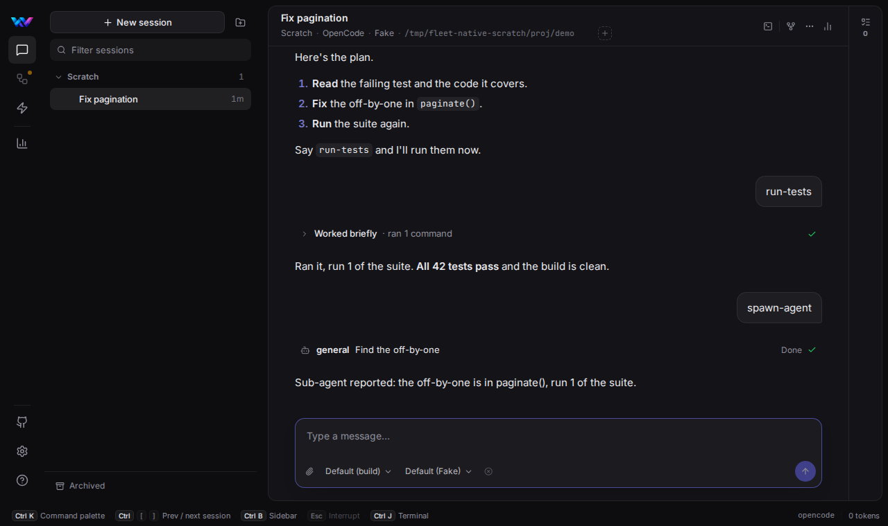
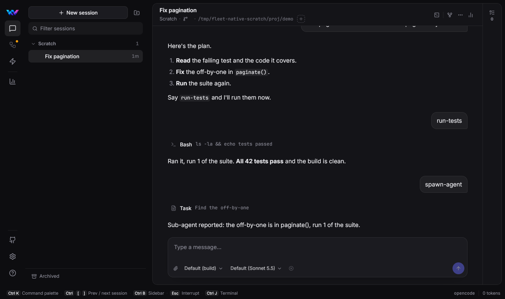
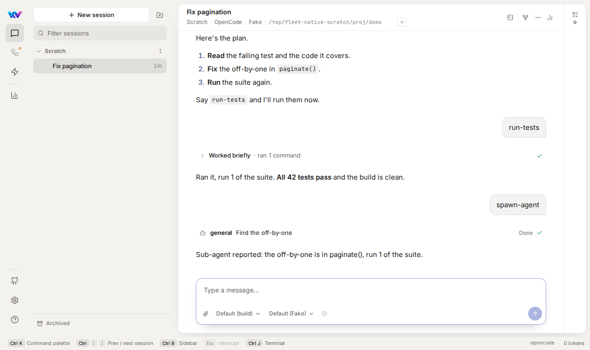
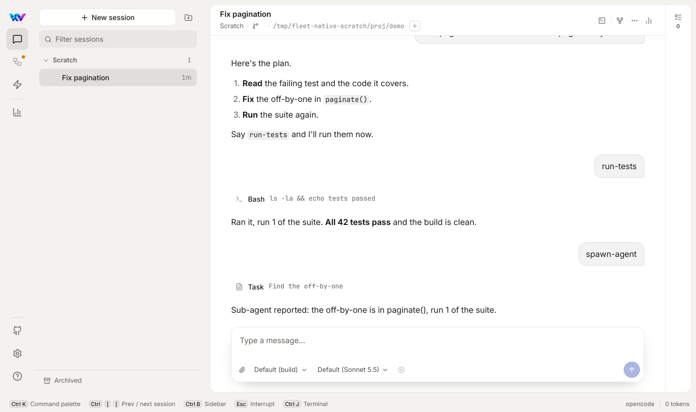

# Component 3: Conversation parts

The parity checklist for component 3 of `docs/PORT.md`, and the pieces it is built in.

- **weave-fleet commit read:** `4f3527299d37f6d5a5e1e83a7837909d9c967d1c` (`main`, 15 November 2026).
  The server the live checks run against is v0.72.0; where `main` has moved past it, a row says so.
- **Native app read:** `main` at `ee6e3b5` (`src/view/conversation.rs`, `prose.rs`, `parts.rs`, `src/fleet/`).
- **Paths** are weave-fleet's under `client/src/` unless they start with `src/` or `docs/`.
- **Row numbers:** 1.x the stream and its turn-level parts, 2.x message bubbles, 3.x tool cards and
  their output, 4.x background work and sub-agent rows, 5.x images and browser steps, 6.x find in
  the conversation, 7.x export. Each part below was read by its own reader and ends with its own
  tests, what Rune can't do, hand-offs and a size estimate.






The gap, visible in the pictures: Fleet folds a finished turn to one line ("Worked briefly · ran 1
command ✓") and draws a sub-agent call as its own row ("general  Find the off-by-one  Done ✓"). The
native app draws every call as a flat `Bash` / `Task` line that can't be opened, with no fold, no
sub-agent state, no output, no diff.

## What "done" means

1. A conversation reads the same as Fleet's: every tool call has its heading, summary line, status
   and an expandable body (output with Fleet's colours, a diff for edits and writes); reasoning
   follows the Thinking setting; user shell commands are their own block.
2. A finished turn folds to Fleet's one-line summary and opens on click; the running turn stays open;
   failed rows, sub-agent rows, pages and screenshots stay visible.
3. Compaction, interrupted turns, turn failures with Fleet's retry bar, the working line with its
   variants, recap lines and background notices are drawn as Fleet draws them.
4. Background work and sub-agent calls have their strip, rows, output tail, Stop and Open.
5. Images, screenshots and the lightbox, and browser steps, work.
6. Find in the conversation (Ctrl/Cmd+F) and Export as Markdown work, with their logic tested under
   Fleet's test names.
7. Scrolling follows Fleet's rules (pin to bottom by intent, jump to latest, older messages when
   within 100 px of the top, show a message).

## What the native app already has

From slice A and component 2 (details at the head of each part below):

| Part | State | Where |
|---|---|---|
| One column (max 760), `virtual_rows` over the messages, `stick_bottom`, partial-snapshot banner, older-history states | Done | `src/view/conversation.rs` |
| Markdown, code blocks | Done (heading tint and code colours still to match, from slice A) | `src/view/prose.rs` |
| User bubble, assistant text, working row ("Working · 18s", plain) | Partial | `conversation.rs` |
| Tool call: one summary line (icon, name, detail, running pulse / `+N −N` / time), not expandable | Partial | `conversation.rs` `tool_row`, `src/fleet/view.rs` (`ToolState`) |
| `Msg.steered`, `command`, `mod_mark`, `turn_error`, `compaction_summary`, `Part::Compaction`, delegations, running work, optimistic prompts | In the model, nothing draws them | `src/fleet/` |
| Everything else in this file (fold, cards, diffs, strip, find, export…) | None | |

## Decisions the pieces need (the owner can overturn)

- **Fleet's gap, find in a collapsed tool card:** with "+ Tool output" a hit inside a collapsed card
  counts and Enter scrolls to the message, but nothing is marked. Native copies Fleet (row 6.5x) and
  lists it as Fleet's gap; the owner may want the card to open instead.
- **Export's source:** Fleet pages `/api/sessions/{id}/messages` over REST; native holds history
  from the hub pager. Piece S takes the REST route as Fleet does, unless the hub pager is cheaper.
- **Copy and Save:** Rune has no clipboard write from a handler at the pin (`docs/RUNE.md`), and a
  save dialog is unsure. Piece S writes the smallest case into `docs/RUNE.md` first; if it can't be
  worked around, Copy stays disabled and Save writes to the Downloads folder (a product decision).

## Rows

<!-- part 1-stream -->
### 1 — The conversation stream and its turn-level pieces

Source root: `weave-fleet/client/src/`. Abbreviations: AS = `components/session/ActivityStream.vue`, USS = `composables/use-stream-scroll.ts`, UAM = `composables/use-activity-messages.ts`, TF = `lib/turn-fold.ts`. Sizes are CSS px at the 14px root (so `0.75rem` = 10.5px). "Native" paths are in the worktree.

What native has today: `src/view/conversation.rs` draws one column (max 760, `pt 24, px 32, pb 12`), `virtual_rows` over `session.messages` with `memo`, `ScrollSpec { stick_bottom: true }`, a partial-snapshot banner, the three older-row states (`Older::Ask/Loading/Failed`), a "Working · 18s" row (no shimmer, no tool name, no waiting/retry/not-answering variants), message rows with Fleet's tool-run spacing. `Part::Compaction` exists in the model but no divider is drawn. None of: turn grouping/fold, jump pill, scroll-intent logic, peer/mod/steered chips, turn-failure card, TurnRetryBar, interrupted card, recap, read-run merge, cluster positions.

Not in AS (checked): there is **no empty-state, no loading skeleton and no error banner** in the stream itself. `stream.isLoading` only gates the `progress` emit (1.31). A session with no messages is an empty scroll box. Loading/empty/error for the whole conversation view belong to whoever hosts AS (component 7/8 session view); say so in the PR.

#### A. Stream container, spacing, message wrapper

| # | What the user sees / does | Source | Native today |
|---|---|---|---|
| 1.1 | Shell `.activity-stream-shell`: flex column, fills, `overflow:hidden`, relative. Find bar (not ours) sits above the scroll box; the Jump-to-latest lane below it. Order: [find bar][scroll box][jump lane] | AS template + style | Partial: `stream()` has no lane |
| 1.2 | Scroll box `<section aria-label="Activity stream">`, `padding: 24px 32px 12px`, thin scrollbar in `--muted` on transparent, vertical scroll only | AS `.activity-stream` | Done: `conversation.rs::stream` (pt24 px32 pb12) |
| 1.3 | Reading column: each message `.activity-message` is `width:100%; max-width:760px; margin:0 auto 20px`, flex column, no shrink. User and shell messages align `flex-end`; assistant `flex-start`. (`--activity-bubble-width: 100%`) | AS styles | Done: `COLUMN`=760 |
| 1.4 | Message spacing by cluster: class `activity-message--first` and `--middle` get `margin-bottom: 6px`; `--single`/`--last` keep 20px | AS styles | Partial: native spaces by tool/text adjacency, not by cluster; port clusters (1.20) then this rule |
| 1.5 | "Rows only" message (assistant, `body.trim()==""`, no images, no questionParts, no turnError) gets `margin-bottom:0`, its `.message` padding 0; the next message that is NOT rows-only gets `margin-top:10px`. `isRowsOnly()` in AS | AS `isRowsOnly`, `.activity-message--rows` | Partial: native has 0 between tool rows and 12 before text; confirm numbers against 0/10 |
| 1.6 | Hover/focus-within raises a message (`z-index:1`) so the model pill lies over the next message. Pill itself is component 3 | AS styles | None (Rune: unsure how z-order on hover works) |
| 1.7 | Highlight ring when jumped to (`--shown`): `outline:2px solid accent @60%`, `outline-offset:4px`, `radius --radius-card`, fades 400ms ease-out; cleared after 1600ms (reduced motion: no fade) | AS `.activity-message--shown`, USS `showMessage` | None |
| 1.8 | Content-visibility / contain-intrinsic-size (320px guess) so off-screen messages cost nothing | AS styles | Done differently: Rune `virtual_rows` + `ESTIMATED_ROW` + `memo`. No row needed beyond keeping it |
| 1.9 | Incremental mount: newest `FIRST_MOUNTED=20` messages first, older ones `MOUNT_BATCH=20` per frame starting 2 frames later; only when the conversation arrives whole (session change or previous length 0) and length > 20; one-at-a-time arrivals mount directly; reaching the top or `showMessage` of an unmounted id mounts all | `use-incremental-mount.ts` | None needed (virtual rows replace it); logic must not be ported, but state in the PR that it is replaced |

#### B. Message list building (logic, no Rune unless noted)

Order of the pipeline in AS/UAM: `stream.messages` -> `messagesAfter(boundary)` -> hide compaction summary messages -> derive views -> drop empty -> append optimistic -> cluster -> `mergeReadRuns` -> `foldTurns` -> mount.

| # | Rule | Source | Native today |
|---|---|---|---|
| 1.10 | Side conversation (`after` prop, `/btw`): only messages after the boundary id; boundary missing -> messages whose id sorts after it (`compareMessageIds`); no boundary -> all. `hasMore` is false unless nothing was cut | `lib/side-conversation.ts::messagesAfter`, AS `hasMore` | None (side conversation owned by composer, comp 5; the filter is logic here) |
| 1.11 | A message is **kept** when role is `user` (even empty) or it has visible content: non-blank body, OR reasoning text/summary AND thinking setting is not `hidden`, OR images, tools, questionParts, shell, compaction, background notice, turnError. Else dropped | UAM `hasVisibleMessageContent`, test "hides an assistant message with nothing to show, and keeps an empty user one" | None |
| 1.12 | Body = text parts joined `\n\n`; reasoning and image parts excluded; non-image file part -> `[filename or "Attached file"](url)` or the label alone when no url | `lib/activity-messages.ts::renderMessageBody` | Partial: native renders parts directly, no joined body; needed for fold `hasContent` and `latestAnswer` |
| 1.13 | Author: user -> "You"; assistant -> `formatAgentDisplayName(agent ?? "Assistant")` (`_`/`-` -> space, collapse spaces; if all lowercase, Title Case each word; mixed case kept; empty -> "Assistant") | activity-messages.ts | None |
| 1.14 | Sender key: user -> "user"; else lowercase-normalised author (`_-` to space). Same sender = same role AND key | `getSenderKey`, `isSameSender` | None |
| 1.15 | Cluster position from (sameAsPrevious, sameAsNext): both=middle, prev only=last, next only=first, neither=single. `showIdentity = !groupedWithPrevious` (header/avatar of the bubble only on the first of a run) | `getClusterPosition`, UAM `messages` | None |
| 1.16 | Model name shown = `modelDisplayName(modelID, models catalog)` | UAM | Partial: component 3 draws the pill; stream passes it |
| 1.17 | Optimistic prompts (sent, not yet echoed): id `optimistic-<promptId>`, author You, status pending/confirmed/needs_retry; shown after delivered messages unless the stream already has the id. Merge is delivered then optimistic, no timestamp sort | `merge-messages.ts`, UAM `optimisticMessages` | Partial: `Message.needs_retry` only |
| 1.18 | Optimistic cleared on a NEW renderable assistant message only when every user message has non-blank text AND every optimistic prompt with images has >= that many `image/*` file parts delivered (else defer; reconcile again on the next change). Count baseline kept updated even with no prompts | AS `watch(sessionMessages)`, `hasRenderableAssistantContent` | None (state logic; belongs with composer send, comp 5, but the stream owns the watch) |
| 1.19 | `hasRenderableAssistantContent`: assistant with any tool part, or file with filename/url, or non-blank text, or reasoning with non-blank summary-or-text | activity-messages.ts | None |
| 1.20 | Read-run merge: assistant message A (no text/reasoning/image/peer/background/compaction/shell/command, has tools) directly after assistant message P whose last tool is a done groupable read, and A's first tool is one too: A's leading run of reads moves onto P's tools; remainder (other tools, questionParts, turnError) stays as its own message; if nothing remains the message vanishes. Not across user messages, a failed read, or P ending with questionParts/turnError | `lib/merge-reads.ts`, `isGroupableRead` in `lib/tool-row.ts` | None |
| 1.21 | Compaction: a `compaction` part makes the message a divider (`message.compaction`); an OpenCode summary message (`compactionSummary`) directly after a divider with no summary of its own is hidden and its text becomes the divider's `summary`; divider that already has a summary keeps it and still hides the message; a summary with no divider before it (older page) stays a message | `lib/compaction.ts::foldCompactionSummaries`, UAM `deliveredMessages` | None |
| 1.22 | Banner-class marks above the bubble, in this order inside one message: fold row, thinking blocks, background note, workflow-step chip, mod chip, steered chip, peer chip, then shell block OR compaction divider OR bubble (bubble skipped when `foldOnly`), then turn-failure card, then optimistic-retry line | AS template | Partial: only bubble parts + retry line |
| 1.23 | `diagLog` / `message-diagnostics.ts`: localStorage ring buffer (500 entries, key `fleet:message-diagnostics`, enabled by `fleet:diag-enabled=1`) | `lib/message-diagnostics.ts` | None. Not user-visible; **skip** or at most a `tracing::debug!` (say so in the PR). Same for `lib/merge-messages.ts` timestamp name (it does not sort) |

#### C. Turn folding (the big piece of logic)

A turn = one user message plus every assistant message until the next user message. A `shell` role message ends the turn it sits in (starts a turn-less group). Assistant messages before any user message form a turn with no prompt; its id is its first agent message's id. A turn with no assistant message is never folded.

| # | Rule / look | Source | Native today |
|---|---|---|---|
| 1.24 | **When a turn folds**: every turn except the last when the session is running (`isStreamWorking(sessionStatus)`) or `keepLast` is set. `keepLast` = `watchedLastTurn`: set true when `isStreaming` goes true, reset on session change; so a turn you watched stays open until the next prompt is sent (a new turn exists), and a reload folds every finished turn | TF `foldTurns`, AS `watchedLastTurn` | None |
| 1.25 | A turn with `foldable === 0` (no completed tool rows that fold) AND no non-blank thinking is left alone (no fold row) | TF `foldTurns` | None |
| 1.26 | What folds: reasoning parts of every agent message in the turn (`reasoningParts` set to empty) and tool rows that `staysVisible` is false for. Text, images, question parts, turnError, background notices, compaction, shell are never hidden. The user's message is never touched | TF | None |
| 1.27 | Stays visible even when folded: tools with `delegation` (sub-agent) or `screenshot`; "opens something" tools (`page`, `canvasId`, or name in `fleet_page_show`, `fleet_app_start`, `fleet_browser_open`, `fleet_walkthrough_show`); any tool whose `status !== "Completed"` (failed, stopped, running, background). Those are counted in `failed` (except delegation/page-show, which are not counted at all) | TF `staysVisible`, `isPageShow` | None |
| 1.28 | After hiding, an agent message with no content left (`hasContent` false: no body/images/tools/questionParts/turnError/background/compaction/shell) is removed, except the turn's FIRST agent message, which stays as host with `foldOnly: true` (draws only the fold row, no bubble). The host (first agent message) gets `fold = {id: turnId, summary}`. Fold id = the user message id (or first agent id) | TF | None |
| 1.29 | Opened turns: `openTurns` set of fold ids toggled by the fold row; open = rows shown again, fold row stays. Opening state is per-stream (reset on session change? it is **not** reset: `ref(new Set())` lives with the component instance). Find reveal can open a turn | AS `toggleTurn` | None |
| 1.30 | Summary counts, completed tools only: `reads` (`isReadCall`, category read), `commands` (`isShellRow`), `edits` = distinct relative file paths of write calls (`isWriteCall`, `tool.filePath` relativised to the session folder; Windows paths: either slash, case-insensitive prefix, UNC/drive), `other` (everything else, and ExitPlanMode always lands here), `failed`. `outcome`: "failed" if any message has `turnError`; else "stopped" if a tool has status "Stopped"; else "done" | TF `foldTurns`, `relativePath` | None |
| 1.31 | `durationMs` = end - start, where start = the prompt's `createdAt` (none when the turn has no prompt) and end = max of `completedAt ?? createdAt` over agent messages, but only until the first background notice or turnError (later messages don't stretch it). Set only when end > start | TF | None |
| 1.32 | Fold line wording: `summaryParts` -> `read N file(s)` · `edited N` · `ran N command(s)` · `N other call(s)` · `N failed`, in that order, joined by " · " | TF `summaryParts` | None |
| 1.33 | File stats for whole-file write rows (`diffFromContent`): the +/- counts come from the server's per-turn snapshot (`endedAt >= turnStart && < nextTurnStart`, latest wins), else for the LAST turn only from the session diff, else `null` (draws no counts). File outside the folder -> null; file the snapshot/diff doesn't list -> `+0 -0`. Fetched via `useFileStats` (wanted: has a whole-file write and not streaming; refresh as streaming flips) and `useTurnStats`. Row counts are drawn by the tool row (comp 2/other); the lookup is here | TF `withFileStats`, `snapshotFor`, `turnStart` | None |
| 1.34 | `turnIdsOf(messages)`: message id -> turn id, for find-bar reveal (not ours; just expose) | TF | None |

#### D. TurnFoldRow (`TurnFoldRow.vue`)

| # | What the user sees | Source | Native today |
|---|---|---|---|
| 1.35 | One full-width button row: `min-height:30px`, `margin:2px 0`, `padding:0 8px`, gap 8, radius `--radius-btn - 2`, 13px, colour `--muted`, transparent. Left to right: chevron-right 12px (rotates 90deg when open, `--transition`), "Worked for 34s" (weight 500, colour `--text`, no shrink), then details, then right-aligned end mark | TurnFoldRow | None |
| 1.36 | "Worked" text: `formatCallDuration(durationMs)`: <1s -> "0.x s" -> text becomes "Worked briefly"; <60s -> "Ns"; else "Xm Ys"; missing duration -> "Worked" (the trailing " for " is stripped) | TurnFoldRow `worked`, `lib/tool-row.ts::formatCallDuration` | None |
| 1.37 | Details: "· read 4 files · edited 2 · ran 2 commands", muted, single line, ellipsis on overflow (min-width 0). Omitted entirely when no counts | TurnFoldRow | None |
| 1.38 | End mark, `margin-left:auto`, no shrink: outcome "done" -> check icon 13px colour `--running-text` (aria "Done"); otherwise circle-alert icon 13px + "Failed" or "Stopped", 12px, gap 4, colour `--danger` (falls back to `--muted`) | TurnFoldRow | None |
| 1.39 | Hover: background `--text` @5%, colour `--text`. Focus-visible: 2px `--accent` outline, offset -2. Click toggles the turn. `aria-expanded` | TurnFoldRow | None |

#### E. Load older, jump to latest, scroll behaviour (USS)

| # | Behaviour | Source | Native today |
|---|---|---|---|
| 1.40 | Partial-snapshot banner (first child, when `isPartial`): "⚠️" (1rem) + "Connection to live session is temporarily unavailable. Showing cached data." 13px/1.4, `--idle-text`; padding 12 16, mb 16, gap 8, bg `--idle` @10%, border 1px `--idle` @30%, radius `--radius-card`, `role=status` | AS | Done: `partial_banner` |
| 1.41 | Loading older: spinner (sm, `--accent-text`) + "Loading older messages…", 13px `--muted`, centred, gap 8, py 8 | AS | Done: `older_row` (fading spinner) |
| 1.42 | Ask: button "Load older messages", 13px `--muted`, opacity .7, hover opacity 1 + `--text`; failed: "Couldn't load older messages · Try again". Click = `loadOlder` | AS | Done: `older_row` |
| 1.43 | Auto-load: on every scroll event, if not restoring and `scrollTop <= 100`: if unmounted older exist mount all; else if `hasMore && !isLoadingOlder` call `loadOlder` | USS `updatePinnedState`, `handleLoadOlder`, `SCROLL_TOP_THRESHOLD=100` | Partial: button only; no near-top trigger. Needs a scroll-offset read in Rune (unsure if exposed; see Out of reach) |
| 1.44 | Keep reading position when older arrive: on `isLoadingOlder` going true record scrollHeight+scrollTop; after messages change, scrollTop = old scrollTop + (new height - old height); suppress the near-top trigger until next frame | USS watchers | None. Rune `virtual_rows` anchoring: unsure |
| 1.45 | Pinned state: `keepPinned` starts true. At bottom within `AT_BOTTOM_EPSILON=2` -> pinned. Leaves pin when more than `SCROLL_BOTTOM_THRESHOLD=80` from bottom, OR a move up of >1px within `USER_INTENT_MS=700` of user intent. A small move up without intent (layout shift, rounding) stays pinned | USS `updatePinnedState` | Partial: Rune `stick_bottom` has its own rule; check it matches (80px, intent) |
| 1.46 | User intent set by: wheel up (deltaY<0, no ctrl) unless the wheel target is inside a nested scroller (overflow auto/scroll, can scroll, scrollTop>0) between target and stream; touchmove; pointerdown on the scroll box itself; keys ArrowUp, PageUp, Home | USS `handleWheel`, `handleKeydown`, `noteUserIntent` | None (nested scroller case matters for code blocks; comp 3) |
| 1.47 | Follow: while pinned, any new child, text change or child resize schedules one `scrollToBottom` per animation frame. Also on mount, and on session change (pinned again, pill hidden) | USS observers/watchers | Partial: `stick_bottom` |
| 1.48 | Sending a prompt re-pins and scrolls to bottom wherever the view was (`sentPrompts.length` grew) | AS `watch(sentPrompts)` -> `pinToBottom` | None |
| 1.49 | **Jump to latest** pill, shown when not pinned. Own lane under the scroll box (`flex:none`, centred, `padding: 6px 0 4px`) so no text is under it. Pill: inline flex, gap 5, `padding: 5px 10px`, 1px `--border`, radius 999, bg `--card-bg`, `--muted`, 12px/1, arrow-down icon 12px + "Jump to latest". Hover: `--text`, border = `--accent` @55% over `--border`. Click -> scroll to bottom, re-pin | AS template/style, USS | None |
| 1.50 | Session commands the stream answers while mounted (`sessionCommands.contribute("conversation:<id>")`): `scroll-top` (smooth), `scroll-bottom`, `show-message {messageId | toolCallId}` (tool call id -> message holding a `tool` part with that `callId`), `focus-prompt`, `copy-session-id` (clipboard), `export-conversation`, `export-raw-messages` (export is another agent's) | AS onMounted, `lib/session-commands` | None (comes with the command palette / keys) |
| 1.51 | `showMessage(id)`: if the element is not mounted and older exist, mount all and retry next tick; unpins; scrolls it to the centre (smooth), highlights (1.7) for 1600ms; forces all messages laid out until scroll end or 2000ms | USS `showMessage` | None (virtual rows: need scroll-to-index) |

#### F. Rows around the bubbles (all inside `.activity-message`)

| # | What the user sees | Source | Native today |
|---|---|---|---|
| 1.52 | Background note (`message.background`): flex, gap 6, `align-self:flex-start`, `padding:2px 8px`, 1px `--border`, `--radius-btn`, bg `--surface-2`, `--muted`, 12px, mb 4. Icon 13px: bot (subagent) or terminal-square; label "Background helper" / "Background command" (500, `--text`); task = label, mono, ellipsis one line; state text `--complete-text` ("completed"/"running"...), `error` -> `--error-text`, `cancelled` shown as "stopped" in `--muted`. Parsed from a user-role body starting `<shell ` / `<subagent `; message is treated assistant-side, bubble text is the notice text; state can be overridden by `finishedBackground` ("Fleet stopped it" wins; its error text dropped) | AS `.background-note*`, UAM `withEnd`, `lib/background-work.ts` | None |
| 1.53 | Chip family `.peer-from`: inline flex, gap 5, max-width `min(100%, 380px)`, `margin 0 0 6px`, `padding 4px 10px`, 1px border `--border` @90%, radius 999, bg `--card-bg` 96% + `--accent-dim` 4%, `--muted`, 0.75rem (10.5px). Icon 0.85rem. Title: `--text`, weight 600, ellipsis. Variants below | AS styles | None |
| 1.54 | Workflow chip: workflow icon + step label (e.g. "Workflow · step 2 of 6", "· you finish this step", "Fleet · you pressed Move on"); label from `workflowMessageLabel(run, sessionId, messageId, body)`. Only on user messages of a workflow-step session | AS, `lib/workflows` | None |
| 1.55 | Mod chip: puzzle icon + "Sent by <mod>" or "Rewritten by <mod>". Tooltip: sent+name starts "Fleet" -> "Fleet sent this message, not you."; sent -> "A mod sent this message, not you."; rewritten -> "A mod reworded what you typed before it was sent." | AS | None |
| 1.56 | Steered chip: corner-down-right icon + "Sent mid-turn", tooltip "You sent this while the agent was working. It read it at its next step, without waiting for the turn to end." | AS | None |
| 1.57 | Peer chip (message from another Fleet session via `fleet_message`, or Fleet's update about one): bot icon, "From" label (hidden when it is an update with an outcome), title, "· <machineName>" (no shrink), outcome text (`peerOutcome`) after, arrow-up-right icon when openable. Failed outcome: outcome text `--error-text`. Tooltip `A session on <machine>` when machineName. Body shown is the parsed text (`parsePeerMessage` / `parsePeerUpdate`) | AS, `lib/session-messages` | None |
| 1.58 | Peer chip click: a link when its machine key is known (`peer.machineId` ? `machines.keyOfMachine(id)` : this session's machine), else plain non-clickable span (names it only). Modified click (meta/ctrl/shift/non-primary) is left to the browser (native: skip). A sender on another machine is remembered (`rememberSessions`) so it opens in place. Navigates to `/sessions/<peer.sessionId>`. Hover: border = `--primary` @24% over `--border`, bg 88/12 mix | AS `handlePeerLinkClick`, `peerMachineKey` | None |
| 1.59 | Session reference chips inside a user message (`@`-sessions): body text is stripped of Fleet's trailing block; chip click opens that session. Chip drawing is component 3/5 | UAM `parseSessionReferences`, AS `openReferencedSession` | None |
| 1.60 | Thinking blocks (`ReasoningBlock`, comp 3) go above the bubble, each with `live` true only for the LAST part of the LAST message while streaming when that part is reasoning | AS `liveReasoningPartId` | Partial (native `Part::Reasoning`) |
| 1.61 | Optimistic retry line under a message with `optimisticStatus === "needs_retry"`: "Not confirmed yet. Retry from the composer if this did not send." 12px `--idle-text`, `margin: 4px 0 8px`; right-aligned and right-aligned text for user, left for assistant | AS `.optimistic-retry*` | Done: `needs_retry` (`conversation.rs`) |

#### G. Turn failure card (inline in AS)

| # | What the user sees | Source | Native today |
|---|---|---|---|
| 1.62 | Card under the message that has `turnError`: `margin 4px 0 10px`, `padding 10px 12px`, border 1px `--error` @35% over `--border`, radius `--radius-card`, bg `--error` @7% over `--card-bg`, `align-self:flex-start`, full bubble width | AS `.turn-failure` | None |
| 1.63 | Limit variant (`limitTitle(kind)` non-null): border `--status-waiting` @35%, bg `--status-waiting` @6%, icon colour `--status-waiting` | AS | None |
| 1.64 | Head: triangle-alert 14px (colour `--error`), gap 6, title 13px/600: "This turn stopped early", or by kind: `usage_limit` "Usage limit reached", `rate_limit` "Rate limited", `overloaded` "The model's provider is overloaded" | AS, `lib/turn-retry.ts::limitTitle` | None |
| 1.65 | Message paragraph: `splitTurnErrorMessage(message).summary`, 13px/1.45, `--text`, anywhere-wrap, mt 6; URLs linkified (`--accent-text`, underlined, offset 2). Summary: trim; cut at first stack frame (`\s+at\s+...:\d+:\d+\)?`); strip a leading `^[A-Z]\w*Error:\s+`; fall back to head, then whole text. The frame and after = `details` | `lib/turn-error.ts` | None |
| 1.66 | Details disclosure when `details`: "Details" (12px `--muted`, hover `--text`, mt 6), opens to `pre` mono 11px/1.5, max-height 180 scroll, pre-wrap | AS | None |
| 1.67 | Foot row (`mt 8`, space-between, gap 12): left = error name, mono 11px `--muted`, empty when name is "UnknownError". Right = actions (gap 6): **Report this** (bug icon 12px) always; **Try again** (rotate-cw icon) only on the latest message AND a last user prompt exists AND no scheduled retry is waiting; disabled (opacity .5) when `!canSend` | AS | None |
| 1.68 | Action pills: `padding 4px 10px`, 1px `--border`, radius 999, bg `--panel-bg`, `--text`, 12px, gap 5; hover (enabled): border `--accent`, text `--accent-text` | AS `.turn-failure__retry` | None |
| 1.69 | Try again sends the last user message's body (trimmed, non-empty) again via `retryPrompt`. Report this opens the problem-report dialog with description `This turn stopped early: <summary>\n\n` (dialog is not ours) | AS `handleRetryTurn`, `reportTurnFailure` | None (hand off) |
| 1.70 | `TurnFailureRetry` (inside the card, between details and foot, only when `turnError.kind` is set and it is the newest message): loads the session's scheduled retry and shows the TurnRetryBar; nothing when there is none | `TurnFailureRetry.vue`, `use-session-retry.ts` | None |

#### H. TurnRetryBar (`TurnRetryBar.vue`)

| # | What the user sees | Source | Native today |
|---|---|---|---|
| 1.71 | Wrap-flex bar in the failure card: `mt 8`, `padding 8px 10px`, gap 8, radius `--radius-card - 2`, bg `--status-waiting` @10% over `--panel-bg`. Left: rotate-cw 14px `--status-waiting`. Middle (grows, basis 220): two lines. Right: two pills | TurnRetryBar | None |
| 1.72 | Line 1 (`role=status`, 12.5px/500 `--text`, tabular): `Fleet tries again at <clock> · <in X>`; when due: "Fleet is trying again now". Clock: today "HH:MM" (2-digit locale); within 6 days "Mon 14:05"; else "9 Oct 14:05". In: <60s "in 40 s" (rounded, min 1), <1h "in 12 min" (ceil), <1d "in 2 h 5 min" (60 min rolls to next hour; "in 3 h" when 0 min), else "in 3 days"/"in 1 day" | `formatRetryClock`, `formatRetryIn` | None |
| 1.73 | Line 2 (11.5px `--muted`): `error` text if an action failed, else `attempt > 1` -> "Attempt N, <source>." else "It carries on <source>. Nothing was lost." Source: providerSaid+usage_limit "when the limit resets", providerSaid else "when the provider said to", not said "after a wait" | TurnRetryBar `why` | None |
| 1.74 | Pills: "Try now" (play icon 12px) and "Don't retry" (x icon); same pill style as 1.68; both disabled while `busy`. Try now = `POST /api/sessions/{id}/retry/send`; Don't retry = `DELETE /api/sessions/{id}/retry`; load = `GET /api/sessions/{id}/retry`. Failure text: `<failure> (HTTP <status>).` or the error message | TurnRetryBar, `use-session-retry.ts` | None |
| 1.75 | Tick: re-render each 1s in the last minute before due, else each 15s; restarts if `dueAt` changes. Native: tick off the app clock, no timers in views | TurnRetryBar `tick` | None |
| 1.76 | `ScheduledRetry` parse (`toScheduledRetry`): needs string `dueAt` parseable, `kind` in the 3 kinds; `attempt` default 1; `reason` default ""; `providerSaid === true`. While a retry waits, the failure card's Try again is hidden (1.67) | `lib/turn-retry.ts` | None |

#### I. Working line, interrupted card, compaction, recap

| # | What the user sees | Source | Native today |
|---|---|---|---|
| 1.77 | Working line container (shown while `isStreaming`, after the permission/page/draft cards and the interrupted card): `width:100%; max-width:760; margin 0 auto 12; padding 4px 0` | AS `.streaming-indicator` | Partial: `working_row` (h24, my4) |
| 1.78 | **Working** variant: row, gap 10, h 24, 13px `--muted`. Session-row quad glyph (active), word "Working" with a shimmer highlight sweeping through `--text` (2.2s linear loop; reduced motion: plain `--muted`), then "· 18s" (elapsed since the turn's start, tabular, `margin-left:-5px`), then `· <tool> running <time>[ +N more]`. Elapsed `formatElapsed`: `Ns` <60, `Nm` <60 min, `Hh` / `Hh Mm`. Turn start = `createdAt` of the last non-steered user message (null -> no time). Ticks each 1s in the first minute, then each minute | WorkingIndicator, `lib/running-work.ts` (`turnStartedAt`, `formatElapsed`, `elapsedTickMs`) | Partial: `working_row` has "Working · Ns" but shows "Nm" with no remainder; minutes fine; no tool segment, no hours; clock is mock `working_since` |
| 1.79 | Tool segment: the longest-running (earliest `state.time.start`, falling back to the message `createdAt`) running tool: `<heading ?? tool> running <elapsed>` plus ` +N more` for other running tools; when `held` (a steered user message sits below the call AND the harness's `steerDelivery === "next-step"`): append ". Your message goes to the agent when it finishes." Its own clock replaces the turn's for ticking | `lib/working-on.ts` | None |
| 1.80 | **Waiting** variant (question holds the turn: `sessionStatus === "waiting_input"` or the list item's `activityStatus === "waiting_input"`): waiting-diamond glyph + "Needs input" (weight 500, `--status-waiting-text`). Wins over all others | WorkingIndicator, AS `isWaitingForInput` | Partial: `parts.rs::diamond` exists, not wired |
| 1.81 | **Not answering** variant (session's machine stopped answering; only if not waiting): idle glyph + "<machine name> isn't answering. It was working when last heard." (name falls back to "Its machine"). No time, no ticking | WorkingIndicator, AS `quietMachine` | None |
| 1.82 | **Retry** variant (list item `activityStatus === "retry"`): amber-dots glyph + `describeRetry`: "Retrying · attempt 3 of 10 · in 12 s · API overloaded (529)", parts omitted when missing; attempt "attempt N" without a max; countdown "in N s" (<60, ceil) / "in N min" / "now"; message trimmed. `--status-waiting-text`, line-height 1.45, wraps (`min-height:24`). Ticks each 1s. Precedence: waiting > not-answering > retry > working | WorkingIndicator, `lib/retry-status.ts` | None |
| 1.83 | Interrupted card (end of the conversation, before the Working line; shown when the server reports an interruption): `margin-top 10`, `padding 11px 12px`, border 1px `--status-waiting` @40% over `--border`, radius `--radius-card`, bg `--status-waiting` @9% over `--panel-bg`. `role=status` | InterruptedCard | None |
| 1.84 | Title row: 9px `--status-waiting` dot + "Cut off by a restart" (13px/600, gap 7, mb 3). Lines 12.5px `--muted`, margin 3 0, bold parts `--text`/500. Waiting case: "Fleet restarted while this was waiting for you (since **<clock>**). **The question was lost.** Fleet doesn't answer for you." Else: "Fleet restarted while this was working (since **<clock>**)." + "Last call that didn't finish: **<lastCall>**" (if any) + "<N> file(s) changed in this worktree, still on disk." (only when `changedFiles > 0`; "1 file", "N files"). `<clock>` = `formatRetryClock(at)` | InterruptedCard, `lib/session-interruption.ts::changedFilesText` | None |
| 1.85 | Error line `--error-text` 12px. `auto`: "Fleet is continuing this by itself." and Continue hidden. Buttons (mt 9, gap 6): primary "Continue" (waiting: "Ask again") = bg `--accent`, text `--primary-foreground`, hover opacity .9; "Dismiss" = pill like 1.68 (`padding 5px 12px`, 12.5px). Both disabled while busy. API: `GET /api/sessions/{id}/interruption`, `POST .../interruption/continue`, `DELETE .../interruption`. Parse: `at` string required, `waiting`, `lastCall` (non-blank), `changedFiles` (finite number), `auto` | InterruptedCard, SessionInterruptedCard, `use-session-interruption.ts` | None |
| 1.86 | Compaction divider (`role=separator`): `margin 10px 0`, full bubble width. Line: 12.5px/1.4 `--muted`, hairline (1px `--border`) fills both sides, gap 12, label centred (max 80%). Label: "Context compacted · 181k → 34k tokens"; only before-size: "Context compacted · 181k tokens before"; none: "Context compacted". Tokens: <1000 integer; <1M "12.3k" (one decimal, trailing ".0" trimmed, >=100k rounded); >=1M "1.2M" (>=10M no decimal). Tooltip by trigger: auto "The harness compacted the conversation because its context was nearly full. The model goes on from the summary."; manual "Compacted on request. The model goes on from the summary."; else "The model goes on from a summary of the conversation before this point." | CompactionDivider, `lib/compaction.ts`, `lib/context-usage.ts::formatTokens` | Done in piece D (`view::compaction`, `conv::compaction`: label, `formatTokens`, tooltip by trigger). Rune's `help` is the tooltip; the label has no 80% cap (it shrinks). |
| 1.87 | With a summary: " · " + link-like toggle "Show summary" / "Hide summary" (`--accent-text`, underline on hover, focus ring 2px `--accent` offset 2). Open: markdown box below, `margin 10px auto 0`, max-width 680, padding 10 14, 1px `--border`, radius 8, `--muted`, 13px/1.55, max-height 360 scroll. Markdown only rendered while open | CompactionDivider | Done in piece D (toggle key `compaction-<id>-toggle`, summary box max 680 x 360 with Markdown). Folding a summary message into its divider is `fold_compaction_summaries`, run when the list is built (`fleet::view`, `sync_open`). No underline on hover (Rune: needs hover state in the view) and no focus ring. |
| 1.88 | RecapLine: **not mounted anywhere** in this commit (dead component; grep finds no importer). Would sit between conversation and composer: `padding 6px 24px`, body max 760, `padding 0 4px`, 13px/1.5 `--muted`, history icon 13px `--accent` + "recap:" (`--text`/500) + `recap.text`; hidden without text; `role=note`. **Recommend: do not port; record as skipped.** Check `session.recap` domain events before deciding | RecapLine.vue | Done in piece D, and the row above was wrong: weave-fleet `main` mounts `RecapLine` in `routes/sessions.$id.tsx`, between the conversation and the composer. Native keeps `recap` on the stream (`StreamState.recap`, from the snapshot's `recap.text` and `session.recap`) and draws `view::recap`. Fleet keeps it outside its reducer; here the reducer holds it. Not checked live: the scripted model has no recap (Fleet writes one only while nobody looks and the Session recap setting is on). |

#### J. Progress events the stream emits (plumbing with visible effect elsewhere)

| # | Behaviour | Source | Native today |
|---|---|---|---|
| 1.89 | `progress {working, latestAnswer, latestAnswerId}` is emitted to the parent (side-conversation tab shows both while folded): latest assistant message with a non-blank body. Only after the snapshot has loaded at least once (`isLoading` seen true first) | AS `latestAnswerMessage` watch | None (logic; needed by comp for /btw) |
| 1.90 | Header model: newest assistant `modelID` patched into the sessions store (`lastAssistantModelId`). Sessions upsert dispatched on each message change | AS watchers | None (logic; model header is comp 8) |
| 1.91 | Visual canvases: tool outputs parsed as visual payloads are listed in the canvas picker; a visual arriving within 5s of mount (`LIVE_TOLERANCE_MS`) also opens as a canvas tab, history never does; deduped by tool id | AS `conversationVisuals` | None (hand off to comp 10) |
| 1.92 | `fileLinks.forgetMissing(sessionId)` when a turn ends: paths that weren't files are re-asked | AS | None (comp 3 link logic) |

#### Order inside the scroll box, top to bottom
partial banner · load-older row · messages · permission asks (`PermissionCard`, comp 4) · page-pick card (`PagePickCard`, not for side conversations, comp 4) · mod drafts (`ModDraftCards`, not side) · interrupted card · Working line. The permission/pick/draft cards use `margin 0 auto 16; max-width 760; width 100%`.

#### Tests to port
Only logic and structure; mount-based DOM tests become `src/tests.rs` state/click tests with the mock session.

- `lib/__tests__/turn-fold.test.ts` (port as plain Rust unit tests): all names under `foldTurns` (keeps the latest turn open after it ends when you watched it (keepLast), and folds it once a newer turn exists; folds a finished turn: tool rows and thinking go, the answer stays, the fold row appears; never hides the agent's text: narration between calls stays, in order, and only tool rows fold; keeps the reply to a steered message visible in its own turn; keeps the last text as the answer when all of it came before the last call; leaves the running turn open; folds every finished turn, the latest one included, but only the running one stays open; keeps failed rows visible and counts them; keeps sub-agent rows, pages and screenshots visible; shows everything again when the turn is opened, with the fold row kept; leaves a turn with nothing to fold as it is; counts several edits of one file as one file edited; puts nothing after the answer of a turn that changed files: no changed-files card), `whole-file writes` (4 tests), `regressions in the folded turn` (6 tests), `past turns keep what they changed` (5 tests).
- `lib/__tests__/turn-fold-row-stats.test.ts`: both (new file in a close-following turn; earlier turn keeps its snapshot).
- `lib/__tests__/merge-reads.test.ts`: all 5. `compaction.test.ts`: all 4. `turn-error.test.ts`: all 4. `turn-retry.test.ts`: `formatRetryIn` each-case, `formatRetryClock`, `limitTitle`, `toScheduledRetry`. `merge-messages.test.ts`: the 7 (trivial concat; port 2 as one).
- `components/session/__tests__/TurnFold.test.ts`: "says what the turn did on one line and toggles on click" (assert label text and open toggle).
- `TurnRetryBar.test.ts`: "says when Fleet tries again, and that it waits for the limit's reset"; "counts down, by the second in the last minute"; "says which attempt it is when the limit keeps stopping the session"; "offers Try now and Don't retry"; "shows why an action failed instead of the explanation".
- `WorkingIndicator.test.ts`: "shows the working glyph and word"; "counts up from the prompt"; "says it needs input while a question waits"; "never shows a negative time when clocks disagree"; "says it's retrying, which attempt out of how many, when and why, counting down"; "says so instead of working on: no ticking dots, no growing time"; "adds the call and its own time after the turn's"; "says the message waits when it's held"; "shows only Working with no call".
- `CompactionDivider.test.ts`: both. `InterruptedCard.test.ts`: all 5.
- `ActivityStream.messages.test.ts`: port "clusters a run of messages from one sender and keeps another sender's apart"; "captions a prompt a mod sent or rewrote, and no other"; "shows a shell command the user ran as its own block, on the user's side"; "puts a prompt that was sent but not echoed yet after the messages, and drops it once the stream has it"; "keeps tool calls and questions apart, in order"; "draws a background notice with how the work ended and no bubble text of its own"; "hides an assistant message with nothing to show, and keeps an empty user one"; "shows thinking alone as a message"; "leaves thinking alone out when thinking is hidden"; "shows only what came after the boundary of a side conversation"; "names the author, the model and the role of each message". Skip (Vue identity caches): "hands an unchanged message's bubble the very same tools and images when others change"; "builds a message's view again when something its own parts read changes"; whole `ActivityStream.rerender.test.ts` (Vue re-render counts; native equivalent is a `memo` hit-count test, one new test); "mounts the newest messages first..." and the three "long conversation" incremental-mount tests (replaced by virtual rows; replace by one test that only visible rows are built). Sub-agent link and Improve tests ("points a sub-agent call...", "offers Improve...") are tool-row (comp 2).
- `ActivityStream.scroll.test.ts`: port behaviour as scripted-scroll tests where Rune allows: "starts at the bottom, without the jump button"; "offers Jump to latest once scrolled up past the threshold, and scrolls to the bottom when clicked"; "keeps the view pinned to the bottom as content grows"; "leaves the view where it is when scrolled up and content grows"; "a small move up that is not the user's (layout shift, rounding) leaves the view pinned"; "a small scroll up by wheel stays put while text streams in"; "a wheel up inside a code block scrolling on its own is not leaving the bottom"; "sending a prompt pins again after a nudge up, so the reply is followed"; "pins again for a session switch"; `older messages from the server`: "asks for them when scrolled near the top, and not before", "does not ask again while they are loading, or when there are none", "keeps the reading position when they arrive above"; `showing a message`: "scrolls to it, highlights it for a moment..." (drop the laid-out part), "stops pinning to the bottom once it has scrolled to a message", "scrolls to the top and the bottom on the session commands". Skip as DOM-only: "keeps every message laid out meanwhile", "ends the laid-out layout when the scroll ends", "disconnects its observers and cancels its work on unmount", "mounts the unmounted older messages first..." .
- `ActivityStream.thinking.test.ts`: all 3 (live flag logic). `ActivityStream.peer-machine.test.ts`: "opens a sender on another machine in place"; "finds a sender with no machine of its own on this session's machine, opened in place" (logic of `peerMachineKey`). `ActivityStream.background-work.test.ts`: "says stopped, not error, for a shell Fleet stopped"; "keeps a real failure a failure" (asking Fleet for older work is a server call: later). `ActivityStream.commands.test.ts`: "scroll-top scrolls...", "scroll-bottom jumps...", "show-message scrolls to a message by id, or by the tool call it holds, and marks it"; clipboard/export ones belong to commands/export. `activity-stream-utils.test.ts`: tool-card derivation, owned by the tool-row agent.

#### Out of reach in Rune, and why
- Shimmer text sweep on "Working" (gradient clipped to glyphs): unsure; native keeps a plain `--muted`, as Fleet does under reduced motion. Spinner rotation: fades (already done for Loading older).
- Scroll offset reads and writes (`scrollTop`, near-top trigger 1.43, restore position 1.44, scroll-to-index 1.51, smooth scroll, "moved up by the user" 1.45): unsure what `ScrollSpec`/`virtual_rows` expose beyond `stick_bottom`. Check `docs/RUNE.md` first; if absent, write the smallest case there. Pin-by-intent (1.46) needs wheel and key events routed to the scroll box.
- Hover z-raise (1.6), `outline` ring with offset and fade (1.7): unsure; a border or fill pulse is the fallback.
- Linkified text in the failure paragraph (clickable URLs inside one text run): unsure; markdown renderer may do it.
- Native `<details>`: build as a toggle button with state in `State`.
- Text selection across messages: unsure (not stream specific).

#### Cross-component hand-offs
- Comp 2 (tool rows): tool-row drawing, `diffStat` counts on Write rows (we supply `withFileStats`), Improve, delegation chips, `mergeReadRuns` output shape.
- Comp 3 (bubbles/markdown): `MessageBubble` content, model pill, `ReasoningBlock`, session-reference chips, code-block nested scrolling.
- Comp 4 (questions/permissions): `PermissionCard`, `PagePickCard`, `ModDraftCards` sit after the messages and before the interrupted card (see order above); `questionParts` are kept separate from tools in the message view and never folded.
- Comp 5 (composer): `sentPrompts` / `canSend` / `retryPrompt` (Try again), `/btw` side conversation (`after`), focus-prompt command.
- Comp 6 (session list): `activityStatus` (`waiting_input`, `retry` with `retryAttempt/MaxAttempts/Message/Next`) read for the Working variants; the list row glyphs are shared (`quad`, `diamond`, amber dots).
- Comp 8 (header): model name from `lastAssistantModelId`; `progress` emit.
- Comp 10 (content panel): visual payload auto-open (1.91), `show-canvas`/`open-file` from bubbles, Turns canvas calls `show-message` (1.7, 1.51).
- Find bar and export: another agent; the stream only exposes `turnIdsOf`, open-turn toggling, `showMessage`.
- Problem report dialog: Report this (1.69).

#### Size estimate (lines of Rust)
- Pure logic, plain unit tests (fold, summary, stats, merge-reads, compaction, turn-error, retry format, working-on/retry-status text, cluster/author): ~550 incl. tests. Cuts into one PR (fold + summary + stats ~350; the rest ~200).
- Message view model (`ActivityMessage` additions: fold mark, peer/mod/steered/background, cluster, optimistic): ~150.
- Fold row + compaction divider + chips + background note: ~250.
- Turn failure card + TurnRetryBar + interrupted card (incl. GET/POST/DELETE handlers off-thread): ~450.
- Working variants + tool segment: ~120.
- Scroll behaviour (pin intent, jump pill, near-top load, restore position, show message): ~250, depends on Rune scroll API; risky, own PR.
- Total ~1800, as 4 PRs of 300-600 (logic; fold row + dividers + chips; failure/retry/interrupted cards; scroll + working).


<!-- part 2-tools -->
### Section: message bubble, tool list, tool cards and their output (rows 2.x, 3.x)

Fleet paths are under `client/src/` (weave-fleet @ 4f35272). `components/session/` is written `cs/`. Sizes are CSS px as written in the
scoped CSS (already px unless noted; `rem` = 14px). Tokens: `--text`, `--muted`, `--border`, `--accent`, `--accent-text`, `--accent-dim`,
`--running`/`-text`, `--error`/`-text`, `--idle`/`-text`, `--complete`/`-text`, `--queued-text`, `--card-bg`, `--panel-bg`, `--main-bg`,
`--sheet-shadow`, `--radius-btn`, `--radius-card`, `--radius-panel`, `--status-waiting`, `--transition`. `wash(n)` = `color-mix(text n%, transparent)`.

**Native today** (read first): `src/view/conversation.rs` `message_row` + `part_view` draws a user text part as a right-aligned bubble
(15px/1.55, pad 10x14, border, wash 5, corners 14/14/4/14, 82% width) and an assistant text part as markdown (`src/view/prose.rs`, `Markdown::selectable`).
`tool_row` (conversation.rs ~294) draws ONE summary line per call: 14px icon (Terminal for "Bash", Pencil for "Edit", FileText for everything else),
name (13px, 500; Read is 400/muted), detail (mono 12 muted, truncated), then Running pulse / `+N −N` / `N.Ns`. It is not expandable (`on_press` is empty).
`src/fleet/view.rs` boils tool state to `ToolState {Running, Diff(a,r), Took(s), Plain}` from `metadata.filediff` and `time` only; `detail()` picks the first of
command/filePath/path/pattern/url/query/description else `state.title`. The tool name is just capitalised (`display_name`), not the registry heading. Reasoning draws the
summary or full text as muted 13px plain text (conversation.rs `part_view`), File parts draw the file name, Compaction a line. No copy button, no meta pill, no command chip,
no chips, no tool grouping, no diff, no output body, no shell block. `Msg.steered`, `Msg.command`, `Msg.mod_mark` exist in `src/fleet/model.rs` but nothing draws them.

#### A. Message frame (MessageBubble.vue + ActivityStream.vue wrapper)

| # | What the user sees / does | Source | Native today |
|---|---|---|---|
| 2.1 | Article per message. Assistant: full column width (`--activity-bubble-width` 100%), no bubble, no icon (the `.msg-icon` User/Bot is `display:none`), padding 2px 0, text 15px/1.65 `--text`, markdown (`.md-content`). Message column: max-width 760px centred, `margin 0 auto 20px`, column gap 0. | MessageBubble.vue `.message`, `.msg-body`; ActivityStream.vue `.activity-message` ~1201 | Partial: `message_row` spacing 20/12/0 (conversation.rs); no 760px cap check |
| 2.2 | User message: right-aligned bubble, `max-width: 82%`, `width:auto`; padding 10px 14px; 1px `--border`; radius `calc(--radius-panel + 2)` on 3 corners and 4px bottom-right; fill wash 5%; line-height 1.55; body text left-aligned; bubble content capped at the bubble width (long `<pre>` lines scroll, don't spill). | MessageBubble.vue `.message--user`, `.message--user .msg-body` | Partial: plain text only, `part_view` User arm (no markdown, no chips, no cap on code width) |
| 2.3 | User text goes through the same markdown pipeline as assistant text (code fences, links, lists inside the bubble). | `rendered`/`bodyHtml` | None: user text is `text()`, not markdown |
| 2.4 | Cluster spacing: consecutive same-sender messages (`clusterPosition` first/middle/last/single from `getClusterPosition`, same `role` and `senderKey`) sit 6px apart (`first`/`middle` get `margin-bottom:6px`), others 20px. Rows-only messages (`isRowsOnly`: tools/reasoning only) have `margin-bottom:0`, padding 0, and a following non-rows message gets `margin-top:10px`. | ActivityStream.vue 1240-1263; lib/activity-messages.ts `getClusterPosition`, `isSameSender` | Partial: spacing by tool/text only, no cluster rule (conversation.rs 242) |
| 2.5 | `message--shown` highlight (jump-to-message): 2px accent 60% outline, offset 4px, radius `--radius-card`, fades over 400ms. | ActivityStream.vue 951 | None (owner: find/jump, probably component 1/8; list here for the frame) |
| 2.6 | Empty body: no copy button when `body.trim()` is empty; text div omitted when `parsedBody.text` is empty (a message of only tools/images draws just those). | MessageBubble.vue template | Partial |
| 2.7 | Long text: assistant lines wrap; user `overflow-wrap` default; command `overflow-wrap:anywhere`; attached-file note `overflow-wrap:anywhere`. Streaming: `streaming` prop (last message while `isStreaming`) keeps an unfinished fold open and re-opens state by position (`folds` map, `rememberFoldClick`). | MessageBubble.vue `folds`, `env.streaming` | Partial: `prose(..., streaming)` handles tables/blocks; markdown `<details>` fold state not checked (owner: markdown, component 1) |

#### B. Hover actions, timestamps, meta pill

| # | What | Source | Native today |
|---|---|---|---|
| 2.8 | Copy button `.msg-copy-btn`: 26x26, 1px border, `--radius-btn`, bg `--card-bg`, `--muted` -> `--text` on hover, absolute `top:0;right:0` of the message (user: `left:-34px; top:6px`, i.e. outside the bubble on its left). Hidden (opacity 0) until `.message:hover` or the button is `:focus-visible`; `--transition` fade (none under reduced motion). Icon Copy 13x13. Title "Copy message". | MessageBubble.vue `.msg-copy-btn` | None |
| 2.9 | Copy action: writes `command ? "/name args" : body` (raw body, including the attached-files note and the session-reference block) to the clipboard; button swaps to the text "Copied" (9px, 500) for 1500ms, title "Copied". | `copyMessage` | None (Rune clipboard write: unsure of API; check `docs/RUNE.md`) |
| 2.10 | Meta pill `.msg-meta` (shown only when `createdAt` and `showMeta`; `showMeta` = user, or assistant with clusterPosition single/last). Assistant: hangs `bottom:-20px;left:0` in the 20px gap, height 20, padding 0 9, gap 7, 1px border, radius 999, bg `--card-bg`, shadow `--sheet-shadow`, 11px `--muted`, tabular-nums, `white-space:nowrap`, `z-index:1`; opacity 0 -> 1 on `.message:hover`/`:focus-within`. Content: [5px dot, accent 75%] [model name, text 72%] [`·`, muted 65%] relative time. Dot+model+sep only if `role==='assistant'` and `modelName` non-empty. | MessageBubble.vue `.msg-meta*` | None |
| 2.11 | User pill: no chrome (no border/bg/shadow/padding, height auto), `right: calc(100% + 10px); bottom: 6px`: plain muted time to the left of the bubble on hover. Never shows model. | `.message--user .msg-meta` | None |
| 2.12 | Pill tooltip (top): `formatAbsoluteTimestamp(createdAt)` e.g. "May 19, 2025, 11:16 PM" (en-US, `month short, day, year, h:mm AM/PM`). | format-utils.ts | None |
| 2.13 | Relative text `formatRelativeTime(createdAt, now)`: `<30s` "just now"; `<60s` "{n}s ago"; `<60m` "{n}m ago"; `<24h` "{n}h ago"; else `formatTimestamp`: same calendar day "2:34 PM", other day "Mar 1, 2:34 PM" (en-US, 12-hour). `now` ticks every 30000ms shared by all bubbles (`useRelativeTime`; timer runs while any consumer is mounted). Logic, no Rune: port as a pure fn + unit tests; local-time formatting needs the OS timezone (chrono/time already in `Cargo.lock`? unsure). | lib/format-utils.ts; composables/use-relative-time.ts | None |
| 2.14 | Wrapper hover lift: `.activity-message:hover/:focus-within {z-index:1}` so the pill, which hangs outside the message box, draws over the next message; `content-visibility:auto` with `overflow-clip-margin:48px`. | ActivityStream.vue 1221-1236 | None; Rune: hover on a parent revealing an out-of-flow child needs `hover_group`/`group_color` (see `parts::tool_button`); overflow outside the box: unsure |

#### C. Marks above a bubble (rendered by ActivityStream.vue `.peer-from`, listed here per assignment)

Shared `.peer-from` pill: inline-flex, gap 5, `max-width: min(100%, 380px)`, margin `0 0 6px`, padding 4px 10px, 1px border (border 90%), radius 999, bg card-bg 96%/accent-dim 4%, `--muted`, font `0.75rem` = 10.5px; icon 0.85rem = 11.9px; title text `--text`, 600, ellipsis. Aligned to the message side (user rows right).

| # | What | Source | Native today |
|---|---|---|---|
| 2.15 | Mod mark (user messages only, `message.mod`): Puzzle icon + "Sent by {name}" (`mod.kind==='sent'`) or "Rewritten by {name}" (rewrite). Tooltip: sent and name starts with "Fleet" -> "Fleet sent this message, not you."; sent otherwise -> "A mod sent this message, not you."; rewrite -> "A mod reworded what you typed before it was sent." `data-testid="mod-mark"`. | ActivityStream.vue 709-724 | None (`Msg.mod_mark` read, not drawn) |
| 2.16 | Steered mark: CornerDownRight icon + "Sent mid-turn", tooltip "You sent this while the agent was working. It read it at its next step, without waiting for the turn to end." Only user messages with `steered`. | ActivityStream.vue 733-745; use-activity-messages.ts 286 | None (`Msg.steered` read, not drawn) |
| 2.17 | Workflow-step mark (`message.workflowStep`): Workflow icon + step name, same pill. `data-testid="workflow-step-prompt"`. Owner: workflows; same pill. | ActivityStream.vue 702 | None |
| 2.18 | Peer mark (`message.peer`): Bot icon, "From" + peer title + "· {machineName}" or outcome word (failed in `--error-text`), ArrowUpRight when it links to the session. Hand-off to the cross-session component, same pill. | ActivityStream.vue 746-780 | None |
| 2.19 | Order above the bubble: fold row, reasoning blocks, background note, workflow mark, mod mark, steered mark, peer mark, then shell block OR compaction OR the bubble, then turn failure. | ActivityStream.vue 680-860 | Partial: parts drawn in `msg.parts` order only |

#### D. User message content

| # | What | Source | Native today |
|---|---|---|---|
| 2.20 | Slash-command chip: if `command`, body is `<p.msg-command>`: `/{name}` in `--accent-text`, mono, 0.92em, 600, then ` {arguments}` in body font if present; replaces the markdown body. Copy takes `/name args`. | MessageBubble.vue 149-190 | None |
| 2.21 | "Show prompt" / "Hide prompt" toggle, only when `body.trim() !== formatSlashCommand(command)` (the harness expanded a template): ChevronRight 0.85rem (rotates 90deg, 120ms), text 0.75rem `--muted` -> `--text`, margin `4px 0 0 -2px`; expanded block `.msg-command__prompt`: margin-top 8, padding-top 8, 1px top border, color `--text-secondary`, 0.875rem = 12.25px, markdown of the whole body. | same | None |
| 2.22 | Attached-file chips `.msg-files` (user messages whose body ends with the note): `parseAttachedNote` strips `Attached: {path} ({details})` lines + `Read it as needed.`/`Read them as needed.`; each file is a button chip (inline-flex, gap 8, pad 3x8, 1px border, `--radius-btn`, 12px, hover wash 6): ext box (`fileExtensionLabel`: last extension uppercased, max 4 chars, else "FILE"; mono 9px, border 3px radius, pad 0 4, muted), name (basename), details (11px muted, e.g. "2,031 lines, 186 KB" or "PDF, 340 KB"). Title = path. Click emits open-file(path, undefined, keep=Cmd/Ctrl). Row wraps, gap 6, margin-top 8. | MessageBubble.vue 192-226; lib/attached-files.ts (`parseAttachedNote`, `fileExtensionLabel`, `formatFileSize`) | None |
| 2.23 | Under the chips, `.msg-files-note`: mono 11px/1.5 muted, left border 2px, padding-left 8, margin-top 8, one line "Attached: {path} ({details})" per file (the note the agent got, kept visible). Assistant messages never parse a note. Logic, no Rune: port `NOTE` regex `(?:^|\n)((?:Attached: \S+ \([^\n]*\)\n)+)Read (?:it|them) as needed\.\s*$` and `NOTE_LINE` `^Attached: (\S+) \((.*)\)$`; sizes: B < 1KB, whole KB < 1MB, then MB with 1 decimal; describe = "{n} line(s), {size}" or "{EXT or File}, {size}". | attached-files.ts | None |
| 2.24 | Image attachments `.msg-images`: wrap row gap 6, margin-top 6; thumbnail button 1px border, `--radius-btn`, overflow hidden, image max 180x120 `object-fit:cover`, border -> text 30% on hover; title = filename; click opens ImageLightbox (cs/ImageLightbox.vue, owner: composer/images). Needs image decoding in Rune: unsure. | MessageBubble.vue 228-250 | None (`Part::File` draws only the filename) |
| 2.25 | `@` session-reference chips (user text containing tokens from the `<fleet-session-references>` block, which `parseSessionReferences` strips from the visible text): token replaced by a chip: inline-flex, height 22, pad `0 8 0 6`, radius 6, bg `--accent-dim`, text 12.5px/500, icon (messages-square) 13px accent, title ellipsised (max-width 100%); hover bg accent 24%. Tooltip "Open {title}". Click (no Cmd/Ctrl/Shift, button 0) -> open-session(sessionId); modified click does not (browser would open a tab; native: decide). Tokens inside code are left alone. Token boundary: `(^|[\s(\["'])@token(?![\p{L}\p{N}_\-/@]|\.[\p{L}\p{N}])`. | lib/session-references.ts `parseSessionReferences`, `withSessionReferenceChips`; MessageBubble.vue `handleBodyClick` | None |
| 2.26 | `$` skill chips (user text only): `$name` after start/whitespace, trailing punctuation `.,;:!?)]}'"` excluded, not inside backticks, only names in `sessionSkillNames(sessionId)`. Same chip, bg `--running` 14%, icon (scroll-text) 13px `--running`; delivery "note" (`skillDeliveries`: opencode2 -> attached; claude-code first skill -> attached; everything else -> note) uses `--idle` 14% bg and `--idle` icon. Tooltip "Skill {name}" or "Skill {name}, sent as a note for the agent to load". Needs the session's skill list (from the `/` autocomplete load: cross-component with composer). | lib/skill-mentions.ts `skillTokens`, `skillDeliveries`, `withSkillChips`; MessageBubble.vue 99-105 | None |
| 2.27 | File links in message text: inline code or md link that `parseFileReference`s as a path (`PATH_SHAPE`, `FILE_NAME`, max 260 chars, no `://`, line suffix `:42`, `:42:7`, `:42-50`, `#L42`, `#L42-L50`) is collected into `fileRefs`; the page asks the server which are files in the session's folder (`fileLinks.request` / `resolve`, owner: file-links store, hand-off to content panel/file browser). Resolved ones draw as `code.file-ref`: cursor pointer, dotted underline accent 70% offset 3px; hover/focus: `--accent-text`, bg `--accent-dim`, solid underline. Title `Open {path}[ at line N] · Ctrl-click keeps the tab` (`⌘-click` on macOS). role=link, tabindex 0. | lib/file-references.ts; MessageBubble.vue 100-135, 296-312 | None |
| 2.28 | Open-file action: click -> open-file(path, line, keep = Cmd/Ctrl); Enter on a focused ref does the same; ignored when Shift/Alt held, button != 0, or the click ended a text selection (non-collapsed). Plain click = preview tab, Cmd/Ctrl-click keeps it. | `openFile`, `handleBodyKeydown` | None (needs an inline-span click inside Rune's markdown: unsure) |
| 2.29 | Bare file names in prose (`README.md`, `main.rs`) are NOT autolinked (country-TLD false positive: `/^[\w-]+(?:\.[\w-]+)*\.[a-z]{2}$/i`, not starting `www.`); real addresses still link. Plain-text linkifier `linkifyText` for error text: only `http(s)`, rest escaped, `target=_blank rel=noopener noreferrer`. | file-references.ts `bareFileNamesAreText`; linkify-text.ts | Unsure: depends on Rune markdown's autolink; verify |
| 2.30 | Questions inside the bubble: a `QuestionCard` per `questionParts` after the tool list. Owner: component 4. | MessageBubble.vue 273-282 | Hand-off |

#### E. Tool list (MessageToolList.vue, lib/tool-row.ts)

| # | What | Source | Native today |
|---|---|---|---|
| 2.31 | `.msg-tools`: column, `margin: 2px 0`, no box, rows sit on the conversation background. Nothing drawn for zero tools. | MessageToolList.vue | Done in piece A (`message_row`, `view/toolrow.rs`) |
| 2.32 | Read grouping `groupReads`: 2 or more consecutive groupable reads become ONE "Read N files" entry. Groupable = no delegation, `getTool(kind).category==='read'` (read, list/ls, lsp, and any alias, any case), and status Completed, Running or Pending. A failed/stopped read stays its own row; a single read stays its own row. Entry id `reads-{first id}`. Logic, no Rune. | lib/tool-row.ts `isGroupableRead`, `groupReads` | Done in piece A: `conv::tools::group_reads`; applied within a message. Across messages (`conv::merge_reads::merge_read_runs`, tested) it is **not wired in yet**: `sync_open` keeps one view message per server message, so the join belongs where piece F/G rebuild the stream list |
| 2.33 | Reads head button: height >= 30, gap 9, padding 0 8, radius `--radius-btn - 2`, 13px `--muted`, FileText 14px (muted 75%), label "Read {N} files" (always plural, even if... N>=2), running glyph (status `running`, `--running-text`, margin-left auto) when any member is Running/Pending, then ChevronRight 12px rotating 90deg when open. Hover wash 5; focus-visible 2px accent outline offset -2. Toggle open set is local (`openReads`), closed by default. | MessageToolList.vue 63-95, css | Done in piece A (`toolrow::reads_entry`, open set `State.open_reads`; opened reads are plain rows because the card body is piece B; no focus ring) |
| 2.34 | Opened read list: `padding-left:14px`, one ToolCard per read with `initiallyCollapsed=true`, only id/callId/input/title/kind/status/summary/output/preview passed (no diff, no actions). | MessageToolList.vue 97-113 | Done in piece A (`toolrow::reads_entry`, open set `State.open_reads`; opened reads are plain rows because the card body is piece B; no focus ring) |
| 2.35 | Row dispatch per call, in order: `delegation` -> AgentTaskRow (cs/AgentTaskRow.vue, subagent; hand-off), else ToolCard; then ToolScreenshot if `screenshot` and no delegation; then BrowserSteps if `sessionId`, no delegation and `getTool(kind).usesBrowser` (execute, fleet_browser_read, fleet_browser_act; any case) with `running = status==='Running'`. Pages (`tool.page`, no delegation) draw as ConversationPage AFTER the list, outside `.msg-tools`, on the conversation background, one per call in call order. Retired-canvas redraw rule: `withoutRedrawnPages` keeps only the last page per `source` path within a turn (turn = since the last user message). | MessageToolList.vue 115-170; activity-stream-tool-card.ts `withoutRedrawnPages` | Partly: a call is a row; delegations, screenshots, pages and browser steps stay with their pieces (M, N, O) |
| 2.36 | Events bubbled up: `expand-visual(payload)`, `show-canvas(canvasId)`, `improve-skill(title, toolId)` (note: the skill is the card title). | MessageToolList.vue emits | Open: needs the card body (piece B) and pieces N/L |
| 2.37 | Spacing between a tool run and neighbouring text: 0 between rows, 12px before text after a run, 20 after text (already in conversation.rs). | conversation.rs 242 | Done in piece A (`message_row`, `view/toolrow.rs`) |

#### F. Tool card shell (ToolCard.vue, activity-stream-tool-card.ts `toToolCardItem`)

Card is a `<details>`; header is the `<summary>`. A closed card draws NO body. Click on the header toggles; no keyboard shortcut of its own (native `details` gives Enter/Space on the focused summary).

| # | What | Source | Native today |
|---|---|---|---|
| 3.1 | Header row `.tool-header`: flex, align center, gap 9, min-height 30, padding 0 8, radius `--radius-btn - 2`, 13px; hover wash 5; no marker. Order: icon, label, detail/pattern, [Diagram retired / Show], [Improve], [mod slot], status or result. Icon 14x14 muted 75%, never shrinks. | ToolCard.vue css 3-70 | Done in piece A except the Diagram/Show/Improve/mod slots (later pieces) Piece B: clicking the header opens and closes the card (key `tool-<id>`); no chevron, as in Fleet. |
| 3.2 | Label = registry `heading` (lib/tools/registry.ts), 13px 500 `--text` sans, never shrinks. Reads (category read) are `--muted` weight 400. Unknown tool = name with first letter capitalised, wrench icon. MCP `mcp__fleet__x` = Fleet's tool x; another MCP server's tool = unknown, heading `capitalize(raw)`. Matching ignores case and punctuation (`apply_patch` = `applypatch`). Logic, no Rune: port the registry table (rows 3.20-3.45) as a Rust `match`. | registry.ts `getTool`, `resolve` | Done in piece A (`conv::tools::get_tool`) |
| 3.3 | Detail (title) text: mono 12 `--muted`, `flex:1`, one line, ellipsis. Shown unless the title equals the kind (case-insensitive): then an empty detail (a call with no path yet is titled with its own name). Title = `pickTitle ?? (titledFromAnswer ? state.title : undefined) ?? getToolLabel(tool, input) || part.tool`. | ToolCard.vue; toToolCardItem | Done in piece A (`fleet::view::title`). Open: the page-choice title (`pageChoiceRowTitle`, piece for pages) |
| 3.4 | Pattern pill for glob and grep (`isPatternTool`): inline-block, pad 1x8, bg accent 8%, 1px border accent 25%, radius `--radius-btn - 2`, mono 12 500 `--accent-text`; replaces the detail text. | ToolCard.vue css `.tool-header__pattern` | Done in piece A |
| 3.5 | Wrapping header: for `copilot_turn` and kinds starting `hydrafusion_` the detail wraps (`overflow-wrap:anywhere`, align flex-start, padding 6x0 top/bottom) instead of ellipsis. | `wrapsDetail` | Done in piece A |
| 3.6 | Status on the right, by `status` string (Capitalised harness status; missing -> "Pending"): Running -> StatusGlyph running (`--running`); Background -> uppercase 11px 500 letter-spacing 0.02em word "Background" then running glyph; Error -> error glyph in `--error`; Stopped -> uppercase 11px "Stopped" in `--muted`, no glyph; Completed, Pending, Cancelled, unknown -> NOTHING (no tick). `waiting` (page call waiting for the user's pick) -> glyph `waiting_input` in `--status-waiting` instead. Glyph map: Pending idle, Running running, Background running, Completed completed, Cancelled idle, Stopped idle, Error error. | ToolCard.vue `TOOL_STATUS_TO_GLYPH`, `STATUS_COLOR` | Done in piece A: running pulse, Background word and pulse, error triangle, Stopped word. Open: the `waiting` amber diamond (needs the page pick) |
| 3.7 | Status derivation (`toToolCardItem`): `workStatus(work)` first (running background work -> "Background", ended by Stop -> "Stopped"), then `backgroundStatus` (call with a background handle: "Background" until the notice says completed/error/cancelled -> "Completed"/"Error"/"Stopped"), else `formatToolStatus(state.status)`. Hand-off with running-work (component 2 piece: `src/fleet/work.rs`). | activity-stream-tool-card.ts 238-275 | Partly: `from_word` only. Open: `workStatus` (needs the running-work list inside `view::message`) and `backgroundStatus` (background notices, piece M) |
| 3.8 | Result counts (when not Running/Background/Error/Stopped and a diff exists): `+{adds}` in `--running-text`, `−{removes}` (U+2212) in `--error-text`, mono 12 tabular-nums, gap 6. Counts from `diffLines` (add/remove), hidden if both 0 (context-only diff shows nothing). Whole-file write with no harness diff (`diffFromContent`) shows the session diff's `diffStat` instead; `null` hides counts until known; counts exclude nothing else. | ToolCard.vue `diffStats` | Done in piece A. Open: the session diff's `diffStat` for a whole-file write with no harness diff, and counts computed from `diffLines` (piece C) |
| 3.9 | Shell took time: shell rows (category shell, except `execute`) show `formatCallDuration(durationMs)` muted mono 12 on the right when completed and no diff counts. `formatCallDuration`: `<0` or NaN -> ""; `<1000ms` -> `max(0.1, round(ms/100)/10)` with one decimal + "s" ("0.1s"); `<60s` -> `{round(s)}s`; else `{m}m {s}s`. `durationMs` = `time.end - time.start` if both finite numbers and end >= start. Logic, no Rune. | lib/tool-row.ts; `toolDurationMs` | Done in piece A. Open: the session diff's `diffStat` for a whole-file write with no harness diff, and counts computed from `diffLines` (piece C) |
| 3.10 | "Show" button (accent-text 12px 500, pad 1x8, hover `--accent-dim`, right aligned `margin-left:auto`) only when `canvasId` and status Completed; click does not toggle the row; emits show-canvas. Retired canvas tools (`fleet_canvas_open`, `fleet_canvas_patch`): muted 12px "Diagram retired" instead of Show, when Completed. | ToolCard.vue | None (hand-off: canvases, component 10) |
| 3.11 | "Improve" button (same style; aria-label `Improve {title}`) when `improvable` (skill tool whose title is a built-in skill) and Completed; emits improve. | ToolCard.vue; use-activity-messages.ts `withImprove` | None (hand-off: built-in skills store) |
| 3.12 | Mod ToolUse tree: a server-sent tree (`toolRowViews`, keyed `sessionId + callId`) is drawn in the header between buttons and status; slot capped at 60% of the row, title keeps min(30%, 12ch), ellipsis; while a mod draws, the Completed check/preview are dropped but `+N −N`, Running, Error, Stopped, Background and buttons stay; presses go to `onAction(action, "desktop")` and do not toggle the row. An invalid tree falls back to Fleet's drawing. Owner: mods component; Rune side = this row only reserves the slot. | ToolCard.vue 150-200; ToolCard.mods.test.ts | None (hand-off: mods) |
| 3.13 | Mod ToolResult tree replaces the body (keeps the line, counts and preview); "fleet" nodes inside the tree draw Fleet's own body; null tree = empty body (not "No output captured"). | ToolCard.vue 240-260 | None (hand-off: mods) |
| 3.14 | Preview line `.tool-preview` (only when `status==='Error'` and no mod draws): mono 12/1.5 muted, padding `0 8 6 31`, text = `buildPreview(output, summary)`: first non-blank line of the output once terminal codes are stripped, cut to 80 chars as first 77 + "...", prefixed "└ ", suffixed " ({N} lines)" when the output has >1 line (trailing newlines ignored); no usable line -> "└ {summary}"; no output -> "└ {summary}" or none. Logic, no Rune. | activity-stream-tool-card.ts `buildPreview` | Done in piece B (`conv::card::build_preview`, drawn under a closed failed row, key `tool-<id>-preview`). Counts 80 characters, not UTF-16 units. |
| 3.15 | Open/closed: initial `isCollapsed = initiallyCollapsed && (isWrite || !shouldShowDiff)`; `initiallyCollapsed` is true for everything except `state.status==="error"` (errors start open). A non-write row with a diff and the "inline tool diffs" setting ON opens by itself (and re-opens if the diff arrives later); changes to `initiallyCollapsed` re-apply. A write row opens on what it wrote regardless of the setting. A user toggle sticks until props change. `inlineToolDiffs` default false (workspace-ui store; setting owned by Settings). | ToolCard.vue 95-125, 140-175 | Done in piece B (`conv::card::is_open`, `State::tool_open`): errors start open, a toggle holds until the call's own state changes, a write opens on what it wrote. Open: the inline-diffs setting (`INLINE_TOOL_DIFFS`, off until Settings owns it); a diff itself is piece C. |
| 3.16 | Body `.tool-body` (id `{id}-body`): padding `2px 8 8 31` (aligned under the label), contents in order: summary paragraph, diff, show-more, visual, output, empty state. Closed card renders none of it. | ToolCard.vue template | Done in piece B (`view::toolcard::body`): padding 2 8 8 31; a closed card draws nothing. The diff slot is piece C's. |
| 3.17 | `summary` paragraph (`state.summary`): 12px/1.6 muted, margin-bottom 8. | `.tool-summary` | Done in piece B (key `tool-<id>-summary`). |
| 3.18 | Empty state: "No output captured" (muted) when no summary, no output, no diff. | ToolCard.vue | Done in piece B (key `tool-<id>-empty`); the empty state's size is Fleet's browser default, not a rule: 14px muted here, checked against no Fleet picture. |
| 3.19 | Visual output: if `output` parses as a visual payload (`parseVisualPayload`, `$type` with a registered renderer) draw it in `.tool-visual` (margin 8 0, padding 12, 1px border, `--radius-card`, `--panel-bg`) plus an "Expand" button (accent fill, `--primary-foreground`, 12px 600, pad 4x12, hover opacity .85) that emits expand-visual. Replaces the output body. Hand-off: visuals/canvas. | ToolCard.vue 285-300 | None |

#### G. One row per tool kind (registry.ts `DESCRIPTORS`, label builders, body behaviour)

Heading = header label. Label = default title (from input; fallback is the raw tool name, which then hides the detail per 3.3). Input keys come from `parseToolInput`: `filePath` <- filePath|path|file_path|file|notebook_path; `command`; `description`; `pattern`; `url`; `query`; `skill` <- name|id; `agent`; `code`; `content` <- content|text|newContent|new_content; `oldString`/`newString` (camel or snake). `shortenPath(p, 50)`: if longer than 50 and >2 segments, `…/parent/file`. `truncate(s, n)`: first n chars + "…". Every kind opens to the same body (3.16-3.19) unless noted; every kind shows the generic output body (rows 3.50+) if it has `output`.

| # | Kind (aliases) | Category / icon | Header label (heading) + detail | Body specifics | Native today |
|---|---|---|---|---|---|
| 3.20 | `read` | read / FileText | "Read"; `shortenPath(filePath)`; muted label, groupable (2.32) | output (file text) as generic output body (last 12 lines first) | Done in piece A (heading, icon, label); the output and diff bodies are pieces B and C |
| 3.21 | `list` (`ls`) | read / Folder | "List"; shortenPath(filePath) | output body | Done in piece A (heading, icon, label); the output and diff bodies are pieces B and C |
| 3.22 | `lsp` | read / Wrench | "Lsp"; shortenPath(filePath) | output body | Done in piece A (heading, icon, label); the output and diff bodies are pieces B and C |
| 3.23 | `glob` | search / Search | "Glob"; `pattern` as pattern pill | output body | Done in piece A (heading, icon, label); the output and diff bodies are pieces B and C |
| 3.24 | `grep` | search / Search | "Grep"; `pattern` as pill | output body | Done in piece A (heading, icon, label); the output and diff bodies are pieces B and C |
| 3.25 | `codesearch` (`search`) | search / Search | "Codesearch"; no label builder -> raw name -> empty detail | output body | Done in piece A (heading, icon, label); the output and diff bodies are pieces B and C |
| 3.26 | `edit` (`multiedit`, `strreplaceeditor`) | edit / Pencil, fileWrite=modify | "Edit"; shortenPath(filePath); `+N −N` | diff from harness `diffLines`/`diff`/`patch` array, else unified diff in `state.diff|patch|metadata.diff|patch`, else computed from input `oldString`/`newString` (context lines dropped). Diff only if `inlineToolDiffs` on, else collapsed output; (a write-kind row always opens on the diff, see 3.27) | Done in piece A (heading, icon, label); the output and diff bodies are pieces B and C |
| 3.27 | `write` | edit / Pencil, fileWrite=create | "Write"; shortenPath(filePath); `+N −N` | ALWAYS opens on the diff (setting-independent): first 12 lines (`DIFF_PREVIEW_LINES`) then a muted 12px button "Show all {N} lines" (hover `--text`, margin-top 4) that shows all. When the diff is shown the output body is hidden (`isWrite && shouldShowDiff`). Whole-file content with no harness diff: every line an add (new line numbers from 1), `diffFromContent` | Done in piece A (heading, icon, label); the output and diff bodies are pieces B and C |
| 3.28 | `notebookedit` | edit / Pencil, create | "Notebook Edit"; shortenPath | same as write | Done in piece A (heading, icon, label); the output and diff bodies are pieces B and C |
| 3.29 | `patch` (`apply_patch`) | edit / Pencil, modify | "Patch"; shortenPath | unified diff or OpenCode `*** Add/Update/Delete File:` headers; multi-file patch -> first file in the card | Done in piece A (heading, icon, label); the output and diff bodies are pieces B and C |
| 3.30 | `bash` | shell / Terminal | "Bash"; `description`, else `truncate(command, 60)`, else "bash" | shell output body with ONE header line `"{first line of command} · exit {code} · {1.2s}"` (3.51); took time on the row (3.9); "shell row" = category shell except execute | Done in piece A (heading, icon, label); the output and diff bodies are pieces B and C |
| 3.31 | `shell` (`terminal`) | shell / Terminal | "Shell"; same label as bash | same as bash | Done in piece A (heading, icon, label); the output and diff bodies are pieces B and C |
| 3.32 | `execute` (Code Mode) | shell / Code | "Code"; first non-blank line of `input.code` trimmed, truncate 60; `usesBrowser` | output body WITHOUT the shell header and without took time (not a shell row); BrowserSteps under the row (2.35) | Done in piece A (heading, icon, label); the output and diff bodies are pieces B and C |
| 3.33 | `webfetch` (`fetch`) | web / Globe | "Web Fetch"; `url` | output body | Done in piece A (heading, icon, label); the output and diff bodies are pieces B and C |
| 3.34 | `websearch` | search / Search | "Web Search"; `truncate(query, 60)` | output body | Done in piece A (heading, icon, label); the output and diff bodies are pieces B and C |
| 3.35 | `task` (`agent`) | subagent / GitBranch | "Task"; no label builder (empty detail); with a delegation it is an AgentTaskRow, not a ToolCard | see AgentTaskRow (delegations) | Done in piece A (heading, icon, label); the output and diff bodies are pieces B and C |
| 3.36 | `subagent` | subagent / GitBranch | "Subagent"; `"{agent} · {truncate(description,60)}"`, or description, or agent | as task | Done in piece A (heading, icon, label); the output and diff bodies are pieces B and C |
| 3.37 | `hydrafusion_pass` | subagent / Layers | "HydraFusion pass"; "Role · model · verdict · 43.0 s · 0.20 credits · reason(60)" capitalised; wraps | output body | Done in piece A (heading, icon, label); the output and diff bodies are pieces B and C |
| 3.38 | `copilot_turn` | subagent / Layers | "Turn"; "Cascade · 4.07 credits · 4 requests · degraded" capitalised; wraps | output body | Done in piece A (heading, icon, label); the output and diff bodies are pieces B and C |
| 3.39 | `skill` | skill / Layers | "Skill"; skill name (name|id); Improve button (3.11) when built-in | output body | Done in piece A (heading, icon, label); the output and diff bodies are pieces B and C |
| 3.40 | `question` | question / MessageCircleQuestion | "Question"; `truncate(first question || header, 60)` | the QuestionCard is a separate part (component 4); this row is only the call line | Done in piece A (heading, icon, label); the output and diff bodies are pieces B and C |
| 3.41 | `todowrite` (`todo`) | plan / ListTodo | "Update todos"; "{N} todo(s)" ("1 todo", "3 todos"); bug fixed in the registry: label existed nowhere before | output body (JSON list as text) | Done in piece A (heading, icon, label); the output and diff bodies are pieces B and C |
| 3.42 | `todoread` | plan / ListChecks | "Read todos"; no label | output body | Done in piece A (heading, icon, label); the output and diff bodies are pieces B and C |
| 3.43 | Fleet tools: `fleet_app_start` "Run app" (AppWindow), `fleet_browser_open` "Open page" (Globe), `fleet_browser_screenshot` "Screenshot" (Camera), `fleet_browser_read` "Read page" (Globe, usesBrowser), `fleet_browser_act` "Use page" (Globe, usesBrowser), `fleet_page_show` "Show page" (PanelsTopLeft), `fleet_walkthrough_show` "Walkthrough" (BookOpen), `fleet_message` "Message session" (Send), `fleet_session_read` "Read session" (MessagesSquare), `fleet_machine_list` "List machines" (Server), `fleet_session_start` "Start session on a machine" (MonitorUp), `fleet_step_done` "Step done" (CircleCheck) | fleet | Labels: open = `"{title} · {truncate(command||url,60)}"`; screenshot = `screenshot {truncate(path,40)} ({viewport or desktop})`; read = `"{what or page} “{truncate(text,40)}”"`; act = `"{action or act} {truncate(url|ref|text,60)}"`; page_show = `"{title} · {truncate(shortenPath(path),60)}"` (or the pick-card title while waiting: `pageChoiceRowTitle`, amber `waiting`); walkthrough = title. `titledFromAnswer` kinds (app_start, browser_open, browser_screenshot, page_show, walkthrough_show, message, session_read, machine_list, session_start) use `state.title` (Fleet's answer) when present | screenshot -> ToolScreenshot thumbnail under the row; page -> ConversationPage (2.35) | Done in piece A (heading, icon, label); the output and diff bodies are pieces B and C |
| 3.44 | Fleet memory/mod tools: `fleet_memory_save` "Remember" (Lightbulb; `truncate(text,80)` or "remember"), `fleet_memory_search` "Search notes" (Search; `truncate(query,80)` or "search notes"), `fleet_memory_forget` "Forget note" (LightbulbOff; id or "forget note"), `fleet_mod_write` "Write mod" (Pencil), `fleet_mod_check` "Check mod" (CircleCheck), `fleet_mod_reload` "Reload mod" (RefreshCw), `fleet_mod_keep` "Keep mod" (PackageCheck); mod ones label = `name` or the verb | fleet | not titledFromAnswer | output body | Done in piece A (heading, icon, label); the output and diff bodies are pieces B and C |
| 3.45 | Unknown tools and server-only names (`notebookread`, `exitplanmode`, `move`, `bashoutput`, `killshell`, MCP tools of other servers): Wrench icon, heading = capitalised raw name, label = raw name (so no detail). Any `fleet_*` name not listed is category fleet. | registry.ts `resolve`, `SERVER_ONLY_KINDS` | Done in piece A (heading, icon, label); the output and diff bodies are pieces B and C |
| 3.46 | Icons needed beyond the 63 in `src/icons.rs` (check `tools/gen-icons.py` list): AppWindow, BookOpen, Camera, CircleCheck, Code, FileText, Folder, GitBranch, Globe, Layers, Lightbulb, LightbulbOff, ListChecks, ListTodo, MessageCircleQuestion, MessagesSquare, MonitorUp, PackageCheck, PanelsTopLeft, Pencil, RefreshCw, Search, Send, Server, Terminal, Wrench, plus Brain, Copy, Check, ChevronRight, ChevronUp, ChevronDown, SquareTerminal, User, Puzzle, CornerDownRight, Workflow, Bot, ArrowUpRight. Missing ones: add to the generator (not by hand). | registry.ts imports | Done in piece A: 17 icons added to the generator list; Brain, Copy, Check etc. are not needed by A |

#### H. Output body (ToolOutputBody.vue, lib/tool-output.ts)

| # | What | Source | Native today |
|---|---|---|---|
| 3.50 | Output source: first present of `state.output|result|content|error|message|stdout|stderr` (non-null), non-strings pretty-printed JSON (2 spaces); else the state minus `input,status,summary,title,diff,diffLines,patch` as JSON if non-empty. Logic, no Rune. | activity-stream-tool-card.ts `getToolOutput` | Done in piece B (`conv::card::get_tool_output`). |
| 3.51 | Bar above the box: flex, gap 8, margin-bottom 5, 12px muted. Left: header string (mono, ellipsis, tooltip = full) for shell rows `"{command first line trimmed or title} · exit N · {took}"` (parts omitted when the harness reports none; `exit` from `metadata.exit|exitCode`); empty for other kinds. Right: copy button 22x22, radius btn-2, Copy icon 13px, hover wash 8 + `--text`. | ToolOutputBody.vue; tool-row.ts `shellHeader` | Done in piece B: the header string and the 22x22 Copy button. |
| 3.52 | Copy: writes the whole output as plain text (no codes, last frame of each `\r` line); icon swaps to Check and aria-label "Copied" for 1200ms; clipboard failure is silent. aria-label "Copy output". | `copy` | Open: Copy is drawn, half faded, with a tooltip saying why it does nothing: Rune has no clipboard write from a handler (docs/RUNE.md). What it would copy (`ParsedOutput::plain`) is tested. |
| 3.53 | Box `<pre>`: margin 0, padding 8x10, 1px border, `--radius-btn`, bg `--main-bg` 60%, text `--muted`, mono 12/1.55, `pre-wrap`, `word-break:break-word`, tab-size 4. | `.tool-output` | Done in piece B (key `tool-<id>-output`). |
| 3.54 | Collapsed: only the LAST 12 lines (`COLLAPSED_LINES`). When total > 12 a toggle above the box: ChevronUp 12px + "Show {N} earlier line(s)" (N with thousands separator, singular for 1), muted 12px -> `--text` on hover. Click expands and scrolls the box to the bottom (same last lines stay in view). | `showEarlier` | Done in piece B (`Window`, keys `tool-<id>-expand`). The box scrolls to the last lines on expand. |
| 3.55 | Expanded: box `max-height:340px; overflow:auto`; at most the last 2000 lines (`MAX_EXPANDED_LINES`); if total > 2000 a note above: "Showing the last 2,000 lines of {total}. Copy takes all of them." Toggle below the box: ChevronDown + "Show only the last 12 lines" (margin-top 5). | template | Done in piece B (max 340 high and a scroll, the 2,000-line note, `tool-<id>-collapse`). |
| 3.56 | Terminal colours (ANSI SGR), parsed once per output (LRU of 32): 30-37/90-97 fg, 40-47/100-107 bg, 38/48;5;n and ;2;r;g;b, bold(1) = weight 600, dim(2) = opacity .6, italic, underline, resets 0/22/23/24/39/49; inverse/blink/strike ignored. Palette: black/bright-black muted 80%; red `--error-text`; green `--running-text`; yellow `--idle-text`; blue `--complete-text`; magenta `--queued-text`; cyan = mix(complete-text 50%, running-text); white/bright-white `--text`; bright = 75% of the colour + 25% text. Backgrounds = same tokens at 22% (black 25% muted, white 18% text). 256-cube levels `0, 55+40v`; grey ramp `8+10*(i-232)`. | tool-output.ts; ToolOutputBody.vue css | Done in piece B (`conv::output`, colours in `view::toolcard`, one `rich` text with a span per run). The parse cache is 32 outputs (`parse_tool_output_cached`). Mixing is done in sRGB as CSS does. |
| 3.57 | Escape handling: CSI non-SGR, OSC (title, hyperlink), DCS/SOS/PM/APC, charset picks dropped; broken escape drops only the ESC; control chars below space except tab and `\n`, and DEL, dropped; `\r` not followed by `\n` rewinds the line (only the last printed frame kept, a trailing `\r` keeps what was shown); `\r\n` = line end; trailing blank lines dropped; empty output = no lines. Text is never treated as markup. | tool-output.ts `parseToolOutput` | Done in piece B (`parse_tool_output`). |

#### I. User-run shell command (ShellCommandBlock.vue, lib/shell-commands.ts)

| # | What | Source | Native today |
|---|---|---|---|
| 3.60 | Message role `shell` (a `!cmd` run from the composer) is a block on the user's side: `align-self:flex-end`, width 82% (100% under 640px), padding 8 10 10, 1px border, same bubble corners as 2.2, bg wash 5. aria-label "Shell command you ran". Failed/timeout/killed: border = `--error` 40% mixed into border. | ShellCommandBlock.vue | Done in piece D (`Part::Shell`, `view::shell`: right side, 82%, border mixed with `--error` 40% when it went wrong). Under 640px the width stays 82% (the app is desktop only). |
| 3.61 | Head: SquareTerminal 13px, "You ran" (500 `--text`), right-aligned state label (tabular): running "Running…"; failed with exit "Failed · exit {N}" else "Failed"; timeout "Timed out"; killed "Stopped"; done "exit {N}" or nothing. Failed/timeout/killed label in `--error-text`. 12px muted. | `stateLabel` | Done in piece D (`state_label`). |
| 3.62 | Command: `<pre>` "$ " (muted, not selectable) + command, mono 12/1.55 `--text`, pre-wrap. Output box: mono 12, max-height 480, scroll, padding 8x10, border, radius btn, bg main-bg 60%, muted, margin-top 6; trailing newlines trimmed; plain text (no ANSI). | template | Done in piece D. "$ " is drawn muted but is selectable with the command (Rune: `selectable` is per text, not per span). |
| 3.63 | Collapse like 3.54 but plain: last 12 lines, "Show {N} earlier line(s)" (ChevronUp), then "Show only the last 12 lines" (ChevronDown) after expanding; no cap, no copy. Empty output and not running: "No output" note (12px muted). `truncated` metadata: "The harness kept only part of the output." | template | Done in piece D (keys `shell-<id>-tool-expand`, `-collapse`, `-none`, `-truncated`; `<id>` is the tool part's id). Output scrolls from 480px high, from the top. |
| 3.64 | State derivation (`toShellCommandView`): pending/running -> running; `metadata.status` "timeout"/"killed"; `state.status==="error"` or non-zero `metadata.exit` -> failed; else done. command from `input.command`; output from `state.output` (or `state.error` when status error), objects as JSON; `truncated = metadata.truncated === true`. Role mapping: "user" -> user, "shell" -> shell, anything else -> assistant. Logic, no Rune. | shell-commands.ts | Done in piece D (`conv::shell`; the role mapping is `fleet::reducer::to_role`). `fleet::view` turns a `shell` message's tool part into `Part::Shell`. |

#### J. Reasoning (ReasoningBlock.vue, lib/reasoning-gist.ts)

| # | What | Source | Native today |
|---|---|---|---|
| 3.70 | Setting "thinking" (theme store, localStorage `weave:thinking`): `folded` (default one line per block), `open` (every block in full), `hidden` (nothing). Also nothing when both `text` and `summary` are blank. Setting is owned by Settings; the block reads it. | ReasoningBlock.vue; stores/theme.ts | Done in piece D: `State.thinking` (Folded default, Open, Hidden). No Settings control yet (component 18 owns the switch); only a scene or test changes it. |
| 3.71 | Row: width 100%, padding 3px 8px, layout flex gap 9; Brain icon 14px muted 75% with margin-top 8 (not shown to the left in a way that shifts text: sits in a 14px slot). Tooltip = `new Date(createdAt).toLocaleString()`. | `.reasoning-row` | Done in piece D (Brain 14px at 75%, 14px slot 8px down). No tooltip with the time (Rune `help` needs the message time here; the part has none). |
| 3.72 | Folded: min-height 30, padding 0 vertical; one button (margin `0 0 0 -4px`, padding 2x6x2x4, radius btn, 13px/1.5 muted, hover wash 5 + `--text`, focus outline 2px accent offset -2): ChevronRight 12px (rotates 90deg open), label "Thinking…" (live, 600) or "Thinking" (open and not live) hidden when closed and not live, then the gist (italic, ellipsis, one line). Click toggles `isOpen`. aria-expanded/controls. | template, css | Done in piece D (keys `reasoning-<id>-fold`, `-label`, `-gist`; chevron turns 90deg). |
| 3.73 | Live label shimmer: gradient text sweeping (muted 0-40%, text 50%, muted 60-100%, bg-size 250%, 2.2s linear infinite); reduced motion: flat `--muted`. | css keyframes `reasoning-shimmer` | Done differently in piece D: "Thinking…" is the muted word with the text-coloured word fading over it (`Cycle`, 2.2s); still muted without motion. No sweep: Rune has no gradient text. |
| 3.74 | Gist (`reasoningGist`, max 240 chars + "…"): finished = first line of `summary` (markers stripped), else first sentence of the first line of text; live = LAST sentence of the LAST line (sentence split `(?<=[.!?])\s+`). Line markers stripped: `#{1,6}\s+`, `>\s*`, `[-*+]\s+`, `\d+[.)]\s+`; blank lines dropped. Gist is rendered as inline markdown. Logic, no Rune. | lib/reasoning-gist.ts | Done in piece D (`conv::gist`). Inline Markdown in the gist: marks dropped (`plain_inline`), no bold or code run in the label. |
| 3.75 | Body (when open, or `thinking==='open'`): optional summary first (13px/1.5 `--text` 500, margin-bottom 4, inline markdown), then the text as markdown 13px/1.5 `--text-secondary` italic, `pre-wrap`; headings are not tinted (heading colour = currentColor, no rule, marker muted). Folded body margin-top 6. | `.reasoning-row__body/__text` | Done in piece D (`view::reasoning::style`: 13/1.5 italic Markdown, summary at 500). Fleet's `--text-secondary` is defined nowhere in its CSS, so the text falls back to the inherited `--text`; native uses `--text` too (checked against Fleet's own picture). Headings use the body's colour and are not ruled. |
| 3.76 | `live` = this reasoning part is the stream's `liveReasoningPartId` (the newest reasoning part of a running turn). | ActivityStream.vue 686 | Done in piece D: the last part of the streaming message (as for text). Fleet's `liveReasoningPartId` is the newest reasoning part of a running turn; the two agree while it is the last part. |

#### K. Diff view (DiffView.vue, lib/diff-parser.ts)

| # | What | Source | Native today |
|---|---|---|---|
| 3.80 | Container: `aria-label="Diff view"`, width 100%, overflow auto (both axes, no wrapping), 1px border, `--radius-card`, bg `--panel-bg`. Tints are mixed into panel colour so sticky gutters stay opaque: add = `--running` 13% over panel, remove = `--error` 12%, gutter = text 3%. | DiffView.vue css | Done (`view/diff.rs`). Gap: no two-axis scroll of the whole box; the code scrolls sideways, the numbers stay fixed |
| 3.81 | Line row: grid `42px 42px 22px 1fr`, min-width max-content, mono 12/1.6, `white-space:pre`, 2px left border transparent; text `--text` 88%. Cols: old number, new number (right-aligned, tabular-nums, pad 1x8, border-right 1px, bg gutter, muted 80%, sticky `left:0` and `left:42px` so they stay put on horizontal scroll, not selectable), marker (`+`, `-` or blank; pad 1x6; muted), content (pad 1x16 1x0). Blank number when the line has none. | css | Done. Gap: the marker scrolls with the code, as in Fleet; code width for tints is estimated at 7.2px a character; the 2px stripe also shows beside the expander (Fleet's gutter there is 84px, here 86) |
| 3.82 | Add rows: left border `--running`, bg add tint, number cells same tint, marker `--running`. Remove rows: `--error`, remove tint, marker `--error`. Context: transparent. | css | Done |
| 3.83 | Context collapse: a run of consecutive context lines longer than 10 (`COLLAPSE_CONTEXT_AFTER_LINE_COUNT`) keeps 3 lines at each edge (`CONTEXT_EDGE_LINE_COUNT`) and shows between them one expander row: grid `84px 1fr`, border top+bottom 1px, bg accent 6% over panel, gutter cell sticky, button `--accent-text`, pad 3x12, underline on hover/focus. Label "Show {N} unchanged line(s)" (singular for 1). Click expands that run only (id `{start}-{end}`); all expansions reset when `lines` changes. Runs of 10 or fewer are never collapsed. Logic part testable without Rune. | DiffView.vue script | Done (`conv::diff::rows`; ids `start-end`; reset when the line count changes). Gap: no underline on hover (RUNE.md) |
| 3.84 | Where used: write rows always (first 12 lines + "Show all N lines", 3.27); other edit rows only with inline diffs setting on. Same component is used by FilesChanged/DiffsTray (other components). | ToolCard.vue | Done. Note: `edit` and `patch` are write kinds in Fleet (`fileWrite`), so they show the diff and the 12-line cut like `write`; only a row that is not a write kind needs `inlineToolDiffs`. The setting is `State.inline_diffs` (off); the palette command that flips it belongs to the commands component |
| 3.85 | Diff sources (`cardDiffLines`): (1) array on state `diffLines|diff|patch`, entries `{type, content|text|line, oldLineNumber, newLineNumber}` with type inferred from a leading `+`/`-` when absent; (2) unified diff text from `state.diff|patch`, `metadata.diff|patch` via `parseUnifiedDiff`; (3) for write kinds, derived from the input (`fileEditsOf`: attached lines, patch text, `oldString/newString` via `parseDiffLines` minus context, else `content` as all-add with `wholeFile`). A write that failed or has not completed has no diff. Cached by `partId|callId|tool`. Logic, no Rune. | activity-stream-tool-card.ts; lib/turns.ts 161-258; use-activity-messages.ts `withFileEdit` | Done (`card_diff_lines`, `file_edits_of`, `split_patch_by_file`). Gap: not cached by part (cheap enough per frame, parsed with the card) |
| 3.86 | `parseUnifiedDiff`: follows hunks by `@@ -a,b +c,d @@` counts (`HunkTracker`) so a removed `-- x` (`--- x`) or added `++ x` is a line, and a blank context line (git `suppressBlankEmpty`) is context with numbers; `\ No newline` skipped; `--- /dev/null` = created; `diff `/`index ` headers skipped; OpenCode `*** Add|Update|Delete File: path` headers name files; path prefixes `a/ b/ c/ i/ w/ o/` stripped only when the old header matches. Returns `{lines, created, paths}`. | lib/diff-parser.ts | Done |
| 3.87 | `parseDiffLines(before, after)`: Myers O(ND) on line lists after trimming common head/tail, lines unique to one side skipped, CRLF/CR normalised, final empty line dropped; past edit distance 6000 degrades to all-removed then all-added. Must be fast (8,000 lines, 1,000+ changes). Logic, no Rune: port or use a crate already in `Cargo.lock` (`similar`?: check, else write ~80 lines). | diff-parser.ts | Done (Myers, no new crate) |

#### L. Sizes for the pieces above

Rough Rust lines (cut pull requests at about 300-800): tool registry + labels + input parse (3.2, 3.20-3.45, `shortenPath`/`truncate`, tests) 350; `toToolCardItem` pipeline (3.7, 3.14, 3.50, status, preview, duration, output pick) 300; tool card shell: header, status glyphs, open/close, body frame (3.1-3.19) 450; read grouping and list 120; ANSI parser + output body (3.50-3.57) 450; diff parser + `fileEditsOf` + DiffView (3.80-3.87) 650 (split parser 350 / view 300); shell block 3.60-3.64 200; reasoning 3.70-3.76 220; bubble frame, copy, meta pill, timestamps (2.1-2.14) 350; command chip + attached files + images (2.20-2.24) 350; ref chips + skill chips + file links (2.25-2.29) 450 (needs Rune inline-chip support first); marks (2.15-2.19) 120.

#### Tests to port

DOM-only tests (mounting, `data-testid`, `find`) are skipped; port the behaviour as `src/tests.rs` style tests or plain Rust unit tests.

- `lib/__tests__/tool-row.test.ts`: all (formatCallDuration "says tenths under a second, then seconds, then minutes", "is empty when nothing was timed"; shellHeader "joins the command, exit code and time", "leaves out what the harness did not report"; groupReads "collapses two or more completed reads in a row", "takes reads still streaming into the row, whether or not their path has arrived", "leaves a single read and a failed read as their own rows", "works for any harness's read tool name").
- `lib/__tests__/tool-output.test.ts`: all but the two timing ones can be ported (the "quickly" ones become a bound check): "keeps plain text as it is, one line per line", "has no lines for empty or blank output", "turns colour codes into classes in Fleet's palette, and resets them", "carries a colour across lines until it's reset", "reads bright, background, dim, italic and underline codes", "draws 256-colour and true-colour codes...", "drops cursor moves, erases, private modes, titles and charset picks", "keeps only the last frame of a line rewritten with \r", "keeps a frame a trailing \r would otherwise wipe...", "treats \r\n as a plain line end", "drops a broken escape...", "drops bells, backspaces and the other control characters, but keeps tabs", "never turns the output into markup"; `linesToHtml` and `parseToolOutputCached` ("parses the same output once") are HTML/cache-only: skip.
- `lib/__tests__/diff-parser.test.ts`: all ("returns_all_context_lines_for_identical_content", "returns_added_lines_for_added_file", "returns_removed_lines_for_deleted_file", "returns_mixed_adds_removes_and_context_for_modified_file", "reads_removed_and_added_lines_that_look_like_file_headers_as_lines", "keeps_line_numbers_when_a_blank_context_line_is_an_empty_line", "keeps_the_lines_of_a_deleted_file_that_start_with_a_dash_or_a_space", the `it.each` paths cases, "names_a_new_file_under_mnemonic_prefixes", "keeps_a_folder_named_like_a_prefix_when_git_writes_no_prefix", "always rebuilds both sides from the lines, for random edits", "diffs an 8,000-line file with over a thousand changed lines quickly").
- `components/session/__tests__/DiffView.test.ts`: "renders_line_number_gutters_markers_and_line_type_metadata", "collapses_large_context_runs_and_expands_them_on_request" (port as a row-model test: 10/3/3 thresholds, label singular/plural).
- `lib/__tests__/reasoning-gist.test.ts`: all five (first sentence of a finished block; prefers the summary; follows the newest sentence while writing; takes Markdown line markers off; empty for empty, cut short for very long).
- `components/session/__tests__/ReasoningBlock.test.ts`: "is folded to one line by default and opens on click", "follows the newest sentence while live", "shows every block in full when set to Open", "shows nothing when set to Hidden, and remembers the choice" (the remembering is Settings).
- `components/session/__tests__/ShellCommandBlock.test.ts`: all five ("shows the command as the user's, with its output", "marks a failed command with its exit code", "says a running command is running, and that a finished one printed nothing", "collapses long output to its last lines until asked for the rest", "says when the harness kept only part of the output"); `lib/__tests__/shell-commands.test.ts`: "is shell mode only when the draft starts with !" and "runs what follows the !" belong to the composer; port "keeps the user's and the shell's roles and puts everything else on the agent's side", "shows a command still running", "reads how a command ended from its metadata", "calls a command done when the harness reports no exit code", "waits for the command's part"; the two "arriving live" tests belong to the reducer.
- `ToolOutputBody.test.ts`: "draws short output whole, coloured, with its line count", "shows the last 12 lines until asked for the rest, then only the last 12 again", "draws at most the last 2,000 lines when expanded, and says so", "copies the whole output as plain text, with no codes and only the last frame of a progress line", "stays quiet when the clipboard refuses"; skip "shows markup in the output as text" (HTML-only; keep the never-markup parser test) and "draws no body while the row is closed, and the output once it opens" ports as a state test.
- `ToolCard.rows.test.ts`: all `ToolCard status indicator` (the `it.each` status table, "labels a Background call...", "shows a Completed call with no tick and no glyph", "shows a Stopped call as the word Stopped...", "shows a %s call with no indicator at all", "defaults to Completed when no status is given", "shows +N and -N instead of the check...", "shows the glyph, not the counts, while an edit is still running", "shows the check when the diff has only context lines"); `ToolCard open and closed` (all six); `ToolCard quiet rows` (all five, incl. "a write opens on what it wrote even with inline diffs off, twelve lines then Show all"); `ToolCard label and detail` (the `it.each` label table, "shows the title as a quiet detail, or as a pill for glob and grep", "uses one icon for a tool it has no icon for...", "offers Show only on a finished call that has a canvas"); `toToolCardItem` block (all nine: keeps the fields..., no input, starts every call collapsed except one that failed, capitalises the harness status and calls a missing one Pending, marks glob and grep as pattern tools, falls back to the tool's name for the title, takes the title Fleet's answer gave for Fleet's own tools only, reads a kept screenshot and page from metadata, never sets a delegation).
- `ToolCard.test.ts` and `ToolCard.characterise.test.ts`: not read in detail; port the per-kind "draws {name} as it always did" cases as the registry table test (list in the file's table); DOM snapshots skip.
- `ToolCard.mods.test.ts`: only the layout rules (60% / min(30%,12ch)) if the mod slot is built; rest belongs to the mods component. Skip "ToolCard rows at scale" (Vue reactivity).
- `lib/tools/__tests__/registry.test.ts` and `lib/__tests__/tool-labels.test.ts`, `tool-classification.test.ts`: port all label/heading/category/icon-name/permission-kind tables (lookup by name, alias, any case; `mcp__fleet__x`; HydraFusion pass/turn labels; todowrite label; `parseToolInput` field-name variants; `asRecord`).
- `MessageToolList.test.ts`: "draws nothing without calls", "draws a ToolCard per call inside the box", "draws a delegated call as an AgentTaskRow", "adds browser steps to a Code Mode call, only with a session", "draws a call's page after the box, not inside it"; skip "passes a row's events up..." (Vue emits). `MessageBubble.tool-rows.test.ts`: the dispatch cases (ordinary call = card, unknown = card, delegation = AgentTaskRow only, sub-agent without delegation = card, screenshots, browser steps `it.each` for execute/fleet_browser_read/fleet_browser_act and the negative list, pages, "collapses reads that are still streaming too...", "collapses completed reads in a row into one Read N files row that opens to the list"); skip "passes the call's fields to the ToolCard" (props).
- `MessageBubble.attached-files.test.ts` ("shows the typed text, a chip for the file and the note under it", "opens the file, keeping the tab on Ctrl-click", "leaves the agent's replies alone"); `MessageBubble.command.test.ts` (all five); `MessageBubble.session-references.test.ts` (all three); `MessageBubble.skills.test.ts` (both); `MessageBubble.file-links.test.ts` (all four, incl. "doesn't open when the click ended a drag that selected text"); `MessageBubble.meta-pill.test.ts` (`it.each`: pill on assistant single/last, off on first/middle, on beside clustered user messages).
- `lib/__tests__/attached-files.test.ts`: "formats sizes", "labels a chip by extension", "writes the note for one and for many files", "says line for one line and File for no extension", "puts the note after the typed text", "parses what it wrote", "parses a message that is only the note, and leaves other text alone" (the big-paste ones belong to the composer).
- `lib/__tests__/file-references.test.ts`: both `parseFileReference` `it.each` tables (accept/reject) port as is; the markdown-it ones ("marks inline code that is a file...", "marks a Markdown link to a file", "collects every path named...", "leaves paths in code blocks and web links alone", "marks nothing without a session", "aren't web addresses", "leave real web addresses linked") port only as far as Rune's markdown lets us mark inline code; otherwise skip.
- `lib/__tests__/linkify-text.test.ts`: only if a plain-text linkifier is needed (turn error text): "links a bare web address and keeps the text around it", "reads no Markdown and links no scheme but http(s)", "leaves text without an address as escaped text".
- Also in lib tests: `format-utils` tests (relative time, absolute stamp) and `slash-command-utils` (`formatSlashCommand`) tests: port `formatRelativeTime`/`formatTimestamp`/`formatSlashCommand` cases; `session-references` and `skill-mentions` tests for token matching (`textHasToken`, `skillTokens`, `skillDeliveries`, `parseSessionReferences` incl. HTML-entity decode of `ref/id/title`).

#### Out of reach in Rune, and why

- Gradient text for the "Thinking…" shimmer (3.73) and `background-clip:text`: unsure; use a fade `Cycle` instead.
- Inline interactive spans inside markdown (file-ref code spans, session/skill chips with icons, `$`/`@` replaced in running text): `Markdown` renders its own tree; unsure whether it exposes inline-span hooks or clickable inline code. May need a Rune gap entry in `docs/RUNE.md` or a custom pre-pass splitting text into text/chip runs.
- Dotted underline with offset on file refs (2.27): unsure (solid underline likely only).
- Text selection across elements and a "selection collapsed" test (2.28): unsure; `selectable(true)` is per text element.
- Sticky line-number columns during horizontal scroll (3.81): unsure; a two-pane approach (fixed gutter column + scrolling content column sharing one vertical scroll) may be needed.
- Image decoding and thumbnails (2.24): unsure.
- `<details>` open/close with native toggle: not needed; own state.
- Colour per run inside one text block for ANSI output (3.56): unsure whether `text()` takes spans; Rune's code-block lexer is the only coloured-run path seen.
- Out-of-flow absolutely positioned hover children outside the parent box (meta pill at `bottom:-20px`, copy button at `left:-34px`): `absolute(left, top)` exists (`parts::quad`) but drawing outside a parent's rect and not clipped is unsure.
- Clipboard write: unsure (check `docs/RUNE.md`).
- Local-timezone date formatting (2.13): not Rune, a dependency question.

#### Cross-component hand-offs

- Component 4 (questions/permissions): `QuestionCard` in the bubble (2.30); permission ask under the stream.
- Component 5 (composer): the `!` shell draft (`isShellDraft`), `/` command and `$` skill lists that `skillTokens` needs, `@` session picks, attached-file note writer (`formatAttachedNote`), big-paste logic, image chips.
- Component 6 (session list)/8 (header): `open-session` target for session chips and peer marks; session title for the chip comes from the message's own reference block, not the list.
- Component 10 (content panel): `open-file(path, line, keep)` target, "Show" canvas button, DiffsTray/FilesChanged use `DiffView` and `parseUnifiedDiff`/`fileEditsOf`; `ImageLightbox`.
- Component 14 (web content): `ConversationPage`, `ToolScreenshot`, `BrowserSteps`, visual payload renderers (3.19).
- Delegations/background work (`src/fleet/delegations.rs`, `work.rs`): `AgentTaskRow` (2.35, 3.35), `workStatus`/`backgroundStatus` (3.7).
- Mods component: ToolUse/ToolResult trees (3.12, 3.13), mod mark meaning (2.15).
- Settings: `thinking` (folded/open/hidden, 3.70) and `inlineToolDiffs` (3.15) settings; theme tokens `--text-secondary`, `--sheet-shadow`, `--card-bg`, `--panel-bg`, `--main-bg`, `--accent-dim`, `--running-text`, `--error-text`, `--idle-text`, `--complete-text`, `--queued-text`, `--status-waiting` must exist in `src/theme.rs` (add with the CSS name beside, per AGENTS.md).
- Markdown component (1): `.md-content` fold state, fenced-code theming used by user bubbles and reasoning.


<!-- part 3-work -->
#### 3-work: background work, subagent rows, images, browser steps

Sources: `client/src/components/session/` (BackgroundWorkRow, BackgroundStrip, WorkOutput, AgentTaskRow, SubagentPromptLine, BrowserSteps, ToolScreenshot, ImageLightbox, ReferenceMirror), `lib/running-work.ts`, `lib/background-work.ts`, `lib/delegation-state.ts`, `lib/image-validation.ts`, `lib/browser-target.ts`, `composables/use-running-work.ts`, `composables/use-machine-image.ts`, `stores/agent-browser.ts`, `composables/use-activity-messages.ts` (withDelegation), `activity-stream-tool-card.ts` (toolScreenshot).

**Native today (summary).** The data layer for rows 4.x is already ported as plain Rust: `src/fleet/work.rs` (RunningWorkItem, to_item(s), is_running, apply_item, format_elapsed/ago, elapsed_tick_ms, work_elapsed_ms, work_result, work_failed, turn_started_at, kind `label()`), `src/fleet/delegations.rs` (Delegation, apply_created/updated, is_waiting, child activity), `running_work` and `delegations` on the session model (`src/fleet/model.rs` ~l.135-138), tests in `src/fleet/tests/work.rs`. NO view exists for any of it: `src/view/parts.rs` is only status glyphs (`quad`, `pulse`, `diamond`) and `tool_button`. `PartData::File{id,mime,filename,url}` parses (tests/work.rs ~l.440, tests/history.rs l.139) but nothing draws it. `stopWork`/`readWorkOutput` calls, the 30s finished-linger, the shared clock, the persisted collapse flag, and browser steps (`browser.step`, agent-browser store) are not in native.

##### 4. Background strip and rows

| # | What the user sees / does | Source | Native today |
|---|---|---|---|
| 4.1 | Strip is a `<section aria-label="Running in the background">`, hidden when `visible` is empty (running items + items that ended in the last 30s). Card: max-width 760px, centred, `margin 0 auto 6px`, 1px `--border`, `--radius-card`, bg `--card-bg`, overflow hidden. Sits above the queued messages, in the Composer column (Composer.vue l.1071) | BackgroundStrip.vue template/style; Composer.vue:1071 | None |
| 4.2 | Header is one full-width button: `Background` label (11px, 600, uppercase, letter-spacing 0.04em, `--muted`), then summary (12px, ellipsis), then ChevronDown 14px `--muted` (rotates -90deg when collapsed, `--transition`). Padding `6px 8px 6px 12px`. Tooltip: collapsed "Show what runs in the background", else "Collapse to one line". `aria-expanded = !collapsed` | BackgroundStrip.vue | None |
| 4.3 | Summary text: `N running`, `M finished` joined with ` · ` (either part dropped when 0). e.g. `2 running · 1 finished` | BackgroundStrip `summary` | None (logic, no Rune) |
| 4.4 | Collapse state persists globally under key `weave:background-strip-collapsed`, default false. Collapsed hides the list but the header still shows the summary | BackgroundStrip (`usePersistedState`) | None; check how native persists other UI flags before adding |
| 4.5 | List: `<ol>` flex column, gap 2px, padding `0 4px 4px`, one BackgroundWorkRow per `visible` item keyed by `item.id`. Order: `startedAt` ascending, ties by id (`sortWork`) | BackgroundStrip; running-work.ts sortWork | Partial: sort in `src/fleet/work.rs::apply_item`; no view |
| 4.6 | Visibility rule: running items always; an ended item stays `FINISHED_VISIBLE_MS = 30_000` from when THIS client first saw it end (`endedSeenAt`, not server `endedAt`; falls back to `endedAt` if never seen), then drops. Strip disappears when the last one drops | use-running-work.ts l.44-50, `isRecentlyEnded`, `visibleUntil` | None (logic, no Rune); needs a "seen ended at" map in State |
| 4.7 | One shared clock `now`: ticks every 1s while any shown time is in its first minute or a finished row waits to drop, else every 60s, rests when nothing shows (`elapsedTickMs`) | use-running-work.ts clock; running-work.ts `elapsedTickMs` | Partial: `elapsed_tick_ms` exists; no timer wiring. Must not tick on the UI thread via work; use Rune clock/timer |
| 4.8 | Row `<li>`: line is flex, gap 8px, min-height 28px, padding `0 4px 0 8px`, radius 7px, font 12px; hover wash = `--text` 5%. `data-kind`, `data-status` (running/ended) | BackgroundWorkRow style `.work-row__line` | None |
| 4.9 | Status icon (14px, `--muted` unless noted). Running: shell = Terminal, subagent = Bot, monitor = Activity, task (and any other) = ListTodo. Ended: failed and not lost = X `--error`; `endedReason==='lost'` = CircleAlert `--status-waiting`; `status==='cancelled'` = Ban `--muted`; else Check `--running` | BackgroundWorkRow template l.~150-190 | None; check `src/icons.rs` for Terminal/Bot/Activity/ListTodo/X/CircleAlert/Ban/Check/ScrollText/ArrowUpRight/ArrowDown/ChevronDown/CircleStop (generated; add via tools/gen-icons.py) |
| 4.10 | Kind label: fixed 66px wide, 11px, 600, uppercase, 0.04em, `--muted`. Text from `workKindLabel`: Subagent / Shell / Monitor / Task (unknown kinds parse as `task`) | running-work.ts workKindLabel | Done (`label()` in src/fleet/work.rs); view None |
| 4.11 | "What" text (flex 1, one line, ellipsis, `--text`; `--muted` once ended). shell: `label ?? title`, drawn as code (mono 11.5px). subagent/task: `title · label` when label exists and differs from title, else `label ?? title`. monitor/other: `label ?? title`. Full text in tooltip (`title`) | BackgroundWorkRow `what` | None |
| 4.12 | Meta suffixes after the what text, each ` · x` in `--muted`: model (only while running, subagent with child session; from child's `selectedModel.modelID` else `lastAssistantModelId`, through `modelDisplayName(id, models)`; null when unknown), then `item.detail` while running (a chain's step), then `workResult` once ended | BackgroundWorkRow; BackgroundStrip `modelOf` | None. Model name needs child session lookup in the sessions store + model list (component owning model names) |
| 4.13 | `workResult` (ended only): `detail` if set (e.g. `exit 0`), else by `endedReason ?? status`: error "failed", cancelled "stopped", lost "lost", else "done" | running-work.ts workResult | Done (src/fleet/work.rs::work_result) |
| 4.14 | `workFailed`: ended and (`status==='error'` or `endedReason` error/lost). Stopped and done are not failures | running-work.ts | Done (work_failed) |
| 4.15 | Time column (right, shrink-0, tabular-nums, `--muted`): running = `formatElapsed(now - startedAt)` (`58s`, `4m`, `1h`, `1h 12m`); ended = `formatAgo(now - endedAt)` (`just now` under 60s, else `4m ago`); empty if `endedAt` unparsable. Tooltip running: `Started at {local time}`; ended: `Ran for {elapsed}, from {local time}` (`toLocaleTimeString`) | BackgroundWorkRow `time`/`timeTitle`; running-work.ts | Partial: format fns Done; local-time string and tooltip None |
| 4.16 | Action buttons: ghost, sm, height 24px, padding `0 8px`, gap 4px, 12px, `--muted` -> `--text` on hover/focus; icon 14px (size-3.5). Only offered when the item allows (below). A trailing 58px empty slot keeps rows aligned when Stop is absent | BackgroundWorkRow style | None |
| 4.17 | **Output** (ScrollText): shown iff `item.canReadOutput`. Toggles WorkOutput below the row. Tooltip running "Show the output so far", else "Show the output". `aria-expanded` | BackgroundWorkRow | None |
| 4.18 | **Open** (ArrowUpRight): shown iff `childSessionId`. Tooltip "Open its session". Navigates to `/sessions/{childId}` with search `instanceId` (= child's `instanceId` from sessions store, else the child id itself) and `parentSessionId = item.sessionId`. Modified click (meta/ctrl/shift or non-left button) is left to the browser (open elsewhere). Native call: select child session in the Sessions view with parent set (back link target for 4.31); no new window concept. Component 10 is NOT involved: this switches the conversation, not a content tab | BackgroundWorkRow `childHref`/`openChild` | None; session selection exists in State (src/lib.rs) but no parent-session tracking: check |
| 4.19 | **Details** (ChevronDown, rotates 180 deg open over 120ms): shown iff `kind==='subagent' && !childSessionId` (Pi runs them inside the tool call). Tooltip "What it was asked, and how it is doing". Opens details panel (4.27) | BackgroundWorkRow `hasDetails` | None |
| 4.20 | **Events** (ArrowDown): shown iff `kind==='monitor' && toolCallId`. Tooltip "Jump to its events in the conversation". Runs `runSessionCommand("show-message", sessionId, {toolCallId})`: scroll the conversation to the tool call's card (expand/highlight if the conversation does that). Owned by component 3 conversation scrolling; needs a "scroll to part by tool call id" in State | BackgroundWorkRow `showEvents`; lib/session-commands | None |
| 4.21 | **Stop** (CircleStop + word "Stop"): shown iff `running && canStop`, else the empty slot. Width 58px. `aria-label "Stop {label ?? title}"`; tooltip "Stop", or "Stopping…" and disabled while in flight (`stopping` set by item id, shared across strip and status-bar list). POST `/api/sessions/{id}/work/{item.id}/stop` (note: Fleet's item `id`, not `workId`). Response is the ended item (`cancelled`, or `lost`): applied to the session list at once, before the event. A second press while in flight returns "Already stopping." | BackgroundWorkRow `stop`; use-running-work.ts `stopWork` l.132 | None (HTTP + a `stopping` set in State; do on a worker thread) |
| 4.22 | Stop failure: red line under the row, `role="alert"`, 12px `--error-text`, margin `0 4px 4px 30px`. Text = server error message else `It couldn't be stopped (HTTP {status}).`; thrown error message else "It couldn't be stopped." Cleared on the next Stop press | BackgroundWorkRow; stopWork | None |
| 4.23 | Narrow container (<=440px strip width; a phone): kind label hidden, action padding `0 6px`, the word "Stop" hidden (icon + tooltip stay), Stop/slot width 28px. Desktop-only target: the strip is max 760px but the conversation pane can be narrower than 440 when the content panel is open, so honour it | BackgroundWorkRow `@container background-work (max-width: 440px)` | None |
| 4.24 | The same row is reused in the status bar's running-work list (`RunningWorkCounter.vue` l.106). Not this component: component for status bar owns the counter and popover; this section provides the row as a reusable fn `work_row(&State, &Theme, &RunningWorkItem, now, model, stopping) -> El` | RunningWorkCounter.vue | None (hand-off, see below) |
| 4.25 | Empty/loading states: strip absent when nothing to show (no "empty" copy). An item with unknown kind/status renders as a task, running | running-work.ts toRunningWorkItem | Done (parse); view None |
| 4.26 | Disabled/hover/focus: ghost buttons gain `--text` colour on hover and focus-visible; Stop disabled while stopping. Row hover wash 5% | BackgroundWorkRow style | None |
| 4.27 | Details panel (subagent without child session, toggled by Details): grid `auto 1fr`, gap `2px 12px`, margin `2px 4px 6px 30px`, padding `8px 10px`, 1px `--border`, radius 7px, 12px. Rows: `Asked to` -> label (if set); `Now` (running) / `Ended` -> detail (if set); values `--text`, wrap anywhere; labels `--muted`. Footer when `running && !canStop`: "Runs inside the tool call. Interrupt the turn to stop it." (`--muted`, spans both columns) | BackgroundWorkRow template/style | None |
| 4.28 | Output panel (WorkOutput) under the row when open and `canReadOutput`: margin `2px 4px 4px 30px`. Notes (12px `--muted`, padding `4px 8px`): "Reading the output…" (loading, no text yet), "No output yet." (loaded, empty), or the error text as an alert (only if nothing was read yet; once text exists, a later read error is swallowed). Text box: `<pre>`, max-height 220px scroll, padding `6px 8px`, 1px `--border`, radius 6px, bg `--panel-bg`, `--text`, mono 11.5px, line-height 1.45, pre-wrap, wrap anywhere, focusable, `aria-label "Output of {label ?? title}"`. If clipped, first line `… earlier output not shown` in `--muted` | WorkOutput.vue | None |
| 4.29 | Output reading logic (plain Rust, no Rune): `GET /api/sessions/{id}/work/{item.id}/output?offset=N` -> `{output, nextOffset, size, truncated}` (byte offsets). Keep only last `TAIL_CHARS = 64*1024` chars (set clipped when dropping). First read of a long output (`size - nextOffset > TAIL_BYTES = 32*1024`): jump `offset = size - 32768`, mark clipped, re-read. Reading from mid-output: drop the partial first line (up to the first `\n`). Up to `MAX_PAGES = 8` pages per tick; stop when `nextOffset >= size` or page empty. `offset = max(offset, nextOffset)`. `truncated` from server -> clipped. NB: offsets are bytes but TAIL_CHARS slices chars: slice on a char boundary in Rust | WorkOutput.vue `read`/`append` | None |
| 4.30 | Output refresh: while running, re-read every `REFRESH_MS = 2000` from the saved offset; on running -> ended, one last immediate read; timers stop on close/unmount. Auto-follow: if the pre was within 24px of the bottom before the read, scroll to bottom after; if the user scrolled up, don't | WorkOutput.vue schedule/watch | None; Rune scroll-to-bottom + "stick to bottom" (see src/view/conversation.rs for how the conversation does it) |
| 4.31 | **SubagentPromptLine**: replaces the composer in a subagent session whose harness can't take prompts (Claude Code). Contains `BackgroundStrip` for that session, then a centred note (`role="note"`, max-width 760px, padding `10px 4px`, 13px, line-height 1.5, `--muted`; tooltip = `reason` from capabilities; outer padding `4px 24px 18px`). With parent title: "This is a subagent of {parentTitle}. Ask there." where `{parentTitle}` is a link (`--text`, weight 500, underline on hover) that emits `back` (select the parent session). Without: "This is a subagent's session. Ask the session that started it." | SubagentPromptLine.vue | None. Needs `parent session id/title` in State and capability "can prompt" (check src/fleet/model.rs). Hand-off: component 5 composer decides when to swap |
| 4.32 | Background-completed notices in the conversation (`<shell id= state= command=>` / `<subagent sessionID= ...>` user messages): parsed by `parseBackgroundNotice` and drawn as a `background-note` chip instead of a user bubble: chip row (flex, gap 6px, padding `2px 8px`, 1px `--border`, `--radius-btn`, bg `--surface-2`, 12px `--muted`; icon 13px Bot or TerminalSquare; label "Background helper" (subagent) / "Background command" (shell) weight 500 `--text`; task = label in mono, ellipsis; state word `--complete-text`, `error` -> `--error-text`, `cancelled` shown as "stopped" in `--muted`). Body = notice text. Regexes: `^<shell id="..." state="..." command="...">\n...\n</shell>\s*$`, `^<subagent sessionID="..." state="..." description="...">\n...\n</subagent>\s*$`; unknown state -> completed. Probably belongs to the user-message component too; flagged here because background-work.ts lives in this assignment | ActivityStream.vue l.693-708 + style l.1288-1333; lib/background-work.ts parseBackgroundNotice | None (logic + view) |
| 4.33 | A backgrounded tool call (`state.background === true` with `metadata.shellID` or `metadata.sessionID`) keeps `status running` but its card says "Background" until a notice with the same id arrives (`finishedBackgroundWork` map: id -> completed/error/cancelled), which finishes the card. Ordinary running subagents (no `background:true`) are left alone. Notice state can change after arrival: when Fleet's running-work list says the shell was stopped (`cancelled`), the chip says "stopped" and the raw `Shell.NotFoundError` body is NOT shown; a real error stays error with its body. Older work not in the stream is fetched with `GET /api/sessions/{id}/work?all=true` | lib/background-work.ts `backgroundWorkId`/`finishedBackgroundWork`; use-activity-messages.ts l.221 `withEnd`; use-background-work | None (logic, no Rune) |

##### 4b. Subagent task row (AgentTaskRow)

| # | What the user sees / does | Source | Native today |
|---|---|---|---|
| 4.40 | One row in the message's tool list, for a sub-agent call (`isSubagentTool`) once a delegation with `childSessionId` matches `parentToolCallId === callId \|\| partId`. Flex, gap 9px, min-height 30px, padding `0 8px`, radius `--radius-btn - 2`, 13px, `--text`; hover wash 5%; focus ring 2px `--accent` inset. Sized like a ToolCard header | AgentTaskRow.vue; use-activity-messages.ts `withDelegation` l.125 | None; the delegation list exists (src/fleet/delegations.rs), matching rule and row do not |
| 4.41 | Contents left to right: Bot icon 14px (`--muted` 75%), agent kind (600, shrink-0, only if non-empty; `subagentKind(part)`, e.g. "explore"), task text (flex 1, ellipsis, one line; `subagentTask(part) \|\| delegation.title`), then right group: `Open` + ArrowUpRight 12px (`--accent-text`, 12px/500, opacity 0, to 1 on row hover or focus, `--transition`), status word (12px `--muted`, ellipsis, gives way first on narrow), status glyph | AgentTaskRow | None |
| 4.42 | Status word: needsInput "Needs input" (`--status-waiting-text`, weight 500); background+working "Running in the background"; completed "Done"; error "Failed" (`--error-text`); cancelled "Stopped"; pending "Starting"; running/other "Working". Working = status running or pending. `needsInput` only honoured while working (a stale question after finish is ignored); `needsInput = isDelegationWaiting(delegation)` | AgentTaskRow `statusWord`; withDelegation | Partial: `is_waiting` in src/fleet/delegations.rs |
| 4.43 | Status glyph: needsInput = StatusGlyph `waiting_input` (diamond); working = StatusGlyph `active` (quad dots); completed = Check 13px `--running-text`; error = StatusGlyph `error`; cancelled = none. Glyph label = status word | AgentTaskRow | Partial: `diamond`, `quad` in src/view/parts.rs; error glyph: check src/view/ session list |
| 4.44 | Tooltip: "Open {task}" or, when needing input, "Open {task} to answer its question". Row has no hover Open on touch (n/a desktop) | AgentTaskRow | None |
| 4.45 | Click opens the child session in place (route `/sessions/{childSessionId}`, search `instanceId = childInstanceId` (sessions store lookup, else child id), `parentSessionId`). Modified click left to the browser (n/a native unless we add "open in new window" which PORT.md should rule out). Same call as 4.18; share one `open_child(parent, child)` handler | AgentTaskRow `handleClick` | None |
| 4.46 | `delegation-state.ts`: `applyDelegationCreated` appends or merges by `delegationId` (defaults: title "", status "pending", `background:true` only if set); `applyDelegationUpdated` ignores unknown ids, keeps existing fields when the event omits them, `background` is sticky (once true, stays true), returns the same list when unchanged | lib/delegation-state.ts | Done (src/fleet/delegations.rs apply_created / apply_updated, tests in src/fleet/tests) |

##### 5. Images, screenshots, browser steps

| # | What the user sees / does | Source | Native today |
|---|---|---|---|
| 5.1 | **Screenshot thumbnail** under a tool call (also visible when the call's row is folded). Container padding `2px 8px 8px 31px`. Thumb is a button: 1px `--border`, `--radius-btn`, bg `--main-bg`, overflow hidden, max-width 100%, cursor zoom-in; hover border = `--text` 30%; focus ring 2px `--accent` offset 2px. Image: height fixed 120px, width auto, `object-fit: cover`, `object-position: top left` (so a tall phone shot is cropped to the top, width follows shape, never > 100%). `width`/`height` attrs from the call reserve the shape before load | ToolScreenshot.vue | None |
| 5.2 | Strings: tooltip and aria-label `Open screenshot: {title}`; img alt `Screenshot: {title}`. Title = tool call title, e.g. "Shop · 1280×800"; for browser steps `step.title \|\| "Agent's tab"` | ToolScreenshot.vue; BrowserSteps.vue | None |
| 5.3 | Where a screenshot comes from: tool part `state.metadata.screenshot = {sessionId, id, width, height}` (all four required, width/height nonzero); path `/api/sessions/{encodeURIComponent(sessionId)}/screenshots/{encodeURIComponent(id)}` (the session can be the PARENT's: a subagent's shot is stored under the session you started). Kept with the call so it survives reload | activity-stream-tool-card.ts `toolScreenshot` l.200 | None (logic) |
| 5.4 | Fetch: home machine = plain GET of the path on the Fleet base URL with the session cookie; another machine = fetch with its bearer token (`machineRequestInit`) then blob URL. Native has one `FleetClient` with the token already: do an authenticated GET on a worker thread, hand bytes to `ImageCache`. Responses are image bytes (PNG expected); no data URLs on this path | use-machine-image.ts; lib/api-client apiUrlOn | None; see "Images in Rune" below |
| 5.5 | Failure: any fetch error, non-OK status, or decode failure hides the whole component (no broken-image box, no placeholder): deleted session, or a Fleet that has lost the file. Loading: the thumb button is present with no image until `src` resolves (empty bordered box; reserve `width/height` shape scaled to 120px high) | ToolScreenshot `missing`, `failed` | None |
| 5.6 | Click thumb opens **ImageLightbox**; closes on Esc, backdrop click, or close button; click on the picture itself does not close. Focus: close button takes focus on open, focus returns to the thumbnail on close. Esc is captured (capture phase, preventDefault + stopPropagation) so it does not also interrupt the turn or close another layer | ToolScreenshot; ImageLightbox.vue | None |
| 5.7 | Lightbox look: fixed overlay over the whole window (z 9999), padding 16px, bg `rgba(0,0,0,0.8)` (literal, not a token: add to theme.rs as e.g. scrim), image centred, `object-fit: contain`, max-width `min(90vw,100%)`, max-height 90vh, square corners, shadow `0 8px 32px rgba(0,0,0,.5)`, default cursor on the image, pointer elsewhere. Close button top 16 right 16, 36px circle, bg `rgba(255,255,255,.15)` (hover .25), X 20px white, focus ring 2px white offset 2px, tooltip/aria "Close preview". Dialog `aria-modal`, label = alt ("Screenshot: {title}", default "Image preview") | ImageLightbox.vue | None; no modal/overlay layer pattern known: check src/view/ for existing overlays (menus) |
| 5.8 | **BrowserSteps** card under a tool call that used the agent's browser, shown iff the store has steps with `callId`. Margin `0 8px 8px 31px`, 1px `--border`, `--radius-btn`, bg `--card-bg`. Head (12px `--muted`, padding `6px 10px`, bottom border, gap 6px): Globe 12px + `Using its browser · N step(s)` while the call runs, `Used its browser · N step(s)` after (`step` / `steps`; singular only for 1) | BrowserSteps.vue | None; `browser.step` events and tabs not modelled in native (grep found none) |
| 5.9 | Step list: padding 4px, gap 1px. Each step grid `16px 1fr auto`, gap `2px 8px`, padding `4px 6px`, radius 6px, 12.5px `--text`. Icon col: Check 12px `--complete` (fallback `--running`) if `ok`, AlertCircle 12px `--error` if not. Summary (line-height 18px, wraps anywhere) = `step.summary`; when `!ok && error`, `step.error` on a new line (12px `--muted`, line-height 1.45). Detail column (`step.detail`, mono 11px `--muted`, no wrap = the operation and duration, plain text from Fleet) | BrowserSteps.vue | None |
| 5.10 | A step with `screenshot {id,width,height}` embeds ToolScreenshot spanning columns 2..end (padding `2px 0 2px`), path `/api/sessions/{sessionId}/screenshots/{screenshot.id}` using the CALL'S sessionId. Steps ordered by `seq` ascending; filtered by `callId`; merged on load: server steps + any later-arriving ones not in the server list, sorted by seq | BrowserSteps; stores/agent-browser.ts `stepsOf`, `setFromServer` | None (logic) |
| 5.11 | `BrowserStep` fields read: `seq, callId, ok, summary, detail, error?, title?, screenshot?`. Tabs (`AgentTab`) and `sameApp(a,b)` (scheme+host+port, loopback hosts equal, default port "80") are for the browser canvas (component 14/10) not this card | stores/agent-browser.ts; lib/domain-events | None |
| 5.12 | Narrow (<=640px; phone) layout: margin-left 8px, detail drops under the summary. Desktop: ignore unless the pane is that narrow | BrowserSteps style | None |
| 5.13 | `image-validation.ts` (logic, no Rune; for composer attachments, component 5, but shared here): allowed mimes `image/png, jpeg, gif, webp`; `sniffImageMime(head)` from magic bytes (PNG `89 50 4E 47 0D 0A 1A 0A`, JPEG `FF D8 FF`, `GIF87a`/`GIF89a`, `RIFF....WEBP`) because filename-derived mime lies; `MAX_IMAGE_BYTES = 5*1024*1024`, `MAX_ATTACHMENTS_PER_PROMPT = 10`; errors: `Unsupported image type: {mime}`, `Image exceeds 5MB limit ({x.x}MB)` (size from base64 length*3/4, 1 decimal, MiB), `Too many images (max 10)` (index -1) | lib/image-validation.ts | None |
| 5.14 | `browser-target.ts` (logic, no Rune; used by the "+" menu Browser field, component 10): input -> `address` or `command`. Empty -> none. `^\d{1,5}$` -> `http://localhost:{n}/`. `^https?://\S+$` -> address (normalized via URL parse, falls back to raw). LOCAL_HOST regex `^(localhost\|[\w-]+\.localhost\|127(.d{1,3}){3}\|0.0.0.0\|[::1?])(:\d{1,5})?(/\S*)?$` (case-insens.) -> `http://` + value normalized. Anything else -> command | lib/browser-target.ts | None. The `url` crate is probably in Cargo.lock via Rune deps: check before hand-writing normalize |
| 5.15 | Images in the conversation outside tool calls: user attachments (`PartData::File`, mime `image/*`, `url` possibly `data:image/...;base64,...` or `file:///`) are parsed in native but not drawn; owned by user-message component, but the data-URL decode (base64 -> bytes -> `ImageCache`) is the same path as 5.4. Out of this section's rows | native parse: src/fleet/tests/work.rs ~l.440 | Partial (model only) |
| 5.16 | **ReferenceMirror**: NOT a conversation part. It is the composer's invisible backing layer that tints `@session` / `$skill` references in the draft (accent 28% default; session accent 18%; skill `--running` 22%; skill-as-note `--idle` 22%; radius 4px, widened 3px each side; syncs height/scroll with the textarea). Belongs to component 5 (composer). In Rune, draw the tint as spans/background behind text inside the editor if Rune's text edit supports ranges; otherwise unsure | ReferenceMirror.vue | None; hand off to component 5 |

##### Where the row calls into other components (open/focus)

- Open (4.18, 4.45): `router.navigate("/sessions/$id", {instanceId, parentSessionId})`. It switches the active session in the Sessions route. Never touches the content panel. Native: set the selected session (and a "parent" so SubagentPromptLine/back works). Component 6 (session list) owns selection; the row only needs a `State` method.
- Events (4.20): `runSessionCommand("show-message", sessionId, {toolCallId})`, a conversation-scroll command. Conversation owns it.
- No row here opens the Agents tab or any content-panel tab. BrowserSteps does not open the browser canvas either (lib `sameApp`/`tabFor` is for the canvas). Component 10 owns tabs; nothing to call.
- Stop and Output are plain HTTP; no panel involvement.

##### Images in Rune: can native fetch and decode?

- `docs/RUNE.md` l.35: `ImageCache` supports PNG, JPEG, GIF, WebP, SVG; "used (PNG, icons)". Native already does `ImageCache::new(waker)` + `cache.load(&bytes[..])` -> `Image`, drawn with `el().pixels(image.pixels())` (src/lib.rs l.286, src/view/rail.rs l.11). So decoding in-process via Rune is available; no new crate needed.
- `Cargo.lock` has `image 0.25.10` (png, gif, image-webp, zune-jpeg, tiff) and `png`, `zune-jpeg`, so `sniffImageMime` is the only piece to hand-write (bytes are enough; Rune's cache sniffs itself, but we need the mime for validation/errors).
- Fetch: use the existing HTTP client in src/fleet/http.rs on a worker thread with the Fleet token; screenshots are plain GET with auth. Cache decoded `Image` by `(sessionId, shotId)` in State; do not decode on the UI thread (confirm whether `ImageCache::load` decodes lazily on its own thread: it takes a waker, so likely yes: unsure, read Rune at the pinned rev).
- Data URLs: not used by screenshots. User attachments may be data URLs (5.15): base64 decode needs a crate already in the lock (check `base64`).
- Sizing: thumbnail is height 120px, width = 120 * w/h, clamp to container width; cover + top-left crop means clip to the box and anchor the image top-left: need Rune `clip`/overflow-hidden plus image placement; unsure if Rune does object-fit natively. Lightbox `contain` = scale to fit 90% of window, aspect preserved, needs window size from the runtime.

##### Tests to port

- `BackgroundStrip.test.ts` (describe "BackgroundStrip"): "shows nothing when nothing runs"; "lists running work with kind, what it is, elapsed time, Output and Stop"; "offers no Output when the output can't be read, and no Stop when it can't be stopped on its own"; "shows finished work with its result and no Stop, then drops it"; "collapses to its header line and remembers it"; "stops an item and shows it stopped"; "says why a stop was refused"; "opens the tail of the output under the row"; "opens a subagent's session"; "jumps to a monitor's events in the conversation"; "gives a subagent with no session of its own Details instead of Open, and says what it is doing"; "shows a finished subagent's result once, and offers no Details for one with a session". All apply (as headless State tests with mock HTTP: give the Stop, Output, Open, Events, Details elements keys such as `work-stop-<id>`).
- `AgentTaskRow.test.ts` ("AgentTaskRow"): "names the agent and its task"; "says a child stopped on a question needs input, and opens it to answer"; "says a child in the background is running there, not working for the session"; "says a child in the background that asks needs input"; "says a child that came back from the background is done"; "ignores a stale question once the child has finished"; "opens the child session in place"; skip "leaves a modified click to the browser" (browser-only). Describe "sub-agent call details": "reads OpenCode's task input"; "reads OpenCode 2's subagent input"; "is empty when the call doesn't say" (logic: subagentKind/subagentTask, port with the row).
- `ToolScreenshot.test.ts` ("a screenshot in the conversation"): "shows a thumbnail under the call, even with the call's row folded"; "shows nothing extra for a call without one"; "opens full size on click and closes on Esc, handing focus back to the thumbnail"; "closes from the backdrop and the close button, but not from the picture"; "disappears rather than showing a broken image when the shot is gone". All apply; "broken image" = a fetch/decode failure in the mock.
- `ActivityStream.background-work.test.ts` ("ActivityStream and work Fleet stopped"): "says stopped, not error, for a shell Fleet stopped"; "asks Fleet for older work when the stream no longer has it"; "keeps a real failure a failure". Apply (logic + chip state word).
- `lib/__tests__/background-work.test.ts`: describe "parseBackgroundNotice": "reads a finished shell", "reads a finished subagent, and how it ended", "leaves an ordinary prompt alone"; describe "a backgrounded call's card": "says Background while the work runs, although the call itself succeeded", "is finished by the notice that names its shell", "is finished by the notice that names its child session", "leaves an ordinary call alone", "leaves a subagent that is merely running alone". All apply (none ported yet).
- `lib/__tests__/running-work.test.ts` ("running work items", "applyDomainEvent with work events", "turnStartedAt"): already covered by src/fleet/tests/work.rs; diff the names: "reads the server's item, filling in what it leaves out", "drops what isn't an item and reads an unknown kind as a task", "replaces an item by id, keeps ended work ended, and returns the same list when nothing changed", "keeps items oldest first", "says how long and how it ended in a few words", plus the event ones, "turnStartedAt is the prompt that began the turn; a prompt sent mid-turn doesn't restart the clock".
- `lib/__tests__/browser-target.test.ts` ("browserTarget"): its cases (port numbers, localhost forms, URLs, commands) and "has nothing for an empty field". `lib/__tests__/image-sniff.test.ts`: port all (magic-byte cases). There is no test file for delegation-state or image-validation limits: add Rust tests for 4.46, 5.13 limits.
- No test exists for WorkOutput, BrowserSteps, ImageLightbox alone: add native tests for 4.29/4.30 (tail clip, mid-offset line drop, 8-page cap, 2s refresh, final read on end) and 5.8-5.10 (step counts, singular/plural, seq order).

##### Out of reach in Rune, and why

- Spinning icons: none used here (the quad/pulse glyphs already work as Cycle fades). Chevron rotate transitions (120ms, `--transition`): unsure; Rune has `rotate` (used by `diamond`) but animated rotation tweening is unsure, a snap is acceptable.
- `object-fit: cover` + `object-position: top left` crop of an image, and `contain` scale: unsure whether `.pixels()` supports it; compute the crop by hand if not.
- Selecting text inside WorkOutput output across lines: unsure; copy-from-output is a real use (the `<pre>` is focusable/selectable).
- Container queries (440px, 640px): not in Rune; use the measured pane width from State/layout if wanted, else skip (desktop).
- Modified-click "open in a new tab": no equivalent; drop.
- Full-window overlay with focus trap and capture-phase Esc: unsure what Rune provides; check how menus/popovers in src/view/ handle Esc and focus return.

##### Cross-component hand-offs

- Component 5 (composer): ReferenceMirror (5.16), image-validation (5.13), browser-target (5.14, for the "+" menu), and when SubagentPromptLine (4.31) replaces the composer, plus BackgroundStrip placement above queued messages (4.1).
- Component 4 (questions/permissions): `needsInput` on the delegation row (4.42) means "answer in the child session"; this row only labels and opens it.
- Component 6 (session list): selection/parent-session handling for Open and Back; child sessions' `instanceId`, `selectedModel`, `lastAssistantModelId`.
- Component 8 (header)/status bar: `RunningWorkCounter` popover reuses BackgroundWorkRow (4.24), the across-sessions list `GET /api/work/running` and `work.*` events on the `sessions` topic.
- Component 10 (content panel): none of these rows open a tab; browser tabs and Agent's view are theirs. `sameApp` / `tabFor` (5.11) belongs there.
- Component 14 (web content): not involved; screenshots are PNG bytes.
- Conversation core (component 3 other sections): tool-card framing (`MessageToolList` hosts AgentTaskRow, ToolScreenshot, BrowserSteps), `show-message` scroll (4.20), background chip in the stream (4.32/4.33).

##### Size estimate (lines of Rust)

- 4.1-4.16, 4.21-4.26 strip + row view + icons + Stop HTTP + clock/linger logic: ~450.
- 4.17, 4.28-4.30 WorkOutput view + paging/tail logic + tests: ~300.
- 4.19, 4.27, 4.31 Details panel and SubagentPromptLine (+ parent plumbing): ~150.
- 4.18, 4.20, 4.40-4.45 AgentTaskRow + delegation matching + open/show-message handlers: ~250.
- 4.32-4.33 background chips + notice parsing + tests: ~200.
- 5.1-5.7 screenshot fetch/cache/thumb + lightbox: ~400 (the biggest unknown is image crop and overlay).
- 5.8-5.12 browser steps + `browser.step` event/store: ~250.
- 5.13-5.14 image-validation, browser-target (+ tests): ~120.
Suggested pull requests: (A) 4.1-4.16 read-only strip and rows; (B) Stop/Open/Events/Details/Output; (C) AgentTaskRow + chips; (D) screenshots + lightbox; (E) browser steps; (F) pure helpers.


<!-- part 4-find-export -->
### Section 4: Find in conversation (6.x) and Export as Markdown (7.x)

Sources (all under `client/src/`): `components/session/ConversationFindBar.vue`, `composables/use-conversation-find.ts`, `lib/conversation-find.ts`, `components/session/ActivityStream.vue` (wiring, ~l.429-470, 608-622), `composables/use-stream-scroll.ts` (`showMessage`), `lib/turn-fold.ts` (`turnIdsOf`), `components/session/ExportMarkdownDialog.vue`, `lib/export-markdown.ts`, `lib/export-history.ts`, `composables/use-export-markdown.ts`, `composables/use-commands.ts` (~l.264, 586), `routes/sessions.$id.tsx` (l.397, 699), `assets/main.css` l.631-640.

**Scope note.** `lib/find-text.ts` and `composables/use-find-text.ts` are NOT conversation find. They are the Find in files search (`GET /api/sessions/{id}/find/text`, case/regex switches, `segmentsOf`, `visibleHits`, `MATCHES_PER_FILE = 5`). They belong to the content panel (component 10) and get no rows here. The conversation find has **no case option and no regex option**: it is a case-insensitive plain substring search, fixed. Its only option is the scope chip (Messages / + Tool output).

**Native today (both groups):** nothing. No find bar, no `Ctrl+F` handler, no match model, no export dialog and no markdown builder exist in `src/`. The only trace is a palette placeholder in `src/ui/commands.rs:227` (`export-conversation`, "Export as Markdown", `Run::Waiting(3)`, disabled when no session is open). Rune has no clipboard write from a handler at this pin (`docs/RUNE.md` l.208), so `commands.rs:~232` parks `Run::Waiting(9)` for copy-style commands.

Native pieces to build on: `Msg`/`PartData` in `src/fleet/model.rs` (Text, Reasoning, Tool{state: Value}, File, Compaction; `compaction_summary`, `command`, `model_id`, `created_at`, `role`), `virtual_rows` for the list (`docs/RUNE.md` l.42), `src/fleet/history.rs` (older pages over SignalR `LoadHistoryAsync`, `Page`, `prepend_page`, 30 s `PAGE_TIMEOUT`).

---

#### 6. Find in this conversation

##### 6.A Opening, shortcut, closing (logic in `use-conversation-find.ts` / `lib/conversation-find.ts`)

| # | What the user sees or can do | Source | Native today |
|---|---|---|---|
| 6.1 | **Ctrl+F** (Linux/Windows) or **Cmd+F** (macOS) opens the bar. `isFindShortcut`: `event.key.toLowerCase()==="f"`, no Shift, no Alt; on Apple only `metaKey && !ctrlKey`, elsewhere only `ctrlKey && !metaKey`. (Ctrl+Shift+F is a different command: `find-in-files`.) Logic, no Rune. | `lib/conversation-find.ts` `isFindShortcut`; `keybinding-types.ts:21` | None |
| 6.2 | Who owns the key (`focusKeepsFindKey`): a text input, textarea, select, contenteditable, anything inside `.cm-editor`, `.xterm`, `[contenteditable=true]` or `[role=dialog]` keeps Ctrl/Cmd+F for itself (bar does not open). **Exception:** the session composer textarea (`textarea.composer-frame__textarea`) counts as part of the conversation: Ctrl+F there opens the bar and leaves the draft alone. Native: map to "focused widget kind", composer = yes, any other text field/editor/terminal/dialog = no. | `focusKeepsFindKey`, `COMPOSER_SELECTOR`, `onKeydown` l.150-170 | None |
| 6.3 | The key is taken when focus is on nothing in particular (body/documentElement) or inside the conversation shell (`root`) or the composer; a focus target elsewhere (e.g. the session list, the content panel) does not open it. Needs `root.offsetParent !== null` (the conversation is visible), `event.defaultPrevented` false, and `enabled !== false`. On open: `preventDefault`. | `onKeydown` l.150-170 | None |
| 6.4 | `enabled` is `props.after === undefined` in ActivityStream: a **side conversation** (one with `after`, shown beside the main one) never takes the key. Only the main conversation on screen does. | ActivityStream l.446 | None (no side conversations in native yet; hand-off to component 4/9) |
| 6.5 | Ctrl/Cmd+F **again while the bar's field has focus and the bar is open**: `preventDefault` and select the field's text (as a browser's find does). | `onKeydown` l.158-163 | None |
| 6.6 | Other entry points: Electron menu **Edit -> Find in Conversation** (`CommandOrControl+F`, accelerator display only, `registerAccelerator:false` on Mac; label `Find in Conversation\tCtrl+F` on others) calls `requestConversationFind()`, a module counter ref; every mounted conversation watching it opens its bar if enabled and visible. The phone `...` menu does the same (phone, out of scope). **There is no command-palette entry and no keybinding id for conversation find** (`command-ids.ts` has only `find-in-files`). Native: a native menu is optional; at minimum the key. A palette entry would be new, not a port: decide in PORT.md. | `requestConversationFind`; `desktop/src/menu.ts:51`; `lib/desktop.ts:41` | None |
| 6.7 | Opening: `isOpen=true`, `pagingStopped=false` (so "searching older" resumes), then focuses the field and **selects its text**. `query`/`scope` are not cleared on close, so reopening shows the old query already selected; `hits` is empty while closed and recomputes on open. | `open()` l.66-70; `hits` computed l.60 | None |
| 6.8 | **Esc** inside the bar (keydown on the bar root, `.stop.prevent`) closes it. The close (x) button does the same. Closing: `isOpen=false`, clears both highlight registries, **focuses the composer** (`document.querySelector(COMPOSER_SELECTOR).focus()`). Query, scope and the unfolded turns remain as they were. Unmounting the conversation while open also clears marks. | `ConversationFindBar.vue` l.82 `@keydown.esc`; `close()` l.72-77 | None |
| 6.9 | Switching session: the composable lives in the ActivityStream instance; ActivityStream is keyed per session by the route, so the bar belongs to one session's stream. Native: close/reset the find state when the active session changes (unsure how Fleet handles `sessionId` prop change without remount; likely remount). | ActivityStream l.439 | None |

##### 6.B The bar (`ConversationFindBar.vue`)

| # | What the user sees or can do | Source | Native today |
|---|---|---|---|
| 6.10 | Placement (desktop): absolutely positioned in `.activity-stream-shell` (the conversation column, `position:relative`): `top:10px; right:18px; z-index:5; width:min(420px, 100% - 36px)`; padding 8px; column flex gap 6px; `1px solid var(--border)`; radius `var(--radius-card)` (10px); bg `var(--card-bg)`; shadow `0 6px 24px rgb(0 0 0 / .25)`; text `var(--text)`; font-size 12px. Floats over the stream (it does not push content). It is not in the DOM when closed (`v-if="find.isOpen"`). Landmark: `role="search"`, `aria-label="Find in this conversation"`. (Docked phone variant: skip.) | `.find-bar` css l.140-157 | None |
| 6.11 | Row 1 (flex, gap 4px, centred): **field**, **count**, **prev**, **next**, **close**. | template l.63-120 | None |
| 6.12 | Field: `flex:1; min-width:0; height:30px; padding 0 8px; 1px border var(--border); radius 6px; bg var(--background); color var(--text)`; font-size **13px** on desktop (16px below 768px, iOS zoom workaround, skip). Placeholder text `Find in this conversation`. `spellcheck=false`, `autocomplete=off`, `type=search`. Focus ring: `outline 2px solid var(--accent); outline-offset:-1px`. Each input event updates `query` (live search, no debounce). | css l.186-210 | None |
| 6.13 | **Enter** in the field steps to the next match; **Shift+Enter** to the previous (`emit("step", shift ? -1 : 1)`, `preventDefault`). | `onKeydown` l.43-48 | None |
| 6.14 | Count label (right aligned, `min-width:56px`, `var(--idle-text)`, tabular numbers, nowrap, `role=status aria-live=polite`): empty string when `query.trim()===""`; `No matches` when total is 0; else `{current+1} of {total}` (for example `3 of 12`). | `count` computed l.38-41 | None |
| 6.15 | Prev / next buttons: chevron-up and chevron-down icons 16px in a 28x28 button, radius 6px, colour `var(--text)`, hover bg `accent 14% over transparent` (`color-mix(in srgb, var(--accent) 14%, transparent)`); **disabled at opacity .4 when `total===0`**. Accessible names `Previous match`, `Next match`. | l.78-106, css l.221-247 | None |
| 6.16 | Close button: X icon, same 28x28 style, name `Close find`, always enabled. | l.108-116 | None |
| 6.17 | Row 2 (gap 6px, `find-bar__row--meta`): scope chips and the older-history status. | l.118-160 | None |
| 6.18 | Scope chip **`Messages`**: pill (`padding 2px 9px; 1px border var(--border); radius 999px; colour var(--idle-text)`); `aria-pressed` true when `scope==="messages"` -> pressed look: `border var(--accent); bg accent 14%; colour var(--text)`. Click always sets scope `messages`. | l.121-130, css l.249-260 | None |
| 6.19 | Scope chip **`+ Tool output`**: same pill; pressed when `scope==="tools"`; click **toggles** (`tools` -> `messages`, else `tools`). Default scope is `messages`. | l.131-141 | None |
| 6.20 | Status while older history loads: `<Spinner size="xs"/>` + `searching older…` (literal ellipsis char) + underlined link-button `Stop` (`var(--accent-text)`), pushed right (`margin-left:auto`, gap 5px, colour `var(--idle-text)`). Shown when open AND not stopped AND `hasMore` AND not failed. Note: spinner rotates in Fleet; Rune lacks rotation (see Out of reach). | l.142-155; `searchingOlder` l.63 | None |
| 6.21 | Status when the last older page failed (`hasMore` and `loadOlderFailed`, not stopped): replaces the above with `role=alert` text `couldn't load older messages ·` + underlined `Try again` link-button (calls `loadOlder` once; paging then carries on). | l.156-166; `olderFailed` l.62, `retryOlder` l.84 | None (native has the failed-page state and retry in `history.rs`/state for the "Couldn't load older messages · Try again" row; reuse its flag) |
| 6.22 | **Stop**: sets `pagingStopped=true`; the status line disappears; paging stays stopped until the bar is closed and opened again (open() resets it). Hits already counted remain; no more are added. | `stopSearchingOlder` l.79 | None |
| 6.23 | Background paging: while `searchingOlder` is true and no page is loading, call `loadOlder()`; each arrival (isLoadingOlder turning false) asks for the next, one after another, until `hasMore` is false or Stop/close. Starts as soon as the bar opens, even with an empty query. Native: use the existing older-history request (`LoadHistoryAsync`) in the same loop; the page cap/timeout is `history.rs` (30 s). | watch l.89-95 | None |
| 6.24 | Light vs dark: all colours are tokens (`--card-bg`, `--border`, `--background`, `--text`, `--idle-text`, `--accent`, `--accent-text`); no literals except the shadow rgb. | css | tokens exist in `src/theme.rs` presumably; verify `idle_text`, `accent_text`, `card_bg` are there |

##### 6.C Match model (logic, no Rune: `lib/conversation-find.ts`)

| # | Rule | Source | Native today |
|---|---|---|---|
| 6.30 | The search reads **message data, not the drawn page**, so folded turns, unmounted older messages and rows not drawn are all counted. `FindUnit{ id, turnId|null, text, toolText[] }`. ActivityStream builds one unit per **merged** message (after `mergeReadRuns`, before folding): `id=message.id`, `turnId=turnIdsOf(mergedMessages).get(id) ?? null`, `text=message.body` (the rendered message body: text parts joined by blank lines; reasoning is never in it, images are not), `toolText = message.tools.flatMap(t => t.output ? [t.output] : [])`. | ActivityStream l.430-438 | None |
| 6.31 | Needle = `query` used as typed (not trimmed) but only when `query.trim().length >= FIND_MIN_CHARS (1)`; otherwise no hits. So `" "` finds nothing, `"a "` searches for `a ` with the space. | `findHits` l.52 | None |
| 6.32 | `countOccurrences(haystack, needle)`: case-insensitive via `toLowerCase()` on both, non-overlapping (`aa` in `aaaa` is 2), empty needle or empty haystack is 0. Rust: `to_lowercase` offsets can shift for non-ASCII; count on the lowered strings. | l.36-48 | None |
| 6.33 | `findHits(units, query, scope)`: units oldest first; per unit first all `text` occurrences (kind `text`, ordinals 0..), then, **only when scope is `tools`**, each `toolText[]` entry's occurrences in order (kind `tool`, ordinals continue). `FindHit{ unitId, turnId, ordinal, kind }`. **Thinking/reasoning text is never searched.** Total = `hits.length`, shown in the count. | l.51-69 | None |
| 6.34 | `current` index: reset to 0 whenever `query` or `scope` changes (the first = oldest match, so Enter walks forward through time); after the hit list changes (new streamed text, page loaded) if `current >= hits.length` it resets to 0, else stays. | watches l.138-147 | None |
| 6.35 | Stepping: `current = (current + dir + total) % total`, wraps both ways, no-op at total 0; then `jump()`. | `step` l.131 | None |
| 6.36 | `jump()`: no current hit -> just refresh marks. Else `reveal(hit)`, wait a tick and **one animation frame** (the unit may have just been mounted/unfolded), then `marks(scrollToCurrent=true)`. Also re-run on every query/scope change and when "has any hit" flips. | l.118-129, 147 | None |

##### 6.D Marks and scroll (the Fleet side is DOM-only; the behaviour is the spec)

| # | What the user sees | Source | Native today |
|---|---|---|---|
| 6.40 | Every match in the **drawn** text of every message that has a hit is highlighted; the current one stronger. Colours: all `color-mix(in srgb, var(--status-waiting) 38%, transparent)` bg, `color: inherit`; current `background: var(--status-waiting)`, text `#1a1400` (a literal; native needs a theme token, name it beside `--status-waiting`, `#d4a017` is only the unused CSS fallback). Both themes use the same rule; `--status-waiting` resolves to `--idle` (dark/light differ). | `assets/main.css:631-640` | None |
| 6.41 | Marks are computed against the **drawn** text, not the data: `rangesIn(root, needle)` joins the text nodes of the message element (skipping `button, textarea, input, script, style, [data-find-skip]`), lowercases, finds occurrences non-overlapping, and a match may span inline elements (bold/code). Consequence: count (from `message.body`, markdown **source**) can differ from marks (rendered text): `**foo**` source has `**` but rendered does not; native prose is Markdown-rendered too, so decide whether to count over source (as Fleet) or rendered text. Port as Fleet (count source) and note the mismatch. | `rangesIn`, `markMatches` l.117-168 | None |
| 6.42 | Which occurrence is "current": the hit's `ordinal`-th range within its message element (`ranges[min(ordinal, len-1)]`). Text ordinals come first, so with scope `tools` the tool-output hits follow the prose hits in that message. | `markMatches` l.158 | None |
| 6.43 | Scroll: `scrollTo(range)` = `range.startContainer.parentElement.scrollIntoView({block:"center", behavior:"instant"})`. Before that, `reveal` runs: (a) if `hit.turnId` is set and not in `openTurns`, toggle the turn open (see 6.50), (b) `showMessage(unitId)`. | ActivityStream l.454-463 | None |
| 6.44 | `showMessage(messageId)`: if the message element is not mounted and `unmountedOlder>0`, mount all older messages, then retry next tick; else adds class `activity-stream--laid-out` (all rows laid out so guessed heights do not mis-aim the scroll; removed on `scrollend` or after `SHOW_MESSAGE_LAYOUT_MS`), `scrollIntoView({block:center, behavior:smooth})`, sets `highlightedMessageId` and clears it after **1600 ms**. The message gets a 2px outline `accent 60%`, offset 4px, radius `--radius-card`, 400 ms colour transition (none under reduced motion) = the "shown" flash on top of the text marks. Also sets `keepPinnedToBottom=false`: finding stops auto-follow of the stream tail. | `use-stream-scroll.ts:139-163`; ActivityStream css l.950 | None |
| 6.45 | Marks refresh (without scrolling) whenever the hit list changes (`nextTick`), so new streamed text, a loaded older page, or an unfolded turn picks up marks. They are not refreshed when a collapsed row is expanded by the user afterwards (unsure; no watcher on that). | watch l.143-146 | None |
| 6.46 | When the closed bar clears: both registries `find-hit`, `find-current` are deleted. No highlight remains. | `clearMarks` | None |

##### 6.E Interaction with the stream: folded turns, collapsed cards, virtual list

| # | Behaviour | Source | Native today |
|---|---|---|---|
| 6.50 | **Folded turns.** Every finished turn folds into one `TurnFoldRow` line (the running turn stays open; `keepLast` for a watched last turn). A turn is named by `turnIdsOf`: the id of its prompt (user message), or its first agent message when it has no prompt; user message and every agent message after it share the id; turns with **no agent messages get no id** (`turnId: null`, nothing to open). A hit in a folded turn calls `toggleTurn(turnId)` (adds to `openTurns`) so the rows draw, then scrolls. `openTurns` is **not** reverted: the turn **stays open after the bar closes** (and after stepping on to a different match). Already-open turns are not toggled again (guard `!openTurns.has`). | ActivityStream l.370-374, 454-456; `turn-fold.ts:141` | None |
| 6.51 | Hits in the prompt of a folded turn: the prompt carries the turn id too, so a prompt match also opens the turn it heads. Messages with `turnId:null` (a prompt with no agent reply yet, or messages outside any turn) never open anything. | `turnIdsOf` test | None |
| 6.52 | **Collapsed tool cards.** `+ Tool output` counts `tool.output` strings of every tool of the message, whether or not the card is open. `reveal` does **not** expand a collapsed `ToolCard` (`isCollapsed` is local to the card; `initiallyCollapsed` drives it). When the matching card is collapsed its output is not drawn, so `rangesIn` finds nothing in it: the hit still counts and Enter lands on the message (scrolled and outlined) but no text is marked (`markMatches` returns `null`, nothing to scroll to inside it; the doc comment says "null when the current match isn't drawn, e.g. inside a collapsed row"). This is a Fleet gap; native should expand the card (add `tool_open` for the part) or document the same behaviour. Product decision: **flag to the planner**. If the card is a `visualPayload` (screenshot/html), its output is not text and is not drawn as text either. | `ToolCard.vue:97,318`; `markMatches` doc | None |
| 6.53 | Reasoning blocks (`ReasoningBlock`) are never searched (not in `body`, not in `toolText`), but if their drawn text happens to contain the query, `rangesIn` may still mark it (the marks scan the whole message element) while the count excludes it. Add `data-find-skip` equivalent only if Fleet does (it does not for reasoning; only buttons/inputs/skip-attribute are skipped). | `SKIPPED` l.104 | None |
| 6.54 | **Virtualised/incremental list.** Fleet mounts the newest 20 messages first then 20 older per frame (`use-incremental-mount.ts`: `FIRST_MOUNTED=20`, `MOUNT_BATCH=20`); unmounted ones are in `unmountedOlder`. The search ignores that (works on data); `showMessage` calls `mountAll()` when the target is not mounted. Native uses `virtual_rows`, so the equivalent is: map message id -> row index, scroll the virtual list to that index, then (after layout) compute the in-row range. Marking inside a virtual row means the row builder must receive the query + current ordinal in `State` so rows that scroll into view draw marks (they are built lazily). | `use-incremental-mount.ts`; `docs/RUNE.md` l.42 | None |
| 6.55 | Message rows are located by `[data-message-id=id]` in the stream (`elementOf`); a merged read run uses the merged message's id. A hit in a unit whose element is not drawn (virtual) simply has no marks until drawn. | ActivityStream l.453 | None |

##### 6.F Native-specific notes for find

- Rune has no CSS Custom Highlight API and no cross-element text selection; the marks must be drawn by the text widgets (prose spans with a background, code lines) from the query held in `State`. See Out of reach.
- `FindHit.ordinal` ties to "n-th occurrence in the message's drawn text"; in native, define it over the same string the renderer draws so count and marks agree (an improvement over Fleet, list the choice in the PR).

---

#### 7. Export as Markdown

##### 7.A Opening and the dialog shell

| # | What the user sees or can do | Source | Native today |
|---|---|---|---|
| 7.1 | Entry points (all owned elsewhere, name only): (a) the session header `...` menu item **`Export as Markdown…`** (file-down icon `size-3.5`, `data-testid session-export-markdown-action`, emits `export`) in `SessionActionToolbar.vue:210-217` (component 8); (b) the command palette **`Export as Markdown`**, category Session, description `Copy or save the active conversation as Markdown.` (or `No active session selected.`), icon Download, keywords `export download conversation markdown copy transcript`, disabled with no active session, no default hotkey (`keybinding-types.ts:30` both null); (c) `session-commands` id `export-conversation` handled by the mounted ActivityStream (`handleExportConversationCommand` -> `openExportMarkdown(sessionId)`). A sibling `export-raw-messages` command ("Export raw messages (JSON)") is separate and not part of this dialog. | `SessionActionToolbar.vue`; `use-commands.ts:586`; ActivityStream l.512-517, 569 | Palette row exists as a stub (`src/ui/commands.rs:227`, `Run::Waiting(3)`); no dialog |
| 7.2 | State: one global "which session is exporting" ref (`openExportMarkdown(id)` / `closeExportMarkdown()`), the dialog is mounted once on the session route with `open = exportingSessionId === current route id`, `title = selectedSession.title ?? remoteSession.title ?? "Untitled session"`, `harness = harnessType`, `directory = workspaceDirectory`; `model` is not passed (the dialog derives it, 7.20). Native: `State.export: Option<ExportDialog>`. | `use-export-markdown.ts`; `sessions.$id.tsx:699-708` | None |
| 7.3 | Dialog frame: modal; on desktop `sm:h-[80vh] sm:max-w-5xl sm:rounded-lg` (max width 5xl = 64rem = 896px at 14px root); full-screen on phones (skip). No padding on the content (`p-0`), no gap. Closes on Esc / click outside / the dialog close X (`pr-8` on the size label leaves room for the X at top right) -> `update:open(false)`. | ExportMarkdownDialog l.145-153 | None |
| 7.4 | Layout: two columns on desktop. Left options column `sm:w-72` (18rem = 252px at 14px root), `border-r border-border`, `p-4`, `gap-3`, `text-sm`, scrolls on overflow. Right: preview column `flex-1`. | l.153-154 | None |
| 7.5 | Left column header: title **`Export as Markdown`** (`text-base font-semibold`) and description **`A readable copy for an issue, a PR or a doc. It cannot be imported back.`** (`text-xs text-muted`). | l.155-160 | None |
| 7.6 | On every open (or session change while open): options reset to defaults, view = `source`, action error cleared, history load starts. On close the load is aborted. | watch l.62-75 | None |

##### 7.B Options (`ExportOptions`, defaults `DEFAULT_EXPORT_OPTIONS`)

| # | Control | Source | Native today |
|---|---|---|---|
| 7.10 | Fieldset legend **`Tool calls`** (font-medium), radios (name `export-tools`), `gap-1.5`, each label `flex items-start gap-2` with the radio `mt-1`: **`One line each`** + hint `“Run bun test upload”` (curly quotes) = `line` (**default**); **`With output`** + hint `Commands, results, diffs` = `output`; **`Leave out`** (no hint) = `off`. Hint is `block text-xs text-muted`. | l.103-107, 162-183 | None |
| 7.11 | Checkbox **`Thinking`** (`thinking`, default **false**), `data-testid export-thinking`. Sub-text `The model's notes, as quotes` when the session has reasoning (`hasReasoning`: any message has a reasoning part with `text.trim() !== ""`), else **disabled**, label `opacity-60`, sub-text `This session has no thinking to include.`. Effective value is `thinking && thinkingAvailable` (a checked box on a session with none stays off in the output). | l.77-79, 185-199 | None |
| 7.12 | Checkbox **`Shorten folder paths`** (`shortenPaths`, default **true**), sub-text `Relative to the session's folder`. | l.200-207 | None |
| 7.13 | Checkbox **`Times and model`** (`meta`, default **true**), no sub-text. | l.208-215 | None |
| 7.14 | Changing any option rebuilds the markdown immediately (computed; no Apply). | l.87-96 | None |
| 7.15 | Warning note, `role=note`, `data-testid export-output-warning`, shown only when tools = `output`: **`Tool output can hold keys and tokens. Fleet does not remove them. Read the file before you share it.`** Box: `rounded-md border border-border bg-main-bg p-2 text-xs`. | l.217-224 | None |
| 7.16 | Key-lines note, `role=note`, `data-testid export-key-lines`, shown when `keyLines > 0`: **`{n} line looks like a key.`** / **`{n} lines look like a key.`** then **` This is a hint, not a check. Read the file before you share it.`** Box: `rounded-md border border-error/40 p-2 text-xs text-error-text`. | l.225-233 | None |

##### 7.C Preview pane

| # | What the user sees | Source | Native today |
|---|---|---|---|
| 7.20 | Toolbar row (`border-b border-border px-3 py-2`, gap-2): button group (`role=group`, `aria-label="Preview"`, gap-1) of two `filter`-variant small buttons **`Markdown`** (view `source`, default) and **`Preview`** (view `preview`), `aria-pressed` + `data-active` for the current one. | l.237-261 | None |
| 7.21 | Right side of that row (when built): **`{turns} turn(s) · {size} KB`** (`1 turn`, `N turns`; size = UTF-8 byte length / 1024 to one decimal, `toFixed(1)`), `ml-auto pr-8 text-xs text-muted`, `data-testid export-size`. | l.262-266, 100 | None |
| 7.22 | Body (`p-3`, scrolls): **loading** (`data-testid export-loading`): spinner + **`Loading the conversation… {loaded} messages`** (count updates per page from `onProgress`); **error** (`ErrorNote`, `data-testid export-error`, `Retry` re-runs the load) with the message from `ExportHistoryError` or `Could not load the conversation.`; **Markdown view**: monospace `text-xs whitespace-pre-wrap break-words` source (`data-testid export-source`), each line that `looksLikeKey` is wrapped in `<mark class="bg-error/20 text-error-text">` (line-level highlight, text is unchanged); **Preview view**: the Markdown rendered by the shared MarkdownRenderer (`data-testid export-rendered`; native: `src/view/prose.rs`). | l.269-299 | Partial: `prose.rs` renders Markdown; no source/preview/loading/error panes |
| 7.23 | Model shown in the header line: `props.model` if given, else the last assistant message that has a `modelID` (searching from the end). (The route passes no `model`, so it is always derived.) | l.81-85 | None |

##### 7.D Footer actions

| # | Control | Source | Native today |
|---|---|---|---|
| 7.30 | Footer row `flex-wrap items-center gap-2 border-t border-border px-3 py-2`: the **file name** (`truncate font-mono text-xs text-muted`), an inline compact `ErrorNote` for an action error, a spacer, then buttons. | l.302-341 | None |
| 7.31 | File name: `exportFileName(title, fallback=sessionId)`: lowercase; runs of anything outside `[a-z0-9-_]` become `-`; leading/trailing `-` stripped; cut to **80** chars; trailing `-` stripped again; empty -> the session id; `.md` appended. `"Add upload retries"` -> `add-upload-retries.md`. Logic, no Rune. | `export-markdown.ts:81-89` | None |
| 7.32 | **`Save .md`** (outline small, download icon, `data-testid export-save`), disabled until built. Writes the markdown as a `text/markdown;charset=utf-8` file named as in 7.31 (browser download). Native: Rune file dialog (`tx.open_file` is read-only per RUNE.md; save dialog unsure -> see Out of reach). | l.121-130 | None |
| 7.33 | **`Copy`** (copy icon; default/primary style when no Share button, outline when Share is there; `data-testid export-copy`), disabled until built. Writes the whole markdown to the clipboard; on success the label becomes **`Copied`** with a check icon for **2000 ms**; on failure the action error **`Fleet could not copy. Use Save instead.`**. | l.109-119 | None (no clipboard write at this pin) |
| 7.34 | **`Share…`** (share icon, `data-testid export-share`): shown only when `navigator.share` exists AND viewport <= 640px (phones). Error text `Fleet could not open the share sheet. Use Copy instead.`; a share-sheet cancel (AbortError) is not an error. Desktop-only app: **skip**. | l.43-44, 132-141 | n/a |

##### 7.E Loading the whole history (`lib/export-history.ts`)

The conversation holds only the pages scrolled to, so export fetches everything itself. Fleet uses the REST endpoint; **native's history comes over SignalR**, so native must either call the same REST route through `src/fleet/http.rs` or loop the hub call: decide (REST keeps the converter below).

| # | Rule | Source | Native today |
|---|---|---|---|
| 7.40 | `GET /api/sessions/{encodeURIComponent(id)}/messages?limit=200` then `&before={oldestMessageId}` for each older page, **newest page first**; each page is prepended; messages already seen (by `messageId`) are dropped; `onProgress(total)` after each page. `PAGE_SIZE=200`, `MAX_PAGES=500`. Response `{messages: FleetMessage[], pagination: {hasMore, oldestMessageId}}`. Each message gets `sessionId` set and is converted by `convertFleetMessageToAccumulated`. | `export-history.ts:318-363` | None (only `history.rs` hub pages) |
| 7.41 | Stops with `ExportHistoryError` (never a half file): network failure -> `Could not reach Fleet to load the conversation (after {n} messages).`; non-OK -> `Fleet could not load the conversation (error {status} after {n} messages).`; unreadable JSON -> `Fleet sent a page of the conversation that could not be read (after {n} messages).`; `hasMore` but no cursor or the cursor did not move -> `Fleet did not say where the older messages start (after {n} messages).`; over 500 pages -> `The conversation is longer than Fleet can export.`. An aborted request (dialog closed/reopened) rethrows quietly and shows nothing. | same | None |
| 7.42 | Message conversion (`pagination-utils.ts:195-300`): part types text, reasoning (with `summary`), tool (state map `0 pending, 1 running, 2 completed, 3 error`; `input` from `arguments`; `output` from a matching `tool-result` part via `toolCallId` (JSON-parsed if it parses, else the raw string) or the part's own `output`/`error`), file (`mime`,`filename`,`url`), step-finish (sums cost/tokens). `createdAt = Date.parse(timestamp)`. Native: the existing `src/fleet/reducer.rs` `committed_part` may do part of this for the hub shape; the REST shape (`FleetMessage`) is different. | `pagination-utils.ts` | Partial: `src/fleet/model.rs` has the target types; no REST converter |

##### 7.F Markdown formatting rules (`buildMarkdown`; logic, no Rune: port exactly into a pure module with `src/fleet/tests/` style unit tests)

Signature: `buildMarkdown(messages oldest-first, ExportOptions{tools: line|output|off, thinking, shortenPaths, meta}, ExportContext{title, harness?, model?, directory?, exportedAt}) -> {markdown, keyLines, turns}`.

| # | Rule | Source | Native today |
|---|---|---|---|
| 7.50 | Document = list of **blocks** joined with a blank line (`\n\n`), ending with a single `\n`. Exception: two consecutive blocks that are both single-line tool bullets (`- ...`, no `\n` inside) are joined with a single `\n` (a tight list). | l.286-293 | None |
| 7.51 | Header block 1: `# {title}` where title is `singleLine(title)` or `Conversation` when empty. `singleLine`: replace `\s*\n\s*` with a space, trim. | `header()` l.266-273 | None |
| 7.52 | Header block 2 (only if `meta`): `_{harness} · {model} · exported {YYYY-MM-DD HH:MM}_`, parts filtered for empty (harness/model may be missing), joined by ` · ` (space, U+00B7, space). The date is the local time of `exportedAt`, zero-padded. | l.269-271, `stamp` | None |
| 7.53 | Messages processed in order. A message with `compactionSummary` is dropped entirely (its summary is not exported). | `message()` l.223 | None |
| 7.54 | A message with a compaction part first emits blocks `---` and `_{describeCompaction}_` and resets the open-turn flag. `describeCompaction`: both token counts -> `Context compacted · {before} → {after} tokens` (arrow U+2192, counts via `formatTokens`: `181000` -> `181k`, `34000` -> `34k`); only before -> `Context compacted · {before} tokens before`; neither -> `Context compacted`. | l.227-228; `lib/compaction.ts:19` | Partial: check the native divider already formats this (`src/view/parts.rs`) and reuse |
| 7.55 | Part order within a message is kept. `text`: trimmed, skipped if empty. `reasoning`: only if the effective `thinking` option; trimmed, skipped if empty; becomes `quoted("**Thinking**\n\n" + text)`. `file`: **never the bytes**: `[image: {filename or mime or "attachment"}]` for `mime` starting `image/`, else `[file: ...]`. `tool`: see 7.60+. Other part kinds (compaction, etc.) add nothing to the body. | l.230-245 | None |
| 7.56 | `quoted(text)`: each line prefixed `> `, an empty line becomes a bare `>`. So thinking is `> **Thinking**`, `>`, `> line1`, `> line2`. | l.112-117 | None |
| 7.57 | If the body has no blocks, the message emits only what it already added (a compaction divider), no heading. A message with a `command` (slash command): the **whole body is replaced** with one inline-code block `` `/{name}{ args? " "+args : ""}` `` (the expanded template text is not exported). | l.246-251 | None |
| 7.58 | Heading: `## {who}` where who = `Assistant` (role assistant), `You ran a command` (role shell), else `You`; with `meta` it becomes `## {who} · {HH:MM}` and for an **assistant** also ` · {modelID}`; parts filtered for empties, joined ` · `. Time is local 24 h `HH:MM` from `createdAt`, omitted if missing or non-finite. | l.253-258, `clock` | None |
| 7.59 | **One reply = one turn**: an assistant message directly after another assistant message (nothing else, no compaction in between) writes **no new heading**, its body just continues under the previous one. A non-assistant message or a compaction resets this (`openTurn=false`). `turns` = number of blocks starting with `## `. | l.257-260, 284 | None |

Tool blocks (`toolBlock`), when `tools != off`, or always for `fleet_page_show`:

| # | Rule | Source | Native today |
|---|---|---|---|
| 7.60 | `fleet_page_show` is written **whatever the tool setting says**, as `quoted('Showed page: "{name}"')` where name = `state.title`, else `input.title` (non-blank string), else `input.path`, else `page`; passed through `singleLine` and the path shortener. | l.191-196 | None |
| 7.61 | Tool bullet: `- {heading}{ subject }{ note }`. `heading` = the tool descriptor's `heading` (`Read`, `List`, `Glob`, `Grep`, `Edit`, `Write`, `Notebook Edit`, `Patch`, `Bash`, ... from `lib/tools/registry.ts` DESCRIPTORS l.198+), else the raw tool name. Port the registry rows that matter, or the heading table. | l.186-210 | Partial: native tool names/labels exist in `src/view/parts.rs` (check) |
| 7.62 | `label`: for categories **read** and **edit** use the full `filePath` from the input (keys `filePath, path, file_path, file, notebook_path`), falling back to `getToolLabel`; every other category uses `getToolLabel(tool, input)` (shell: description, else command cut at 60 chars + `…`; grep/glob: the pattern; etc.). Collapsed through `singleLine`. | l.200-203 | None |
| 7.63 | `subject` = `` ` `inlineCode(shorten(...))` `` only when the label is non-empty AND not equal (case-insensitive) to the raw tool name or the heading; for **shell** with a `command` input the subject is the command, `singleLine`, cut to **120** chars (no ellipsis), instead of the label. `inlineCode`: wrap in a backtick run one longer than the longest backtick run inside. | l.204-207, 119-123 | None |
| 7.64 | `note`: state status lowercased; `error` -> ` (failed)`; `pending` or `running` -> ` (did not finish)`; else none. | l.208-209 | None |
| 7.65 | Shortening (`shortenPaths`): `folder = directory` minus trailing `/` or `\`; every occurrence of `{folder}/` and `{folder}\` is removed from the text (labels, commands, output, diffs). No-op when option is off or directory empty. | `Writer` constructor l.180-183 | None |
| 7.66 | Mode `line`: just the bullet. Mode `output`: after the bullet a blank line and a fenced block, if there is content: **edit-category tools** use the diff (7.67) with language `diff`; otherwise the output (7.68) fenced with language `text` for shell tools and no language for the rest. No content -> bullet only. | l.211-219 | None |
| 7.67 | Edit diff source, first hit wins: `toolDiffText` = first non-empty string of `state.diff`, `state.patch`, `state.metadata.diff`, `state.metadata.patch`; else `state.metadata.files[].patch` (non-blank, `trimEnd`, joined by `\n`); else, if `input.oldString` and `input.newString` exist (keys `oldString|old_string`, `newString|new_string`), every line of old prefixed `-` then every line of new prefixed `+`, joined `\n`. | l.145-163; `activity-stream-tool-card.ts:251` | None |
| 7.68 | Tool output text: first present (non-null) of `state.output, result, content, error, message, stdout, stderr`; a string as is, any other value `JSON.stringify(value, null, 2)`; **ANSI escapes stripped** (`ESC[` ... final byte; regex `\u001b\[[0-9;?]*[ -/]*[@-~]`). Whitespace-only output counts as none. | l.129-139 | None |
| 7.69 | **Truncation** (`cut`): trim trailing whitespace; if longer than **20,000 characters** keep the first 20,000 and append `\n… {n} more characters left out` (n = removed count). Applies to output and to diffs. (Counts are JS UTF-16 units; in Rust count `chars()` or accept the small difference and say which.) | l.52, 165-169 | None |
| 7.70 | **Fence** (`fenced`): the fence is a backtick run `max(3, longestBacktickRunInBody + 1)`; `{fence}{lang}\n{body}\n{fence}`. A body containing a ``` gets a 4-backtick fence. | l.106-110 | None |
| 7.71 | **Key lines**: `looksLikeKey(line)` is any of these regexes: `\bsk_(live\|test)_[A-Za-z0-9]{8,}`, `\bsk-[A-Za-z0-9_-]{20,}`, `\bAKIA[0-9A-Z]{12,}`, `\bgh[pousr]_[A-Za-z0-9]{20,}`, `\bxox[baprs]-[A-Za-z0-9-]{10,}`, `-----BEGIN [A-Z ]*PRIVATE KEY-----`, `\bBearer\s+[A-Za-z0-9._~+/=-]{20,}`, `\b[A-Z0-9_]*(?:API_?KEY\|SECRET\|TOKEN\|PASSWORD)[A-Z0-9_]*\s*[=:]\s*["']?[^\s"']{8,}` (case-insensitive). `findKeyLines(markdown)` counts lines. Nothing is redacted. Needs the `regex` crate (check `Cargo.lock`; otherwise hand-match). | l.56-73 | None |
| 7.72 | Worked example (golden output in the test): default options on the fixture produce `# Add upload retries`, `_opencode2 · claude-sonnet-5-5 · exported 2026-10-20 10:14_`, `## You · 10:02`, text, `## Assistant · 10:02 · claude-sonnet-5-5`, text, a tight list `- Read \`src/upload.ts\``, `- Edit \`src/upload.ts\``, `- Bash \`bun test upload\``, `- Bash \`false\` (failed)`, `> Showed page: "Retry timeline"`, `## You · 10:09`, text, `[image: shot.png]`, `---`, `_Context compacted · 181k → 34k tokens_`, `## Assistant · 10:09 · claude-sonnet-5-5`, text; 4 turns. Port this fixture verbatim (change nothing; names are invented already). | `export-markdown.test.ts:78-113` | None |

---

#### Tests to port

**`lib/__tests__/export-markdown.test.ts`** (all apply; pure logic, port as Rust unit tests): `buildMarkdown` -> "writes the default export: tools as one line, no thinking, short paths, times and model"; "never carries file bytes and leaves out a compaction's summary message"; "leaves tool calls out, but keeps the page the agent showed"; "adds each call's output, a diff for an edit and a text block for a command, with tool output on"; "quotes thinking when asked"; "keeps full paths and drops times and model when those are off"; "counts the lines that look like keys, and rewrites nothing"; "counts the turns that were written"; "opens a fence longer than any backticks in the output"; "cuts a very long output and says so"; "finds an edit's diff in OpenCode 2's per-file patches, or builds one from the swapped strings"; "writes an agent's steps, which arrive as messages of their own, as one turn"; "keeps a long path whole"; "shows a slash command as the command, not its expanded template". `hasReasoning` -> "is true only when a message has reasoning with text". `findKeyLines` -> "recognises common key shapes and ignores plain text". `exportFileName` -> "names the file after the title". (The date fixture uses local time; Rust test must build `exportedAt` and `createdAt` in the same local zone or pass the clock/zone explicitly.)

**`lib/__tests__/export-history.test.ts`** (apply if the REST route is used; against a stub http): "pages back with the oldest id until nothing is left, oldest message first"; "keeps what a tool call returned, which OpenCode 2 and Claude Code put on the part"; "fails with a message naming the page when one fails, instead of returning half"; "fails when Fleet can't be reached"; "stops when the cursor doesn't move".

**`components/session/__tests__/ExportMarkdownDialog.test.ts`** (state tests, no DOM; `loadWholeHistory` is mocked in Fleet, so the native test feeds a canned message list): "shows how many messages it has loaded, then the file"; "says so, with a way to try again, when a page fails"; "changes the file at once when tool output is switched on, and warns about keys"; "turns Thinking off, with the reason, when the session has none"; "copies the Markdown on Copy" (needs the clipboard double); "saves <title>.md on Save" (the download mechanics are DOM-only; test the file name and content handed to the writer); "switches to the rendered preview".

**`lib/__tests__/conversation-find.test.ts`**: `countOccurrences` -> "ignores case and doesn't overlap"; `findHits` -> "counts messages only by default, oldest first"; "adds tool output when asked, after the message's own text, and says where it is"; "finds nothing for an empty query"; "Ctrl/⌘F focus rules" -> "lets fields, editors, the terminal and dialogs keep the key" and "matches Ctrl+F, or ⌘F on a Mac, and nothing with extra modifiers" (port against native focus kinds and key events); `rangesIn` -> "finds a match that runs across inline elements and skips buttons" (**DOM-only**, port only as a spans-in-a-paragraph test over the native text model); `turnIdsOf` -> "names a turn by its prompt, for the prompt and every agent message after it" (component 3's fold logic, shared).

**`composables/__tests__/use-conversation-find.test.ts`** (state-machine, port as `src/tests.rs` style): "steps through the matches and wraps both ways"; "adds tool output with the scope chip and reveals the folded turn it sits in"; "loads older pages one after another while open, and stops on Stop or close"; "stops paging when an older page fails, says so, and carries on after a retry"; "closes to the composer"; `Ctrl+F` -> "opens from the conversation or from nothing in particular, and takes the key"; "selects the query when pressed again inside the bar's field"; "opens from the composer, which sits beside the conversation, and leaves the draft alone"; "leaves the key to a text field, the editor and elements outside the conversation"; "stays shut when the conversation isn't the one that takes the key"; "opens when the menu asks".

**Not ours:** `lib/__tests__/find-text.test.ts` (`splits_a_line_into_plain_and_marked_pieces`, `returns_the_whole_line_when_nothing_is_marked_and_ignores_ranges_outside_it`, `keeps_overlapping_ranges_from_repeating_text`, `shows_the_first_matches_per_file_until_the_file_is_expanded`) and `composables/__tests__/use-find-text.test.ts` belong to Find in files (component 10). `ActivityStream.commands.test.ts` l.160-164 (export command opens the dialog for the session) is a useful small test to port with 7.1.

#### Out of reach in Rune, and why

- **Highlighting ranges across inline elements** (CSS Custom Highlight API): Rune has no equivalent; marks must be drawn by the prose/code widgets from the query in `State`. A match that spans a bold/code boundary needs the renderer to join spans (unsure if `Markdown` in `rune-kit` lets us wrap sub-ranges; likely we must render our own spans, which `src/view/prose.rs` may already do; check).
- **Clipboard write** from a handler: not available at the pin (`docs/RUNE.md` l.208). Blocks `Copy` (7.33) and also the "Copy" in the palette. Needs a Rune-side change or a different channel; write the smallest case into `docs/RUNE.md`. Do not stop Save/Preview.
- **Save file dialog / writing a file**: `tx.open_file` is listed read-only; a save dialog is **unsure**. Fallbacks: write to the user's Downloads folder on a worker thread and say where (needs a product decision) or `rfd`-style crate (new crate, ask).
- **Spinner rotation** (`searching older…`, `Loading the conversation…`): fades instead.
- **Scrolling a virtual list to an item and then to a sub-range inside it**: `virtual_rows` can scroll to an index (unsure of exact API at the pin: `Tx::scroll_to_*`), but not to a text range; centre the row and accept row-level precision (the current-match stronger colour still shows).
- **Smooth scroll with outline flash** (400 ms outline fade): unsure; a timed colour change on the row is achievable with the clock.
- **Native menu bar item "Find in Conversation"**: Rune menu support is unsure; not needed for the key.

#### Cross-component hand-offs

- **8 (session header)**: the `...` menu entry `Export as Markdown…` (FileDown `size-3.5`, `data-testid session-export-markdown-action`) and the title/harness/directory passed to the dialog; the desktop **Edit menu** entry, if any.
- **1 (shell/command palette)**: the `export-conversation` command (`use-commands.ts:586`, session-commands bus: the mounted conversation answers `runSessionCommand`), its keywords, disabled rule, and the `keybinding-types.ts` row (no binding). Palette already has a stub in `src/ui/commands.rs:227`: replace `Run::Waiting(3)` with the real open. Also the `find-in-files` command (Ctrl+Shift+F) is the other "Find" and must not collide with Ctrl+F.
- **3 / stream (turn folding, tool cards)**: `foldTurns`, `turnIdsOf`, `openTurns` + `toggleTurn`, `TurnFoldRow`, `ToolCard` collapse state, and `mergeReadRuns` (units are per merged message). Find needs: a function from message id to turn id, a setter to open a turn, and a setter to open a tool card (not in Fleet). `message.tools[].output` comes from `getToolOutput` (tool-output.ts).
- **5 (composer)**: `focusComposer` on close; composer counts as conversation for Ctrl+F (6.2); the composer must expose a focus request.
- **9/side conversations**: `enabled=false` rule (6.4).
- **10 (content panel)**: Find in files (`find-text.ts`, `use-find-text.ts`, `FindInFilesResults.vue`, Ctrl+Shift+F) and the Changes find bar (`changes-find.ts`, `ChangesFindBar.vue`, `changes-find-hit/current` registries) are separate; they share the highlight colours only. Native should reuse one highlight colour token.
- **13/prose (Markdown rendering)**: the Preview pane reuses the conversation's Markdown renderer.
- **Stream data (component 2)**: the REST `messages` pager vs the hub pager; older-history state (`hasMore`, `isLoadingOlder`, `loadOlderFailed`, `loadOlder`) is already in `src/fleet/state.rs` / `history.rs`; find drives it.
- **Theme**: new token for `#1a1400` (current-match text), alongside the `--status-waiting` hit colour.

#### Size estimate (lines of Rust, tests excluded unless stated)

| Group | Lines |
|---|---|
| Find logic: `FindUnit`, `count`, `find_hits`, step/wrap, focus rules, key predicate, state machine + paging loop (6.1-6.9, 6.30-6.36, 6.23) | ~250 + ~150 tests |
| Find bar view (6.10-6.22, 6.24) with scenes (open, no match, n of m, searching older, failed, tools chip, dark/light) | ~250 |
| Marks + scroll + folded-turn/tool-card reveal (6.40-6.55): touches prose/code renderers and the list | ~300-400 (cross-cutting; cut as its own PR) |
| Export builder: `build_markdown`, fences, quotes, tool block, truncation, ANSI strip, key regexes, filename (7.31, 7.50-7.72) | ~400 + ~300 tests (golden fixture) |
| Export history loader (7.40-7.42, REST or hub) | ~200 + ~100 tests |
| Export dialog view: options, preview/source, footer, states, scenes (7.1-7.30, 7.33) | ~350 |
| Copy/save plumbing (blocked on Rune clipboard/save) | ~80-150 |

Suggested PRs: (1) export builder + tests (pure, ~700 with tests); (2) find logic + bar + count, no marks (~650); (3) marks + reveal + turn/card opening (~400); (4) export history + dialog + copy/save (~650, depends on the Rune clipboard answer).


## What cannot be done, and why

Every reader's list is above, under "Out of reach in Rune". In one place:

| Gap | Fallback | Needs checking by |
|---|---|---|
| Spinner rotation (Rune can't loop a rotation) | Fade, as "Loading older" already does | none |
| Shimmer sweep across "Working" / "Thinking…" (gradient clipped to glyphs) | Plain muted text, as Fleet does under reduced motion | H, I |
| Scroll offset reads and writes (near-top trigger, keep position when older rows arrive, scroll to a row) | Smallest case into `docs/RUNE.md`; centre the row | J first, then F/Q |
| Colour runs inside one text block (ANSI output), marks inside markdown spans (find) | Our own spans; check `Markdown` hooks | B, Q |
| Clickable inline code and chips inside markdown text (file references, session references) | Pre-pass that splits text into runs | E |
| Absolutely positioned hover children outside the parent (copy button, meta pill) | Place inside the row's padding | E |
| Clipboard write, save dialog | See Decisions | S, B |
| `object-fit: cover` crop, image overlay with focus trap | Crop by hand; check how menus handle Esc | N |
| Container queries | Use the measured pane width | none |
| Text selection across elements | Not stream specific | none |

## Pieces, in build order

Each piece is one pull request of a few hundred lines of Rust (at most about 800), done by a fresh
session from this file alone. A piece takes only its rows. "Pictures" are the native app beside
Fleet's own client, same state, same size (1280×760), both themes, under
`shots/parity/03<letter>-<topic>/`; for a piece with no view they are the app showing the behaviour.
Pictures come from the scratch Fleet with the scripted model's keywords. A piece adds a scene for
each state it draws, ticks its rows here, updates `docs/PORT.md` and adds what it learned to
`docs/RUNE.md`. Pure logic goes in plain Rust with no Rune in it, under `src/fleet/` or a new
`src/conv/` folder, with Fleet's tests ported under the same names (`src/fleet/tests/` style).

### A. Tool rows: names, labels and the row model
- **Rows:** 3.20-3.46 (one row per tool kind: heading, icon, summary), 2.31-2.37 (the tool list: read-run grouping, duration, shell header), the status model in 3.1-3.8.
- **Files:** `src/conv/tools.rs` (descriptor table, labels, `parseToolInput` field variants, status, duration), `src/conv/merge_reads.rs`; `src/view/conversation.rs` `tool_row` switches to them; `src/fleet/view.rs` hands over the raw state.
- **Depends on:** nothing. ~500 lines with tests.
- **Tests to port:** `lib/__tests__/tool-row.test.ts` (all), `merge-reads.test.ts` (5), `tool-labels.test.ts`, `tool-classification.test.ts`, `lib/tools/__tests__/registry.test.ts`, the `ToolCard.rows.test.ts` status table, `MessageToolList.test.ts` "draws nothing without calls".
- **Pictures:** a scene with one call of each kind (read, edit, write, bash, grep, glob, task, webfetch, todo, an MCP call), dark and light, beside Fleet's rendering of the same calls (collapsed).

### B. Tool card: the shell, the expandable body and the output body
- **Done** (PR for piece B). Left open from its rows: 3.10-3.13 and 3.19 (Show, Improve, mods, visuals: hand-offs, not this piece); Copy (3.52, Rune has no clipboard write); the diff in the body (piece C); the `waiting` glyph and `workStatus` (3.6, 3.7); the inline-diffs setting (3.15). The checklist for the `ToolCard.test.ts` / `characterise` per-kind cases is the registry table of piece A.
- **Rows:** 3.1-3.19 (card shell, chevron, status word and glyph, expand state, error state), 3.50-3.57 (`ToolOutputBody`: last 12 lines until asked, at most 2,000 when expanded, ANSI colours in Fleet's palette, line count, copy).
- **Files:** `src/view/toolcard.rs`, `src/conv/output.rs` (ANSI to coloured runs, tail, progress-line collapsing), expand state in `State`, a key per card (`tool-<id>`).
- **Depends on:** A. ~700 lines. Copy waits on the clipboard answer (Decisions); the button is drawn disabled with the tooltip.
- **Tests to port:** `tool-output.test.ts` (all), `ToolOutputBody.test.ts`, `ToolCard.rows.test.ts`, the `ToolCard.test.ts` / `characterise` per-kind cases.
- **Pictures:** `run-tests` collapsed and expanded, an error call, long output with "show all", dark and light.

### C. Diffs
- **Done** (PR for piece C). Rows 3.80-3.87. Left open: the hover underline on the expander; the `inlineToolDiffs` switch (Settings and the palette); the header's `diffStat` from the session diff for a whole-file write (the header counts the lines instead, Fleet's fallback); Fleet's Show/Improve and mods (not this piece).
- **Rows:** 3.80-3.87 (`DiffView`: gutters, markers, add/remove colours, context collapse at 10/3/3, singular/plural labels), the inline diff on edit and write rows (3.15 setting `inlineToolDiffs`).
- **Files:** `src/conv/diff.rs` (parser, hunk model), `src/view/diff.rs`.
- **Depends on:** B. ~600 lines.
- **Tests to port:** `diff-parser.test.ts` (all names above, kept as snake_case), `DiffView.test.ts` (both).
- **Pictures:** an edit with a diff and a write, with a collapsed context run, dark and light. The scripted model has no edit keyword: show it from a scene built from invented data and from Fleet's own client fed the same call (a `curl` of a message to the scratch Fleet if the model can't make one; say so in the pull request).

### D. Reasoning, shell command block, compaction divider, recap line
- **Done** (rows 1.86-1.88, 3.60-3.64, 3.70-3.76). Fleet draws reasoning above the text in a message and native keeps the reducer's part order (text first): the order is the stream's, piece G's. Not checked live: a running shell command beside Fleet (the scripted model finishes it before the picture; the scene shows it), and the recap.
- **Rows:** 3.60-3.64 (`ShellCommandBlock`), 3.70-3.76 (`ReasoningBlock` with the Folded/Open/Hidden setting, live gist), the compaction divider and recap rows in 1.77-1.88.
- **Files:** `src/view/reasoning.rs`, `src/view/shell.rs`, `src/conv/gist.rs`, `src/conv/compaction.rs`.
- **Depends on:** B (output tail). ~550 lines.
- **Tests to port:** `reasoning-gist.test.ts` (5), `ReasoningBlock.test.ts`, `ShellCommandBlock.test.ts` (5), `compaction.test.ts` (4), `CompactionDivider.test.ts` (both).
- **Pictures:** reasoning folded and open, a user-run shell command (ok, failed, running), a compaction divider, dark and light.

### E. The message frame: bubbles, marks, hover
- **Done** (rows 2.1-2.4, 2.6, 2.8-2.16, 2.19-2.23, 1.55, 1.56, 1.60-1.61 as before). Pictures: `shots/parity/03e-message-frame/` (native only: the scripted model cannot send a steered prompt, a command or a mod's message, so Fleet's own client could not be shown the same state). **Left open, with reasons:** 2.5 (`message--shown`, needs scroll-to-row, piece J); 2.7 fold state of markdown `<details>`; 2.17/1.54 workflow chip and 2.18/1.57-1.58 peer chip (other components); 2.24 image thumbnails (piece N); 2.25 `@` session chips, 2.26 `$` skill chips, 2.27-2.29 file links in running text (Rune's `Markdown` has no inline-chip or clickable-code hook; `parse_file_reference` and the tests are ported, nothing draws them); 1.52 background note; 1.59 (same as 2.25); 2.13's local zone is read with `localtime_r` on Linux and macOS and is UTC on Windows until the app takes a time crate; the file chips are drawn and pressable but open nothing until the content panel exists (component 10); the assistant copy button sits 20px higher than Fleet's (the message's top margin is the first row's); user text is Markdown only when it looks like it (`looks_like_markdown`), because Rune's `Markdown` fills the row and would stretch short bubbles; user bubbles keep the 82% cap but don't clip a wide code block.
- **Rows:** 2.1-2.30 (frame, hover actions and timestamp, meta pill, marks above a bubble, user content: attached-file chips, command chip, session and skill chips, file references), 1.52-1.61 (rows around the bubbles: peer, mod, steered captions).
- **Files:** `src/view/message.rs` (split out of `conversation.rs`), `src/conv/attached.rs`, `src/conv/references.rs`.
- **Depends on:** nothing visual; can come before B. ~750 lines; image thumbnails in 2.24 wait for piece N, copy waits on the clipboard answer.
- **Tests to port:** `MessageBubble.*.test.ts` (attached files, command, session references, skills), `attached-files.test.ts`, `file-references.test.ts`, `format-utils` time cases, `formatSlashCommand`.
- **Pictures:** a user message with a file chip and a command chip, a steered prompt, a mod-sent prompt, hover state with timestamp, dark and light.

### F. Turn folding (logic)
- **Rows:** 1.24-1.34 (`foldTurns`: what folds, what stays, keepLast, failed rows, sub-agent rows, the stats line "Worked briefly · ran 1 command").
- **Files:** `src/conv/fold.rs`, `src/conv/message_list.rs` (the list-building rows 1.10-1.23: clustering, optimistic prompts, hidden empties). No view.
- **Depends on:** A. ~550 lines with tests, the biggest pure piece.
- **Tests to port:** `turn-fold.test.ts` and `turn-fold-row-stats.test.ts` (every name in "Tests to port" above), `ActivityStream.messages.test.ts` (the list ones), `ActivityStream.thinking.test.ts`, `merge-messages.test.ts`.
- **Pictures:** the behaviour: a scene printing nothing new is not enough, so draw the fold's result as plain rows with a text line (the view comes in G): `run-tests` then `spawn-agent` shows the tool row gone and the answer kept.

### G. Fold row and the stream's list
- **Rows:** 1.35-1.39 (`TurnFoldRow`), 1.1-1.9 (shell, spacing, wrapper), 1.10-1.23 (rendering the built list).
- **Files:** `src/view/fold.rs`, `src/view/conversation.rs` takes the list from F.
- **Depends on:** D? no, F and B. ~400 lines.
- **Tests to port:** `TurnFold.test.ts` ("says what the turn did on one line and toggles on click"), the click test in `src/tests.rs` style.
- **Pictures:** the fold closed and open after `run-tests`, running turn open, dark and light, beside Fleet.

### H. Turn failure card and retry bar
- **Rows:** 1.62-1.76 (failure card text, `TurnRetryBar`: when Fleet tries again, countdown, attempt number, Try now, Don't retry, action errors).
- **Files:** `src/view/failure.rs`, `src/conv/turn_error.rs`, `src/conv/retry.rs`; Try now / Don't retry on a worker thread through `src/fleet/http.rs`.
- **Depends on:** G. ~550 lines.
- **Tests to port:** `turn-error.test.ts` (4), `turn-retry.test.ts`, `TurnRetryBar.test.ts` (5), `linkify-text.test.ts` only if the failure paragraph needs it.
- **Pictures:** a rate-limited retry with its countdown, a failed turn, from a scene fed the invented failure (the scripted model has no failing keyword) and Fleet's client fed the same message.

### I. Working line and interrupted card
- **Rows:** 1.77-1.88 (working variants: waiting for input, retrying with attempt and countdown, not answering, tool name and time, held message; `InterruptedCard` and the session-level one, `SessionInterruptedCard`).
- **Files:** `src/view/working.rs`, `src/view/interrupted.rs`, `src/conv/working.rs`.
- **Depends on:** G. ~450 lines.
- **Tests to port:** `WorkingIndicator.test.ts` (9), `InterruptedCard.test.ts` (5).
- **Pictures:** `long-reply` mid-stream (the working line with the time), a retrying state, an interrupted turn, dark and light.

### J. Scroll behaviour
- **Rows:** 1.40-1.51 (pin by intent, jump to latest pill, near-top older load, keep reading position, show a message by id, scroll top and bottom commands), 1.89-1.92 (progress events).
- **Files:** `src/view/scroll.rs`, `src/conv/pin.rs`, `docs/RUNE.md`.
- **Depends on:** G. ~350 lines. **First** check what `ScrollSpec` and `virtual_rows` expose (Out of reach, above); if they can't give offsets, write the smallest case into `docs/RUNE.md` and stop for the owner (AGENTS.md).
- **Tests to port:** `ActivityStream.scroll.test.ts` (names above), `ActivityStream.commands.test.ts` (scroll ones), `ActivityStream.rerender.test.ts` replaced by one memo hit-count test.
- **Pictures:** scrolled up with the "Jump to latest" pill; older messages arriving while reading, from the `long-reply` and a long history; dark and light.

### K. Background strip and rows (read only)
- **Rows:** 4.1-4.16, 4.21-4.26 (strip header, collapse memory, rows with kind, what, elapsed time, finished result, linger and drop).
- **Files:** `src/view/work.rs`, `src/conv/work_clock.rs`.
- **Depends on:** nothing of this component (`src/fleet/work.rs` has the data). ~450 lines.
- **Tests to port:** `BackgroundStrip.test.ts` (the display ones), `lib/__tests__/running-work.test.ts` names not yet in `src/fleet/tests/work.rs`.
- **Pictures:** `background-work` running and finished, dark and light.

### L. Work actions: Output, Stop, Open, Details
- **Rows:** 4.17-4.20, 4.27-4.31 (WorkOutput tail with paging and 2 s refresh, Stop and its refusals, Open child session, Events jump, Details for a sub-agent with no session, `SubagentPromptLine`).
- **Files:** `src/view/work_output.rs`, handlers off the UI thread in `src/fleet/http.rs`.
- **Depends on:** K. ~450 lines.
- **Tests to port:** the action tests of `BackgroundStrip.test.ts`, WorkOutput rows 4.29/4.30 as new tests (tail clip, 8-page cap, final read on end).
- **Pictures:** output open under a row, a stopped item, "Stop refused", dark and light.

### M. Sub-agent rows and background notices
- **Rows:** 4.32-4.33 (background chips and notice parsing), 4.40-4.46 (`AgentTaskRow`, delegation matching).
- **Files:** `src/view/agent_row.rs`, `src/conv/background.rs`.
- **Depends on:** A, K. ~400 lines.
- **Tests to port:** `AgentTaskRow.test.ts` (7 and the 3 "sub-agent call details"), `lib/__tests__/background-work.test.ts` (all), `ActivityStream.background-work.test.ts` (3), `ActivityStream.peer-machine.test.ts` (2).
- **Pictures:** `spawn-agent` done, `background-work` running ("running there"), a child that asks (needs input), dark and light; this is the gap in the first picture.

### N. Images, screenshots and the lightbox
- **Rows:** 5.1-5.7, 5.13 (screenshot fetch with token on a thread, `ImageCache`, thumbnail 120 px tall, lightbox with Esc and backdrop close, validation limits), 2.24 (user image thumbnails).
- **Files:** `src/view/image.rs`, `src/conv/image_sniff.rs`.
- **Depends on:** E. ~450 lines; crop and overlay are the unknowns (see the table).
- **Tests to port:** `ToolScreenshot.test.ts` (5), `image-sniff.test.ts` (all).
- **Pictures:** a tool call with a screenshot and the open lightbox; needs a screenshot on the scratch Fleet (a browser tool call through a scene fed a PNG, and Fleet's client fed the same).

### O. Browser steps
- **Rows:** 5.8-5.12, 5.14 (`BrowserSteps`: step counts, singular and plural, order by `seq`; `browser-target`).
- **Files:** `src/view/browser_steps.rs`, `src/conv/browser.rs`, the `browser.step` event into the reducer if component 2 left it as a hand-over.
- **Depends on:** A. ~300 lines.
- **Tests to port:** `browser-target.test.ts`, new tests for step counts.
- **Pictures:** a Code Mode call with steps, dark and light.

### P. Find: logic and the bar
- **Rows:** 6.1-6.24, 6.30-6.36 (open with Ctrl/Cmd+F by Fleet's focus rules, query, scope chip, "n of m", next and previous with wrap, Enter and Shift+Enter, searching older, Stop, close and Esc).
- **Files:** `src/view/find.rs`, `src/conv/find.rs`, state in `State`; the palette entry and key.
- **Depends on:** F (units and turn ids), J (paging on scroll). ~650 lines with tests.
- **Tests to port:** `conversation-find.test.ts`, `use-conversation-find.test.ts` (all names in the section).
- **Pictures:** the bar open with "2 of 5", no match, searching older, failed, the tools chip, dark and light.

### Q. Find: marks and reveal
- **Rows:** 6.40-6.55 (highlighting in prose and code, current match colour, scroll to the row, open a folded turn, collapsed card behaviour).
- **Files:** `src/view/prose.rs`, `code` renderer, `src/view/find.rs`. Cross-cutting.
- **Depends on:** P, G, J. ~400 lines.
- **Tests to port:** the reveal cases in `use-conversation-find.test.ts` ("adds tool output … reveals the folded turn it sits in").
- **Pictures:** a match marked in a paragraph and in a code block, the current one distinct, in a folded turn that opened, dark and light.

### R. Export: the markdown builder
- **Rows:** 7.31, 7.50-7.72 (`buildMarkdown`: headings, tool lines, fences, quotes, truncation, ANSI strip, file names, options).
- **Files:** `src/conv/export.rs`, a golden fixture under `tests/fixtures/`. No view.
- **Depends on:** A. ~700 lines with tests.
- **Tests to port:** `export-markdown.test.ts` (all).
- **Pictures:** the behaviour: the markdown of the `run-tests` session printed in a scene (a plain text view), beside the file Fleet's export writes for the same session.

### S. Export: history, the dialog, copy and save
- **Rows:** 7.1-7.30, 7.32-7.34, 7.40-7.42 (the dialog: options, preview and source, loading and failed states, footer; loading the whole history).
- **Files:** `src/view/export.rs`, `src/conv/export_history.rs`, `src/ui/commands.rs` (replace the `export-conversation` stub).
- **Depends on:** R, kit dialogs. ~650 lines. Write the clipboard and save cases into `docs/RUNE.md` first.
- **Tests to port:** `export-history.test.ts`, `ExportMarkdownDialog.test.ts`.
- **Pictures:** the dialog loading, ready with preview, failed, dark and light, beside Fleet's.

### T. Sweep
- Everything left: rows still open, Fleet tests not yet ported under their names, scenes for every state, a pass over both themes against Fleet's client, the hand-offs below, `docs/PORT.md` marked Done with gaps listed. ~300 lines.

Order notes: A, E, K, O have no dependency on each other and any one can go first; F needs A; the
fold view (G) is the largest visible change and unlocks H, I, J, P.

## Checks for every piece

- `cargo fmt`, `cargo clippy --all-targets -- -D warnings`, `cargo test`, `bash scripts/snap-scenes.sh`.
- Pictures from the scratch Fleet (`scripts/scratch-fleet.sh`, `WORK=/tmp/fleet-native-scratch`):
  Fleet's client through Playwright at 1280×760 and the native app with `--server`, the same
  session and keywords. Look at each; check for paths, user names and machine names.
- Both themes. A picture on Linux only is fine; say what wasn't checked on macOS and Windows.
