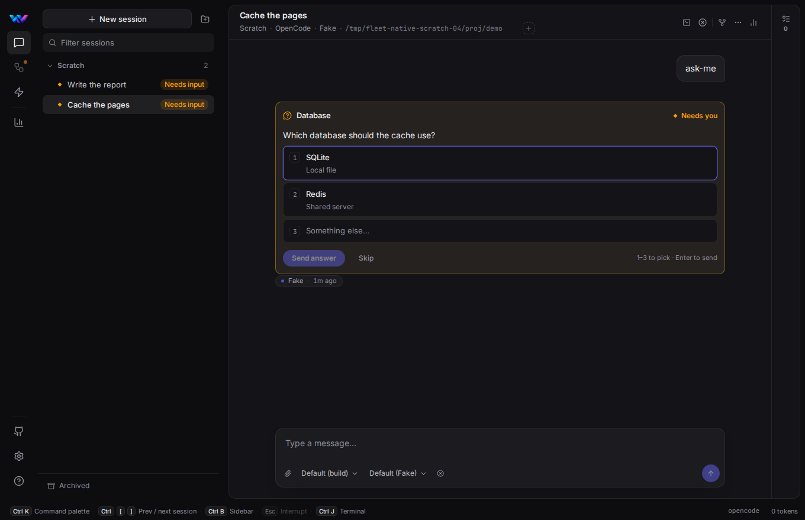
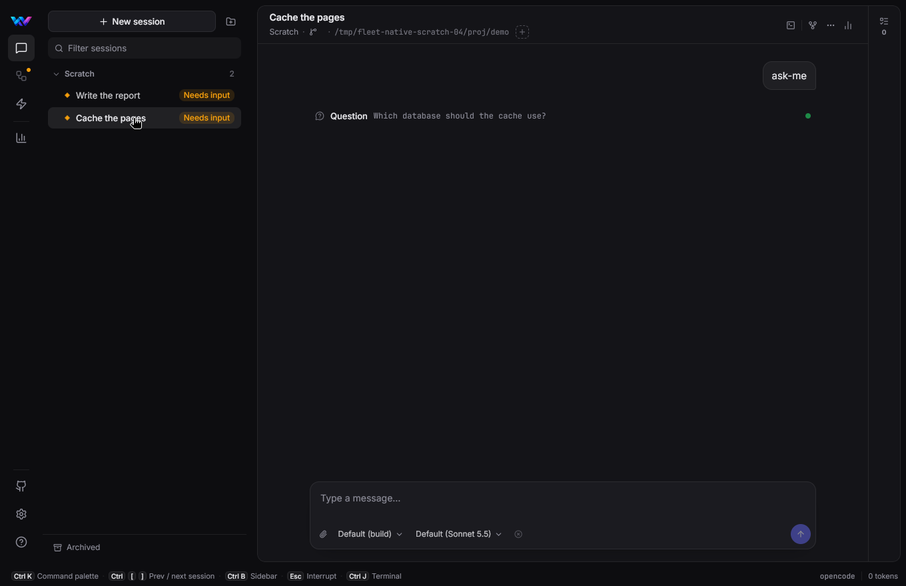
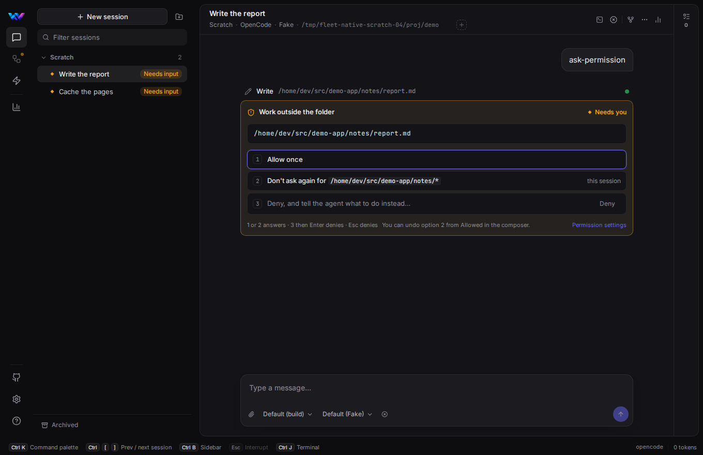
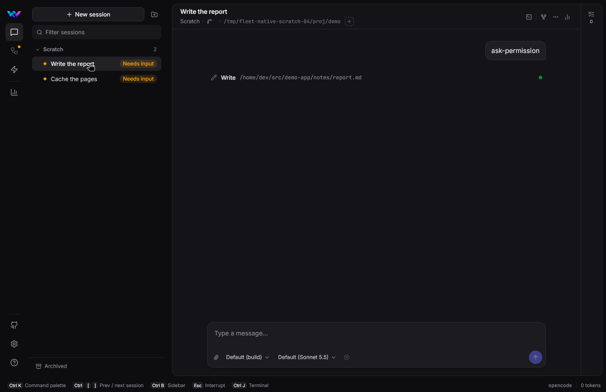

# Component 4: Questions and permissions

The parity checklist for component 4 of `docs/PORT.md`, and the pieces it is built in.

- **weave-fleet commit read:** `bf34b7cbc57fb78ac561737456a5f8643507b7bb` (`main`, 15 November 2026).
  The server the live checks run against is v0.72.0; the routes below were read from `main`'s
  `SessionEndpoints.cs` and confirmed against v0.72.0 (a live `ask-me` and `ask-permission` run).
- **Re-read for piece A (15 November 2026):** weave-fleet `main` is still `bf34b7c`; `PermissionCard.vue`, `permission-wording.ts` and `use-session-permissions.ts` are unchanged since this file was written. The scratch server's scripted model (that commit's `fakellm.py`) has `ask-permission` and `run-tests` but no `write-file` or `edit-file`, so an edit's card can't be had live yet.
- **Native app read:** `main` at `4580109` (`src/view/conversation.rs`, `src/conv/tools.rs`, `src/fleet/`).
- **Paths** are weave-fleet's under `client/src/` unless they start with `src/`, `docs/` or `server:`.
  Short names: QC `components/session/QuestionCard.vue`, PC `.../PermissionCard.vue`, ARL
  `.../AllowedRulesList.vue`, ACH `.../AllowedChip.vue`, ARP `.../AllowedRulesPanel.vue`, PPC
  `.../PagePickCard.vue`, QA `composables/use-question-answer.ts`, SP `composables/use-session-permissions.ts`,
  SPR `composables/use-session-permission-rules.ts`, PW `lib/tools/permission-wording.ts`, QT
  `lib/question-types.ts`, FBC `lib/focus-blocking-card.ts`, PL `lib/permissions.ts`.
- **Row numbers:** 1.x the question card waiting on you, 2.x answered and skipped rows, 3.x the
  permission card, 4.x Fleet's own ask (work for another machine), 5.x the Allowed chip and list,
  6.x the page-pick card, 7.x data, routes and events, 8.x where the cards sit and what else shows
  "needs you".

The gap, visible in the pictures (the light theme is in the same folder): both sessions are stopped
on the user, and the list says "Needs input" in both apps. Fleet draws an amber card under the
conversation: the question with its two choices and "Send answer / Skip", the ask with "Allow once /
Don't ask again / Deny". The native app draws the tool's line (`Question  Which database…`,
`Write  /home/dev/…`) and nothing to answer with: **the user can't unblock an agent from the native
app today.** Taken in a real window on a virtual display (1360×880, the window's default size)
against a scratch Fleet, so both pictures are the same size. The scripted model writes under its
own `$HOME`; it was started with an invented one (`/home/dev`).

## What "done" means

1. A question the agent asks shows as Fleet's amber card under its message: header, text with links,
   choices with their number keys and descriptions, "Something else…", "Pick any that apply.",
   Send answer, Skip, the key hint. Picking, typing, number keys, arrows and Enter work as in Fleet.
   Answered and skipped questions shrink to Fleet's one-line rows.
2. A permission ask the session's level doesn't allow shows as Fleet's card (a command, a diff, a
   path, a sub-agent's, a hand-off to another machine) with Allow once, Don't ask again, Deny with
   words; keys 1, 2, 3, Esc and Enter; failure text; and the answer reaches the agent.
3. "Allowed · N" in the composer lists what "Don't ask again" allowed, with Remove and Remove all,
   dormant under "Allow everything", live across clients.
4. The page-pick card shows while the agent waits on a page and opens it.
5. The state is the server's: asks load on opening, reload after a reconnect, follow
   `permission.asked` / `permission.replied` / `session.permission-rules`, and the answer routes are
   Fleet's. Fleet's tests for all of it pass here under the same names.

## What the native app already has

| Part | State | Where |
|---|---|---|
| `question` tool call as one summary line ("Question  <first question>", `MessageCircleQuestion` icon, status dot) | Done (piece A of component 3) | `src/conv/tools.rs` `question_label`, `src/view/toolrow.rs` |
| Tool classification (`PermissionKind` per tool: read/edit/shell/web/other) | Done | `src/conv/tools.rs` `PermissionKind`, `server_only_kind` |
| Event types `permission.asked`, `permission.replied`, `session.permission-rules`, `session.pages` read into the typed union, handed to subscribers | Done, nothing keeps them | `src/fleet/events.rs` (component 2) |
| Session row "Needs input" (`waiting_input`), diamond glyph, derived status of sub-agents | Done | `src/fleet/state.rs`, `src/view/parts.rs::diamond`, `src/view/sessions.rs` |
| `Part::Tool { state: Value }` keeps the raw state of a stream part (`status`, `input`, `metadata`) | In the model | `src/fleet/model.rs`, `reducer.rs` |
| Text input with caret, selection, clipboard, placeholder | Done | `src/ui/controls.rs::input`, `TextEdit` |
| Popover and dropdown anchored to a key, scrim, centred dialogs; badges, switch, card, separator | Done (component 1) | `src/ui/overlay.rs`, `menu.rs`, `dialog.rs`, `controls.rs` |
| Composer shell with its toolbar (attach, agent and model selects) | Shell only (component 5) | `src/view/sheet.rs::composer` |
| HTTP: `post(base, path, body)` on the link thread, `Post` hand-back | Done | `src/fleet/http.rs`, `link.rs` |
| Tokens: `idle`/`idle_text` are `--status-waiting`/`--status-waiting-text`; `running_text` is `--diff-add-text`; `error_text` is `--diff-del-text`; `accent`, `accent_dim`, `accent_text`, `primary_fg`, `RADIUS_CARD`, `RADIUS_BTN` | Done, but not named for these uses | `src/theme.rs` |
| Anything else in this file: the cards, their state, the stores, the Allowed chip, the page-pick card | **None** | |

No new colour tokens are needed: add the aliases `status_waiting`, `status_waiting_text`,
`diff_add_text`, `diff_del_text` to `theme.rs` (with the CSS variable's name beside each) as
methods or fields pointing at the existing colours, so views read the intent.

## Decisions the pieces need (the owner can overturn)

- **Links in the question text** (`linkifyText`, an `<a>` in a `v-html`): Rune's `text()` has no
  underline and no inline link runs (`docs/RUNE.md`). Piece C splits the text into plain and
  address runs (Fleet's rule, `http(s)` only) and draws addresses in `accent_text`, clicking one
  opens it in the system browser if a run can take a click at the pin; if not, the address stays
  coloured and the gap is listed. The test names are kept.
- **The card's rise animation** (`pcard-rise`, 180 ms, 4 px, off under reduced motion): drawn as a
  fade if Rune can fade an element in; otherwise absent and listed.
- **Permission settings / Machine settings** buttons go to Settings (component 16). Until it
  exists they set the active section in `State` and do nothing else visible; piece A of component 16
  wires them. Same for **Open page** (component 14).
- **Phone inbox and mission control** (`InboxAskRow`, `PermissionChoices`, `QuestionChoices`,
  `NeedsYouColumn`) answer asks too. They are not this component: the phone is out of scope and
  mission control is component 23. They reuse `QA` and `SP`'s routes, which piece B and D build as
  plain Rust a later component can call.

## Rows

### 1. The question card waiting on you (`QC`)

Shown when the tool part's status is `pending` or `running` and `getQuestionInput` found
`input.questions`. One card per question tool part, drawn after the message's tool list (`MessageBubble`).

| # | Row | Source | Native today |
|---|---|---|---|
| 1.1 | Card: grid, gap 12, margin-top 10, padding 12, border 1px `color-mix(--status-waiting 40%, --border)`, `--radius-card`, background `color-mix(--status-waiting 5%, --card-bg)` | QC `.qcard` | Done (piece C): `view::question`, `asks::question`, tests in `tests_questions`. Except the `pcard-rise` animation, not drawn (as 3.1). Checked live and beside Fleet (04c, 04d, 04g). |
| 1.2 | Head: row, gap 8: `MessageCircleQuestion` 15px in `--status-waiting`; title (13px/600, ellipsis, flex 1) = `questions[0].header` or "Question"; right: waiting diamond + "Needs you" (12px/600, `--status-waiting-text`, gap 6) | QC head | None (icon exists, diamond exists) |
| 1.3 | Sub-heading for question `qi > 0` with a header: 12px/600 `--muted`, margin-top 4 | QC `.qcard__subhead` | Done (piece C): `view::question`, `asks::question`, tests in `tests_questions`. Checked live and beside Fleet (04c, 04d, 04g). |
| 1.4 | Question text: 14px/1.5, `--text`, line breaks kept (`pre-line`), `text-wrap: pretty`; web addresses become links (`--accent-text`, underline, offset 2) | QC `.qcard__text`, `lib/linkify-text.ts` | None (see Decisions) |
| 1.5 | "Pick any that apply." (12px `--muted`, margin -4 0 0) when `multiple` | QC `.qcard__hint` | Done (piece C): `view::question`, `asks::question`, tests in `tests_questions`. Checked live and beside Fleet (04c, 04d, 04g). |
| 1.6 | Choices group: grid gap 4; role `group` (multiple) or `radiogroup`; aria-label header or question | QC | Done (piece C): `view::question`, `asks::question`, tests in `tests_questions`. Roles (`group`, `radiogroup`) have no equivalent until Rune exposes an accessibility tree: component 26. Checked live and beside Fleet (04c, 04d, 04g). |
| 1.7 | A choice: full width, row, gap 10, padding 8 10, border 1px `--border`, `--radius-btn`, background `--panel-bg`; hover border `color-mix(--accent 35%, --border)`; disabled opacity .55. Role `radio` or `checkbox`, `aria-checked` | QC `.qcard__choice` | Done (piece C): `view::question`, `asks::question`, tests in `tests_questions`. Except the hover border colour (Rune has none) and `aria-checked`/roles (component 26). Checked live and beside Fleet (04c, 04d, 04g). |
| 1.8 | Key chip: 18×18, border 1px `--border`, radius 5, mono 11px `--muted`, margin-top 1; shows `oi + 1`; in a multiple question a picked option shows a 11px check (stroke 3) instead of the number | QC `.qcard__key` | None (Check icon exists) |
| 1.9 | Picked state: border `--accent`, background `--accent-dim`; the key chip fills `--accent`, ink `--primary-foreground` | QC `[aria-checked=true]` | Done (piece C): `view::question`, `asks::question`, tests in `tests_questions`. Checked live and beside Fleet (04c, 04d, 04g). |
| 1.10 | Choice copy: name 13px/500; description 12px `--muted`, line-height 1.45, line breaks kept; grid gap 1 | QC | Done (piece C): `view::question`, `asks::question`, tests in `tests_questions`. Checked live and beside Fleet (04c, 04d, 04g). |
| 1.11 | "Something else…" row (only when `custom !== false`): same box, align centre, cursor text; key chip shows `options.length + 1`; borderless text input 13px, placeholder "Something else…" (`--muted`), aria-label "Type your own answer"; focus-within border `--accent`; typed text (non-blank) gives the picked look | QC `.qcard__choice--other` | None (input exists) |
| 1.12 | Single-answer exclusivity: picking an option clears the typed text; typing (non-blank) clears the pick. Multiple: picks and typed text combine. Picking a picked option again unpicks it | QC `toggleOption`, `handleCustomInput` | Done (piece C): `view::question`, `asks::question`, tests in `tests_questions`. The clear runs once a frame, so one frame late (no change hook on a field). Checked live and beside Fleet (04c, 04d, 04g). |
| 1.13 | Error line: 12px `--error-text`, `role=alert` | QC `.qcard__error` | Done (piece C): `view::question`, `asks::question`, tests in `tests_questions`. `question-error`. Checked live and beside Fleet (04c, 04d, 04g). |
| 1.14 | Footer: row, wrap, gap 8. Send answer: pill, height 28, padding 0 14, 12px/600, background `--accent`, ink `--primary-foreground`; disabled (opacity .45) while loading or nothing answered; hover opacity .88; label "Sending…" while loading. Skip: pill, transparent, `--muted`, hover `--text` on `color-mix(--text 5%, transparent)`; label "Dismiss" once the question is known gone. Right: key hint 11px `--muted`, margin-left auto | QC `.qcard__foot`, `.qcard__btn` | Done (pieces C and D): Send answer and Skip draw and send (`submit_question`, `reject_question`, `question-submit-button`, `question-dismiss-button`); the hover opacity on Send (.88) is not drawn, Rune has no opacity on hover. Checked live (04g). |
| 1.15 | Key hint text: "Enter to send" when the first question has fewer than 2 choices (options + custom); else "1–N to pick · Enter to send", N = min(choice count, 9), en dash | QC `keyHint` | Done (piece C): `view::question`, `asks::question`; tested in `tests_questions` and `asks::tests_question`. |
| 1.16 | Answer built: per question, the picked labels, plus the trimmed typed text appended when non-empty | QC `submit` | Done (piece C): `view::question`, `asks::question`; tested in `tests_questions` and `asks::tests_question`. `sends_the_picked_choice`. |
| 1.17 | `hasAnyAnswer`: any pick, or any non-blank typed text; Send and Enter need it | QC | Done (piece C): `view::question`, `asks::question`, tests in `tests_questions`. Checked live and beside Fleet (04c, 04d, 04g). |
| 1.18 | Focus: when the card appears with the status active, focus goes to the first choice (else the card), unless the user is typing in a text field elsewhere that has content (an empty composer that autofocused doesn't count) | QC `onMounted`, FBC `focusBlockingCard` | Done (piece D): `fleet::questions`, `view::question`; tested in `fleet::tests::questions`. Focus rule `asks::focus`. |
| 1.19 | Keys on the card: Arrow keys move between choices (up/left back, down/right forward, wrap; only when a choice button has focus); digits 1–9 pick that choice in the question holding focus (first otherwise) or focus the "Something else…" input at `options + 1`; Enter sends when something is answered and focus isn't on a button; in the input Enter sends; any modifier (Cmd/Ctrl/Alt) is ignored; ignored while loading | QC `handleCardKeydown`, FBC `moveChoiceFocus` | Done (piece D): `fleet::questions`, `view::question`; tested in `fleet::tests::questions`. See piece D's note on Enter. |
| 1.20 | Focus ring on the card/choice/buttons: 2px `--accent`, offset 2 (-1 on choices) | QC | Open, owner: Rune. Choices carry the 2px ring, the card itself only when it holds focus (a question with no choices); Rune's own focus ring is a different offset (`docs/RUNE.md`). No change possible here. |
| 1.21 | Skip sends the reject route; Dismiss (when gone) hides the card here and sends nothing | QC `dismiss` | Done (piece D): `fleet::questions`, `view::question`; tested in `fleet::tests::questions`. |
| 1.22 | Fleet says it's gone (HTTP 404 or 409): error text "The agent isn't waiting for this question any more. It was answered somewhere else, or Fleet or the agent restarted.", the button reads "Dismiss", the card stays until dismissed | QC, QA `QuestionGoneError` | Done (piece D): `fleet::questions`, `view::question`; tested in `fleet::tests::questions`. Shown from the `question-gone` scene (not live, see piece D). |
| 1.23 | Other failure: error line "Failed to answer question: <statusText>" or "Failed to reject question: <statusText>"; card stays, buttons enabled again | QA `failure` | Done (piece D): `fleet::questions`, `view::question`; tested in `fleet::tests::questions`. |
| 1.24 | Long text: the title ellipsises; the text wraps; long choice names wrap (`min-width: 0`); many questions stack with their sub-headings | QC | Done (pieces C and D): the title ellipsises, text wraps, long choice names wrap, two questions stack with sub-headings; scenes `question-answered-long` and the two-question scene, both themes (pictures in `shots/parity/04c-question-waiting/`, `04d-question-live/`). |

### 2. Answered and skipped rows (`QC`)

| # | Row | Source | Native today |
|---|---|---|---|
| 2.1 | Answered (status not active and `metadata.answers` present): a framed group (margin 10 0 4, padding 4, border 1px `--border`, `--radius-card`, background `color-mix(--text 3%, transparent)`), one row per question: height 30, padding 0 8, gap 9, 13px | QC `.qrow-group`, `.qrow` | Done (piece D): `fleet::questions`, `view::question`; tested in `fleet::tests::questions`. |
| 2.2 | Row parts: `MessageCircleQuestion` 14px (`--muted` 75%); "Asked" (`--text`, 500); the question (`--muted`, ellipsis, takes the shrink); "→" (`--muted`); the answer (`--text`, 500, max-width 50%, ellipsis); `Check` 13px `--running-text` at the right. Tooltip = the question | QC | Done (piece D): `fleet::questions`, `view::question`; tested in `fleet::tests::questions`. |
| 2.3 | Answer text: the answers joined by ", ", or "No answer" when empty | QC `answerText` | Done (piece C): `view::question`, `asks::question`; tested in `tests_questions` and `asks::tests_question`. |
| 2.4 | Skipped (status `error`, or dismissed here): one row: icon, "Asked", the first question (or "Question"), "Skipped" (12px `--muted`) at the right | QC `qrow__skipped` | Done (piece D): `fleet::questions`, `view::question`; tested in `fleet::tests::questions`. |
| 2.5 | A completed question with no `metadata.answers`, and an unknown status: nothing but the tool line (neither card nor row draws) | QC `v-if` chain, QT | Done (piece D): `fleet::questions`, `view::question`; tested in `fleet::tests::questions`. `a_completed_call_with_no_recorded_answers_draws_neither_card_nor_row`. |
| 2.6 | Status words: `getQuestionStatus` = pending / running / completed / error / unknown; `getQuestionInput` is null for a non-question tool or a malformed state | QT | Done (piece C): `view::question`, `asks::question`; tested in `tests_questions` and `asks::tests_question`. |

### 3. The permission card (`PC`, `PW`)

One card per waiting ask, after the messages and before the page-pick card (`ActivityStream`, 8.1).

| # | Row | Source | Native today |
|---|---|---|---|
| 3.1 | Card: same box as 1.1; `aria-label` "The agent asks: <heading>"; rises in (opacity 0, translateY 4px, 180 ms ease-out; none under reduced motion) | PC `.pcard` | Done in piece A except the rise animation (opacity and 4 px, 180 ms): not drawn, a card appears at once. The card is `view::permission::card`; it is shown from `State.asks` after the messages (the real slot is piece B). |
| 3.2 | Head: `ShieldAlert` 15px `--status-waiting`; heading (13px/600, ellipsis); a "Subagent" pill when a sub-agent asked (border 1px `--border`, 999px radius, padding 0 8, 11.5px `--muted`); right: diamond + "Needs you" (margin-left auto) | PC head | None (icon to add to the generator list) |
| 3.3 | Heading by kind: shell "Run a command"; edit "Edit a file"; web "Go online"; read "Read a file", except for plan/subagent/skill/fleet/question tools which read "Use <tool>"; other "Use <tool>", and `external_directory` is "Work outside the folder"; a hand-off's own title or "Send work to <machine>" | PW `permissionHeading` | Done (piece A): `asks::wording::permission_heading`, tested under Fleet's names. |
| 3.4 | Command block (kind shell with a title): padding 9 12, border 1px `--border`, `--radius-btn`, background `--panel-bg`, mono 12.5px, no wrap, scrolls sideways; the directory above it (11.5px `--muted`), then "$ " (`--muted`) and the command | PC `.pcard__cmd`, `__cwd`, `__prompt` | Done (piece A): scrolls sideways; the directory line only when the ask has one (the live shell ask sends none). |
| 3.5 | File block (kind edit): box as 3.4 with a file line (padding 6 12, 11.5px `--muted`): the title or tool name (ellipsis), `+N` (`--diff-add-text`), `−N` (`--diff-del-text`, a real minus); lines in a scroller (max-height 240, border-top) when there are changes | PC `.pcard__diff` | Done (piece A). |
| 3.6 | Diff lines: the file headers a unified diff starts with are dropped (`Index: `, `===…`, `--- `, `+++ `); `@@` lines are hunk (`--muted`), `+` add (background 10% `--diff-add`), `-` del (10% `--diff-del`), else context; mono 12px, padding 0 12, no wrap; an empty line draws a space | PC `diffLines` | Done (piece A) except one thing: a line's tint reaches only the width of the longest line, so in a box wider than every line the tint stops short (Rune has no "fill the scroller's width" inside `scroll_xy`; `docs/RUNE.md`). |
| 3.7 | A write that changes nothing (headers only): the file line shows, no lines, no counts | PC `changes` | Done (piece A). |
| 3.8 | Anything else with a title (an address, a folder): the plain block of 3.4 without prompt or directory | PC | Done (piece A). |
| 3.9 | Choice 1: key chip "1", "Allow once". Choice 2: chip "2", `dontAskAgainWording`: "Don't ask again for" + code of the harness's patterns (joined ", ", `*` dropped), else per kind "…for file edits" / "…for commands" / "…for web access", else "…for" + the tool; scope text "this session" right-aligned (12px `--muted`; hidden under 520 px) | PC, PW `dontAskAgainWording` | Done (piece A) except: the scope text ("this session") is not hidden under 520 px, and the border does not tint to the accent on hover (Rune has no hover border colour). |
| 3.10 | Choice 3 (deny): chip "3"; borderless input (13px, placeholder "Deny, and tell the agent what to do instead…", aria-label "Deny, with an optional message for the agent"); a "Deny" pill (height 24, padding 0 10, 12px `--muted`; hover `color-mix(--error 10%, transparent)` and `--error-text`). Clicking the row focuses the input; clicking Deny doesn't | PC `.pcard__choice--deny` | Done (pieces A and B): clicking the row focuses the field, Enter denies with the words, clicking Deny denies (`clicking_the_deny_row_puts_the_caret_in_the_field_and_clicking_deny_denies`). |
| 3.11 | Choice boxes as 1.7 (flex centre, `min-width: 0`); the `code` in a name: margin-left 4, padding 0 4, radius 4, background `color-mix(--text 6%, transparent)`, mono 12px | PC | Done (piece A). |
| 3.12 | Answering sends `once`, `always` or `reject`; Deny sends the typed words (trimmed; none when empty) | PC `answer`, SP `answer` | Done (piece B): `State::answer_ask`; a hand-off sends no words. |
| 3.13 | Footer: wrap, gap 8, 11px `--muted`: "1 or 2 answers · 3 then Enter denies · Esc denies"; "You can undo option 2 from Allowed in the composer."; "Permission settings" (11px `--accent-text`, margin-left auto, underline on hover). The two spans hide under 520 px | PC `.pcard__foot` | Done (piece A) except: the two spans are not hidden under 520 px, and "Permission settings" does not underline on hover (colour only). It sets `State.settings_section` ("permissions" or "machines"); Settings (component 16) reads it. |
| 3.14 | Keys: arrows move between the choice buttons (1.19); `1` allow once, `2` always, `3` focus the deny input; Esc anywhere in the card denies; Enter in the deny input denies with the words; modifiers ignored. Focus starts on "Allow once" unless the user is typing elsewhere | PC `handleCardKeydown`, FBC | Done (piece B): `view::permission::on_key` and the deny field's `on_input_key`; focus starts on Allow once (`fleet::asks::focus_new_ask`, rule in `asks::focus`). Gap: with two cards waiting the keys act on the first (buttons share keys); a key counts only while focus is inside a card. |
| 3.15 | Failure: the card stays; the error line shows Fleet's own text (`error`, `detail` or `title` of the body) or "The answer didn't reach the agent (HTTP <status>)."; buttons usable again. While answering, all choices are disabled | SP `errorMessage`, PC | Done (piece B): the error line (`permission-error`), choices at opacity .55 and presses ignored while answering. A refusal can't be made live on the scratch Fleet: shown from the `ask-failed` and `ask-answering` scenes and the fake-server test. |
| 3.16 | Long text: the heading ellipsises, the command scrolls sideways, the diff scrolls at 240 px, "Don't ask again" names ellipsise | PC | Done (piece A): the heading and the command ellipsise or scroll, the diff scrolls at 240, the pattern code ellipsises. |
| 3.17 | The ask's wire shape: `id, sessionId, kind, tool, title, detail, directory, always[], callId, subagent, askedAt, handoff`; unknown `kind` reads as "other"; an ask missing `id`, `sessionId` or `tool` is ignored; empty strings read as none | SP `toPermissionAsk` | Done (piece A): `asks::permission::to_permission_ask`, tested ("ignores an ask it can't read"). |
| 3.18 | Fleet's one-line preview of an ask, "Wants to run `git push`", is used by the phone inbox and mission control only | PW `askPreviewWording` | Out of this component; port it with the wording (piece A) so component 23 has it |

### 4. Fleet's own ask: work for another machine (`PC`)

An ask with `handoff` set (an agent wants to send work to a machine set to Ask).

| # | Row | Source | Native today |
|---|---|---|---|
| 4.1 | Heading = the ask's title or "Send work to <machine>"; no command/diff/block; "Subagent" pill as 3.2 | PC, PW | Done (piece A). |
| 4.2 | Detail list (grid `max-content / 1fr`, gap 4 14, padding 9 12, border and fill as 3.4, 12.5px; values mono, ellipsis): Machine ("<machine> · <OS>", OS = Linux / macOS / Windows or as sent), Session (if any), Folder (if any), Branch ("the folder as it is" when none), Harness ("its default" when none), Message (when a session) or Task | PC `handoffRows` | Done (piece A): `handoff_rows`. |
| 4.3 | Note: "It runs under <machine>'s permission level: **<Ask before changes / Allow edits / Allow everything>**." or "unknown (that Fleet doesn't say)" | PC `handoffLevel`, PL `PERMISSION_LEVEL_NAMES` | Done (piece A): `level_name`. |
| 4.4 | Choices: "1 Allow once"; "2 Always for <machine>" with scope "sets <machine> to Always"; "3 Not <machine>" with scope "sets <machine> to Never" (no deny input, no message sent) | PC | Done (piece A). |
| 4.5 | Keys: 1, 2, 3 answer once, always, reject; **Esc does nothing**; arrows still move | PC `handleCardKeydown` | Done (piece B): Esc is taken and does nothing; 1, 2, 3 answer; arrows move. |
| 4.6 | Footer: "1, 2 or 3 answers"; "You can change it on <machine>'s card."; "Machine settings" | PC | Done (piece A). |

### 5. The Allowed chip and list (`ACH`, `ARP`, `ARL`, `SPR`)

| # | Row | Source | Native today |
|---|---|---|---|
| 5.1 | Chip in the composer toolbar after the effort toggle, hidden in a side conversation and while the session has no rule: `ShieldCheck` 14px + "Allowed · N", toolbar-icon button, auto width, padding 0 8, 12px, no wrap; tooltip "What you told the agent not to ask about again" | ACH, `Composer.vue` | Done (piece E): `view::allowed::chip`, after the effort slot, hidden with no rule and in a side conversation (and in shell mode, as Fleet's template does). |
| 5.2 | Flashes once when a rule is added (background `color-mix(--primary 35%, transparent)` fading to none over 0.9 s; none under reduced motion); closes itself when the count reaches 0 | ACH `watch(count)` | Done (piece E): the flash is drawn from `State.clock`; the popover closes itself at 0. |
| 5.3 | Popover: opens above, aligned start, offset 8, 22rem wide (308 px) | ACH | Done (piece E): `anchored(.., Top, Start, 8)`, 308 px wide, `p-4`, square corners like Fleet's `PopoverContent`. |
| 5.4 | The panel reads the level (`PermissionLevel.<harness>`, else `PermissionLevel`, else "all") from Fleet's preferences, only when opened | ARP, `use-permission-level.ts`, PL | Done (piece E): `State::open_level` reads the preferences the app already loads, and opening the popover reads them again (`open_allowed`). |
| 5.5 | One row per rule, oldest first, divided by 1px `--border`: padding 6 0; text 13px (wraps anywhere), code mono 12px; below it the age, compact (11px `--muted`); a ghost small "Remove" | ARL | Done (piece E): one `rich` text per row (code run mono), age beneath, ghost small Remove. |
| 5.6 | Rule wording: shell "Run any command" / "Run `<patterns>`"; edit "Edit files" / "Edit `<patterns>`"; web "Go online" / "Go online: `<patterns>`"; other "Use `<tool>`" or "Use `<tool> on <patterns>`"; all followed by " without asking"; `*` patterns dropped; a rule with no pattern is **broad** and its text is tinted `--warning` (`#b45309` fallback) | ARL, PW `allowedRuleWording` | Done (piece E): `asks::wording::allowed_rule_wording` (piece A); the broad tint is `Theme::warning`. |
| 5.7 | "Remove all" (ghost small, right-aligned, border-top, padding-top 4) only when there are 2 or more rules | ARL | Done (piece E). |
| 5.8 | Dormant: with level "all", rows at opacity .55 and a note above: "Not needed now: this session allows everything. They count again if you turn asking back on." (12px/1.4 `--muted`) | ARL | Done (piece E). |
| 5.9 | Remove: the rule leaves the list at once; `DELETE /api/sessions/{id}/permission-rules/{ruleId}`; if the status is not ok and not 404, or the call throws, the list is loaded again | SPR `remove` | Done (piece E): `State::remove_rule`; a refusal that isn't 404, or a call that fails, loads the list again. |
| 5.10 | Remove all: list empties at once; `DELETE /api/sessions/{id}/permission-rules`; same recovery | SPR `removeAll` | Done (piece E): `State::remove_all_rules`, same recovery. |
| 5.11 | The list loads (`GET /api/sessions/{id}/permission-rules`) when the session opens and after a reconnect; `session.permission-rules` on `session:<id>` carries the whole list (`payload.sessionId`, `payload.items`) and wins over a load in flight; a rule is `{id, kind (default "other"), tool, patterns[], createdAt}`, one without `id` or `tool` is ignored | SPR | Done (piece E): `fleet::rules::Rules`, loaded in `open_session` and `on_reconnected`; `session.permission-rules` wins over a load in flight. |
| 5.12 | Relative age, compact ("now", "5m", "2h", "3d" as `RelativeTime compact` does) | `components/ui/relative-time` | Done (piece E): `src/ui/age.rs` over `fleet::row_status::format_relative`; the tooltip carries the exact time. |
### 6. The page-pick card (`PPC`)

| # | Row | Source | Native today |
|---|---|---|---|
| 6.1 | Shown (not in a side conversation) while the session's `activityStatus` is `waiting_input` and one of its page canvases has `page.choice.status === "waiting"` | PPC, `composables/use-waiting-page.ts` | Done (piece F): `State::waiting_page` (`fleet::pages`), shown through `view::pagepick::shown`, which hides it for a side conversation (the side stream, component 15, passes `true`; the main stream is the only one drawn today). |
| 6.2 | Card: row, gap 10, margin-top 10, padding 12, the amber border and fill of 1.1; `PanelsTopLeft` 16px `--status-waiting`; title "Pick on the page" (13px/600); line "<page title> · or type a message to answer instead" (12px `--muted`, ellipsis, margin-top 2); "Open page" button (padding 4 10, border 1px `--border`, `--radius-btn`, 12px; hover `--accent-dim`) | PPC | Done (piece F): `view::pagepick`, same sizes and tints as Fleet's card; drawn beside Fleet's own live, both themes. |
| 6.3 | Open page shows the page's canvas in the content panel (`server.canvasId` or the canvas id) | PPC, `ActivityStream.handleShowCanvas` | Done as far as this component goes (piece F): `State::open_page` sets `page_target` and opens the content panel; the page's tab is component 14's. Component 10, piece C: `open_page` also activates the tab (`focus_server_canvas`; the server reopens a closed one). | **Closed by component 10 (18 November 2026):** the page canvas is a tab on 10's list (piece C); its body is 14's.
| 6.4 | A waiting choice is live only while the session is in a turn (`isChoiceLive`: waiting and activity not idle); a Fleet restart leaves "waiting" behind | `lib/page-choice.ts` | Done (piece F): `is_choice_live`, tested under `page-choice.test.ts`'s case; a restart's stale "waiting" with the session idle draws no card. |
| 6.5 | Where the page and its choice come from: the session's canvases (`GET` of its canvases and `session.pages`), component 14's store | `stores/canvases.ts`, `lib/server-canvas.ts` | Done (piece F): `fleet::pages` loads `GET /api/sessions/{id}/canvases` on open and reconnect and follows `canvas.updated`/`canvas.closed` (never back a version); `session.pages` is only a count and plays no part. `waiting_page` is the one function component 14's store replaces. |

### 7. Data, routes and events

| # | Row | Source | Native today |
|---|---|---|---|
| 7.1 | Answer a question: `POST /api/sessions/{id}/questions/{requestId}/answer`, body `{answers: string[][]}`; `requestId` is the tool part's `callId` | QA, `MessageBubble.makeSubmitHandler`, server: `SessionEndpoints.cs` | Done (piece D): `http::answer_question`; checked live against the scratch Fleet (04g, `ask-me` answered "Redis"). |
| 7.2 | Skip: `POST /api/sessions/{id}/questions/{requestId}/reject`, no body | QA | Done (piece D): `http::reject_question`; checked live (04g, `ask-me` skipped). |
| 7.3 | 404 and 409 mean gone (1.22) | QA `failure` | Done (piece D): 404 and 409 read as gone; tested against a fake server. |
| 7.4 | List waiting asks: `GET /api/sessions/{id}/permissions` (oldest first, a sub-agent's included); loads on session open and after a reconnect; a load that was overtaken by an event is dropped; a failed load is logged, not shown | SP `load` | Done (piece B): `State::load_asks` on open and in `on_reconnected`; a load overtaken by an event is dropped. |
| 7.5 | `permission.asked` on `session:<id>`: payload is an ask; added unless its id is held already; `permission.replied`: payload `{id}`; the ask is removed. An ask that can't be read is ignored | SP | Done (piece B): `State::on_ask_event`, on `session:<id>` topics only. |
| 7.6 | Answer: `POST /api/sessions/{ask.sessionId}/permissions/{ask.id}`, body `{reply: "once"\|"always"\|"reject", message: string\|null}` (message trimmed, null when empty); ok or **404** removes the ask from every session's list; any other status throws with Fleet's text (3.15). Fleet's own hand-off asks use the same route (ids start with the hand-off prefix; the server saves the machine's setting) | SP `answer`, server | Done (piece B): `http::reply`; ok or 404 forgets the ask in every session. |
| 7.7 | Asks are kept per session, so switching back shows them at once; a sub-agent's ask shows on the session it works for (the ask's `sessionId` is the sub-agent's, `subagent` is set) | SP `asksBySession` | Done (piece B): `fleet::asks::Asks`, per session; answers go to the ask's own `sessionId`. |
| 7.8 | The session's level and rules come from `GET /api/preferences` (`PermissionLevel`, `PermissionLevel.<harness>`) | `stores/preferences.ts`, PL | Done (piece E): `PermissionLevel::of` (harness key, else `PermissionLevel`, else all). |
| 7.9 | **The server drops `question.asked` on purpose** (`DomainEventTranslator`). Question cards are built from the assistant message's `question` tool part (status pending/running, `state.input.questions`), and `waiting_input` marks the session. Never wait for `question.asked` | `docs/research` (later notes), QT | n/a |
| 7.10 | Stream part shape: Fleet's reducer hands the card an accumulated tool part with `state: {status, input, metadata}`; the REST history gives `toolName`, `arguments`, a numeric `state` and `callId`-less ids (`toolCallId`), so history parts must go through the same normalising the stream does (component 2's `reducer.rs`). Check the card on an older message, loaded from history, in piece D | `lib/client-types.ts`, `docs/parity/02` | Done (piece D): see its note: the app's conversation comes from the hub's snapshot in the stream's shape; an answered question on a session opened later draws its row (checked live). |
| 7.11 | Agents can't answer: the routes refuse an agent caller (`RefuseAgent`); nothing for the client to do | server | n/a (nothing to do in the client). |

### 8. Where the cards sit, and the rest of "needs you"

| # | Row | Source | Native today |
|---|---|---|---|
| 8.1 | Order under the messages: load-older row, messages (with their question cards inside), **permission cards**, **page-pick card**, mod drafts, interrupted card, working line. The permission and page-pick cards take `margin 0 auto 16`, `max-width 760`, full width (class `activity-permission`) | `ActivityStream.vue` 880-896; `docs/parity/03` row 1.x | Permission slot done (piece B): after the messages, `max-width 760`, 16 below; page-pick card slot done (piece F), after the permission cards. |
| 8.2 | A question card sits inside its message after the tool list; `questionParts` are kept apart from tools and never folded away | `MessageBubble.vue` 328, `docs/parity/03` 2.30, 1.26 | Done (piece D): `view::conversation::message_row` draws it after the message's parts; a question call has no tool row. |
| 8.3 | While a question or ask waits, the working line reads "Needs input" with the diamond (component 3, 1.80), the session row shows "Needs input", the header says so | `WorkingIndicator`, `ActivityStream.isWaitingForInput` | Done (04g): while a question or ask waits the working line reads "Needs input" with the diamond and the session row says "Needs input" (pictures `shots/parity/04g-sweep/`). |
| 8.4 | The composer is not locked while a card waits: typing a message answers a page pick, and a message queues as usual | PPC text, Composer | Done (04g): the composer is not locked while a card waits (test `typing_while_a_card_waits_is_the_composers`, below); a page pick answered by typing is Fleet's server's reading of the message. |
| 8.5 | After Fleet restarts the question is lost: "Fleet restarted while this was waiting for you…" (component 3, 1.84) | `SessionInterruptedCard` | Component 3 |
| 8.6 | Session-level desktop notification when a session needs you | desktop shell | Component 24 |

## Tests to port

Names kept (`snake_case` in Rust, a comment with Fleet's sentence). All under `src/` in the same
style as `src/fleet/tests/`.

- `components/session/__tests__/QuestionCard.test.ts` (12): "takes keyboard focus on its first option, and the arrow keys move between options"; "leaves focus alone while the user types in the composer"; "asks for an answer and marks itself as needing you"; "sends the picked choice"; "picks a choice by its number key and sends on Enter"; "sends typed text instead of a choice"; "skips"; "shrinks to a row with the question and its answer once answered"; "says when a question was skipped"; "says the agent isn't waiting and lets the user dismiss the leftover card here, sending nothing"; "keeps the line breaks agents put in the question and option descriptions"; "still takes focus from an empty composer that autofocused".
- `components/session/__tests__/PermissionCard.test.ts` (13): "says what goes there and under whose permission level, with Always and Not for that machine"; "answers 1, 2 and 3 as once, always and reject, and Esc doesn't answer"; "takes keyboard focus on its first choice and moves it with the arrow keys"; "leaves focus alone while the user types in the composer"; "shows the command and that the session needs you"; "shows an edit's diff without the file headers, with what it adds and removes"; "shows no lines for a write that changes nothing"; "says when a subagent asked"; "answers once, or for the rest of the session"; "answers by number key, and denies with Escape"; "denies with the words typed for the agent on Enter"; "keeps the card and says why when the answer fails"; "opens Permission settings".
- `components/session/__tests__/AllowedRulesList.test.ts` (4): "reads each rule in plain words"; "removes one rule or all of them"; "greys the rows and says why when the level allows everything"; "says nothing about being dormant when asking is on".
- `composables/__tests__/use-question-answer.test.ts` (2): the 404/409 case ("says the agent isn't waiting…") and "keeps the status for other failures".
- `composables/__tests__/use-session-permissions.test.ts` (6): "loads what waits when the session opens, and again after a reconnect"; "adds an ask when one is asked and drops it when it's answered or gone"; "ignores an ask it can't read"; "answers on the session whose harness asked, and the card goes"; "keeps the card and says why when the answer didn't reach the agent"; "follows the session it's shown for".
- `composables/__tests__/use-session-permission-rules.test.ts` (5): "loads the rules when the session opens"; "takes the whole list a session.permission-rules event carries, and only for its own session"; "removes a rule at once and tells Fleet"; "loads the list again when Fleet refuses a removal"; "removes every rule".
- `lib/__tests__/permission-wording.test.ts` (5): "the desktop card's heading and 'Don't ask again' line, per kind"; "the card names the harness's patterns when it sent some"; "the phone's heading and 'Don't ask again', per kind" (the shared wording half only); "the phone inbox's one-line preview, per kind"; "is headed by what the agent wants there, and Always is for that machine, on the phone too".
- `lib/__tests__/allowed-rule-wording.test.ts` (4): "says what a command pattern lets the agent run"; "lists every pattern one click allowed"; "marks a rule with no pattern as broad"; "names another tool".
- `lib/__tests__/linkify-text.test.ts` (4): "links a bare web address and keeps the text around it"; "escapes markup in the text and in the address" (as runs: markup stays literal text); "reads no Markdown and links no scheme but http(s)"; "leaves text without an address as escaped text".
- Not ported, with the reason: `phone-tool-sites.test.ts`, `PhoneAllowedSheet`, `InboxPageFirstLoad.test.ts` (phone, out of scope); `session-calls-machine.test.ts` (Vue composable wiring to a machine target; component 17); the Vue `RelativeTime` tests belong to whoever ports `RelativeTime` (piece E ports its compact formatting under Fleet's names if tests exist).
- New for native: a test that a card only builds when its ask or part is present (the view is a plain function of `State`), and one that every card's choices have keys a test can click (`question-pill-<label>`, `permission-allow-once`, …, copied from Fleet's `data-testid`s).

## What cannot be done, and why

- **Clickable links in text**: see Decisions. Colour only if Rune has no inline click run.
- **Underline** on `text()`: none at the pin (`docs/RUNE.md`); the "Permission settings" hover underline becomes a colour change.
- **`pcard-rise`** and **`allowed-flash`** animations: only if Rune can animate opacity/background of an element in `view()`; Rune can't loop a rotation (component 2F) but fades work. List what is left.
- **Copy to clipboard**: none needed here.
- **Settings navigation** and **Open page**: need components 16 and 14. The buttons are drawn and set the target in `State`; the pieces say so.
- **Screen readers**: the roles (`radiogroup`, `checkbox`, `alert`, `aria-label`) have no equivalent until Rune exposes an accessibility tree; listed for component 26.
- **Phone inbox and mission control answering**: out of scope / component 23, which reuse the routes built here.

## Pieces, in build order

Each piece is one pull request of a few hundred lines of Rust (at most about 800), done by a fresh
session from this file alone. A piece takes only its rows. Pictures are the native app beside
Fleet's own client, same state, same size, both themes, under
`shots/parity/04<letter>-<topic>/`; for a piece with no view they are the app showing the behaviour.
Pictures come from the scratch Fleet and its scripted model (`ask-me`, `ask-permission`; the
permission level preference set to "ask" with `PUT /api/preferences/PermissionLevel
{"value":"ask"}`). Start the scripted model with an invented `HOME` so a path in a picture isn't
the machine's. A piece adds a scene for each state it draws, ticks its rows here, updates
`docs/PORT.md` and adds what it learned to `docs/RUNE.md`. Logic goes in plain Rust with no Rune in
it, in `src/asks/` (a new folder: `wording.rs`, `question.rs`, `rules.rs`) and `src/fleet/asks.rs`
for what talks to the server, with Fleet's tests ported under the same names.

### A. Permission card: wording, parsing and the view (from mock data) — done
- **Rows:** 3.1-3.11, 3.13, 3.16-3.18, 4.1-4.4, 4.6 (the view and its wording; no sending yet).
- **Files:** `src/asks/mod.rs`, `src/asks/wording.rs` (`permissionHeading`, `dontAskAgainWording`, `askPreviewWording`, `allowedRuleWording`, the diff-line splitter), `src/asks/permission.rs` (the `PermissionAsk` type and its reader), `src/view/permission.rs`, `src/theme.rs` (aliases), `tools/gen-icons.py` (`ShieldAlert`, `ShieldCheck`; regenerate `src/icons.rs`), `src/mock.rs` (an ask of each kind), `src/lib.rs` (scenes).
- **Depends on:** nothing. ~650 lines with tests.
- **Tests to port:** `permission-wording.test.ts` (5), `allowed-rule-wording.test.ts` (4), PermissionCard's "shows the command and that the session needs you", "shows an edit's diff without the file headers…", "shows no lines for a write that changes nothing", "says when a subagent asked", the hand-off card's "says what goes there and under whose permission level…" (view half).
- **Pictures:** scenes for a command, an edit with a diff, a path ask (`external_directory`), a sub-agent's, a hand-off, a write that changes nothing, long text. Fleet's own card can be had live for two of them: the path ask (`ask-permission`) and a command (`run-tests` while the level is "ask": the harness asks before the shell tool runs). For the others the scripted model has no keyword; say in the pull request "Fleet not shown" for that state and compare with the CSS in the rows. A model that raises more asks can be added to the scratch clone of weave-fleet's `fakellm.py` (never committed to either repository). Dark and light.

### B. Permission asks live: load, events, answer, keys — done
- **Rows:** 3.12, 3.14, 3.15, 4.5, 7.4-7.7, 7.11, 8.1 (the slot), 3.13's Settings button hand-off.
- **Files:** `src/fleet/asks.rs` (store per session, `load`, event handling, `answer`), `src/fleet/http.rs` (`permissions`, `reply`), `src/fleet/state.rs`, `src/fleet/mod.rs`, `src/view/conversation.rs` (the cards after the messages), `src/view/permission.rs` (keys, focus, deny input, loading, error), `src/lib.rs`, `src/fleet/tests/asks.rs`.
- **Depends on:** A. ~550 lines.
- **Tests to port:** `use-session-permissions.test.ts` (6), PermissionCard's "answers once, or for the rest of the session", "answers by number key, and denies with Escape", "denies with the words typed for the agent on Enter", "keeps the card and says why when the answer fails", "takes keyboard focus on its first choice and moves it with the arrow keys", "leaves focus alone while the user types in the composer", "answers 1, 2 and 3 as once, always and reject, and Esc doesn't answer", "opens Permission settings".
- **Pictures (taken, `shots/parity/04b-permission-live/`):** the live run: `ask-permission` shows the card in the native app; Allow once in the app and the next frame has no card and the agent's "Wrote the report" line; a second run with Deny and words; the error state against a scratch Fleet whose ask was answered elsewhere (404 removes it) and against a refused answer. Each beside Fleet's own client, dark and light. Check the HTTP calls in the scratch Fleet's log.

### C. Question card: logic and the waiting view — done
- **Rows:** 1.1-1.17, 1.20, 1.24, 2.3, 2.6 (state and drawing; no sending yet).
- **Files:** `src/asks/question.rs` (`QuestionInput`, `getQuestionInput/Answers/Status`, selection state and its rules, answer builder, key hint, link runs), `src/view/question.rs`, `src/mock.rs`, `src/lib.rs` (scenes), `src/icons.rs` via the generator if `MessageCircleQuestion` at 15 px needs nothing new.
- **Depends on:** A (the card's box and number-key chips are shared: put them in `src/view/ask_card.rs`, created by A or moved there by C). ~650 lines.
- **Tests to port:** QuestionCard's "asks for an answer and marks itself as needing you", "keeps the line breaks agents put in the question and option descriptions", the selection half of "sends the picked choice" and "sends typed text instead of a choice", "picks a choice by its number key and sends on Enter" (the number-key half), `linkify-text.test.ts` (4), plus new tests for single and multiple exclusivity (1.12), `hasAnyAnswer`, the key hint.
- **Pictures:** scenes: one question with two choices (Fleet's own card live from `ask-me`); a picked choice (click it in Fleet for the same state); a multiple question with "Pick any that apply."; typed text in "Something else…" (type it in Fleet); two questions with sub-headings; long text with a link; no custom answer. The scripted model raises only the one single-choice question, so the last four are "Fleet not shown": compare with the CSS in the rows, or extend the scratch clone of `fakellm.py` (never committed anywhere). Dark and light.

**Done in C (rows 1.1-1.17, 1.20, 1.24, 2.3, 2.6; pictures `shots/parity/04c-question-waiting/`, native beside Fleet's own client for the card, a pick and typed text, both themes; the multiple, two-question, long-text and no-custom states are scenes only, the scripted model raises just `ask-me`).** The card draws in the permission slot after the messages (`sheet.rs`) from `State.questions`; piece D moves it inside its message (8.2) and fills it from the tool part. Gaps, with reasons:
- 1.7 hover border (accent 35%): Rune has no hover border colour; not drawn. 1.8 check stroke 3: icons have one stroke; drawn at 11px.
- 1.2 title not truncated at 30 characters: Fleet doesn't either (the header is the model's); it ellipsises at the card's width.
- 1.4 selectable and links open the system browser (`tx.open_url`); not clicked in a window here, only built.
- 1.20 focus ring on the card itself: no card focus yet (piece D focuses the first choice). Choices carry the 2px ring.
- 1.12 "typing clears the pick": Rune has no change hook on a field, so `State::keep_questions` runs once a frame (one frame late).
- 1.14 Send answer and Skip are drawn, press nothing, and the hover on Send (opacity .88) is absent: piece D.
- 1.9/1.11 picked and typed looks match Fleet's; Fleet's real `<input>` shows a faint inner box when focused (browser default), not copied.

### D. Question card live: answer, skip, answered and skipped rows — done
- **Rows:** 1.18, 1.19, 1.21-1.23, 2.1, 2.2, 2.4, 2.5, 7.1-7.3, 7.9, 7.10, 8.2.
- **Files:** `src/fleet/asks.rs` or `src/fleet/questions.rs` (`answer_question`, `reject_question`, gone/other failure), `src/fleet/http.rs`, `src/view/conversation.rs` (a question part draws the card or the row after its message's tool list; it is never folded), `src/view/question.rs` (keys, focus, loading, error, Dismiss), `src/fleet/tests/questions.rs`.
- **Depends on:** C, and B for the shared focus and key helpers (`src/asks/focus.rs`: `focusBlockingCard` rule, `moveChoiceFocus`). ~600 lines.
- **Tests to port:** `use-question-answer.test.ts` (2), QuestionCard's "takes keyboard focus on its first option, and the arrow keys move between options", "leaves focus alone while the user types in the composer", "still takes focus from an empty composer that autofocused", "sends the picked choice", "picks a choice by its number key and sends on Enter", "sends typed text instead of a choice", "skips", "shrinks to a row with the question and its answer once answered", "says when a question was skipped", "says the agent isn't waiting and lets the user dismiss the leftover card here, sending nothing".
- **Pictures:** live: `ask-me`, the card; a click on "Redis" then Send answer; the answered row ("Asked  Which database should the cache use? → Redis ✓") and the agent's reply; a skipped one; the gone state (answer the same question from curl first, then in the app); an older question loaded from history (7.10). Beside Fleet's own client, dark and light.

**Done in D (rows 1.18, 1.19, 1.21-1.23, 2.1, 2.2, 2.4, 2.5, 7.1-7.3, 7.9, 7.10, 8.2; pictures `shots/parity/04d-question-live/`, native beside Fleet's own client for the waiting card, the answered row and the skipped row, both themes, from a live run of `ask-me`; the gone, failed and sending states and the two-question and long answered rows are scenes only).** The card is made from the message's `question` tool part (`State::sync_questions`, from `sync_open`), never from an event; `view::conversation::message_row` draws the card, the answered row or the skipped row after the message's other parts. Gaps, with reasons:
- 7.10: the app's conversation (live and on reopening a session) comes from the hub's snapshot, whose parts already have the stream's shape (`tool`, `callID`, an object `state`); the REST `toolName`/`arguments`/numeric `state` shape is only read by the export. Checked live: an answered question on a session opened later draws its row.
- 1.22 (gone) can't be made live with Fleet's own client or the app: both show the answered row the moment the event arrives, before a second answer could be sent. Shown from a scene; the 404 and 409 paths are tests against a fake server.
- 1.23 `statusText`: HTTP/1.1 reason phrases for the codes Fleet answers with (`fleet::questions::reason`); a code not in the table gives an empty phrase, as HTTP/2 would.
- 1.19 Enter on a focused choice or button is that button's press (the browser's click), as in Fleet: after a digit pick focus stays on the first choice, so Enter then toggles it. Fleet's own test presses on the card, so ours does too.
- 1.20 the card takes the 2px ring only when it holds focus itself (a question with no choices).
- 2.2 the answer's `max-width: 50%` is half the column less the row's padding (`COLUMN`), as Rune has no percentage widths.
- The question text field's own hash must be part of the message's `memo` key (Rune's memo docs): without it a click on the field did nothing (`docs/RUNE.md`).
- 2.5: Fleet draws the "tool line" for a finished call with no answers; here a question call never has a tool row (row 8.2), so nothing draws.

### E. Allowed rules: the store, the list, the chip — done
- **Rows:** 5.1-5.12, 7.8.
- **Files:** `src/asks/rules.rs` (`AllowedRule`, reader, level from preferences, `PermissionLevel` and its names from `lib/permissions.ts`), `src/fleet/rules.rs` (load, `session.permission-rules`, optimistic remove, reload on refusal), `src/fleet/prefs.rs` (a minimal `GET /api/preferences` read, shared later with Settings), `src/view/allowed.rs` (chip, popover, list), `src/ui/age.rs` (`RelativeTime` compact), `src/view/sheet.rs` (the chip in the composer toolbar after the effort slot), `src/fleet/tests/rules.rs`.
- **Depends on:** A (wording). The popover is from component 1. ~650 lines. If component 5 has rebuilt the composer toolbar by then, put the chip in its slot instead.
- **Tests to port:** `use-session-permission-rules.test.ts` (5), `AllowedRulesList.test.ts` (4), `allowed-rule-wording.test.ts` already in A (check it's there).
- **Pictures:** live: a "Don't ask again" answered from the native app (needs B) makes "Allowed · 1" appear; the open popover with one rule, two rules with Remove all, a broad rule (tinted), the dormant note (level set to "all"); removing one. Beside Fleet's own client, dark and light.

**Done in E (rows 5.1-5.12, 7.8; pictures `shots/parity/04e-allowed-rules/`, native beside Fleet's own client, both themes, from a live run: `run-tests` and `ask-permission` answered "Don't ask again" at level ask; the chip appearing and Remove all are native-live, answered from the app's own card).** Gaps, with reasons:
- 5.1 and 5.5 sizes: Fleet's scoped style says `font-size: 0.75rem` on the chip and the list's `0.8125rem`, `0.75rem` and `0.6875rem` are rems on a 14 px root, so the chip text is 10.5 px, the rule text 11.4, its code 10.5, the age 9.6 and the note 10.5 (the rows above said 12/13/12/11/12). The chip's icon is `size-3.5`, 12.25 px, not 14. The text goes from muted to text colour while the list is open, as Fleet's does.
- 5.2: the flash eases out with a square law, not the browser's `ease-out` curve; reduced motion isn't read. Not shown in a picture (a still can't).
- 5.12: Fleet v0.72.0's client (the scratch server) writes "just now" / "1m ago" where weave-fleet `main` writes "now" / "1m"; the native app follows `main` (compact). Dates from eight weeks on read "Oct 12", US order, as the session list's do.
- Rows made live: one rule, three rules (one tinted: `edit` with no pattern), a path-pattern rule that wraps, the dormant note, Remove, Remove all. The broad `bash` rule ("Run any command without asking") and the dormant-while-one-rule case are scenes only: the scripted model's asks always carry patterns, except an edit.
- 5.4: the level is read from the preferences the app loads at start and on reconnect, and again when the popover opens (Fleet's panel mounts only when opened, and its store reads once); no new request. Settings (component 16) will write the same map.
- Chip sits in the toolbar after the effort toggle; component 5's final toolbar keeps that slot.

### F. Page-pick card — done
- **Rows:** 6.1-6.5, 8.1 (its slot).
- **Files:** `src/view/pagepick.rs`, `src/fleet/pages.rs` (the minimum of `session.pages` and the session's canvas list that says a choice is waiting and live; component 14 owns the rest), `src/fleet/tests/pages.rs`, `src/mock.rs`, `src/lib.rs`.
- **Depends on:** A (box shared). Needs the page canvas data: if it isn't there, read the canvases from `GET /api/sessions/{id}/canvases` (check the route in weave-fleet at the time) and keep it behind one function component 14 replaces. ~350 lines. **Stop and ask the orchestrator** if reading canvases needs more than that.
- **Tests to port:** none in Fleet for the card itself; port `isChoiceLive`'s cases from `lib/__tests__/page-choice.test.ts` (the live half) and add: card shows only while waiting and live, hides for a side conversation, "Open page" sets the target.
- **Pictures:** `show-page` live: the card under the conversation in both apps, dark and light; the same session after a restart (stale "waiting", idle: no card).

**Done in F (rows 6.1-6.5, 8.1's slot; pictures `shots/parity/04f-page-pick/`, native beside Fleet's own client, both themes, from a live run of `show-page` with the scripted model; `scene-*` are the scenes, including the stale state).** Gaps, with reasons:
- Stale state after a restart (6.4) is a scene only: the scratch Fleet was not restarted; the rule is tested (`fleet::tests::pages`, `tests_pages`).
- Fleet draws the page's tab in the content panel and a "Waiting for your pick" tool row; native shows the collapsed rail and the plain tool row (components 14 and 3).
- Browser canvases in the same list are ignored here; component 14 owns them.
- Side conversation: no second stream exists yet, so "hides for a side conversation" is the pure `pagepick::shown(.., in_side)`, tested.

### G. Sweep — done
- **Rows:** whatever is open: 1.20, 1.24, 3.16 long texts and sizes under 520 px, 4.x remaining, 8.3-8.4 once components 3 and 5 are in, and a pass over every row marked "None".
- **Files:** only what a row needs; `docs/PORT.md` marks component 4 done.
- **Depends on:** A-F. ~300 lines.
- **Tests to port:** whatever of the lists above is not yet ported (count them against "Tests to port"); a live end-to-end test per card in `src/fleet/tests/live.rs` style.
- **Pictures:** every state, native beside Fleet's, dark and light, in one folder; the live run of `ask-me`, `ask-permission` with Allow once, Always, Deny, and `show-page`.

**Done in G (the sweep; pictures `shots/parity/04g-sweep/`, native beside Fleet's own client, both themes, from one live run of every card against a scratch Fleet v0.72.0 whose scripted model is weave-fleet `main`'s `fakellm.py`).**

Every Fleet test case for this component, counted against "Tests to port" (weave-fleet `d39cb75`): 55 cases in 9 files; 54 were ported by A-F under the same names (Rust names are Fleet's sentence in `snake_case`), and G ported the last one. The files, where the Rust tests are:

| Fleet file | Cases | Rust |
|---|---|---|
| `QuestionCard.test.ts` | 12 | `fleet::tests::questions` (focus, keys, send, skip, gone, rows), `tests_questions` (view: needs you, line breaks) |
| `PermissionCard.test.ts` | 13 | `tests_asks` (view), `fleet::tests::asks` (keys, focus, answers, failure) |
| `AllowedRulesList.test.ts` | 4 | `fleet::tests::rules` |
| `use-question-answer.test.ts` | 2 (the 404 and 409 are one `it.each`) | `fleet::tests::questions` |
| `use-session-permissions.test.ts` | 6 | `fleet::tests::asks`; "follows the session it's shown for" was the last one, ported in G as `follows_the_session_its_shown_for` (the topic switch itself is the hub's, `fleet::tests::wire`) |
| `use-session-permission-rules.test.ts` | 5 | `fleet::tests::rules` |
| `permission-wording.test.ts` | 5 | `asks::tests` |
| `allowed-rule-wording.test.ts` | 4 | `asks::tests` |
| `linkify-text.test.ts` | 4 | `asks::tests_question` |
| `page-choice.test.ts` (the live half) | 1 | `fleet::tests::pages` |

Not ported, each with its owner: `page-choice.test.ts`'s other cases (the call text of a tool row that shows a page choice: component 3's tool rows); `permission-reach.test.ts` (the Settings page's "Edit files / Run commands" rows: component 16); `PermissionsSection.test.ts`, `MachinesSection.test.ts` (Settings: component 16); `QuestionQuickAnswers.test.ts`, `phone-tool-sites.test.ts`, `InboxPageFirstLoad.test.ts`, `PhoneAllowedSheet` (phone: out of scope); `MissionControlPage.test.ts`, `mission-control.test.ts`, `inbox*.test.ts` (answering from mission control and the inbox: component 23, which reuses the routes built here); `ActivityStream.peer-machine.test.ts` (a session on another machine: component 17); `InterruptedCard.test.ts`, `session-interruption.test.ts` (component 3, row 8.5); `WorkingIndicator.test.ts` (component 3, row 8.3). New in G: `typing_while_a_card_waits_is_the_composers` (row 8.4).

The live end-to-end per card is the Rust fake-server tests above (`Live` in `fleet::tests::asks`, `questions`, `rules`, `pages`: a real socket, the real HTTP and the real state) plus the run in G against a real server, with the keys the user would press:
- `ask-permission` answered Allow once; `write-file` "Don't ask again" (chip "Allowed · 1" and its list; the rule removed afterwards); `edit-file` Deny with words ("Use a helper instead"); `ask-me` answered "Redis" and a second one skipped; `show-page` waiting. Each beside Fleet's own client.
- The three replies on all three keywords, answered through the routes the app uses and checked by what the agent said afterwards: `ask-permission`, `write-file` and `edit-file` each with once ("Wrote the report" / "Wrote src/page_size.py." / "Edited src/paginate.py."), always (same words, and the rule listed) and reject ("Couldn't write the report" / "Couldn't change …"). One trap for whoever repeats it: the scratch Fleet's OpenCode keeps one lock per file, so an `edit-file` session left waiting for an answer makes every later `edit-file` session wait without asking; answer or deny each before the next, and an applied edit has to be restored (`git checkout`) before `edit-file` can match again.

Rows closed in G: 1.1-1.24 and 2.x ("None" in the table above was never updated by C and D; each now says which piece did it), 3.10, 7.1-7.3, 7.10, 8.3, 8.4. Open, with owner:
- **1.20** focus ring offset: Rune's own ring; nothing to do here.
- **3.1 / 1.1 rise animation** (`pcard-rise`): not drawn; a card appears at once. Would need an opacity-and-offset entrance Rune doesn't give a node that is built by `view()` each frame (the flash on the chip works because it is the app's clock). Component 26 (motion polish).
- **3.9 / 3.13 "hide under 520 px"**: a viewport media query in Fleet (`@media (max-width: 520px)`), and the native window can't be narrower than 720 px (`min_size`), so it can't fire; nothing to draw.
- **3.9 hover border, 1.7 hover border, "Permission settings" underline**: Rune has no hover border colour or text underline (`docs/RUNE.md`).
- **3.6** a diff line's tint stops at the longest line in a wide box: Rune (`docs/RUNE.md`).
- **8.5, 8.6**: components 3 and 24. **Screen-reader roles**: component 26. **3.16 under 520 px**: as above; the long-text cases are scenes (`ask-long`, `question-answered-long`).
- **Seen in the closing pictures, not this component's** (`shots/parity/04g-sweep/`): beside Fleet's, a denied edit's tool row shows Fleet's rejected-permission text wrapped in a box under the row, native draws it as one line that runs past the column (component 3, tool rows); Fleet's content panel shows the session's Changes tab where native shows the collapsed rail (components 12 and 14); Fleet's list is a different length because each client's run made its own sessions. The three cards, the chip and its list, the answered and skipped rows and the page-pick card match.
- **Settings and Open page buttons**: set `State.settings_section` and `State.page_target`; components 16 and 14 read them.

## Checks for every piece

1. `cargo fmt`, `cargo clippy --all-targets -- -D warnings`, `cargo test`; `bash scripts/snap-scenes.sh`.
2. A scene for each state drawn; the picture opened and compared with Fleet's at the same state and size, both themes.
3. A live run against a scratch Fleet on its own ports and folder with an invented `HOME` for the scripted model (a path in a Fleet picture is the machine's otherwise). A real window on a virtual display (`xvfb-run`, the window's default is 1360×880) shows the app against it; `xdotool windowfocus` before sending keys.
4. In the pull request: which rows are covered, which are open and why, what was checked on which system.
