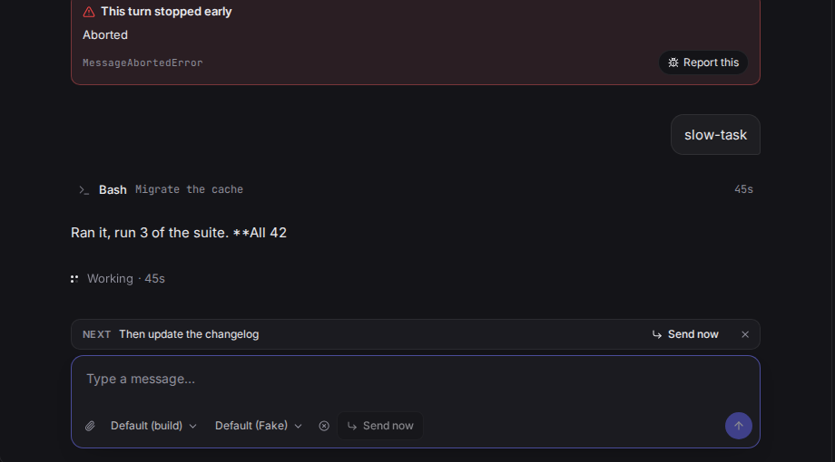
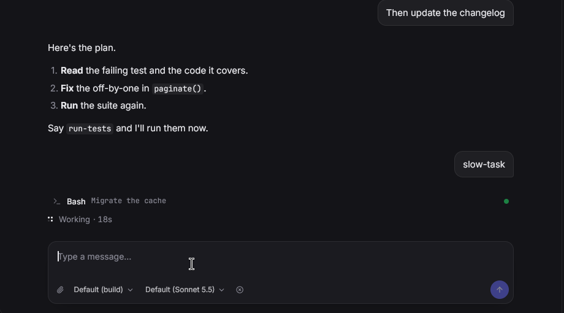
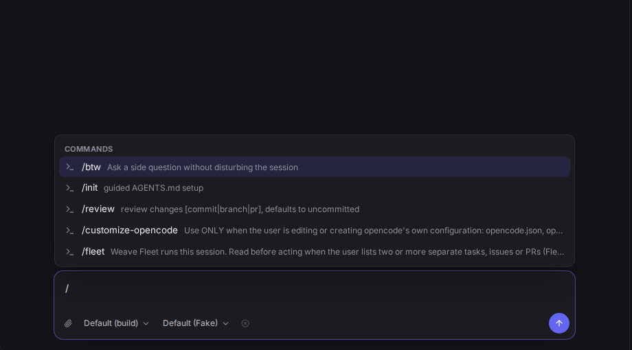
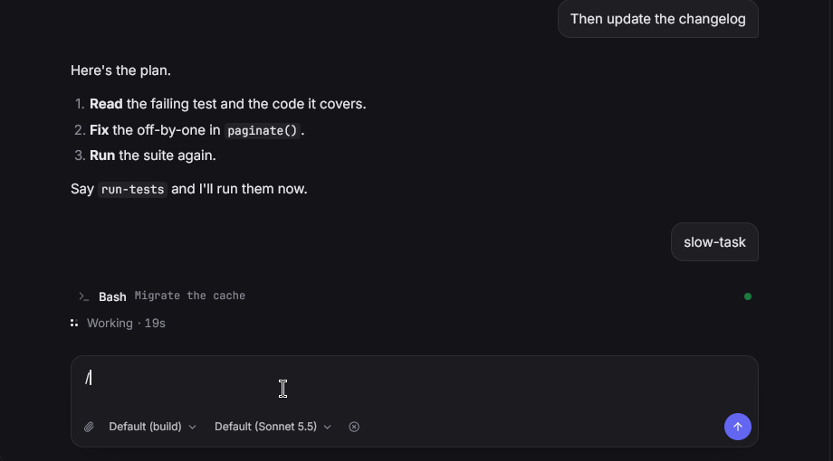
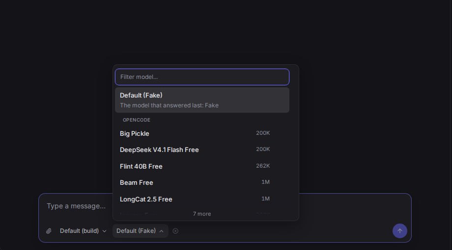
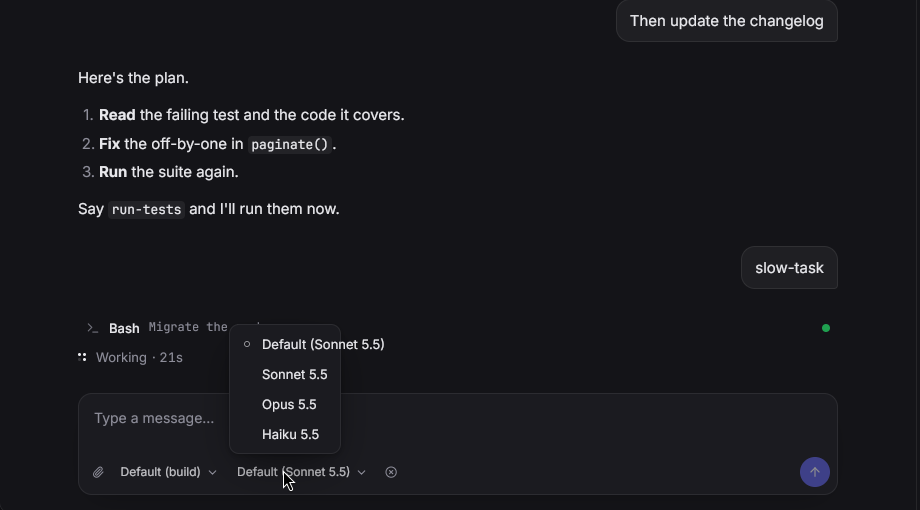
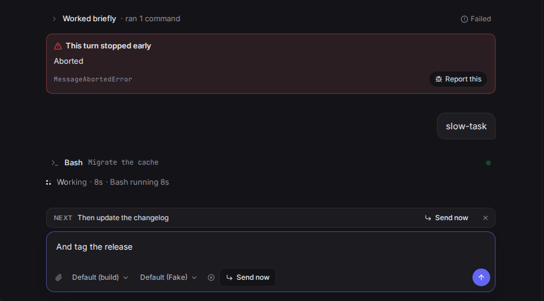

# Component 5: Composer

The parity checklist for component 5 of `docs/PORT.md`, and the pieces it is built in.

- **weave-fleet commit read:** `9841da225398500f67ef166f76773a9f71e510da` (`main`, 15 November 2026).
  The server the live checks run against is v0.72.0. Every route below was read from `main`'s
  `SessionEndpoints.cs` and `client/src/api/`, and the GETs were called against a v0.72.0 scratch
  Fleet (agents, models, queue, commands, context, find/files, preferences, harnesses, usage limits,
  harness usage): all answer and have the shapes below. The writes (queue, steer, attachments,
  command, shell) were read, not run; the pieces that build them run them live.
- **Native app read:** `main` at `0ae23a2` (`src/view/sheet.rs`, `src/lib.rs`, `src/fleet/`, `src/ui/`).
- **Paths** are weave-fleet's under `client/src/` unless they start with `src/`, `docs/` or `server:`.
  Short names: CO `components/session/Composer.vue`, CF `.../ComposerFrame.vue`, AP
  `.../AutocompletePopup.vue`, SD `.../SelectorDropdown.vue`, MS `.../ModelSelector.vue`, AS
  `.../AgentSelector.vue`, ET `.../EffortToggle.vue`, IC `.../ImageAttachmentChips.vue`, QM
  `.../QueuedMessages.vue`, CR `.../ContextRing.vue`, RM `.../ReferenceMirror.vue`, UA
  `composables/use-autocomplete.ts`, UQ `composables/use-session-queue.ts`, USP
  `composables/use-send-prompt.ts`, UCA `composables/use-composer-actions.ts`, UEM
  `composables/use-effort-memory.ts`, UIH `composables/use-input-history.ts`, UDR
  `composables/use-draft-references.ts`, UIA `composables/use-image-attachments.ts`, AF
  `lib/attached-files.ts`, AMC `lib/agent-model-choice.ts`, CU `lib/context-usage.ts`, MPG
  `lib/model-picker-groups.ts`, SR `lib/session-references.ts`, SM `lib/skill-mentions.ts`.
- **Row numbers:** 1.x the frame and the text area, 2.x the toolbar and its buttons, 3.x the agent
  and model pickers, 4.x the effort toggle, 5.x the autocomplete popup, 6.x what the triggers list
  and what an accepted pick puts in the text, 7.x references in the draft, 8.x message history,
  9.x shell mode and the side conversation, 10.x image attachments, 11.x file attachments, big
  pastes and terminal lines, 12.x queue and steer, 13.x the context ring, 14.x data, routes and
  events, 15.x states, sizes and the narrow rule.









The gap, visible in the pictures (the light theme, and Fleet's `@` list and agent picker, are in the
same folder): the native composer is a box with a text field, a paperclip that does nothing, two
chips over **invented** lists ("Sonnet 5.5", "Opus 5.5": they are not the session's models and
choosing one changes nothing), and Send. Typing `/` or `@` shows nothing; Fleet lists the
session's commands, files, agents and sessions. Fleet's model picker filters, groups, and shows
context sizes; the native menu is four radio rows. While the agent works, Fleet queues what the
user types, lists it above the composer ("Next", "Queued"), and offers "Send now"; the native app
has no queue (Enter sends at once and the server decides), no effort toggle, no context ring, and
nothing can be attached. Taken in a real window on a virtual display (1360×880) against a scratch
Fleet, cropped to the same 920×510 region of the window.

## What "done" means

1. The composer is Fleet's: the frame, the text area (grow 52 to 180 px), the placeholder, the
   focus border, the error box, the Send and Interrupt buttons and their states, at Fleet's sizes
   and tokens, both themes.
2. The agent, model and effort pickers show the **session's** lists from the server, with Fleet's
   "Default (...)" wording, filter, groups, favourites, recent, sizes, prices and usage bars; the
   effort level is remembered per model; and what is picked goes with the prompt.
3. `/` commands, `$` skills and `@` sessions, files, folders and agents open Fleet's popup with
   Fleet's matching, keys and footers; what is picked goes into the text the way Fleet puts it,
   references are tinted and edited as one piece, and they reach the agent as Fleet sends them.
4. While the agent works, Enter queues or steers as the harness says, Ctrl+Enter is the other, the
   queue is Fleet's (listed above the composer, "Send now", remove), and a slash command, a shell
   command (`!`) and a side question (`/btw`) take Fleet's routes.
5. Images and files can be attached by the picker, paste or drop, with Fleet's limits, chips and
   wording, and a large paste is offered as a file. Prompts carry them the way Fleet's do.
6. The context ring shows how full the window is, with Fleet's six cases, its popover, and
   "Compact now"; the 6 `context-usage` tests component 2 left for it pass here.
7. Message history (ArrowUp on an empty draft), drafts per session, and every key in Fleet's
   `handleKeydown` order work as in Fleet. Fleet's tests for all of it pass here under the same
   names.

## What the native app already has

| Part | State | Where |
|---|---|---|
| The composer box: text field (`text_input`, `auto_grow` 1 to 7 lines), placeholder "Type a message…", paperclip, agent and model chips, Interrupt (`CircleX`), round Send (30 px, accent, half opacity when empty), frame (radius 14, `card_bg`, border, the shadow), column `max_w(760)` | Shell only. Sizes match Fleet's; **no focus-within border, no states, no error box**; paperclip does nothing; one `State.draft` for every session | `src/view/sheet.rs::composer` |
| Agent and model chips open the kit's dropdown over **invented** lists (`AGENTS`, `MODELS`), radio marks; the pick is `s.ui.agent` / `s.ui.model` and goes nowhere | Shell only | `src/ui/menus.rs`, `src/ui/mod.rs` |
| Send against a server: the prompt joins the conversation as pending, goes as `{text}` only, receipt confirms, a refusal removes it and puts the text back if the draft is empty, a notice says why; 15 s confirmation timeout | Done (component 2, piece D); **text only, no `agent`, `model`, `effort`, `delivery`, `attachments`, `skills`, `sessionReferences`, `userMessageId`** | `src/fleet/prompts.rs`, `state.rs::send_to_server`, `link.rs::send_prompt`, `http.rs::prompt` |
| Abort (Interrupt button, Esc) | Done, always enabled while Working | `src/lib.rs::interrupt`, `http.rs::abort` |
| Session `activityStatus`, derived status | Done | `src/fleet/state.rs`, `rows.rs` |
| `ContextUsage` (`toContextUsage`: used, limit, compacts_at, last_call, turns, compacting, compacted_at, compaction_error), kept per session from the snapshot and `context.updated` | Done, **not drawn**; the percent, tone, turns before compaction and `formatTokens` are missing | `src/fleet/context.rs`, `work.rs` |
| Event types `session.queue`, `catalog` changes (`session.catalog` or as the event union names them), `usage.limits`, `harness.usage`, `context.updated` read into the typed union and handed to subscribers | Done, nothing keeps `session.queue`, usage or catalogs | `src/fleet/events.rs` |
| Text input with caret, selection, clipboard, IME, placeholder; `TextEdit` | Done (the kit) | `src/ui/controls.rs`, Rune |
| Menus, anchored popovers, scrim, dialogs, toasts, tooltips (`.help`), progress, badges, switch | Done (component 1) | `src/ui/` |
| The Rune parts this component needs and the pin has: `canvas(Shape)` with `stroke_path` and line caps (the ring), `TextEdit::rich()` with marks and pills (reference tints), `ClipboardContent` with an image and a size cap, `tx.open_file`, `on_drop_files` (no drops on Wayland), `.help()` | In the pin, **none used yet** | `docs/RUNE.md`, Rune at the rev in `Cargo.toml` |
| Anything else in this file: the pickers' data, the selector, the effort toggle, the popup, queue, attachments, the ring, history, shell mode | **None** | |

No colour token is missing: `card_bg`, `panel_bg`, `border`, `text`, `muted`, `accent`, `accent_dim`,
`accent_text`, `running`, `idle`, `idle_text`, `error`, `error_text`, `primary_fg` and the radii
exist in `src/theme.rs`. `--status-waiting` and `--status-waiting-text` (the usage bars) are the
`idle` pair, as component 4 aliases them. `color-mix(--X n%, transparent)` is `t.X.alpha(n/100)`.

## Decisions the pieces need (the owner can overturn)

- **The phone's rules drop out.** Desktop only: the `(max-width: 716px)` rules, `isMobile` (Enter
  inserts a newline), the phone outbox and the phone composer are not ported. The 640 px
  **narrow** rule (chips say the plain name) is a desktop rule and is ported (15.4).
- **One draft per session, in memory and in a file.** Fleet keeps the text of each session's draft
  in `localStorage` (`weave-fleet.draft.session.<id>`, plus `side.<id>.<side id>` and
  `side-main.<id>` for the side conversation); the agent, model, effort, images, files and
  terminal lines are in memory only and are lost on reload. Native does the same: a map by session
  id in `State`, the text saved to a small JSON file in the app's data folder from a thread
  (`docs/RUNE.md`, "Work off the UI thread"), read when the app starts. Piece A decides the
  folder with the same logic `instance.rs` uses to find Fleet's, and says in the pull request if
  the app has no folder of its own yet.
- **Tooltips for `title`.** Fleet's browser `title` becomes `.help("...")`, so the 28 px chips and
  the ring show their text on hover as Fleet's do (a delay differs; component 1 settled the look).
- **Screen readers.** The roles and `aria-*` (`listbox`, `option`, `combobox`, `aria-activedescendant`,
  `alert`, `group`) have no equivalent until Rune exposes an accessibility tree; each piece keeps
  the labels it can (`.label(..)`) and lists the rest for component 26.
- **Clipboard images.** The pin's `ClipboardContent` has an image (PNG-encoded, with a size cap);
  a paste of an image becomes the same attachment as a picked file, named `image.png`. If the cap
  is below Fleet's 5 MB, say so in the piece's report (it is a Rune gap, `docs/RUNE.md`).
- **Drops.** `on_drop_files` gives paths. No drops on Wayland (`docs/RUNE.md`): the picker and paste
  are the way there; listed.
- **`/btw`.** The side conversation panel is component 15. The composer's part is here: the
  parse (`/btw <question>`), the "btw" mode chip, the placeholder, the per-side draft swap, the
  accent border, and posting the question through one function component 15 fills. Until it is
  built the composer shows "The side conversation isn't in the native app yet (component 15 of the
  port)." as a toast and keeps the draft, as the kit's `waiting()` entries do.
- **Terminal lines (`SquareTerminal` chips).** They come from the terminal drawer (component 13).
  The chip strip, `formatTerminalContext` and the send path are here; the way lines get added is
  a function component 13 calls (`add_terminal_context(session, ctx)`).
- **Mods.** `ModComposerBand` (the band above the composer a mod draws) is component 22;
  `BackgroundStrip` above the queue is component 3, piece K. Their slots are drawn empty here and
  listed in 15.9.
- **Allowed chip** in the toolbar is component 4, piece E. Piece B leaves the slot (after the effort
  toggle, hidden in side mode).
- **Analytics (`trackAction`)** is not ported.
- **`useIsMobile`'s `max-height: 500px` and coarse pointer** rule: dropped with the phone.

## Rows

### 1. The frame and the text area (`CF`, `CO`)

| # | Row | Source | Native today |
|---|---|---|---|
| 1.1 | Section "Message composer" (`aria-label`), padding `4px 24px 18px`, no background, does not shrink | CO `.composer` | Done (`col().pt(4).px(24).pb(18)`) **Done (piece B): `Message composer` label.** |
| 1.2 | Frame: relative, max-width 760, centred, border 1px `--border`, radius `--radius-panel + 2` (14), `--card-bg`, shadow `0 10px 28px -18px rgba(0,0,0,.5)`, border colour transition `--transition` (150 ms) | CF `.composer-frame` | Done, no transition **Done (piece B). The 150 ms border transition isn't drawn (focus ring is a Rune `focus_within_ring`, which doesn't animate).** |
| 1.3 | Focus: `:focus-within` border `color-mix(--accent 55%, --border)` | CF | **None** **Done (piece B): `focus_within_ring(1, -1)` in `Theme::accent_border(55)`; the mix is premultiplied in linear light, so slightly off the browser's sRGB mix.** |
| 1.4 | Dragging a file over it: border `--accent`, background `color-mix(--accent 5%, --card-bg)` | CF `--dragging` | None (needs `on_drop_files`; not on Wayland) |
| 1.5 | Shell mode and side mode: border `color-mix(--accent 70%, --border)`, also while focused | CO `.composer-frame--shell`, `--side` | None **Done (piece B) for the frame's border and the placeholder (`Mode`, scene `composer-side`); the mode chips (2.2, 2.3) are piece M / component 15.** |
| 1.6 | Text area: width 100%, min-height 52, max-height 180, padding `14px 16px 6px`, transparent, `--text`, 14px/1.5, no resize, no outline (the frame shows focus), placeholder `--muted`, `dir="auto"` | CF `.composer-frame__textarea` | Partly: padding is `14/16/25` and 1 to 7 lines (`auto_grow`), which measures 60 px empty as Fleet's does; the 180 px cap is seven lines. **`dir="auto"` (RTL)** None |
| 1.7 | Placeholder "Type a message…"; in side mode "Ask a follow-up in the side conversation…" | CO | "Type a message…" only **Done (piece B).** |
| 1.8 | The text area grows with its content to the cap, then scrolls; resized after every input, send and put-back | CO `resizeTextarea` | Done (`auto_grow`) **Done (piece B).** |
| 1.9 | Disabled (the session is archived, `props.disabled`, the harness can't prompt, or `lifecycleStatus` isn't running): text area `disabled`, attach and Send disabled, every key ignored | CO `isDisabled`, UCA `canSend` | None; the composer is always live **Piece A: the rule is done** (`status::can_send`, tests); the view that disables the controls is B. **Done (piece B): the field, attach, Send and Interrupt are off. Open: the row's `lifecycleStatus` isn't read (a row without `capabilities.canPrompt` counts as able), and `props.disabled` / `localDisabledOverride` have no source yet.** |
| 1.10 | Error box above the frame: max-width 760, margin `0 auto 10px`, border 1px `color-mix(--error 30%, transparent)`, radius 10, padding `10px 12px`, background `color-mix(--error 10%, transparent)`, `--error-text`, 12px/1.5, `role=alert`; shows the first of: side-draft error, queue error, shell error, command error, prompt error, then the paste/attachment error | CO `sendError`, `pasteError` | Partly: a notice (`State.notice`) in the status bar for a refused prompt. **Move it here.** **Done (piece B): the box and `State.composer_error`; the text is the server's reason as Fleet shows it. Only a refused prompt feeds it; queue, shell, command, side and paste errors come with their pieces.** |
| 1.11 | Slots above the frame, in order: error box, `BackgroundStrip`, `ModComposerBand`, queued messages (12.x), the paste offer (11.x); inside the frame: popup (5.x), history popup (8.x), mirror + text area, attachment strip (10.x, 11.x), terminal strip (11.12), the hidden file input, then the toolbar | CO template | None **Partly (piece B): the error box and the toolbar are in order; the slots for the strip, band, queue and paste offer are not drawn (nothing to show yet).** |
| 1.12 | The frame carries `data-notice-avoid` (Fleet's notices stay clear of it) | CF | Component 9 |
| 1.13 | Focus: `focusPrompt()` (exposed) puts the caret in the text area; used after a send, a pick, a put-back, and by the palette's "message" command | CO | Partly: the palette focuses key `composer` **Done (piece B): Enter and Send focus `composer` again.** |
| 1.14 | `Esc` while the text area has focus interrupts the session (`data-escape-interrupts`) unless a popup, the offer bar or history takes it first | CO, `use-hotkeys` | Partly: Esc interrupts everywhere; **popups don't exist to take it** **Partly (piece B): Esc interrupts only while Interrupt is live (`can_interrupt`); popups, the offer bar and history don't exist to take it first.** |

### 2. The toolbar and its buttons (`CF`, `CO`)

Toolbar: row, centred, gap 2, padding `4px 8px 8px`. Left to right: (mode chip or paperclip), agent
chip, model chip, effort toggle, Allowed chip, Interrupt, ring, Send now / Queue, Send.

| # | Row | Source | Native today |
|---|---|---|---|
| 2.1 | Attach: `Paperclip` 12.25 px in a `toolbar-icon` button (24.5 px square, `size-7`), title and label "Attach files", disabled when the composer is; opens the file picker (multiple, no type filter) | CO | The button is drawn, **does nothing**; check its size against 24.5 **Done (piece B): 24.5 px, 'Attach files', off when the composer is; the picker is piece N.** |
| 2.2 | Shell mode shows, instead of the buttons up to Interrupt: `SquareTerminal` 14 px `--accent`, "Shell command" (`--text`, 500, 12px), "Runs in the session's folder, no model turn · Esc for a prompt" (`--muted`, 12px, ellipsis, shrinks) | CO `.composer-shell-mode` | None |
| 2.3 | Side mode shows a pill: height 24, padding 0 8, radius `--radius-btn`, `--accent-dim` fill, `--accent-text`, 12px/600, `MessageCircleQuestion` 13 px + "btw"; title "Goes to the side conversation above, not the session. Close it to talk to the session again."; it replaces the paperclip and Allowed is hidden | CO `.composer-side-mode` | None |
| 2.4 | Interrupt: `CircleX` 12.25 px, `toolbar-icon-danger`, title "Interrupt", disabled unless `canInterrupt` (status isn't idle and no abort is running), so it is live while the session waits on a question or permission too; clicking it aborts and patches the session idle | CO `handleInterrupt`, UCA `canInterruptSession` | Done but opacity .5 vs live is on `Status::Working` only; **waiting_input is not live**; no aborting state **Piece A: the rule is done** (`status::can_interrupt`: live while waiting_input, off while aborting); the button's state is B. **Done (piece B): live while busy or waiting, off when idle or aborting, red wash on hover.** |
| 2.5 | Ring (13.x) sits after Interrupt and takes `margin-left: auto; margin-right: 2px`, so it and the buttons after it go right | CR | None **Open: the ring is piece G (Send already sits at the right edge).** |
| 2.6 | Send: 30×30 pill (`.composer-frame__send`, `toolbar-lg`), `ArrowUp` 14 px, `margin-left: auto` when the ring isn't there; `--accent` fill, `--primary-foreground` ink | CF, CO | Done (opacity .5 when empty) **Done (piece B): `--primary-foreground` ink.** |
| 2.7 | Send's label and title by state: shell "Run command"; side "Ask in the side conversation"; busy and steering by default "Send now" with title "Send now (Enter): the agent reads it at its next step"; busy otherwise "Queue" with title "Queue (Enter): sent when the agent finishes"; else "Send" | CO | "Send" only **Done (piece B) but the busy labels (piece I).** |
| 2.8 | Send disabled while `isDisabled`, nothing to send (`hasContent`: text, an image, a file or a terminal line; for shell mode the command after `!`; false while a `!` draft waits for the harness list), or uploading; shows a `Spinner` in place of the arrow while files upload (`aria-busy`) | CO `hasContent`, `isUploading` | Disabled look when the text is blank only **Done (piece B) but the upload spinner (pieces N, O).** |
| 2.9 | The second button, "Send now" / "Queue": shown when the harness can steer, the session is busy, and the draft is an agent message (not shell, not `/btw`, not side mode). On a harness that steers by default it reads **"Queue"** with `ListEnd`, title "Queue (Ctrl+Enter): sent when the agent finishes", testid `prompt-queue-button`, click = queue; elsewhere **"Send now"** with `CornerDownRight`, title "Send now (Ctrl+Enter): the agent reads it at its next step, without waiting for the turn to end", testid `prompt-send-now-button`, click = steer. Outline, `sm`, height 32, padding `0 10`, 12px, icon 12.25 px; disabled when the composer is or there is nothing to send | CO | None |
| 2.10 | Enter sends; Shift+Enter inserts a newline; Ctrl+Enter or Cmd+Enter is the other choice (queue where Enter steers, steer where Enter queues); the order of keys is 8.x then 5.x then this | CO `handleKeydown` | Enter sends (`on_submit`); no Shift/Ctrl split **Done (piece B): Enter and Shift+Enter (the kit), Ctrl/Cmd+Enter through `submit`; the harness list isn't read yet (`Caps::default()`), so on every session the modifier sends. Steer and queue are piece I; a `/command` or `!` draft still goes as text until pieces K and M.** |
| 2.11 | After a send: the draft clears at once; `optimisticBusy` is set (the composer reads as busy until the session reports busy/delegating/retry); the text area keeps focus and shrinks | CO `handleSend` | Partly: draft clears; no optimistic busy beyond the prompt's own **Done (piece B): `State.optimistic`.** |
| 2.12 | The hidden file input `aria-label="Attach files"`, multiple; its pick goes through `addFiles` (10.x, 11.x) | CO | None **Not drawn (piece B): there is no file input; the picker is piece N.** |

### 3. The agent and model pickers (`SD`, `AS`, `MS`, `AMC`)

One component, two uses. The chip is a button inside the toolbar; the menu opens **above** it.

| # | Row | Source | Native today |
|---|---|---|---|
| 3.1 | Chip: inline-flex, height 28, padding `0 8`, gap 5, 12px/1.2, max-width 100%, no border, radius `--radius-btn`, transparent; label `--text` 80%, ellipsis; `ChevronDown` 13 px `--muted`, rotated 180° while open; hover or open `color-mix(--text 6%, transparent)`; focus ring 2px `--accent` offset 2; `aria-haspopup=listbox` | SD `.selector-btn` | Done in look (28 px, 12px); no rotation, no focus ring, **lists invented** |
| 3.2 | Chip label: the selected item's label, or the placeholder (agent: the id itself, else "Select agent"; model: the model id from the key, else "Select model"). With `plainDefault` (composer narrower than 640 px, 15.4) `Default (X)` shows as `X`; the full label goes in the tooltip when the text differs | SD, AS, MS, CO | "Default (Sonnet 5.5)" invented text **Rule done (piece C): `plain_default_label` in `choice.rs`; drawn in D.** |
| 3.3 | Menu: absolute above the chip, `bottom: calc(100% + 6px)`, left 0, **width 380**, max-width `100vw - 16`, max-height `min(320px, 60vh)`, scrolls (`overscroll: contain`, stable gutter), padding 4, border 1px `--border`, radius `--radius-card`, `--card-bg`, shadow `0 10px 30px rgba(0,0,0,.3)`, above everything (z 200) | SD `.selector-dropdown` | Uses the kit's menu panel (not Fleet's selector box) |
| 3.4 | Horizontal placement: shifted left so the 380 px menu stays inside the first clipping ancestor or the window with 8 px to spare (`max(0, min(left + 380 - (clip - 8), left - 8))`); a window narrower than 396 px clamps the width | SD `place()` | None; the kit anchors by side/align |
| 3.5 | Filter input at the top, sticky, focused on open: padding `7px 10px`, border 1px `--border`, radius `--radius-btn`, background `--text` 3%, 12px; placeholder "Filter model…" / "Filter agent…" (`--muted`); focus outline 2px `--accent` offset -1; `role=combobox` | SD | None |
| 3.6 | Filtering: trim, lowercase, substring of `label + description + meta + id` joined by spaces; the **Default row (empty id) always stays**; while typing the sections and headings go and one flat run shows; the active row becomes the first with a non-empty id | SD | None |
| 3.7 | Heading (only when a section has a title): padding `8px 10px 3px`, 10px/600, letter-spacing .06em, uppercase, `--muted`; a provider heading is indented (left 16) at 9.5px/500. Titles: "Favourites", "Recent", "All models", or the provider's name | SD | None |
| 3.8 | Row: radius 6 (`--radius-btn` - 2); active (keyboard or `mousemove`) `--text` 6%; selected `--text` 6%; dimmed rows at opacity .55 (still pickable). Item button: padding `7px 10px`, gap 12, space-between. Left: label 13px/500 `--text` (ellipsis), description 12px/1.4 `--muted` (wraps). Right (nowrap, 12px `--muted`, right-aligned, gap 2): provider name (**hidden** for provider sections and when every row shares one provider), context size (11px, tabular, e.g. "200K" from `formatTokens`), price chip ("Low cost", "Medium cost", "High cost", "Very high cost"; the capability, capitalised, is its tooltip; an unknown tier draws nothing) | SD, MS `itemFor` | None |
| 3.9 | Star: `Star` 14 px, padding `0 8`, shown only on row hover, focus-within, or when starred (opacity 0 otherwise); starred is `--idle` and filled; "Add to favourites" / "Remove from favourites", `aria-pressed`; clicking neither picks nor closes. Only with a harness | SD, MS | None |
| 3.10 | "N more" cue: sticky at the bottom (margin `0 -4 -4`, padding `18px 12px 6px`), 11px `--muted`, centred, a gradient to `--card-bg`, ignores the pointer; N is the rows whose middle is below the visible bottom, measured on open, scroll and filter | SD | None (needs the list's visible range; `docs/RUNE.md`) |
| 3.11 | Empty: "No matching options" (padding 10, 12px, `--muted`, centred) | SD | None |
| 3.12 | Keys: click toggles; opening focuses the filter and highlights the selected row; ArrowDown/Up move (clamped, no wrap, `block: nearest` scroll); Enter picks the active row; **Esc closes only while open** (closed, it goes on, so it interrupts); click outside closes; picking closes and clears the filter | SD | Kit menu: arrows, Enter, Esc, outside; no filter |
| 3.13 | Agent list: `Default` row (id "", label `defaultLabel`, description `defaultDescription`) then each agent (`name`, `description`); no stars, headings or meta | AS | Invented 3 rows |
| 3.14 | Model list: `Default` row, then models. With a harness: sections from `groupModels` (3.15), stars, recent; without one: a flat run. A HydraFusion model (id matches `/hydrafusion/i`) shows "HydraFusion runs several models per prompt; cost varies per prompt." as its description (and under a `Default` that resolves to one) | MS | Invented 4 rows **Description rule done (piece C): `model_description`, `default_model_description`; the list is D's.** |
| 3.15 | `groupModels(models, harness, favourites, recent, showRecent)`: key `harness:provider/model`; **Favourites** in starred order (stale keys ignored; a favourite stays in All models too); **Recent** = this harness's recent keys minus favourites, only existing, at most 5, only when `showRecent` (the composer shows it); past **8 models from more than one provider** one heading per provider in first-seen order (with "All models" above them, empty, when Favourites or Recent exist); otherwise one "All models" group when something is above it, else untitled | MPG | None **Done (piece C): `group_models` in `groups.rs`; drawn in E.** |
| 3.16 | Favourites and recent live in the `modelPicker` preference (`{favourites[], hidden[], recent[]}`); `toggleFavourite` adds or removes; `recordRecent` moves the key to the front, de-duplicates within the harness, keeps 5 per harness; written by `PUT /api/preferences/modelPicker` (optimistic, rolled back and refetched on failure); `recordRecent` is called when a prompt (or queued prompt) is sent with a model | `stores/model-picker.ts`, `stores/preferences.ts`, USP, UQ | None **Pure half done (piece C): `ModelPicker` in `groups.rs` (parse, toggle, record_recent, JSON); the `PUT` and the star are E's, `record_recent` on send is I's and the send path's.** |
| 3.17 | Usage bar on a **provider heading** (float right, gap 6, 28×4 bar, radius 999, track 22%, fill by percent, `title` "N% of the limit used"; tone `--status-waiting-text` from 80%, `--error-text` when rejected, `--muted` otherwise); when the provider is dimmed (rejected or at 95% or more) its rows dim and the heading adds "resets <time>". Only provider headings carry it, so only with more than 8 models from several providers. Mapping: anthropic and claude-code to `claude`, openai to `codex`, openrouter, github-copilot and copilot to `copilot`; others none | MS `modelProviderUsage`, `usage-providers.ts` | None |
| 3.18 | "Default" wording (`describeSessionDefaults`): agent label `Default (<session agent, else the first agent>)`, else "Default"; description "This session's agent: X" or "Use the session default agent". Model: the session's model, else the chosen agent's own model, else the model that answered last (`lastAssistantModelId`): label `Default (<name>)` with "This session's model: X" / "<agent>'s own model: X" / "The model that answered last: X"; none known: "Default", "Use the session default model" | AMC | None **Done (piece C): `describe_session_defaults` in `choice.rs`; drawn in D.** |
| 3.19 | A model picked in an earlier visit that the session no longer offers goes back to "Default" **once**, when the list first loads; a list that changes later doesn't change the pick (the chip keeps naming it) | CO | None **Rule done (piece C): `keep_offered`; applying it once, when the list first loads, is D's.** |
| 3.20 | An agent picked sets `agent` on the prompt; a model picked sets `model: {providerID, modelID}`; the pick is the draft's, kept per session in memory, "" is Default | CO, USP | None |
| 3.21 | Re-fetch the lists when the harness says its catalog changed (the session's `catalog` event); the old list stays while the new one loads; the pickers show no loading or error state, only the list they have | `use-agents.ts`, `use-models.ts` | None |

### 4. The effort toggle (`ET`, `UEM`, `effort-memory.ts`)

| # | Row | Source | Native today |
|---|---|---|---|
| 4.1 | Shown only when the effective model has at least one variant. The effective model: the picked one, else `sessionDefaultModelKey` (the session's model, else the agent's, else the model that answered last by id, never "the catalog's first" for this), else the list's first | CO `effortModelKey`, AMC | None **Rule done (piece C): `session_default_model_key` in `choice.rs`; the toggle is drawn in D/E.** |
| 4.2 | Button: inline-flex, height 28, padding `0 8`, gap 7, radius `--radius-btn`, `--muted`, hover `--text` 6%, focus ring; an optional note first (`role=status`, 11px, `--accent-text`), the level's name (12px, `--text` 80%: "Low", "Xhigh", "Default"), then one 7×7 dot per variant (`--accent` filled for the levels up to the current, else `--muted` 35%; Default fills none), gap 2 | ET | None |
| 4.3 | Click cycles `[...variants, ""]` and wraps (low, medium, high, xhigh, Default, low); `aria-label` "Reasoning effort: X"; title "Default: the harness's own level, nothing sent", "X, remembered for <model>", or "X" | ET | None **Cycle done (piece C): `next_effort` in `effort.rs`; the button is drawn later.** |
| 4.4 | Memory: one level per harness and model in the `effort.<harness>.<provider:model>` preference (the model key's `["a","b"]` joined with ":", "/" to ":"); "" means none; a stored level the model no longer offers is ignored, not deleted. The draft takes the remembered level when the draft opens and when the model changes (a pick or a late catalog), but **not** over a level the draft already has on first run; a click writes it (`PUT /api/preferences/<key>`, Default writes "") | UEM, `effort-memory.ts` | None **Done as a state machine (piece C): `EffortMemory::update` and `pick` in `effort.rs`, preference key and `remembered_effort`; the preference fetch and the `PUT` are D's.** |
| 4.5 | Note: when a **model pick** brings back a level different from the one before, the toggle says "<Model>: back on <Level>" for 4 s ("This model" if the name is unknown) | UEM | None **Done (piece C): `EffortMemory::note`, 4 s; drawn later.** |
| 4.6 | Sent: `effort` = the pick, else `fleet:default` when the model has variants, else nothing (`effortToSend`) | `effort-memory.ts`, CO | None **Done (piece C): `effort_to_send` and `MODEL_DEFAULT_EFFORT`; the send path uses it in D.** |
| 4.7 | Not drawn in shell mode; drawn in side mode; the side question carries the pick (`effort` only when set) | CO | None |

### 5. The autocomplete popup (`AP`)

| # | Row | Source | Native today |
|---|---|---|---|
| 5.1 | Placement: absolute in the frame, `right: 0; left: 0; bottom: calc(100% + 6px)`, so it is the frame's width, 6 px above it; max-height 340, scrolls (`overscroll: contain`); padding 6, border 1px `--border`, radius `--radius-card`, `--card-bg`, shadow `0 16px 40px -12px rgba(0,0,0,.45)`, z 250 | AP | None |
| 5.2 | Open when the trigger is live and there is a session id; groups in fixed order **Commands, Skills, Sessions (hint "Tab to attach"), Files & folders, Agents**; empty groups dropped. The `@` list's own item order is sessions, then files, then agents | AP, UA | None |
| 5.3 | Group label: sticky (top -6), padding `6px 8px 2px`, 11px/600, letter-spacing .04em, uppercase, `--muted`, background `--card-bg`; the hint is right, weight 400, no case change; groups after the first have margin-top 2 | AP | None |
| 5.4 | Row: radius 7; the main button flex, gap 9, padding `6px 8px`; hover **or** selected `--accent-dim` (hover doesn't move the selection); disabled opacity .5. Icon slot 16×16: command `Terminal` (14, muted), skill `ScrollText` (`--running`), file `FileText` (muted), folder `Folder` (`--accent`), agent `Bot` with a 7×7 dot at the bottom right (`agent.color`, border 1px `--card-bg`), session a status glyph for active, waiting and error sessions and nothing otherwise | AP | None |
| 5.5 | Row text, one line: label 13.5px/1.4 `--text` (ellipsis); description 12px `--muted` (ellipsis, takes the rest); `disabledReason` replaces the description. A session row adds a compact relative time at the right (12px, tabular). Match highlight on session and skill labels only: the first case-insensitive match of the trimmed query in `--accent-text`/600 | AP | None |
| 5.6 | Folder row: a chevron button, 32 wide, `ChevronRight` 14 px, title "Open folder (Tab)", `aria-label` "Open <label>"; hover `--accent-dim`; opens the folder (Tab does too) | AP | None |
| 5.7 | Rows take `mousedown` without moving focus, so the caret stays in the text area; a click picks | AP | None |
| 5.8 | Loading, only while there are no items: centred, padding `14px 16px`, a spinner and "Loading suggestions…" (12px, `--muted`). Error: same layout in `--error-text` with an `AlertCircle` 16 px and the message. Empty: "No results", or for `$` "No skill named “<query>”. It stays as text." (curly quotes). Items already shown stay while a newer search loads | AP | None |
| 5.9 | Footer (sticky bottom -6, margin `4px -6px -6px`, padding `7px 14px 8px`, top border, `--card-bg`, 12px `--muted`, `kbd` with a 1px border, radius 3, 11px): skill selected: its `disabledReason` or `warning` (warning in `--idle-text`), else "[Enter] add skill" + " · <skill hint>"; session selected: "The agent gets a link to the session, not a copy, and reads what it needs." (harness has Fleet tools) or "The agent gets the session's title and a recap of where it stands, not a copy."; file: "[Tab] open folder · [Enter] reference it" for a folder, "[Enter] reference it" for a file; commands and agents have none | AP, CO | None |
| 5.10 | Skill hint by harness: OpenCode 2 "<H> loads it with the message"; Claude Code "<H> runs the first skill in a message"; others "<H> gets a note naming it, then loads it" (`<H>` the harness's display name or "The agent") | SM `skillListHint` | None |
| 5.11 | The selected row scrolls into view (`block: nearest`) | AP | None |
| 5.12 | Keys: ArrowDown/Up wrap around (flat across groups); **Enter and Tab** pick (Tab on a folder opens it; a disabled row does nothing); with no item yet and a load running they are held and, when it ends, pick the first item **only if the draft is unchanged and the popup still open**; **Esc** closes (stops propagation, so it does not interrupt) and keeps it closed until the text differs; any other key resets the selection to the first row | UA `onKeyDown` | None |
| 5.13 | While the popup is open, Enter, Tab and Esc don't reach the composer (Enter doesn't send). Exception: a `$` list with no items that isn't loading counts as closed, so Enter sends ("costs $5") | CO | None |
| 5.14 | IME: the autocomplete does not check `isComposing` in Fleet (Enter during composition can pick). Native guards it: no pick while composing; listed as a deliberate difference | UA | None |
| 5.15 | `role=listbox` "Autocomplete suggestions", options with ids, `aria-activedescendant` on the text area | AP, CO | None (labels where Rune has them) |

### 6. What the triggers list, and what a pick does (`UA`, `SR`, `SM`)

Evaluated in this priority; none while the text is empty or the popup is suppressed (5.12).

| # | Row | Source | Native today |
|---|---|---|---|
| 6.1 | **`$` skill**: the last `$` before the caret, at the start of the text or after whitespace; the text after it up to the caret has no whitespace or `$`; not inside backticks (an odd count before it); needs the session to have skills or its commands still loading. Works anywhere, including after a `/command` | SM `skillTrigger` | None |
| 6.2 | **`/` command**: the text starts with `/`, the caret is after it, and no space has been typed yet; the start is 0 (a typed space closes it). A draft that starts with `/` never opens `@` | UA | None |
| 6.3 | **`@` mention**: the last `@` before the caret, at the start or after whitespace, no space between it and the caret (newlines allowed); a token that is already a picked file or session of this draft doesn't reopen it. Works with no session id (the New Session draft; component 7) | UA | None |
| 6.4 | `#` (GitHub) and `!` are not part of this popup (`#` is the New Session composer's; `!` is shell mode, 9.1) | UA | n/a |
| 6.5 | **Slash list**: Fleet's own commands first (`/btw` "Ask a side question without disturbing the session", only for a harness that can fork), then `GET /api/sessions/{id}/commands` (`{commands:[{name, description, kind, userOnly}]}`; a harness command with a Fleet command's name is dropped); filter `name` **starts with** the typed text, case-insensitive, no fuzzy, the server's order; row `/name`, value `/name ` | UA | None |
| 6.6 | **Skill list**: the commands whose `kind` isn't "command" (kept per session by `rememberSessionSkills`); filter `name` contains the text, case-insensitive, names that start with it first (stable); row `name` (no `$`), value `$name `. On Claude Code, with another skill already in the text: a `userOnly` skill is disabled ("The model can't load <name>, so it only runs first in a message, and this one already runs <first>."), any other gets a warning ("This message already runs <first>. <Harness> runs one skill per message, so this one goes as a note.") | UA, SM | None |
| 6.7 | **Session list** (`@`): the store's sessions merged with `GET /api/sessions?retentionStatus=all&limit=200`, fetched when the `@` list first opens, cached 30 s per machine, the request shared, errors swallowed, the store winning on duplicate ids. Ranking: title starts with the text 0, a word starts with it 1, contains it 2, else out; then newest `updated` first; never the current session; **3 rows for a bare `@`, 5 otherwise**. Description `<project or workspace name or folder> · <harness>`, "subagent of <parent title>" for a child, " · archived" appended; the row has the status and the time | `use-referable-sessions.ts`, SR `matchReferableSessions` | None |
| 6.8 | **File list** (`@`): `GET /api/sessions/{id}/find/files?q=` (no session: `GET /api/directories/find?path=&q=`); an empty query or one ending in `/` lists a folder's children immediately, any other waits **80 ms**; a newer request cancels the older; error text is the server's `error` or "HTTP n" (default "Failed to search files"). Until the server answers, the last answer is narrowed locally (`narrowFileMatches`: ranks as the server does: name equals, starts with, contains, path contains, then in-order matches; a query with `/` matches the path; folders first, shallower first) | `use-find-files`, `lib/file-matches.ts` | None |
| 6.9 | File rows: folders end in "/"; label is the last segment (a folder keeps its "/"); description the parent path, or "…" + its last 47 characters when it is longer than 48; value `@<path> ` | UA | None |
| 6.10 | **Agent list** (`@`): `GET /api/sessions/{id}/agents` (shared with the picker); empty text shows all, else the name or description contains it; row `@name`, description (or the mode), the agent's colour; value `@name ` | UA | None |
| 6.11 | Commands and agents reload when the harness reports a catalog change; the old list stays up while it loads | UA | None |
| 6.12 | **Accepting**: a `/` pick replaces the **whole text** with `/name ` and moves the caret to the end; `@` and `$` replace the trigger text only and keep what follows the caret; the caret is set at once and again on the next tick; the selection and suppression reset | UA `onSelect` | None |
| 6.13 | Accepting a **session** inserts a token `@<slug> ` (the slug: NFKD, strip combining marks, lowercase, words joined by "-", at most 40 characters, "session" if empty; a clash gets `-2`, `-3`; the same session picked again gets its old token) and remembers `{token, sessionId, title}` for the draft (at most 50, kept with the draft). Accepting a **file** remembers the `@path` token for the draft; a folder picked with Tab inserts `@folder/` with no space and isn't remembered | UA, SR | None |
| 6.14 | The prompt carries **`sessionReferences: [{token, sessionId}]`** (the remembered picks whose token still stands alone in the text, in the order they appear: `textHasToken`) and **`skills: [name]`** (known skills named by `$name` tokens outside backticks, once each, in order); the server expands them (a `<fleet-session-references>` block, a skill note). File and agent mentions go as plain text | USP, SR, SM | None |
| 6.15 | `textHasToken`: the token stands alone: not followed by a letter, digit, `_`, `-`, `/`, `@`, or a "." plus a letter or digit (`@notes` isn't in `@notes-2` or `@notes.md`, but is in `@notes.`) | SR | None |
| 6.16 | Slash command send: `parseSlashCommand` (trim start, starts with `/`, the command up to the first whitespace, the rest trimmed as arguments, a bare `/` is none) goes to `POST /api/sessions/{id}/command` `{command, arguments?, agent?, model?}` (202); the session turns busy optimistically and rolls back on a refusal; the text comes back only if the draft is still empty | `use-send-command.ts`, `lib/slash-command-utils.ts` | None **Piece A: the parse is done** (`route::parse_slash_command`, `Route::Command`); the request is piece I/M's. |
| 6.17 | Picked files and sessions are forgotten when their token leaves the text (files on every change; sessions at send) | UDR, UA | None |

### 7. References in the draft (`RM`, `UDR`, `composer-references.ts`)

| # | Row | Source | Native today |
|---|---|---|---|
| 7.1 | A reference is tinted behind the text: `@path` and `@folder/` accent 28%; a session accent 18%; a `$skill` that goes with the message `--running` 22%, one that goes as a note `--idle` 22%; radius 4, widened 3 px each side without moving the text, each wrapped line gets its own tint | RM, SM | None (`TextEdit::rich()` marks; Rune's pin) |
| 7.2 | What counts (`splitDraftReferences`): `(^|\s)(@[^\s@][^\s]*|\$[^\s$][^\s]*)` with trailing `.,;:!?)]}'"` stripped; two characters at least; a `$` token must name a known skill and not sit in backticks; a token the caret is still typing (`start < caret <= end`) stays plain unless it was picked; a picked token is always drawn; a typed `@foo` that wasn't picked draws as a file once the caret leaves; kind order skill, session, folder, file; none in shell mode | `composer-references.ts` | None |
| 7.3 | Picked references edit as one piece: Backspace after one or Delete before it selects it whole and deletes it (undoable); the arrows step over it; the caret is never kept inside (on key-up and click it moves to the nearer edge, a tie to the start); nothing of this with a selection, IME composition, Cmd, or (for the arrows) Shift, Alt, Ctrl | UDR `handleReferenceKey`, `keepCaretOutside` | None |
| 7.4 | The skill's delivery decides its tint: OpenCode 2 attaches every named skill, Claude Code attaches the first and notes the rest, other harnesses note them all (`skillDeliveries`) | SM | None |

### 8. Message history (`UIH`)

| # | Row | Source | Native today |
|---|---|---|---|
| 8.1 | Per session, in `weave:input-history:<id>`: the last **10** sent texts, newest first, trimmed, de-duplicated (a repeat moves to the front); recorded in `handleSend` before the side, shell and command routing, so those are recorded too | UIH | None **Piece A: done** (`history::History`, 10 entries, newest first, de-duplicated; recorded in `send`; kept in the drafts file). The list and keys are M. |
| 8.2 | ArrowUp in an **empty** text area (history closed) opens the list (nothing happens with no entries), newest selected | CO | None |
| 8.3 | The list: above the frame, absolute `bottom: 100%`, full width, max-height 260, scrolls, border 1px `--border` without the bottom, radius 14 on the top corners, `--card-bg`, shadow `0 -4px 16px rgba(0,0,0,.25)`, z 20; oldest at the top, newest next to the composer; items padding `8px 16px`, 12px/1.4, one line with ellipsis; selected `--accent` 18%, hover 12%; `role=listbox` "Message history" | CO | None |
| 8.4 | While open: ArrowUp goes to an older entry, ArrowDown to a newer (clamped, no wrap), Enter puts the entry in the text area (**does not send**), Esc closes, a click picks (`mousedown` without focus change), `mouseenter` selects; any other key closes it and goes on to normal handling | CO | None |

### 9. Shell mode and the side conversation (`CO`, `shell-commands.ts`, `side-conversation.ts`)

| # | Row | Source | Native today |
|---|---|---|---|
| 9.1 | **Shell mode**: a draft that starts with `!`, when the harness supports shell commands (`supportsShellCommands`) and side mode is off; otherwise `!` is plain text. While the harness list loads, a `!` draft isn't sent at all (`shellSupportPending`) | CO, `shell-commands.ts` | None **Piece A: the parse and the rule are done** (`route::is_shell_draft`, `Route::Shell` only where the harness runs commands, `status::has_content` holds a pending `!` draft); the mode and request are M. |
| 9.2 | Look: frame border accent 70% (1.5); text and mirror in the mono stack at 13px; the toolbar shows 2.2 | CO | None |
| 9.3 | Enter runs the command after the `!` (trimmed): idle, `POST /api/sessions/{id}/shell {command}` (202), the draft clears at once and comes back if refused (unless something new was typed); busy, it is **queued** as kind `shell` (OpenCode won't run one during a turn); an empty command does nothing | CO `handleShellSend`, `use-run-shell-command.ts` | None |
| 9.4 | Esc in shell mode removes the `!` and keeps the rest as a prompt; no `@` or `/` popup in shell mode; no references; a large paste isn't offered | CO | None |
| 9.5 | **`/btw <question>`** (`/^\s*\/btw(?:\s+([\s\S]*))?$/`) or any text while a side conversation is open: goes to the side conversation, never waits for the session's turn; a bare `/btw` shows "Type a question after /btw." in the error box and sends nothing; the question carries the agent, model and effort picked (none picked: the session's own) and the terminal lines | CO `handleSideSend`, `lib/side-conversation.ts` | None; the panel is component 15 **Piece A: the parse is done** (`route::parse_side_question`, `Route::Side`, the bare `/btw` is an empty question the view reports); the panel is component 15. |
| 9.6 | Each side keeps its own draft: when the side conversation opens, minimizes, closes or is discarded and undone, the text area's text is put away under `side-main` or `side.<id>` and the other comes back; it survives a reload | CO | None |
| 9.7 | Side mode UI: pill 2.3, accent border 1.5, placeholder 1.7, the Allowed chip hidden, no Send now button, files are not uploaded for a side question | CO | None |

### 10. Image attachments (`IC`, `UIA`, `image-validation.ts`)

| # | Row | Source | Native today |
|---|---|---|---|
| 10.1 | Where they come from: the picker (2.1), a paste that carries files, a drop. A paste with files takes the files; when the harness can't take images and every file is an image but the clipboard has text (a spreadsheet's picture), **the text is pasted instead** | CO `handlePaste` | None |
| 10.2 | Where the harness can't take images (`supportsImageAttachments` false) an image is refused: "This session's harness can't take images." | CO `addFiles` | None |
| 10.3 | Checks, in order: MIME in `image/png`, `image/jpeg`, `image/gif`, `image/webp` ("Unsupported image type: <type or unknown>"); size 5 MB at most ("Image exceeds the 5 MB limit (<size>)"); at most **10** per prompt counting images and files together ("10 files at most per prompt." / "Too many images (max 10)"); then the bytes are read and the type is **sniffed** (PNG `89 50 4E 47 0D 0A 1A 0A`, JPEG `FF D8 FF`, `GIF87a`/`GIF89a`, `RIFF....WEBP`), the sniffed type wins over the name, and bytes that match none give "<name or That file> isn't a PNG, JPEG, GIF or WebP picture." | UIA, `image-validation.ts` | None |
| 10.4 | The error shows in the error box (1.10) and clears after 5 s and on the next good add | UIA | None |
| 10.5 | Held in memory as `{id, mime, filename (default "image.png"), data (base64), previewUrl}` | UIA | None |
| 10.6 | Strip above the toolbar (inside the frame, after the text area): flex-wrap, gap 8, padding `8px 12px 4px`, only when there is an image or a file | CO `.attachment-strip` | None |
| 10.7 | Image chip: column, centred, gap 4, padding 6, border 1px `--border`, radius `--radius-btn`, `--panel-bg`, 11px; a thumbnail **80×80**, cover, radius 5 (hover opacity .8, title "Click to preview"); the name under it (`filename` or "image.png", max-width 80, 10px `--muted`, ellipsis); `X` button top 4 right 4, 18×18 circle, `rgba(0,0,0,.6)` with a white `X` 12 px, title "Remove <name>", **visible on chip hover only** (hover `rgba(220,38,38,.8)`) | IC | None |
| 10.8 | Click the thumbnail: the lightbox (shared with component 3, piece N: fixed overlay `rgba(0,0,0,.8)`, padding 16, image at most 90% of the window, close button 36×36 at the corner, Esc and a click close, focus returns) | IC, `ImageLightbox.vue` | None |
| 10.9 | Sent as `attachments: [{mime, filename, data}]` (base64, no prefix) in the prompt body; **an image can't wait in the queue**: with images pending, a send while the agent works (and not steering) shows "Images can't wait in the queue yet. Send now with Ctrl+Enter, or send once the turn ends." and sends nothing | CO `handleSend`, USP | None |
| 10.10 | After the send the images clear (and the preview URLs are released); **if the server refuses**, they come back (from their base64) beside anything added since | CO `putBackRefused` | None |
| 10.11 | The sent message shows its images (component 3, piece N) | `MessageBubble` | Component 3 |

### 11. File attachments, large pastes and terminal lines (`AF`, `CO`)

| # | Row | Source | Native today |
|---|---|---|---|
| 11.1 | A non-image file is **held** (not uploaded) until Send, at most 25 MB ("<name> is <n> MB. The limit is 25 MB."), counted with images in the 10 | CO `addFiles` | None |
| 11.2 | File chip (inline in the strip): row, gap 8, padding `4px 8px`, border 1px, radius `--radius-btn`, `--panel-bg`, 11px; extension box (upper case, at most 4 characters or "FILE", mono 9px, border 1px, radius 3, padding `0 4`, `--muted`); name (max-width 200, ellipsis); size text (10px `--muted`: "2,031 lines · 186 KB" or the size); remove `X` 12 px (14×14, always visible, `--muted`, hover `--text`, title "Remove <name>", disabled while uploading) | CO, `describeDraftFile` | None |
| 11.3 | On Send (not for a slash command, shell command, side question or `/btw`): files go up **in order**; a text file (`text/*`, a name ending `json` or `xml`, or one of 19 extensions) **under 4096 bytes** that wasn't pasted goes **inline** after the typed text as "<name>:\n```\n<content>\n```" (fence longer than any backticks inside; blocks joined by a blank line); anything else is uploaded with `POST /api/sessions/{id}/attachments?name=<enc>` (body the raw file, `Content-Type` its type or `application/octet-stream`; answers `{path, name, size, lines|null, mime}`; server limits 25 MB per file and 100 MB per session) | CO `attachDraftFiles`, `attached-files.ts` | None |
| 11.4 | The note: after the typed text (`trimEnd`, a blank line) one line per uploaded file "Attached: <path> (<description>)" and "Read it as needed." (one file) / "Read them as needed." (several); the description "<n> line(s), <size>" or "<EXT or File>, <size>"; the path is relative to the session folder; sizes "N B", "N KB", "N.N MB" below 10 MB | `withAttachedNote` | None |
| 11.5 | A failed upload changes nothing (draft, files and text as they were); the error is the server's; Send shows its spinner while uploading, the remove buttons are disabled | CO | None |
| 11.6 | Lines are counted after adding, for a text file up to 5 MB without NUL or U+FFFD (a final newline isn't a line), off the UI thread; a chip removed meanwhile isn't touched | `use-draft-files.ts` | None |
| 11.7 | **Large paste**: a text paste of **2,000 characters or 25 lines or more** (not in shell or side mode); the preference `LargePastes` is `ask` (default), `attach` (a file at once) or `text` (paste as is; the setting's label is "Large pastes": "Ask", "Always attach", "Paste as text") | CO `handleTextPaste` | None; the preference is read-only here (Settings is component 16) |
| 11.8 | The offer bar above the frame: centred pill (gap 4, margin-bottom 6, padding 3, border 1px, radius 999, `--panel-bg`, 12px), the text "<n> lines pasted" (n of 2 or more) or "<n> characters pasted" (`--muted`, padding `0 8`), then **"Attach as file" `Enter`** and **"Paste as text" `Esc`** (padding `3px 10`, radius 999; the chosen one `--accent` with `--primary-foreground`; `kbd` 10px at opacity .6); the buttons keep focus in the text area | CO | None |
| 11.9 | Bar keys (they run before the text area's own): Enter takes the chosen one (starts on Attach); Tab flips; Esc pastes as text at the caret; a printable key without Ctrl, Cmd or Alt pastes as text and then **is typed**; other keys leave the bar; Send drops it; a second big paste replaces the first | CO `handleOfferKey` | None |
| 11.10 | A pasted-as-file text is named `pasted-text.txt`, `pasted-text-2.txt`, … (the first free name) and **always uploads** (never inlined) | `pastedFileName` | None |
| 11.11 | `INLINE_MAX_BYTES` = 4096 and the 19 extensions and `isTextFile` are in `attached-files.ts`; port them as they are | AF | None |
| 11.12 | **Terminal lines** (from the terminal drawer, component 13): a strip of chips (flex-wrap, gap 6, padding `8px 12px 2px`, `aria-label` "Terminal lines in this message"); chip height 24, padding `0 4px 0 8px`, radius 7, `--accent-dim`, `--accent-text`, 12px/500, `SquareTerminal` 12 px, the label, the range "line N" / "lines N–M" in mono 11px at opacity .85, an `X` button 18×18 (11 px, opacity .7); title = the lines' text | CO | None |
| 11.13 | Terminal lines go in front of the text as fenced blocks "Terminal <label>, line N:" (fence longer than any inside; blocks joined by a blank line; the typed text trimmed after them; just the blocks when nothing was typed) and clear on any send; a refused send puts the text back **and** the lines; the same lines of the same terminal are added once; in memory only | `format-terminal-context.ts`, `use-draft-terminal-context.ts` | None |
| 11.14 | The sent message parses the note back out and shows a chip (component 3, `MessageBubble.attached-files.test.ts`) | `parseAttachedNote` | Component 3 |

### 12. Queue and steer (`QM`, `UQ`, `UCA`, `CO`)

| # | Row | Source | Native today |
|---|---|---|---|
| 12.1 | Status: busy when activity is `busy`, `delegating` or `retry` or an optimistic send is pending (cleared when the session reports busy/delegating/retry); `waiting_input` for that; else idle | UCA `composerStatus` | None (the composer reads "working" from the row) **Piece A: done** (`status::composer_status`); the view still reads the row's status until B. |
| 12.2 | Capabilities from the session's harness (`GET /api/harnesses`): `supportsSteering` (can steer), `steersByDefault`, `supportsImageAttachments`, `supportsShellCommands`, `supportsSideConversations`, `supportsFleetTools`, `takesSkills`; `canPrompt` and `lifecycleStatus` for 1.9 | UCA `harnessCapabilities` | None **Piece A: done** (`status::harness_capabilities` over a `HarnessInfo` list); `GET /api/harnesses` is not fetched yet (piece D/I). |
| 12.3 | Enter flow (`handleSend`): ignore if disabled or uploading, or nothing to send, or a `!` draft is still waiting; drop the paste offer; upload files (11.3) then run again; record history (8.1); `/btw` or side mode (9.5); shell mode (9.3); then `steering = steer && canSteer && busy && not a slash command`; **busy and not steering**: queue (12.6); else send now (12.5) | CO | None **Piece A: the decision is done** (`route::route_draft`: empty, side, shell, command, steer, queue, send); the requests and wiring are B/I. |
| 12.4 | The key: Enter sends with `steer = steersByDefault ? !modifier : modifier` (modifier is Ctrl or Cmd); so by default (not OpenCode 2) Enter **queues** and Ctrl+Enter **steers**; on a harness that steers by default Enter steers and Ctrl+Enter queues; **idle**, either is a plain send | CO | None **Piece A: the key rule is done** (`route::steer_for_key`); the key wiring is B. |
| 12.5 | Send now: `POST /api/sessions/{id}/prompt` with `delivery: "steer"` only when steering (omitted otherwise; the server takes "queue" or "steer" and answers 400 `delivery must be "queue" or "steer".` for anything else); the body also has `text` (trimmed), `agent` (picked), `model {providerID, modelID}`, `effort` (4.6), `attachments`, `userMessageId` (`user-<uuid, no dashes>`), `correlationId` (`prompt-<uuid>`), `sessionReferences`, `skills`; 200 `{eventId?, correlationId}`; 503 "Fleet is restarting to update. Try again in a moment." | USP | Partly: `{text}` plus `correlationId` |
| 12.6 | Queue: `POST /api/sessions/{id}/queue` `{text, kind: "prompt"|"command"|"shell", command|null, arguments|null, agent|null, model|null, effort|null, sessionReferences?, skills?}` (201 with the item; text required, at most 100,000 characters, an archived session refuses). The draft **clears at once** and the text **comes back** if Fleet refuses it and nothing new was typed. A slash command queues as `kind: "command"` with its name and arguments; a shell command as `kind: "shell"`; terminal lines go in front of a queued prompt's text. The pick (agent, model, effort) travels with the item | CO `queueDraft`, UQ | None |
| 12.7 | The queue is **Fleet's**: loaded with `GET /api/sessions/{id}/queue` when the session opens and after a reconnect (a stale load is dropped), replaced whole by every `session.queue` event `{sessionId, items}` for that session; other sessions' events are ignored; unknown kinds read as "prompt"; the first item goes out when the turn ends | UQ | Event read; **nothing keeps it** |
| 12.8 | The list (only when there are items), above the paste offer and the frame: an `ol` (`aria-label` "Queued messages"), column, gap 2, max-width 760, margin `0 auto 6px`; each row: flex, centred, gap 8, padding `3px 4px 3px 12px`, border 1px `--border`, radius `--radius-card`, `--card-bg`, 12px; label "Next" for the first and "Queued" for the rest (11px/600, uppercase, letter-spacing .04em, `--muted`), with " · from <mod>" when a mod queued it; the text (flex 1, ellipsis, `--text`, tooltip the full text, Fleet's `@`-session block removed); "Send now" (ghost, height 26, padding `0 8`, 12px, `CornerDownRight` 12.25 px, title "Send now: the agent reads it at its next step, without waiting for the turn to end", only when 12.9 allows); remove `X` (24.5 px, title "Remove from the queue", `aria-label` "Remove queued message: <text>"). No edit, no reorder | QM | None |
| 12.9 | A queued item can go now when the session is idle (anything left, say after a restart), or while it works only if it is a **prompt** and the harness can steer (a command waits for the turn to end); otherwise "Send now" isn't offered. `POST /api/sessions/{id}/queue/{itemId}/send` (202); the server says "Only a message can go into a running turn. A command waits for the turn to end." or "This session's harness can't take a message while it works. It's sent when the turn ends."; on failure the error shows and the queue reloads; on success the item leaves locally (the event follows); the draft is left alone | CO `sendQueuedNow`, UQ | None |
| 12.10 | Remove: the item leaves locally first, then `DELETE /api/sessions/{id}/queue/{itemId}` (204; a 404 is a success); on any other failure the queue reloads | UQ | None |
| 12.11 | The queue error (the server's `error`, `detail` or `title`, else "The message couldn't be queued (HTTP n)." / "…couldn't be sent (HTTP n)." / "The command couldn't be run (HTTP n).") shows in the error box (1.10) | UQ | None |
| 12.12 | After a send the composer emits "prompt sent" (the conversation scrolls to the end, component 3 piece J) | CO | Done (`scroll_to_bottom`) |
| 12.13 | The Retry for a failed turn re-sends the last prompt without touching the draft (component 3, piece H) | `retryPrompt` | Component 3 |

### 13. The context ring (`CR`, `CU`)

Drawn only once the harness has reported a call (the session has a `context`): none before.

| # | Row | Source | Native today |
|---|---|---|---|
| 13.1 | Maths: `percent = min(100, round(used/limit*100))`, none without both; tone: none `ok`, from 90 `danger`, from 75 `warn`, else `ok`; **amber = percent above 80** (strictly), independent of the tone, danger wins; fill (0 to 1): 0 without `used`, 1 without `limit`, else `min(1, used/limit)`; `compactsAtPercent = min(100, compactsAt/limit*100)`; `turnsBeforeCompaction(sample 5)`: none without `used` or `compactsAt`, takes the turns since the last `afterCompaction` (or all), the last 5 of them, none under 2, growth = (last - first)/(n - 1), none if it isn't above 0, else `max(0, floor((compactsAt - used)/growth))` | CU | `ContextUsage` only |
| 13.2 | `formatTokens`: "950", "17.1k", "200k", "1M", "1.5M" (one decimal under 100, the unit as written); `formatCount`: grouped digits ("76,000"); `formatMoney`: "$1.42", "<$0.01" for a tiny positive amount. One locale rule (Fleet's follows `Intl`; native uses a comma group in English) | CU, `lib/format/numbers.ts` | None **Done (piece C): `format.rs` (`format_tokens`, `format_count`, `format_money`, `format_bytes`), en-US only: the native app has no locale setting.** |
| 13.3 | Button: height 28, min-width 28, inline-flex centred, gap 5, 11.5px/500 tabular, radius `--radius-btn`, `--muted`; hover or open `--text` 6% and `--text` ink; padding `0 7px 0 6px` with a percent; `margin-left: auto; margin-right: 2px` in the toolbar; `aria-label` "<summary>. Details" | CR | None |
| 13.4 | Ring: 18×18, viewBox 16, rotated -90°, stroke 2, centre (8, 8) radius 6; track `--text` 14% (dashed `2 2` when `used` is known and `limit` isn't); fill `--text` 62%, round cap, length animating 300 ms ease-out, at least 2% of the circle, drawn only when both numbers are known; `danger` strokes `--error` and the text `--error-text`; amber (not danger) `--idle` and `--idle-text`. The percent text shows whenever the percent is known ("38%"; the component's comment about "three-quarters" is stale, the test shows "38%") | CR | None (`canvas` + `stroke_path`) |
| 13.5 | Tooltip (off while the popover is open): "Context: 38% of 200k tokens" normally, else "<summary> · details". **Summary**: compacting "Compacting the context…"; `used` unknown "Context compacted. Its size shows after the next reply."; no limit "<formatTokens(used)> tokens in the context. The model's window isn't known."; else "<percent>% of the context window used" | CR | None |
| 13.6 | The **six cases** the ring is tested in: 1 known and under 75 (quiet arc, "N%", "Plenty of room"); 2 from 75 (arc, amber only above 80, "Getting full"); 3 from 90 (red arc, "Nearly full"); 4 used known, limit unknown (dashed full track, no fill, no percent, "Window unknown", the headline is the token count); 5 `used` unknown after a compaction (empty ring, no percent, "Compacted" if `compactedAt` else "Not measured yet", headline "—"); 6 compacting (as the others, "Compacting…" with a small spinner in place of the dot). The label order: compacting, `used` unknown, no percent, danger, warn, ok | CR `stateLabel` | None |
| 13.7 | Popover: opens on click, above the button (side top, align end, offset 8, collision padding 8), **width 340** (max `100vw - 16`), padding `14px 14px 12px`, radius `--radius-panel`, `--card-bg`, 12.5px | CR | None (kit popover) |
| 13.8 | Head: left the eyebrow "Context window" (11px `--muted`) over the number (26px/600, line-height 1.1, letter-spacing -.02em, tabular; "%" 13px/500 `--muted` after it when known); right the state label (11px/500 `--muted`) with a 6 px dot in the tone (`--running` ok, `--idle` warn, `--error` danger) or a spinner when compacting | CR | None |
| 13.9 | Size line (margin-top 3, `--muted`): "<count> of <limit> tokens", "<count> tokens", "<limit> token window" or "Window unknown", each followed by " · <model id>" when known | CR | None |
| 13.10 | Meter (with a limit): a track 6 px high (margin `12px 0 4px`, pill, `--text` 9%), fill `--accent` (the tone for warn and danger) animating 300 ms, a 2 px tick at the compaction point (`--muted` at .7, 3 px over and under); legend "0" left, "compacts at ~N%" or the limit right (11px `--muted`) | CR | None |
| 13.11 | Chart "After each turn" (only with turns): caption right "N turn(s)" or, while a bar is hovered, "Turn N · <size>[ · after a compaction]" (back on leave); 54 px high, margin-top 10, bars flex 1, min 2 px, max 18 px, radius `2 2 0 0`, `--accent` 55% (hover `--text`, the last `--accent` or the tone), height `max(4, min(100, used/scale*100))%` with `scale = limit or the biggest turn`; a bar after a compaction has a 4 px `--muted` dot 7 px above; a dashed line (1 px, `--text` 25%) at the compaction point | CR | None |
| 13.12 | Rows (a grid `auto 1fr`, gap `6px 14px`, margin-top 14): unless the harness gave only the total, "Read from cache", "New input" (input + cache write), "Output" (with " · N reasoning"); "Before it compacts": "Probably next turn" (0), "25+ turns" (above 25), "About N turn(s)", then a muted "at this pace"; "Estimated spend" when the session's cost is above 0 | CR | None |
| 13.13 | Usage limits (section "Usage limits", top border, padding-top 12, only when the session's harness reports windows): per window the label ("5-hour limit", "Weekly limit", "Weekly Opus limit", "Weekly Sonnet limit", "Organization limit", else "<name with spaces> limit") and "<percent> · resets <time>" (the percent "100%" when rejected), a 4 px meter (tone `--error` rejected, `--status-waiting` from 80%, else `--accent`); windows already reset are dropped; the order five-hour, seven-day, opus, sonnet, others | CR, `use-harness-usage.ts` | None |
| 13.14 | Error line (`--error-text`, 12px, margin-top 12): the failed request's text or the context's `compactionError` | CR | None |
| 13.15 | Foot (top border, padding-top 12, gap 8): hint (11.5px/1.4 `--muted`) "The agent compacts on its own when it gets close." while ok or unknown, else "Compacting summarises earlier turns so the agent can keep going."; the button "Compact now" / "Compacting…" (padding `6px 10px`, border 1px, radius `--radius-btn`, 12px, `--text` 5% fill, **primary** (`--accent`, `--primary-foreground`) when the tone isn't ok), disabled while compacting or when the session's `capabilities.canCompact` is false, its title the reason (`compactDisabledReason`) or "Summarise the conversation so far, so the agent can keep going." | CR | None |
| 13.16 | Compact: `POST /api/sessions/{id}/compact`; error text is the body's `error`, `detail` or `title`, else "It couldn't be compacted (HTTP n)." or the network error; a no-op while a request is in flight; `context.updated` reports the start and end of compaction | CR | None |
| 13.17 | Reduced motion: the dash animation and the fills turn off | CR | Rune honours it |

### 14. Data, routes and events

| # | Row | Source | Native today |
|---|---|---|---|
| 14.1 | `GET /api/sessions/{id}/agents` → `{agents:[{name, description, mode, model?{providerID, modelID}, color?, hidden?}]}` (or a bare list); hidden agents dropped; the list's first is the default; refetched on the session's catalog-change event | `use-agents.ts` | None |
| 14.2 | `GET /api/sessions/{id}/models` → `[{id, name, models:[{id, name, variants[], priceTier?, capability?, contextWindow?}]}]` (a bare list on v0.72.0; the client also takes `{providers}`); selection key `JSON.stringify([providerId, modelId])`; `modelFromKey` is none for "", bad JSON, a non-pair or empty parts; `modelToPath`/`modelFromPath` "provider/model" split at the first slash | `use-models.ts`, AMC | None |
| 14.3 | `GET /api/harnesses` → `[{type, displayName, available, capabilities{…}}]` (12.2); the session's `harnessType` picks one | `use-harnesses.ts` | None |
| 14.4 | `GET /api/preferences` → `{key: value}` and `PUT /api/preferences/{key}` `{value}` (optimistic, rolled back and refetched on failure); keys used here: `modelPicker`, `effort.<harness>.<model>`, `LargePastes`. Shared with Settings (component 16): one small module | `stores/preferences.ts` | None |
| 14.5 | `GET /api/sessions/{id}/commands`, `/find/files?q=`, `GET /api/directories/find?path=&q=` (no session), `GET /api/sessions?retentionStatus=all&limit=200` (6.5 to 6.10) | UA | None |
| 14.6 | `GET/POST/DELETE …/queue`, `POST …/queue/{id}/send` (12.6 to 12.10); `POST …/prompt`, `…/command`, `…/shell`, `…/attachments`, `…/abort`, `…/compact` | USP, UQ, … | `prompt` and `abort` |
| 14.7 | `GET /api/sessions/{id}/context` (204 when there is none) and the snapshot's `context`; `context.updated` carries the whole record | CU | Done (component 2) |
| 14.8 | `GET /api/usage/limits` (`?watch=true` refreshes) → `{enabled, providers:[{provider, account, name, state, windows[{window, utilization 0-1, resetsAt, status allowed|warning|rejected}], credits}]}` and the `usage.limits` event; `GET /api/harnesses/usage` → `[{harnessType, windows[]}]` and `harness.usage`; both reload on reconnect. v0.72.0 answers `{"enabled":true,"providers":[]}` and `[]` for a scratch Fleet with no provider | `use-usage-limits.ts`, `use-harness-usage.ts` | None |
| 14.9 | Session row fields the composer reads: `selectedAgent`, `selectedModel`, `lastAssistantModelId`, `harnessType`, `retentionStatus`, `lifecycleStatus`, `activityStatus`, `capabilities.canPrompt`, `capabilities.canCompact`, `capabilities.compactDisabledReason`, `totalCost`; after a send naming an agent or model the row's `selectedAgent`/`selectedModel` are set locally | `stores/sessions.ts` | Partly (`src/fleet/rows.rs`); check each |
| 14.10 | The page's `data-testid`s Fleet's tests use (`prompt-input`, `prompt-send-button`, `prompt-queue-button`, `prompt-send-now-button`, `queued-message`, `queued-send-now`, `queued-remove`, `context-ring`, `context-popover`, `context-compact`, `paste-offer`, `paste-offer-attach`, `paste-offer-text`, `draft-file-chip`, `image-attachment-chip`, `send-prompt-error`, `composer-shell-mode`, `composer-side-mode`) become `.key(..)` with the same names | CO | Only `composer`, `composer-frame`, `send`, `attach`, `interrupt`, `agent`, `model` **Partly (piece B): `prompt-send-button` and `send-prompt-error` added. The text field keeps its key `composer` (the palette, scripts and tests use it), not `prompt-input`.** |

### 15. States, sizes and the narrow rule

| # | Row | Source | Native today |
|---|---|---|---|
| 15.1 | Empty draft: Send at half strength, attach, chips, Interrupt greyed; no Send now | CO | Partly **Piece A: the rule is done** (`status::has_content`); the look follows in B. |
| 15.2 | Busy: Interrupt live and red on hover, the busy Send label (2.7), Send now / Queue (2.9), the queue list (12.8), the ring unchanged | CO | None **Send and Interrupt part done (piece B); the busy Send label, Send now / Queue and the queue list are piece I.** |
| 15.3 | Long text: the text area caps at 180 and scrolls; a long queued text ellipsises; a long agent or model name ellipsises in its chip (the chip shrinks, `min-width: 0`); a long file name 200 px; an attachment strip wraps | CO | Partly **Done (piece B): 180 px cap (scene `composer-long`).** |
| 15.4 | **Narrow**: a composer under **640 px** wide says the plain name on the chips (`Default (X)` shows `X`); measured from the composer's width | CO `NARROW_COMPOSER_PX` | None |
| 15.5 | Loading: the pickers show the list they have; the popup 5.8; Send spinner while uploading; the harness list loading holds a `!` draft | CO | None **Open: nothing loads yet (pickers D, popup K, uploads N, harness list I).** |
| 15.6 | Error: the box 1.10 (send, queue, shell, command, side, upload, paste); a refused send puts the draft back (and images, terminal lines) | CO | Partly **Done (piece B) for a refused prompt: the box, and the text goes back (piece A's `on_prompt_refused`).** |
| 15.7 | Disabled (archived or can't prompt): 1.9; the archived banner is component 6/8 | CO | None **Done (piece B); the archived banner is component 6/8.** |
| 15.8 | Both themes: every colour is a token with its alpha | | Tokens exist |
| 15.9 | Slots drawn empty and listed: the mod band (component 22), the background strip (component 3, piece K), the Allowed chip (component 4, piece E); in a sub-agent session whose harness can't take prompts the composer is replaced by `SubagentPromptLine` (component 3, row 4.31) | CO | n/a |
| 15.10 | Window narrower than the menu (380) or popup (frame width): the menu clamps (3.4), the popup follows the frame | SD, AP | None |

## Tests to port

Names kept (`snake_case` in Rust, a comment with Fleet's sentence), in the style of
`src/fleet/tests/`. Pure logic goes in `src/composer/` with the tests beside it.

- `lib/__tests__/agent-model-choice.test.ts` (**15**, all pure): "turns a model selection key back into the model"; "writes a model as provider/model and reads it back at the first slash"; "keeps what the catalog offers and drops what it doesn't"; "says what Default resolves to"; "says plain Default when only the harness knows the model"; "uses the folder's configured model for an agent without one"; "says plain Default before the catalog arrives"; in a session: "Default is the agent and model the session was given", "without a choice of its own, Default is the harness's agent and that agent's model", "an agent picked for the next prompt brings its own model", "a session left to the harness's model names the model that answered last"; `sessionDefaultModelKey`: "follows the model that answered last, not the catalog's first entry", "prefers the session's own model, then the agent's", "is null when only the harness knows"; `plainDefaultLabel`: "drops the Default wrapper and keeps everything else". (`describeDefaults` and `keepOffered`, for a folder's choice, are component 7's; the tests above that use them are ported with the file since the logic is shared.)
- `lib/__tests__/effort-memory.test.ts` (4): "keys one level per harness and model, in one URL segment"; "returns the remembered level only while the model still offers it"; "names an unset level Default"; `effortToSend`: "sends the explicit model default for Default on a model with levels, nothing on one without, the pick otherwise".
- `composables/__tests__/use-effort-memory.test.ts` (5, the logic as a state machine): "opens a draft on the remembered level, else Default"; "takes the remembered level once the model's levels load, when its key was known first"; "ignores a remembered level the model no longer offers, without deleting it"; "brings each model's level back on a switch and says so; a model without one resets to Default"; "writes only a composer pick; Default stores an empty value".
- `lib/__tests__/model-picker-groups.test.ts` (7): "looks like today's list when nothing is starred or recent"; "lists favourites in starred order and keeps them in All models"; "ignores keys the list doesn't have"; "lists this harness's recent minus favourites, at most five"; "leaves Recent out when asked"; "splits by provider only past eight models from several providers"; "puts All models above the provider headers when something is above it".
- `components/session/__tests__/SelectorDropdown.test.ts` (10), `SelectorDropdownPlacement.test.ts` (6: the geometry is pure), `ModelSelectorUsage.test.ts` (4), `AgentModelSelectors.test.ts` (3), `EffortToggle.test.ts` (2): by their names, as behaviours of the native view (a click on a key, the keys, the state read back). `picker-screen-reader.test.ts` (3): the roles are listed for component 26; port only "keeps the filter out of the listbox and points it at the highlighted option" as "the filter keeps focus while the highlight moves".
- `lib/__tests__/context-usage.test.ts` (11): the 5 `toContextUsage` ones are done in component 2 (`work.rs`); **the 6 here**: "is the size against the window, quiet until three-quarters full"; "is unknown without a size or a window, and never over 100"; "is how many more turns fit at the recent pace"; "counts only the turns since the last compaction"; "can't tell without a compaction point, enough turns, or growth"; "writes counts the way the meter shows them".
- `components/__tests__/ContextRing.test.ts` (11, as native view tests): "shows nothing until the session's harness has reported a call"; "is a quiet ring under three-quarters, and says how full on hover"; "shows the percentage once it's getting full, in the tone that says so"; "opens the details: the size, each turn, the last call and what the session cost"; "shows the call's split by kind for a normal call"; "leaves out the split when the harness gave only the call's total, but keeps the size"; "compacts now, and says why when Fleet refuses"; "can't compact when the session says it can't, with its reason"; "after a compaction, says so until the next call measures it"; "shows the harness's usage limits under the context, when it reports them"; "shows no limits for a harness that reports none, as on a gateway".
- `composables/__tests__/use-composer-actions.test.ts` (13, of which 11 pure and ported): `composerStatus` "reads busy, waiting and idle"; `harnessCapabilities` "steers by default where the harness says so", "offers images only where the harness passes them on"; `routeDraft` "sends when idle and queues while working", "steers only when asked and the harness can", "routes ! to the shell, queued while working, where the harness runs commands", "routes /btw and anything typed while the side is open to the side", "routes slash commands as commands, queued while working", "ignores an empty draft"; `canInterruptSession` "allows stopping a running turn and a session waiting on a question or permission", "offers nothing when idle or already aborting". The phone's two ("the phone's buttons") are not ported. `use-composer-actions.refused.test.ts`: "puts the text back and tells the composer, so the photos it cleared come back too" (the phone outbox one is not).
- `composables/__tests__/use-session-queue.test.ts` (8): "loads the queue when the session opens"; "replaces the queue with the one a session.queue event carries"; "ignores another session's queue and other events"; "loads again after a reconnect and stops listening when unmounted"; "queues a message and shows it at once"; "lists a model queued with as recent"; "reports why a message couldn't be queued"; "takes an item back, and sends one now".
- `components/session/__tests__/QueuedMessages.test.ts` (5): "lists what waits for the turn to end, next one first"; "names the mod that queued a message in its row, and only there"; "offers Send now only for what can go into the turn"; "has no Send now when the session's harness can't take a message mid-turn"; "takes a message back out of the queue".
- `composables/__tests__/use-autocomplete.test.ts` (19): "shows slash commands, filters them, and replaces the input on Enter"; "asks for the session's commands and agents again when its harness says they changed"; "shows mention suggestions after whitespace and debounces server-side file search"; "lists the session folder as soon as @ is typed, files and folders before agents"; "opens a folder on Tab and references it on Enter"; "holds Enter pressed before anything matches, and picks the first match when the answer comes"; "narrows the last answer as you type, so the list and Enter follow each key before the server answers"; "doesn't search files while typing a slash command"; "wraps arrow navigation, selects on Tab, and reopens after Escape when typing resumes"; "reloads session-scoped suggestions when the session id changes"; sessions: "offers matching sessions before files, never the session being written to", "offers only the three newest for a bare @, which is mostly for files", "attaches a session on Tab as a token from its title, which goes with the message"; before the session exists: "offers sessions, then the files in the folder, and nothing that needs a session", "opens no / list", "keeps its picks under the draft's key"; `$` skills: "lists the session's skills after a $ anywhere, not its commands, and puts the pick in as $name", "opens after a /command at the start too, and not inside a word or backticks", "on Claude Code, warns that a second skill goes as a note and greys out one the model can't load".
- `lib/__tests__/session-references.test.ts` (13, of which 11 here): "makes a token from the title"; "gives a second session with the same title its own token, and a session picked again its old one"; "sends only the picks still in the text, in the order they appear"; "keeps the picks with the draft across a reload"; "finds a token only where it stands on its own"; "splits what was typed from the sessions the block names"; "leaves a message without a block as it is"; "ranks titles that start with the text, then words that do, then the rest; newest first within each"; "offers the newest for a bare @, never the session being written to"; "names a harness the way the caller does"; "names a harness the caller doesn't know by its type, without guessing a name"; (the two chip ones, "draws each token as a chip linking to its session" and "leaves tokens in code alone", are component 3's: the message bubble's chips).
- `lib/__tests__/skill-mentions.test.ts` (9, of which 8 here): "opens on a $ at the start of a word, anywhere in the draft"; "doesn't open inside a word, after a space, or inside backticks"; "finds the session's skills once each, in order, with sentence punctuation after them"; "leaves unknown names, longer tokens and code alone"; "attaches every skill on OpenCode 2, only the first on Claude Code, and notes them elsewhere"; "keeps the skills among a session's commands, and those the harness can't tell apart"; "tints known skills by how they're sent and leaves other $ text plain"; "keeps a skill the caret is still typing plain" (the HTML-chip one, "draws each skill as a chip, a note in its own tint, and leaves code alone", is component 3's).
- `lib/__tests__/composer-references.test.ts` (14): "marks files and folders picked with @"; "leaves emails, a lone @ and @@ alone"; "keeps the reference the caret is still typing plain"; "treats a reference at the very start and one without a caret as done"; "drops sentence punctuation after a reference"; "finds references on later lines"; "marks a token picked as a session from the @ list as a session"; and, picked: "stay references with the caret at their end, where a typed one is still being typed", "stay plain once their folder doesn't have them, until picked again", "are found where they are in the text", "go in one piece on Backspace after them or Delete before them, leaving the delete to the browser", "are stepped over by the arrows", "never keep the caret inside: it moves to the nearer edge", "are remembered with the draft, and forgotten once they're out of it".
- `lib/__tests__/file-matches.test.ts` (3): "ranks like the server: name is the query, starts with it, contains it, then the path, then fuzzy"; "matches the whole path once the query has a slash"; "lists a folder's children, folders first, for an empty query or one ending in /".
- `lib/__tests__/shell-commands.test.ts`, the composer's half (2): "is shell mode only when the draft starts with !"; "runs what follows the !". (The command's view, `toShellCommandView`, `toMessageRole` and the live-arrival tests are component 3's: they draw a shell command in the conversation.) `lib/__tests__/side-conversation.test.ts`: "reads the question after /btw"; "gives an empty question for a bare /btw"; "isn't fooled by other commands or text" (the three that parse the question; the boundary ones are component 15's).
- `lib/__tests__/attached-files.test.ts` (11): "formats sizes"; "labels a chip by extension"; "writes the note for one and for many files"; "says line for one line and File for no extension"; "puts the note after the typed text"; "parses what it wrote"; "parses a message that is only the note, and leaves other text alone"; "calls 2,000 characters or 25 lines big"; "counts lines the way the server does"; "fences a file longer than any backtick run inside"; "names pasted files without clashes and describes a draft file".
- `lib/__tests__/format-terminal-context.test.ts` (5): "names one line or a range"; "leaves a message with nothing attached alone"; "puts each attachment in a labelled block before the message"; "sends just the blocks when nothing was typed"; "uses a longer fence when the output has one of its own". `composables/__tests__/use-draft-terminal-context.test.ts` (3): "keeps each session's lines apart, and survives a new composable"; "adds the same lines of the same terminal once"; "removes one, or clears them all".
- `composables/__tests__/use-image-attachments.test.ts` (6): "holds an image as base64 with its name"; "sends a PNG named .jpg as a PNG, and refuses bytes that aren't a picture"; "refuses an image the harness can't take"; "refuses other types and big images"; "forgets the error after a few seconds"; "removes and clears images". (`image-validation.ts` is built in component 3, piece N, row 5.13; reuse it.)
- `lib/__tests__/draft-storage.test.ts` (5): "keeps a draft and forgets an empty one"; "lists keys by their start"; "works in memory when storage throws"; "composer drafts": "are kept in the browser, and cleared on send", "come back after a reload" (as: a file, in the app's data folder).
- `components/__tests__/Composer.test.ts` (1,746 lines, DOM): port **the behaviours** under its `describe` names, reading the names from the file: the core (Enter sends with the popup closed; terminal lines go ahead and are dropped; a refused message restores images and lines; a refused slash command restore; slash commands go to the command endpoint; model and provider selection; `@` references; Shift+Enter and a blank session id; disabled for errored and archived sessions), "Composer shell commands" (7), "Composer side questions (/btw)" (5 for the composer's side: the panel is component 15), "Composer with a minimized side conversation" (the draft swap), "Composer images" (2), "Composer attach any file" (3), "Composer big paste" (the bar, the preferences, the 4 KB rule), "Composer steering" (11). `Composer.characterise.test.ts`: "draws the composer as it always did" is the DOM snapshot; native's equivalent is the scene pictures. `Composer.other-machine.test.ts` (3: "asks the session's own machine for its sessions" and the two others) is component 17's, except that `@` sessions use the session's machine target (one function, so 17 only swaps it). `Composer.mods.test.ts` (6) is component 22's.
- Not ported, with the reason: everything phone (`PhoneComposer`, the outbox, "the phone's buttons"); `use-skills.spec.ts` and `use-skill-catalog.spec.ts` (Settings pages); `MessageBubble.skills.test.ts`, `MessageBubble.session-references.test.ts`, `MessageBubble.attached-files.test.ts` (chips in the conversation: component 3); `picker-screen-reader.test.ts` roles (component 26).
- New for native: a test that the composer reads only `State` (the view is a plain function); that every control a test needs has the key listed in 14.10; that the draft is per session and survives switching sessions and a restart; that no key press, paste or send does file or network work on the UI thread.

## What cannot be done, and why

- **Screen-reader roles** (`listbox`, `option`, `combobox`, `aria-activedescendant`, `alert`, `group`, `aria-busy`): no accessibility tree in Rune yet; labels where the kit has them; component 26.
- **Dropping files on Wayland**: `on_drop_files` has none there (`docs/RUNE.md`). The picker and paste work everywhere; drop works on X11, macOS and Windows. Listed.
- **`dir="auto"`** (right-to-left text direction for the text area): Rune lays out text left to right. If it can't, listed as a gap (the text still edits; the paragraph isn't right-aligned).
- **Hover-only remove button on an image chip** is not reachable by keyboard in Fleet either; native keeps hover and also shows it while the chip has focus, which is not a difference users see on a mouse.
- **The measured "N more" cue** needs the list's visible range. If Rune's scroll doesn't report one, the cue is drawn from the scroll offset and row height (rows are one of two heights); if that is wrong for wrapped descriptions, listed.
- **`title` attributes** become `.help(...)` tooltips: Fleet's browser delay differs.
- **`Intl` formatting** (grouping, the clock in "resets 14:05"): one English rule, written down in the piece; Fleet's output depends on the browser's locale.
- **The ring's `stroke-dasharray` transition**: drawn as an arc whose end angle springs; the dashed track (limit unknown) is drawn as short strokes.
- **Spreadsheet and word-processor copies** put a picture beside the text: Rune's clipboard gives both; the rule in 10.1 applies as Fleet's.
- **Analytics (`trackAction`)**, the **phone** rules, and **`useIsMobile`'s** Enter: not ported (Decisions).

## Pieces, in build order

Each piece is one pull request of a few hundred lines of Rust (at most about 800), done by a fresh
session from this file alone. A piece takes only its rows. Pictures are the native app beside
Fleet's own client, same state, same size, both themes, under
`shots/parity/05<letter>-<topic>/`; for a piece with no view they are the app showing the behaviour.
Pictures come from the scratch Fleet and its scripted model, on your own ports and folder, a real
window on a virtual display at 1360×880, the crop of the composer region at 920×510 where that
shows the state best (the planning pictures in `shots/parity/05-composer/` show how). Use an
invented `HOME` for the scripted model. A piece adds a scene for each state it draws, ticks its
rows here, updates `docs/PORT.md` and adds what it learned to `docs/RUNE.md`. Logic goes in plain
Rune-free Rust in `src/composer/` (one file per concern: `status.rs`, `route.rs`, `choice.rs`,
`effort.rs`, `groups.rs`, `ring.rs`, `triggers.rs`, `refs.rs`, `files.rs`, `history.rs`, `drafts.rs`,
`format.rs`), what talks to the server in `src/fleet/` (`catalog.rs`, `prefs.rs`, `queue.rs`,
`usage.rs`, `finder.rs`), views in `src/view/` (`composer.rs` and one file per panel; `sheet.rs`
loses its `composer` function to `composer.rs` in piece B).

Where a piece's pictures need a state the scripted model can't make live (a provider with usage, a
model with effort levels, a context with a limit), say "Fleet not shown" for that state and
compare with the CSS in the rows, or point a scratch Fleet's scripted model at extra behaviour in
your own clone of `fakellm.py` (never committed to either repository). The scratch Fleet's
session has no `context` until a model reports usage: say so and use scenes, as piece J of
component 2 did.

### A. Drafts, status and send routing (plain Rust) — done
- **Rows:** 12.1, 12.2, 12.3 (the decision, not the requests), 12.4, 6.16 (the parse), 9.1 (the parse), 9.5 (the parse), 8.1, 1.9 (the rule), 2.4 (the rule), 15.1.
- **Files:** `src/composer/mod.rs`, `status.rs` (`composerStatus`, `canInterruptSession`, `harnessCapabilities`, `canSend`), `route.rs` (`routeDraft`: send, steer, queue, command, shell, side, none; `parseSlashCommand`, `isShellDraft`, `shellDraftCommand`, `parseSideQuestion`), `history.rs` (the 10-entry list rules), `drafts.rs` (a draft per session: text, agent, model, effort; the text saved to a file by a thread, read at start), `src/lib.rs` (`State.drafts`, `s.draft` becomes the open session's), `src/fleet/tests/` or `src/composer/tests.rs`.
- **Done** in `src/composer/` (`status.rs`, `route.rs`, `history.rs`, `drafts.rs`) and `State.drafts`. Open from this piece, by design: nothing sends through `route_draft` yet (B wires Enter), the history list and ArrowUp are M, the agent/model/effort per draft are stored in memory (`Choice`) but nothing sets them until D. The draft file is `drafts.json` in `FLEET_NATIVE_DATA_DIR`, else the platform's data folder (`~/.local/share/fleet-native`, `Library/Application Support/fleet-native`, `%APPDATA%\fleet-native`): the app had no folder of its own before. The mock data's drafts are kept in memory only. Side-conversation draft keys (`side.*`, `side-main.*`) exist in `drafts.rs`; component 15 uses them.
- **Depends on:** nothing. ~600 lines with tests.
- **Tests to port:** `use-composer-actions.test.ts` (the 11 listed), the two parse ones of `shell-commands.test.ts`, `side-conversation.test.ts` (3), `draft-storage.test.ts` (5, as the file), plus new: the draft follows the session when another is opened and the old text is back after returning, the history list (cap, de-duplication, order).
- **Pictures:** the app showing the behaviour: type in two sessions, switch, the text is back in each (one scene and a scripted run with marks, as `scripts/tour.json`); the app closed and reopened keeps the text. Native only; nothing in Fleet's client differs visually.

### B. The frame and the toolbar — done
- **Rows:** 1.1-1.3, 1.5-1.11, 1.13, 1.14, 2.1 (the button; opening the picker is N), 2.4-2.6, 2.7 (all but the busy labels, which are I's), 2.8, 2.10, 2.11, 2.12 (hidden for now), 15.2 (the Send and Interrupt part), 15.3, 15.5-15.7, 14.10 (the keys of this piece).
- **Files:** `src/view/composer.rs` (the whole composer moves here out of `sheet.rs`: frame with its focus border, the error box fed by one `State.composer_error`, the toolbar with slots in Fleet's order, Send and Interrupt in their states, Enter / Shift+Enter / Ctrl+Enter wiring through A), `src/view/sheet.rs`, `src/lib.rs` (scenes: empty, busy, disabled, error, long text), `src/tests.rs`, `src/fleet/state.rs` (the refused-prompt notice moves into the error box).
- **Done** in `src/view/composer.rs` (out of `sheet.rs`), `src/composer/status.rs` (`Optimistic`, `Mode`, `send_label`), `State` (`composer_error`, `optimistic`, `aborting`, `side_open`; `composer_status`, `composer_disabled`, `can_interrupt`, `submit`), and `Row.archived` / `Row.can_prompt` in `src/fleet/rows.rs`. Scenes `composer-{idle,typed,busy,disabled,error,long,side}` (+ `-light`), script `scripts/composer-focus.json`. Pictures: `shots/parity/05b-frame-and-toolbar/` (native left, Fleet right; Fleet's busy picture has the Send now button, piece I). Open from this piece, by design: see the notes on rows 1.9, 1.11, 1.14, 2.5, 2.10, 2.12, 15.5.
- **Depends on:** A. ~550 lines.
- **Tests to port:** the core of `Composer.test.ts`: "sends on Enter when the popup is closed", "does not intercept Shift+Enter and does not render autocomplete when sessionId is blank", disabled for archived and errored sessions, a refused message puts the text back and says why; plus new key and scene tests.
- **Pictures:** idle, focused (the border), busy (Interrupt red-capable, the Send label "Queue" or "Send now" waits for D), disabled (an archived session), the error box (a refused prompt: stop the scratch Fleet's model or POST to a stale session), long text at the 180 px cap. Fleet's client live for all of them (`slow-task` keeps a session busy; an archived session via `POST /api/sessions/{id}/archive`). Dark and light.

### C. Choice logic: defaults, effort memory, model groups (plain Rust) — done
- **Rows:** 3.2 (the label rule), 3.14 (the description rule), 3.15, 3.16 (the pure half), 3.18, 3.19 (the rule), 4.1, 4.3 (the cycle), 4.4, 4.5, 4.6, 13.2 (`formatTokens`, `formatCount`, `formatMoney`).
- **Files:** `src/composer/choice.rs` (model keys, `describeSessionDefaults`, `sessionDefaultModelKey`, `plainDefaultLabel`, `keepOffered`), `effort.rs` (`effortPreferenceKey`, `rememberedEffort`, `effortLabel`, `effortToSend`, the memory state machine), `groups.rs` (`groupModels`, `modelPickerKey`, the preference's JSON), `format.rs` (`formatTokens`, `formatCount`, `formatMoney`, `formatBytes`), tests.
- **Done** in `src/composer/{choice,effort,groups,format}.rs`, tests in `tests_choice.rs`: all 33 ported tests under Fleet's names (15 + 4 + 5 + 7 + the `formatTokens` one + "formats sizes"), plus native ones (the cycle, HydraFusion, the preference's JSON, `record_recent`, `formatTokens` cases from `numbers.test.ts`). Open from this piece, by design: nothing is drawn or sent (D wires the lists, the preference fetch and the `PUT`s; E stars; the send path calls `effort_to_send` and `record_recent`). The formats write `en-US` only. Fleet's `Intl` rounds halves up (1,250 tokens is "1.3k"); Rust's `{:.1}` rounds to even, so `format.rs` rounds the decimal text itself.
- **Depends on:** nothing. ~550 lines with tests.
- **Tests to port:** `agent-model-choice.test.ts` (15), `effort-memory.test.ts` (4), `use-effort-memory.test.ts` (5), `model-picker-groups.test.ts` (7), "writes counts the way the meter shows them" (the `formatTokens` one of `context-usage.test.ts`), `attached-files.test.ts` "formats sizes".
- **Pictures:** none visual. The app showing the behaviour is the next piece's; here the report lists the test names and counts (33).

### D. The pickers on the session's own lists
- **Rows:** 3.1, 3.2, 3.13, 3.14 (the data, with the chip as the kit's menu until E), 3.18-3.21, 4.2-4.5 (the view), 4.7, 12.2 (live), 14.1-14.4, 14.9, 15.4, 15.5.
- **Files:** `src/fleet/catalog.rs` (agents, models, harnesses per session on threads; refetch on the catalog-change event), `src/fleet/prefs.rs` (`GET`/`PUT /api/preferences/{key}`, optimistic with rollback; shared with Settings), `src/fleet/http.rs` (`get_agents`, `get_models`, `get_harnesses`, `put_preference`; `prompt` takes `agent`, `model`, `effort`, `userMessageId`), `src/fleet/prompts.rs`/`state.rs` (the prompt carries the pick; the row's `selectedAgent`/`selectedModel` set locally), `src/view/composer.rs` (chips from the lists with Fleet's "Default (...)" text, the narrow rule, the effort toggle), `src/mock.rs` (an agent list, a model list with variants, so scenes and tests need no server), `src/lib.rs`, tests.
- **Depends on:** A, B, C. ~700 lines. **Stop and ask** if the pin's kit menu can't show a list of 20 models and a filter well enough to leave E for later; it is meant to be replaced, not extended.
- **Tests to port:** `AgentModelSelectors.test.ts` (3), `EffortToggle.test.ts` (2), "model and provider selection" of `Composer.test.ts`, and new ones: the lists load on opening a session and again on a catalog event; a model that disappears falls back to Default once; the prompt body carries the pick (read the request in the test's fake link).
- **Pictures:** the idle composer with Fleet's own labels ("Default (build)", "Default (Fake)"): native beside Fleet, dark and light; the toggle (a model with variants: **Fleet not shown** unless the scripted model has one in your scratch config; use a scene and compare with the CSS in 4.2); a prompt sent with a picked agent: the scratch Fleet's log shows `agent` in the body. Check against the scratch Fleet's request log.

### E. The selector dropdown
- **Rows:** 3.3-3.12, 3.15 (drawn), 3.16 (starring writes the preference), 15.10.
- **Files:** `src/view/selector.rs` (the generic selector: chip, 380 px menu, filter, sections, rows, star, "N more", empty; agent and model use it), `src/view/composer.rs` (swap the kit menu for it), `src/ui/menus.rs` (drop `AGENTS`, `MODELS`), `src/lib.rs` (scenes: closed, open, filtered, empty, starred, long list, narrow window), tests.
- **Depends on:** C, D. ~700 lines.
- **Tests to port:** `SelectorDropdown.test.ts` (10), `SelectorDropdownPlacement.test.ts` (6), the filter-focus one of `picker-screen-reader.test.ts`.
- **Pictures:** the agent picker and the model picker open, native beside Fleet (the scratch Fleet's catalog has a dozen models: that is the same state), filter text typed, the empty filter, a favourite starred (live: the star writes `modelPicker`), the menu at the window's right edge. Dark and light.

### F. Usage limits: the data, and the provider bars
- **Rows:** 3.17, 13.13 (the data half), 14.8.
- **Files:** `src/fleet/usage.rs` (`GET /api/usage/limits`, `/api/harnesses/usage` on threads; `usage.limits` and `harness.usage` events; reload on reconnect; `modelProviderUsage`, `currentWindows`, `windowLabel`, `percentLabel`, `isNearLimit`, `formatWhen`), `src/view/selector.rs` (the heading bar and the dimmed rows), `src/mock.rs`, `src/lib.rs` (scene), tests.
- **Depends on:** E. ~400 lines.
- **Tests to port:** `ModelSelectorUsage.test.ts` (4), plus new ones for `currentWindows` (drops reset windows, the order), `percentLabel`, `isNearLimit` (Fleet has no test files for these: say so).
- **Pictures:** the model picker with a provider's usage bar at 60%, dimmed at 97% with "resets 14:05", and rejected. **Fleet not shown** for these unless the scratch Fleet can be given a usage provider (it cannot with a scripted model: `providers` is `[]`); compare with the CSS in 3.17 and say so. Dark and light.

### G. The context ring
- **Rows:** 13.1-13.6, 13.17, 2.5.
- **Files:** `src/composer/ring.rs` (`contextPercent`, `contextTone`, amber, `turnsBeforeCompaction`, the six cases, summary and title text), `src/view/ring.rs` (the button and the arc: `canvas` + `stroke_path` with a round cap, the dashed track, the 300 ms spring), `src/view/composer.rs` (the slot), `src/mock.rs` (a context for each case), `src/lib.rs` (six scenes), `docs/RUNE.md` (what the arc taught).
- **Depends on:** B, C. ~450 lines. If `stroke_path` can't draw an arc smoothly at 18 px, write the smallest case into `docs/RUNE.md` and draw it with a polyline of 48 points.
- **Tests to port:** the 6 `context-usage.test.ts` ones, and `ContextRing.test.ts`: "shows nothing until the session's harness has reported a call", "is a quiet ring under three-quarters, and says how full on hover", "shows the percentage once it's getting full, in the tone that says so", "after a compaction, says so until the next call measures it".
- **Pictures:** the six cases as scenes beside Fleet's own ring. Fleet's client shows the ring only with usage: the scratch Fleet's scripted model reports none, so use Fleet's client with a mocked `context` response (route interception in Playwright: `page.route('**/api/sessions/*/context', …)` and the snapshot's `context`; say so), same size and state. Dark and light, all six.

### H. The ring's popover and Compact now
- **Rows:** 13.7-13.16.
- **Files:** `src/view/ring_popover.rs` (head, size line, meter, chart with hover caption, rows, usage limits, error, foot), `src/fleet/compact.rs` (`POST /api/sessions/{id}/compact`, the in-flight guard, the error text), `src/composer/ring.rs` (the sizes line, the rows, the chart's bars), `src/mock.rs`, `src/lib.rs` (scenes: ok, warn, danger, no limit, compacting, compacted, limits, error), tests.
- **Depends on:** F, G. ~700 lines.
- **Tests to port:** `ContextRing.test.ts`: "opens the details: the size, each turn, the last call and what the session cost", "shows the call's split by kind for a normal call", "leaves out the split when the harness gave only the call's total, but keeps the size", "compacts now, and says why when Fleet refuses", "can't compact when the session says it can't, with its reason", "shows the harness's usage limits under the context, when it reports them", "shows no limits for a harness that reports none, as on a gateway".
- **Pictures:** the popover open in the states above, native beside Fleet's own (with the same mocked `context`); "Compact now" live against the scratch Fleet if its harness can compact (the click and the toast or error are the check). Dark and light.

### I. Queue and steer
- **Rows:** 2.7, 2.9, 12.3 (the requests), 12.5-12.12, 10.9 (the queue refusal), 15.2.
- **Files:** `src/fleet/queue.rs` (the store per session, `load`, `session.queue` events, `enqueue`, `remove`, `send_now`, rollback and reload), `src/fleet/http.rs` (`queue`, `enqueue`, `dequeue`, `send_queued`, `command`, `shell`; `prompt` gets `delivery`), `src/fleet/state.rs`, `src/view/queued.rs` (the list), `src/view/composer.rs` (the Send now / Queue button, the Send label, Enter/Ctrl+Enter through A), `src/mock.rs`, `src/lib.rs`, `src/fleet/tests/queue.rs`.
- **Depends on:** A, B, D. ~650 lines.
- **Tests to port:** `use-session-queue.test.ts` (8), `QueuedMessages.test.ts` (5), "Composer steering" of `Composer.test.ts` (the 11), "queues a slash command as a command, to run when the turn ends".
- **Pictures:** live against the scratch Fleet: `slow-task` keeps the session busy; a message queued (Enter) shows the "Next" row; a second shows "Queued"; Ctrl+Enter steers on a harness that can (the scratch Fleet's OpenCode 1 can steer: check `supportsSteering`); "Send now" on a queued item; remove; the refusal text for a command during a turn. Native beside Fleet's own client, dark and light; the picture of Fleet's `fleet-queue-*` in `shots/parity/05-composer/` is the state to match.

### J. Autocomplete: triggers, lists and matching (plain Rust)
- **Rows:** 6.1-6.3, 6.5-6.10, 6.12 (the text edit), 6.13, 6.14 (the readers), 6.15, 6.17, 5.12 (the state machine), 5.13 (the rule).
- **Files:** `src/composer/triggers.rs` (`computedTrigger`, the three triggers, suppression, the held pick), `refs.rs` (`sessionReferenceSlug`, tokens, `textHasToken`, `sessionReferencesIn`, `matchReferableSessions`, `skillNamesIn`, `skillTrigger`, `skillDeliveries`, `skillListHint`), `files.rs` (`narrowFileMatches`, the file items), `src/composer/tests.rs`. Unicode: NFKD and `\p{L}` need a crate: check `Cargo.lock` (`unicode-normalization` is likely there through Rune's deps) before adding one, and say why in the pull request if you add it.
- **Depends on:** A. ~700 lines.
- **Tests to port:** `use-autocomplete.test.ts` (the logic of all 19, against a fake list source), `session-references.test.ts` (11), `skill-mentions.test.ts` (8), `file-matches.test.ts` (3).
- **Pictures:** none visual. The report lists the 41 test names.

### K. The autocomplete popup, live
- **Rows:** 5.1-5.15, 6.5-6.11 (live), 14.5, 1.14 (Esc taken by the popup), 15.10.
- **Files:** `src/fleet/finder.rs` (commands, files, directories, referable sessions: the debounce (80 ms), the cancel, the 30 s cache, the shared agent list; all on threads), `src/view/autocomplete.rs` (popup: groups, rows, icons, footer, states, scroll), `src/view/composer.rs` (the popup in the frame, the keys before Enter), `src/mock.rs` (commands, files, agents, sessions for scenes), `src/lib.rs` (scenes: `/`, `@`, `$`, loading, error, empty, a disabled skill with its warning, a folder), tests.
- **Depends on:** J, D. ~750 lines. The `StatusGlyph` for session rows is component 6's: use the diamond/dot the session list already draws.
- **Tests to port:** "keeps textarea focus when clicking an autocomplete item and applies the selection", "routes slash commands to the command endpoint", "puts a refused slash command back and says why", "offers no @ references or / commands in a shell command", "lists /btw in the / popup only for a harness that can fork"; the key tests as native (Enter picks, Tab on a folder opens, Esc closes and doesn't interrupt, a held Enter).
- **Pictures:** `/` (commands), `@` (files and agents, and sessions with a second session in the scratch Fleet), `$` (skills: the scratch Fleet's OpenCode may have none: **Fleet not shown**, compare with the CSS), a folder opened with Tab, an empty result, an error (a stopped server). Native beside Fleet's own (the `fleet-slash-*` and `fleet-mention-*` pictures in `shots/parity/05-composer/` are the state to match), dark and light.

### L. References in the draft
- **Rows:** 7.1-7.4, 6.13 (remembering), 6.14 (sending), 6.17.
- **Files:** `src/view/composer.rs` (the field becomes a `TextEdit::rich()` with marks/pills for references, or the pin's equivalent), `src/composer/refs.rs` (`splitDraftReferences`, the picked ranges, the key actions), `src/fleet/http.rs` and `prompts.rs`/`queue.rs` (`sessionReferences`, `skills` in the prompt and queue bodies), `src/composer/drafts.rs` (the remembered picks kept with the draft, at most 50, saved with it), `docs/RUNE.md`, tests.
- **Depends on:** J, K, I. ~600 lines. **Stop and ask** if `TextEdit::rich()` at the pin can't tint a range without making the field rich text (bold/italic shortcuts, HTML paste): write the smallest case into `docs/RUNE.md` first; the fallback is a mirror element behind a transparent text field, as Fleet does, measured with Rune's text layout.
- **Tests to port:** `composer-references.test.ts` (14), "marks @ references behind the text once they're typed, and sends them as plain text", "edits a file picked from the @ list as one piece: Backspace takes it out whole, the arrows step over it", `skill-mentions.test.ts` "tints known skills…" and "keeps a skill the caret is still typing plain" (if not in J).
- **Pictures:** a draft with a file, a folder, a session and a skill (tinted), a picked reference with the caret beside it, the same after Backspace (gone whole); a sent prompt's request showing `sessionReferences` and `skills` (the scratch Fleet log). Native beside Fleet's own, dark and light.

### M. Message history, shell mode and the `/btw` mode
- **Rows:** 8.1-8.4, 2.2, 2.3, 9.1-9.7, 1.5, 1.7.
- **Files:** `src/view/history.rs` (the list), `src/view/composer.rs` (mode chips, the border, mono text in shell mode, the `!`/Esc rule), `src/fleet/http.rs` (`shell`), `src/fleet/queue.rs` (a shell item), `src/composer/route.rs` (hooks), `src/lib.rs` (scenes: history open, shell mode, side mode), tests. The `/btw` question goes through one function `ask_side_question(session, text, choice)` that shows the "isn't in the native app yet (component 15 of the port)" toast until component 15 fills it.
- **Depends on:** A, B, I (shell while busy queues), K (no popup in shell mode). ~600 lines.
- **Tests to port:** "Composer shell commands" (7), "Composer side questions (/btw)" (the composer's 5: "asks /btw <question> in the side conversation, not the session, even while the session works", "asks for a question after a bare /btw", "refused restore", "lists /btw in the / popup only for a harness that can fork", and "open side takes what is typed" with the fake panel), "Composer with a minimized side conversation" (the draft swap), new: history opens on ArrowUp in an empty draft, Enter fills without sending, ten entries.
- **Pictures:** history open with five entries; shell mode (`!ls`: Fleet's client live, the harness supports it: `supportsShellCommands`); the command's output in the conversation is component 3's; side mode's pill and border (the panel is not drawn: Fleet's client beside, with its panel cropped out, and the gap said). Dark and light.

### N. Image attachments
- **Rows:** 10.1-10.11, 2.1 (the picker opens, `tx.open_file`), 1.4 (drop, where the platform has it), 2.12.
- **Files:** `src/composer/files.rs` (the held image type, the checks of 10.3 reusing component 3's `image-validation` (row 5.13) if merged, else built here and moved), `src/view/attachments.rs` (the strip, the image chip with the 80 px crop, hover remove, the lightbox hand-off to component 3, piece N), `src/fleet/http.rs` (`attachments` in the prompt), `src/fleet/prompts.rs`, `src/view/composer.rs` (the picker, paste, drop), `src/mock.rs` (a few small pictures), `src/lib.rs`, tests. Decoding and encoding run on a thread.
- **Depends on:** B, I (the queue refusal), D. ~700 lines.
- **Tests to port:** `use-image-attachments.test.ts` (6), "Composer images" (2: "Attach image is offered everywhere" as the picker is, and "pastes a spreadsheet's text rather than its picture"), the refusal and put-back ones, `image-validation` tests if built here.
- **Pictures:** an image picked and shown as a chip (live: the scratch Fleet's `supportsImageAttachments` is true for OpenCode), the chip's hover remove, a refused file ("isn't a PNG, JPEG, GIF or WebP picture"), the error for 11 attachments, the queue refusal text, a sent image in the conversation (if component 3 N is merged), the request body's `attachments` (log). Native beside Fleet's, dark and light.

### O. File attachments, large pastes and terminal chips
- **Rows:** 11.1-11.14, 10.6 (the file chip shares the strip), 15.3 (file name width).
- **Files:** `src/composer/files.rs` (`withAttachedNote`, `inlineFileBlock`, `isTextFile`, `describePaste`, `pastedFileName`, `isBigPaste`, `countLines`, `formatTerminalContext`, the draft's terminal registry), `src/fleet/uploads.rs` (`POST …/attachments?name=`, on a thread, in order, the spinner state), `src/fleet/prefs.rs` (read `LargePastes`), `src/view/attachments.rs` (file chip, terminal chip, the offer bar), `src/view/composer.rs` (the paste routing, the offer keys before the text area's, the send path through upload), tests.
- **Depends on:** N, D (preferences). ~750 lines.
- **Tests to port:** `attached-files.test.ts` (11), `format-terminal-context.test.ts` (5), `use-draft-terminal-context.test.ts` (3), "Composer attach any file" (3), "Composer big paste" (all), "Terminal lines go ahead of the message and are dropped" and "a refused message restores images and lines".
- **Pictures:** a file chip ("README.md", "2 lines · 10 B"), a large paste offer bar (paste 30 lines: type it with a script; Fleet's client live), after "Attach as file" the `pasted-text.txt` chip, the sent message's note in the conversation (component 3 if merged; else the request log), a failed upload's error, a terminal-line chip (a scene: the drawer is component 13). Dark and light.

### P. Sweep
- **Rows:** whatever is open, and a pass over every row marked "None": 1.4, 1.12, 1.14, 2.x, 15.x, 14.10.
- **Files:** only what a row needs; `docs/PORT.md` marks component 5 done; the tests-to-port list is counted against what passes.
- **Depends on:** A to O. ~400 lines.
- **Tests to port:** whatever of the lists above is not yet ported (count them against "Tests to port"); a live end-to-end test per path in the style of `src/fleet/tests/live.rs`: pick an agent and a model, send, queue, steer, attach, send with a reference.
- **Pictures:** every state, native beside Fleet's, dark and light, in one folder; the live run for a prompt with a picked agent, a queued message, an attached file and an `@` reference.

## Checks for every piece

1. `cargo fmt`, `cargo clippy --all-targets -- -D warnings`, `cargo test`; `bash scripts/snap-scenes.sh`.
2. A scene for each state drawn; the picture opened and compared with Fleet's at the same state and size, both themes.
3. A live run against a scratch Fleet on its own ports and folder with an invented `HOME` for the scripted model; a real window on a virtual display (the window's default is 1360×880) shows the app against it; `xdotool windowfocus` before sending keys. Fleet's own client by Playwright at the same size; the theme with `localStorage['weave:theme']`.
4. Nothing slow on the UI thread: every request, file read, image decode and upload is on a thread (`docs/RUNE.md`).
5. In the pull request: which rows are covered, which are open and why, what was checked on which system.
