# Component 6: Session list

The parity checklist for component 6 of `docs/PORT.md`, and the pieces it is built in.

- **weave-fleet commit read:** `49640bf843e68ca04af4eab6de1678c76dae2351` (`main`, 15 November 2026).
  The server the live checks run against is v0.72.0 (a scratch Fleet; its client is what the "Fleet's
  own client" pictures show). Where `main` is newer than v0.72.0 the row says so.
- **Native app read:** `main` at `adcc87b` (`src/view/sessions.rs`, `src/mock.rs`, `src/fleet/`, `src/ui/`).
- **Sources:** `client/src/components/sessions/` (`SessionsPanel`, `ProjectGroup`, `SessionItem`,
  `StatusGlyph`, `MachineSessionsGroup`, `MachineHeader`, `SessionsV2RightPanel`, `NewProjectDialog`,
  `ArchiveUndoToast`, `OpenToolContextSubmenu`, `DraftSessionRow`, `SubagentSessionRow`, `InlineEdit`,
  `ProgressRing`; `new-session/` and `NewSessionComposer` are component 7) and the stores, composables
  and `lib/` behind them. There is **no** `ConfirmDeleteSessionDialog` or `ConfirmClearAttachmentsDialog`
  file: both are calls to the one `confirmAction()` made from `SessionItem` (rows 4.30-4.36).
  `ConfirmDeleteProjectDialog` is rows 2.50-2.60.
- **Row numbers:** 1.x the panel, 2.x a project group (its header, menu, rename, delete, draft row,
  nesting, drag, the archive queue, drafts, the progress ring), 3.x the session row, 4.x the sub-agent
  row, the undo toast, the confirm dialogs and the Open in submenu, 5.x machine headings and another
  machine's group, 6.x the data, routes and events the list uses. Numbers have gaps inside a
  section on purpose (so a row can be added without renumbering). In the parts below, "Part B" is
  the project group and "Part C" the session row, as the readers named them.

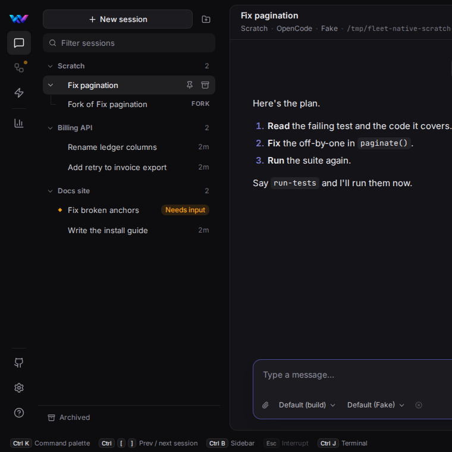
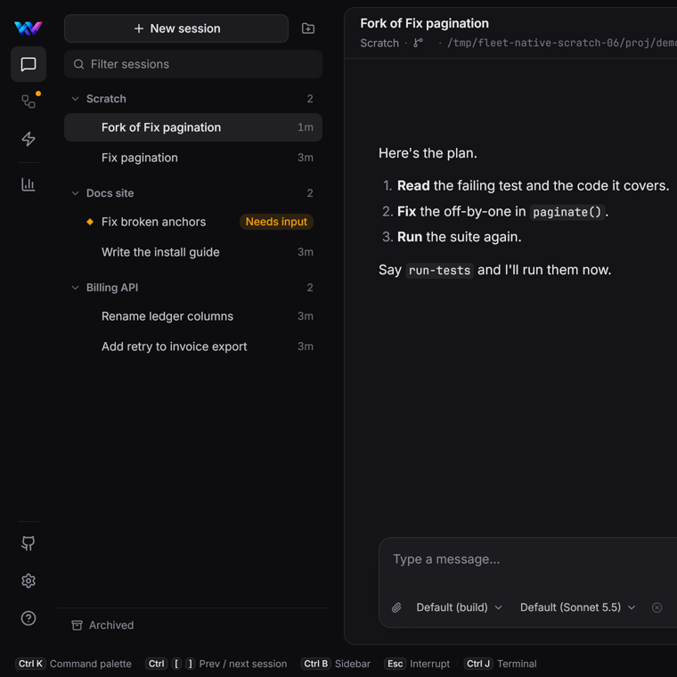
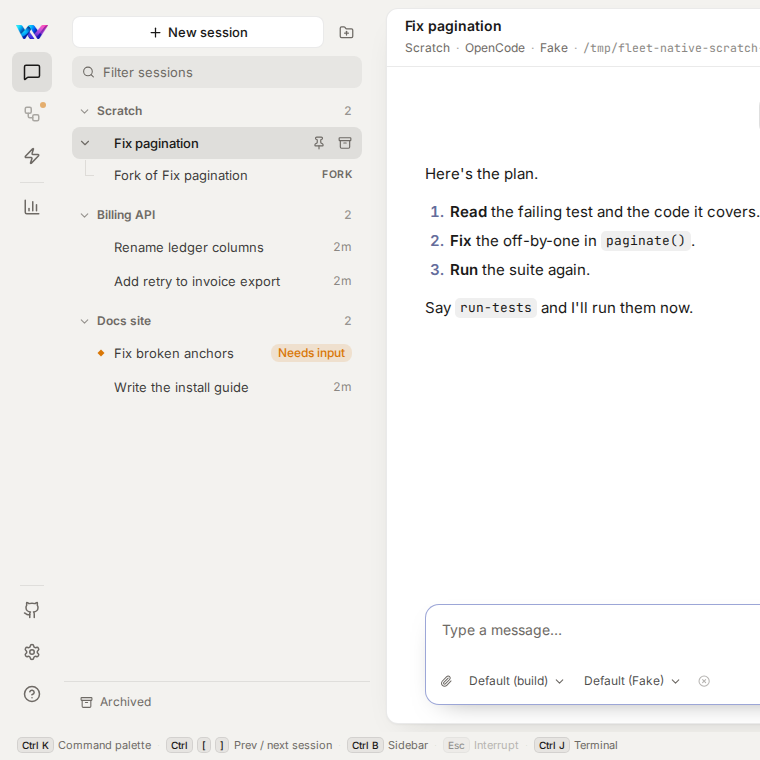
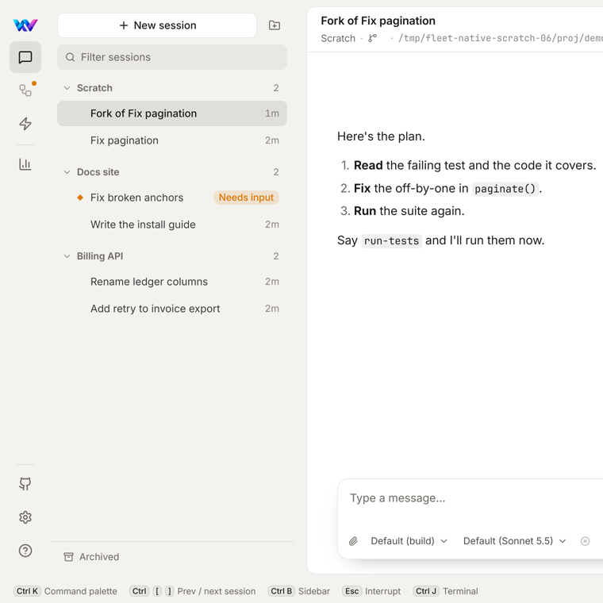
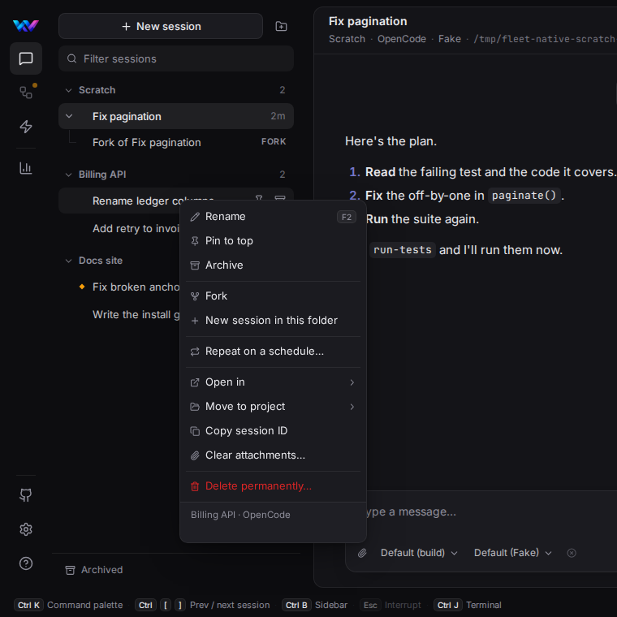
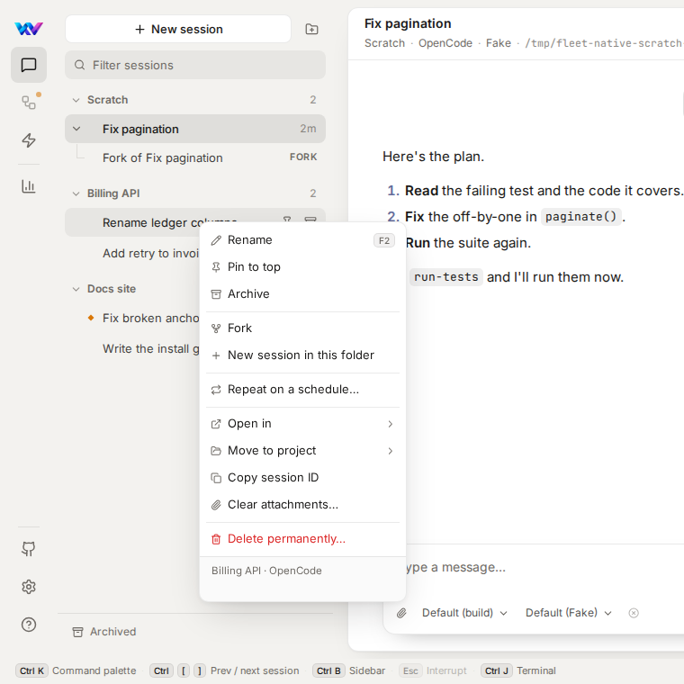

The gap, visible in the pictures: Fleet orders the projects by their position (here Scratch, Billing
API, Docs site) and native by first appearance; Fleet draws the fork as a nested row under its
origin with a muted line and a FORK tag, native lists it flat; the open row shows pin and archive
buttons on hover, native has none; right-click offers Rename (F2), Pin to top, Archive, Fork, New
session in this folder, Repeat on a schedule, Open in, Move to project, Copy session ID, Clear
attachments, Delete permanently and a hint footer, where native has three entries and two are
stubs. The status chip, the age and the glyph are drawn alike. Taken against one scratch Fleet
v0.72.0 (three projects, six sessions, one fork, one waiting for input), 1280×760, cropped to the
left 760×760; the native app ran headless with `--server` and its picture is scaled from 2x. Not
shown: the native right-click menu (its three stubs are in `src/ui/menus.rs`), the Archived view,
a draft row, machine headings (they need a second machine).

## Piece A, built (15 November 2026)

Read against weave-fleet `main` at `d39cb75` (15 November 2026): nothing in `client/src/components/sessions/`, `lib/session-project-groups.ts`, `lib/session-pins.ts`, `composables/use-projects.ts` or the stores changed since `49640bf`; the 8 files that did (onboarding, selector dropdown, tool-card, settings tabs, annotation types) are not this component's.

Done, in `src/fleet/groups.rs` (pure) with tests in `src/fleet/tests/groups.rs` and `src/tests.rs`:

- **1.31, 1.32** the filter matches title, id, project name and `sessionStatus`; a project whose name matches keeps all its sessions. The panel draws through `matching_sessions`.
- **1.37 (part), 1.38** unchanged: still `parse_sessions` (hidden, non-active and child rows dropped; newest first). The Undo queue and the retention filter are piece B/I.
- **1.39, 1.40, 1.41** groups come from `GET /api/projects` by `position`, then name; an empty project shows with a 0; no project is "Ungrouped", last; Scratch only with sessions or when the draft key points at it (`build_project_groups`, `draft_group_key_for`, `draft_group_id_for`).
- **1.42** `can_move_up/down` and the reorder targets are computed (the menu is piece G).
- **1.43** `split_pinned`, `pin_order_for`, `pinned_neighbour_for`, `pinned_project_group` are ported and tested; the Pinned group is not drawn yet (piece J), so a pinned session stays in its project for now.
- **2.1-2.17 (compute)** and **6.6** `GET /api/projects` is read with every list (not only once as Fleet does; a rename elsewhere shows at the next list), a failure keeps the last good projects (`ProjectsLoad`, which ports `useProjects`' loading/refreshing/error/overtaken-request rules).
- `Project` has `id`, `kind`, `position`; `Session` has a `listing` (project ids, `pinOrder`, lineage ids, detached).

Open or different, on purpose: 1.33 (folded projects while filtering) is unchanged and still to verify in piece E; the fold state is kept by project id now (name for the invented list); `ProjectsLoad.error` is kept but not shown (piece E draws the error block); the projects read has no Scratch-only group row of its own, so Scratch shows with its sessions as in Fleet. Fleet has no unit test for `session-project-groups.ts`; the cases in `tests/groups.rs` come from reading it.

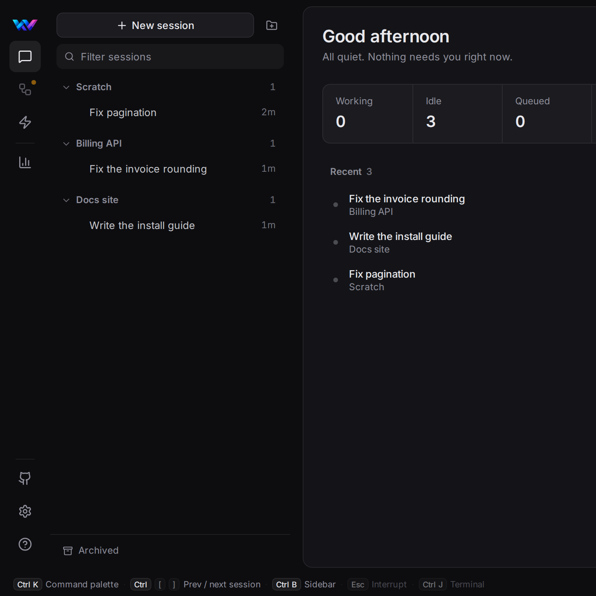
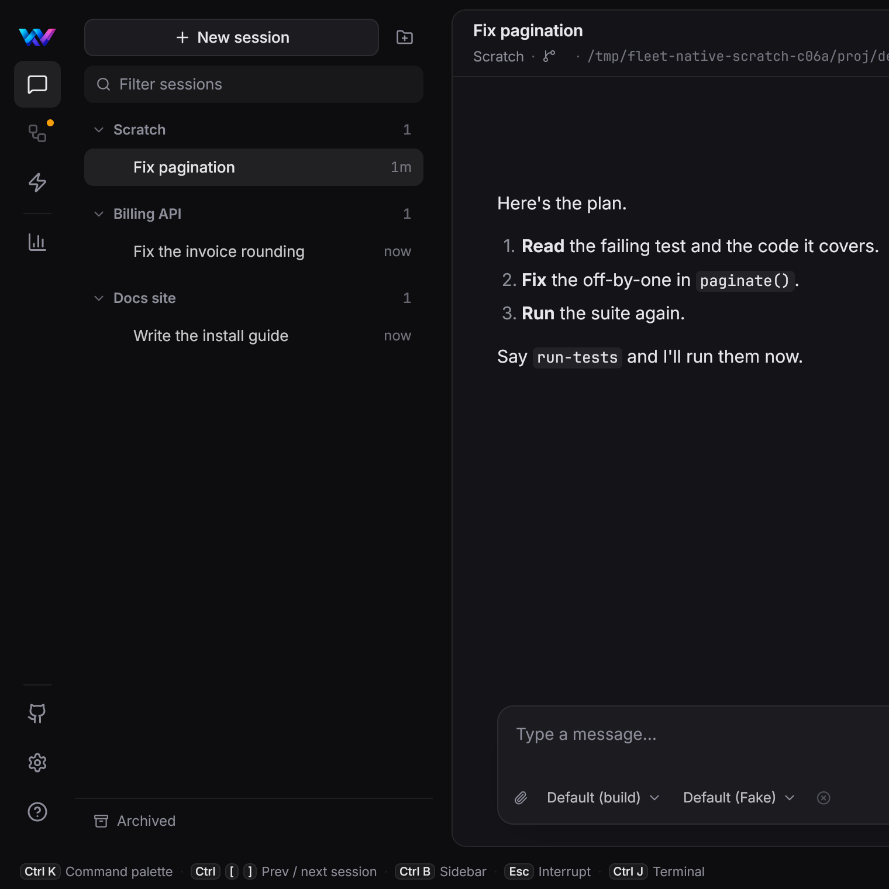

## Piece B, built (15 November 2026)

The sessions store and the open session by id, in `src/fleet/store.rs` (pure) with tests in `src/fleet/tests/store.rs`. Done (rows in `### 6.`): **6.1** the list request is `limit=100&offset=0` with `retentionStatus` for archived and all (`list_path`); **6.3** a poll that says the same thing rebuilds nothing (`store::changed`; only the ages move on); **6.4** a request numbered on the UI thread, a stale answer or failure is dropped (`SessionStore::begin/finish`); **6.5** `is_loading` (first fetch, nothing held) and `is_refreshing`, `error`; **6.9** `error_text` (`error`, `detail`, `title`, the body, `HTTP <status>`), used by `http::sessions`; **6.11** `upsert` (new at the top, known updated in place, conversation kept) and `remove` (clears the route); **6.13** `list_loaded`, `session_by_id`, `elsewhere` (20 newest); **6.14** `patch` (kept entry first, unknown id does nothing), `patch_project` (a workflow run's steps move together, the caller groups again).

Selection: `State.open: (usize, usize)` is gone. `State.route: Route` names the open session by id; `State::open_at()` finds where it is now, `set_open((p, i))` / `set_session_id` set it. The invented sessions have ids `mock.
.<i>` (`store::invented_id`), which are never sent to a server (`open_id()` is `None` for them). A refetch, a reorder or a project move leaves the same session open (pictures below).

Open or different: `changed` compares what the row holds; `archivedAt`, `runningWorkCount` and `progress` join it when pieces D and I add them. 6.12 (state overrides) is piece I's with the archive queue. `elsewhere` has no caller until component 17. The store lives in `store.rs`, not `sessions.rs`, to keep parsing apart from state. `Listing` gained `workflow_run_id`. Fleet's `useSessions` page and poll timer are not ported: the list never pages (6.1) and `refresh::Refresh` already polls.

Pictures, one scratch Fleet v0.72.0: "Add invoice export" open in Docs site; the session is moved to Billing API on the server and the list refetches by itself; the same session stays open.

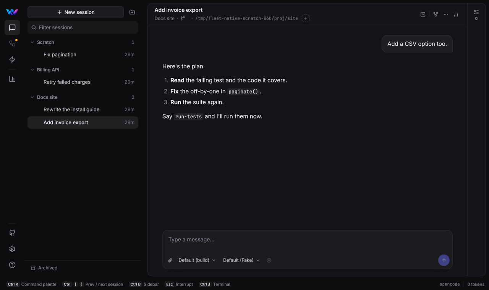
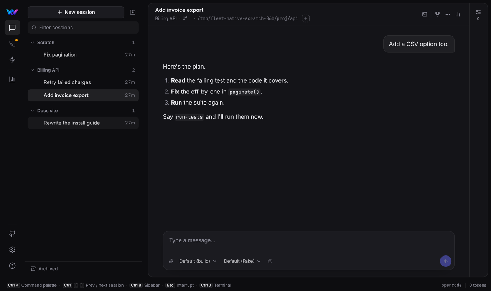

## Piece C, built (15 November 2026)

Row anatomy and status, in `src/view/session_row.rs` (the row, split from `sessions.rs`) and `src/fleet/row_status.rs` (pure: `sessionRowStatus`, `sessionRowDim`, `formatRelative`, `toTimestamp`, `formatDateTime`, the retry words), with the `row-*` tokens in `src/theme.rs`. Tests: `src/fleet/tests/row_status.rs` (Fleet's `session-row-status` and compact `time` cases under their names) and `src/tests_rows.rs` (the `SessionItem` cases the row can answer today).

Done: **3.2, 3.3 (top-level padding; the 28px child row is piece M)**, **3.4-3.8** (86 % text; dim 66/51 dark and 77/62 light as absolute shares of `--text`, restored on hover, never on the open row or a live one; the age fades only at dim-2; hover wash and active 9 % with weight 500), **3.10** focus ring (2px accent, inset; set, not yet seen with the keyboard), **3.12** the row's `Double-click to rename` tooltip (the rename itself is piece H), **3.14, 3.15** order caret slot, glyph, title, word; **3.20** the 14x14 slot with `margin-right:-4px` (the chevron itself is drawn by piece M and exists as `session_row::caret`), **3.21-3.33** every glyph (`parts::status_glyph`: working quad, retry quad in amber, waiting diamond, error triangle, completed check, idle ring, stopped square, running pulse) and the quiet 8x8 slot, the cut-off dot, tooltips from the status description, **3.40-3.48** the title as Fleet derives it (`Untitled session`, trimmed), one line with an ellipsis, the words (Needs input, Error, Retry n/m, Done, Offline, Failed, Cut off, Retry <time>, Not answering) with their tones and colours (the `row-waiting` mix is 55 % in light), the compact age with weeks and dates, `toTimestamp`, the age's exact-time tooltip, and the list re-reading the clock every 30 s. The invented sessions now carry `ago_secs` instead of a stored age and a dim number; `Row` gained `created`.

Open, with reasons: **3.1** (`data-session-id` and the drag role: no equivalent), **3.9, 3.34** the picked row and the checkbox (need the selection store, piece J), **3.11** the editing row's cursor (piece H), **3.13** keys stay `session-{p}-{i}` because tests, scripts and the bench use them; sub-element keys are `session-title-`, `-glyph-`, `-slot-`, `-caret-`, `-status-`; moving to ids is one change for the sweep, **3.40** `dir="auto"` (Rune's text shaping, not checked with an RTL title), the 150 ms colour transitions (Rune has none on hover, see `docs/RUNE.md`), **3.42** while a row has progress or a kind label (pieces D and M), and the "Not answering" word is only reachable with machines (component 17): `row_status` takes `machine_answering`, the row passes `true`. Fleet's `LIVE_STATUSES` makes a lifecycle `error` live (red triangle and `Error`); here `RowItem::of` keeps the server's lifecycle word over the stream's glyph.

Pictures, native beside Fleet's own client (one scratch Fleet v0.72.0: a working row, one waiting for input, idle ones "now"; both themes), and every status from a scene (the scratch Fleet cannot make an error, a retry, a cut-off turn, a limit retry or ages of days):

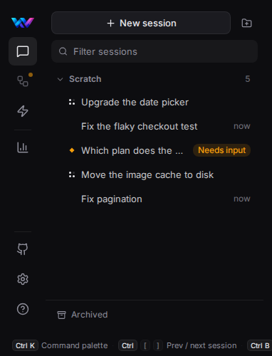
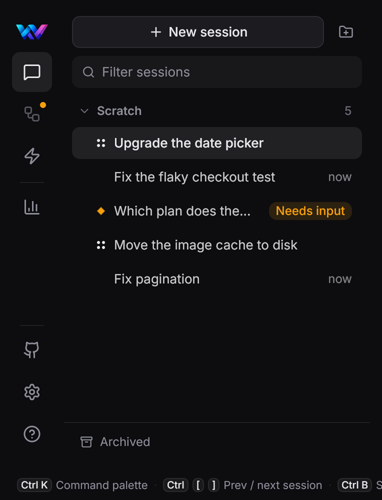
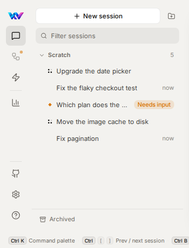
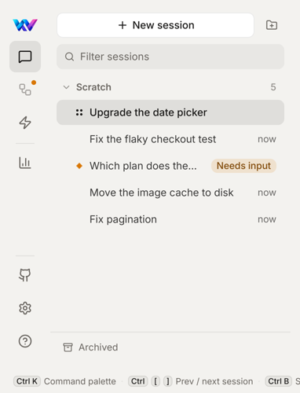
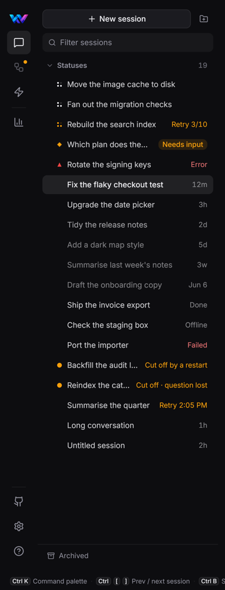
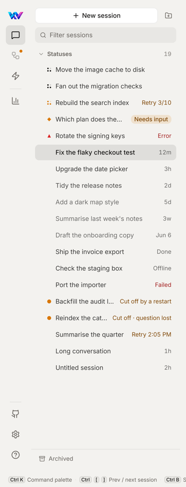

## Piece D, built (15 November 2026)

Running chip, progress ring and count, pull request badge, step-note and kind-label slots, in `src/view/session_row.rs` and `src/view/progress_ring.rs` (a `canvas` arc, eased by a live trim). Pure parts in `src/fleet/row_chips.rs` (`parseProgressSummary`, `sameProgressSummary`, the progress rules, `runningChipLabel`, `PrBadge`); `Row` gained `running_work`, `progress` and `pr`; the `session_progress` event patches the row (`RowPatch::Progress`) and the poll's change check compares both. Tests: the Part C progress cases in `src/tests_rows.rs`, `session-progress` cases and the chip's words in `src/fleet/tests/row_status.rs`.

Done: **3.14** order (title, running chip, badge, progress, then one of step note, kind label, word), **3.49** running chip (18 px pill, 14 % green, 11 px count, tooltip), **3.50** badge layout, icons per state, colours per state, checks dot (data from mock only), **3.53** progress (ring beside the count for a working row, ring beside the age for a quiet unfinished one, none for a finished quiet one or an empty list, tooltip `3 of 7 done. Now: ...`), **3.54** event and parse and compare (`runningWorkCount` as a number or a string), **3.55** step note colour and **3.124** kind label style, as slots nothing fills yet, **3.42** (the word hides behind the count), **2.170-2.174** ring (14 px, 2 px stroke, round cap from twelve o'clock, track 14 % of `--text`, green when complete, 150 ms ease).

Open, with reasons: **3.51** PR state and words (`lib/pr-state.ts`): the data is the header component's smart links; the badge takes its state and tooltip from the row, and only mock rows have one. **3.50** needs the live smart-links store for a real badge. **3.56** hover swapping the right edge for the actions: piece I adds the buttons. **3.55** and **3.124** get their text from workflows and lineage (piece M). The running chip's loader icon is 2 px stroke, Fleet's is 2.25 (no way to set it, see `docs/RUNE.md`). The detail form of progress (`parseProgressDetail`, plan, subagents) and the `progress.updated` event belong to the right panel. A working-row with an open sub-agent shows no child row yet (piece M).

Pictures, native beside Fleet's own client (one scratch Fleet v0.72.0 with a patched copy of the scripted model that calls the todo tool: a working row on 3/7, a sub-agent's chip `1`, quiet rows with an unfinished list; Fleet's child row under Weekly tasks and the open row are pieces M and E), and every case from a scene (the scratch Fleet has no pull requests):

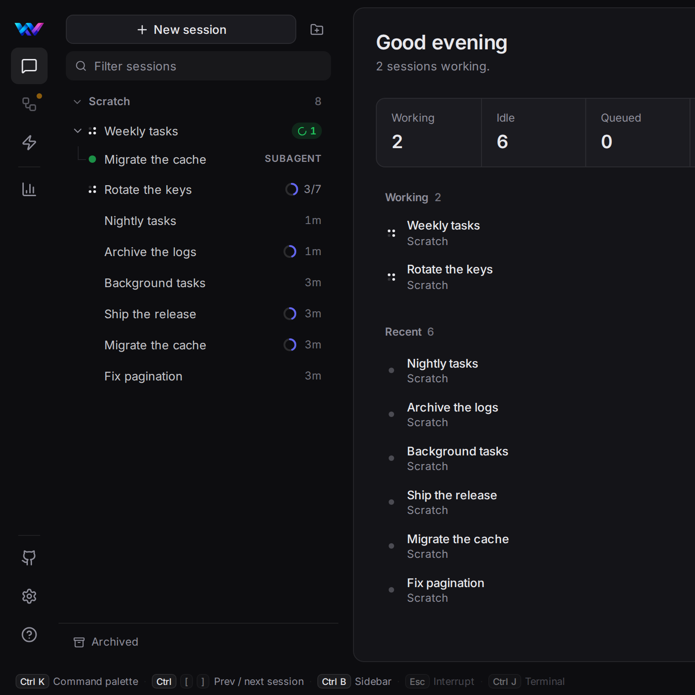
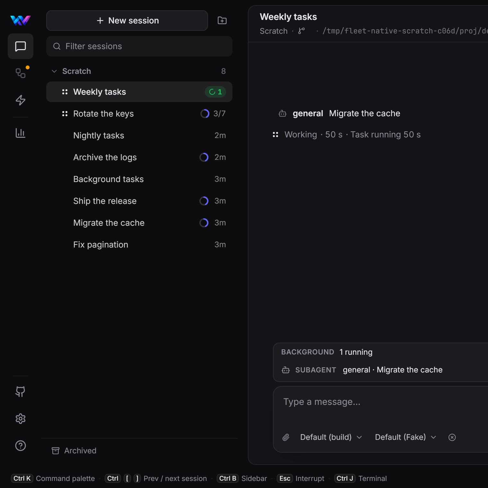
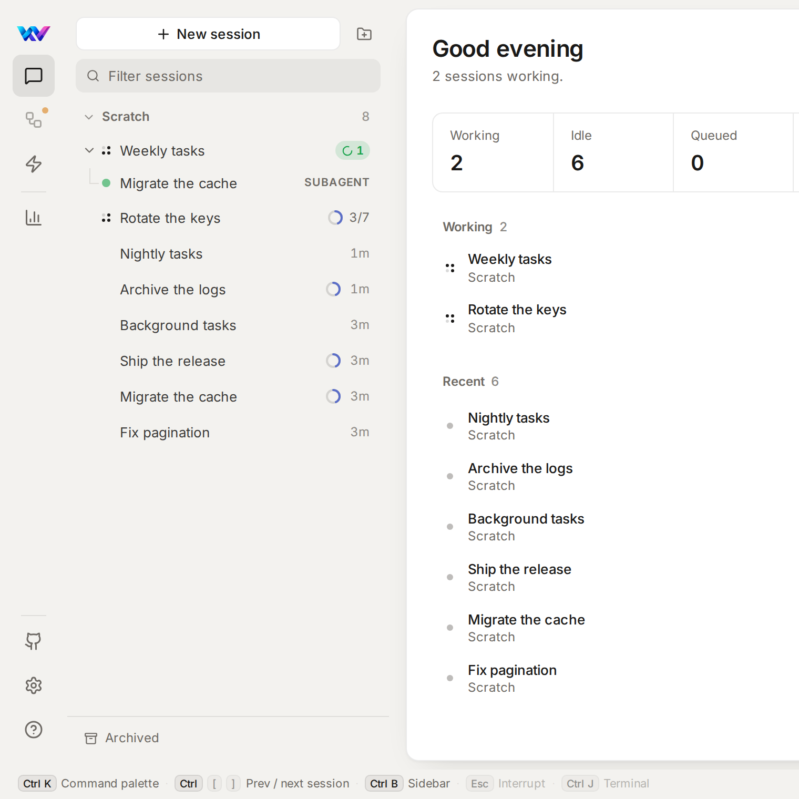
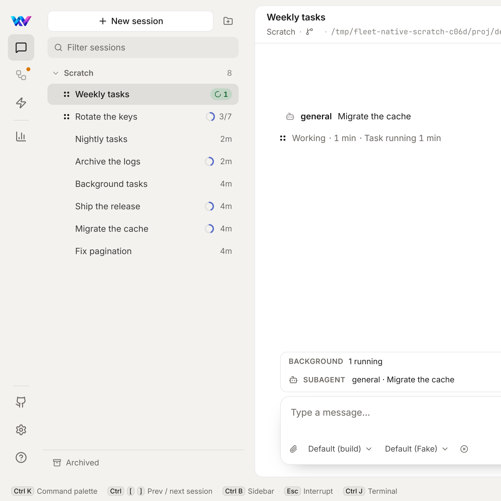
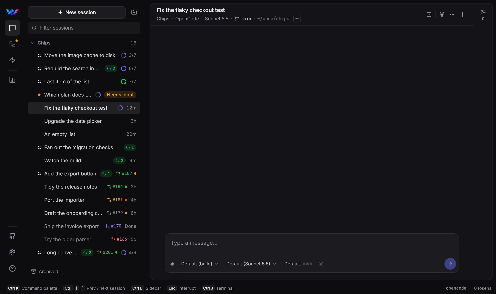
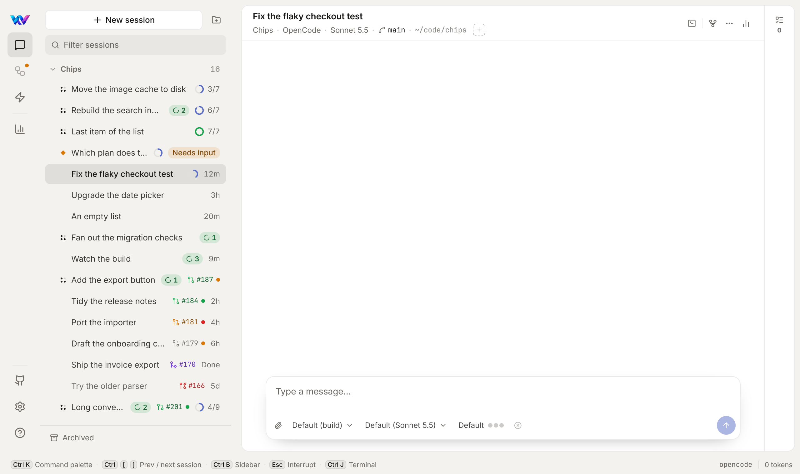

## Piece E, built (15 November 2026)

The panel's states and the filter box, in `src/view/sessions.rs` with the pure rules in `src/fleet/panel.rs` (`feedback`, `empty_words`, `error_message`, `banner_copy`) and `State::list_error`, `list_is_loading`, `retry_list` (which calls `Link::refetch_list`, the sessions and the projects read together). Tests in `src/tests_panel.rs`; Fleet has no unit test for these states (`SessionsPanel.test.ts` is machines), so the names say what the template does.

Done: **1.21** New project wording (tooltip and label), **1.28** filter focus (the sheet's fill and a 1 px border of the accent at 55 %, transparent at rest, so the text sits where Fleet's does), **1.65** loading block (first load only; also while the window waits for the hub's first list), **1.66** error block with "Try again" (square, 30 high), **1.67** banner over the rows (28 high button, the literal red at 20 %/8 % in both themes, `Theme::feedback_red`), **1.68** error text is the sessions' error, else the projects', **1.69** Try again reads both, **1.70** the three empty wordings (compact, centred, no icon), **1.71** no empty state while any group is drawn, **1.72** a failed refresh keeps the rows and shows the banner; the status-bar line it used to make is gone (Fleet has none), **1.73** a refresh shows nothing, **1.74-1.76** checked unchanged. **1.14-1.20, 1.25-1.27, 1.29** were already as Fleet has them.

Open, with reasons: **1.68** "Can't reach `<machine>`" (component 17, machines). **1.16** New session hover still washes the fill where Fleet only changes the border (Rune has no hover border; `docs/RUNE.md`); the same stops "Try again" showing its hover border. **1.28** no 150 ms ease on the focus change. **1.17, 1.18, 1.22, 1.23** unchanged (new-session page, shortcut, dialog are other components and pieces). **1.33** (folded projects while a filter is typed) is drawn open while filtering, as Fleet does; looked at in the filter picture. The empty state in the pictures is centred (Fleet's `main` `EmptyState` is); the v0.72.0 client's is left-aligned and its button says "Retry", where `main` says "Try again": both are differences between the released server's client and `main`, native follows `main`. Fleet's filter box is `type=search` and shows a clear (x) button when it has text; native's doesn't (a new row, not in the list above). The banner can't be made live in v0.72.0's client (nothing refetches on demand), so it is from a scene only. Server not reachable at start: the panel keeps saying "Loading sessions" while the hub tries to connect, as nothing has been asked yet; the status bar says the connection is down.

Pictures, Fleet's own client (left) beside native (right), the same state, 1280x760 cropped to the left 380x280 css px, one scratch Fleet v0.72.0 (loading and error by holding or failing the list requests, empty by answering them with nothing): loading, error, empty, no result, filter focused.

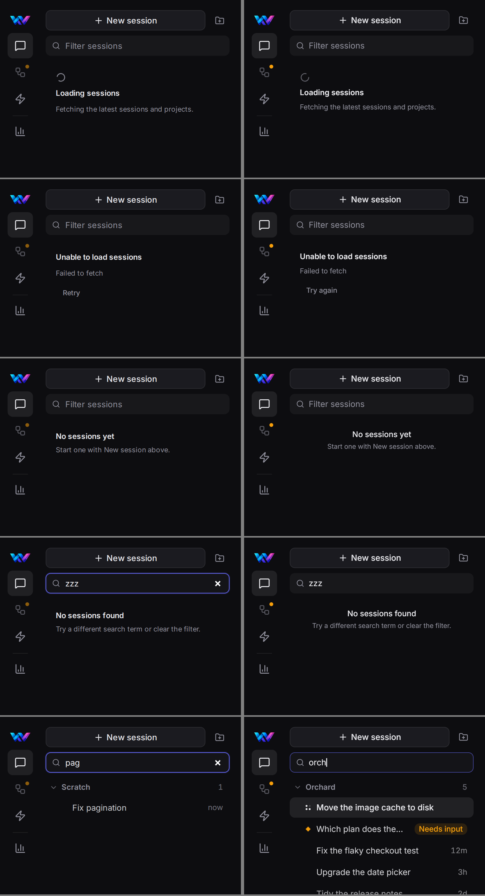
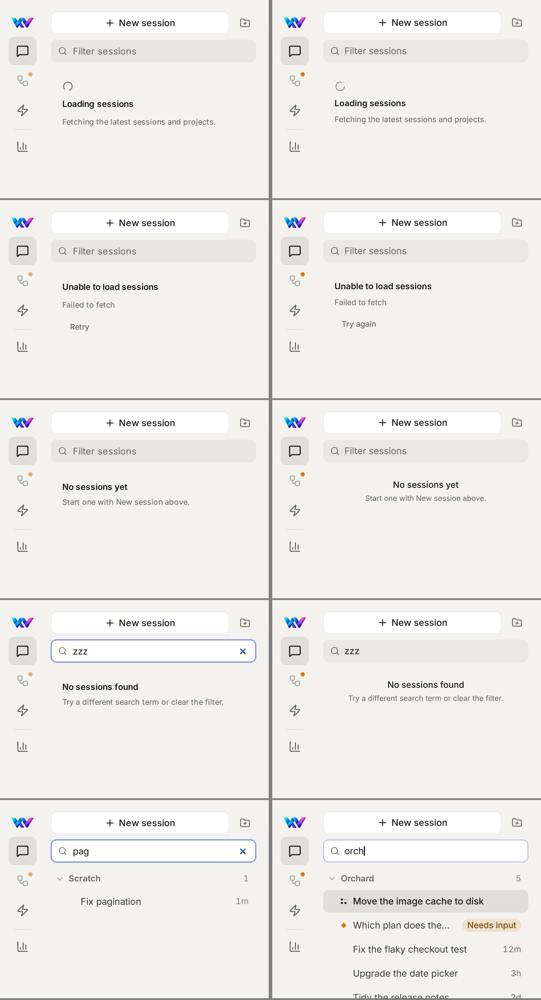
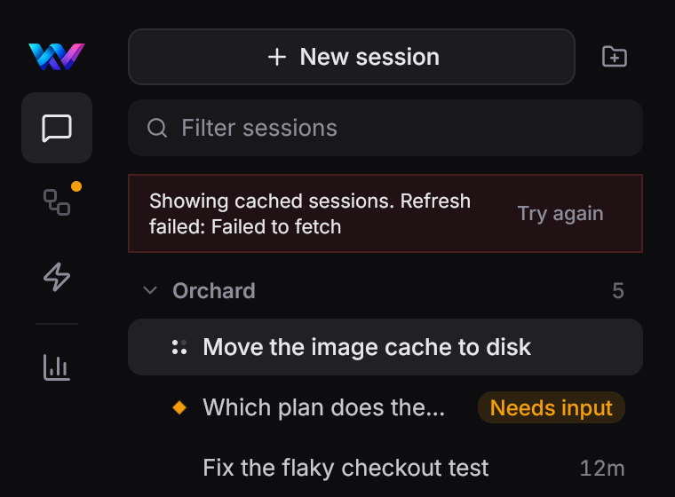
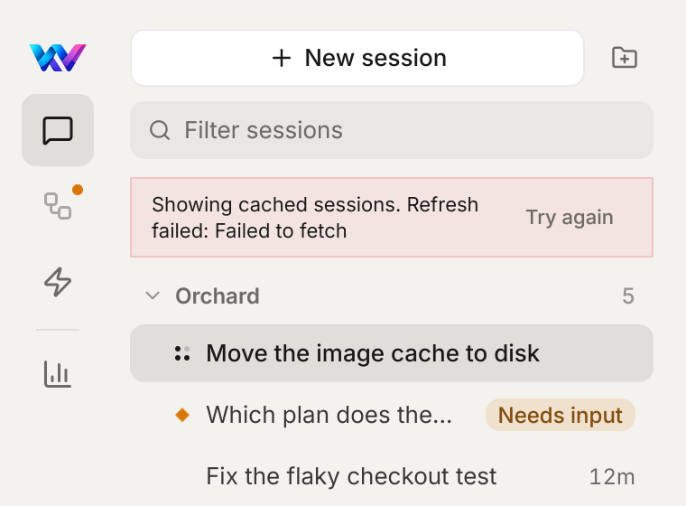

## Piece F, built (15 November 2026)

The settings file, folding and the project header. `src/fleet/settings.rs` (pure data plus `load`/`write_file`/`spawn_save`) ports `stores/sidebar.ts`: one `settings.json` in the app's own data folder (`composer::drafts::app_dir`, the same folder as component 5's `drafts.json`, a separate file; never Fleet's `.weave`; the format is not shared with the Electron app). It holds the folded groups (`project:<machine>:<id>`, `machine:<key>`; only folded ones; machine `home` until component 17), the list's hidden state, the right panel's last choice and each session's own (newest 200). Read once at start on a thread (`State::adopt_settings`), written on a thread after every change (a write asked for before one already written is dropped). A scene or test only touches a folder when it names one. `src/view/project_header.rs` is `ProjectGroup.vue`'s header (`Header::{Project, Ungrouped, Pinned}`); `sessions.rs` uses it. Tests: `src/fleet/tests/settings.rs` (the nine `sidebar.test.ts` cases under their names, plus a corrupt file, the 200 limit and the file round trip) and `src/tests_header.rs`.

Done: **1.9** the list's hidden state is saved, **1.13** the panel is labelled "Sessions context panel", **1.45** folded groups kept by project id under Fleet's keys in a file, a corrupt value reads as nothing, **1.46** a header press folds and saves, **1.131** (see open) per-session and last right-panel choice saved and applied when a session opens, **2.3** keyboard focus ring (2 px accent, inside), **2.8-2.10** toggle, saved, Ungrouped's header is a plain one, **2.11** the Pinned header (pin 11 px, 5 before the name) drawn by `Header::Pinned`, **2.14 / 1.33** a folded group now **stays folded while a filter is typed** (Fleet's `SessionsPanel` hands the group `isProjectExpanded(id)` and no query; piece E had it open while filtering, which was wrong, and its note is withdrawn), **2.183** fold state survives a list re-read (keyed by id). **2.1, 2.2, 2.4, 2.5, 2.7, 2.12, 2.15-2.17** were already as Fleet has them (checked in the pictures). **1.1-1.7, 1.10** unchanged. **2.180, 2.181, 2.182** were piece E's and C's.

Open, with reasons: **1.8** the palette wording is component 1's. **1.11** `Sidebar::register_list`/`release_list`/`list_shown` are ported and tested, but nothing reads them: the header that shows a session's status only when no list is on screen is component 9's. **1.12** unchanged (no URL; `Route` plays it). **1.131** the right panel's per-session choice is wired, but native starts with the panel closed where Fleet starts open, and "closed until the session has a change" (`note_session_content`, ported and tested) belongs to the content component (11), so a remembered choice is only applied once one was made. The Board's panel (no session) doesn't exist here. **2.2, 2.4, 2.13** no 150 ms ease on hover or the caret, no height animation on folding (Rune has no transitions; `docs/RUNE.md`). **2.6** the 28 px margin for the + belongs to piece G (it adds the +). **2.12** the group clips nothing (no overflow clip needed without the height animation). **2.10, 2.11** the Pinned header is drawn only by a scene (`project-headers`) until piece J draws the group; Ungrouped has no live Fleet picture (the released server puts a session with no project in Scratch). The machine key `home` is fixed until component 17.

Pictures, Fleet's own client (left) beside native (right), 1280x760 cropped to the left 380x330 css px, one scratch Fleet v0.72.0 with three projects: open, then Docs site folded and the app started again (the native run read its own `settings.json`, the Fleet one reloaded its page); then the headers (Fleet's live Pinned group beside the native sample scene).

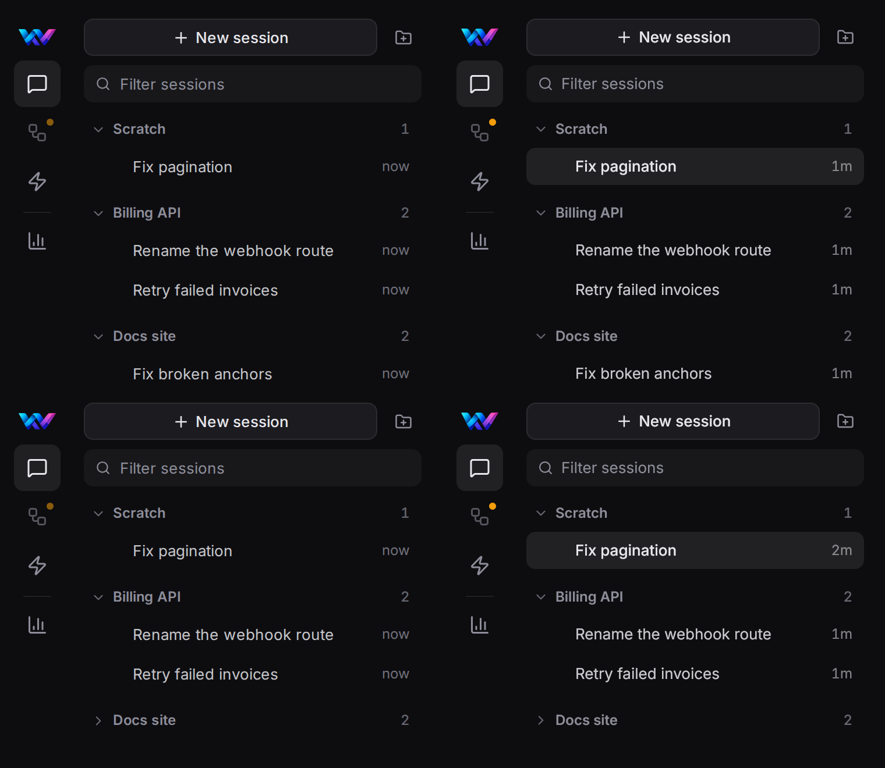
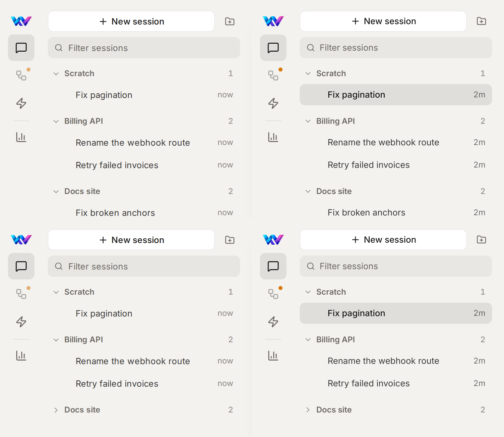
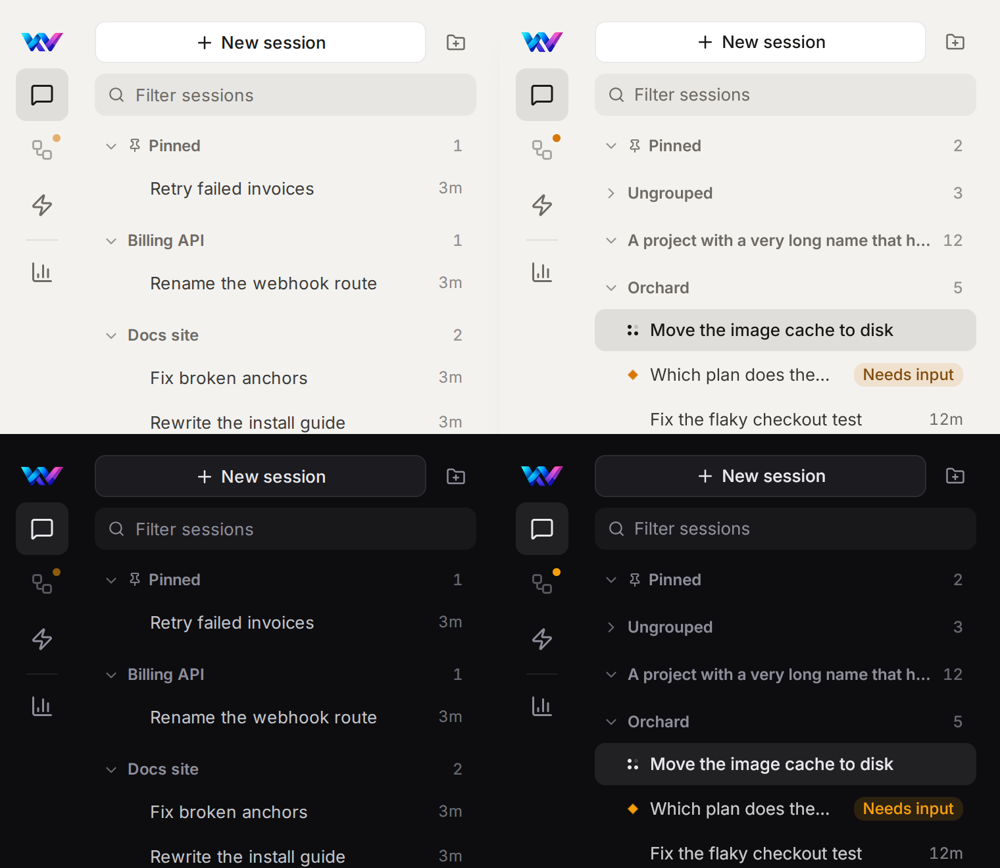

## Piece G, built (15 November 2026)

The project's +, right-click menu, rename in place, Move up/down and the delete dialog. `src/fleet/projects.rs` (requests and rules as plain data: `rename_outcome`, `move_targets`, the paths and bodies; `State` methods that send a call on a thread with `Link::off_thread` and read the list again on success; with no server the invented list takes the change, so scenes and tests need none), `src/view/project_header.rs` (`project_shell`: + and name field), `src/view/project_menu.rs`, `src/view/project_dialogs.rs`, `ui::dialog::Dialog` gained `title_icon`, `description_el` and `dismiss`. Tests: `src/tests_project.rs` (30; the `ProjectGroup.test.ts` cases "shows a New session + button that emits newSession without toggling", "has no + button for the ungrouped group" and "shows no rename input for the ungrouped group" under those names, the rest written from the source because Fleet has no tests for the menu, `InlineEdit` or the delete dialog).

Done: **2.6, 2.20-2.23, 2.25-2.30, 2.40-2.47, 2.50-2.59, 2.140, 2.141**; **2.24** and **2.142** partly (below). Run against a scratch Fleet v0.72.0: renamed a project (the name changed on the server), moved one down (positions 1..n sent in sequence; the list came back in the new order), deleted one with "Delete project only" (it left `GET /api/projects`; its sessions stayed). **2.48:** checked: `PATCH /api/projects/{id}` with `description: null` leaves a project's description as it was (a project made with one kept it), so Fleet's `null` is harmless; nothing to fix.

Open, with reasons: **2.24** the + and the menu's New session record the project (`proj.new_session_in`) and say in a toast that the New session page is component 7's; they cannot go to `/sessions/new?projectId=` yet. **2.21, 2.22** no 150 ms ease on the + (Rune has no transitions). **2.60** left as Fleet has it: the dialog counts the group's filtered rows (`shown_count`). **2.142** Fleet is silent when a request fails; here a toast says why, which is a difference on purpose (the brief). **2.47/2.59** the same. The delete dialog's radio is drawn (Fleet uses the browser's, blue in both themes). **Differences found in v0.72.0 (the released client the pictures come from) against `main`, followed here as `main`:** the dialog's description and card lines are drawn in the full text colour in v0.72.0 (its CSS has no `--color-muted-foreground`, so `text-muted-foreground` inherits), the confirm button reads "Delete Project", and the name field's ring is 1 px; `main` has the muted lines, "Delete project" and a 3 px ring. Not checked: a real keyboard's F2 (the test focuses the header and presses it), Windows and macOS (CI).

Pictures, Fleet's own client (above or left) beside native, one scratch Fleet v0.72.0 with four projects: the + on a hovered header, the menu, rename in place (name selected), the delete dialog with its first card picked, and with the second.

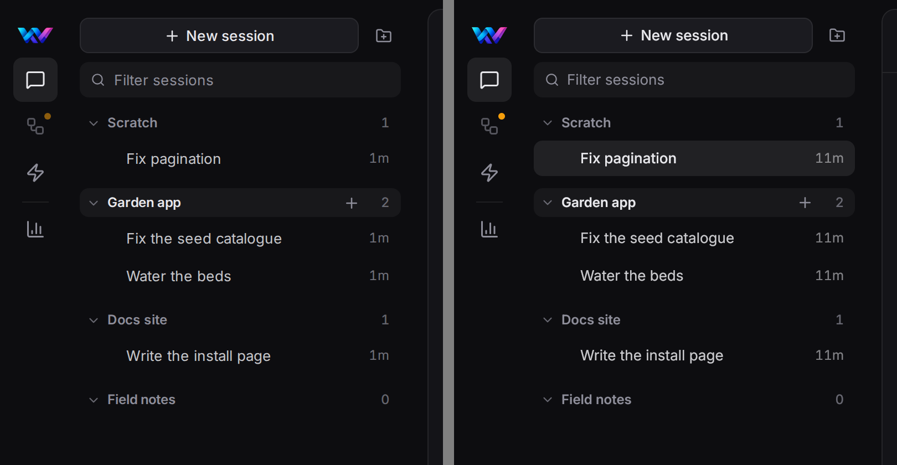
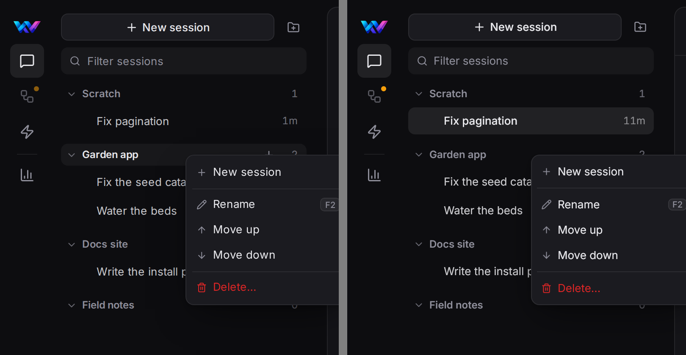
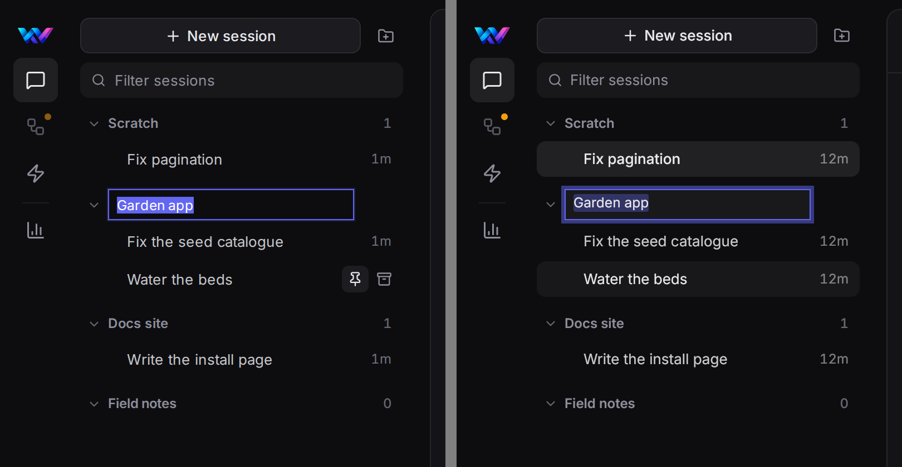
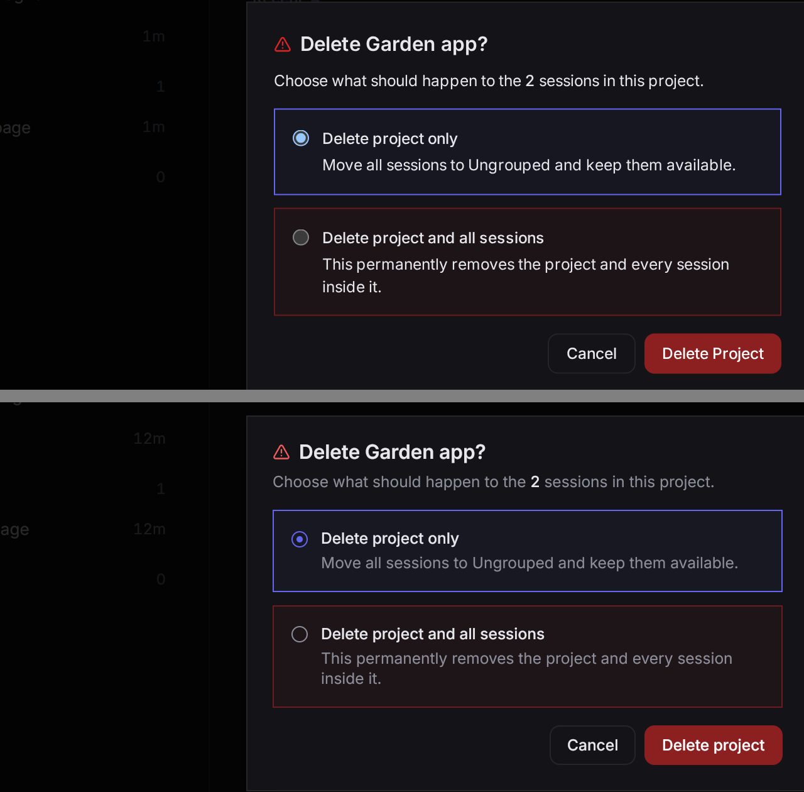
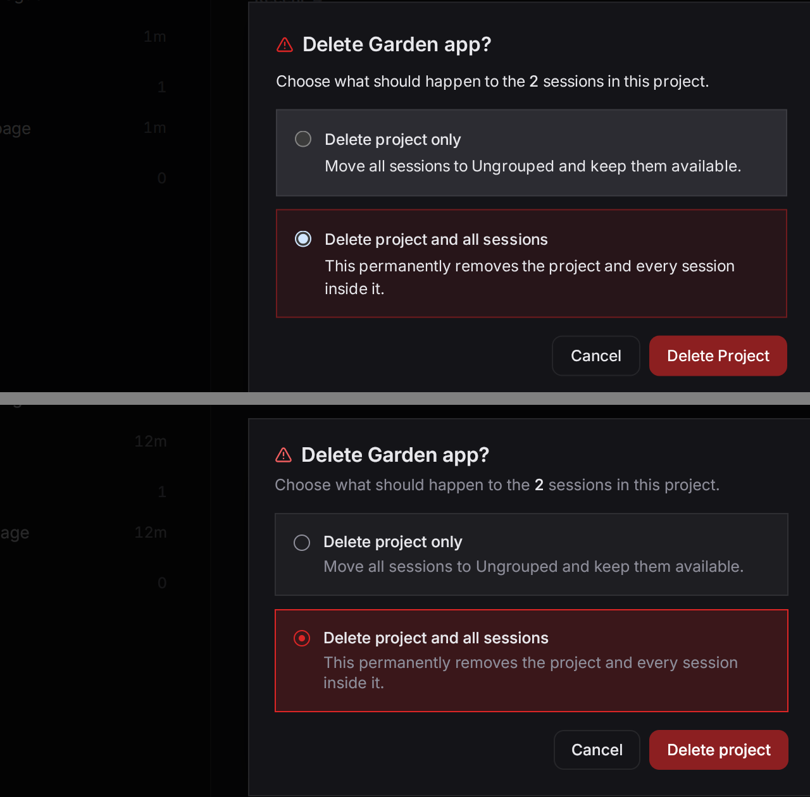

## Piece H, built (15 November 2026)

Rename in place on a row, F2 and double-click, and the confirm dialog with its two users (Clear attachments, Delete session). `src/fleet/actions.rs` (`PATCH /api/sessions/{id}` `{title}`, `DELETE /api/sessions/{id}`, `DELETE .../attachments`, the refusal words as `failure_text`; `State` methods that send on a thread, with the invented list taking the change when there is no server), `src/ui/confirm.rs` (one `Confirm` in `Ui`: title, subject, body, labels, destructive, busy, error, the call; drawn on `ui::dialog`; `ErrorNote`), `ui::button::button_lead` (a button with its own leading element, for the 14px spinner), `src/view/session_row.rs` (the editing row, F2, double-press), the row menu's Rename, Clear attachments… and Delete permanently… (`src/ui/menus.rs`, now `w-66`). Tests: `src/tests_row_actions.rs` (28; "renames in place on double click", "optimistically renames and rolls back on failure", the `ConfirmAction` cases and the Clear and Delete cases under their names).

Done: **3.71, 3.72** (F2 only; Alt+Up/Down and the arrows belong to pins and lineage: pieces I and M), **3.80-3.83**, **4.30-4.36**; **3.70** partly (a click while renaming is ignored: the editing row has no press handler; shift and ctrl click are piece J's); **3.74** untouched (no read-only rows yet: piece R). Run against a scratch Fleet v0.72.0: renamed a session in the row (the title changed on the server). Not run live: delete and clear against the server's own refusal (the scratch Fleet has nothing that refuses); those paths are tested through `confirm_done` and `session_call_done`.

Open, with reasons: **4.33** where focus starts (Cancel when destructive) is `autofocus` on the button; a headless modal focuses itself, so it can't be read in a test, and the Xvfb window I tried ignored the injected keys, so it is **not checked**. Focus going back to where it was is left to Rune's modal. The last ask is not kept drawn while the dialog fades out (the dialog leaves at once). **3.81** one tick, one frame and a 0 ms retry to focus the field are not needed: Rune focuses on the next frame. **3.82** "on another machine the machine's own list is patched": no other machines yet (piece R, component 17). **3.84** (done in piece P: a deleted session's drafts are forgotten). **4.31** `canDelete` (a session's `capabilities`) is not read: the item is always offered. **4.36** the menu is the row's old five-item stub plus the two new items; its full set is piece L. **Differences found in v0.72.0 (the released client the Fleet pictures come from) against `main`:** v0.72.0 asks "Are you sure?" with the title in the sentence and buttons "Delete" and "Clear", and has no subject line; `main` (followed here) has the `ConfirmHost` dialog, so the dialog pictures set v0.72.0 beside the native one only for the frame. v0.72.0's rename field has a faint 1 px border; `main`'s has none. A long title is shown scrolled to its end in the field (Rune puts the view at the selection's end; a browser keeps the start).

Pictures, Fleet's own client (left) beside native, one scratch Fleet v0.72.0 with three sessions: rename in place, the Delete session dialog, the Clear attachments dialog. Scenes (native only): rename, the dialog busy, and with a refusal.

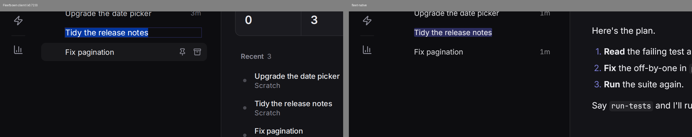
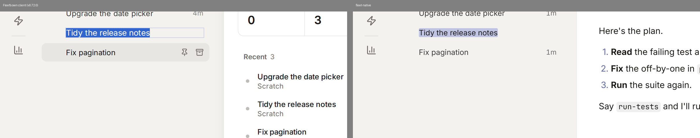
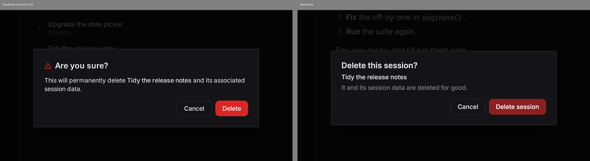
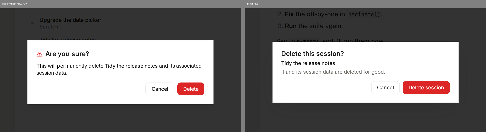
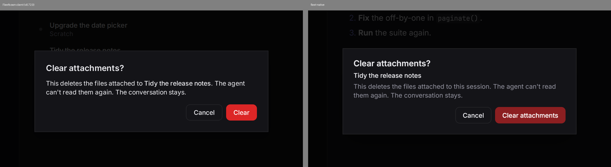
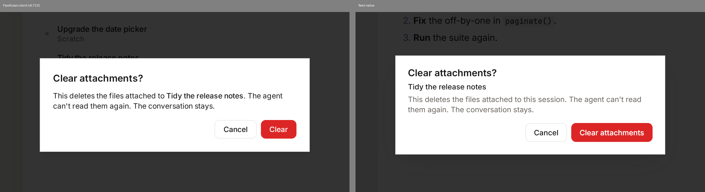
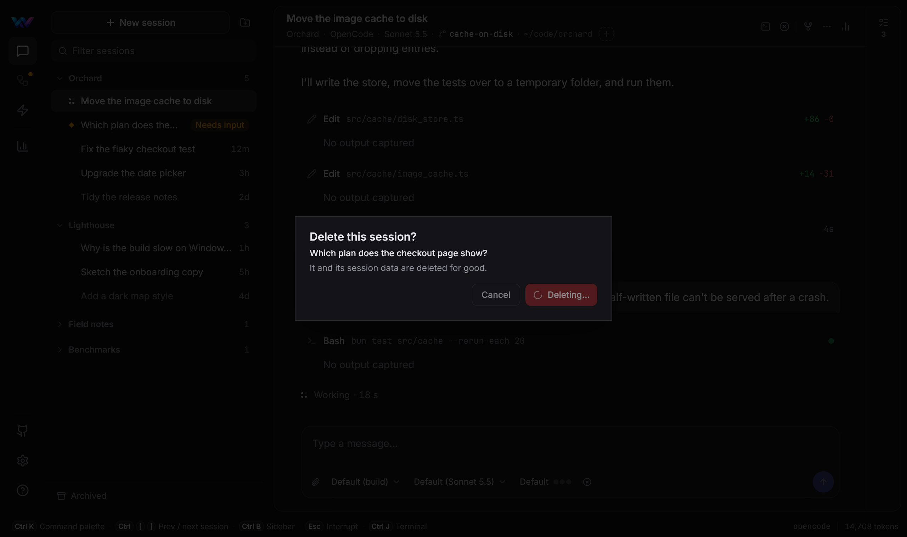
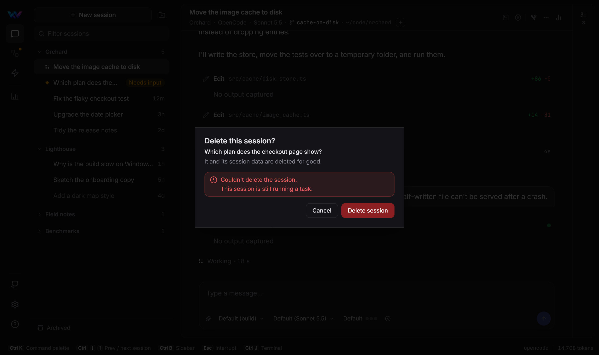

## Piece P, built (16 November 2026)

The row itself (`src/view/draft_row.rs`) and the draft state behind it were built by component 7 (pieces D and L) and component 5 (piece A: `src/composer/drafts.rs`, the file `drafts.json`). This piece checked every row against the code, wrote the missing tests and added what was missing: `append_draft_reference` and `append_draft_text` (`src/fleet/drafts.rs`, with the pure `with_reference` and `with_text` in `composer::drafts`), `clear_draft_text`, and forgetting a deleted session's drafts (`forget_session` calls `forget_drafts_of`, which also empties the box when that session was open: closes 3.84's open half). Tests: `src/tests_draft_row.rs` and `src/fleet/tests/drafts.rs` (Fleet has no tests for these; the four `draft-storage.test.ts` ones were ported by component 5 under their names in `src/composer/tests.rs`).

Done: **2.70, 2.71, 2.72, 2.73, 2.74, 2.75, 2.76, 2.77** (a click opens the page on the draft's project), **2.78** as state (`DraftStore::hand_off` keeps the row key, tested; the native list has no arrive/leave animation, so there is nothing to avoid), **2.160** (one draft per session in `Drafts`, text in the file; the agent/model/effort fill from defaults is component 5's `choice`), **2.161, 2.162, 2.163, 2.164** (a JSON file in the app's data folder instead of `localStorage`; the same key names; write errors leave memory only), **2.165, 2.166**.

Open, with reasons: **2.79** another machine's draft in that machine's group and unfolding it: component 17 (the draft is placed in the live machine's group; `tests_machines` pins that another machine's group has none). Nothing calls `append_draft_reference` yet: "reference this line" is the changes view (component 10). **Differences:** the mock data has no Scratch group, so a draft with no project is drawn at the foot of the list (Fleet shows it in Scratch, which it creates while a draft lands there); the real-server scene would match.

Pictures, Fleet's own client (left) beside native, left 380 px, 2x. Fleet: one scratch Fleet v0.72.0; the native scenes are from the mock list.

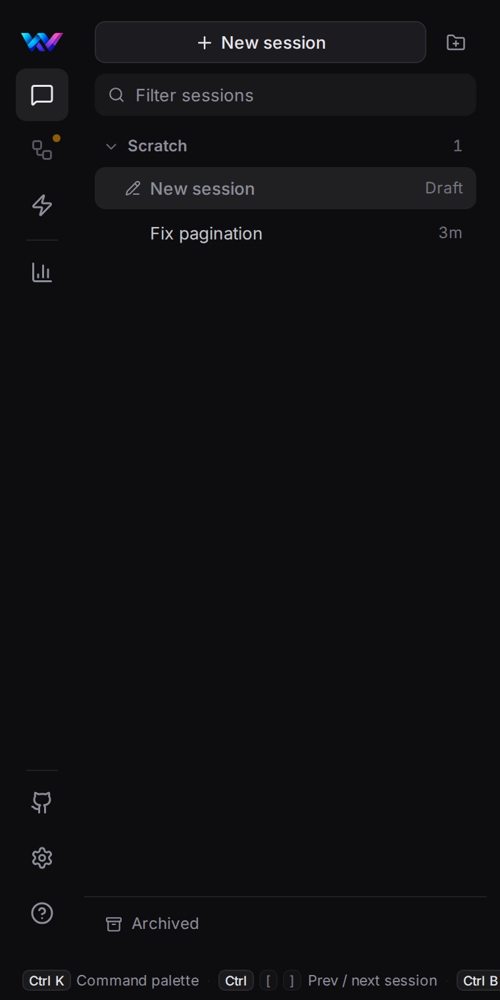 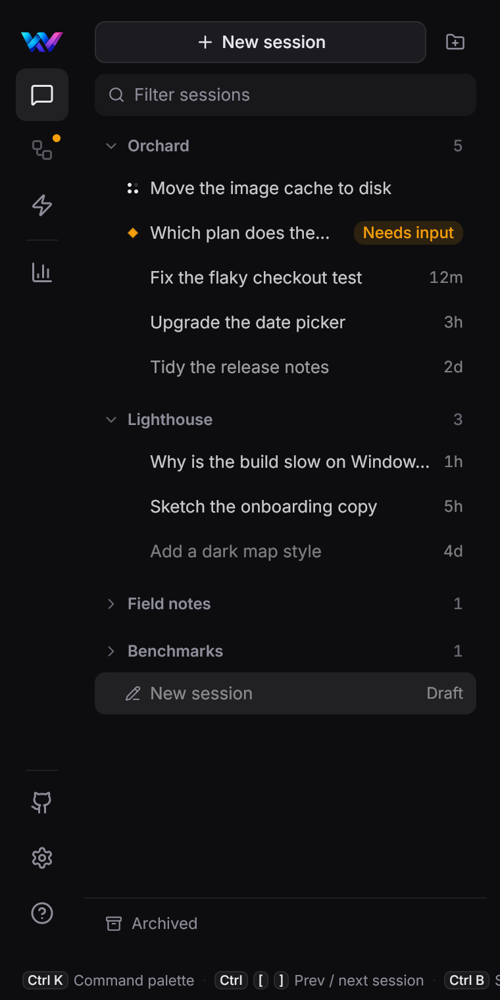
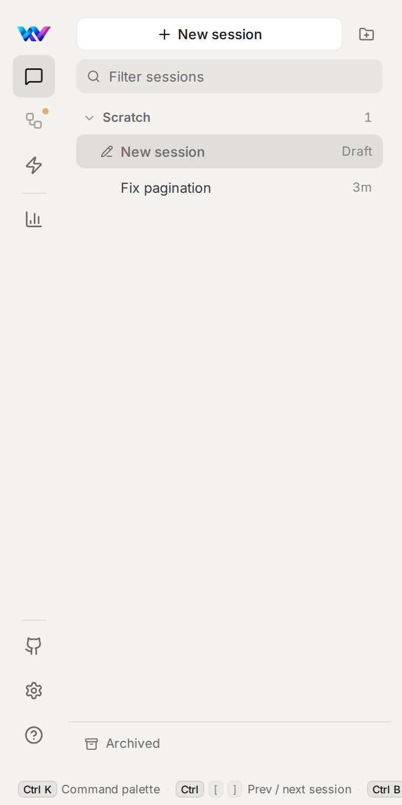 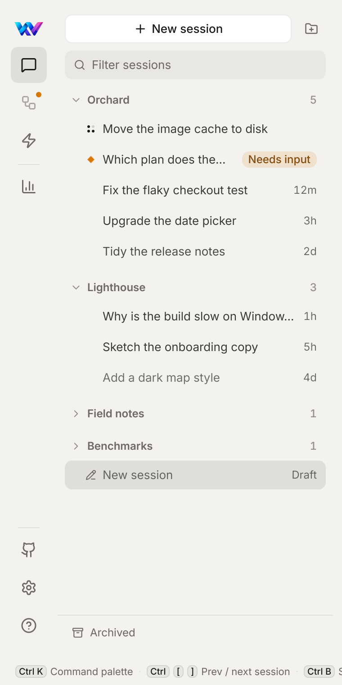
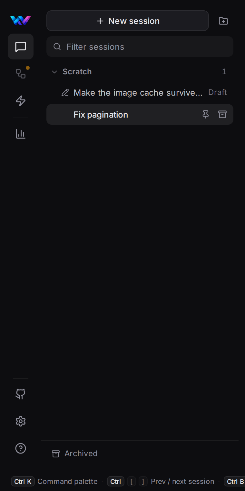 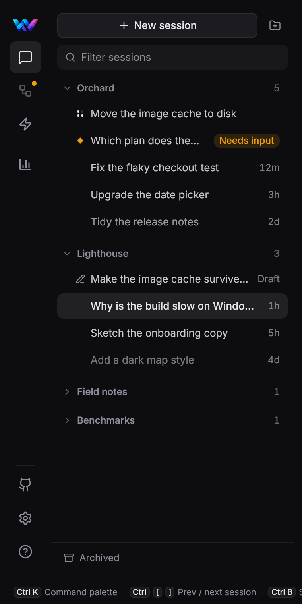
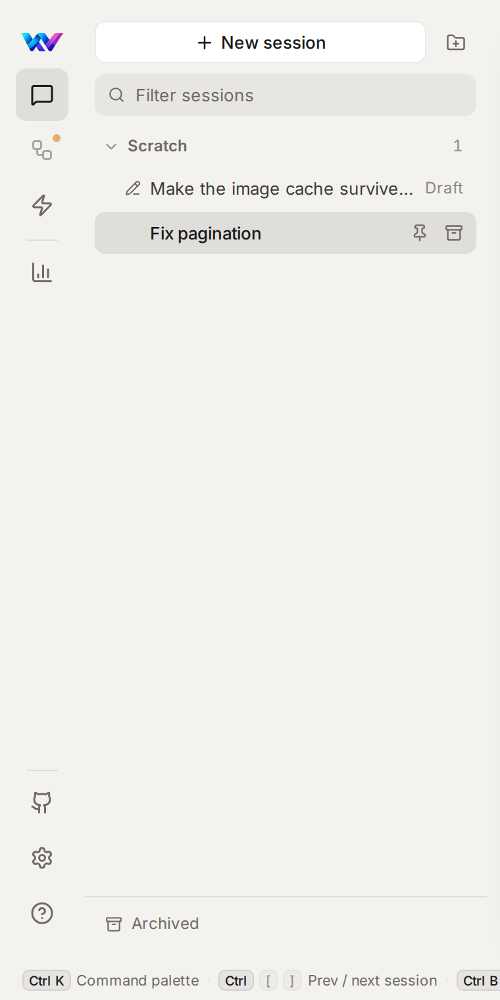 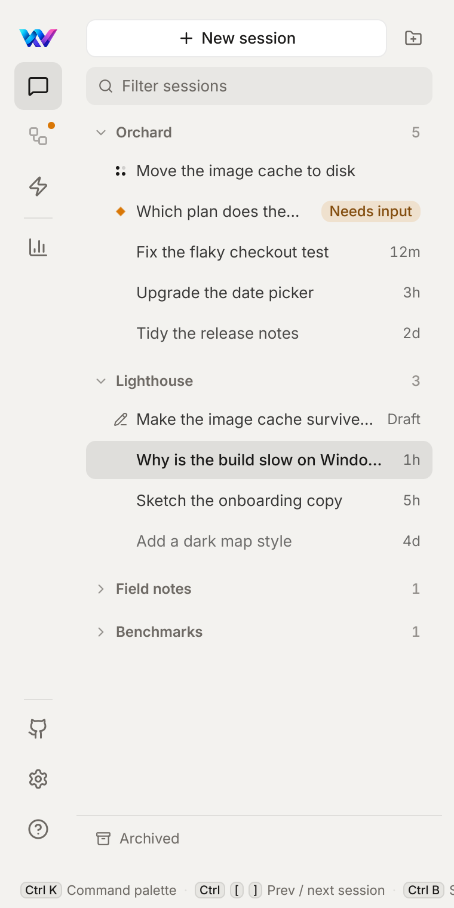

## What "done" means

1. The list is Fleet's: projects from `GET /api/projects` in their own order (Pinned first,
   Ungrouped last), the filter, the loading, error and empty states, group folding that is
   remembered, and every size, token and word of Fleet's `SessionsPanel`/`ProjectGroup`, both themes.
2. A session row is Fleet's: its status glyph and words (Done, Offline, Failed, Retry n/m, Cut off,
   Needs input), chips, progress ring, compact age that ticks, dimming by age (66/51 % dark, 77/62 %
   light), hover buttons, inline rename (F2, double-click), and every item of the right-click menu
   with its condition, its hint, and its call.
3. Archive with a 6-second Undo, delete with its confirmation, pin and unpin, restore from the
   Archived view, move to a project, fork, new session in this folder, and project rename, move
   up/down and delete (both modes) all do what Fleet's do, against a live Fleet.
4. Child sessions are nested with Fleet's lineage lines, which are muted in every state (3.129).
5. A project may be created from the New project dialog; the list's right panel shell (width,
   gutter, collapse, the empty-session rule) is Fleet's, with the bodies left to later components.
6. A machine heading and another machine's group are drawn from mock data and tested; what makes
   them appear (several machines) is component 17's.
7. Fleet's tests for all of it are ported under the same names (the `Tests to port` list), and
   each piece's pictures are beside Fleet's own client at the same state and size.

## What the native app already has

| Part | State | Where |
|---|---|---|
| The list: New session and "Add a project folder" buttons, the filter (title only), project headers (name, count, fold, in first-seen order), session rows (glyph, title, "Needs input" chip, compact age), the Archived link, the open row, scroll | Shell, from the server's list and the mock | `src/view/sessions.rs::{panel, project_header, session_row}` |
| Row dimming | **Wrong**: 0.55 and 0.40 alpha; Fleet uses 66/51 % of `--text` in dark and 77/62 % in light | `session_row`, `src/fleet/sessions.rs` |
| The list model: `Project { name, path, open, sessions }` by `projectName`; no ids, no project type, position, pins, parent, fork or lineage fields | Partial | `src/mock.rs`, `src/fleet/sessions.rs::parse_list` |
| Row fields from the server and the `sessions` patches; debounced refetch, 15 s poll, refetch on focus | Done (component 2, H) | `src/fleet/rows.rs`, `refresh.rs` |
| Derived status; the glyph shapes (quad, pulse, diamond, triangle) | Done | `src/fleet/rows.rs`, `src/view/parts.rs` |
| Context menu with three entries (Open, Rename and Archive as "waiting" stubs, Delete as a toast) | Stub | `src/ui/menus.rs::session_context` |
| Menus, submenus, shortcut chips, dialogs, alert dialog frame, toast with one action, tooltips, text input, select | Done (component 1) | `src/ui/` |
| Open one session by an index pair `(project, session)`; selection is not by id | Shell | `State.open`, `open_session` |
| Anything else: ids and routes, pins, selection, Archived view, archive queue and Undo, rename, delete, fork, Move to project, projects menu, lineage, sub-agent rows, draft rows, New project dialog, right-panel shell, machine headings, progress ring, remembered fold state | **None** | |

Tokens: Part C's table lists the colours and sizes `src/theme.rs` lacks (the `row-*` tokens, the
coral machine colour); each gets added with its CSS variable's name beside it.

## Decisions the pieces need (the owner can overturn)

- **Selection by session id, a `Route`.** Fleet drives the panel from the URL. Native replaces
  `State.open: (usize, usize)` with a session id (and a `Route` enum for the later `NewSession`
  and `Settings` pages), so a refetch, a filter or a pin doesn't move the selection. Piece B does it
  alone because it touches everything that reads `open`.
- **One small settings file** for the folded groups, the collapsed panel and the right panel's
  per-session choice and widths (Fleet keeps them in `localStorage`), and the drafts' text
  (shared with component 5, piece A: use the same file and folder, `instance.rs`'s logic). Written
  from a thread. Piece F makes it if component 5's piece A hasn't; whichever comes first owns it.
- **Muted lineage.** Lineage lines, the caret and the sub-agent label are `muted` at 16 % in every
  state; the session kind label is `text` at `--row-meta`; nothing changes on hover, selection,
  dimming or for the open session's family (the owner's rule, and Fleet's, 3.129). A test names it.
- **Drag and drop is last and optional.** Rune has pointer drags (`on_drag`, `Phase`) but no
  drag-and-drop with targets. Every drag has a menu or button equivalent in Fleet (Pin, Archive,
  Move to project, Move up/down), so those ship first; piece S decides after a small Rune case is
  written into `docs/RUNE.md`.
- **Tool icons** in Open in: `lucide` fallbacks (Code, Terminal, FolderOpen), no borrowed brand
  marks, unless the owner wants them (they need a licence row, AGENTS.md).
- **Repeat on a schedule…** and **Save as workflow…** go to Automations and Workflows (components
  19 and 18). Until then they show the kit's "isn't in the native app yet" toast, as today.
- **Draft row** needs the new-session draft that component 7 owns; piece P builds the row over a
  mock draft and leaves one function component 7 fills.
- **Machines.** The list draws no machine heading with one machine (D, "read first"). Pieces R
  draws a heading and another machine's group from mock data; what loads them is component 17.
- **Startup screen** (`later-notes`): Fleet opens on its home dashboard, native on the first
  session. Not changed here; it belongs to component 9 (app frame) or 7.
- **Fleet issues to report, not fix** (weave-fleet is read-only from here): `--accent-rgb` is
  undefined so a project's drop fill is violet (2.121; native uses `--accent` at 8 % and says so);
  project rename sends `description: null` (2.48); rename, delete and reorder fail silently (2.47,
  2.59, 2.142); the delete dialog's count comes from the filtered group (2.60);
  `lib/session-sync.ts` and `nestSessions` in `lib/session-utils.ts` are unused.
- Phone and narrow-window rules are dropped (desktop only); screen-reader roles use `.label(..)`
  where Rune allows and are listed for component 26.

## Reading the rows

Each of the four parts below was read separately; its short names, sizes and facts come first. Row numbers: 1.x the panel, 2.x a project group, 3.x the session row, 4.x the sub-agent row, undo toast, confirm dialogs and the Open in submenu, 5.x machine headings (with an Owner column: `L` the list, `17` component 17), 6.x the data, routes and events the list uses.

### Part A: the panel (SessionsPanel, the right panel, New project)

Rows `1.x` (the panel) and `6.x` (data, routes and events the list uses).

**Desktop only.** Phone and narrow-window rules (mobile drawer, hamburger button, touch swipe, `inSheet` right panel,
`useIsMobileNav`, `rightPanelAsSheet`, phone font scale) are dropped once, here, and are not rows.

- **Paths** are weave-fleet's under `client/src/` (commit 49640bf). Short names: SP `components/sessions/SessionsPanel.vue`,
  RP `components/sessions/SessionsV2RightPanel.vue`, NP `components/sessions/NewProjectDialog.vue`, AS
  `components/layout/AppShell.vue`, CP `components/layout/ContextPanel.vue`, CRR `components/layout/CollapsedRightRail.vue`,
  SPG `lib/session-project-groups.ts`, SPN `lib/session-pins.ts`, STS `stores/sessions.ts`, STB `stores/sidebar.ts`, SEL
  `stores/session-selection.ts`, SLO `stores/session-list-on.ts`, PINS `stores/session-pins.ts`, AQ `stores/archive-queue.ts`,
  USS `composables/use-sessions.ts`, UPR `composables/use-projects.ts`, USA `composables/use-session-actions.ts`, USM
  `composables/use-sidebar-mobile.ts`, UC `composables/use-commands.ts`.
- **Native paths** are this repo's: `src/view/sessions.rs` (`panel`, `project_header`, `session_row`), `src/view.rs` (`root`,
  `gutter`), `src/view/sheet.rs` (content panel), `src/lib.rs` (`on_key`), `src/fleet/sessions.rs` (`parse_list`),
  `src/fleet/rows.rs`, `src/fleet/refresh.rs`, `src/fleet/state.rs` (`on_list`, `open_session`), `src/ui/menus.rs`.
- **Sizes** are CSS px at the 14px root (1rem = 14). Tailwind rem sizes are converted (`text-sm` 0.875rem = 12.25, `text-xs`
  0.75rem = 10.5, `px-3` 10.5, `gap-1.5` 5.25). A scoped `px`/`rem` value is quoted as written, rem converted.
- **Colours** are `--token` names from `assets/main.css`. `wash(n)` = `color-mix(in srgb, var(--text) n%, transparent)`.
  `--radius-btn` 8, `--radius-card` 10, `--radius-panel` 12, `--transition` 150ms ease-out. A token missing from `src/theme.rs`
  gets added with its CSS name beside it (the red feedback tint `rgba(239,68,68,*)` is a literal in Fleet, see 1.66).
- What is **not** in this part (named so no row is lost): the rows inside a project (`ProjectGroup.vue`, `SessionItem.vue`,
  `SessionRow`, status glyphs, lineage nesting, rename, row menus), machine headings (`MachineHeader.vue`,
  `MachineSessionsGroup.vue`), `ArchiveUndoToast.vue`, `CanvasHost.vue` and the tabs. Rows below that touch them say what the panel
  hands them and stop there.
- **No sort or group menu exists in this panel.** Fleet's list has one grouping (by project, the projects' own order, Ungrouped
  last, Pinned on top) and one order (the server's, newest first; pins in `pinOrder`). There is nothing to port as a menu; rows
  1.31-1.40 pin down the order and the grouping.

### Part B: project groups, drafts, rename, the progress ring

Rows prefix **2.x**. Paths are weave-fleet's under `client/src/` (commit 49640bf). Short names: PG
`components/sessions/ProjectGroup.vue`, CD `.../ConfirmDeleteProjectDialog.vue`, DR `.../DraftSessionRow.vue`, IE
`.../InlineEdit.vue`, PR `.../ProgressRing.vue`, SP `.../SessionsPanel.vue`, SPG `lib/session-project-groups.ts`, SL
`lib/session-lineage.ts`, SPN `lib/session-pins.ts`, AQ `stores/archive-queue.ts`, LM `stores/lineage-moves.ts`, DS
`composables/use-draft-state.ts`, DST `lib/draft-storage.ts`, USL `composables/use-session-lineage.ts`, USA
`composables/use-session-actions.ts`, SB `stores/sidebar.ts`, WU `stores/workspace-ui.ts`, SPS `stores/session-pins.ts`.
Sizes are CSS px at 14px root (Tailwind `h-8` = 2rem = 28, `p-4` = 14, `text-sm` = 12.25, `text-lg` = 15.75).
Phone/mobile rules (`@media (hover: none)` on the + button, its 44px hit area) are dropped once, here.

Facts to know before reading the rows:
- **No "show more" and no per-project row cap exist at this commit.** Every session of a project is listed. No project
  drag-reorder either: projects move only by the menu's Move up / Move down. Sessions can be dragged (the drag source
  is in SessionItem, not in my area).
- **Order**: the server answers the list newest first (`stores/sessions.ts:94` comment); groups sort by project
  `position`, then name (`localeCompare`), Ungrouped last (SPG `buildProjectGroups`). Pinned group first, by `pinOrder`.
- Native today (`src/view/sessions.rs`, `src/fleet/sessions.rs`): flat project headers + session rows, groups by
  `projectName` in first-seen order, no ids, no ungrouped/pinned/draft, no nesting, no menu, no +, no rename, no delete,
  `Project.open` is not persisted. Each row says Done / Partial / None.

### Part C: the session row, its menu, sub-agent row, toast and dialogs

Rows 3.x (the session row, its glyph, menu, rename) and 4.x (sub-agent row, archive undo toast, dialogs,
open-in submenu). Desktop only: every phone/mobile layout rule is dropped (no drawer, no touch long-press).

- **weave-fleet read:** commit `49640bf`, `client/src/`. Paths below are relative to that. Short names:
  SI `components/sessions/SessionItem.vue`, SG `.../StatusGlyph.vue`, SB `.../SubagentSessionRow.vue`,
  AT `.../ArchiveUndoToast.vue`, OT `.../OpenToolContextSubmenu.vue`, PG `.../ProjectGroup.vue`, PR
  `.../ProgressRing.vue`, RS `lib/session-row-status.ts`, SS `lib/session-status.ts`, SL `lib/session-lineage.ts`,
  USL `composables/use-session-lineage.ts`, USA `composables/use-session-actions.ts`, SC `lib/session-commands.ts`,
  SP `lib/session-pins.ts`, AQ `stores/archive-queue.ts`, LM `stores/lineage-moves.ts`, PS `stores/session-pins.ts`,
  SPG `lib/session-progress.ts`, FT `lib/format/time.ts`, FD `lib/format/duration.ts`, RT `lib/retry-status.ts`,
  SI2 `lib/session-interruption.ts`, PB `components/github/PrBadge.vue`, PRS `lib/pr-state.ts`, MC
  `components/ui/menu-classes.ts`, CM `components/ui/context-menu/`, CF `components/ui/confirm/`
  (`confirm-action.ts`, `ConfirmHost.vue`), AD `components/ui/alert-dialog/`.
- **There is no `ConfirmDeleteSessionDialog` or `ConfirmClearAttachmentsDialog`.** Both are calls to the one
  `confirmAction()` (CF) made from SI (`handleDelete`, `handleClearAttachments`), drawn by `<ConfirmHost>` on the shared
  AlertDialog. They are rows 4.30-4.36 below. (`ConfirmDeleteProjectDialog.vue` is a project dialog, not in this part.)
- **SS `lib/session-status.ts`** holds only `deriveSessionStatus(activity, current)`: lifecycle states `stopped`,
  `completed`, `error`, `disconnected` are kept; `idle` -> `idle`; `waiting_input` -> `waiting_input`; `busy`,
  `delegating`, `retry` and anything unknown -> `active`. Native has it as `fleet/rows.rs::derive_session_status` (Done).
- **Native app read:** `main` at `adcc87b`. What exists: `src/view/sessions.rs::session_row` (glyph, title, "Needs
  input" chip, age), `project_header`, `src/ui/menus.rs::session_context` (3 invented items, all stubs),
  `src/ui/toast.rs` (the toast, generic, one pill action, drain), `src/ui/dialog.rs::dialog` (the alert dialog frame),
  `src/ui/menu.rs` (menu panel, items, submenu, shortcut chip), `src/view/parts.rs::{quad,pulse,triangle,diamond}`
  (glyph shapes), `src/fleet/sessions.rs::{status_of,age,parse_list}` (the list), `src/fleet/rows.rs::Row`
  (lifecycle/activity/retry/interrupted/failed fields). Everything else in this file is None.
- **Sizes** are CSS px at the 14px root (`1rem` = 14). Tailwind v4 spacing is `0.25rem` = 3.5px per unit, so `w-66` =
  231px and `w-52` = 182px; both are classes the Vue side sets on the menus.
- **Colour** words are CSS variables of `assets/main.css`; dark values are `:root`, light are the light block. Only the
  two themes native has are listed. Tokens not in `src/theme.rs` today are in the table below.

### Part D: machine headings

Paths are weave-fleet's under `client/src/` (commit 49640bf). Short names: MH `components/sessions/MachineHeader.vue`,
MG `components/sessions/MachineSessionsGroup.vue`, SP `components/sessions/SessionsPanel.vue`, M `stores/machines.ts`,
LM `lib/machines.ts`, MT `lib/machine-target.ts`, MS `lib/machine-store.ts`, MF `lib/machine-feed.ts`, UMC
`composables/use-machine-choice.ts`, SB `stores/sidebar.ts`. Line numbers: MH and MG are each counted from 1 in their own file;
others are the file's own. Sizes are CSS px at the 14px root (1rem = 14): 0.82143rem = 11.5, 0.78571rem = 11, 0.85714rem = 12.
Desktop only: phone/mobile layout rules (`/phone/s/<machine>/...`, `rememberPhoneMachine`, paired-phone list `source = "device"`) are dropped, once, here.

**Owner column** (the point of this part): `L` = the list draws it, stays in component 6. `17` = component 17 (Machines) owns it.
`L+17` = the list draws it but it only appears when there is more than one machine, so it is checked in component 17's several-machine setup.

#### What a one-machine Fleet shows (read first)

`SP:143` `showMachines = hasMachines && !isArchivedView`; `hasMachines = connections.length > 0` (M:462), and `connections` is the list of
machines **besides home** (LM:152 "The home machine isn't in it"). So with no other machine saved:

- **No machine heading is drawn at all**: `MachineHeader` is `v-if="showMachines"` (SP:680), no dot, no name, no count, no chevron, no menu.
- `listedMachines` is just the live machine (SP:145); `liveMachineExpanded` is forced true (SP:147), so the tree can't be folded.
- The tree is the plain live tree: banner/loading/error, Pinned, projects, empty state. No `MachineSessionsGroup` exists.
- **No "Add a machine" button** at the foot of the list (`v-if="showMachines"`, SP:820). With one machine the only ways in are Settings →
  Machines and the command palette's "Add a machine" (native: `src/ui/commands.rs:131`).
- No machine polling starts (`watch(hasMachines)`, SP:157); no feeds, no held hubs (M `holdsWanted` needs entries that aren't live).
- Error text is the browser's own, not "Can't reach <name>." (SP:256 needs `hasMachines`).

So every row but 5.1 and 5.6 draws only when a second machine is saved, and component 17 owns whether one can be saved. Native today: **None** for all
of it; `src/view/sessions.rs::panel` draws projects only, there is no machine type in `State` (`grep machine src/fleet src/view` finds
nothing but the status-bar words), and `theme.rs` has no coral token. Row 5.1 is **Done by omission** and needs a test that says so.

## Rows

### 1. The panel

#### a. Where the panel lives (AppShell, ContextPanel, the left gutter, collapse)

| # | Row | Source | Native today |
|---|---|---|---|
| 1.1 | The Sessions rail owns the whole context area: `[session-list][conversation][content]`, nothing of another view in it | `AS` `showContextPanel` (`!panelCollapsed && contextPanel !== null`); `use-context-panel.ts` `useContextPanel` | Done: `view::root` draws `sessions::panel` only for `Rail::Sessions`; other rails show `notice` |
| 1.2 | List column is an `aside` labelled "Context panel": 306 wide, `min-width` 306, transparent background, column flex, `overflow: hidden`; no border, no fill (it sits on `--main-bg`) | `CP` `panelWidth = shallowRef(306)`, `.context-panel` | Done: `view::SIDEBAR_W` 306, `col().w(s.sidebar_w)` |
| 1.3 | `.main` is a row with `gap: 8px`, `padding: 8px`, `background: var(--main-bg)`; rail, panel, gutter, workspace sheet in that order | `AS` `.main` | Done: `row().padding(8.0)`, `.ml(8.0)` on the panel |
| 1.4 | Left gutter: 8 wide, `margin: 0 -4px`, `cursor: col-resize`, transparent; hover or dragging fills `rgba(91,110,199,0.15)` (`transition: background var(--transition)`), `z-index: 5`; drawn only while the panel shows | `AS` `.resize-gutter`, `onLeftGutterPointerDown`, `isLeftGutterDragging` | Partial: `gutter` key `sidebar-gutter`, 8 wide, `mx(4)`, `ResizeColumn` cursor, fill `t.accent.alpha(0.15)` (Fleet's literal is the light accent `#5B6EC7` at 15% in every theme; native uses the theme accent, so dark differs: `#6365f1`) |
| 1.5 | Dragging the left gutter sets width = start width + dx, clamped 200..500; the page cursor is `col-resize` and text selection is off while it drags; releasing ends it | `AS` `onLeftGutterPointerDown` (`Math.min(500, Math.max(200, ...))`), `CP` `MIN_WIDTH`/`MAX_WIDTH`/`resizeBy` | Done: `gutter` `on_drag`, `SIDEBAR_MIN` 200, `SIDEBAR_MAX` 500, cancel restores `d.data` |
| 1.6 | The width is not saved: a restart starts at 306 | `CP` (`shallowRef`, no storage) | Done (not saved) |
| 1.7 | Gutter is the only thing between panel and sheet: the 16px visual gap is 8 (`.main` gap) + gutter net 0 + 8 (`.main` gap) | `AS` `.main`, `.resize-gutter` | Done: `ml(8)` + gutter `mx(4)` + 8 |
| 1.8 | Hide the panel: Ctrl/Cmd+B (`toggle-sidebar`, palette key `b`); the palette row reads "Hide sidebar" (open) or "Show sidebar" (collapsed), description "Collapse the left context panel." / "Expand the left context panel.", category View, keywords panel menu collapse expand sidebar | `lib/keybinding-types.ts` `toggle-sidebar`; `UC` `id: "toggle-sidebar"`; `USM` `toggleSidebar` | Partial: `lib::on_key` toggles `sidebar_open` on Cmd/Ctrl+B; the palette's wording is component 1's; check it reads the same |
| 1.9 | Collapsed state is remembered across restarts: `localStorage` key `weave:left-collapsed` (`"true"`/`"false"`); read at startup | `STB` `LEFT_PANEL_STORAGE_KEY`, `setPanelCollapsed`, `togglePanelCollapsed` | None: `sidebar_open` starts true each run (needs a settings file; see Decisions) |
| 1.10 | With the panel collapsed the workspace sheet takes the room and there is no left gutter | `AS` `showContextPanel` | Done: `Rail::Sessions =>` arm without `sidebar_open` |
| 1.11 | While the panel is mounted it registers as "a session list is shown" (`mountedSessionLists` +1 on mount, -1 on unmount, idempotent release); the header shows the open session's status only when no list is on screen | `STB` `registerSessionList`, `sessionListShown`; `SP` `onMounted`/`onUnmounted` | None |
| 1.12 | Opening the panel's route selects the Sessions rail: when the path is `/sessions/<id>` and the session is in the list, `activeSessionId = id` and `activeRail = "sessions"` (immediate, re-run on list change) | `SP` `watch([pathname, sessions])` | Partial: `State.open` is an index pair, set on press; no URL (the native app has no routes, see 6.x) |
| 1.13 | `section` is the panel root, `aria-label="Sessions context panel"`, flex column, `min-height: 0`, transparent | `SP` template, `.sessions-panel` | Partial: `col().key("session-list")`; no label |

#### b. Header: New session, New project (the "first left-panel header buttons")

| # | Row | Source | Native today |
|---|---|---|---|
| 1.14 | Header row: `padding-top: 8px`; inside `.panel-actions`: flex, `gap: 6px`, `padding: 0 8px 8px`; two buttons side by side (New session grows, New project 32 wide) | `SP` `.panel-header-row`, `.panel-actions` | Done: `row().pt(8).px(8).pb(8).gap(6)` |
| 1.15 | "New session" button: `Button variant=ghost size=sm`, `flex: 1 1 auto`, `min-height: 32px`, `padding: 0 12px`, centred, `border: 1px solid var(--border)`, `border-radius: var(--radius-btn)` (8), `background: var(--card-bg)`, `color: var(--text)`, `font-size: 0.92857rem` (13), weight 500; inside: `Plus` 15 + text "New session", `gap-1.5` (5.25) | `SP` `.panel-action-button`, `.panel-action-button__icon` (15) | Done: key `new-session`, h 32, px 12, gap 5.25, `PLUS` 15, 13/500 |
| 1.16 | New session hover: `background: var(--card-bg)` (unchanged), `border-color: wash(18)`, `color: var(--text)`. (Native today has `hover(wash 3)` and `press(wash 6)`, which Fleet does not: Fleet only changes the border) | `SP` `.panel-action-button:hover` | Differs: fill hover `t.wash(3.0)`; no border change |
| 1.17 | New session press: opens the new-session page: `activeRail = "sessions"`, navigate `/sessions/new` with `search.projectId = undefined`, `search.source = undefined`; the `workspaceUi.newSessionMachine` is left as is (the panel's button never sets it) | `SP` `handleNewSession` -> `openNewSessionPage(null)` | None: `on_press` is a no-op (new-session page is component 7) |
| 1.18 | New session keyboard shortcut: Ctrl/Cmd+N (`new-session`, palette key `n`), palette row "New session", description "Create and open a new session.", category Session, keywords create spawn start; same navigation as 1.17 | `lib/keybinding-types.ts` `new-session` (`platformModifier` + `metaKey`); `UC` `handleNewSession` | None |
| 1.19 | "New project" icon button: same `Button ghost sm` with class `--icon`: `flex: 0 0 32px`, `width: 32`, `padding: 0`, `border-color: transparent`, `background: transparent`, `color: var(--muted)`; icon `FolderPlus` 15 | `SP` `.panel-action-button--icon` | Done as a box (key `add-folder`, 32x32, `FOLDER_PLUS` 15, muted) |
| 1.20 | New project hover: border stays transparent, background wash(5), colour `--text` (icon follows `currentColor`) | `SP` `.panel-action-button--icon:hover` | Done: `hover(t.wash(5.0))`, `group_color(t.text)` |
| 1.21 | New project wording: `aria-label="New project"` and `title="New project"` (the tooltip). Native today says "Add a project folder" in both: wrong wording | `SP` template | Differs: `.help("Add a project folder")`, `.label("Add a project folder")` |
| 1.22 | New project press: `activeRail = "sessions"`, `newProjectMachine = null`, `isNewProjectDialogOpen = true` (dialog rows 1.103-1.121) | `SP` `handleNewProject` | Done (piece O): opens the dialog on the machine you are on |
| 1.23 | Focus ring on both buttons: `focus-visible` border `--ring` and a 3px ring at `--ring` 50% (from the Button variant) | `components/ui/button/index.ts` | None: needs a focus ring in the kit (component 1 has `ui::button`; check it) |
| 1.24 | Disabled look is `opacity: 0.5`, no pointer events (never reached here: neither button is ever disabled) | `components/ui/button/index.ts` | n/a |

#### c. The filter box

| # | Row | Source | Native today |
|---|---|---|---|
| 1.25 | Wrapper `.panel-search`: `margin: 0 8px 10px`, `position: relative` | `SP` `.panel-search` | Done: `el().w_full().px(8).pb(10)` |
| 1.26 | Input: `type="search"`, `aria-label="Filter sessions"`, placeholder "Filter sessions" (`--muted`), height 32, width 100%, `background: wash(5)`, `border: 1px solid transparent`, `border-radius: 8`, `padding: 0 10px 0 30px`, `font-size: 0.92857rem` (13), colour `--text`, no outline | `SP` `.panel-search input` | Done: `text_input` key `filter`, h 32, `pl(30)`, `pr(10)`, 13px, `fill(wash(5))`. Native has no 1px transparent border (so the text sits 1px left of Fleet's; check by picture) |
| 1.27 | Search icon: `Search` 13, `position: absolute`, `left: 10`, vertically centred (`top: 50%`), `--muted`, ignores pointer | `SP` `.panel-search__icon` | Done: `icon(&SEARCH, 13).absolute(10, 9.5)` |
| 1.28 | Focus: `background: var(--panel-bg)`, `border-color: color-mix(accent 55%, transparent)`; `transition: background, border-color var(--transition)` | `SP` `.panel-search input:focus` | None: no focus fill or border |
| 1.29 | Typing filters live on every keystroke (no debounce, no Enter); the query is trimmed and lower-cased (`normalizedQuery`); whitespace only = no filter | `SP` `searchQuery`, `normalizedQuery` | Partial: `s.filter.text.trim().to_lowercase()`, live |
| 1.30 | The box is cleared by the browser's own clear affordance on `type=search`, and by Esc (Chromium `search` input clears on Esc); the filter text is not remembered (reset on reload, kept while the panel stays mounted, e.g. while switching sessions; lost when the panel unmounts for another rail) | `SP` (local `shallowRef`) | Partial: native keeps `filter` in `State` for the life of the process (survives rail changes; Fleet loses it). Decide: keep or reset |
| 1.31 | What matches: the lower-cased `title + " " + id + " " + project display name + " " + sessionStatus` of a session contains the query (substring); `sessionStatus` is the raw word (`idle`, `active`, `waiting_input`, `stopped`...). A literal space in the query only matches across those joins | `SPG` `sessionMatchesQuery` | Partial: matches the **title only** |
| 1.32 | A project whose own name contains the query keeps **all** its sessions; other projects keep only matching sessions; a project with no matching sessions and a non-matching name is dropped; a project whose name matches stays even with zero sessions | `SPG` `filterProjectGroups` | Partial: matches only titles, and only drops empty projects; a name match does not keep its sessions |
| 1.33 | (Piece F: wrong, Fleet keeps a folded group folded while filtering) While the filter is on, folded projects show their matching rows anyway | `ProjectGroup.vue` (query forces open? see Part B); `SP` passes `expanded` from `sidebarStore` only | Done in native (`project.open \|\| !needle.is_empty()`); **verify against `ProjectGroup.vue`**: `SP` passes no query to `ProjectGroup`, so Fleet may keep a folded project folded. Settle by reading Part B |
| 1.34 | The Pinned group is filtered by the same `sessionMatchesQuery`; the Pinned group is hidden when nothing in it matches | `SP` `filteredPinnedSessions`, `showPinnedGroup` | None (no pins) |
| 1.35 | Moves and moving-out-of-parent are ignored while a filter is on (the user sees a filtered view): `handleMoveSession` and `handleMoveOutOfParent` return early when `normalizedQuery` is not empty; the empty Pinned group drop target is not shown while filtering | `SP` | None |
| 1.36 | Other machines' groups get the same query (`:query="normalizedQuery"`) | `SP` `MachineSessionsGroup` prop | None (component 17) |

#### d. Order and grouping (no menu; the rules)

| # | Row | Source | Native today |
|---|---|---|---|
| 1.37 | Which sessions the list holds: from the store, drop `parentSessionId` ones (children nest under their parent, they are not top-level), drop ids waiting on Undo (`archiveQueue.pendingIds`), then keep `retentionStatus === store.retentionStatus` (`"all"` keeps everything) | `SP` `sessions` computed | Partial: `parse_list` drops hidden, non-active and `parentSessionId` rows; no Undo queue |
| 1.38 | Order of sessions in a group is the server's order (newest first); `upsertSession` puts an unseen session first. The client never re-sorts a project's sessions | `STS` `upsertSession`; `SPG` `buildProjectGroups` (pushes in list order) | Differs: `parse_list` sorts by `session.time.updated` descending itself. Same in practice; compare with the server's order on a live list |
| 1.39 | Groups: every user project (`type !== "scratch"`) is a group, **even with no sessions**, keyed by project id; named `name`; ordered by `position` ascending, ties by `name.localeCompare` | `SPG` `buildProjectGroups` | Differs: groups by `projectName` string, in order of first appearance; empty projects are not shown; no `/api/projects` read |
| 1.40 | Sessions with no project, or a project the list does not know, go to group id `"ungrouped"` named "Ungrouped", always last; a session whose `projectName` (non blank) is set but whose project is not in `/api/projects` is grouped under its `projectName` | `SPG` `projectDisplayName`, `buildProjectGroups` | None (native names a no-project session "Sessions") |
| 1.41 | The Scratch project (`type === "scratch"`) is never listed as a project; its sessions group under it only while it has sessions, or while a new-session draft will land in it; the draft's group is also created empty (`draftKey`) | `SPG` `buildProjectGroups`, `draftGroupKeyFor`, `draftGroupIdFor` | None |
| 1.42 | Each group carries `canMoveUp`/`canMoveDown` and `moveUpTargets`/`moveDownTargets` (swap with its user-project neighbour, `position = index + 1`); Ungrouped and Pinned never move | `SPG` `buildReorderTargets`, `swapProjects`; project menu in `ProjectGroup.vue` (Part B) | None |
| 1.43 | Pinned group: `id: "pinned"`, name "Pinned", never moves; lists each pinned session in `pinOrder` ascending then everything that came from one (in list order); not shown in the Archived view; shown while it has sessions, or during a drag (once the drag is under way) with no filter, so a session can be dropped in | `SPG` `PINNED_GROUP_ID`, `pinnedProjectGroup`; `SPN` `splitPinned`; `SP` `showPinnedGroup` | None |
| 1.44 | Groups render in this order: machine heading (only with other machines), feedback banner, loading or error block, else Pinned group then project groups, then empty state, then "Add a machine" row, then drop zone | `SP` template | Partial: project groups and an empty note only |
| 1.45 | A group's folded state is kept per machine and project: key `project:<machineKey>:<projectId>` (the Pinned group uses `project:<machineKey>:pinned`); a machine's key is `machine:<machineKey>`; all in `localStorage` `weave:sessions-collapsed-groups` as `{key: true}`; only `true` is stored (open groups have no entry); a non-boolean value is dropped on read; a corrupt value reads as `{}` | `STB` `machineGroupKey`, `projectGroupKey`, `readStoredBooleanMap`, `setGroupCollapsed` | Partial: `Project.open` in memory, kept over a refresh by project name (`on_list`); not saved to disk |
| 1.46 | Toggling a project (header click) flips its folded state; `isProjectExpanded(id)` is `!isGroupCollapsed(project:<liveKey>:<id>)` | `SP` `handleToggleProject`, `isProjectExpanded` | Done in memory: `project_header` `on_press` |
| 1.47 | A draft session lands in its group: when `draftGroupId` changes to a value the group (and, with other machines, the machine) unfolds | `SP` `watch(draftGroupId)`, `watch(draftMachineKey)` | None (drafts: Part B / component 7) |

#### e. Selection (bulk archive and restore)

| # | Row | Source | Native today |
|---|---|---|---|
| 1.48 | Ctrl/Cmd-click on a row toggles it in the selection; Shift-click adds every row between the anchor and the clicked row, in the order the list shows them; with no anchor the open session is the anchor; an unknown anchor or target falls back to a toggle | `SEL` `toggle`, `extendTo`; click handling in `SessionItem.vue` (Part B) | None |
| 1.49 | The anchor is the last toggled row; a click on a row of another machine starts a new selection from it (the old picks are let go) and sets `machineKey` | `SEL` `selectionOn`, `machineKey`, `isSelectingOn` | None |
| 1.50 | Visible order for a Shift range: Pinned group rows, then each project's rows, **only for groups that are expanded** and only while the live machine's tree is expanded; recomputed on any change (`immediate: true`) | `SP` `watch(... selection.setVisibleOrder)` | None |
| 1.51 | A picked row that leaves the list (archived, filtered out, folded) leaves the selection | `SEL` `setVisibleOrder` | None |
| 1.52 | Esc clears the selection (a window `keydown`, only while selecting; removed on unmount) | `SP` `handleSelectionKeydown` | None (`on_key` Esc interrupts the working session only) |
| 1.53 | Leaving the panel (unmount) clears the selection; switching to or from the Archived view clears it | `SP` `onUnmounted`, `showArchived` | None |
| 1.54 | Selection bar appears (instead of the footer) while one or more rows are picked: `role="toolbar"`, `aria-label="Selected sessions"`, `margin: 6px 8px 8px`, `padding: 5px 5px 5px 12px`, `gap: 6px`, `border: 1px solid var(--border)`, `border-radius: var(--radius-card)` (10), `background: var(--card-bg)`, `box-shadow: 0 12px 32px -12px rgba(0,0,0,.35)`, `font-size: 0.85714rem` (12), flex-shrink 0 | `SP` `.selection-bar` | None |
| 1.55 | Count: "`N` selected" (e.g. "3 selected"), flex 1, weight 600, tabular numerals | `SP` `.selection-bar__count` | None |
| 1.56 | Action in the active view: **Archive** (`Archive` icon 13, `Button size=sm`, `height: 28`, `border-radius: 999` pill, `gap: 6`); in the Archived view: **Restore** (`ArchiveRestore` icon 13, same box) | `SP` `.selection-bar__action`, `data-testid session-selection-archive` / `session-selection-restore` | None |
| 1.57 | Clear button: `X` 14 in a 28x28 box, `border-radius: 7`, `--muted`, hover wash(6) and `--text`; `aria-label="Clear selection"`, `title="Clear selection (Esc)"` | `SP` `.selection-bar__clear` | None |
| 1.58 | Archive of the selection: `archiveQueue.archive([...ids], machineOf(selection))`, then clear; the rows vanish at once (pending ids filtered, 1.37) and the toast reads `Archived "<title>"` (one) or `Archived N sessions` with Undo for 6000 ms; after the window `PATCH /api/sessions/{id}/retention {retentionStatus:"archived"}` per session, on that session's machine | `SP` `archiveSelected`; `AQ` `archive`, `ARCHIVE_UNDO_MS` 6000, `flush`; `USA` `useArchiveSession` | None |
| 1.59 | Restore of the selection: for each id in order, `PATCH .../retention {retentionStatus:"active"}`; the selection is cleared first; a failure on one does not stop the rest; the queue shows `Couldn't restore the session.` (or the server's text) | `SP` `restoreSelected`; `AQ` `restore` | None |
| 1.60 | A second archive inside the Undo window sends the first one at once; failures say `Couldn't archive "<title>".` (one) or `Couldn't archive N sessions.`; a session with no title reads "Untitled session" | `AQ` `archive`, `flush`, `titleOf` | None (toast kit exists: `ui::toast`; queue does not) |

#### f. Keyboard (list level)

| # | Row | Source | Native today |
|---|---|---|---|
| 1.61 | Fleet's list has **no arrow-key navigation**: rows are buttons reached by Tab; Enter/Space opens the focused row. The only list-level keys are Esc (clear selection), Ctrl/Cmd+[ and ] (previous or next session, wrapping, in list order of `store.sessions`), Ctrl/Cmd+N, Ctrl/Cmd+B | `SP` `handleSelectionKeydown`; `UC` `nav-next-session` `nav-prev-session` (`]` `[` with `platformModifier`), `currentSessionIndex` | Partial: `s.step(-1/1)` wraps (test `next_and_previous_wrap_around_the_list`); order is the native list's (grouped), not `store.sessions`: compare when pins and projects land |
| 1.62 | "Show all sessions" / "Show active sessions" palette command (`toggle-activity-filter`, no key) flips `retentionStatus` between `active` and `all`; "all" lists archived sessions inline with the rest | `UC` `toggleActivityFilter`; `SP` `sessions` (`"all"` keeps everything) | None (decide: needed? see Decisions) |
| 1.63 | "Refresh sessions" palette command (key `r`, no global shortcut): `GET /api/sessions` (+`retentionStatus` when not active) then `setSessions`; errors are swallowed | `UC` `refreshSessions` | None in the palette; the list refreshes itself (6.4) |
| 1.64 | Tab order: New session, New project, the filter, each row, the Archived link; `focus-visible` on the feedback buttons is a 2px `--accent` outline, offset 2 | `SP` template, scoped CSS | None |

#### g. Empty, loading and error states

| # | Row | Source | Native today |
|---|---|---|---|
| 1.65 | Loading (first load only: `isLoading && !hasSessions`, where `isLoading = sessions loading \|\| projects loading`): block `padding: 16`, `gap: 8`, column, left aligned; `Spinner` 16 (`--muted`), title "Loading sessions" (12 / 600 / `--text`), copy "Fetching the latest sessions and projects." (11 / `--muted`); `aria-live="polite"`. Later refreshes show no spinner | `SP` `.sessions-feedback-state*`; `USS` `shouldShowInitialLoader` | None: nothing shows while the first list loads |
| 1.66 | Error with no sessions: same block, title "Unable to load sessions" (12 / 600), copy = the error text (11 / muted), button "Try again" (`min-height: 30`, `padding: 0 10`, 11 / 500, `--muted`, `border: 1px solid transparent`, **radius 0**; hover `background: var(--bg)`, `border-color: var(--border)`, `color: var(--text)`) | `SP` `.sessions-feedback-state--error`, `__button` | Partial: `notice` gets "Couldn't load the session list..." in the status bar; no panel block |
| 1.67 | Error with sessions (stale list): a banner above the rows: `display: flex`, space-between, `gap: 12`, `padding: 8px 12px`, `margin-bottom: 8`, `border: 1px solid rgba(239,68,68,.2)`, `background: rgba(239,68,68,.08)`, no radius; copy "Showing cached sessions. Refresh failed: `<error>`" (11 / `--text`) and a "Try again" button (`min-height: 28`, otherwise as 1.66); `aria-live="polite"`. (Fleet writes the red as a literal; `--error` is `#ef4444` in dark, `#dc2626` light, so the banner is the same red in both) | `SP` `.sessions-feedback-banner*` | None |
| 1.68 | Error text: `sessionsError ?? projectsError`; with other machines and a live machine that is not home and not answering it is "Can't reach `<machine name>`." (a fetch failure reads "Failed to fetch" otherwise) | `SP` `errorMessage` | None |
| 1.69 | "Try again" runs both `refetchSessions()` and `refetchProjects()` together (not retention-aware beyond the current filter) | `SP` `handleRetry` | None |
| 1.70 | Empty (not loading, no error, no groups, no Pinned group): `EmptyState compact` (centred column, `gap-1`, `px-3` 10.5, `py-4` 14, title `text-sm` 12.25 / 500 `--text`, description `text-xs` 10.5 `--muted`, `max-w-prose`): with a filter "No sessions found" / "Try a different search term or clear the filter."; in the Archived view "No archived sessions" / "Sessions you archive show up here."; else "No sessions yet" / "Start one with New session above." No icon | `SP` `EmptyState`; `components/ui/empty-state/EmptyState.vue` | Partial: only "No sessions match." (12 / muted, left aligned, `px 10 py 8`): different words and layout |
| 1.71 | Empty is not shown while a user project exists: every user project is a group even with no sessions, so "No sessions yet" shows only with no user projects and no sessions (and no draft/Scratch group) | `SPG` `buildProjectGroups`; `SP` `v-if` | n/a until 1.39 lands |
| 1.72 | A refresh that fails after a good load keeps the old rows (store is untouched) and shows the banner (1.67); a later success clears `error` | `USS` `fetchSessions` | Partial: `on_list` keeps rows; no banner |
| 1.73 | `isRefreshing` (a poll in flight with a list on screen) shows nothing | `USS` | n/a |
| 1.74 | Long text: a long project name or title truncates with an ellipsis inside its row (`truncate`); the panel never scrolls sideways; long error text wraps | rows in Part B; `SP` banner/state copy has no `nowrap` | Done for titles and names: `.truncate()` |
| 1.75 | The list scrolls (`overflow-y: auto`, thin scrollbar `scrollbar-color: var(--muted) transparent`, `padding: 0 8px 12px`); header, filter and footer stay put. `gap: 4px` on `.sessions-list` has no effect (it is not a flex or grid box): do not draw a 4px gap | `SP` `.sessions-list` | Done: `scroll(...)`, `px(8).pb(12)`; thin scrollbar is Rune's |
| 1.76 | The list scroll position is kept while the panel stays mounted (rows are in the same scroll box); the panel is a keyed child of `ContextPanel` (`:key="panelKey"`), so leaving Sessions and returning rebuilds it at the top | `CP` `:key="activePanelKey"` | Done in native (state is in `State`; scroll position is Rune's, not kept across rails: check) |

#### h. Footer and the Archived view

| # | Row | Source | Native today |
|---|---|---|---|
| 1.77 | Footer (not selecting, not in the Archived view): `padding: 6px 8px 8px`, `border-top: 1px solid var(--border)`, flex-shrink 0; one button "Archived" (`Archive` icon 13, `gap: 7`, `height: 28`, `padding: 0 8px`, `border-radius: 8`, `--muted` 12px; hover wash(5) + `--text`) | `SP` `.panel-footer`, `.panel-footer__link`, `data-testid sessions-show-archived` | Done: `archived` row (key `archived`) |
| 1.78 | Pressing Archived: clear the selection and `setRetentionStatus("archived")`; the list is fetched again with `?retentionStatus=archived` | `SP` `showArchived(true)`; `USS` `watch(retentionStatus)` | Done (piece K): `State::show_archived` |
| 1.79 | Archived header replaces the New session/New project row: `padding: 8px 8px 4px`; one button "Archived sessions" (`ArrowLeft` 14 `--muted`, `gap: 8`, `height: 30`, `padding: 0 8px`, radius 8, 13px / 600, `--text`; hover wash(5)); press = `showArchived(false)` back to active | `SP` `.panel-archived-header*`, `data-testid sessions-archived-back` | Done (piece K) |
| 1.80 | The Archived view shows every project that has archived sessions (projects with none are dropped), no Pinned group, no machine headings, no "Add a machine" row, no selection bar footer swap beyond Restore (1.56) | `SP` `isArchivedView`, `filteredProjectGroups`, `showMachines` | Done (piece K) |
| 1.81 | Archived-view sessions are those with `retentionStatus === "archived"` (the list is fetched with the filter); archiving unpins (server) | `SP` `sessions`; `SPN` header comment | Done (piece K) |

#### i. Dragging in the list (panel-level handlers; the row and project drop targets are Part B)

| # | Row | Source | Native today |
|---|---|---|---|
| 1.82 | A drag starts only for a session that exists in the store; it records `{sessionId, projectId}`; `isSessionDragUnderway` turns true one tick later (an empty Pinned group that would push rows down waits for it) | `SP` `handleSessionDragStart`, `dragUnderwayTimer` | None (Rune drag exists: `on_drag`; native list has no row drag) |
| 1.83 | Drag end clears the drag state and the timer | `SP` `handleSessionDragEnd` | None |
| 1.84 | Drop on a project (not while filtering, only for the session being dragged, only a known project or ungrouped, one move at a time): the store moves the session now (`patchSessionProject`, and its workflow-run steps with it), `PATCH /api/sessions/{id}/project {projectId}` (null = Ungrouped), the list is read again; success announces `Moved <title> to <project>` (`a project` if unknown, `Ungrouped` for null, `Session` if untitled); failure rolls the optimistic move back and announces "Move failed. Session returned to original project." | `SP` `handleMoveSession`; `USA` `useMoveSession`; `STS` `patchSessionProject` | None |
| 1.85 | Archive drop zone: while a drag is active a dashed box appears at the end of the list: `margin-top: 8`, `padding: 16`, `border: 2px dashed var(--muted)`, transparent, `--muted`, 12 / 500, `Archive` 16 + label "Archive", `gap: 8`, `role="button"`, `aria-label="Drop session here to archive it"`; entering fills `rgba(var(--accent-rgb, 139 92 246) / .08)`, border and text `--accent`/`--accent-text`; enter/leave transition 0.2s (opacity, `translateY(8px)`); drop archives that session via the queue (with Undo) and announces `Archived <title>` (`session` if untitled) | `SP` `.complete-drop-zone*`, `handleCompleteDropZone*` | None |
| 1.86 | Drop in the Pinned group pins the session just before the row it was dropped on, or at the end: `pins.pin(sessionId, beforeSessionId)`; a pinned session dropped back on its own project unpins | `SP` `handlePinSession`, `handleUnpinSession`; `PINS` | None |
| 1.87 | A fork or started session dragged out of its parent stands on its own (Undo in the toast): `lineageMoves.moveOut(sessionId)`; ignored while filtering | `SP` `handleMoveOutOfParent` | None |
| 1.88 | Screen-reader live region (`aria-live="polite"`, `aria-atomic`, visually hidden) carries the announcements above | `SP` `.sessions-sr-only` | None (AccessKit label in Rune: check) |

#### j. Pins

| # | Row | Source | Native today |
|---|---|---|---|
| 1.89 | A session is pinned when `pinOrder` is a number (0 counts); `pinnedInOrder` sorts ascending | `SPN` `isPinned`, `pinnedInOrder` | None |
| 1.90 | Pinned group content: each pinned session in `pinOrder` order, then everything that came from one (fork, started session, walking `parentId` up with a cycle guard), in the list's order; a pinned session whose parent is not pinned stands alone; a session moved out of a pinned parent (detached) stays where it is | `SPN` `splitPinned` | None |
| 1.91 | Pin: the row gets `pinOrder = pinOrderFor(...)` at once (halfway between its neighbours, or last + 1 at the end, or first - 1 before the first), `PUT /api/sessions/{id}/pin {beforeSessionId}`, answer `{pinOrder}`; if the answer differs the list is read again (`GET /api/sessions?limit=<n or 100>`, patch every `pinOrder`) because the server renumbered; a failure puts the old value back and sets the error "Couldn't pin the session." (or the server's text) shown in the toast | `PINS` `pin`, `refreshPinOrders`; `USA` `pinSession`; `SPN` `pinOrderFor` | None |
| 1.92 | Unpin: `pinOrder = null` at once, `DELETE /api/sessions/{id}/pin`; failure restores and says "Couldn't unpin the session." | `PINS` `unpin`; `USA` `unpinSession` | None |
| 1.93 | Move a pin up or down one place (menu rows in Part B): the target is the neighbour it goes before, or the end; not past either end; not for an unpinned session | `PINS` `move`; `SPN` `pinnedNeighbourFor` | None |
| 1.94 | Pinning a session pinned already moves it; `beforeId === sessionId` is a no-op | `PINS` `pin` | None |
| 1.95 | The pin error shows in the one toast with the archive error (`role="alert"`, a dismiss `X`) | `ArchiveUndoToast.vue` (`pins.error`) | None (toast kit exists) |

#### k. Machines in the panel (component 17 owns the work; listed so no wiring is lost)

| # | Row | Source | Native today |
|---|---|---|---|
| 1.96 | With other machines saved (`hasMachines`) and not in the Archived view, every machine gets a heading in a fixed order (home first, the rest as added); the live machine's tree sits in its slot, the others render from their last polled list; without other machines there is no heading and the live tree is always open | `SP` `showMachines`, `listedMachines`, `liveMachineExpanded` | None |
| 1.97 | Live heading: name, "live" tag, `unreachable` note when the live machine does not answer, session count = sessions in the filtered groups + filtered pinned; a menu (New session on ..., New project on ...); toggle folds the machine (`machine:<key>`) | `SP` `MachineHeader` props, `liveSessionCount`, `handleToggleLiveMachine` | None |
| 1.98 | Polling of other machines starts when machines exist and stops when none: `machines.startPolling()`; every list change tells the store which sessions are live (`rememberLiveSessions`) | `SP` `watch(hasMachines)`, `watch(session ids)` | None |
| 1.99 | Opening another machine's session: `rememberSessions(machineKey, [id])`, navigate `/sessions/$id` with `search.instanceId = session.instanceId \|\| undefined`, no reload | `SP` `handleMachineSessionOpen` | None |
| 1.100 | "Work here" on another machine's heading: `machines.setCurrent(key)`, navigate `/` | `SP` `handleWorkHere` | None |
| 1.101 | New session on a machine: `newSessionMachine = key` then the new-session page; New project on a machine: opens the dialog with that machine picked (1.103); a project's + on another machine: machine + `projectId` | `SP` `handleNewSessionOn`, `handleNewProjectOn`, `handleProjectSessionCreateOn` | None |
| 1.102 | Last row of the list with other machines: "Add a machine" (`Plus` 13, `gap: 6`, `padding: 6px 12px`, 12px, `color: color-mix(--muted 80%)`; hover and focus-visible `--text`); press: `openAddMachine()`, rail `settings`, navigate `/settings` | `SP` `.sessions-add-machine`, `handleAddMachine`, `data-testid sessions-add-machine` | None |

#### l. New project dialog (`NP`)

| # | Row | Source | Native today |
|---|---|---|---|
| 1.103 | Opens from New project (1.22) and from a machine heading's "New project on ..."; closes on Cancel, the dialog X, Esc, a press on the overlay, and after a successful create | `NP` `open` model | Done (piece O): Cancel, X, Esc, a press on the scrim, and after a successful create; nothing closes it while it creates |
| 1.104 | Dialog box: `DialogContent class="sm:max-w-lg"` (max 448), `p-6` (21), `gap-4` (14), `border`, `shadow-lg`, no radius, centred; overlay `bg-black/80`; close X top-right `top-4 right-4` (14) | `components/ui/dialog/DialogContent.vue`, `DialogOverlay.vue` | Done in the kit (`ui::dialog::dialog`) |
| 1.105 | Title "New project" (`text-lg leading-none font-semibold`, 15.75); description "Create a project to organize related sessions." (`text-sm` 12.25 muted); header `gap-2` (7) | `NP` `DialogTitle`, `DialogDescription`; `DialogHeader.vue` | Done (piece O) |
| 1.106 | Form: `space-y-5` (17.5 between fields); each field `space-y-2` (7) with a label | `NP` form | Done (piece O): 17.5 between fields, 7 inside |
| 1.107 | Name field: label "Name" (`text-sm font-medium text-foreground`, `for=new-project-name`), `Input id=new-project-name`, `placeholder="Project name"`, autofocus on open (`document.getElementById("new-project-name").focus()` after `nextTick`), disabled while creating; `Input` = `h-9` (31.5), `border`, no radius, `px-3` (10.5), `py-1`, transparent, `text-sm` at md | `NP`; `components/ui/input/Input.vue` | Done (piece O): focused on open, off while creating |
| 1.108 | Machine field, only when other machines exist: label "Create on" (`block text-sm font-medium`), a machine chip picker (`MachinePicker`, heading "Create on", menu opens below) framed `height: 32`, `padding: 0 10px`, `border-color: var(--border)`; hint "The project and its sessions live on this machine." (`text-xs` 10.5, `--muted`); starts on `machineKey` prop or the machine you are on (`machines.currentKey`), re-set each time the dialog opens; "Add a machine" in the menu closes the dialog and goes to Settings > Machines | `NP` `pickedKey`, `pickMachine`, `addMachine`; `new-session/MachinePicker.vue` | Done in part (piece O): the "Create on" chip (32 high, framed), the menu with every machine and Add a machine…, the hint, starting on the heading's machine or the one you are on. Add a machine… only says Settings isn't built (component 16) |
| 1.109 | Description field: label "Description", `Textarea id=new-project-description`, placeholder "Optional description", disabled while creating; `min-h-16` (56), `px-3 py-2`, `field-sizing-content` (grows with text), border, no radius | `NP`; `components/ui/textarea/Textarea.vue` | Done (piece O): grows from 3 lines to 8 |
| 1.110 | Error note (when set): `ErrorNote` non-compact: `role="alert"`, `AlertCircle` 16, `rounded-card border border-error/30 bg-error/10 px-3 py-2 text-sm`, text `--error-text` | `NP`; `components/ui/error-note/ErrorNote.vue` | Done (piece O) |
| 1.111 | Footer: Cancel (`variant=outline`, type button, disabled while creating) and submit (default variant, `type=submit`); `DialogFooter` is a row, justify end, `gap-2` (7) | `NP`; `DialogFooter.vue` | Done (piece O) |
| 1.112 | Submit label: "Create project"; while creating "Creating..." (U+2026) with a `Spinner` 16 before it; disabled while creating or while the trimmed name is empty | `NP` `canSubmit`, template | Done (piece O) |
| 1.113 | Submit with Enter in the name field (form submit); a blank name does nothing | `NP` `handleSubmit` | Done (piece O) |
| 1.114 | Create: `POST /api/projects` body `{name: <trimmed>, description: <trimmed or undefined>}` on the picked machine's API; success: close, emit `created(project, machineKey)` | `NP`; `USA` `useCreateProject` | Done (piece O): on a thread, to the picked machine's own link |
| 1.115 | After created: that machine's heading unfolds; for the live machine `refetchProjects()` then `refetchSessions()`; for another machine `machines.refreshMachine(key)` | `SP` `handleProjectCreated` | Done (piece O): the machine's heading unfolds and its list is read again |
| 1.116 | Failure wording: server error text (`error`/`detail`/`title` field, else the response body text, else `HTTP <status>`); a network failure (a `TypeError`) with other machines reads "Can't reach `<machine>`. The project wasn't created."; anything else "Failed to create project"; the dialog stays open and the typed text is kept | `NP` `handleSubmit`; `USA` `readErrorMessage` | Done (piece O) |
| 1.117 | The error clears when the name, the description or the machine changes | `NP` `watch(name)`, `watch(description)`, `pickMachine` | Done (piece O) |
| 1.118 | Closing resets the form (name, description, error); opening clears the error | `NP` `watch(open)`, `resetForm` | Done (piece O) |
| 1.119 | One create at a time: `isCreating` disables every field and both buttons | `NP`; `USA` `createMutationState` | Done (piece O) |
| 1.120 | No client-side name rules (no length cap, no duplicate check): the server answers | `NP` | n/a |
| 1.121 | The dialog is a sibling of the panel `section`, so it is mounted even while the panel's content scrolls | `SP` template | n/a |

#### m. Right panel: `SessionsV2RightPanel` and how AppShell hosts it

| # | Row | Source | Native today |
|---|---|---|---|
| 1.122 | Shows only on a session's page in the Sessions rail: not on Settings, not on `/sessions/new`, not on `/`; the Board rail has its own (`BoardRightPanel`, not ported) | `AS` `showSessionsV2Panel` | Partial: the panel shows on a session's page only (no routes yet); no route-based hiding because the other rails don't draw a sheet. Piece Q. |
| 1.123 | Inline column while the workspace sheet has room for it: `inlineRoom = sheetWidth - 480` (the conversation keeps 480) and `inlineRoom >= 280`; unmeasured counts as roomy; otherwise a sheet over the conversation (that variant is not desktop-wide; narrow windows still get it, so it stays: a window narrower than about 760 draws the panel over the conversation, closed until asked, closing on any route change) | `AS` `MIN_CONVERSATION_WIDTH`, `rightPanelFits`, `showRightPanelSheet`; `RP` `inSheet` | Done (piece Q): `rp::fits` / `inline_room` (`fleet/right_panel.rs`), unmeasured counts as roomy; the over variant stays at `min(360, sheet - 48)` and closes through the rail. Not checked against Fleet's `max-w-[480px]`. |
| 1.124 | Right gutter: same 8 wide, `margin: 0 -4px`, col-resize, hover/active `rgba(91,110,199,.15)`; shown only when the inline panel shows; sits between conversation and panel | `AS` `.resize-gutter`, `onGutterPointerDown` | Done (piece Q): `view::right_rail::gutter`, 8 wide, -4 margins, col-resize, 15% accent on hover and press; only while the panel is an inline column. |
| 1.125 | Right width: default 360, min 280; dragging left grows it: `width = clamp(start + (startX - x), 280, max)`, `max = min(max(0.5 * appWidth, startWidth), inlineRoom)` where `appWidth` is the `.main` width; not saved | `AS` `rightPanelWidth = ref(360)`, `MIN_RIGHT_PANEL_WIDTH`, `onGutterPointerDown` | Done (piece Q): default 360, min 280, `RightPanel::drag` with the `max(0.5 * app, start)` / `inlineRoom` cap; not saved. Test `dragging_the_gutter_left_grows_the_panel_and_right_shrinks_it_to_280`, `the_width_never_passes_half_the_app_or_the_room_beside_the_conversation`. |
| 1.126 | The panel is an `aside` labelled "Right panel": `width` from the prop, `min-width: 280`, `border-left: 1px solid var(--border)`, transparent, column flex, `overflow: hidden` | `RP` template, `.right-panel` | Done (piece Q): width from `right_shown_w`, `min_w(280)`, left border, full height. No `aside` role in Rune. |
| 1.127 | Widen: tabs that allow it grow the panel to `max(dragged width, min(760, inlineRoom))`; the width animates 200ms `cubic-bezier(.2,.8,.2,1)` only when Widen is toggled (a 240ms flag), never while dragging, and not at all with `prefers-reduced-motion` | `AS` `WIDENED_RIGHT_PANEL_WIDTH` 760, `sessionsRightPanelWidth`; `RP` `isResizingForWiden`, `.right-panel--widening` | Done (piece Q): `State::set_widened` eases the layout 200 ms on `cubic-bezier(.2,.8,.2,1)` through `tx.motion_curve`, a drag lands at once (`tx.instant()`); Reduce Motion is Rune's. The Widen button is component 10's; the scene `right-widened` sets it. Not measured against Fleet's frames. |
| 1.128 | Review width: opening Changes to review (a changed-files card or the tab) gives the panel 60% of the sheet (`max(dragged, 0.6 * sheet)`, capped by `inlineRoom`) until the user drags the gutter once; the first press on the gutter while widened or reviewing takes over from the width on screen and turns Widen off | `AS` `REVIEW_PANEL_SHARE`, `reviewing`, `userSizedPanel`, `onGutterPointerDown` | Done (piece Q) as logic and widths: `RightPanel::reviewing`, `begin_drag` takes over. `review` is set by component 10 (Changes tab); nothing sets it yet. Test `review_gives_60_percent_of_the_sheet_until_the_gutter_is_dragged_once`. |
| 1.129 | Collapse button in the tab header: `Button variant=toolbar-icon size=toolbar` (28 box), `PanelRightClose` icon, `aria-label` and `title` "Collapse right panel"; press = `hideRightPanel()` -> `setRightPanelCollapsed(true)` | `RP` `header-actions` slot; `USM` `hideRightPanel` | Done (piece Q): `PanelRightClose` (`X` in the over variant), label and tip `Collapse right panel` / `Close right panel`. The row says a 28 box; Tailwind's `size-7` at the 14 px root is 24.5, which is what is drawn. |
| 1.130 | Collapsed rail (replaces the panel when collapsed): `aside` 48 wide (`min-width: 48`), `border-left: 1px solid var(--border)`, transparent; one whole-rail button `aria-label="Expand right panel"`: column, `gap: 18`, `padding: 12px 8px`, top-aligned; `ChevronLeft` 16 `--muted`; below, with a todo/plan count: a 32x32 ring (track `border` 75%, 3 wide; value `--accent`, round cap, 0.2s dashoffset) with the total in 10px / 700 inside, then `ListTodo` 14 over the number of pending items (10 / 700, `--muted`); `data-testid collapsed-right-rail`; press expands | `CRR` | Done (piece Q): `view::right_rail::rail`: 48 wide, gap 18, padding 12/8, chevron 16, ring 32 (track `border` 75%, 3 wide, accent round cap, eased), total inside, list icon over the pending count; label `Expand right panel`; a press expands. The ring has no state in the scratch Fleet (its sessions have no plan), so it is shown from the scene only. |
| 1.131 | Collapsed state: Ctrl/Cmd+Shift+B (`toggle-right-panel`); remembered **per session** (`weave:right-collapsed-by-session`, newest 200 kept) with the last choice anywhere as the default (`weave:right-collapsed`); the Board's panel does not write the per-session map | `STB` `rightPanelCollapsed`, `setRightPanelCollapsed`, `RIGHT_PANEL_BY_SESSION_LIMIT`; `lib/keybinding-types.ts` | Done (piece Q): the per-session memory and the last choice as default were already in `fleet/settings.rs` (piece F), 200 kept; `remembered_right` now also follows the empty-session rule. Cmd/Ctrl+Shift+B was already bound. |
| 1.132 | An empty session (no changes, files, todo list, links or running agents) starts collapsed and opens by itself the first time it gets something (`noteSessionContent`); a session's own remembered choice wins; a session that already had content on load does not pop open; a failed `/diffs` is not "empty" | `STB` `noteSessionContent`, `emptySessions`, `openedByChange`; `lib/panel-content.ts` `panelHasContent`; `RP` watch | Done in the store (piece Q): `Sidebar::note_session_content` and `State::note_panel_content`, with `remembered_right` order choice, empty, opened-by-change, last. Open: nothing calls it yet; the content (changes, files, todo list, links, agents; a failed `/diffs` is not empty) comes with component 10, so every session still follows the last choice. Tests `an_empty_session_starts_collapsed_and_opens_by_itself_when_it_first_gets_something`, `a_session_that_already_had_content_on_load_does_not_pop_open`. |
| 1.133 | Tabs added without focus the first time the session has something: Context (smart links, or an automation origin), Progress (a todo list or plan, total > 0), Agents (an active running or waiting subagent, not history) | `RP` `canvasesStore.introduce(sessionId, "context"\|"progress"\|"agents")` | None (content is component 12) |
| 1.134 | Tab badges: Context count and "A linked pull request needs attention" / "`N` linked"; Progress "`done`/`total`" with label "`done` of `total` done"; Agents count with label "`N` running or waiting" | `RP` `tabBadges` | None |
| 1.135 | The panel runs one diffs instance per session: if the session's route already holds one it reads that (no second `/diffs` fetch, no second topic listener); otherwise its own; a session id change fetches (`fetchDiffs({join: true})`); server canvases and live file updates keep running while it is collapsed | `RP` `useSessionDiffsContext`, `useDiffs`, `useServerCanvases`, `useFileLiveUpdates` | None |
| 1.136 | Annotation flow: any canvas can ask the agent about a selection; the popover (teleported to the body) sends `formatAnnotationPrompt(file, anchorText, note)` as a prompt in the open session | `RP` `useAnnotation`, `provideCanvasAnnotate` | None (component 12) |
| 1.137 | The open session id is passed in by AppShell in the same render that keys the panel by the session's machine (so the panel never shows a session on the previous machine) | `AS` `MachineScope :key="sessionTarget.key"`; `RP` `sessionId` prop | n/a (one machine) |
| 1.138 | Footer of the panel is `SessionMetadataHeader`; the body is `CanvasHost` (tabs, header, canvases) | `RP` `CanvasHost` slots | None (component 12) |

### 6. Data, routes and events the list uses

| # | Row | Source | Native today |
|---|---|---|---|
| 6.1 | `GET /api/sessions?limit=100&offset=0` (+ `&retentionStatus=archived` or `all`; omitted for active). Page size 100, no paging in the list UI (the panel never calls `nextPage`) | `USS` `fetchSessions`, `DEFAULT_PAGE_SIZE` | Partial: `GET /api/sessions?limit=200` (`http::sessions`); no retention parameter |
| 6.2 | Response is a bare array of `SessionListItem` (`session{id,title,time,tags}`, `instanceId`, `workspaceId`, `workspaceDirectory`, `sessionStatus`, `activityStatus`, `lifecycleStatus`, `retentionStatus`, `archivedAt`, `isHidden`, `parentSessionId`, `forkedFromSessionId`, `spawnedBySessionId`, `lineageDetachedAt`, `projectId`, `projectName`, `pinOrder`, `branch`, `totalTokens`, `totalCost`, `harnessType`, `runningWorkCount`, `progress`, ...) | `api/client` types; `lib/session-utils.ts` `sessionsChanged` | Partial: `rows::Row::from_list_item` reads the glyph and patch fields; no `projectId`, `pinOrder`, lineage ids |
| 6.3 | The store replaces the list only when it changed (compares id, three statuses, retention, `archivedAt`, `isHidden`, `instanceStatus`, title, `runningWorkCount`, fork/spawn/detach ids, `pinOrder`, progress); a poll with the same data causes no redraw | `lib/session-utils.ts` `sessionsChanged`; `USS` | None (native replaces on every fetch) |
| 6.4 | Refresh: first load on mount and whenever the retention filter, page, page size or enabled flag changes; poll every 15 s (not while the tab is hidden); a hidden-to-visible change fetches at once; a request that is overtaken by a newer one is dropped (request id); a stale reply after unmount is dropped | `USS` `DEFAULT_POLL_INTERVAL_MS` 15000, `isVisible`, `requestId`, `disposed` | Done: `refresh::Refresh` (15 s poll while visible, fetch on return, plus a 400 ms debounced fetch after any unexplained `sessions` event: native's addition, called out in `refresh.rs`) |
| 6.5 | Loading flags: `isLoading` only for the first fetch with an empty store; `isRefreshing` otherwise; `refetch()` skips the visibility guard and is what Try again calls | `USS` | None |
| 6.6 | `GET /api/projects` once on mount (`useProjects`, with the machine's API); not polled; read again after a project is created, changed (rename, delete, reorder, in project menus) and when a session changes (`@session-changed` -> `handleRetry`); response is an array of `ProjectResponse {id, name, type ("user"\|"scratch"), position, description, sessionCount, createdAt, updatedAt}`; the first failure sets `error` (message from `extractApiError` or "No data returned") | `UPR`; `SP` | None (native never reads projects) |
| 6.7 | Project mutations that end up in this panel (menus in Part B): `PATCH /api/projects/{id}` (`UpdateProjectRequest`), `DELETE /api/projects/{id}?mode=move_to_scratch\|delete_sessions`, `PATCH /api/projects/{id}/reorder {position}` (1-based), `POST /api/projects` (dialog, 1.114) | `USA` `useUpdateProject`, `useDeleteProject`, `useReorderProject`, `useCreateProject` | None |
| 6.8 | Session mutations the panel makes: `PATCH /api/sessions/{id}/project {projectId}`, `PATCH /api/sessions/{id}/retention {retentionStatus}`, `PUT`/`DELETE /api/sessions/{id}/pin`, `PATCH /api/sessions/{id}/lineage {detached}`; row menus add `PATCH /api/sessions/{id} {title}` (rename; optimistic with rollback), `DELETE /api/sessions/{id}` (clears the session's stored drafts), `POST /api/sessions/{id}/fork`, `POST /api/sessions/{id}/new-in-folder`, `POST /api/sessions/{id}/abort` | `USA` | None |
| 6.9 | Error text for any of them: the response JSON's `error`, then `detail`, then `title` (non-blank string), else the body text, else `HTTP <status>`; a request that throws keeps its own message | `USA` `readErrorField`, `readErrorMessage`, `createMutationState` | Partial: native `http` returns a string per call |
| 6.10 | Live events on the `sessions` topic patch rows in the store without a fetch: `activity_status` (sets `activityStatus` and the derived `sessionStatus`; keeps a lifecycle word like `stopped`; sets `retry*` fields only while `retry`; clears the optimistic override), `session.retry` (`scheduledRetry`), `session.pages` (`pageCount`, `lastPageShownAt`), `session.interrupted`, `session.failure`, `session_progress` (`progress`), `session_branch` (every session in the workspace gets `branch`), `session_checkout` (`checkoutRemovedAt`, `checkoutRestoring`), `session_tokens` (`totalTokens`, `totalCost`) | `use-session-activity-updates.ts`, `use-session-progress-updates.ts`, `use-session-branch-updates.ts`, `use-session-checkout-updates.ts`, `use-session-token-updates.ts`; `lib/session-progress.ts` `SESSION_PROGRESS` | Done: `rows::RowPatch` and `State::on_row_patch` (component 2, piece H) |
| 6.11 | No event adds, renames, archives or removes a row: those come from the poll or from the action that made them (`upsertSession` after create or fork; `removeSession` after delete, which also clears `activeSessionId` and the state override) | `STS` `upsertSession`, `removeSession`; `use-session-detail.ts`, `NewSessionComposer.vue` | Partial: native refetches 400 ms after an unexplained `sessions` event |
| 6.12 | Optimistic state overrides (`sessionStateOverrides`): set by actions (archive sets `retentionStatus`), dropped on the next `activity_status` for that session, or when the session is removed | `STS` `patchSessionStateOverride`, `clearSessionStateOverride`; `AQ` `setRetention` | None |
| 6.13 | `sessions` store shape: `sessions`, `activeSessionId`, `retentionStatus` ("active" default), `listLoaded` (true after the first `setSessions`, not after an upsert), `elsewhere` (sessions on other machines opened here, newest kept 20, oldest dropped), `sessionById` (live list, then `elsewhere`) | `STS` | Partial: `State.projects` + `open: (usize, usize)` (index pair; ids only for server sessions) |
| 6.14 | `patchSession` on an `elsewhere` session patches that entry; on an unknown id it does nothing; `patchSessionProject` moves the session and every session with the same `workflowRunId` | `STS` | None |
| 6.15 | `useSessionListOn(machine)` answers the list for the live machine (the store) or another machine (its last polled list, `machines.patchSession`, `settled()` re-reads it) so actions change a row at once on either | `SLO` | None (component 17) |
| 6.16 | Route: `/sessions/<id>` opens a session (search `instanceId`, `parentSessionId`); `/sessions/new` (search `projectId`, `source`) the new-session page; `/` first page; `/settings`; the panel's active row comes from the path, and a path that is not `/sessions/` leaves the last row marked | `SP` `pathname`, `openSessionId`, `handleSessionSelect`; `AS` | n/a: no URL in the native app; `State.open` plays the same role (decision 1 below) |
| 6.17 | Selecting a row: `activeSessionId = id`, rail `sessions`, navigate `/sessions/$id` with `search.instanceId = session.instanceId`; on another machine the row marks "open" only on its own machine and only one row is ever marked | `SP` `handleSessionSelect`, `liveActiveSessionId`, `openSessionMachineKey` | Done: `open_session` and `open_machine_session`; the open mark is on its own machine's row only (17 E) |
| 6.18 | `lib/session-sync.ts` fires a `weave:session-sync` window event (`remove`, `upsert`) from rename, delete and fork actions; **nothing in the client listens** (`addSessionSyncListener` has no non-test caller at 49640bf): dead; do not port | `lib/session-sync.ts` | n/a |
| 6.19 | Running work per session (chip count and nested running subagents): `useRunningWorkAcrossSessions` gives `runningCounts` (session id -> number of items) and `runningSubagentsBySession` (kind `subagent`, has `childSessionId`, still running) handed to every project group | `SP`; `lib/session-lineage.ts` `runningSubagentsBySession` | None (component 3/2 data exists: `work.rs`) |
| 6.20 | The draft row (`newSessionDraftRow`) and the per-row keys (`sessionRowKeys`) come from `workspace-ui` and go to the groups unchanged | `SP` props to `ProjectGroup` | None (Part B / component 7) |

### 1. Project header (PG template, `.project-header`)

| # | Row | Source | Native today |
|---|---|---|---|
| 2.1 | Header is one full-width button, `min-height: 26`, flex, centred, `gap: 6`, padding `0 10 0 6`, radius `--radius-btn` (8), transparent, text left, colour `--muted` | PG style `.project-header` | Done: `project_header` (`min_h(26)`, gap 6, pl 6, pr 10, radius 8) |
| 2.2 | Hover: fill `--text` at 5%, colour `--text`; transition `--transition` (150ms ease-out) | PG `.project-header:hover` | Partial: `hover(wash(5))` and `group_color`; no 150ms ease |
| 2.3 | Keyboard focus ring: 2px solid `--accent`, offset -2 (inside) | PG `.project-header:focus-visible` | None (header has no `.focus_ring`) |
| 2.4 | Chevron `ChevronDown` 13x13, shrink 0, colour `--muted` at 70%; collapsed rotates -90deg; transform eases 150ms | PG `.project-chevron`, `.collapsed` | Partial: `icon(&CHEVRON_DOWN, 13)` with `.rotate`; instant, no ease |
| 2.5 | Title: 12px (0.85714rem), weight 600, line 1.3, one line, ellipsis; takes the space left (`flex 1 1 auto; min-width 0`) | PG `.project-title`, `.project-copy` | Done: `sans(12, 600, 1.3).truncate().grow(1)` |
| 2.6 | Title reserves `margin-right: 28` for the + slot when the + exists (real projects only); nothing moves when + appears | PG `.project-shell > .project-header .project-title` | Done (piece G): `project_header(.., plus)` keeps 28 px clear |
| 2.7 | Count: 12px, weight 500, `--muted` at 70%, tabular figures, no shrink; shows `project.sessionCount` (under a filter: the filtered count) | PG `.project-count`; SPG `filterProjectGroups` | Done: `text(count)` with `'tnum'`; count is the filtered rows |
| 2.8 | Click on header toggles open/closed, emits `toggle(project.id)`; state is `aria-expanded` | PG `handleToggle` | Done: `on_press` flips `Project.open` |
| 2.9 | Open/closed is remembered across restarts, per machine and project: key `project:<machineKey>:<projectId>` in the map stored at `weave:sessions-collapsed-groups`; only collapsed groups are stored; default open | SB `projectGroupKey`, `setGroupCollapsed` (l.126-152) | None (in memory only) |
| 2.10 | Header of the Ungrouped group: plain button (no +, no menu, no rename, no F2); id `ungrouped`, name `Ungrouped`, `isUngrouped` true, always sorted last | PG `canShowContextMenu`; SPG `buildProjectGroups` | None |
| 2.11 | Pinned group header: `Pin` icon 11x11, `margin-right: 5`, `vertical-align: -1`, before the name "Pinned"; `data-testid=pinned-header`; no + and no menu | PG template, `.project-title__pin`; SPG `pinnedProjectGroup` | None |
| 2.12 | Spacing: `.project-group + .project-group { margin-top: 10 }`; `.project-content` has `padding-top: 2` and `overflow: hidden` | PG style | Done: `mt(10)`, `pt(2)` (no clip) |
| 2.13 | Folding animates height (`heightEnter`/`heightLeave`, `:css=false`) on the content and on each row entering/leaving | PG `Transition`, `lib/height-transition.ts` | None (instant) |
| 2.14 | Filter (search box): a project whose **name** matches keeps all its sessions; otherwise only matching sessions (title, session id, project name, status, joined, lower-cased); a group with no match is hidden. Fleet still obeys a folded group while a query is on (`liveMachineExpanded && isProjectExpanded`); the native list unfolds on a query: differs | SPG `filterProjectGroups`, `sessionMatchesQuery`; SP `filteredProjectGroups` | Partial: matches title only, hides empty groups, unfolds on a query (differs) |
| 2.15 | Empty user project still shows (header, count 0); Scratch (`type: "scratch"`) shows only while it has sessions or the draft lands in it; Archived view hides groups with no sessions | SPG `buildProjectGroups` l.101-103,134-145; SP `filteredProjectGroups` | None |
| 2.16 | Group order: project `position` ascending, tie by `name.localeCompare`, Ungrouped last; a session with an unknown project falls to Ungrouped (name from `projectName`) | SPG l.147-162, `projectDisplayName` | Partial: first-seen order, not `position`; no Ungrouped |
| 2.17 | Long project name: one line, ellipsis, count stays visible | PG `.project-title` | Done: `.truncate()` |

### 2. The + (new session in project) and the header's right-click menu

| # | Row | Source | Native today |
|---|---|---|---|
| 2.20 | + button, only for a real project (not Ungrouped, not Pinned): 22x22 grid-centred, absolute `top 2; right 34`, radius 6, transparent, `Plus` icon 15x15, colour `--muted`; `data-testid=project-new-session` | PG `.project-new` | Done (piece G): `project_shell`, 22x22, `pin(2, 34)`, 15 px icon, key `project-new-<n>` |
| 2.21 | + is hidden (opacity 0) until the group header is hovered or has focus inside; fades with `--transition`; sits left of the count | PG `.project-shell:hover/:focus-within .project-new` | Done (piece G): `group_opacity(0, 1)` under the shell's `hover_group` (also lit by focus inside). Fleet fades it over 150 ms; instant here |
| 2.22 | + hover: fill `--text` 10%, colour `--accent-text`; focus ring 2px `--accent`, offset -1 | PG `.project-new:hover/:focus-visible` | Done (piece G): fill 10 %, `accent_text` icon, 2 px ring offset -1 |
| 2.23 | + wording: `aria-label` and tooltip `title` = `New session in {project.name}` | PG template | Done (piece G): label and tooltip |
| 2.24 | + click does not toggle the group; emits `newSession(projectId)`; SP goes to `/sessions/new?projectId=<id>` (Sessions rail active) | PG `handleNewSessionRequest`; SP `handleProjectSessionCreate`, `openNewSessionPage` | Partial (piece G): does not fold the group and records the project (`proj.new_session_in`); opens the New session page for it (component 7, piece D) |
| 2.25 | + is disabled while a rename, reorder or delete request is in flight (`isUpdating \|\| isReordering \|\| isDeleting`) | PG `isAnyActionPending` | Done (piece G): `proj.pending` disables the + and every menu item |
| 2.26 | Right-click on header or + opens the context menu (`w-56` = 196 wide); only for a real project and not while renaming | PG `ContextMenu v-if="canShowContextMenu && !isInlineEditing"` | Done (piece G): `Open::ProjectMenu`, 196 wide, not for Ungrouped, not while renaming |
| 2.27 | Menu items in order: **New session** (`Plus`, icon `size-3.5` = 12.25) ; separator ; **Rename** (`Pencil`, shortcut chip `F2`) ; **Move up** (`ArrowUp`, only if `canMoveUp`) ; **Move down** (`ArrowDown`, only if `canMoveDown`) ; separator ; **Delete…** (`Trash2`, destructive variant, ellipsis U+2026) | PG template l.544-592 | Done (piece G): `view/project_menu.rs`, items and their conditions in Fleet's order, F2 chip |
| 2.28 | Every item is disabled while a project request is pending | PG `:disabled="isAnyActionPending"` | Done (piece G) |
| 2.29 | Menu item styling (hover, destructive, shortcut chip, the hint footer) is the shared `menuItemClass` | `components/ui/menu-classes`, `ContextMenuItem.vue` | Done in `ui/menu.rs` (shared) |
| 2.30 | Menu closes on select; New session, Rename, Delete… and the moves close it before acting | PG `handleNewSessionRequest`, `startRename`, `openDeleteDialog`, `handleMoveUp/Down` | Done (piece G): the shared menu closes before the handler runs |

### 3. Rename (IE and the PG rename flow)

| # | Row | Source | Native today |
|---|---|---|---|
| 2.40 | Rename starts from menu Rename or **F2** on the focused header; ignored for Ungrouped/Pinned and while a request is pending | PG `startRename`, `handleHeaderKeydown` | Done (piece G): menu Rename and F2 on the focused header (the header is `focusable`) |
| 2.41 | While renaming the header is a non-button `div.project-header--editing` (cursor default, hover fill off), same chevron, the input replaces the title, a spacer replaces the count (count hidden) | PG template l.626-646, `.project-header--editing` | Done (piece G): `editing` in `project_header.rs`; same chevron, field, no count |
| 2.42 | Input: autofocus and select all on mount (after next tick); placeholder `Project name`; initial value = current name | IE `onMounted`; PG `placeholder` | Done (piece G): focus and select-all on start (`start_rename`); placeholder `Project name` |
| 2.43 | Input box: `h-8` (28), full width, `px-2` (7), `py-1` (3.5), 1px border `--input`, transparent fill (dark: `input/30`), text-sm 12.25, no radius, `shadow-xs` | IE class | Done (piece G): 28 high, `px 7`, `py 3.5`, `--input` border, dark fill `wash(5.4)`; width is Fleet's `project-copy` plus half the spare room (worked out from the panel width) |
| 2.44 | Focus: border `--ring`, 3px ring `ring/50`; disabled (while saving): opacity 50%, no pointer events | IE class | Done (piece G): border accent and 3 px ring while focused (main's `ring-[3px]`; v0.72.0 draws 1 px); disabled 50 % while the request is on its way |
| 2.45 | **Enter** commits, **Escape** cancels, **blur** commits; only the first of these counts (`hasCompleted`); a disabled input never commits | IE `commit`, `cancel`, `handleKeydown`, `handleBlur` | Done (piece G): Enter commits, Escape cancels, blur commits (polled: `keep_rename`), only the first counts |
| 2.46 | Commit: trim; empty or unchanged name does nothing (edit mode closes, no request); else `PATCH /api/projects/{id}` body `{ "name": <trimmed>, "description": null }`; then emits `projectChanged` -> SP re-reads projects, then sessions | PG `handleRename`; USA `useUpdateProject` l.698; SP `handleProjectChanged` | Done (piece G): trimmed, empty or unchanged asks for nothing; `PATCH /api/projects/{id}` `{name, description: null}`; the list is read again |
| 2.47 | Edit mode closes at once on commit (before the request answers); on failure nothing is shown (error stays in the composable) | PG `handleRename` catch | Done (piece G): closes at once; a failure is told in a toast (Fleet shows nothing), which is a difference |
| 2.48 | Fleet quirk to report, not copy: rename sends `description: null`, which may clear a project's description server-side (check `PATCH /api/projects/{id}` before porting) | PG l.425 | n/a |

### 4. Delete project dialog (CD)

| # | Row | Source | Native today |
|---|---|---|---|
| 2.50 | Opens from the menu's Delete…; closes on Cancel or Escape; an alert dialog (overlay press does not close); cannot be closed while deleting | PG `openDeleteDialog`; CD `handleOpenChange` | Done (piece G): `view/project_dialogs.rs`; Cancel and Escape close it, the overlay does not, nothing closes it while deleting |
| 2.51 | Panel: `AlertDialogContent`: `max-w-lg` (448), `p-6` (21), `gap-4` (14), 1px `--border`, `bg-background`, no radius, `shadow-lg`, centred; overlay `black/80` | `components/ui/alert-dialog/AlertDialogContent.vue` | Done on `ui::dialog` (`title_icon`, `description_el`, `dismiss` added to `Dialog`) |
| 2.52 | Title: flex, `gap-2` (7), `AlertTriangle` 14x14 (`h-4 w-4`) in `--error-text`, then `Delete {projectName}?`; font `text-lg` 15.75 weight 600 | CD template l.62-65 | Done (piece G) |
| 2.53 | Description (`text-sm` 12.25, muted): `Choose what should happen to the` + count in `font-medium text-foreground` + `session` + `s` unless count is 1 + ` in this project.` | CD l.66-70 | Done (piece G): count in medium weight, singular for 1 |
| 2.54 | Two radio cards in a grid with `gap-3` (10.5); each card: flex, `gap-3`, `p-4` (14), 1px border, `text-sm`, cursor pointer, native radio `mt-0.5` (1.75), text stack `space-y-1` (3.5) | CD l.73-107 | Done (piece G): cards as rows with a drawn radio (a native radio is the browser's) |
| 2.55 | Card 1 `move_to_scratch` (default each time the dialog opens): title `Delete project only` (font-medium, foreground), text `Move all sessions to Ungrouped and keep them available.` (muted); fill `--secondary` 60%, border `--border`; hover fill `--secondary`; selected: border `--primary`, fill `--primary` 5% | CD l.74-89 | Done (piece G): first card is the default every time; fills as Fleet's source |
| 2.56 | Card 2 `delete_sessions`: title `Delete project and all sessions`, text `This permanently removes the project and every session inside it.`; fill `--destructive` 5%, border `--destructive` 40%; hover fill 10%; selected: border `--destructive`, fill 10% | CD l.91-106 | Done (piece G) |
| 2.57 | Radios disabled while deleting; selection resets to card 1 on every open | CD `watch(open)` | Done (piece G) |
| 2.58 | Footer right-aligned, `gap-2` (7): **Cancel** (outline button) and **Delete project** (destructive: `bg-destructive`, dark 60%, white text); both `h-9` (31.5), `px-4` (14), text-sm weight 500; while deleting both disabled (opacity 50%) and the label reads `Deleting…` (U+2026) | CD l.109-126; `ui/button/index.ts` | Done (piece G): `Variant::Destructive`; label `Deleting…`. v0.72.0's client says "Delete Project"; main says "Delete project", which is what is drawn |
| 2.59 | Confirm: `DELETE /api/projects/{id}?mode=move_to_scratch\|delete_sessions`; on success the dialog closes and emits `projectChanged` (projects then sessions re-read); on failure the dialog stays open with **no error text** (silent: record as a Fleet gap) | PG `handleDelete`; USA `useDeleteProject` l.341 | Done (piece G): `DELETE ...?mode=`; on failure the dialog stays and a toast says why (Fleet shows nothing: difference) |
| 2.60 | The session count in the dialog is `project.sessionCount` of the **filtered** group (with a search on it shows the filtered count): Fleet quirk | PG `:session-count` | n/a |

### 5. Draft row (DR) and its slot

| # | Row | Source | Native today |
|---|---|---|---|
| 2.70 | Draft row shows at the top of the project the New Session page's draft will land in (its project; Scratch/Ungrouped when none), above the sessions; opens that group (and its machine) when a draft lands | PG `draft`; SP `draftGroupId` watch l.328-333; SPG `draftGroupKeyFor`, `draftGroupIdFor` | None (no draft; "New session" does nothing) |
| 2.71 | Shell `py 1`, button full width, `min-height: 32`, gap 9, padding `0 10 0 6`, radius 8, text `--text` at 86%, hover fill `--text` 5% and colour `--text` | DR style `.draft-row-shell`, `.draft-row` | None; same box as `session_row` (Done there) |
| 2.72 | Active (the New Session page is open): fill `--text` 9%, colour `--text`, weight 500, `aria-current=true` | DR `.active`; SP `isNewSessionOpen` (`pathname === /sessions/new`) | None |
| 2.73 | Focus ring 2px `--accent`, offset -2 | DR `:focus-visible` | None |
| 2.74 | Columns: 14x14 empty caret slot (`margin-right: -4`), `PencilLine` icon 12x12 (`margin-inline: -2`, `--muted`), title, meta | DR template/style | None |
| 2.75 | Title: 13px (0.92857rem), line 1.3, ellipsis, grows; text = `draft.title` or `New session` when empty, the empty one in `--text` at `--row-meta` (dark 53%, light 63%) | DR; WU `newSessionDraftRow` (`titleFromMessage(title) \|\| titleFromMessage(message) \|\| GitHub preset title \|\| ""`) | None; `--row-meta` is not in `theme.rs` (add with its CSS name) |
| 2.76 | Meta at right: 12px, weight 400, no wrap, `--row-meta` of text; `Draft`, or `Starting…` (U+2026) once sent | DR `label` | None |
| 2.77 | Click emits `openDraft` -> SP navigates to `/sessions/new?projectId=<draft.projectId>` and makes Sessions the rail | PG; SP `handleOpenDraft` | None |
| 2.78 | The session started from the draft **replaces the draft row in place**: same row key (`rowKeys[sessionId] = draft.key`), so no leave/arrive animation | PG `rowKey`, test "becomes the session's row in place"; WU `sessionRowKeys` | None |
| 2.79 | A draft for another machine shows in that machine's group, and unfolds that machine | SP `draftMachineKey` l.336-340 | None (other machines: another part) |

### 6. Nesting: forks, started sessions, subagents (PG + SL)

| # | Row | Source | Native today |
|---|---|---|---|
| 2.90 | Lineage of an item: `parentSessionId` => subagent; else `forkedFromSessionId` (fork), `spawnedBySessionId` (started); both: `spawnKind === "fork"` picks the fork, otherwise started wins. Null when `lineageDetachedAt` is set (not for subagents) | SL `lineageOf`, `lineageOriginOf` | None (only skips rows with `parentSessionId`: `parse_list`) |
| 2.91 | `nestLineage`: a child nests under its parent **only when the parent is in the same group list**; otherwise (archived, filtered, other project) it stays top level; any session in a parent loop stays top level; children keep list order | SL `nestLineage` | None |
| 2.92 | Descendants depth first, depth 1 for a child; the **indent stops at depth 3** (`LINEAGE_MAX_DEPTH`) | SL `lineageDescendants`, `layoutLineage` | None |
| 2.93 | Running subagents (with a session of their own, still running) come first under their session, each followed by its own nested subagents (cycle-guarded), then forks/started children each followed by that one's subagents | PG `subagentRowsOf`, `childRowsOf`; SL `runningSubagentsBySession` | None |
| 2.94 | Kind label per child row: `subagent` / `fork` / `started` | SL `lineageKindLabel` | None |
| 2.95 | Children container: `margin: 0 0 2`, column, `role=group`, `aria-label` `Started from {title or "this session"}`, `data-testid=session-children` | PG template l.721-727 | None |
| 2.96 | Each child row's content starts at `--lineage-indent = lineX(depth) + 12` where `lineX(level) = 13 + (level-1)*16`: depth 1 = 25, depth 2 = 41, depth 3 = 57; child row `min-height: 28`, `padding-left` = that | PG `lineX`, `rowStyle`, `.session-children :deep(.session-item)` | None |
| 2.97 | Elbow lines: 1px wide, colour `--muted` at 16%, at `left: lineX(level)`; own line full height (`last`: stops at 50%), a 9x1 stub at 50% height; ancestor lines run through while that ancestor has later children | PG `.lineage-line`, `.lineage-stub`, `.project-row { --lineage-line }`; SL `layoutLineage` | None |
| 2.98 | Children fold: a top-level row with children shows a caret (in the row's slot); children show by default when its own row is the open one, or any child is the open one, or any child is `running` or `waiting` (`sessionAgentState`), or a subagent is running; a user toggle overrides (kept in memory by parent id) | PG `opensByItself`, `childrenExpanded`, `toggleChildren` | None |
| 2.99 | `sessionAgentState`: `waiting` if `sessionStatus` or `activityStatus` is `waiting_input`; `running` if `sessionStatus === active`; `failed` if `error`; else `idle` | SL l.241-246 | Partial: `status_of` / `glyph_of` (different input) |
| 2.100 | Top-level rows get `top-level` so titles line up (with or without children); child rows do not | PG, test "marks the rows at the top" | None |
| 2.101 | The running-count chip on a row: `runningCounts.get(sessionId)` (items of that session's running work) | PG; SP `runningCounts` | None (`fleet/work.rs`: another part) |
| 2.102 | A subagent row opens its session under its parent: navigate `/sessions/$id` with `instanceId=<child>`, `parentSessionId=<parent>` | test "a running subagent's row opens its session under its parent"; `SubagentSessionRow.vue` | None (the row: SessionItem/Subagent part) |
| 2.103 | A workflow run's step sessions group under one `WorkflowRunGroup` row (`groupRunSessions`); another machine's steps do not group | PG `entries`; `lib/workflows` | None (workflows: another component) |
| 2.104 | A family is never highlighted on hover or focus (no `project-row--lit`) | test "never lights a family" | n/a (assert nothing is lit) |
| 2.105 | Lineage moves (row menu, drag out): `PATCH /api/sessions/{id}/lineage` body `{ detached: bool }`; the list patches `lineageDetachedAt` at once (now as ISO string, or null) and rolls back on refusal | LM `apply`; USA `updateSessionLineage` l.463 | None |
| 2.106 | Toast text: moved out `Moved "{title}" out of "{parent}"` (or `... out of its parent` when the parent has no title); moved back `Moved "{title}" back under "{parent}"` (or `... back under its parent`); title fallback `Untitled session`; Undo window `LINEAGE_UNDO_MS` = 6000 ms; a new move clears the pending one; Undo applies the opposite; refusal error: server message or `Couldn't move the session.` | LM `messageFor`, `move`, `undo` | None (`ui/toast.rs` draws the bar) |
| 2.107 | Movable rules: out only for fork/started (never subagent); back only when `lineageDetachedAt` is set (origin kept) | SL `movableOutOf`, `movableBackUnder` | None |
| 2.108 | Lineage wording used by the header and Agents tab: `Started by` / `Forked from` / `Subagent of`; parent note `started this session` / `forked into this session` / `delegated this session` | SL `lineageLinkLabel`, `lineageParentNote` | None (session header and Agents tab: another part) |
| 2.109 | Parent title lookup: from the list, else `GET /api/sessions/{id}` once (title trimmed, null on failure, cached) | USL `useSessionTitle`, `fetchTitle` | None |
| 2.110 | `useSessionLineage` loads the list once when nothing has (`useSessions` with `pollIntervalMs: 0`), remembers ended work so the Agents tab keeps earlier agents; `activeCount` = running agents; `hasLineage` | USL | None (Agents tab: another part) |

### 7. Drag and drop on a group (HTML5 drag in PG; native needs a Rune drag, see Out of reach)

| # | Row | Source | Native today |
|---|---|---|---|
| 2.120 | A group accepts a dragged session when it comes from **another project**, or is a nested fork/started session of this project (moves out), or is a pinned session dropped on its own project (unpins) | PG `acceptsDrag` | None |
| 2.121 | Drop target look: header outline 2px **dashed** `--accent`, offset -2, fill `rgba(var(--accent-rgb, 139,92,246), 0.08)` (`--accent-rgb` is not defined in `main.css`, so the violet fallback paints: a Fleet bug, say so) | PG `.project-header--drop-target` | None |
| 2.122 | Drop on another project: emits `moveSession(sessionId, projectId)`; same project: nothing; SP sends `PATCH /api/sessions/{id}/project` body `{ projectId }` after patching the list at once; rolls back on failure; ignores moves while a search filter is on or another move is pending | PG `handleDrop`; SP `handleMoveSession`; USA `useMoveSession` l.436 | None |
| 2.123 | Dropping on a folded group unfolds it (emits `toggle`) | PG `handleDrop` end | None |
| 2.124 | Drag-over counts enter/leave (`dragEnterCount`) so the outline does not flicker over children; reset when the drag ends | PG `handleDragEnter/Leave`, watch | None |
| 2.125 | Dragging a nested fork/started session onto its own project (outside its family) emits `moveOutOfParent(id)` (LM `moveOut`); over its own family nothing is offered; ignored while a search filter is on | PG `draggedOutOfParent`, `overOwnFamily`; SP `handleMoveOutOfParent` | None |
| 2.126 | Pinned group while dragging: shows during a drag even when empty (after one tick, `isSessionDragUnderway`, because a row move cancels a drag in Chrome); not while a search is on | SP `showPinnedGroup` | None |
| 2.127 | Empty Pinned group: dashed box `height: 36`, `margin 2 0`, border `1.5px dashed` `--muted` 45%, radius 8, muted text `Drop here to pin` 12px, `Pin` icon 12x12, gap 6; while dragging over: border `--accent`, text `--accent-text`, fill `--accent` 7%; `data-testid=pinned-empty` | PG `.pinned-empty`, `.pinned-empty--over` | None |
| 2.128 | Pinned group drop: a 2px `--accent` line (radius 1, `left/right: 10`, `top: -1`) before the row under the pointer (by half row height), or at the bottom of the content after the last; dropping where it already is does nothing; any non-nested session is accepted; emits `pinSession(id, beforeId \| null)` | PG `pinDropTarget`, `handleDrop`, `.project-row--drop-before`, `.project-content--drop-end` | None |
| 2.129 | Pin/unpin requests: `PUT /api/sessions/{id}/pin` body `{ beforeSessionId }` answers `{ pinOrder }`; unpin via `unpinSession`; the list patches `pinOrder` at once (`pinOrderFor`: midpoint of neighbours, or last + 1), rolls back on error (`Couldn't pin the session.` / `Couldn't unpin the session.`); when the server's order differs from the guess, the list is re-read (`GET /api/sessions?limit=N`) | SPS; SPN `pinOrderFor`, `pinnedNeighbourFor`; USA `pinSession` l.477 | None |
| 2.130 | Pinned split: pinned sessions in `pinOrder` ascending, then everything that came from a pinned session (list order); archived view has no pinned group; archiving unpins | SPN `splitPinned`, `isPinned`, `pinnedInOrder` | None |
| 2.131 | Drop on the "complete" zone archives (`archiveQueue.archive([id])`) | SP `handleCompleteDropZoneDrop` | None (zone: another part) |
| 2.132 | Drag announcements for screen readers: `Moved {title} to {project}`, `Move failed. Session returned to original project.`, `Archived {title}` | SP | None (see Out of reach) |

### 8. Move up / Move down (project order)

| # | Row | Source | Native today |
|---|---|---|---|
| 2.140 | `canMoveUp`: the group is a user group (not Ungrouped) and not first; `canMoveDown`: not last among user groups; Ungrouped and Pinned have neither | SPG l.164-175 | Done (piece G): `State::can_move`, `move_targets` (Scratch counts as an orderable group, as in `buildProjectGroups`) |
| 2.141 | A move swaps the group with its neighbour; targets = every user group in the **new** order with `position = index + 1`; the menu sends one `PATCH /api/projects/{id}/reorder` body `{ position }` per target, **in sequence**, then emits `projectChanged` | SPG `buildReorderTargets`, `swapProjects`; PG `handleMoveUp/Down`; USA `useReorderProject` l.727 | Done (piece G): one `PATCH .../reorder` per project in sequence, then the list is read again |
| 2.142 | A failed request stops the loop silently; no list re-read happens (`projectChanged` not emitted) | PG catch | Partial (piece G): a failed request stops the loop; a toast says so (Fleet is silent) and the list is not re-read, as Fleet |

### 9. Archive queue (AQ), as the list uses it

| # | Row | Source | Native today |
|---|---|---|---|
| 2.150 | `archive(ids, machine?)`: ids de-duplicated, empty does nothing; the rows vanish from the list at once (`pendingIds` hides `pending` and `sending` ids from `sessions`); the request is held back `ARCHIVE_UNDO_MS` = 6000 ms | AQ `archive`; SP `sessions` filter l.104-108 | None |
| 2.151 | A second archive inside the window sends the first one at once | AQ `archive` (`void flush()`) | None |
| 2.152 | Toast text: one session `Archived "{title}"` (title fallback `Untitled session`), many `Archived {n} sessions`; Undo cancels the timer and the rows come back; the toast drains over the same 6000 ms | AQ `archive`, `undo`; `ArchiveUndoToast.vue` (testids `archive-undo-toast`, `archive-undo-button`, label `Undo`) | Partial: `ui/toast.rs` draws the toast; no queue |
| 2.153 | Flush: `archiveSession` per id in parallel (retention PATCH to `archived`), on success the row's `retentionStatus` becomes `archived`; while the request is in flight the row stays hidden; on failure the row returns and `error` reads `Couldn't archive "{title}".` or `Couldn't archive {n} sessions.` | AQ `flush`; USA `createRetentionMutation` | None |
| 2.154 | Restore: `unarchiveSession`, row's `retentionStatus` -> `active`; failure: message from the error or `Couldn't restore the session.`, rethrown; the list's `restoreSelected` keeps going over the rest | AQ `restore`; SP `restoreSelected` | None |
| 2.155 | Closing the app inside the wait leaves the sessions active (nothing is sent on exit) | AQ doc comment | None (assert in a test) |
| 2.156 | Other machines: the session is archived on the machine its row was on (`rowMachines`), else the one it is known on; that machine's list is patched and re-read | AQ `sessionMachine`, `setRetention`, `rememberMachine` | None (other machines: another part) |
| 2.157 | One toast for all of it: archive pending, else lineage pending; the error shown is `archiveQueue.error ?? lineageMoves.error ?? pins.error`, with a dismiss; the toast key changes per pending item so the drain restarts | `ArchiveUndoToast.vue` | Partial: toast widget exists |

### 10. Draft state and storage (DS, DST) as the list and composer use them

| # | Row | Source | Native today |
|---|---|---|---|
| 2.160 | One in-memory draft per session id: `{ text, agentId, modelId, effort }`; created on first use with the stored text; an existing draft keeps its text but fills an empty agent/model from the defaults | DS `ensureDraft` | None (composer keeps its own text; see 05-composer.md) |
| 2.161 | `setText` writes through to storage; `resetText` and `clearDraftText(sessionId)` clear text and storage (also when no in-memory draft) | DS `setText`, `resetText`, `clearDraftText` | None |
| 2.162 | `appendDraftReference(sessionId, ref)`: adds `ref` + one space at the end, with one space before it unless the text is empty or ends in whitespace; nothing is sent (used by "reference this line" in the changes view) | DS l.346-352 | None |
| 2.163 | `appendDraftText(sessionId, text)`: empty (or blank) draft -> `text`; else existing text trimmed at the end + blank line + `text`; nothing is sent | DS l.358-362 | None |
| 2.164 | Storage keys under the prefix `weave-fleet.draft.`: `session.<id>`, `side.<id>.<sideConversationId>`, `side-main.<id>`; an empty text removes the key; every access is guarded (storage full/blocked -> memory only) | DST `readStoredDraft`, `writeStoredDraft`, `sessionDraftKey`, `sideDraftKey`, `sideMainDraftKey` | None (native has no browser storage) |
| 2.165 | `storedDraftKeys(start)` lists keys starting with `start` (prefix stripped); `clearStoredDraftsOf(id)` forgets the session's, its side conversations' and the side-main draft once the session is deleted | DST | None |
| 2.166 | The draft text survives a restart (a browser reload today) | test "come back after a reload" | None |

### 11. Progress ring (PR)

| # | Row | Source | Native today |
|---|---|---|---|
| 2.170 | SVG ring, `size` 14 (default), `strokeWidth` 2; radius `(size - stroke)/2`; rotated -90deg so it starts at 12 o'clock; `aria-hidden`; no shrink | PR | None (the composer's context ring is a different widget) |
| 2.171 | Track: stroke `--text` at 14%, fill none | PR `.progress-ring__track` | None |
| 2.172 | Value arc: stroke `--accent`, round caps, `dasharray = circumference`, `dashoffset = circumference * (1 - ratio)`; ratio = `min(1, done/total)`, 0 when `total` is 0; eases 150ms | PR `.progress-ring__value` | None |
| 2.173 | Complete (`total > 0 && done >= total`): value stroke `--running` (green) | PR `.progress-ring--complete` | None |
| 2.174 | Used by the session row (with an optional `done/total` count, `showProgressCount`, tooltip `progressDescription`), the dashboard row and the session header | SessionItem l.734-742; `DashboardSessionRow.vue:147`; `SessionMetadataHeader.vue:3` | None (the row's progress: SessionItem part) |

### 12. States and both themes (everything above)

| # | Row | Source | Native today |
|---|---|---|---|
| 2.180 | Loading: sessions or projects loading shows a spinner; error shows `Unable to load sessions`, the message, and a `Try again` button (re-reads sessions and projects); another machine that stopped answering: `Can't reach {machine}.` | SP template ~l.700-745, `errorMessage`, `handleRetry` | None (no error state in the list) |
| 2.181 | Empty list (not loading, no error, no groups, no pinned): `No sessions found` / `Try a different search term or clear the filter.` (query), `No archived sessions` / `Sessions you archive show up here.` (archived view), else `No sessions yet` / `Start one with New session above.`; compact empty state | SP l.797-803 | Partial: only `No sessions match.` for a filter |
| 2.182 | Light and dark values: header text `--muted` (`#8e8e9a` / `#67645F`), hover `--text`, `--row-meta` 53% / 63%, `--accent` `#6365f1` / `#5B6EC7`, `--accent-text` `#8284F4` / `#4D5EA9`, `--running` `#22c55e` / `#16A149`, `--error-text` `#EF5E5F` / `#B92323`; Fleet's third theme (accent `#A855F7`, `--row-meta` 56%) is outside this port unless PORT.md says otherwise | `assets/main.css` l.21-178 | Partial: `theme.rs` has all but `--row-meta` |
| 2.183 | Fold state and the draft row survive a list re-read (the list re-reads after rename/delete/move) | SP `handleProjectChanged` | n/a |

---

#### Tokens this part needs that `src/theme.rs` lacks (add with the CSS name beside each)

| CSS variable | dark | light | Used by |
|---|---|---|---|
| `--row-dim-1` | 66% | 77% | title colour after 1 day idle |
| `--row-dim-2` | 51% | 62% | title colour after 3 days idle |
| `--row-meta` | 53% | 63% | age, labels, kind, progress count, PR draft |
| `--row-error` | 71% | 71% | "Error"/"Failed" text, closed PR |
| `--row-waiting` | 100% | 55% | "Needs input" text, retry text, blocked PR |
| `--row-accent` | 67% | 69% | the "With you" step note |
| `--row-running` | 100% | 56% | running chip text, open PR |
| `--row-queued` | 69% | 80% | merged PR |
| `--status-waiting` (= `--idle`) | #f59e0b | #D27306 | retry glyph, cut-off dot, "Needs input" |
| `--status-idle` (= `--muted`) | #8e8e9a | #67645F | idle ring glyph |
| `--complete` | #3b82f6 | #2563eb | completed glyph (check) (native has `complete`) |
| `--pr-open` (= `--running`), `--pr-blocked` (= `--status-waiting`), `--pr-merged` (= `--queued`), `--pr-closed` (= `--error`) | | | PR badge |
| `--check-pass` (= `--running`), `--check-fail` (= `--error`), `--check-pending` (= `--status-waiting`) | | | PR badge dot |
| `--menu-shadow` | `0 16px 40px -12px rgba(0,0,0,.55), 0 2px 6px rgba(0,0,0,.25)` | `0 16px 40px -12px rgba(26,25,24,.22), 0 2px 6px rgba(26,25,24,.06)` | menu panel (native: `Theme::menu_shadows`, Done) |

Row text is always `color-mix(in srgb, var(--text) N%, transparent)`, i.e. `t.text.alpha(N)`. A status colour as
row text is `color-mix(in srgb, var(--X) var(--row-X), var(--text))`, i.e. `lerp(text, X, row_X)`.

---

### 3. The session row

SessionItem is a `div.session-item-shell` holding a `button.session-item` (the row) and up to two absolute
hover buttons (pin, archive/restore); the context menu's trigger is the shell.

#### 3a. Frame and states

| # | Row | Source | Native today |
|---|---|---|---|
| 3.1 | Shell: `position:relative; width:100%; display:flex; align-items:center; gap:8px; padding:1px 0`; `data-tree-leaf`, `data-session-id`, `aria-roledescription="draggable session"`. | SI `.session-item-shell` | Partial: `session_row` wraps in `el().w_full().py(1.0)`; no ids. |
| 3.2 | Row button: `min-height:32px; display:flex; align-items:center; gap:9px; padding:0 10px; border-radius:var(--radius-btn)=8; background:transparent; text-align:left; cursor:pointer; transition background,color 150ms ease-out`. | SI `.session-item` | Partial: min_h 32, gap 9, radius 8, pointer Done. Padding is `pl(6) pr(10)` on every row (3.3). No transition (Rune hover is instant: note in RUNE.md if it can ease). |
| 3.3 | Top-level row (`topLevel` prop): `padding-left:6px` (`.session-item--top`); every other row keeps `padding-left:10px`. Inside a family `.session-children :deep(.session-item){min-height:28px;padding-left:var(--lineage-indent)}`. | SI `.session-item--top`; PG `.session-children` | Partial: native uses `pl(6)` and `min_h(32)` for every row. |
| 3.4 | Default text colour `text 86%`. | SI `.session-item` | Done: `t.text.alpha(0.86 * dim)` (but see 3.5). |
| 3.5 | Dim: a quiet row fades by last activity. `session-item--dim-1` (age >= 1 day) colours the title `text` at `--row-dim-1` (66% dark / 77% light); `--dim-2` (age >= 3 days) at `--row-dim-2` (51% / 62%). These are absolute shares of `--text`, not multipliers of the 86%. Not applied when selected; hover restores full `--text`; the open row never dims (`rowDim = active ? 0 : sessionRowDim`). Live statuses (`active`, `waiting_input`, `error`) never dim. Age from `session.time.updated ?? created`; no time or non-finite = no dim. | SI `.session-item--dim-1/2`, `rowDim`; RS `sessionRowDim` | Partial and wrong: `age()` returns 0.55/0.40 and the row uses `0.86 * dim` alpha. Must be 66%/51% (dark), 77%/62% (light) of text, and 86% when undimmed. |
| 3.6 | Dim-2 also fades the quiet age: `.session-item--dim-2:where(:not(:hover,.session-item--selected)) .session-meta--quiet` takes `text` at `--row-dim-2`. Dim-1 does not touch the age (it stays `--row-meta`). | SI css | None: native age is `muted.alpha(0.8 * max(dim, 0.6))`. |
| 3.7 | Hover (non-active, non-selected): background `text 5%` (`t.wash(5)`), colour `--text`. Hover also lifts a dimmed colour to full `--text`. | SI `.session-item:hover` | Partial: background Done; the colour lift is None (ink stays dimmed). |
| 3.8 | Active (open) row: background `text 9%`, colour `--text`, `font-weight:500`; `aria-current="true"`. Hover on it keeps the 9%. | SI `.session-item.active` | Partial: fill `wash(9)` and weight 500 Done; `aria-current` None. |
| 3.9 | Selected (multi-select) row: background `--accent-dim` (15% dark `rgba(99,102,241,.15)`, 12% light `rgba(91,110,199,.12)`), colour `--text`; same on hover and when also active. `aria-pressed` set while selecting. | SI `.session-item--selected` | None. |
| 3.10 | Focus: `:focus-visible` outline `2px solid var(--accent)`, `outline-offset:-2px` (inside the row). Same on the hover action buttons. | SI css | None on rows (Rune `focus_ring(2.0, ..)` exists, used by the toast). |
| 3.11 | Cursor `pointer` on the row; `default` on the editing row (`.session-item--editing`), whose hover background is transparent. | SI css | Partial: pointer Done. |
| 3.12 | `title` tooltip on the row: `Double-click to rename`; on a read-only (machine not answering) row: `Open on <machine>`. | SI template | None. |
| 3.13 | Test ids: `session-row` (`machine-session-row` when `openOnMachine`), `session-children-toggle`, `session-running-chip`, `session-step-note`, `session-kind`, `session-row-pin`, `session-row-archive`, `session-row-restore`, `session-context-*`. Native keys are `session-{p}-{i}` today; key by session id (`session-<id>`) and key every sub-element a test needs. | SI | Partial. |
| 3.14 | Order inside the button: caret or caret slot, then glyph (or checkbox while selecting), then `.session-copy` (title), then running chip, PR badge, progress, then ONE of step note / kind label / status label. | SI template | Partial: slot, glyph, title, then the "Needs input" chip or age; no chip, badge, progress, kind. |
| 3.15 | Test "leads a top-level row with the caret": the first three children are `[caret, dot, copy]` (with children) or `[caret-slot, dot, copy]`; a child row (kind label) has no caret slot. | SI.test | Partial: native always adds a 10x14 slot (Fleet's is 14x14, 3.20). |

#### 3b. Glyph slot and the status glyph (StatusGlyph.vue)

| # | Row | Source | Native today |
|---|---|---|---|
| 3.20 | Caret slot: `.session-caret-slot` 14x14, `margin-right:-4px`, only on `topLevel` rows without children. Caret itself: `.session-caret` 14x14 inline-grid, `margin-right:-4px`, radius 4, colour `var(--muted)`, chevron-right svg 14x14, rotates 90deg when `childrenExpanded` (150ms). `title`: `Hide what it started` (open) / `Show what it started` (closed). `aria-hidden`; click toggles and stops propagation (does not open the session). | SI `.session-caret`, `.session-caret-slot` | Partial: a 10x14 empty slot; no caret. |
| 3.21 | The glyph is drawn only for a LIVE status: `isSessionLive` = `sessionStatus` in {`active`,`waiting_input`,`error`}. Otherwise an empty `.session-glyph-slot` 8x8 keeps titles aligned. A working row whose machine isn't answering also drops the glyph. | SI `isLive`; RS `LIVE_STATUSES` | Partial: native draws quad/diamond/empty by `Status`; no `error` glyph on rows (triangle exists in `parts.rs`, unused here), no "machine not answering". |
| 3.22 | Cut-off dot: an idle row with `session.interrupted` shows the empty slot as a filled 8px circle in `--status-waiting` (`session-glyph-slot--cut`). | SI css | None. `Row.interrupted` is parsed. |
| 3.23 | Glyph box is 8x8, `flex-shrink:0; display:block`. | SG `.status-glyph` | Done (`size(8,8)`). |
| 3.24 | `active`: working glyph = 2x2 grid of 3px dots, `gap:2px`, colour `var(--text)` (NOT a status colour: "colour is kept for states that need the user"). Each dot `border-radius:50%`, animation `status-quad 800ms steps(1,end) infinite`: opacity 0.16 for the first 25% of its cycle, then 1; dot i delayed `(slot-4)*200ms`, slots in clockwise order `[0,1,3,2]`, so the dim dot travels clockwise one step per 200ms. `role="img"`, `aria-label`/`title` = label. | SG | Done: `parts::quad(t.text)`; period 0.8, 0.16 floor, stepped. |
| 3.25 | Reduced motion: no animation, hold one frame with the top-left dot at 0.16. | SG `@media` | Done (`still`). |
| 3.26 | `active` + `activityStatus == "retry"`: same dots in `var(--status-waiting)` (`status-glyph--retry`). | SG | None (native draws retry as plain working). |
| 3.27 | `running` (tool call): 8px filled circle `--running`, pulses opacity 1 -> 0.3 -> 1 over 1.2s ease-in-out. Used by the sub-agent row (4.1). | SG | Done: `parts::pulse`. |
| 3.28 | `idle`: ring r=3 stroke 1.5 in `--status-idle`. (Never drawn on a row: not live. Used elsewhere.) | SG | None. |
| 3.29 | `error`: filled triangle `4,0.5 7.5,7.5 0.5,7.5` in `--error`. | SG | Partial: `parts::triangle` exists, not used in the list. |
| 3.30 | `waiting_input`: filled diamond `4,0.5 7.5,4 4,7.5 0.5,4` in `--status-waiting` (`--idle`). | SG | Done: `parts::diamond(t.idle)`. |
| 3.31 | `completed`: check polyline `1,4.5 3.2,6.5 7,1.5`, stroke 1.5, round caps/joins, `--complete`. | SG | None. |
| 3.32 | `stopped`, `disconnected`, anything else: filled square `1,1 6x6` in `--muted`. (An unknown status takes `--running` as colour via `COLOR_MAP` fallback but the square shape.) | SG | None. |
| 3.33 | Spoken/tooltip label: `label` prop (the row passes `rowStatus.description`) else `Working`, `Idle`, `Running`, `Completed`, `Error`, `Waiting for input`, `Stopped`, `Disconnected`, else the raw status. | SG `statusLabel` | None (a11y label on the glyph). |
| 3.34 | Selecting swaps the glyph for a checkbox in the same slot: `.session-check` 14x14, `margin-inline:-3px`, border `1.5px` `muted 70%`, radius 4; on: border and fill `--accent`, check icon 10x10 stroke 3 in `--primary-foreground`. Shown when `isSelecting` (some row of the same machine tree is picked and the row can be picked). | SI css | None. |

#### 3c. Title, status words, chips, progress

| # | Row | Source | Native today |
|---|---|---|---|
| 3.40 | Title text: `0.92857rem` = 13px, `line-height:1.3`, one line, `overflow:hidden; text-overflow:ellipsis; white-space:nowrap`, `dir="auto"` (RTL titles flip). `.session-copy` is `flex:1 1 auto; min-width:0; column; gap:2px`. | SI `.session-title` | Partial: 13px/1.3/truncate/grow Done; `dir=auto` depends on Rune text shaping (see Out of reach). |
| 3.41 | Title derivation: `label || session.title?.trim() || "Untitled session"`. `label` (a workflow step's name) wins over the title. The raw title (untrimmed, `""` if null) seeds rename. | SI `displayTitle`, `rawTitle`; SL `sessionRow` | Partial: `parse_list` uses `"Untitled"` and no trim. Must be `Untitled session`, trimmed. |
| 3.42 | The word on the right comes from `sessionRowStatus(item, now, machineAnswering)`; shown only when there is no step note and no kind label and `rowStatus.label` is non-empty and not `showProgressCount`. Class `session-meta session-meta--<tone>`; `title` = `rowStatus.title`. Base `.session-meta`: 12px (`0.85714rem`), weight 400, line-height 1.3, `tabular-nums`, `nowrap`, no shrink, colour `text` at `--row-meta`. | SI; RS | Partial: only "Needs input" and the compact age; 12px/tnum Done; colour wrong (3.43). |
| 3.43 | Tones and their looks. `quiet`: `--row-meta` of text (dim-2 can lower it, 3.6). `attention` (`Needs input`): padding `1px 7px`, radius 8, background `--status-waiting` 14%, text `mix(--status-waiting at --row-waiting, --text)`, weight 500. `retry`: text `mix(--status-waiting at --row-waiting, --text)`. `error`: text `mix(--error at --row-error, --text)`. `working`: label is empty so nothing draws. | SI css | Partial: attention chip drawn (colour `t.idle`, no row-waiting mix: in light it must be 55%). Others None. |
| 3.44 | Words by status (exact): `waiting_input` -> `Needs input` (tone attention, description `Needs input`). `error` -> `Error`. `active` -> label `""`, description `Delegating` if `activityStatus=="delegating"` else `Working`. `active`+`retry` -> label `Retry 3/10` / `Retry 3` / `Retrying`, description `Retrying · attempt 3 of 10 · in 12 s · <message>` (parts omitted when unknown; `attempt 3` without a max). `completed` -> `Done`. `disconnected` -> `Offline`. Otherwise (`idle`, `stopped`, unknown): 3.45. Machine not answering and `active` -> label `Not answering`, tone quiet, description `Its machine isn't answering. It was working when last heard.` | RS `sessionRowStatus`; RT | Partial: `glyph_of`/`status_of` map to 3 glyphs; none of these words exist. `Row` carries lifecycle, activity, retrying, scheduled_retry, interrupted, failed. |
| 3.45 | The default (idle/stopped) branch, in this order: (1) `interrupted` -> `Cut off · question lost` if `waiting` else `Cut off by a restart`, tone retry. (2) `scheduledRetry` -> `Retry <formatWhen(dueAt)>` (tone retry), description `Stopped by <a usage limit / a rate limit / an overloaded provider>. Fleet tries again at <clock> (<in 12 s / now>)`. (3) `failed` -> label `Failed`, tone error, description `Last turn failed: <message>` or `Last turn failed`. (4) else the age: `formatRelative(updated ?? created, {compact:true})`, tone quiet, description `Idle`, tooltip `formatDateTime(at)`. | RS; SI2 `interruptionRowLabel`; `lib/turn-retry.ts limitName` | None for 1-3. Age: Partial (`fleet::sessions::age`: `now/Nm/Nh/Nd` only). |
| 3.46 | Compact relative time: under 60 s `now`; `Nm` (< 1 h); `Nh` (< 1 d); `Nd` (< 1 w); `Nw` (< 8 w); from 8 weeks a date `12 Oct` (`Oct 12` by locale; with the year when not this year), never `119w`. A future time reads `in 4m`; a few seconds ahead `now`; invalid input `""`. Whole units rounded down. The list re-reads the clock every 30 s (`TICK_INTERVAL_MS`), and catches up at once when the first consumer mounts. | FT `formatRelative`; `composables/use-relative-time.ts` | Partial: native stops at days (`4d`, `40d`), never weeks or dates; ages are computed once at `parse_list` and do not tick. |
| 3.47 | `toTimestamp`: unix ms, Date, ISO, SQLite `2026-11-14 09:30:00` (no zone = UTC), bare date = local midnight, digits = unix ms, 0/negative = none (NaN). | FT | Partial: only `as_i64`. |
| 3.48 | Age tooltip: `formatDateTime(at)` = `12 Oct, 14:07` (24/12 hour by locale, year when not this year). Needs a `.help()` on the label. Retry clock: `formatWhen` = clock today (`14:05`), weekday within six days (`Mon 14:05`), else `12 Oct, 14:05`; countdown `formatCountdown`: `in 12 s`, `in 3 min`, `in 2 h 05 min`, `now`. | RS; FT; FD | None. |
| 3.49 | Running chip (`runningCount` > 0, from `runningWorkCount`): inline-flex pill, height 18, padding `0 6px`, radius 999, gap 3, background `--running` 14%, text `mix(--running at --row-running, --text)`, 11px (`0.78571rem`) weight 600, tabular; a loader-circle icon 11x11 stroke 2.25, then the count. Tooltip and sr text `1 thing running in the background` / `N things running in the background`. Hidden at 0. | SI `.session-running-chip`, `runningChipLabel` | None. |
| 3.50 | PR badge (`PrBadge`): mono 11px (`--font-mono-stack`), `tabular-nums`, line-height 1.3, `nowrap`, gap 3, `border-bottom:1px solid transparent`; a 12px pull-request icon, `#<number>`, and a 6x6 round checks dot (margin-left 2) when `checks != none` and state is open/blocked/draft. Text colours: open `mix(--pr-open at --row-running, --text)`, draft `text at --row-meta`, blocked `mix(--pr-blocked at --row-waiting, --text)`, merged `mix(--pr-merged at --row-queued, --text)`, closed `mix(--pr-closed at --row-error, --text)`. Dot: passing `--check-pass`, failing `--check-fail`, pending `--check-pending`. Tooltip `Pull request #187 · <prWords>`. `data-testid="pr-badge"`. Not drawn when the link isn't `resolved` or has no number. | PB; SI `prBadge`; PRS; `stores/smart-links.ts sessionPullRequest` | None. The smart-link data is another component's (Out of reach). |
| 3.51 | PR state: `merged`/`closed` by GitHub state; a draft is `draft` (grey) whatever its checks; open with any block reason (failing checks, conflict, changes requested, unresolved threads) is `blocked`; else `open`. Words (`prWords`): `Merged`, `Closed`, `Draft`, `Draft · checks failing`; blocked = reasons joined ` · ` (`N failing`, `Checks failing`, `Conflicts`, `Changes requested`, `N thread(s)`; one `N failing` alone reads `Checks failing`; more than two = `a · b +N`); open: `N of M checks done`/`Checks running`, `Approved`/`Ready to merge`, `Waiting for review`, `Checks passed`, `Open`. | PRS | None. |
| 3.52 | Branch chip: there is none on the row. The branch shows only in the menu's footer (3.106). (The brief asked about branch chips; Fleet's list has none.) | SI `menuFooter` | n/a |
| 3.53 | Progress (`session.progress`, `{done,total,current}`): shown when `total > 0`, except a quiet row that finished its list (`done >= total`). `span.session-progress`: inline-flex, gap 6, no shrink, `title` = `<done> of <total> done` plus `. Now: <current>` when set. Contains a `ProgressRing` 14x14, stroke 2 (track `text 14%`, value `--accent` with round cap and a 150ms offset transition, `--running` when complete, rotated -90deg), and the count `done/total` (12px, tabular, `--row-meta`) ONLY for a working row (`tone == working`). A quiet row with unfinished items keeps the ring beside its age, no count; an attention row keeps ring plus its word. When the count shows, the status label is hidden. | SI `progress`, `showProgressCount`; PR | None. |
| 3.54 | Progress data: `session_progress` event on the `sessions` topic carries `{sessionId, kind ("todos"/"plan"), done, total, current}`; `parseProgressSummary` rejects a missing id/kind or a non-integer/negative count. Rows redraw when `done`, `total`, `current` or `kind` change (`sameProgressSummary`); `sessionsChanged` (`lib/session-utils.ts`) is the structural-share check the poll uses: it compares id, statuses, retention, archivedAt, isHidden, instanceStatus, title, runningWorkCount, forkedFrom, spawnedBy, lineageDetachedAt, pinOrder and progress. `nestSessions` (same file) nests by `parentSessionId` only and is older than `nestLineage`. | SPG; `lib/session-utils.ts` | None. |
| 3.55 | Step note (`stepNote` prop, a workflow step the user finishes): replaces the status; `session-meta session-meta--with`: text `mix(--accent at --row-accent, --text)`. Wording comes from the workflow component (`With you`). Kind label (`kindLabel`) replaces the status too (3.124). | SI | None (workflow rows are not in this part). |
| 3.56 | Hover swaps the right edge for the actions: `.session-item-shell:hover .session-item--has-action .session-meta` and `.session-progress` get `visibility:hidden`; with two actions the PR badge and running chip hide too. `has-action` = (canArchive or canRestore or canPin) and not selecting; `has-two-actions` = canArchive and canPin and not selecting. Also hidden while an action button has keyboard focus. Layout space is kept (visibility, not display). | SI css | None. |

#### 3d. Hover actions (pin, archive, restore)

| # | Row | Source | Native today |
|---|---|---|---|
| 3.60 | Action button: `position:absolute; top:50%; right:5px; 24x24; radius 6; transparent; colour --muted; svg 14x14`; hidden until the shell is hovered or the button has `:focus-visible`; hover: background `text 8%`, colour `--text`; focus ring 2px accent inset. | SI `.session-row-action` | None. |
| 3.61 | Pin button sits left of Archive when both: `right:31px` (`--second`). Alone it takes `right:5px`. Pinned: colour `--accent` (`--on`), `PinOff` icon; else `Pin`. `aria-label` `Pin <title>` / `Unpin <title>`; `title` `Pin to top` / `Unpin`. Click stops propagation, runs `pins.pin(id, null, machine)` / `pins.unpin`. Shown when `canPin && !isSelecting`. | SI | None. |
| 3.62 | Archive button: `Archive` icon, `aria-label` `Archive <title>`, `title` `Archive`, disabled while any action is pending; click stops propagation and runs `archiveQueue.archive([id], machine)` (row hidden at once, request waits 6 s for Undo). Shown when `canArchive && !isSelecting`. | SI | None. |
| 3.63 | Restore button replaces Archive on an archived row: `ArchiveRestore` icon, `aria-label` `Restore <title>`, `title` `Restore`, disabled while `isRestoring` or any action pending; errors go to the toast (4.24). | SI | None. |
| 3.64 | `canArchive` = not read-only, not archived, and (`capabilities.canArchive ?? true`) (retention wins over stale capabilities). `canRestore` = not read-only and archived. `canPin` = not read-only and not archived. `canDelete` = `capabilities.canDelete ?? true`. `canFork` = `capabilities.canFork ?? true`. | SI | None. |
| 3.65 | `isAnyActionPending` = restoring, deleting, forking this session, starting a session in its folder, moving, or renaming; it disables the buttons and menu items and stops dragging. | SI | None. |

#### 3e. Selecting, opening, keys

| # | Row | Source | Native today |
|---|---|---|---|
| 3.70 | Click: while renaming, ignored. Read-only (machine not answering): emits `select` (opens), never picks. Shift-click: `selection.extendTo(id, activeSessionId or null on another machine, machineKey)`. Ctrl/Cmd-click, or any click while some row is picked: `selection.toggle(id, machineKey)`. Plain click: emit `select` (open the session). | SI `handleSelect` | Partial: plain click opens (`open_session`); pick/range None. Needs the multi-select store (Out of reach). |
| 3.71 | Double-click starts the inline rename (3.80). | SI | None. |
| 3.72 | `F2` on the row: start rename (not read-only). `Alt+Up`/`Alt+Down` on a pinned row (not read-only): move the pin up/down (`pins.move(id, -1/+1)`), then focus returns to the moved row. `ArrowRight`/`ArrowLeft` on a row with children: open/close it like a tree item (no-op when already so; emits `toggleChildren`). `aria-expanded` is set only when it has children. | SI `handleRowKeydown`, `handleMovePin` | None (key handlers on rows). |
| 3.73 | Drag: the shell is `draggable` unless read-only, renaming or an action pending. `dragstart` sets `text/plain` = id, `application/weave-session-id` = id, `application/weave-source-project-id` = `projectId ?? ""`, `effectAllowed=move`; emits `dragSessionStart(id, projectId)`. While dragging the shell is `opacity:.4; pointer-events:none`. `dragend` emits `dragSessionEnd`. Targets: another project's group, the Pinned group (reorder), a project, to move a nested child out of its parent (PG). | SI `handleDragStart`; PG | None. See Out of reach. |
| 3.74 | A read-only row (`openOnMachine` and `machineNotAnswering`): opens only; menu is Copy path + Copy session ID; no hover buttons, no pick, no drag, no F2. | SI `readOnly` | None (machines are another piece of component 6). |

#### 3f. Inline rename

| # | Row | Source | Native today |
|---|---|---|---|
| 3.80 | While renaming, the row button is replaced by `div.session-item.session-item--editing` (same caret slot, glyph, and `.session-copy`) containing an `input`: `type=text`, `spellcheck=false`, `aria-label="Session name"`, `placeholder="Session name"` (colour `text at --row-meta`), class `session-title--editing`: block, full width, `padding:0`, no border/background, `color:--text`, `font:inherit`, `line-height:1.2`, `cursor:text`, `caret-color:--text`, no outline. Hover/active/selected states are off. Pin/archive buttons are gone. | SI template + css | None. `text_input` exists (the filter uses it). |
| 3.81 | Starting: draft and initial value = the raw title (not the `Untitled session` fallback); the input is focused and its whole text selected (after next tick; retried on animation frame and a 0 ms timeout). The context menu closes. | SI `startRename`, `focusInlineTitle` | None. |
| 3.82 | Enter commits; Escape cancels (both prevent default); blur commits (clicking elsewhere saves). A guard (`hasHandledInlineRename`) makes the first of Enter/Escape/blur win. Commit: trim; if empty or equal to the old trimmed title do nothing; else `PATCH /api/sessions/{id}` body `{title}` with an optimistic title patch in the sessions store, `dispatchSessionUpsert` on success, and a roll-back of the title on failure (the error is swallowed; no toast). On another machine the machine's own list is patched and settled. | SI `handleRename`; USA `useRenameSession` | None. |
| 3.83 | Tests: "optimistically renames and rolls back on failure"; "renames in place on double click" (input `aria-label='Session name'` exists after `dblclick`). | USA.test; SI.test | None. |

#### 3g. Right-click menu

The menu is `ContextMenuContent class="w-66"` (231px). Panel (MC `menuContentClass`): `min-width:8rem` (112), `rounded-card` 10, 1px `--border`, background `--card-bg`, padding 5, 13px text, `--menu-shadow`, opens with a 120ms fade + zoom 0.97 from the pointer. Row (MC `menuItemClass`): `min-height:30px`, padding `5px 8px`, gap 8, radius `calc(--radius-btn - 2)` = 6, 13px; highlighted background `text 7%`; disabled `opacity:.45`, no pointer events; icons 12.25px (`size-3.5`) in `--muted`, turning `--text` when highlighted; destructive rows `--error-text` with `--destructive` 12% highlight and a red icon. Shortcut chip (`menuShortcutClass`): `ml-auto`, 10px weight 500, `--muted`, 1px border, `text 6%` fill, radius 5, padding `2px 5px`. Separator: `mx 2px; my 4px; h 1px; --border`. Native `src/ui/menu.rs` already draws these; the rows below are the content and conditions.

Footer (`ContextMenuHint`): `mx -5px; mt 4px; mb -5px; height 50px; border-top 1px --border; background text 2.5%; padding 8px 13px 9px; 11.5px; line-height 1.4; colour --muted; overflow-wrap:anywhere`. It shows the highlighted row's `hint` (set on focus, cleared on blur; a submenu trigger keeps its hint while its submenu is open; rows inside a submenu leave the footer alone); with no row highlighted it shows `menuFooter` (3.106). A disabled row can't be highlighted, so Fork puts its reason on the row (3.95).

| # | Row (label / icon / hint) | Shown when | Action | Native today |
|---|---|---|---|---|
| 3.90 | **Rename** (Pencil), shortcut chip `F2` | not read-only | start inline rename; disabled while an action is pending | Partial: stub item "Rename" (toast `waiting`), no chip |
| 3.91 | **Pin to top** (Pin) / **Unpin** (PinOff). Hint `Keeps it in Pinned, above your projects. Drag pinned sessions to put them in order.` / `Puts it back in its project, newest first.` id `session-context-pin` | `canPin` | `pins.pin(id,null,machine)` / `pins.unpin` | None |
| 3.92 | **Move up** (ArrowUp, chip `Alt+↑`, hint `Or press Alt+↑ on the row.`), **Move down** (ArrowDown, chip `Alt+↓`, hint `Or press Alt+↓ on the row.`). ids `session-context-pin-up/-down` | pinned only; disabled when `pinnedNeighbourFor(...)` is undefined (top/bottom of Pinned) | `pins.move(id, -1/+1)` then focus the row | None |
| 3.93 | **Archive** (Archive). Hint `Hides it from the list. You can undo it for a few seconds, then find it under Archived.` id `session-context-archive` | `canArchive`; disabled while pending | `archiveQueue.archive([id], machine)` (6 s Undo toast) | Partial: stub "Archive" |
| 3.94 | **Restore** (ArchiveRestore). Hint `Puts it back in the list.` id `session-context-restore` | `canRestore`; disabled while pending | `archiveQueue.restore(id, machine)` | None |
| 3.95 | Separator, then **Fork** (GitFork). Hint `A new session with a copy of this conversation.` id `session-context-fork`. When `canFork` is false the row is disabled and shows two lines: `Fork` and under it the reason (11.5px `--muted`, id `session-context-fork-note`): `capabilities.forkDisabledReason` else `This session can't be forked.` | not archived | `POST /api/sessions/{id}/fork` body `{}`; on success: upsert the new row (`forkedFromSessionId` = source, `spawnKind` "fork"), make it active, navigate to `/sessions/<new>?instanceId=...`; error in the mutation state | None |
| 3.96 | **New session in this folder** (Plus). Hint `Same folder and harness, an empty conversation.` id `session-context-new-in-folder`. Offered even where Fork is off | not archived; disabled while pending | `POST /api/sessions/{id}/new-in-folder`; upsert (tokens/cost 0), activate, navigate as Fork. Failure default text `Couldn't start a session in this folder` | None |
| 3.97 | Separator (only when not on another machine), then **Repeat on a schedule…** (Repeat). Hint `Opens Automations with this session's first message and folder filled in.` id `session-repeat-on-schedule` | not on another machine | `startCreateFromSession(id)`, navigate `/automations` | None (Automations route is another component) |
| 3.98 | **Save as workflow…** (Sparkles), directly after Repeat. Hint `Asks the model once. From a session it reads the conversation from the cache, so it's cheap.` (`DRAFT_COST_NOTE`). id `session-save-as-workflow` | workflows feature on, not on another machine, not archived, and the session's harness reports `capabilities.supportsOffTheRecordPrompt === true` (decided by the capability, not the harness name) | navigate `/workflows`, `workflowsNav.draftFromSession(id, displayTitle)` | None (Workflows is another component; the row only emits) |
| 3.99 | Separator, then **Open in** (ExternalLink) submenu, hint `Opens the session's folder in an editor, a terminal or the file manager.` (rows 4.40-4.47). On another machine it is **Copy path** instead (Copy; hint `Copies <workspaceDirectory>. It's a folder on <machine>, so it doesn't open here.` id `session-context-copy-path`). | not read-only | Copy path: clipboard write of `workspaceDirectory`, failures ignored | Done (L: Copy path; N: Open in) |
| 3.100 | **Move to project** (FolderOpen) submenu, hint `Now in <current project label>.` (omitted when unknown), disabled while pending. Submenu `w-52` (182px): while projects load a disabled row `Loading projects…`; else one row per project: label (truncated, `flex-1`) and, on the current one, a check icon in `--accent-text` (`aria-label="Current project"`). A scratch project reads `Ungrouped`; `Ungrouped` (`id null`) is added first if absent. Projects load only while the menu is open (`useProjects({enabled: isContextMenuOpen})`). | not read-only | picking the current project does nothing; else `PATCH /api/sessions/{id}/project` body `{projectId}` (null = ungrouped), then patch the list's project and name | None |
| 3.101 | **Move out of "<parent title>"** (CornerLeftUp; falls back to `Move out of its parent` when the parent's title isn't known). Hint `Lists it on its own instead of under the session it came from.` id `session-context-move-out`; label truncates. Names the parent it REALLY came from (`lineageOf`), which may differ from the row it sits under (the list nests every level one indent under the top-level row). | `movableOutOf(item)` (a fork or an agent-started session still attached) and not archived; never a subagent's session or one the user started; disabled while pending | `lineageMoves.moveOut(id, machine)` (4.27) | None |
| 3.102 | **Move back under "<parent title>"** (CornerDownRight; fallback `Move back under its parent`). Hint `Lists it under the session it came from again.` id `session-context-move-back`. | `lineageDetachedAt` set (`movableBackUnder`), not archived; disabled while pending | `lineageMoves.moveBack(id, machine)` | None |
| 3.103 | **Copy session ID** (Copy). Hint `Copies <id>.` Also in the read-only menu. | always (disabled while pending, except read-only) | clipboard write of the id | None |
| 3.104 | **Clear attachments…** (Paperclip). Hint `Deletes the files you attached to this session's prompts. Fleet asks first.` id `session-context-clear-attachments`. Archived sessions too. | not read-only; disabled while pending | the confirm dialog 4.30 | None |
| 3.105 | Separator, then **Delete permanently…** (Trash2, destructive). Hint `Deletes the session and its history. Fleet asks first; it can't be undone.` | `canDelete`; disabled while pending | the confirm dialog 4.31 | Partial: stub "Delete" (X icon) that toasts `Delete isn't in the native app yet (component 6 of the port).` |
| 3.106 | Footer when nothing is highlighted: `<projectName ?? workspaceDisplayName> · <branch> · <harness display name>` with missing parts dropped. Not shown on the read-only menu. | not read-only | | None (`Session.branch` is parsed; the harness name comes from `GET /api/harnesses`) |
| 3.107 | The native stub "Open" item (MessageSquare) is not in Fleet's menu: remove it. | | | `session_context` has it |
| 3.108 | Menu order (top to bottom): Rename; Pin/Unpin; Move up; Move down; Archive; Restore; sep; Fork; New session in this folder; sep (not other machine); Repeat on a schedule…; Save as workflow…; sep; Open in / Copy path; Move to project; Move out; Move back; Copy session ID; Clear attachments…; sep (when canDelete); Delete permanently…; footer. An archived row has no Fork, no New session and no separator before them. | | | Partial |
| 3.109 | Opening: right-click on the row opens at the pointer; the menu closes on pick, Esc, or outside click; arrow keys/Home/End/typeahead are reka's. The menu closes itself before its action runs (`isContextMenuOpen=false`). | CM; SI | | Done in `ui/menu.rs` (keys per its tests); `on_secondary_press` Done |

#### 3h. Lineage: nesting, kind labels, lines, and the MUTED rule

Where this lives: SL (pure tree functions), PG (draws the lines and renders the rows), SI (kind label, caret). The
Agents tab and header (USL) read the same functions; those panels are another component.

| # | Row | Source | Native today |
|---|---|---|---|
| 3.120 | `lineageOf(item)`: a hidden delegated child (`parentSessionId`) is `{parentId, kind:"subagent"}`; else a fork (`forkedFromSessionId`) or a started session (`spawnedBySessionId`); when both are set `spawnKind == "fork"` prefers the fork, otherwise the started one. A fork/started session the user moved out (`lineageDetachedAt` set) has NO parent (`null`) but keeps its origin (`lineageOriginOf`); a subagent session cannot be detached. | SL | None (`parse_list` drops every session with a `parentSessionId` and ignores forks/started). |
| 3.121 | `nestLineage(items)`: children nest under their parent when the parent is in the same list (a tree, so a fork of a started session sits under the started one); a child whose parent is archived, filtered out or in another project stays top level; every session in a loop of parents stays top level. Roots and children keep list order. | SL | None. |
| 3.122 | `lineageDescendants(root, childrenOf)`: depth-first, each with depth (1 = a child). `LINEAGE_MAX_DEPTH = 3`: rows deeper than that keep depth 3's indent and line. | SL | None. |
| 3.123 | What shows under a top-level row (`childRowsOf`): first its running subagents (4.1), then, in tree order, each forked/started session followed by that one's own subagents and its own children. Running subagents = work items of kind `subagent` with a `childSessionId` that are still running (`runningSubagentsBySession`); a finished one drops off (the Agents tab keeps it). Nested subagents (a subagent's own subagents) sit one level under it, with a cycle guard. | PG `childRowsOf`, `subagentRowsOf`; SL | None. |
| 3.124 | Kind label (`lineageKindLabel`): `subagent`, `fork`, `started` (lowercase in data; drawn uppercase). On a child session row (`kindLabel` prop) it replaces the status word; style `.session-kind`: no shrink, 10.5px (`0.75rem`), weight 600, `letter-spacing:.04em`, `text-transform:uppercase`, colour `text at --row-meta`. `data-testid="session-kind"`. Other label helpers exist for the header (`Forked from` / `Subagent of` / `Started by`) and the Agents tab (`forked into this session` / `delegated this session` / `started this session`): not on the row. | SI; SL | None. |
| 3.125 | Opening: a parent shows its children when it is the open session, or one of them is open, or it has a running subagent, or one of its children is `running` or `waiting` (`sessionAgentState`: `waiting_input` -> waiting, `active` -> running, `error` -> failed, else idle). The user's caret click overrides (`childrenOverride` by parent id, kept per component). | PG `opensByItself`, `childrenExpanded`, `toggleChildren`; SL `sessionAgentState` | None. |
| 3.126 | The group wrapper: `div.session-children` `role=group`, `aria-label="Started from <parent title or 'this session'>"`, `data-testid=session-children`, column, margin `0 0 2px`. Each child is `div.session-child` (relative) with `--lineage-indent = lineX(depth) + 12px`. | PG | None. |
| 3.127 | Geometry: `lineX(level) = 13 + (level-1)*16` px from the row's left edge. Child rows: `min-height:28px` (not 32) and `padding-left = lineX(depth)+12` (25 / 41 / 57px for depth 1-3). A vertical line is 1px wide at `lineX(level)`, full height (`top:0;bottom:0`), or stopping at the row's middle (`bottom:50%`) for the last child (`--last`). The stub is 1px high, 9px wide at `top:50%`, left `lineX(depth)`. Lines are non-interactive. | PG css | None. |
| 3.128 | `layoutLineage(depths)`: depth clamped to 1..3; a row is `last` when no later row at its level or shallower is at the same level; `through` lists the shallower levels whose line keeps running past this row because that ancestor has later children. Draw order: through-lines, the row's own line, the stub. | SL | None. |
| 3.129 | **The muted lineage rule (decided 17 October 2026, #573; test `SessionItem.lineage-muted.test.ts`): lineage lines, kind labels and the caret are ALWAYS muted, never lit; not on hover, not on focus, not for the open session's family, not when selected, not when the row is dimmed.** Exactly: (a) lines use `--lineage-line = color-mix(in srgb, var(--muted) 16%, transparent)`, set on `.project-row`, one value in every state; (b) the caret colour is `var(--muted)` (`.session-caret`) and no rule may change its colour on `:hover`/`:focus` (the test fails otherwise); (c) the kind label `.session-kind` is `text at --row-meta`, set on the span itself so the row's hover/active/selected `color` cannot reach it, and dim-1/dim-2 do not touch it (only `.session-meta--quiet` fades at dim-2); (d) the sub-agent row's `subagent` label is `var(--muted)` and has its own colour too, so the sub-agent row's hover/active text colour does not reach it. Keep that small inconsistency: kind label on a session child = `text @ --row-meta`; on a sub-agent row = `--muted`; caret = `--muted`; lines = `muted @ 16%`. The open session's family gets no lit line, no accent, no thicker line. The title text of the open row IS lit (`--text`, weight 500): the rule covers lines, labels and the caret only. | SI css (caret ~1363, kind ~1325); PG css (~937); SB css; the test | None: no lineage drawn. Add a state-style test in `src/tests.rs` that reads the line, caret and kind-label colours at rest, hover, active and selected. |
| 3.130 | Parent title lookup for the menu labels: `list.find(parentId)?.session.title?.trim()`; for a parent not in the list (archived, subagent-hidden) the row falls back to `its parent`. (`useSessionTitle` in USL fetches `GET /api/sessions/{id}` once and caches it in `fetchedTitles`, but only the header/Agents tab use it.) | SI `parentTitle`; USL `fetchTitle` | None. |
| 3.131 | Pinned: a pinned session takes everything that came from it (forks, started, any depth) with it into the Pinned group, nested as in a project; a pinned session whose origin isn't pinned stands on its own; a session moved out of a pinned parent stays where it is. `splitPinned`: pinned (by `pinOrder` ascending) then the unpinned descendants in list order; rest in list order. `pinOrderFor`: at the end = last + 1; before X = halfway between its predecessor and X (X first = X - 1); excludes itself. `pinnedNeighbourFor(delta)`: the pinned session it then sits before, null for "at the end", undefined when it can't move. Archiving unpins. | SP | None (no Pinned group). The group header belongs with the list piece. |

#### 3i. Data, routes, events

| # | Row | Source | Native today |
|---|---|---|---|
| 3.140 | `GET /api/sessions` list item fields the row reads: `session.{id,title,time.{created,updated}}`, `sessionStatus`, `activityStatus`, `lifecycleStatus`, `retentionStatus` (`archived` hides from the main list), `archivedAt`, `isHidden`, `instanceStatus`, `parentSessionId`, `forkedFromSessionId`, `spawnedBySessionId`, `spawnKind`, `lineageDetachedAt`, `pinOrder`, `runningWorkCount`, `progress`, `interrupted`, `scheduledRetry`, `failed`, `retryAttempt/retryMaxAttempts/retryMessage/retryNext`, `capabilities.{canArchive,canFork,canDelete,forkDisabledReason}`, `projectId/projectName`, `workspaceDirectory/workspaceDisplayName`, `branch`, `harnessType`. | SI; RS; SL | Partial: `parse_list` reads title, status, time, branch, projectName, tokens and `Row` (`src/fleet/rows.rs`); none of pin/lineage/capabilities/progress. |
| 3.141 | Writes (all through the target machine's `api`): rename `PATCH /api/sessions/{id}` `{title}`; move `PATCH /api/sessions/{id}/project` `{projectId}`; lineage `PATCH /api/sessions/{id}/lineage` `{detached}`; pin `PUT /api/sessions/{id}/pin` `{beforeSessionId}` -> `{pinOrder}`; unpin `DELETE /api/sessions/{id}/pin`; archive/restore `PATCH /api/sessions/{id}/retention` `{retentionStatus:"archived"\|"active"}`; fork `POST /api/sessions/{id}/fork` `{}`; new in folder `POST /api/sessions/{id}/new-in-folder`; delete `DELETE /api/sessions/{id}`; clear attachments `DELETE /api/sessions/{id}/attachments`; pin orders re-read `GET /api/sessions?limit=<list length or 100>` when the server renumbered them. | USA; PS; AQ; `api/session-attachments.ts` | None. `docs/FLEET.md` should get a row per route as each piece lands. |
| 3.142 | Error text (`readErrorMessage`): the response body's `error`, `detail` or `title` (first non-blank string), else the raw text, else `HTTP <status>`. Mutation fallbacks: `Failed to delete session`, `Failed to rename session`, `Failed to move session`, `Failed to archive session`, `Failed to restore session`, `Failed to fork session`, `Couldn't start a session in this folder`, `Failed to delete project`. | USA | None (check what `fleet/http.rs` returns for errors). |
| 3.143 | Pin store: `pin` changes `pinOrder` at once to the expected value, then sets the server's number; if it differs it re-reads every row's `pinOrder` (live machine only), then `settled()`; on failure puts `pinOrder` back and sets `Couldn't pin the session.` (or the server's message). `unpin` likewise (`Couldn't unpin the session.`). Errors show in the toast (4.24). | PS | None. |
| 3.144 | After a confirmed delete: `sessionCache.delete`, `dispatchSessionRemoved(id)`, `sessionsStore.removeSession(id)`, list `settled()`; the delete call also clears the session's stored composer drafts (`clearStoredDraftsOf`). | SI `removeSessionFromStore`; USA | None (how native keeps drafts is component 5's). |
| 3.145 | `sessionCommands` (SC): a contribution point where the open conversation registers `focus-prompt`, `copy-session-id`, `export-conversation`, `export-raw-messages`, `scroll-top`, `scroll-bottom`, `show-message {messageId?, toolCallId?}`; `runSessionCommand(name, sessionId, detail?)` does nothing when no conversation for that id is mounted. The row's own Copy session ID writes the clipboard directly and does not use it; the palette does. | SC | None; belongs to the palette/conversation (Out of reach). |

---

### 4. Sub-agent row, undo toast, dialogs, Open in

#### 4a. Sub-agent session row (SubagentSessionRow.vue)

| # | Row | Source | Native today |
|---|---|---|---|
| 4.1 | A running sub-agent under the session that started it (3.123): one button row: `StatusGlyph status="running" label="Running"` (pulsing 8px `--running` disc), the task title, and a `subagent` label. `title` tooltip `<item.title>: <task title>`; `data-testid="subagent-session-row"`, `data-child-session-id`; `aria-current="true"` when its child session is the open one. | SB | None. |
| 4.2 | Frame: flex, gap 9, `min-height:28px`, padding `0 10px` (overridden to the lineage indent inside a family), radius 8, 13px, background transparent, colour `text 86%`; hover: background `text 5%`, colour `--text`; active: background `--card-bg`, colour `--text` (NOT the session row's `text 9%`); focus-visible 2px accent ring inset. Cursor pointer; 150ms transition. | SB css | None. |
| 4.3 | Title: `item.label ?? item.title`, `flex:1; min-width:0; overflow:hidden; ellipsis; nowrap; line-height 1.3`. | SB | None. |
| 4.4 | Kind label: the literal word `subagent`, uppercase, 10.5px, weight 600, `letter-spacing:.04em`, colour `--muted` (always; see 3.129). | SB css | None. |
| 4.5 | Click: if `childSessionId` is empty do nothing; else navigate to `/sessions/<childId>?instanceId=<childId>&parentSessionId=<item.sessionId>`. No context menu, no pin, no archive. It disappears when the sub-agent finishes. | SB `open` | None. |
| 4.6 | Source of the items: running work (`composables/use-running-work`, the `work` topic; not in this part): `RunningWorkItem {id, kind, sessionId, childSessionId, title, label, status, startedAt, endedAt, endedReason}`. Native has `src/fleet/work.rs` and `delegations.rs`: reuse if the shape matches. | `lib/running-work.ts` | Partial: work data exists in `src/fleet/work.rs`; no list row. |

#### 4b. Archive and undo toast (ArchiveUndoToast.vue + AQ + LM + PS)

| # | Row | Source | Native today |
|---|---|---|---|
| 4.20 | One toast for archive Undo, lineage-move Undo and any pin/archive/restore/move error. Mounted once at the app root. Archive wins when both are pending; then lineage; the error toast shows only when nothing is pending. Error source order: archive error, lineage error, pin error (`archiveQueue.error ?? lineageMoves.error ?? pins.error`). | AT | Partial: `ui/toast.rs` is the same box with one message and one action; no queue or error variant. |
| 4.21 | Box: `position:fixed; left:50%; bottom:max(16px, safe-area); z-index:60; width:min(420px, 100vw-32px); translateX(-50%)`; `overflow:hidden`; radius `--radius-card` 10; background `--text`; colour `--main-bg` (inverted so it reads over any panel); 13px; shadow `0 12px 32px -12px rgba(0,0,0,.45)`; `role="status"`, `data-testid=archive-undo-toast`. Enter/leave: opacity 0 and `translate(-50%, 8px)`, 150ms; none under reduced motion. | AT css | Done: `ui/toast.rs` (420, inverted, 10, bottom). Enter/leave motion: check. |
| 4.22 | Row: flex, gap 12, padding `9px 8px 9px 14px`; the message `flex:1; min-width:0; nowrap; ellipsis`; the action pill: inline-flex, gap 5, padding `3px 10px`, radius 999, background `main-bg 16%` (hover 26%), colour inherit, weight 600, an `Undo2` icon 13x13 then `Undo` (`data-testid=archive-undo-button`), focus ring 2px accent offset 2. | AT | Done (toast action pill, `UNDO_2`). Hover is 10% in native, Fleet's is 26%: fix. |
| 4.23 | Drain bar: 2px high, `main-bg 45%`, `transform-origin:left`, `scaleX(1 -> 0)` over the undo duration (6000 ms), linear, forwards; none under reduced motion. The key changes (`archive:<message><ids>` / `lineage:<id>:<detached>`) so a new pending restarts it. | AT | Done (`left` fraction on the app clock). |
| 4.24 | Error toast: same box (`role="alert"`, no drain, message wraps: `white-space:normal`), the action is an `X` icon button `aria-label="Dismiss"` that clears all three errors. | AT | None. |
| 4.25 | Archive messages: `Archived "<title>"` (title trimmed, or `Untitled session`); `Archived <n> sessions` for a batch. Failures: `Couldn't archive "<title>".`, `Couldn't archive <n> sessions.`; restore failure shows the thrown message or `Couldn't restore the session.`. | AQ | None. |
| 4.26 | Archive queue semantics: `ARCHIVE_UNDO_MS = 6000`. `archive(ids, machine?)` flushes any pending archive first (a second archive sends the first at once), sets `pending` with a timer. While pending OR while the request is `sending` the ids are hidden (`pendingIds`). `undo()` cancels the timer; nothing reaches the server. `flush()` sends one `PATCH retention` per id in parallel; on success patches `retentionStatus: archived` into the list and the state override; failures are collected into the error and the rows reappear. Closing the app inside the window leaves them active. `restore()` sends `retention active`, patches, rethrows on failure (row shows `isRestoring`). Another machine's rows use their machine's list. | AQ | None. |
| 4.27 | Lineage moves: `LINEAGE_UNDO_MS = 6000`. `moveOut`/`moveBack`: clear pending, build the message first, apply at once (`lineageDetachedAt` = now / null), tell the server; on success set `pending` with a 6 s timer; on failure restore the old value and set the error (`Couldn't move the session.` or the server's text). Messages: `Moved "<title>" out of "<parent>"` / `Moved "<title>" out of its parent` / `Moved "<title>" back under "<parent>"` / `Moved "<title>" back under its parent`. `undo()` applies the opposite. | LM | None. |
| 4.28 | Tests for 4.26-4.27 are listed under Tests to port. | | None. |

#### 4c. Confirm dialogs (CF)

One dialog serves delete session, clear attachments and every other irreversible ask. `confirmAction(options)` returns a
promise (true on action, false on Cancel/Esc); a new ask cancels the previous one (`settle(false)`); with no host mounted it
logs `confirmAction: no <ConfirmHost> is mounted, so the action is cancelled.` and resolves false. Frame is the shared
AlertDialog (AD): overlay `bg-black/80` (fixed, inset 0, z 50, fade); content `bg-background`, fixed and centred, `grid`, `gap-4`
(1rem = 14px), 1px border, `p-6` (1.5rem = 21px), `shadow-lg`, `max-w-lg` (32rem = 448px; at most viewport minus 2rem), fade + zoom 0.95
in 200ms; no radius; no close button; clicking the overlay does NOT close. Header: `flex-col gap-2` (7px), left aligned; title
`text-lg` (1.125rem = 15.75px) weight 600; description `text-sm` (0.875rem = 12.25px) `--muted-foreground`, `grid gap-1`.
Footer: `flex-row justify-end gap-2` on desktop. `ui/dialog.rs::dialog` has this frame (Done: 448 wide, p 21, gap 14, alertdialog role, no close button, no overlay close).

| # | Row | Source | Native today |
|---|---|---|---|
| 4.30 | **Clear attachments dialog**: title `Clear attachments?`; subject (own line, `block break-words`, `--foreground`, weight 500) = the session's display title; body `This deletes the files attached to this session. The agent can't read them again. The conversation stays.`; buttons `Cancel` (outline) and `Clear attachments` (destructive); busy label `Clearing…`; failure heading `Couldn't clear the attachments.` with the server's reason under it. Action: `DELETE /api/sessions/{id}/attachments` on the row's machine; on non-2xx the error is the body's `error` string else `Failed to clear attachments: HTTP <status>`. Works on archived sessions. | SI `handleClearAttachments`; `api/session-attachments.ts` | None (frame exists). |
| 4.31 | **Delete session dialog**: title `Delete this session?`; subject = the display title; body `It and its session data are deleted for good.`; buttons `Cancel` and `Delete session` (destructive); busy `Deleting…`; failure `Couldn't delete the session.` + reason. Action: `DELETE /api/sessions/{id}` (then 3.144 clean-up). Only reachable when `canDelete`. | SI `handleDelete` | None. |
| 4.32 | Subject mono: `monoSubject` shows the subject in monospace (for paths); neither dialog here uses it. | CF | None. |
| 4.33 | Focus: opens with focus on Cancel when `destructive` (so Enter can't confirm by accident), on the action otherwise; Esc and Cancel resolve false; while `run` is in flight both buttons are disabled, Esc does nothing, and the action shows a 14px spinner and `busyLabel`, `aria-busy`. When `run` throws the dialog stays open with the error and the buttons re-enable, to try again or cancel. On close focus returns to where it was; if that was an item in an open menu (gone by then) it goes to the control that opened the menu (found by `aria-controls`). The last ask stays drawn while the dialog fades out. | CF `ConfirmHost`, `focusToReturnTo` | None. |
| 4.34 | Error note (`ErrorNote`): `role=alert`, flex, gap 8 (7px at 0.5rem), `rounded-card` 10, 1px `--error` 30% border, `--error` 10% fill, `px-3 py-2` (10.5px / 7px), 12.25px text in `--error-text`; an alert-circle icon 16px (margin-top 1px), the message (weight 500 when a reason follows) and the reason on its own line (margin-top 2). | `components/ui/error-note/ErrorNote.vue` | None. |
| 4.35 | Buttons: 12.25px (`text-sm`) weight 500, radius `--radius-btn`, gap 8; Cancel is the `outline` variant; the action is `destructive`: `--destructive` fill (`bg-destructive/60` in dark), white text, hover 90%; disabled 50% opacity. | `components/ui/button/index.ts` | Partial (`ui/button.rs`, `dialog.rs::footer_button` cover default/outline: check destructive). |
| 4.36 | Delete and Clear are triggered from the menu only (no hover button), and the menu closes before the dialog opens. | SI | None. |

#### 4d. Open in submenu (OpenToolContextSubmenu.vue)

| # | Row | Source | Native today |
|---|---|---|---|
| 4.40 | Trigger row `Open in` with an `ExternalLink` icon, hint `Opens the session's folder in an editor, a terminal or the file manager.`, chevron on the right. Submenu panel: default width (min 128px), same menu panel styling. Rows in the submenu do not change the footer. | OT; CM `ContextMenuSubTrigger` | Done (N). |
| 4.41 | Loading: while tools load and none are known a disabled row with a 14px spinner and `Detecting tools…`. Empty: a disabled row `No tools detected`. | OT | Done (N). |
| 4.42 | Groups in this order: editors, terminals, file explorers; a separator between non-empty groups. Each tool row: 14px tool icon (`ToolIcon` by id), then its label (`flex-1`). | OT `groups` | Done (N). |
| 4.43 | Terminal and explorer rows click straight through: `POST /api/open-directory` `{directory, tool}`. | OT; `composables/use-open-directory.ts` | Done (N). |
| 4.44 | Editor rows: if the tool has key files (`GET /api/key-files?directory=<dir>`, per-tool lists, fetched lazily when the submenu mounts and whenever the directory changes) the row is a nested submenu: `Open directory` (Folder icon), a separator, a disabled `Loading…` row with a spinner while key files load, then one row per key file (FileText icon, mono 12.25px text) that opens `POST /api/open-file` `{filePath: <dir>/<file> with // collapsed, tool}`. Without key files an editor row is a direct click like 4.43. | OT; `composables/use-key-files.ts`, `use-open-file.ts` | Done (N). |
| 4.45 | Tool list: `GET /api/available-tools` -> `{tools:[{id,label,iconName,category}]}` (or a bare array); per machine; fetched at module load for the live machine and again on mount; cached, with `invalidateToolsCache()`. Errors keep the previous list and set an error string (no UI). | `composables/use-available-tools.ts` | Done (N). |
| 4.46 | Not offered on another machine (Copy path instead, 3.99): the folder is on that machine. | SI | Done (N). |
| 4.47 | Failures of open-directory/open-file are swallowed by `void` (the composable keeps an `error` string; nothing shows). Port as is, no toast. | OT | Done (N): a refused open shows nothing. |

---

### 5. Machine headings and another machine's group

#### 5a. When a heading exists

| # | Row | Source | Native today | Owner |
|---|---|---|---|---|
| 5.1 | With no machine saved besides home the list draws no machine heading, no Add a machine button, and the live tree cannot be folded by a machine fold | SP:143-147, 680, 820 | Done; test `sessionspanel_shows_no_machine_headings_and_its_rows_act_on_this_machine_as_before` (17 C) | L |
| 5.2 | With one or more other machines saved, every machine gets a heading, in a fixed order: home first, then the others in the order they were added; switching the live machine moves no heading, only the open row | SP:138-139, M `entries` (:466) | None | L+17 |
| 5.3 | The live machine's heading is shown only when `showMachines`; its tree sits under it and folds with it | SP:679-694, 147 | None | L+17 |
| 5.4 | Another machine is a `MachineSessionsGroup` (`<section aria-label="Sessions on <name>" data-machine=<key>>`) under the live one, never above | SP:803, MG:214-220 | None | L+17 |
| 5.5 | The archived view hides every heading and every other machine's group (`!isArchivedView`) | SP:143 | None | L+17 |
| 5.6 | Machine headings never show in Settings, Automations etc.: the session list belongs to Sessions only | AGENTS.md layout rule | n/a | L |
| 5.7 | "Add a machine" row at the foot, only with machines: 12 px text, `muted` at 80%, hover/focus `text`, 13 px plus icon, gap 6, padding 6/12, full width; click goes to Settings → Machines with the add form open (`openAddMachine`, rail = settings, route `/settings`) | SP:820-832, 343-347, css 1144-1167 | None; palette command exists (`src/ui/commands.rs:131`) | 17 |

#### 5b. The heading itself (MH)

| # | Row | Source | Native today | Owner |
|---|---|---|---|---|
| 5.8 | Heading is a full-width flex row, `min-height` 28, gap 7, `margin-top` 6, radius `--radius-btn` (8), transparent, text colour `text`, `font: inherit` | MH:155-169 | None | L+17 |
| 5.9 | Padding is `0 10px 0 8px`; a heading with a chevron (collapsible) has left padding 4; one without (not collapsible) has left padding 23, so every dot lines up | MH:162, 172-180 | None | L+17 |
| 5.10 | Collapsible when `expanded` is true/false: drawn as a button (`type=button`, `aria-expanded`), click emits `toggle`; with `expanded` null/undefined it is a plain `div` with no chevron and no click | MH:38, 47-58 | None | L+17 |
| 5.11 | Chevron: lucide `ChevronDown` 12x12, no shrink, colour `muted` at 70%, transition `transform 150ms ease-out`; collapsed turns -90 degrees | MH:60-63, 210-220 | None; `project_header` has the same chevron at 13 px (`sessions.rs:130`), reuse with 12 | L+17 |
| 5.12 | Dot: 7x7 circle, no shrink, `--running` (dark #22c55e, light #16A149) | MH:65-68, 222-228 | None | L+17 |
| 5.13 | Dot when `unreachable`: `--error` (dark #ef4444, light #dc2626) | MH:67, 230-232 | None | L+17 |
| 5.14 | The dot is green for every reachable machine, live or not (it means "answers", not "is live"); the live machine is marked only by `data-machine-live` and by its menu wording | MH:57, 227 | None | L+17 |
| 5.15 | Name: machine name, mono (`--font-mono`), 11.5 px, weight 600, letter-spacing 0.02em, colour `--coral-text` (dark #DE6E52, light #A7452D; the `--coral` family is #D95A3A in both, a colour of its own so where a session runs never competes with status colours), one line, ellipsis, `min-width 0` | MH:201-203, 234-244 | None; `theme.rs` has **no coral token**: add `coral`/`coral_text` with the CSS names beside them | L+17 |
| 5.16 | Home's name is "This machine" until `GET /api/machine` answers with its name; any other machine uses the name it reports | M:466-470 | None | 17 |
| 5.17 | Right-hand note, one of three, first match wins: (a) note with a diagnosis -> red tooltip trigger; (b) a note -> plain; (c) otherwise the session count when `count` is not null. Always `margin-left: auto`, no shrink, 11 px, tabular numerals, `muted` at 80% | MH:71-102, 246-252 | None | L+17 |
| 5.18 | Note when down is `--error-text` (dark #EF5E5F, light #B92323); with a count it stays `muted` | MH:254-256, 96 | None | L+17 |
| 5.19 | Tooltip on a down note that has a `why`: 150 ms delay, below the note, max width 16rem (224 px); first line the headline (font-medium), second line `why.try` | MH:71-92 | None; tooltip exists (`src/ui/mod.rs:90`) | L+17 |
| 5.20 | Hover (collapsible only): background `text` 5% over transparent, 150 ms; also while its menu is open (`data-state=open`) | MH:182-185 | None | L+17 |
| 5.21 | Focus ring (collapsible only, keyboard): 2 px `--accent` outline, offset -2 | MH:205-208 | None | L+17 |
| 5.22 | Cursor pointer on a collapsible heading; none on a plain one | MH:177 | None | L+17 |
| 5.23 | Long machine name: cut with an ellipsis; the count/note stays visible on the right | MH:234-244 | None | L+17 |
| 5.24 | Count on the live heading is the live tree's filtered total (project groups plus Pinned, children not counted); on another machine's it is the same filtered total of its tree | SP:152-153 (`liveSessionCount`), MG:89-91 | None | L+17 |
| 5.25 | The live heading, when it is not home and `liveReachable` is false: dot red, note "unreachable" in red, and the list's error line says "Can't reach <name>." instead of the browser's message | SP:681-690, 256 | n/a here (17 H, decision 1: the live machine is always home); the "Can't reach <name>." line is 17 B's | 17 |

#### 5c. The heading's right-click menu (MH, `menu` set; both live and other headings pass it)

| # | Row | Source | Native today | Owner |
|---|---|---|---|---|
| 5.26 | Right-click on the heading opens a context menu, width 16rem (224); with no `menu` prop the trigger is disabled and nothing opens | MH:43-46, 106-110 | None; context menu kit is `ui::menu::context` (`src/ui/menu.rs:189`) | L+17 |
| 5.27 | Item "New session" (plus icon 3.5 = 14 px) on the live machine; "New session on <name>" on another (name in mono 11.5 px weight 600, the label on one line with an ellipsis) | MH:111-124 | None | L+17 |
| 5.28 | Item "New project" (folder-plus icon) on the live machine; "New project on <name>" on another | MH:125-138 | None | L+17 |
| 5.29 | Both items are disabled when the machine is unreachable and not live | MH:112, 126 | None | L+17 |
| 5.30 | Separator then "Work here" (monitor icon), only on a machine that isn't live; stays enabled while unreachable | MH:140-149 | None | 17 |
| 5.31 | Selecting an item emits `newSession` / `newProject` / `workHere`, never `toggle` | MH:36, tests | None | L+17 |
| 5.32 | New session on a machine sets that machine as the new-session page's target (`setNewSessionMachine`) and opens the new-session page with no project; New project on a machine opens the New project dialog on it (`handleNewProjectOn`) | SP:380-383, 198-200 | None | 17 (new session page is component 7) |
| 5.33 | Work here: remembers the machine as "current" (`setCurrent`, saved per tab) and goes to `/` (the first page of that machine); this is "the machine you're on" that Settings opens on | SP:185-188, M `setCurrent` | None | 17 |

#### 5d. Another machine's group (MG)

| # | Row | Source | Native today | Owner |
|---|---|---|---|---|
| 5.34 | Group has the same tree as the live one: Pinned first (only while it has sessions, or empty and open once a drag is under way and no filter), then projects in the machine's own order, then what each session started under it | MG:62-100, 243-262 | None; live-tree builder is component 6's (other parts) and must take a machine key | L+17 |
| 5.35 | Rows leave the list while waiting on Undo (`archiveQueue.pendingIds`), and archived and child rows are never top-level | MG:65-68 | None | L |
| 5.36 | Folding: the machine's heading folds its whole tree under key `machine:<machineKey>`; each of its projects folds under `project:<machineKey>:<projectId>` (project ids are only unique within a machine); both stored in `weave:sessions-collapsed-groups`; default open | SB:17-24, MG:60, 108-113 | None; native `Project.open` is per project, not keyed by machine | L+17 |
| 5.37 | A new-session draft that starts on this machine shows in its project's group (`draftGroupKeyFor`) and opens that group when the draft lands (`watch(draftGroupId)`); a draft for another machine shows no row here | MG:76-78, 106-108, test | None | L+17 |
| 5.38 | A group with no top-level sessions after a read and no error shows `EmptyState compact` (20 px icon none, gap 4, padding 14/12 (px-3 py-4), title 12.5-ish `text-sm` medium `text`): "No sessions yet" with an outline small "New session" button (emits `newSession`); with a filter, "No sessions found" and **no** button | MG:287-300 | None | L+17 |
| 5.39 | Filter box applies to every group: matches session titles and project names; a project whose name matches stays whole; Pinned is filtered too | MG:76-84, tests | None | L |
| 5.40 | `runningWorkCount` per session shows as the chip on its row (running counts map) | MG:93-96 | None | L |
| 5.41 | Visible order for Shift-click range: the open groups' session ids, per machine key (`setVisibleOrder(order, key)`), cleared on unmount; a pick never spans machines | MG:187-194 | None | L+17 |
| 5.42 | Rows of another machine open **in place** (route `/sessions/<id>`, `instanceId` search) after `rememberSessions(machineKey, [id])`; the open row is marked only when `openSessionMachineKey === machine.key` | SP:175-182, 808-810 | Done (17 E) | 17 |

#### 5e. A group that is not answering, loading, cached

| # | Row | Source | Native today | Owner |
|---|---|---|---|---|
| 5.43 | Before the first read: note "..." (a real ellipsis "…") while `loading`, else no note and the count shows | MG:203-207 | None | L+17 |
| 5.44 | Error with no cached list: note "unreachable"; with a cached list (`loadedAt` set): "unreachable · cached" (middle dot U+00B7) | MG:203-206 | None | L+17 |
| 5.45 | Error line under the heading: the message (`state.error`, e.g. "Can't reach <name>.", "<name> didn't accept the token.", "<name> answered 500." or the server's own message), `role=status`, 11.5 px, line-height 1.4, margin `2px 10px 4px 26px`, colour `error-text` mixed 80% with `muted` | MG:236-241, 311-318 | None | L+17 |
| 5.46 | Down machine's rows are the last ones it returned: every `.session-item` at opacity 0.6 | MG:322-324 | None | L+17 |
| 5.47 | While it isn't answering its rows only open: no pin, archive, drag, rename or pick; title tooltip "Open on <name>"; a working session says "Not answering" instead of "working" (no working glyph); ProjectGroup gets `machine-not-answering` | MG:244,250, tests | Done (17 F): rows only open | L+17 |
| 5.48 | While answering, its rows do what the live machine's do: pin, archive, drag, rename (title "Double-click to rename"), pick; every call goes to that machine (`provideMachineTarget`) and the list is read again after each change (`refreshList`) | MG:113-114, 126-200, tests | Partly (17 F): rename, menu, Clear attachments, Delete and the project's rename go to that machine; pin, archive, drag, pick open | L+17 |
| 5.49 | The row menu on another machine offers "Copy path" (copies the workspace directory) and no "Open in" | test | Done (17 F): Copy path, no Open in | L+17 |
| 5.50 | The tooltip's `why` is home's diagnosis of that machine, or this browser's own check (`diagnoses[key]`) when it has run; none when the machine answers | MG:210, M:`diagnose` | Done (17 H): `Machines::why`, the tooltip on the note | 17 |
| 5.51 | Dragging: a drag never leaves its machine; drop on another project of the same machine moves it at once (`patchSession`), asks that machine (`moveSession`), rolls back on failure, then rereads; ignored while filtering | MG:122-166 | None; native has no drag at all (kit/other part) | L+17 |
| 5.52 | Pin/unpin and "move out of parent" go to this machine's target; move out is ignored while filtering | MG:149-164 | None | L+17 |

#### 5f. What is behind them: data, routes, events (all component 17's unless noted)

| # | Row | Source | Native today | Owner |
|---|---|---|---|---|
| 5.53 | `GET /api/machines` on home, once at start: the list kept by home. Owner sees tokens; every token non-null = owner; any null = a paired device (dropped here). 404/not ok/not JSON array: source `local` (this browser's own list) | M:`syncFromServer` (:330-375) | None | 17 |
| 5.54 | First run as owner: machines this browser had that home doesn't are copied up once with `POST /api/machines/import` (flag `weave:machines-imported`) | M:`importToServer` | None; no browser list exists natively, so this is dropped (decision) | 17 |
| 5.55 | `connections` is read from `weave:machines` (localStorage) first, then replaced by home's list; native must keep a list somewhere (the app has no localStorage) | LM:44, 153 | None | 17 (decision) |
| 5.56 | `GET /api/machine` on home: `{id,name,hostName,os,version,apiVersion,authMode,remoteReachable,requiresToken,webApp?,publicUrl?,capabilities?,update?}`; home's name for its heading | M `MachineInfo`, `loadHome` | None | 17 |
| 5.57 | Another machine is read with `GET /api/sessions?limit=100&offset=0`, `GET /api/projects`, `GET /api/machine`, in one go; 401 -> "<name> didn't accept the token."; other non-ok -> the body's `error`/`message` or "<name> answered <status>."; a thrown network error -> "Can't reach <name>."; projects/identity may fail without failing the read | M `readMachine` (:268-283), `describeFailure` | None | 17 |
| 5.58 | Request rule: another machine gets `Authorization: Bearer <token>`, `credentials: omit`, no CSRF header; home gets cookie credentials; sockets carry the token in `access_token`; a read that can't connect is tried once more at another of the machine's addresses | LM `machineRequestInit`, `machineSocketUrl`, `fetchOnMachine` | None (native `fleet/http.rs` talks to one server) | 17 |
| 5.59 | Poll: every 15 s while the page is visible `refreshOthers` (each non-live machine) and `loadHome`; stops with the last caller (`startPolling` returns stop; shared by callers) | M:`startPolling`, `POLL_INTERVAL_MS` | None | L+17 |
| 5.60 | Live feeds (Settings → Labs "Keep every machine live", pref `LiveMachines` = "true"): one `MachineFeed` per non-live machine instead of polling: first read, then the machine's event hub (`/hubs/session-events`, `SubscribeToSessionsTopicAsync`), any `sessions` event schedules a read after 300 ms (bursts folded; an event during a read reads again), 60 s safety read, 15 s poll if the hub drops, backoff `[2000, 5000, 15000, 30000]` ms, 401 asks once for a new token. Status `connecting`/`live`/`polling`/`unreachable` | MF (whole), M `openFeed`/`syncFeeds` | None; native has this for the one server (`docs/parity/02`, 7.3) | 17 |
| 5.61 | With feeds off, each other machine's hub is still held open and idle so opening one of its sessions finds a ready connection; held in every view (not only while the list polls) | M `syncHolds` | None | 17 |
| 5.62 | Page hidden 5 min (`HIDDEN_CLOSE_MS`): feeds and holds close; on return they reopen, or (not yet closed) every feed rereads | M `onVisibility` | None | 17 |
| 5.63 | A failed read keeps the last list and marks `error`; a successful read sets `error` null, `loadedAt = now`, clears the diagnosis, saves the cache and remembers which machine each session is on; coming back after an error makes that machine's session connections retry at once | M `applyRead`, `markUnreachable` | None | 17 |
| 5.64 | Cache: `weave:machine-sessions` keeps each machine's last list (only title, time, status, project, pin, lineage, run count, workflow id per session, and `{id,name,type,position}` per project), so a machine that is away still shows rows after a restart | M `trimForCache`, `loadCachedSessions` | None | 17 (decision: where the native app keeps it) |
| 5.65 | `diagnose(key)`: skipped when the SSH tunnel is down (the card says it); a page on https calling an http machine gets the mixed-content diagnosis locally; otherwise `POST /api/machines/<id>/check` -> `{diagnosis}`, kept only while the machine still has an error. `{code, headline, steps[], try}`. Mixed content does not exist for a native app | M `diagnose`, `lib/machine-diagnosis` | Done (17 H): `spawn_diagnose` → `POST /api/machines/<id>/check`, kept while the error stands; the tunnel and mixed-content branches: tunnel is J's card, mixed content n/a | 17 |
| 5.66 | `patchSession(key, id, patch)` edits one listed session at once (pin, move, archive) before the next read; `upsertSession` adds a just-started session at the top of that machine's list | M:716-760, 800-812 | None | L+17 |
| 5.67 | `isAnswering(key)`: the live machine always; another is answering while its state has no error | M `isAnswering` | None | L+17 |
| 5.68 | Sessions-to-machine map `weave:session-machines` (ids only, never dropped) so a link to a session opens on its machine; `sessionTarget(id)` = that machine, else live | LM `rememberSessionMachines`, M `sessionTarget` | None | 17 |
| 5.69 | `targetOfKey(key)`: live target for the live key and for a key not listed; each target has `{key, connection, isLive, api}`; every row action in a group asks its group's target (`provideMachineTarget`), the move composable is given it directly | MT, MG:113-114 | None | 17 |
| 5.70 | `defineMachineStore(id, setup)`: one Pinia store per machine; the live machine keeps plain id, others `id@<key>`. In Rust: one state struct per machine key, not a global | MS | None | 17 |
| 5.71 | `createMachineChoice()` for views with their own machine switch (Settings, Automations): `enabled = hasMachines`; key = picked (if still listed) else `currentKey`; `isOther = key != liveKey`; `reset()` forgets a pick; each view has its own choice | UMC | None | 17 |
| 5.72 | `currentKey` = the machine of the open (or last open) session, saved per tab (`weave:current-machine`), ignored when unlisted; the live key by default | M:`currentKey`, `setCurrent` | None | 17 |
| 5.73 | The page always starts on home (`restoreActiveMachine`); another machine's sessions open in place; only forgetting the live machine goes home (`switchToMachine(null,"/")` reloads) | LM:222-248, M `forgetMachine` | None | 17 |
| 5.74 | Live machine not home: `checkLive` every 10 s and on hub disconnect/reconnect; `liveReachable` drives the heading's red dot and the list's "Can't reach <name>." | M:`checkLive`, `LIVE_CHECK_INTERVAL_MS` | None | 17 |
| 5.75 | Pairing, add by address+token, rename (`PUT /api/machine`), forget (`DELETE /api/machines/<id>`), update token, reorder addresses (`PUT /api/machines/<id>` `{addresses}`), agent-work toggle, SSH set-up (`/api/machines/candidates`, `/probe`, `/setup`), home access (`/api/machine/access`) | M (rest) | None | 17 (not drawn by the list) |
| 5.76 | Forgetting a machine drops its group, cache and its session rows at once; its sessions are asked of the live machine again | M `forgetMachine`, test `machines-open-in-place` | None | 17 |

## Tests to port

Every test case of Fleet that this component touches, by file and name. Port each under the same name where the logic is plain Rust; for a view, the same case as a click-and-read test in `src/tests.rs` style.

### Part A

Every title below is `describe > it`, by exact name, with the file under `client/src/`. Fleet has no unit test for `session-project-groups.ts`, `lib/session-sync.ts` or `use-sidebar-mobile.ts` at this commit.

##### `components/sessions/__tests__/SessionsPanel.test.ts`

- SessionsPanel across machines > lists home first and the other machines in the order they were added, with the live one tagged
- SessionsPanel across machines > ends the machine groups with an Add a machine row that opens Settings → Machines with the form asked for
- SessionsPanel across machines > keeps that order when another machine is live: only the live tree moves
- SessionsPanel across machines > opens another machine's session in place, without a reload
- SessionsPanel across machines > starts a new session on another machine from its heading, without switching to it
- SessionsPanel across machines > opens New Project on another machine from its heading, and shows the new project there at once
- SessionsPanel across machines > gives another machine's projects their + and menu, and the + starts a session there, in that project
- SessionsPanel across machines > starts a session in another machine's project from its +, on that machine, while you're on home
- SessionsPanel across machines > renames another machine's project on that machine, and lists that machine again
- SessionsPanel across machines > offers every row and project action this machine's tree offers on another machine's tree
- SessionsPanel across machines > sends another machine's row actions to that machine, and lists that machine again
- SessionsPanel across machines > keeps a pick on one machine, and a bulk archive goes to that machine only
- SessionsPanel across machines > offers no actions on a machine that isn't answering
- SessionsPanel across machines > Work here makes that machine the one you're on and goes to its first page in place
- SessionsPanel across machines > marks the open session's row on the machine it's on, and only that row, with no Live badge on any heading
- SessionsPanel across machines > marks another machine's session open after a reload with it open
- SessionsPanel with no other machines > shows no machine headings and marks the open session's row, as it always has
- SessionsPanel with no other machines > shows no machine headings, and its rows act on this machine as before (the second `describe` has the same name; it checks pin, bulk archive requests and the row menu)

##### `components/sessions/__tests__/SessionsV2RightPanel.test.ts`

- SessionsV2RightPanel diffs > does not run its own diffs instance when the session's route already holds one
- SessionsV2RightPanel diffs > doesn't take a failed /diffs for an empty session, so the panel isn't shut over the error
- SessionsV2RightPanel diffs > runs its own diffs instance when no route holds one

##### `components/sessions/__tests__/NewProjectDialog.test.ts`

- NewProjectDialog > doesn't ask for a machine when there is only one, and creates the project on it
- NewProjectDialog > creates the project on the machine picked, from a heading's New project on …
- NewProjectDialog > starts on the machine you're on, and lets you pick another
- NewProjectDialog > keeps the dialog open and names the machine when it can't be reached

##### `stores/__tests__/sessions.test.ts`

- useSessionsStore > stores session list items and the active selection
- useSessionsStore > puts a session it hasn't seen at the top, where the newest-first list will have it
- useSessionsStore > moves a workflow run's steps to a project together, and nothing else
- useSessionsStore > updates a known session in place
- sessions on other machines opened here > finds them by id without adding them to the live machine's list
- sessions on other machines opened here > patches and removes them like the live machine's
- sessions on other machines opened here > keeps the 20 opened most recently
- sessions on other machines opened here > forgets a machine's sessions when the machine is forgotten

##### `stores/__tests__/sidebar.test.ts`

- useSidebarStore > tracks the active rail and panel visibility
- useSidebarStore > persists both panel states
- useSidebarStore > remembers which session-list groups are collapsed across a reload
- useSidebarStore > keeps the right panel collapsed for a session with nothing to show, and opens it on the first change
- useSidebarStore > lets a remembered choice win over the empty-session default
- useSidebarStore > doesn't open a session that already had changes when the app loaded
- useSidebarStore > remembers the right panel per session
- useSidebarStore > keeps the board's right panel out of the session choices
- useSidebarStore > knows whether any sessions list is mounted

##### `stores/__tests__/session-selection.test.ts`

- session selection > toggles single rows
- session selection > takes a Shift range from the last picked row in list order
- session selection > starts a Shift range from the open session when nothing is picked yet
- session selection > drops rows that leave the list
- session selection > clears

##### `stores/__tests__/session-pins.test.ts`

- session pins > pins at once where it will go, tells the server, and keeps the server's answer
- session pins > puts it back and says so when the server refuses
- session pins > reads every pin's order again when the server numbered them again
- session pins > unpins at once, and puts the pin back when the server refuses
- session pins > moves a pin up or down past its neighbour, and not past the ends

##### `lib/__tests__/session-pins.test.ts`

- splitPinned > puts pinned sessions in their pinned order and keeps the rest in the list's order
- splitPinned > takes what came from a pinned session with it, however deep
- splitPinned > lets a pinned session stand on its own when the one it came from isn't pinned
- splitPinned > leaves a session moved out of a pinned parent where it is
- pinOrderFor > goes at the end when there's nothing to sit before
- pinOrderFor > sits halfway between the pinned session before it and the one it goes before
- pinOrderFor > leaves itself out when it's already pinned
- pinnedNeighbourFor > says which pinned session it goes before when it moves up or down
- pinnedNeighbourFor > can't move past either end, or move a session that isn't pinned

##### `composables/__tests__/use-projects.test.ts`

- useProjects > fetches projects immediately when enabled
- useProjects > waits for enabled to become true before fetching
- useProjects > uses refreshing state on refetch after the initial load
- useProjects > captures HTTP failures as composable errors

##### `composables/__tests__/use-session-actions.test.ts`

- useSessionActions > creates a session and exposes loading state
- useSessionActions > forgets a deleted session's unsent drafts, and only its own
- useSessionActions > reports API errors for project deletion
- useSessionActions > shows the server's message when session creation fails
- useSessionActions > tracks the active fork while the request is pending
- useSessionActions > starts_an_empty_session_in_the_sessions_folder_and_opens_it
- useSessionActions > optimistically renames and rolls back on failure

##### `components/layout/__tests__/ContextPanel.test.ts` (the host; plugin panels only)

- ContextPanel plugin panels > shows the plugin's panel for its rail when the plugin registered before mount
- ContextPanel plugin panels > shows no panel for a plugin rail nobody has registered
- ContextPanel plugin panels > shows a placeholder for a plugin rail whose plugin has an icon but no panel
- ContextPanel plugin panels > swaps the placeholder for the real panel when the plugin registers after mount

##### `components/layout/__tests__/rails.test.ts` (the context panel per rail; the rail icons are component 1/Part of the rail)

- the context panel per rail > shows the workflows library only while Workflows is on, and no panel while it's off
- the context panel per rail > shows the fleet menu for Fleet while Mission control is on, and no panel while it's off
- the context panel per rail > shows the jobs list for Jobs while Jobs is on, and no panel while it's off
- the context panel per rail > gives every rail that can be switched off no panel while it's off (its notice fills the context area)
- the context panel per rail > shows no panel for Board while Board is off, so its notice fills the context area
- the context panel per rail > shows the board controls for Board while Board is on
- the context panel per rail > never borrows another view's panel: a rail nobody knows, or no rail, shows none
- the context panel per rail > a rail nobody contributes > redirects to Sessions
- the context panel per rail > a rail nobody contributes > leaves a known rail and the no-rail state alone
- the context panel per rail > keeps an unknown rail id in the store without persisting it

(Not in native scope: the Labs-gated rails, Board and plugin panels. Port only the Sessions case: the Sessions rail shows the session list and never another view's panel; `a_rail_entry_takes_the_whole_context_area` in `src/tests.rs` covers the second half today.)

##### Native tests that exist today for this area (`src/tests.rs`)

`clicking_a_session_opens_it`, `clicking_a_project_folds_it`, `the_sidebar_key_hides_the_session_list`, `next_and_previous_wrap_around_the_list`, `a_rail_entry_takes_the_whole_context_area`; `src/fleet/tests/refresh.rs`, `rows.rs`.

### Part B

`components/__tests__/ProjectGroup.test.ts`
- ProjectGroup > shows a New session + button that emits newSession without toggling
- ProjectGroup > shows no rename input for the ungrouped group
- ProjectGroup > has no + button for the ungrouped group
- ProjectGroup > ignores drops without app-local active drag state
- ProjectGroup > emits moveSession for trusted active drag state
- ProjectGroup > treats same-project drop as a no-op
- ProjectGroup > draft row > sits above the group's sessions and opens the draft
- ProjectGroup > draft row > says New session until something is typed, and Starting… once sent
- ProjectGroup > draft row > becomes the session's row in place: the same row, not one leaving and one arriving
- ProjectGroup > lineage > nests running subagents, forks and started sessions under their parent with a kind label and a running chip
- ProjectGroup > lineage > marks the rows at the top of the project, with or without children, so their titles line up
- ProjectGroup > lineage > folds the children of a quiet parent until it's opened
- ProjectGroup > lineage > opens a quiet parent's children while one of them is the open session
- ProjectGroup > lineage > shows a nested session's own running subagents right after it
- ProjectGroup > lineage > draws everything under the top-level session on one tree, in tree order, each level indented
- ProjectGroup > lineage > nests a subagent's own running subagents (Claude Code nesting) under the same top-level session
- ProjectGroup > lineage > never lights a family: not the open session's, not the one under the pointer
- ProjectGroup > lineage > dragging a session out of its parent > moves a nested fork out when it's dropped on its project, and shows the project as the place to drop
- ProjectGroup > lineage > dragging a session out of its parent > does nothing over its own family
- ProjectGroup > lineage > dragging a session out of its parent > doesn't offer a drop for a top-level session in its own project
- ProjectGroup > lineage > dragging a session out of its parent > moves a nested session to another project as before, without moving it out
- ProjectGroup > lineage > a running subagent's row opens its session under its parent
- ProjectGroup > the Pinned group > has a pin in its header
- ProjectGroup > the Pinned group > shows a line where a dragged session will go, and pins it there
- ProjectGroup > the Pinned group > pins at the end when it's dropped below the last pinned session
- ProjectGroup > the Pinned group > does nothing when a pinned session is dropped where it already is
- ProjectGroup > the Pinned group > offers somewhere to drop while it's empty
- ProjectGroup > the Pinned group > unpins a pinned session dropped on its own project

`stores/__tests__/lineage-moves.test.ts` (describe "lineage moves")
- moves a session out at once, tells the server, and offers Undo for a while
- puts it back under its parent on Undo
- moves a session back under its parent, and Undo moves it out again
- puts the list back and says why when the server refuses

`stores/__tests__/archive-queue.test.ts` (describe "archive queue")
- holds an archive back until the undo window closes
- keeps the row hidden while the archive request is on its way
- shows the row again when the archive request fails
- never reaches the server when undone
- sends the waiting archive when another one starts
- names the sessions it couldn't archive
- restores an archived session

`lib/__tests__/session-lineage.test.ts`
- lineageOf > reads a fork, a started session and a subagent's hidden session
- lineageOf > lets spawnKind decide when a session is both a fork and started by an agent
- moving a session out of its parent > gives a session the user moved out no parent, though it keeps where it came from
- moving a session out of its parent > moves forks and started sessions out, never a subagent's session
- moving a session out of its parent > puts a session moved out at the top of the list, and out of its parent's Agents tab
- nestLineage > nests forks and started sessions under their parent, in list order
- nestLineage > keeps a child at the top when its parent isn't in the list
- nestLineage > nests a fork of a started session under that session, and lists descendants depth first
- nestLineage > keeps every session in a loop of parents at the top
- runningSubagentsBySession > keeps running subagents that have a session, by the session that started them
- buildAgentsLineage > splits running agents, sessions it started, and earlier agents newest first
- buildAgentsLineage > lists only its own children: a child's children are in that child's tab
- buildAgentsLineage > lists a subagent's session once, through its work
- summarizeAgentActivity > reads what it was asked, its tool calls, tokens, latest words and model
- layoutLineage > stops a line at the middle of its parent's last child and runs it past the earlier ones
- layoutLineage > keeps an ancestor's line running past its descendants while it has later children
- layoutLineage > draws rows deeper than the cap at the cap's indent and line

`lib/__tests__/draft-storage.test.ts`
- draft storage > keeps a draft and forgets an empty one
- draft storage > lists keys by their start
- draft storage > works in memory when storage throws
- composer drafts > are kept in the browser, and cleared on send
- composer drafts > come back after a reload

Other tests that touch my area (their titles belong to the parts that own those files):
- `components/sessions/__tests__/SessionsPanel.test.ts`, describe "SessionsPanel across machines": "gives another machine's projects their + and menu, and the + starts a session there, in that project", "starts a session in another machine's project from its +, on that machine, while you're on home", "renames another machine's project on that machine, and lists that machine again", "offers every row and project action this machine's tree offers on another machine's tree" (machines part; they reuse rows 2.20-2.46).
- No tests exist at this commit for ConfirmDeleteProjectDialog, InlineEdit, DraftSessionRow, ProgressRing, `session-project-groups.ts`, `session-pins.ts`, `use-draft-state.ts` or the project menu itself: rows 2.26-2.60, 2.140-2.142, 2.160-2.163 and 2.170-2.173 need new native tests written from the code above.

### Part C

Vitest titles, exact. Native tests go in `src/tests.rs` or `src/ui/tests.rs` in the existing headless style.

`components/__tests__/SessionItem.test.ts`, describe "SessionItem":
- shows a progress ring and count instead of the status word while working
- keeps words the user has to act on next to the ring
- shows no ring for a session without progress or with an empty list
- keeps the ring but shows the age instead of the count for a quiet session with unfinished items
- shows no progress once a quiet session has finished its list, and its status label comes back
- still shows the count while a session works through its last item
- renders the session title and current status
- names delegation and retries on the glyph, and shows the retry attempt
- shows no status glyph on an idle row, and keeps its slot so titles line up
- keeps the glyph for sessions that are waiting or stopped by an error
- dims a quiet row by its last activity, but not a live or open one
- emits the session when clicked
- sets draggable to true when not editing and no action is pending
- sets the correct dataTransfer values on dragstart
- adds the dragging class during drag and removes it on dragend
- shows_context_actions_enabled_by_session_capabilities
- hides_context_actions_disabled_by_session_capabilities
- says_what_fork_does
- shows_fork_off_with_the_reason_on_a_harness_that_cant_fork
- offers_a_new_session_in_the_folder_even_where_fork_is_off
- has_no_fork_on_an_archived_session
- never_offers_pause_or_resume_for_a_%s_session (each of `running`, `stopped`)
- archives_from_the_hover_button_through_the_undo_queue
- offers_restore_instead_of_archive_for_an_archived_session
- picks_the_row_on_ctrl_click_instead_of_opening_it
- opens_the_session_on_a_plain_click
- renames_in_place_on_double_click
- "lineage": shows a green chip counting the work its agent has running; under its parent, says how it came from it instead of its status; a parent opens and closes its children with the caret or the arrow keys, without opening the session; keeps the caret's place on a top-level row with nothing under it, so its title lines up with a parent's; leads a top-level row with the caret, so the status dot sits beside the title
- "lineage" > "moving it out of its parent": names the session it really came from, which may not be the row it sits under; is there for a session an agent started, not for a subagent's session or one the user started; offers to move a session that's out back under its parent
- "pinning": pins from the hover button and the menu, next to Archive; unpins a pinned session, and offers to move it up or down; moves a pinned row with Alt+Up and Alt+Down, and leaves the arrows alone on other rows; can't pin an archived session

`components/__tests__/SessionItem.lineage-muted.test.ts`, "SessionItem lineage caret": is muted; never lights on hover or focus

`components/__tests__/SessionItemClearAttachments.test.ts`:
- "SessionItem: Clear attachments…": is in the menu; asks first, then clears the session's attachments, archived or not; keeps the dialog open and says why when the server refuses
- "SessionItem: Delete permanently…": asks first, naming the session, then deletes it; keeps the dialog open and says why when the delete fails

`components/__tests__/SessionItemSaveAsWorkflow.test.ts`, "SessionItem: Save as workflow…": is under Repeat on a schedule… and says what it costs, for a harness that can ask off the record; opens Workflows and asks for a draft from the session; isn't offered on a harness that can't ask off the record; isn't offered with workflows off, or on an archived session

`components/__tests__/ConfirmAction.test.ts`, "confirmAction": draws the question, the subject, what happens and a button that says the action; resolves true when the action is taken, and closes; resolves false on Cancel; resolves false on Esc; starts focus on Cancel for a destructive action, so Enter doesn't take it by accident; starts focus on the action when it isn't destructive; puts focus back where it was when the dialog closes; asked from a menu item, puts focus back on the button that opened the menu; a second ask cancels the first; with no host mounted it cancels instead of waiting for ever; "with run": holds the dialog open and busy while the action runs, then resolves true; keeps the dialog open with the error when the action fails, to try again or cancel; resolves false when cancelled after a failure

`lib/__tests__/session-row-status.test.ts`:
- "sessionRowStatus: a failed last turn": says Failed in the error tone instead of the age; leaves a retry Fleet has scheduled to say so; is plain idle once the failure is cleared
- "an idle row's age": (a table of ages to compact labels, `it.each`); is a date past eight weeks, never 119w; carries the exact time as its tooltip; is empty when the session has no time
- "sessionRowStatus": asks for attention when the session waits on the user; shows no word for working sessions, because the glyph animates; names a retry, with the attempt when the harness reported one; names a retry out of how many, and says when and why; names lifecycle states quietly; shows last activity for idle sessions; says when Fleet tries a turn a limit stopped again; shows last activity for stopped sessions, which wake on the next prompt
- "isSessionLive": treats %s as live (`active`, `waiting_input`, `error`); treats %s as quiet (`idle`, `stopped`, `completed`, `disconnected`)
- "sessionRowDim": keeps a session at full contrast within a day of its last activity; dims after a day without activity, and further after three; never dims live sessions, however old their last activity; falls back to the creation time, and stays bright without either
- "sessionRowStatus while its machine isn't answering": says a working session's machine isn't answering, instead of working on; leaves a session that wasn't working as it was

`lib/__tests__/session-lineage.test.ts`:
- "lineageOf": reads a fork, a started session and a subagent's hidden session; lets spawnKind decide when a session is both a fork and started by an agent
- "moving a session out of its parent": gives a session the user moved out no parent, though it keeps where it came from; moves forks and started sessions out, never a subagent's session; puts a session moved out at the top of the list, and out of its parent's Agents tab
- "nestLineage": nests forks and started sessions under their parent, in list order; keeps a child at the top when its parent isn't in the list; nests a fork of a started session under that session, and lists descendants depth first; keeps every session in a loop of parents at the top
- "runningSubagentsBySession": keeps running subagents that have a session, by the session that started them
- "buildAgentsLineage": splits running agents, sessions it started, and earlier agents newest first; lists only its own children: a child's children are in that child's tab; lists a subagent's session once, through its work (Agents tab: another component)
- "summarizeAgentActivity": reads what it was asked, its tool calls, tokens, latest words and model (Agents tab: another component)
- "layoutLineage": stops a line at the middle of its parent's last child and runs it past the earlier ones; keeps an ancestor's line running past its descendants while it has later children; draws rows deeper than the cap at the cap's indent and line

`lib/__tests__/session-pins.test.ts`: "splitPinned": puts pinned sessions in their pinned order and keeps the rest in the list's order; takes what came from a pinned session with it, however deep; lets a pinned session stand on its own when the one it came from isn't pinned; leaves a session moved out of a pinned parent where it is. "pinOrderFor": goes at the end when there's nothing to sit before; sits halfway between the pinned session before it and the one it goes before; leaves itself out when it's already pinned. "pinnedNeighbourFor": says which pinned session it goes before when it moves up or down; can't move past either end, or move a session that isn't pinned

`stores/__tests__/archive-queue.test.ts`, "archive queue": holds an archive back until the undo window closes; keeps the row hidden while the archive request is on its way; shows the row again when the archive request fails; never reaches the server when undone; sends the waiting archive when another one starts; names the sessions it couldn't archive; restores an archived session

`stores/__tests__/lineage-moves.test.ts`, "lineage moves": moves a session out at once, tells the server, and offers Undo for a while; puts it back under its parent on Undo; moves a session back under its parent, and Undo moves it out again; puts the list back and says why when the server refuses

`stores/__tests__/session-pins.test.ts`, "session pins": pins at once where it will go, tells the server, and keeps the server's answer; puts it back and says so when the server refuses; reads every pin's order again when the server numbered them again; unpins at once, and puts the pin back when the server refuses; moves a pin up or down past its neighbour, and not past the ends

`composables/__tests__/use-session-actions.test.ts`, "useSessionActions": creates a session and exposes loading state; forgets a deleted session's unsent drafts, and only its own; reports API errors for project deletion; shows the server's message when session creation fails; tracks the active fork while the request is pending; starts_an_empty_session_in_the_sessions_folder_and_opens_it; optimistically renames and rolls back on failure

`lib/__tests__/session-progress.test.ts`, "session progress": reads a row summary; (`it.each` table of rejected summaries); reads the detail, fills in missing priorities and drops todos without text; rejects a detail without an update time; compares summaries by what the row draws. "session plan": reads the plan in a detail and drops empty groups and malformed steps; has no plan when the detail carries none; finds the current step: the first unticked one; splits code spans and strips backticks

`lib/format/__tests__/time.test.ts` (the parts the row uses): "toTimestamp": reads unix ms, Dates, ISO and SQLite strings; treats a string without a zone as UTC, the way SQLite writes it; reads a bare date as that day's local midnight; gives NaN for nothing and for nonsense. "formatRelative, compact": is now for the first minute; counts minutes from 60 seconds, rounding down; counts hours from 60 minutes up to 23; counts days up to 6, then weeks from 7 days; is a date from eight weeks, never 119w; writes the year once the date is in another year; orders day and month by the locale; reads a future time as in …, and a few seconds ahead as now; is empty for invalid input. "absolute times": writes the clock by the locale, 24 or 12 hour; leaves the year out this year and writes it otherwise; joins the day and the time; stamps today's times with the clock alone; counts today by the time zone, not UTC; is empty for invalid input. "formatWhen, a time near now": is the clock today, the weekday within six days, and the date after

`lib/format/__tests__/duration.test.ts` (the retry countdown): "formatCountdown" (an `it.each` table); is now once it's due, and empty with no time

Tests that touch these files but belong to other parts (SessionsPanel, MachineSessionsGroup, SessionsV2RightPanel, SessionDetailHeader, dashboard archive tests, AgentsCanvas): not listed. There is no test file for `lib/session-utils.ts`, `lib/session-status.ts`, `lib/session-commands.ts` or `use-relative-time.ts`; they are covered in the tests above only indirectly.

New native tests to write (no Vue equivalent): a state-style test that a lineage line, a kind label and a caret keep their colour at rest, hover, active and selected (3.129); child row heights 28 and top-level 32; dim colours per theme.

---

### Part D

Ported under the same names, in Rust, in whichever component owns the row (column "Owner").

**`components/sessions/__tests__/MachineHeader.test.ts`** (all `describe("MachineHeader menu")`; Owner L+17)
- MachineHeader menu > offers a new project there, named for a machine that isn't live
- MachineHeader menu > says just New project on the live machine, and can't be picked on one that's unreachable
- MachineHeader menu > offers a new session there and Work here on a machine that isn't live
- MachineHeader menu > offers only New session on the live machine
- MachineHeader menu > can't start a session on a machine it can't reach, but can still work there
- MachineHeader menu > has no menu unless asked for one

**`components/sessions/__tests__/MachineSessionsGroup.test.ts`** (Owner L+17)
- MachineSessionsGroup > says why an unreachable machine isn't answering, from home's last look at it
- MachineSessionsGroup > shows the new-session draft that starts on this machine, in its project, and opens it
- MachineSessionsGroup > has no draft row for a draft on another machine, and says when it has no sessions
- MachineSessionsGroup > offers a new session on a machine with no sessions
- MachineSessionsGroup > groups its sessions like the live machine: Pinned first, then its projects in their order
- MachineSessionsGroup > puts forks and started sessions under the top-level session they came from, and counts what runs
- MachineSessionsGroup > filters by the search box, keeping a project whose name matches
- MachineSessionsGroup > folds its projects under its own keys
- MachineSessionsGroup > gives its rows what the live machine's rows have: pin, archive, drag, rename and picking
- MachineSessionsGroup on a machine that isn't answering > says a working session's machine isn't answering, instead of working on
- MachineSessionsGroup on a machine that isn't answering > only opens a session: no pin, archive, drag, rename or picking
- MachineSessionsGroup on a machine that isn't answering > offers Copy path, not Open in, on another machine's row

**`lib/__tests__/machine-store.test.ts`** (17)
- defineMachineStore > is the live machine's store when no machine is given, and the same one every time
- defineMachineStore > gives each machine its own instance with its own state, asking that machine

**`lib/__tests__/machine-feed.test.ts`** (17)
- MachineFeed > holds what the caller's read returns, next to how the feed is doing
- MachineFeed > gives the read a request with the machine's key and no cookies
- MachineFeed > marks the machine unreachable when the read fails, keeping the last read
- MachineFeed > reads once for a burst of events, and again for an event that came in during a read
- MachineFeed > only reads on the safety refresh while the hub is live
- MachineFeed > closes a hub that finished connecting after the feed stopped, and reads no more

**`lib/__tests__/machines.test.ts`** (17; "requests" rows are the transport rule, 5.58)
- machines > requests > sends the home machine's requests same-origin with its cookie
- machines > requests > sends another machine's requests to it with its token and no cookies
- machines > requests > sends the typed client's requests to the live machine, decided per call
- machines > requests > lets setApiBase reach the typed client, which captured it once before
- machines > requests > keeps a request's body when it goes to another machine
- machines > requests > sends a machine's own client to that machine whichever machine is live
- machines > requests > gives the live machine's own client for the live machine
- machines > requests > puts the token in a socket's query, since a browser socket can't send headers
- machines > requests > sends a request to the machine it names whichever machine is live, and null is home
- machines > requests > opens a socket on the machine it names whichever machine is live
- machines > requests > drops a CSRF header and cookies for another machine even when the caller set them
- machines > restoring the live machine > starts at home in a fresh tab
- machines > restoring the live machine > always makes home live, even when an older version left another machine as this tab's active one
- machines > restoring the live machine > keeps home live for a session on another machine: its views ask its machine
- machines > restoring the live machine > remembers the machine you were on per tab, and nothing of the kind across tabs
- machines > restoring the live machine > goes home when the machine the tab was on has been forgotten
- machines > restoring the live machine > keeps sessions a machine stops listing, so archived ones still open on it
- phone pages > keeps the phone on home, whatever machine its path names: that machine opens in place (dropped: phone)
- phone pages > remembers a machine the phone has a key for without duplicating it (dropped: phone)
- machines > urls > normalizes %s (it.each, four cases: `100.64.90.72:2113`, a trailing slash, an https address, and padded spaces with a doubled slash in the path)

**`stores/__tests__/machines.test.ts`** (17; the sessions-list ones are marked L)
- machines store > the list on the server > copies this browser's machines to home once, then reads them from there
- ... > takes home's list over the cached one
- ... > keeps this browser's own list when home is too old to keep one
- ... > writes adds and forgets through to home
- ... > pairs a machine with a code through home, which keeps the token it was given
- ... > says what went wrong when home can't pair, and keeps nothing
- ... > won't pair from a Fleet that doesn't keep the list
- ... > sets a machine up from here, reports each step and keeps how it is reached
- ... > throws the step that broke when the set-up fails
- ... > loads the machines it can see and the commands, and reads a failure as none
- ... > on a paired phone, lists only machines it has a key for (dropped: phone)
- machines store > adding a machine > checks the address and token with the machine, then keeps it
- ... > says so when the token is wrong
- ... > says so when nothing answers
- ... > refuses a Fleet that speaks another machine contract
- ... > refuses a Fleet too old to have an identity
- ... > refuses this machine under another address
- ... > updates a machine added twice instead of listing it twice
- machines store > machines that aren't live > lists another machine's sessions with its token and remembers where they live (L)
- ... > shows a session just started on it in its list at once, before its next list says so (L)
- ... > keeps the last list and says why when a machine goes away (L)
- ... > still lists a machine's sessions after a reload while it's away (L)
- ... > lists home the same-origin way when another machine is live
- ... > notices when the live machine stops answering, and when it's back
- ... > renames a machine on the machine itself
- ... > keeps each session's project, pin and lineage, and the machine's projects, across a reload (L)
- ... > still lists the sessions when the machine's projects don't answer (L)
- ... > keeps what each machine says it can run, and nothing for a Fleet too old to say
- ... > reads the live machine's capabilities when it checks it's there
- ... > forgets a machine without touching its sessions
- ... > finds a machine by its id: home, a listed one, or none

**`stores/__tests__/machines-live-feeds.test.ts`** (17) - machines store with every machine live >
polls as before, with no feeds, while the switch is off; opens one feed per machine that isn't live, and stops polling them; shows what a
feed reads as it reads it; keeps the last list and says why when a feed can't reach its machine; reads sessions, projects and what the
machine can run through the feed's own request; gives home a same-origin feed when another machine is live, and the live machine none;
opens, restarts and closes feeds as machines are added, get a new token, and are forgotten; closes the feeds and polls again when the
switch goes off; closes the feeds with the last caller; closes the feeds after five minutes off screen, and opens them again on return.

**`stores/__tests__/machines-switch.test.ts`** (17) - switching machines in place > opens in place whenever machines are listed, with no
preference set; starts on the machine this tab was last on, else the live one, and ignores one that's gone; is on the live machine until a
session on another machine is open, and stays on it afterwards; is the live machine for a machine that's gone; gives a target for any listed
machine, the live one for one that isn't; holds each other machine's event hub open and idle unless live feeds are on, and lets go when
they come on; holds no hub of its own with live feeds on: the feeds hold them; keeps the hubs held with nothing polling, as when Settings
replaces the sidebar; holds them before anything polls, and lets go when live feeds come on with nothing polling; holds nothing with no machines listed.

**`stores/__tests__/machines-open-in-place.test.ts`** (17; two are L) - opening another machine's session in place > asks the machine a
session is on; the live machine for its own and unknown ones; asks home for home's sessions while another machine is live; knows the machine
of a session started or forked there in place before any list has it; asks the live machine again for the sessions of a machine that's
forgotten, and drops their rows (L); says a machine its feed can't read isn't answering (L); archives and stops a session opened in place on
its own machine, from outside its views; has a machine's sessions connect again at once when its feed hears from it after it stopped
answering; gives each machine's live feed that machine's event hub, shared with its open sessions.

`composables/use-machine-choice.ts` has **no test of its own** (no `__tests__` file); it is exercised through
`settings-follow-machine.test.ts` (component 16). Add one here: `hasMachines` false -> key is `liveKey`, `enabled` false.

New tests to write (none exist in Vue): with no machine saved there is no `machine-header` and no `sessions-add-machine` (5.1); with one
saved there are two headings in order home, other (5.2); the heading's dot colour on unreachable (5.13).

## What cannot be done, and why; decisions

Items marked **Decision** need the owner or the orchestrator before the piece that names them; the pieces say which.

### Part A

1. **Routes.** Fleet's panel is driven by the URL (`/sessions/$id`, `/sessions/new`, `/`, `/settings`) and `router.navigate`. The native app has none. Decide once: `State` gets a `Route` enum (`Session(id)`, `NewSession{project, source}`, `Settings`, ...) that replaces `open: (usize, usize)`, so selecting by session id (not by index pair) survives a refetch, a filter and pins. Everything keyed on `pathname` (1.12, 6.16, 6.17, the right-panel visibility rules 1.122) hangs on that.
2. **Settings file.** Fleet keeps the collapsed panel, the folded groups and the per-session right-panel choice in `localStorage`. Native has no storage layer; `docs/PORT.md` should say where these three small maps live (a JSON file in the data folder next to `fleet.instance.json`, read at start and written on change from a thread). Rows 1.9, 1.45, 1.131.
3. **Right-click and hover menus, rename, delete, fork, "New session in folder", project menu (rename, delete with `move_to_scratch`/`delete_sessions`, move up/down, reorder), hover pin and archive buttons, check box on a selected row, drag handles.** All are Part B (ProjectGroup/SessionItem) or the kit; this panel only passes handlers to them. `src/ui/menus.rs` already has the session context menu entries with placeholders.
4. **Drag and drop (1.82-1.88).** Rune has pointer drags (`on_drag` with `Phase`, used for the gutter) but no HTML5 drag-and-drop with drop targets, drag images or `dataTransfer`. Rows would use a pointer-drag with a drag ghost, hit-testing drop targets by key and the scroll box auto-scroll. Smallest case to write into `docs/RUNE.md` before that piece: drag a row over elements inside a scroll box and read which key is under the pointer. Decide whether drag-to-archive and drag-to-pin ship (alternatives all exist in menus and buttons: pin button, Archive button, "Move to" menu).
5. **Screen-reader live region (1.88)** and `aria-live`, `role="toolbar"`, `aria-label`s: Rune has `.label(...)` and `.role(...)`; whether a polite live region exists is unchecked.
6. **`input type="search"`** has a browser clear button and Esc-to-clear; Rune's `text_input` has neither. Decide: add an inline clear (not in Fleet's CSS) or leave it out.
7. **Focus ring** (3px ring-ring/50 on buttons, 2px accent outline on the feedback buttons, `focus-visible` on rows). Depends on the kit's focus handling (component 1). Keyboard Tab order across the panel needs Rune's focus order to follow draw order.
8. **Retention filter command "Show all sessions" (1.62)** is a palette-only view (archived rows inline, no marker). Port with the palette (component 1) or drop; the Archived view (1.78-1.81) is the real feature.
9. **The Machines stack (1.96-1.102, 6.15)** is component 17 per `docs/PORT.md`; the rows are listed so the panel's wiring is not lost. One machine first; the panel's machine props (`liveReachable`, `unreachable`, `count`) stay unused until then.
10. **`session-sync.ts`** is dead code in Fleet (6.18): not ported. If Fleet starts listening, add it then.
11. **Right panel content** (`CanvasHost`, tabs, Changes, Files, Context, Progress, Agents, `SessionMetadataHeader`, `AnnotationPopover`) is component 12 and later. This part ports the shell (visibility, width, gutter, collapse, rail, empty-session rule) only.
12. **Font size setting** (`stores/theme.ts` sets the root px) scales every rem value here; Fleet's own `shell-font-scale.test.ts` covers it. Native uses fixed px today; scaling is a cross-component decision.
13. **Differences worth a product decision**: the filter text persisting across rails (1.30); showing a project with no sessions (1.39 changes what the native list shows today: the project group with a "0" count and no rows); native's debounced refetch on an unexplained event (6.4) is not in Fleet but is harmless.

### Part B

- **HTML5 drag and drop of rows (2.120-2.132).** Rune needs a pointer-drag that carries a payload and reports the element under the pointer (and the half-row position for the pin line). Check `docs/RUNE.md`. Decision for PORT.md: either build drag on Rune's raw pointer events (press on a row, move past a threshold, an app-drawn ghost), or ship the menu-driven moves first (Fleet's row menu has Move to project, Pin, Unpin) and add drag last. Chrome's "empty Pinned group cancels the drag" workaround (2.126) is not needed natively.
- **Screen-reader announcements (2.132)** and `role=group` / `aria-label` on children (2.95): depend on Rune's accessibility tree; use `.label(...)` where Rune allows, else mark Not checked.
- **Persistence (2.9, 2.164, 2.166).** The browser keeps fold state and drafts in `localStorage`. Native needs a small settings file, written off the UI thread. Product decision: where it lives and whether the format is shared with the Electron app (suggest not shared). Needs a line in PORT.md "Decisions".
- **Height animation (2.13)** and the 150ms colour/transform eases: Rune has `.transition(...)` and springs on some properties; where it cannot animate the height of a growing list, accept an instant fold and say so.
- **Workflow run groups (2.103)** belong to the workflows component (`WorkflowRunGroup.vue`); this part nests plain rows and leaves a hook.
- **Other machines (2.79, 2.156):** `MachineSessionsGroup.vue` reuses PG with `open-on-machine`; a machines piece. Rows here assume the live machine.
- **Session row internals** (caret, status glyph, chips, progress count, selection, row menu, SessionItem drag source) are SessionItem's part; 2.98-2.101 only specify what the group passes in.
- **Fleet issues to report, not fix:** `--accent-rgb` undefined so the drop fill is violet (2.121); rename sends `description: null` (2.48); silent failures on rename/delete/reorder (2.47, 2.59, 2.142); delete count taken from the filtered group (2.60). Decision needed: copy Fleet's violet fill or use `--accent` at 8%? Suggest `--accent`, and say so in the PR.
- **Third theme** (2.182): out unless PORT.md adds it.
- **`useSessionLineage` / Agents tab (2.108-2.110):** the data model is needed here, the tab is another component.

### Part C

- **Drag and drop (3.73).** Not checked: what pointer-drag primitives Rune has (`docs/RUNE.md`). An OS-level drag (`dataTransfer`) is not needed here, an in-app drag is enough. Moving a session between projects, pinning by dropping, reordering the Pinned group and dropping a nested child onto its project (PG `acceptsDrag`, `pinDropBefore`, the 2px accent drop line) are one piece (C9) and depend on the project-group layout (another part).
- **Multi-select (3.9, 3.34, 3.70).** The picking store (`stores/session-selection`) and the bulk bar are not in my files; the row only needs `is_selecting`, `is_selected`, `toggle`, `extend_to`. Decision: ships with the list or later.
- **Machines (3.74, `openOnMachine`, `machineNotAnswering`, `readOnly`).** Rows of other machines, the "Not answering" label, `Open on <machine>` and the read-only menu depend on the machines store and `MachineSessionsGroup`; PORT.md decides whether the native app does remote machines. Rows here cover the one live machine; keep a `machine` parameter in the API calls.
- **Transitions.** Fleet's 150ms colour transitions on the row and the caret rotation and the toast enter/leave: Rune hover is instant; if Rune has a transition use it, else note in `docs/RUNE.md`.
- **`dir="auto"` titles** and the one-line ellipsis: depends on Rune's text shaping (bidi). Check with an invented RTL title.
- **Context menu details Rune may lack:** the 50px footer that follows the highlight (`useMenuRowHint`), submenus that stay tinted while open, typeahead. `src/ui/menu.rs` is the base; the footer is not there. A disabled row with two lines (Fork with its reason) needs a multi-line item.
- **Tool icons (4.42):** `ToolIcon.vue` draws per-tool brand marks (editors, terminals, file managers); `src/icons.rs` is generated from lucide only. Decision: a lucide fallback (Code, Terminal, FolderOpen) or generate marks with `tools/gen-icons.py`. Borrowed brand marks need the licence note per AGENTS.md.
- **Clipboard** (Copy path, Copy session ID): needs Rune's clipboard write; the palette's Copy session ID in `src/ui/commands.rs` may already do it: reuse.
- **PR badge data (3.50)** needs the smart-links store (`/api/smart-links`, GitHub enrichment): the GitHub/header component's. The row takes an `Option<PrBadge>` computed elsewhere. Same for the workflow step note and workflow grouping (`groupRunSessions`, `workflowsStore`), `DraftSessionRow`, `MachineHeader`, the project header and the Pinned group header: the rest of component 6, not this part.
- **Automations / Workflows destinations** of Repeat on a schedule… and Save as workflow…: the routes belong to other components. The items can ship with a toast "isn't in the native app yet" like today's stubs, or be left out until those exist; a decision for the piece owner (PORT.md Decisions says nothing).
- **Fork navigation:** Fleet navigates to `/sessions/<id>?instanceId=...`; native is `open_session` on the new row after upsert.
- **`session-commands` (3.145)** is the palette/shortcut bridge into the open conversation; native has `src/ui/commands.rs`. Not a row concern; keep it out of the row pieces.
- **Draft clean-up on delete (3.144)** depends on how native stores composer drafts (component 5).
- **Product decision to write into `docs/PORT.md` Decisions:** "lineage lines, kind labels and the caret are muted in every state" (3.129), and the 66/51 (dark), 77/62 (light) dim values replacing today's 55/40.
- **Bug worth reporting about Fleet, not fixing:** the toast's drain and SessionItem's tooltip `Double-click to rename` are on the button, so a read-only row shows `Open on <machine>`; nothing wrong. No Fleet bug found in this part, except that `lib/session-utils.ts nestSessions` still nests only by `parentSessionId` and is unused by the row (dead beside `nestLineage`); I did not check other callers.

### Part D

- **Hover tooltip on the note (5.19):** Rune has a tooltip primitive (`src/ui/mod.rs:90`); whether it can anchor to a span that appears and
  disappears with a read needs a small case in `docs/RUNE.md`. Fallback: show `why.headline` in the error line instead.
- **Right-click on the heading (5.26):** exists for session rows (`on_secondary_press`, `sessions.rs:157`); same mechanism.
- **Mixed-content diagnosis (5.65):** a native app has no page protocol, so that branch of `diagnose` is dropped; the home `check` call stays.
- **localStorage keys (`weave:machines`, `weave:machine-sessions`, `weave:session-machines`, `weave:current-machine`, per-tab storage):**
  the native app has no browser storage. Decision for component 17 and `docs/PORT.md`: where the cache and per-window "current machine" live
  (a file under the data folder, as `instance.rs` does). Needs an owner's call; the list does not need it before 17 starts.
- **Home owns the machine list** (`/api/machines`): a native client that is the owner reads it with tokens, same as the browser. A paired-device
  client (no tokens) is the phone's, dropped.
- **Machine switch, pairing, add form, SSH set-up, Labs "Keep every machine live", Settings → Machines:** component 17 / 16; the list only links
  to them ("Add a machine" row 5.7, "Work here" 5.33).
- **New-session target machine** (`setNewSessionMachine`, 5.32) is component 7's page; the list only sets the target and navigates.
- **Drag between projects (5.51)** depends on whatever the native app does for dragging rows (component 6's other part); a machine group only
  reuses it with a machine-bound handler.
- **Nothing here is needed for a one-machine Fleet.** Component 6 can ship with rows 5.1 and 5.34-5.36 shaped so a machine key is already
  carried (fold keys `machine:<key>`, `project:<key>:<id>`), so 17 plugs in without reshaping the list.
- **Pictures:** Fleet can only show these with a second machine paired; a scratch second Fleet (`docs/FLEET.md`) on another port is enough.
  Mock data needs invented machine names ("hangar", "macbook" are in the Vue tests; fine) and one down machine.

## Piece I, built (16 November 2026)

Archive with Undo, pins and the row's hover buttons. `src/fleet/archive_queue.rs` (the 6 s wait on the app clock, hidden ids while waiting and sending, one flush per session side by side, the failure words, restore, `queue_toast`), `src/fleet/pins.rs` (`PUT`/`DELETE .../pin`, optimistic order from `pin_order_for`, roll-back, re-reading every order on home when the server renumbered, `move_pin`), `src/view/row_actions.rs` (the buttons), `src/ui/toast.rs` (`Kind::{Message, Undo, Error}`; Undo's hover is 26% now), `machine_tree::build_hiding`, `http::text_with` learned PUT. Every call goes through `link_for(session)`, so a session of another machine is archived and pinned on that machine with its token (tested against two fake Fleets). Tests: `src/tests_archive_pins.rs` (25; "archive queue" 7 and "session pins" 5 under Fleet's names, the toast, the buttons, another machine, the requests).

Done: **2.150-2.157**, **3.60-3.65**, **4.20-4.26**, **1.89, 1.91-1.95** (logic and toast; 1.90 and the group are J's), **3.72** Alt+Up/Down. Not drawn live because the scratch Fleet can't make it: the error toast (a scene), Restore (needs piece K's Archived view; tested with `Retention::All`).

Open, with reasons: **3.61/3.62** `isSelecting` hides the buttons: selection is piece J. **3.65** `isAnyActionPending` is only "restoring" here (rename and delete are optimistic or modal). **4.27/4.20** the lineage-move Undo shares the toast but lineage is piece M; the toast's enter/leave motion (150 ms fade) is not drawn: the toast appears and goes at once. **3.72** focus does not return to the moved row (the Pinned group that would move it is J's). The Archive and Pin items in the right-click menu (and the header's Archive) are still stubs: piece L and component 8. A pinned row stays in its project until piece J draws the Pinned group. Archiving the open session leaves it open, as Fleet does; the next list read then drops it. v0.72.0's buttons carry no `data-testid`; its titles `Archive`/`Pin to top` match `main`.

Pictures, Fleet's own client (left) beside native, one scratch Fleet v0.72.0: the hovered row, and the Undo toast 2.5 s into its drain. Scenes (native only): the toast at 3 s, and the error toast.

## Piece J, built (16 November 2026)

The Pinned group and bulk selection. `src/fleet/selection.rs` (the `session-selection` store: picks in pick order, anchor, machine, visible orders), `src/fleet/home_layout.rs` (which rows the live list shows and in which group: pinned split, filter, hidden; shared by the view and the selection), `src/fleet/bulk.rs` (`press_row`, `sync_selection`, `archive_selected`, `restore_selected`, two scenes' setup), `src/view/selection_bar.rs`. `sessions.rs` draws the Pinned group above the projects (header key `pinned`, fold kept under `project:home:pinned`); rows are drawn from `home_layout`. Rows (home's and another machine's) pick with Ctrl/Cmd-click, Shift-click ranges, plain click once something is picked; a checkbox replaces the glyph, the hover buttons give way, a picked row has `--accent-dim` and full contrast. Tests: `src/fleet/tests/selection.rs` (the five `session-selection` cases under their names, plus three) and `src/tests_selection.rs` (22).

Done: **1.43** (group, order, fold; shown while it has sessions), **1.48-1.53**, **1.54-1.58**, **1.59** (Restore: tested with the retention switched; the Archived view is piece K), **1.89, 1.90** (view), **2.10, 2.11** (now live), **3.61, 3.62** (`!isSelecting`), **3.70**, **1.50** (visible order: Pinned, then open groups, only while the machine's tree is open). Run against a scratch Fleet v0.72.0: the Pinned group from two real pins matches Fleet's.

Open, with reasons: **1.52** Esc clears only while rows are picked and then doesn't interrupt. **1.53** switching to the Archived view clears: done in piece K. The selection prunes on the clock (100 ms while picking) because a press changes the list after that frame's poll; a count may show the old number for a moment. The check mark is 10 px but Fleet's 3 px stroke can't be set on a Rune icon. Selection by keyboard (Space on a row) is not in Fleet. `--script` has no modifier keys, so the live native picture shows the Pinned group only; the selection pictures put Fleet's live client beside the native scene (different invented data). **Not checked:** Windows and macOS (CI), a real Ctrl-click with a mouse (the tests send the modifier through Rune's input).

## Piece K, built (16 November 2026)

The Archived view. `src/fleet/archived_view.rs` (`is_archived_view`, `show_archived`: clears the selection, sets the retention, reads the list again), `Retention::Archived` now decides what `hides` keeps (active rows in the Active list, archived rows in the Archived view), `home_layout` drops the Pinned split and empty projects there, `sessions.rs` swaps the New session row for the "Archived sessions" back button, drops the footer link and the machine headings and gives the empty view its own words. `parse_sessions_for` keeps the archived rows the server sends for an archived or "all" list (it used to drop them, so an Archived list came back empty). Tests: `src/tests_archived.rs` (9: Fleet has no archived-view test of its own, so they take the rows by name; one runs against a fake server and checks the request).

Done: **1.77-1.81**, **1.53** (switching clears the selection), **1.70** (the archived wording, which piece E had), **2.15**, **2.130**, **5.5**, **1.56/1.59** (Restore now reachable from the view).

Open, with reasons: **1.62** "Show all sessions": a palette command (component 1); `Retention::All` exists and the store handles it. The draft row isn't drawn in the Archived view (Fleet places it in its group if that group has archived rows; rare). A restored row leaves the view at once and the list is read again. While the new list is on its way the held rows are filtered, so a view with nothing archived can say "No archived sessions" for a moment, as Fleet's does. **Not checked:** Windows and macOS (CI). The live native pictures are dark (the app takes its theme from the system and a script can't change it): the light pair is Fleet live beside a native scene with invented data.

## Piece L, built (16 November 2026)

The row's right-click menu. `src/fleet/row_menu.rs` (one builder for a row of this machine and a row of another: `build(state, session, machine)` gives the rows in Fleet's order, each with its id (Fleet's test ids), hint, shortcut chip and condition; the footer; scenes), `src/fleet/row_menu_actions.rs` (Fork and New session in this folder made at once, Move to project, Move out / back under, the request paths and bodies), `src/ui/menu.rs` (the 50 px hint footer, a second line on a disabled row, `Item::id`, a submenu that opens beside its trigger), `fork.rs` (`Made::{Fork, InFolder}`, shared by the header's dialog and the menu), `State::can_move_pin`. A machine that isn't answering gets only Copy session ID. Tests: `src/tests_row_menu.rs` (16; the six `SessionItem.test.ts` menu cases and the three "moving it out of its parent" cases under their names, the rest from the source).

Done: **3.90-3.96**, **3.99** (Copy path; Open in is piece N), **3.100** (submenu from the project list, current one checked), **3.101-3.108**, **3.109**, **3.107** (the Open row is gone), **3.141** (project and lineage writes), **3.142** (the fallback words), **3.97** (as a toast: Automations is another component).

Open, with reasons: **3.98** Save as workflow: the workflows feature flag and the harness's `supportsOffTheRecordPrompt` aren't read yet (component 12). **3.99** Open in is a toast stub with no chevron: piece N. **3.101/3.102** the menu moves a session out and back, but the Undo toast and the nesting are piece M's. **3.100** the project list is the list already held (not a fetch when the menu opens), and the submenu opens on a press, not on hover or the Right arrow. **3.106/3.109** the footer follows the pointer, not keyboard focus (Rune has no per-row focus callback); arrow keys still move the highlight. A disabled row shows no hint (as in Fleet). The "waiting" toast text of Repeat on a schedule is ours. Fork from the menu has no dialog and sends `{}` (Fleet's menu does the same); its failure is a toast. **Not checked:** Windows and macOS (CI), a menu opened with the keyboard.

Pictures: Fleet's own client (left) beside native (right), one scratch Fleet v0.72.0, 760x760 crops of 1280x760. Scenes (native only, invented data): the hint footer, Fork off with its reason, the Move to project submenu, and the archived and fork states.

## Piece M, built (16 November 2026)

Lineage and sub-agent rows. `src/fleet/lineage.rs` (pure: `nest_lineage`, `descendants`, `layout_lineage`, `agent_state`, `running_subagents`, `child_rows`, the indents), `src/fleet/family.rs` (`State::family_plan`: a group's rows with each family under its top-level session, folded by the caret or by Fleet's rule; `open_subagent_session`; scenes), `src/fleet/list_work.rs` (what runs in every session: `GET /api/work/running` at start and after a reconnect, then the `work.*` events), `src/fleet/lineage_moves.rs` (move out and back with the 6 s Undo, replacing the version in `row_menu_actions.rs`), `src/view/family.rs` (the family's rows with the lines), `src/view/subagent_row.rs`, and the caret and the 28 px child in `session_row.rs`. The Pinned group and every project nest the same way, and the selection's order follows what is drawn. Tests: `src/fleet/tests/lineage.rs` (the `session-lineage` cases under their names) and `src/tests_lineage.rs` (`lineage-moves` (4 + the no-words refusal), the `SessionItem` "lineage" cases, `lineage-muted`, the geometry, sub-agent rows).

Done: **3.120-3.123, 3.125-3.128** (the lines are muted at 16 %, full height or stopping at the middle, a 9 px stub, indents 25/41/57), **3.124** (kind label), **3.129** (the muted rule: a test reads the label, line, stub and caret colours at rest, on hover of the row, caret and label, with focus, picked and open), **3.130** (parent title from the list, else "its parent"), **3.131** (a pinned family moves together, through the existing `split_pinned`), **4.1-4.6**, **2.90-2.100, 2.102, 2.104-2.107, 4.27** (Undo shares the archive's toast; archive wins when both wait; errors are archive, lineage, then pin), **2.101**, **3.55** (the kind label replaces the word) and **3.42** (no word under a kind label).

Open, with reasons: **2.103** workflow run groups (component 12). **2.108-2.110** the header's and the Agents tab's wording and `useSessionLineage` (they exist for the header; the Agents tab is another component). The server keeps a sub-agent's own session out of `GET /api/sessions` (seen on v0.72.0 while one ran), so a sub-agent row opens it from the work item: a session with only its id and title, kept as an opened one; its header and conversation come from the server. Another machine's group (`machine_group.rs`, component 17) still nests with its own simpler code: no lines, no sub-agents (it doesn't read that machine's running work). A child row in rename shows the top-level layout. Dragging out of a parent is piece S. `src/fleet/lineage_moves.rs` keeps Fleet's order of toasts but its 100 ms re-wake is native's. A refusal with no body says "Couldn't move the session." **Not checked:** Windows and macOS (CI), the caret with the keyboard on a real window, and a running sub-agent drawn by the live native app (the headless run's list doesn't see the work start in time; the sub-agent row is shown from a scene and tested with injected work).

Pictures: Fleet's own client (left) beside native (right), one scratch Fleet v0.72.0: the fork under its origin at rest, hovered and open, both themes. The sub-agent row: Fleet's own row beside the scene (invented data), because the live native run couldn't catch it.

## Piece N, built (16 November 2026)

The Open in submenu. `src/fleet/open_in.rs` (parsing `GET /api/available-tools` and `/api/key-files`, the groups, the joined path, the two POST bodies; `State::open_in_prepare` reads both on a thread when the row menu opens, `open_in_directory` and `open_in_file` POST on a thread and show nothing on failure), `src/view/open_in.rs` (the rows), and in `src/ui/menu.rs` a second submenu level (`Ui::sub2`), spinner rows, mono rows and a submenu sized to its rows. Tests: `src/tests_open_in.rs`, named for rows 4.40-4.47 (Fleet has no component test for this submenu; `open-in-machine.test.ts` is component 17's, since another machine's rows get Copy path).

Done: **4.40-4.47**, **3.99** (Open in; Copy path was done in L).

Open, with reasons: the tool icons are one lucide glyph per group (Code, Terminal, Folder open), not Fleet's logos (a decision, no borrowed marks). Fleet keeps the trigger row highlighted while its submenu is open; native doesn't. The submenu opens on a press, not on hover or the Right arrow (as for Move to project). Tools are read for the home machine only (another machine's rows have no Open in). The tool list is read each time the menu opens, with no cache across menus (Fleet caches and shows the cached list while it re-reads); the first open shows "Detecting tools..." until it answers. The submenu's width is an estimate (`docs/RUNE.md`). **Not checked:** Windows and macOS (CI), a menu opened with the keyboard, an actual program starting (the scratch Fleet's editors were stubs that do nothing and no open was clicked).

Pictures: Fleet's own client (left) beside native (right), one scratch Fleet v0.72.0 with two stub editors (one with a key file): the submenu open, and the editor's key files open, both themes. Scenes (invented data): the same, plus "Detecting tools..." and "No tools detected".

## Pieces, in build order

Twenty pull requests, each a fresh session working from this file alone. Sizes are Rust lines with
tests; about 800 is the ceiling (past it by half, stop and say why). Every piece: a scene per state
in both themes in `spec()`, tests in the style of `src/tests.rs`, its rows ticked here, the Fleet
issues it found added to "Decisions", and an entry in `docs/RUNE.md` for anything Rune couldn't do.
"Tests" names the sections of "Tests to port" (file names there); port each case under its name.
"Pictures" are native beside Fleet's own client, the same scratch Fleet, the same state and size,
both themes, unless the piece is non-visual. A piece may only touch the files it names, plus
`src/lib.rs` for scenes and wiring.

| | Piece | Rows | Needs | ~Lines |
|---|---|---|---|---|
| A | Projects, groups and the filter's data | 1.37-1.47, 1.25-1.36 (matching), 2.1-2.17 (compute), 6.6 | none | 450 |
| B | The sessions store; selection by id | 6.1-6.5, 6.9, 6.11-6.14 | A (types) | 400 |
| C | Row anatomy and status | 3.1-3.15, 3.20-3.34, 3.40-3.48 | B | 550 |
| D | Row chips, progress and the ring | 3.49-3.56, 2.170-2.174 | C | 400 |
| E | The panel's states and the filter box | 1.14-1.29, 1.65-1.76 | A, B | 400 |
| F | The settings file, folding, project header | 1.1-1.13, 1.45, 1.46, 1.131, 2.1-2.17, 2.180-2.183 | A, B, E | 450 |
| G | Project menu, +, rename, move, delete | 2.20-2.30, 2.40-2.48, 2.50-2.60, 2.140-2.142 | F | 700 |
| H | Row rename, keys, confirm dialogs | 3.70-3.74, 3.80-3.83, 4.30-4.36 | C | 600 |
| I | Archive with Undo, pins, hover buttons | 3.60-3.65, 4.20-4.28, 2.150-2.157, 1.89-1.95 (logic) | C, B | 700 |
| J | The Pinned group and bulk selection | 1.48-1.60, 1.89-1.95 (view), 2.11 | I, F | 500 |
| K | The Archived view | 1.77-1.81, 1.62 | I | 300 |
| L | The row's right-click menu | 3.90-3.109, 3.140-3.145 | H, I | 700 |
| M | Lineage and sub-agent rows | 3.120-3.131, 4.1-4.6, 2.90-2.110, 4.27 | C, D | 750 |
| N | The Open in submenu | 4.40-4.47 | L | 350 |
| O | The New project dialog | 1.103-1.121, 6.7 | A | 450 |
| P | The draft row and drafts storage | 2.70-2.79, 2.160-2.166 | F | 400 |
| Q | The right panel's shell | 1.122-1.138 | B, F | 500 |
| R | **Moved to component 17** (15 November 2026): the machine heading and another machine's group are built there from real data, in its pieces C, E, F and G (`docs/parity/17-machines.md`). Not built from this list. | 5.1-5.52 | | |
| S | Drag and drop (optional) | 1.82-1.88, 2.120-2.132, 3.73 | I, J, M, a Rune case | 600 |
| T | The sweep | every row still open | all | 400 |

Rows 5.53-5.76 (machine data, feeds, diagnosis, pairing) are component 17's: its data (`GET /api/machines`, reading another machine, the 15 s poll, the cache file), feeds and holds, diagnosis, and the rows' actions on their machine.

### A. Projects, groups and the filter's data (plain Rust)
- **Creates/touches:** `src/fleet/groups.rs` (new: `build_project_groups`, `filter_project_groups`,
  `session_matches_query`, the Pinned group's split, Ungrouped last, the Scratch rule, the draft
  group key, reorder targets), `src/fleet/http.rs` (`projects`), `src/mock.rs` (`Project` gets `id`,
  `kind`, `position`; sessions get `project_id`), `src/fleet/sessions.rs`, `src/fleet/state.rs`.
- **Behaviour:** projects come from `GET /api/projects` and order by `position`, then name; the
  filter matches title, id, project name and status, not title only; a project with no sessions
  still shows with a 0 (1.39); the list the view draws is the groups' output. No look change except
  the order and the count.
- **Tests:** Part A `session-project-groups` cases (the `splitPinned` and grouping ones) and
  `use-projects.test.ts`; Part B section (a) the `buildProjectGroups`/`filterProjectGroups` cases.
- **Pictures:** non-visual in code; one picture of the native list in Fleet's order (Scratch,
  Billing API, Docs site) beside Fleet's, both themes.

### B. The sessions store; selection by id (plain Rust)
- **Creates/touches:** `src/fleet/sessions.rs` (store keyed by id: `sessions`, `active`, `retention`,
  `list_loaded`, `patch`, `upsert`, `remove`, `session_by_id`, the `changed` comparison, a request-id
  guard so a stale answer is dropped, `loading`, `error`, `refreshing`, error text from the response),
  `State.open` becomes a session id (`Route`), `src/fleet/refresh.rs`, every reader of `open`
  (`src/lib.rs`, `src/view/*`, `src/tests.rs`).
- **Behaviour:** none visible; a refetch, a filter or a pin no longer moves the open session.
- **Tests:** Part A `stores/sessions.test.ts`, `composables/use-sessions` cases, the stale-answer case.
- **Pictures:** the app showing the same selection before and after a refetch with a changed order
  (a scripted run, `--script`), both themes.

### C. Row anatomy and status
- **Creates/touches:** `src/theme.rs` (the `row-*` tokens, Part C's table), `src/fleet/rows.rs` (or a
  new `src/fleet/row_status.rs`: words, tones, descriptions, the compact age including weeks and
  dates, a ticking clock), `src/view/sessions.rs` split to `src/view/session_row.rs` (first comment
  names `SessionItem.vue`, `StatusGlyph.vue`), `src/view/parts.rs` (glyphs: quiet slot, cut-off dot,
  retry, error triangle).
- **Behaviour:** 66/51 % (dark) and 77/62 % (light) dimming replaces 55/40; the status words (Done,
  Offline, Failed, Retry n/m, Cut off, Needs input) and tooltips; hover, active, focus and selected
  looks; the title as Fleet derives it; long titles ellipsised.
- **Tests:** Part C `session-row-status` (all), the `time` compact-format cases, dims by theme.
- **Pictures:** one list showing every status, native beside Fleet's own client, both themes.

### D. Row chips, progress and the ring
- **Creates/touches:** `src/view/session_row.rs`, `src/view/progress_ring.rs` (new; `ProgressRing.vue`;
  a `canvas(Shape)` arc, as component 5's ring will), `src/fleet/` (`session.progress` events into
  the row).
- **Behaviour:** the running chip, the ring and count, the PR badge (from a mock `PrBadge`; the data
  is the header component's), the kind label and workflow step note slots.
- **Tests:** Part C the six progress tests; chip counts and tooltips.
- **Pictures:** rows with progress, a running chip and a PR badge, both themes.

### E. The panel's states and the filter box
- **Touches:** `src/view/sessions.rs`, `src/fleet/state.rs`.
- **Behaviour:** the loading block, the error block and banner with "Try again", the three empty
  wordings, the filter's focus fill and border, the New session and New project buttons' look and
  Fleet's wording (not "Add a project folder"), Fleet's collapse/expand labels.
- **Tests:** Part A `SessionsPanel.test.ts` states cases.
- **Pictures:** loading, error, empty, filter focused, with no result, both themes (Fleet's by
  stopping the scratch Fleet or filtering for nothing).

### F. The settings file, folding, project header
- **Creates/touches:** `src/fleet/settings.rs` (new unless component 5's piece A made the file),
  `src/view/project_header.rs` (new; `ProjectGroup.vue` header), `src/view/sessions.rs`.
- **Behaviour:** folded groups keyed `machine:<key>` and `project:<key>:<id>` (so component 17 plugs
  in), remembered across restarts; the header's name, count, caret rotation, focus ring, the
  Pinned and Ungrouped headers; the panel's collapsed state remembered.
- **Tests:** Part B section (a) header and fold cases, Part A `sidebar.test.ts`.
- **Pictures:** headers folded and open, Pinned, Ungrouped, both themes.

### G. Project menu, +, rename, move, delete
- **Creates/touches:** `src/view/project_menu.rs`, `src/view/project_dialogs.rs` (the delete dialog
  with its two radio cards on `ui::dialog`), `src/fleet/projects.rs` (calls on a thread; re-read
  after a change).
- **Behaviour:** the hover-revealed + (new session in that project), right-click menu, inline rename
  (Enter/Esc/blur, F2), Move up/Move down, delete with `?mode=move_to_scratch|delete_sessions` and
  "Deleting…". Fleet's silent failures show a toast here (noted as a difference).
- **Tests:** Part B `ProjectGroup.test.ts` rename, menu and delete cases.
- **Pictures:** the project menu, rename in place, the delete dialog, both themes.

### H. Row rename, keys, confirm dialogs
- **Creates/touches:** `src/view/session_row.rs`, `src/ui/confirm.rs` (one `confirm` state: title,
  subject, body, labels, destructive, busy, error; drawn on `ui/dialog.rs`), `src/fleet/actions.rs`
  (`PATCH /api/sessions/{id}`, `DELETE /api/sessions/{id}`, `DELETE .../attachments`).
- **Behaviour:** the title becomes a text field on F2 and double-click, select-all, Enter/Esc/blur
  with an optimistic title and roll-back; the two confirm dialogs (focus on Cancel for a destructive
  one, busy, error and retry); the row leaves the list after a delete.
- **Tests:** Part C `ConfirmAction` (13) and the Clear and Delete cases; the rename cases.
- **Pictures:** rename in place and both dialogs, both themes.

### I. Archive with Undo, pins, hover buttons
- **Creates/touches:** `src/fleet/archive_queue.rs` (6000 ms timer on the app clock, pending ids,
  flush, undo, restore, errors), `src/fleet/pins.rs` (`pin_order_for`, `pinned_neighbour_for`,
  `split_pinned`; optimistic `PUT/DELETE .../pin` with roll-back), `src/view/session_row.rs` (pin,
  archive, restore buttons and their visibility rules), `src/ui/toast.rs` use (the undo toast with
  its drain bar and error variant).
- **Tests:** Part C `archive-queue` (7), the pins lib and store cases (14), the toast in
  `src/ui/tests.rs`; Part B section (a) archive queue.
- **Pictures:** the hover buttons, the Undo toast mid-drain, both themes.

### J. The Pinned group and bulk selection
- **Touches:** `src/fleet/selection.rs`, `src/view/sessions.rs`, `src/view/selection_bar.rs`.
- **Behaviour:** the Pinned group on top by `pinOrder`; Ctrl/Cmd and Shift click, Esc, the bar with
  Archive and Restore; Alt+Up/Down moves a pin.
- **Tests:** Part A `session-selection` and `session-pins` stores and lib cases.
- **Pictures:** a selection with the bar, the Pinned group, both themes.

### K. The Archived view
- **Touches:** `src/view/sessions.rs`, `src/fleet/sessions.rs` (retention in the list call).
- **Behaviour:** the footer button, the "Archived" header and back, the fetch with
  `retentionStatus`, the project filter in that view, Restore, and "Show all sessions" if kept (1.62).
- **Tests:** Part A `SessionsPanel` archived-view cases.
- **Pictures:** the Archived view with a restored row, both themes (archive one session in the
  scratch Fleet first).

### L. The row's right-click menu
- **Touches:** `src/ui/menus.rs` (replaces `session_context`), `src/ui/menu.rs` (the 50 px hint
  footer, two-line disabled items), `src/fleet/actions.rs` (fork, new session in folder, move to
  project, copy ID).
- **Behaviour:** every item in Fleet's order with its condition from `capabilities`, shortcut
  chips (F2), hint footer; Fork's disabled reason; Move to project over `GET /api/projects`;
  Repeat on a schedule and Save as workflow as toasts (decision).
- **Tests:** Part C menu-content cases (capabilities, fork reason, archived has no Fork, move-out and
  back labels by lineage).
- **Pictures:** the menu on a session, an archived one and a fork, both themes (beside the Fleet
  pictures already in this folder).

### M. Lineage and sub-agent rows
- **Creates/touches:** `src/fleet/lineage.rs` (`lineage_of`, `lineage_origin_of`, `nest_lineage`,
  `lineage_descendants`, `layout_lineage`, running sub-agent grouping), `src/view/session_row.rs`
  (caret, the 28 px child rows, lines and stub, indents 25/41/57, kind label),
  `src/view/subagent_row.rs`, `src/fleet/sessions.rs` (`parse_list` keeps children), the lineage-moves
  store and its Undo toast.
- **Behaviour:** the muted rule (3.129) and its state test: line, caret, label colour identical idle,
  hover, selected, dimmed and for the open session's family.
- **Tests:** Part C `session-lineage` (12), `lineage-moves` (4); Part C `SessionItem.lineage-muted`.
- **Pictures:** the fork under its origin, a running sub-agent, both themes, and the same row on
  hover and selected to show the lines unchanged.

### N. The Open in submenu
- **Touches:** `src/view/open_in.rs`, `src/ui/menu.rs` (a nested submenu with spinner and states),
  `src/fleet/http.rs` (`GET /api/available-tools`, `/api/key-files`, `POST /api/open-directory`,
  `/api/open-file`).
- **Tests:** Part C `OpenToolContextSubmenu` cases. **Pictures:** the submenu open, both themes.

### O. The New project dialog (done, 16 November 2026)
- **Touches:** `src/view/new_project.rs`, `src/fleet/projects.rs`.
- **Behaviour:** `ui::dialog` with name and description fields, error note, "Creating…", Enter to
  submit, autofocus, reset on close, `POST /api/projects` on a thread, then re-read. The machine
  picker (1.108) waits for component 17.
- **Tests:** Part A `NewProjectDialog.test.ts`. **Pictures:** the dialog empty, filled, with an
  error, both themes.

- **Done:** rows 1.22, 1.103-1.119 (see each). **Open:** 6.7's `POST` is covered by 1.114. Fleet's released
  server (v0.72.0) serves a client that says "New Project" and "Create Project" in title case and draws the error note
  square; weave-fleet's `main` (this port) says "New project" / "Create project" with a rounded note. The port follows `main`.
  The dialog's machine menu is a copy of the New session page's rows, not that page's picker, since the pick lives in the dialog.
- **Pictures:** `shots/parity/06-new-project/` (native and Fleet's own: empty, filled, error, both themes; machine field and
  menu from scenes only, since the scratch Fleet has one machine).

### P. The draft row and drafts storage
- **Touches:** `src/view/draft_row.rs`, `src/fleet/drafts.rs` (shared with component 5, piece A:
  read `docs/parity/05-composer.md` first and reuse its store), `src/fleet/settings.rs`.
- **Behaviour:** the draft row and its slot replaced in place by the real session once sent, over a
  mock draft until component 7 gives the real one. **Pictures:** a draft row, both themes.

### Q. The right panel's shell (done 16 November 2026; rows 1.122-1.132 above, 1.133-1.138 are component 10's and 12's)
- **Fleet's tests:** `SessionsV2RightPanel.test.ts` (3) is about sharing the route's diffs instance (component 10); not ported, open there. Width, widen, review, rail and empty-session rules are tested in `src/tests_right_panel.rs`.
- **Pictures:** `shots/parity/06-right-panel/` (native and Fleet's own: open, collapsed, widened, both themes).
- **Touches:** `src/view.rs` (the right gutter), `src/view/sheet.rs`, `src/fleet/settings.rs`.
- **Behaviour:** the gutter drag (min 280, max half the window), widen and review widths, the 200 ms
  animation, collapse and expand labels, per-session memory, the progress ring in the collapsed
  rail, the empty-session auto-open rule; the bodies are component 10's.
- **Tests:** Part A `SessionsV2RightPanel.test.ts`. **Pictures:** open, collapsed, widened.

### R. Machine heading and another machine's group, from mock data (moved to component 17, pieces C, E, F, G: `docs/parity/17-machines.md`; do not build it from here)
- **Touches:** `src/view/machine_header.rs`, `src/view/machine_group.rs`, `src/theme.rs` (coral),
  `src/mock.rs` (two machines, one down; invented names).
- **Behaviour:** the "no heading with one machine" test (5.1); the heading's dot, name, count, note
  and fold; its right-click menu; another machine's tree, the empty, cached and "not answering"
  states.
- **Tests:** Part D `MachineHeader` (6) and `MachineSessionsGroup` (12). **Pictures:** a mock scene
  beside Fleet's client with a second scratch Fleet paired (component 17 may do the second half).

### S. Drag and drop (optional)
- **Start by** writing the smallest Rune case (drag a row over keyed elements in a scroll box and read
  the key under the pointer) into `docs/RUNE.md`; stop and ask if the answer is "can't".
- **Behaviour:** drag to a project, the Pinned group (with the 2 px accent drop line) and the
  archive zone, the announcement text, the filter-off guard, optimistic move with roll-back, move out
  of a parent. **Pictures:** mid-drag, both themes.

### T. The sweep
- Every row still open, ticked or given a reason; the scenes in both themes beside Fleet's; a live
  check against a scratch Fleet (poll, archive, undo, pin, rename, delete, fork, a project made and
  deleted, the filter); Fleet's remaining tests; PORT.md's row for component 6 closed.

## Piece S, built (16 November 2026)

Drag and drop. The small Rune case came first: a row's `on_drag` plus `tx.element_at` finds the keyed target under the pointer inside the scroll box (`docs/RUNE.md`, "Component 6, piece S"), so it is built. `src/fleet/row_drag.rs` (state, target from the pick's path, the drops), `src/view/drop_zones.rs` (the pin line, the empty Pinned box, the Archive box), keys `drop-project-{p}`, `pinned-group`, `pinned-empty`, `drop-archive` on the list; the row carries the drag. Tests in `src/tests_row_drag.rs`. Scenes `row-drag-{project,pin-row,pin-empty,archive}` (+ `-light`).

Done: **1.82** (a drag starts only for a session that exists), **1.83**, **1.84** (a drop on another project moves it through the existing `move_to_project`: at once, `PATCH`, rolled back and a toast on refusal, the list read again; off while a filter is typed), **1.85** (the Archive box shows only while a row is dragged, over it the accent; the drop archives with Undo), **1.86** (a drop in Pinned pins before the row under the pointer, or at the end; a pinned row dropped on its own project unpins), **1.87** (a fork or started session dropped on its own project stands on its own, Undo in the toast), **1.43** (the empty Pinned group shows during a drag), **2.120-2.123, 2.125-2.127**, **3.73** (the row is the drag source, dimmed to 40 %; Escape cancels).

Open, with reasons: **1.88, 2.132** the screen-reader announcements: Rune has no polite live region (unchecked beyond `.label`); the toasts Fleet already shows (Undo for archive and move-out) stay. **2.124** the enter/leave counting is not needed: the target is found from the pointer each move. **2.125** "over its own family does nothing" is only approximated: a drop on its own project always moves a nested session out, even over its parent's rows. The drag image Fleet's browser draws under the pointer isn't drawn (Rune). The dashed drop outline on a project header is solid (header outlines can't dash). Other machines' rows have no drag (read-only rows there; a drag never leaves its machine, 5.51, is left to component 17). Moving a pinned row to another position inside Pinned by dropping on a pinned row works; ordering pinned rows by the Move up/down keys is piece I.

## Piece T, the sweep (16 November 2026)

**How to read the row tables.** The "native today" column of the rows above is the audit made before any piece was built (the
commit named at the top). Pieces A to S recorded what they built, and what they left open and why, in their own "built"
sections; those sections win over the table. This sweep went through every "Open, with reasons" paragraph and built what could be built.

**Built here**

- **Kind label (3.42, 3.124; Fleet #1048, merged 16 November 2026).** The FORK / STARTED label of a row gives way while the row is
  hovered, so Pin and Archive never cover it (`session_row::tail`, `group_opacity(1.0, 0.0)`, as the status word already did).
  Test: `tests_lineage::the_kind_label_hides_while_the_row_is_hovered`. **Open: keyboard focus.** Fleet also hides it while a row
  button has keyboard focus, but the buttons are not reachable by the keyboard here (see `docs/RUNE.md`, "Component 6, piece T"), so
  there is no such state to hide it for. The v0.72.0 client the Fleet pictures come from predates #1048 and still shows the overlap.
- **Open in (4.40-4.47).** The trigger row keeps its fill while its submenu is open, and so does "Move to project", and
  the editor row inside the Open in submenu (`ui::menu`, `held`). Test: `tests_open_in::the_trigger_row_keeps_its_fill_while_its_submenu_is_open`.

**Still open, with the reason and who owns it**

- **No transitions (1.16, 1.28, 2.2, 2.4, 2.13, 2.21, 2.22, 3.2, 3.40 colour easing, toast enter/leave):** Rune eases only what it
  has a track for; recorded in `docs/RUNE.md`. Not buildable here.
- **Screen-reader announcements (1.88, 2.132):** Rune has no polite live region.
- **Drag image, dashed drop outline, `dir="auto"` titles, 2.25 strokes (3 px check, 2.25 px loader):** Rune limits, in `docs/RUNE.md`.
- **Keyboard focus on a row's Pin / Archive buttons (3.10, 3.72):** Tab and `tx.focus` skip a button whose group opacity is 0, so a keyboard
  user cannot reach them. Fleet shows them on `:focus-visible`. Needs Rune to focus a hidden control (or a way to reveal on focus).
- **Machines (1.36, 1.68, 1.137, 2.79, 3.74, 3.82, 5.x, 5.53-5.76):** component 17 (`docs/parity/17-machines.md`).
- **Right panel contents (1.133-1.138, 2.108-2.110, 3.50, 3.51, 3.55 progress detail, 3.143-3.145):** components 10, 11 and 12 (changes, content, header and smart links).
- **Workflows (2.103, 3.98 Save as workflow):** component 12 (workflows).
- **Palette and routes (1.8, 1.11, 1.12, 1.62 "Show all sessions", 1.63, 6.16):** components 1 and 9 (the palette, the header, routes); native has no URL, `Route` plays it.
- **New session page links (1.17, 1.18, 2.24):** component 7.
- **Decisions kept (not bugs):** the Open in tool icons are one glyph per group; a toast tells why a request failed where Fleet is silent; the
  dialogs follow weave-fleet `main` where v0.72.0's client differs; row keys stay `session-{p}-{i}` (3.13).
- **Not checked:** Windows and macOS (CI draws them on `main`), a real keyboard's F2 and menu keys.
