# Component 7: New session and first run

The parity checklist for component 7 of `docs/PORT.md`, and the pieces it is built in.

- **weave-fleet commit read:** `f29ed9f263b3662287bc1ebfb603192aaaeef457` (`main`, 15 November 2026).
  The server the pictures come from is v0.72.0 (a scratch Fleet; its client is what "Fleet's own
  client" shows). Every row comes from reading `main`'s source; the pictures were checked against
  the rows they show (the page, its empty state, the folder menu, Welcome, Repositories), and no
  difference between v0.72.0's client and `main` showed there. Rows nobody has seen drawn say
  "source only" where it matters.
- **Native app read:** `main` at `f807d3a` (`src/view/sessions.rs`, `src/ui/directory_picker.rs`,
  `src/ui/commands.rs`, `src/fleet/`).
- **Sources** (`client/src/`): `components/sessions/NewSessionComposer.vue`,
  `components/sessions/new-session/` (`FolderPicker`, `BasePicker`, `WorkspacePicker`,
  `MachinePicker`, `ProfilePicker`, `HarnessPicker`, `MoreOptions`, `StarterChips`,
  `GitHubItemPicker`, `new-session.css`), `components/harness-setup/`, `components/onboarding/`,
  `components/pages/WelcomePage.vue`, `components/pages/RepositoriesPage.vue`, the routes
  `sessions.new`, `welcome`, `repositories`, and the stores, composables and `lib/` behind them
  (`new-session-request`, `new-session-plan`, `worktree-naming`, `use-new-session-defaults`,
  `use-enabled-harnesses`, `stores/workspace-ui`, `stores/harness-setup`, `use-github-picker`, …).
  The New project dialog is component 6 (piece O); the composer frame, `@`/`/` autocomplete,
  attachments and the agent/model selectors are component 5.
- **Row numbers:** the rows come in three parts, read separately, and each keeps its own numbers
  with a letter in front so none clash. **Inside a part's text, a bare number such as "3.12" means
  that part's row.** Part A (`A1`-`A23`) is the composer itself: page shell, route and entry points,
  draft, message box, keys, `#` and `@`, images, toolbar, strip, plan line, submit, errors, starters,
  remembered choices, naming preview, machines, the GitHub boundary, requests, tests, issues. Part B
  (`B2`-`B11`) is the pickers: folder (`B2`), base (`B3`), workspace (`B4`), machine (`B5`), profile
  (`B6`), harness (`B7`), more options (`B8`), starters (`B9`), GitHub item (`B10`), shared styles
  (`B11`). Part C (`C12`-`C17`) is first run: setup wizard (`C12`), setup rows (`C13`), onboarding
  (`C14`), Welcome (`C15`), Repositories (`C16`), routes, start-up and first-run rules (`C17`).
  Numbers have gaps inside a section on purpose.

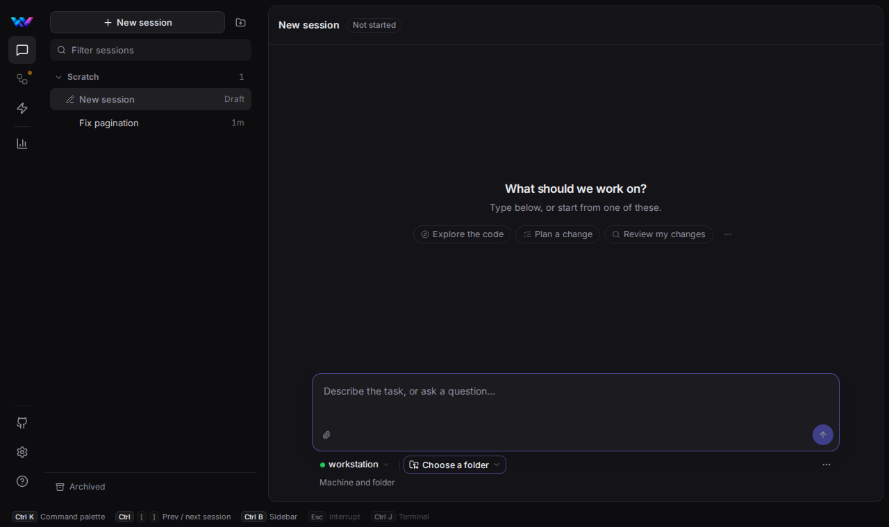
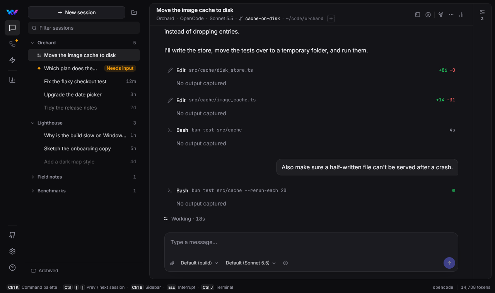
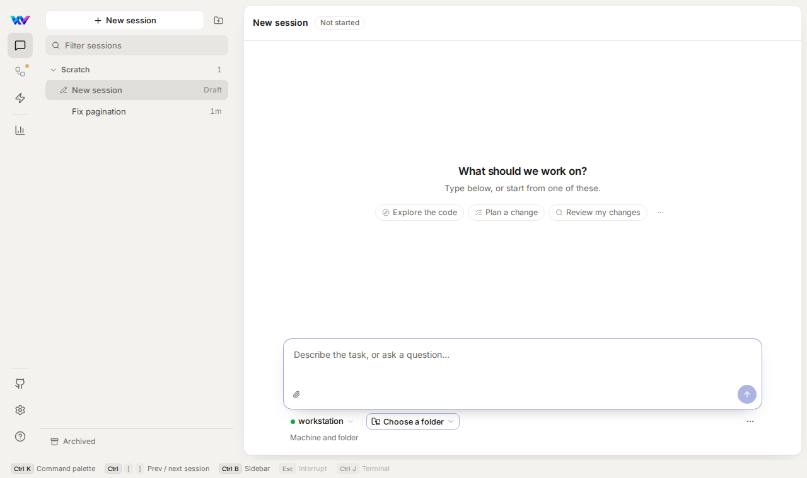
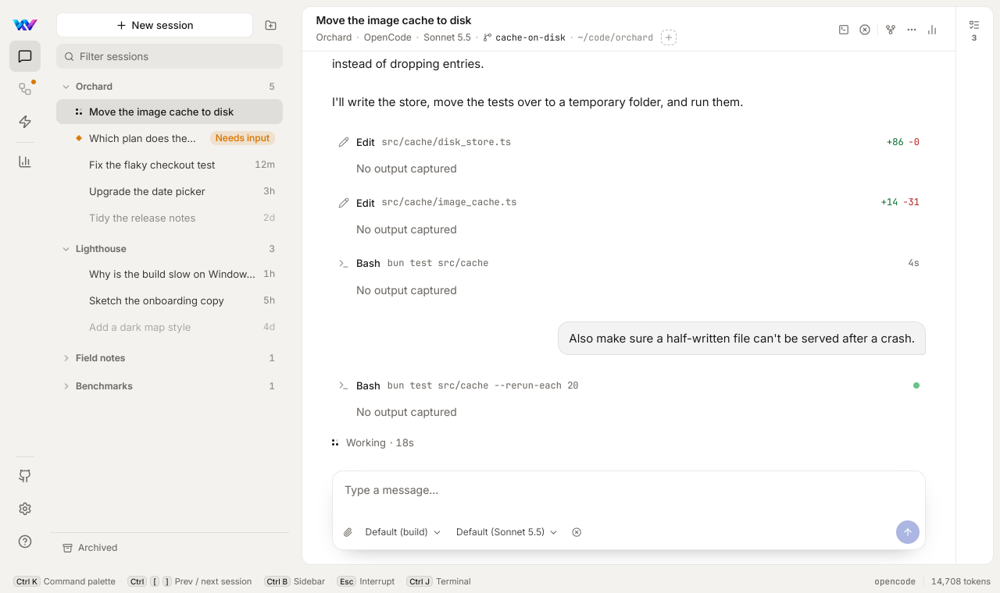
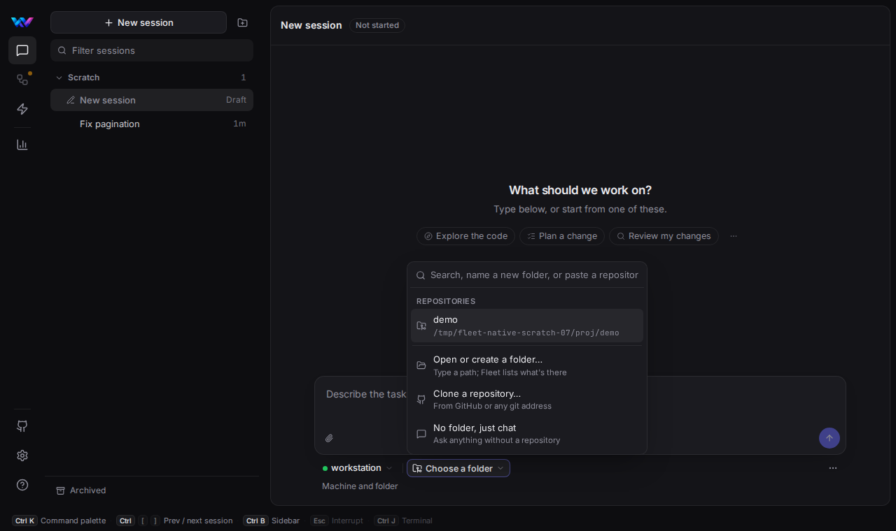
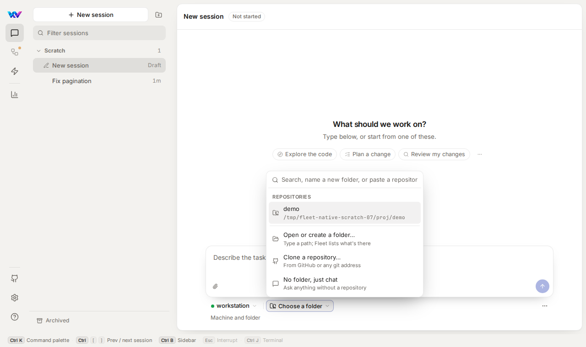
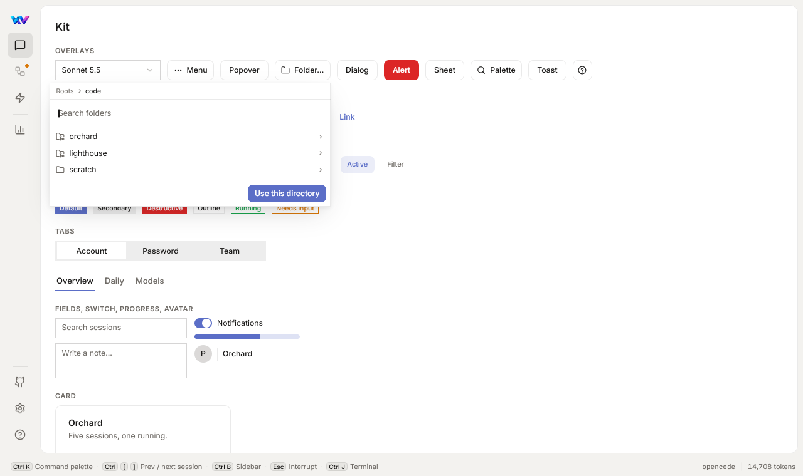
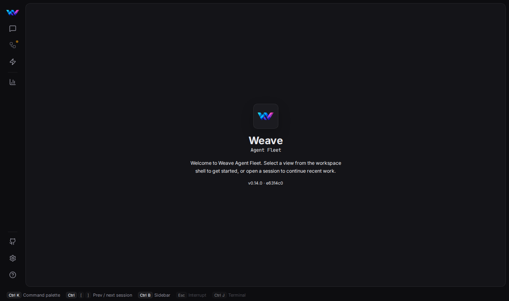
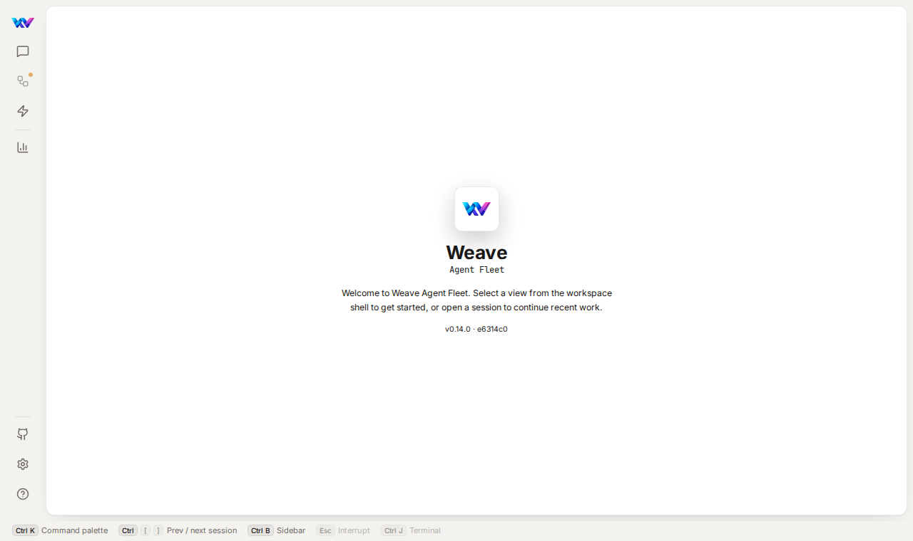
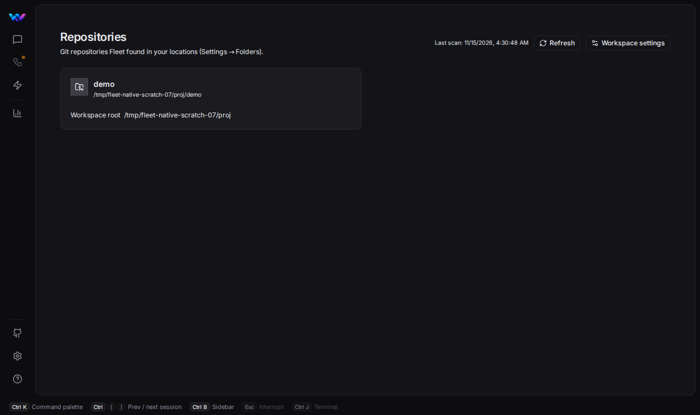
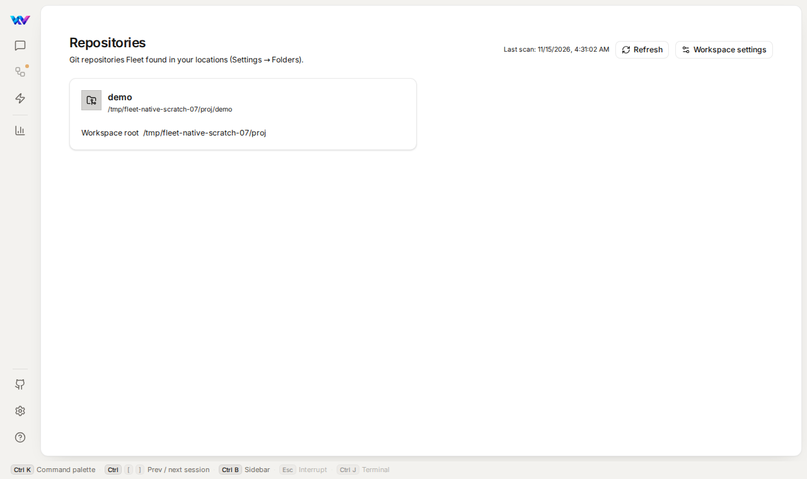

The gap, visible in the pictures: Fleet's New session button opens a page (header "New session" with
a "Not started" pill, "What should we work on?", three starter chips and a "…", a message box and
under it the machine and folder chips, no content panel, a Draft row in the list); native's button
leaves the open conversation as it was, and the app has no page, no draft, no folder choice and
no `POST /api/sessions` at all. The folder menu lists the repositories Fleet found, then "Open or
create a folder…", "Clone a repository…" and "No folder, just chat"; native has only the kit's
demo popover over invented folders. Welcome and Repositories are not reachable in native. Taken
against one scratch Fleet v0.72.0 (one repository, one session), 1280×760; the machine's name is
rewritten in the picture so that no host name is shown. Not shown: the Base, Workspace, Profile and
Harness menus, the `#` GitHub popup, the clone view, the setup wizard (needs a Fleet with no usable
harness), onboarding (cloud only).

## What "done" means

1. **New session** is Fleet's page: the route, the header, the empty state and its starters, the
   message box, the chips under it (machine, folder, workspace, base, harness, profile, agent and
   model, more options), and what Enter does (the plan line says it first), with every size, word
   and token of the Vue source, both themes.
2. **Creating a session** sends what Fleet sends (`POST /api/sessions` with the same fields), shows the
   first message at once, hands the draft's list row to the new session and opens it, and puts
   the message back with the server's error when it fails. Checked against a scratch Fleet with the
   scripted model.
3. **Every picker** is Fleet's: the folder menu with its list, path and clone views and the warning
   panel; the workspace and base pickers; the harness, profile and machine pickers; More options;
   the starters. Remembered choices are Fleet's (`weave:new-session:defaults` and the rest) in the
   native settings file.
4. **First run** is Fleet's: the harness setup wizard opens the way Fleet's does, its rows install or
   explain, and "Start a session" opens the New session page. Welcome and Repositories are Fleet's
   two pages.
5. **The GitHub boundary** is kept: core offers places (the `#` item picker, the clone suggestions,
   the preset), component 21 fills them. Nothing in core imports GitHub code.
6. Fleet's tests for all of it are ported under the same names ("Tests to port" in each part), and
   each piece's pictures are beside Fleet's own client at the same state and size.

## What the native app already has

| Part | State | Where |
|---|---|---|
| A "New session" button in the list, full width with a plus; a button beside it for a project folder | Shell: draws, does nothing but keep the open conversation | `src/view/sessions.rs::panel` |
| Command palette rows "New session" and "New session in this folder" | Rows exist, marked "waiting on 7", and do nothing | `src/ui/commands.rs` |
| A directory popover: breadcrumb, search, list of a fixed invented tree, "Use this directory" | Kit demo (component 1) over invented folders; Fleet's folder menu is a different thing | `src/ui/directory_picker.rs` |
| Menus, popovers, selects, dialogs, tooltips, toasts, text input, shortcut chips | Done (component 1) | `src/ui/` |
| Rail with Sessions, Fleet, Automations, Analytics, Settings, Help, GitHub | Shell | `src/view/rail.rs` |
| Anything else: a route for the page, the page, the draft, any request of the page, every picker, the harness wizard, Welcome, Repositories, remembered choices | **None** | |

Tokens: a picker chip, the popover shell and the plan line use the `--ns-*`-style values in
`new-session.css` (`B11`); each token `src/theme.rs` lacks gets added with its CSS variable's name
beside it.

## Decisions the pieces need (the owner can overturn)

- **The startup screen** (`later-notes`). Fleet's desktop app calls `loadURL(<server>)`, the server root,
  and `/` renders `FleetDashboard`; there is no first-run redirect to Welcome or onboarding and no
  remembered route. The only redirect is to `/fleet` (mission control) once, when that Labs
  preference is on (`C17.1-17.4`). Native opens the first session. **Not changed here**: the home
  dashboard is component 23's (the `dashboard` source) and wiring what the app opens on is
  component 9's (app frame). This component adds the `NewSession` route (and Welcome and
  Repositories), not the startup rule. Until 23 lands, native keeps opening the first session and,
  when there are none, the New session page (piece D: the empty list opens the page, as Fleet's
  "New session" would). That one rule is written here so no one has to find it again.
- **A `Route`.** Component 6's piece B introduces `Route` and selection by session id. This
  component adds `Route::NewSession { project_id }`, `Route::Welcome` and `Route::Repositories`
  to it. **Pieces D and P need component 6's piece B merged first**; if component 7 starts earlier,
  piece D makes the `Route` enum (small) and 6B takes it over. The two pages with no rail owner
  (Welcome, Repositories) show with no rail item highlighted (`C17.19`, Fleet's `NO_RAIL`).
- **The draft is in memory, as Fleet's is** (`A3`, `A21.191-204`): it survives leaving the page and
  coming back in the same run, not a restart. This differs from component 6's note that draft text
  goes in the settings file; the settings file (made by whichever of 5A, 6F or 7B comes first) keeps
  only what Fleet keeps in `localStorage` (`weave:new-session:defaults` per machine key and the
  saved repository, harness lists). If the owner wants drafts to survive a restart that is a
  deliberate difference and gets its own decision.
- **The composer is component 5's frame.** Fleet's page reuses `ComposerFrame` (`A4`). Piece L builds the
  page's message box on component 5's pieces A and B (frame, toolbar, drafts' send routing) and 5J/5K/5L/5N
  for autocomplete, references and images; if they are not merged, piece L waits. `agent-model-choice`
  is 5C's; the folder-scoped half of it (`describeDefaults`, `keepOffered`) is piece J here.
- **GitHub boundary** (the owner's rule; `A19`, `B10`). Fleet's composer imports GitHub code directly
  (`use-github-picker`, `lib/github-items`, `builtin.github` source ids, the `#` trigger) and only the
  clone suggestions go through a slot (`getRepositorySources`). Native is stricter: core
  (`src/fleet/new_session/`) defines two places, **`RepositorySources`** (suggestions for the Clone
  view) and **`ItemPicker`** (the `#` popup and the preset a GitHub item attaches: its source
  selection, branch suggestion, title), each a trait object registered at startup; with nothing
  registered the `#` trigger stays inert and Clone suggests nothing, as Fleet does with the plugin
  off (`A21.83`). Component 21 registers the GitHub ones. The GitHub rows (`A6`, `A7`, `B10`,
  `A21.46-55`, `A21.206`, `B` GitHub-picker tests) are **owned by component 21**; piece M builds
  the places and tests them with a fake item source.
- **Machines** (`A18`, `B5`). The machine chip and its popup are drawn from mock data and tested; what
  fills them (several machines, pairing, `GET /api/machine` per machine, "Add a machine") is
  component 17's. With one machine Fleet still shows the chip on desktop (`A21.95`): it shows the
  home machine, and the menu ends with "Add a machine", which goes to Settings → Machines (16) and
  is a "isn't in the native app yet" toast until then.
- **Harness setup** (`C12`, `C13`). `HarnessSetupRows` embeds Settings' `HarnessUpdateStrip`,
  `HarnessSignInPanel` and the setup `TerminalView` (`C13.80-13.84`). Component 16 owns the first two
  and component 13 the terminal. Piece O ships the rows with the install command shown and a Copy
  button, the docs and download links, and the install places; the in-app terminal ("Run it for
  me") and the sign-in panel are **left as the hand-off points** those components fill. Until
  then those buttons show the kit's "isn't in the native app yet" toast.
- **Onboarding is not ported.** `OnboardingWizard` shows only when `authEnabled && cloudMode && the
  user hasn't completed it` (`C17.9`, `C17.10`); a local Fleet never shows it, and cloud mode is not
  something the native desktop app is for (`docs/PORT.md`, "Out of scope"). The rows `C14` stay
  listed so a later decision can pick them up (it would be a small piece after component 9's
  sign-in pages). The owner can overturn this.
- **The auth gate and `Checking your session…`** (`C17.6-17.8`) are component 9's (sign-in and pairing).
- **Welcome and Repositories have no links in Fleet** (`C17.17`, `C17.18`): reachable only by address
  and, for Repositories, from Settings → Folders. Native gets them as routes with a scene each; the link from
  Settings is component 16's.
- **Locale text.** Repositories shows "Last scan" as `toLocaleString()` (`11/15/2026, 4:30:01 AM`).
  Native formats it as en-US the same way and says so; other locales are component 26's.
- **Fleet issues to report, not fix** (weave-fleet is read-only from here); the parts list each with
  its row: onboarding's "Start a session" goes to `/` not `/sessions/new`; the route's `source`
  search param is declared and never read; a `catch` in `submit` swallows a failing `navigate()`;
  `ProfilePicker`'s unscoped style overrides the global `.ns-pop__note`; the repository sources are
  read once in `setup`; Esc closes the whole folder menu instead of going back to the list; the
  `.ns-pop` shadow is a literal; Welcome's `weave-gradient-text` class has no CSS; the onboarding API-key
  error can read `[object Object]`; a failed Refresh on Repositories clears the list; setup rows
  show an empty 2px box when no harness has an installer.
- **Never create a session on a real Fleet.** Every live check uses a scratch Fleet on the checking
  session's own ports (`scripts/scratch-fleet.sh`, `docs/FLEET.md`); the scripted model answers.
  The first-run wizard needs a scratch Fleet with no usable harness (start one with `opencode` off its
  `PATH`, or turn every harness off in its preferences).
- Phone and narrow-window rules are dropped (desktop only); screen-reader labels use `.label(..)`
  where Rune allows and are listed for component 26.

## Reading the rows

Three parts, each read separately and in full. Each part ends with its own "Tests to port", "Data and
requests" and "Fleet issues noticed".

## Part A: the composer itself

Desktop only: rows for phone, narrow windows (`max-width: 560px` padding rule, `PhoneNewSession*`, `useIsMobile` branches, `safe-area-inset`, `phone-menu-lane`) are dropped; the one mobile rule that touches desktop is "Enter sends" (desktop always sends on Enter).
Root font 14px: 1rem = 14px. Literal `px` values in the scoped CSS are literal CSS px. Tailwind `size-N` = N x 3.5px here (size-3.5 = 12.25, size-4 = 14, size-7 = 24.5, size-8 = 28).
Tokens named below are CSS variables from `assets/main.css` (they vary per theme: dark, light and two further themes; the composer holds no colour literals except the frame shadow rgba).
Pickers (Folder, Base, Workspace, Machine, Profile, Harness, MoreOptions, StarterChips, GitHubItemPicker) are other readers' rows; here only how the composer wires them.

### A1. Page shell and layout

| # | Row | Source | Detail |
|---|---|---|---|
| A1.1 | Root element | NSC template L950 | `div.new-session[data-testid=new-session-form]`; flex column, height 100%, min-height 0. |
| A1.2 | Route wrapper | route sessions.new.tsx | Wrapper div: flex column, height 100%, min-height 0, overflow hidden; hosts `<NewSessionComposer key={target.key}>` so the composer is torn down and rebuilt when the machine changes. |
| A1.3 | Header | NSC css `.new-session__header` | Flex row, align center, gap 10px, min-height 56px, no shrink, border-bottom 1px `--border`, padding 8px 14px (`max(1rem, safe-area-inset)` with no inset = 14px). Same height/rule as the session header. |
| A1.4 | Header title | NSC L955 | `h2` "New session"; 14px, weight 600, letter-spacing -0.005em, line-height 1.3, colour `--text`. |
| A1.5 | Header pill | NSC L958 | Text "Not started"; 1px `--border`, radius 999px, padding 1px 8px, colour `--muted`, 11.5px, weight 500. Always shown (also while starting). |
| A1.6 | Context layout | AppShell.vue L103-111 | `isNewSessionRoute = pathname == "/sessions/new"`: the right/content panel is NOT shown (`showSessionsV2Panel` false). Layout = session list + composer page only; no content panel, no second gutter. |
| A1.7 | Stage (empty state) | NSC css `.new-session__stage` | Shown when no message is being sent. Flex 1, column, min-height 0, overflow auto, padding 20px 24px 8px. |
| A1.8 | Empty block | NSC css `.new-session__empty` | width 100%, max-width 640px, margin auto (centres in stage both axes), text-align center, `--muted`, 13.5px. |
| A1.9 | Empty headline | NSC L984 | `strong` "What should we work on?"; block, margin-bottom 4px, `--text`, 17px, weight 600, letter-spacing -0.01em. |
| A1.10 | Empty sub-line, starters on | NSC L985-994 | Text "Type below, or start from one of these." then `<StarterChips>` (see section 15). Shown when `showStarters`. |
| A1.11 | Empty sub-line, starters off | NSC L995-997 | Text "Type below. The chips under the box say where it runs." Shown when starters hidden, preferences unknown, box has text, or starting. |
| A1.12 | Conversation (sending) | NSC css `.new-session__conversation` | Replaces the stage while `sentMessage` is set (`draft.isStarting && message.trim()`). `aria-label="Activity stream"`; flex 1 column, overflow-y auto, padding 24px 32px 12px, CSS var `--activity-bubble-width: 100%`. |
| A1.13 | Sent bubble wrapper | `.new-session__message` | flex column, width 100%, max-width 760px, align-items flex-end, margin 0 auto 20px. |
| A1.14 | Sent bubble | NSC L968-976 | `MessageBubble` props: author "You", role "user", body = trimmed-or-raw `message`, session-references = `sentReferences`, created-at = `sentAt` (Date.now() at submit), show-identity true, cluster-position "single". Same bubble the session page draws. |
| A1.15 | Composer section | `.new-session__composer` | `section[aria-label="First message"]`; no shrink, padding 4px 24px 18px; every child max-width 760px centred (margin-inline auto). |
| A1.16 | Frame wrapper | `.new-session__frame` | position relative; the `#` picker is absolutely placed above the box, as wide as the box. |
| A1.17 | Chip strip | `.new-session__strip` | flex, wrap, align center, gap 2px, padding 6px 4px 0. Order: [Machine chip + sep], Folder chip, [sep, Workspace chip, Base chip when repository], spacer, More options (margin-left auto). |
| A1.18 | Strip separator | `.new-session__strip-separator` | 1px x 14px, margin-inline 3px, bg `--border`, aria-hidden. Shown after Machine chip and between Folder and Workspace. |
| A1.19 | Strip end | `.new-session__strip-end` | flex, margin-left auto; holds MoreOptions. |
| A1.20 | Plan line | `.new-session__plan` | See section 12. |

### A2. Route, entry points, shortcuts

| # | Row | Source | Detail |
|---|---|---|---|
| A2.1 | Route | routes/sessions.new.tsx | `/sessions/new`. Search params validated: `projectId?: string`, `source?: string` (only strings kept, else undefined). |
| A2.2 | Route setup | sessions.new.tsx | `useSessionsStore().setActiveSessionId(null)` so sidebar/status bar show no open session. |
| A2.3 | Target machine | sessions.new.tsx | `target = machines.entries.find(key == workspaceUi.newSessionMachine)` -> `targetFor(connection)`, else `machines.targetOfKey(machines.currentKey)`. `provideMachineTarget` so every composable below asks that machine. |
| A2.4 | Palette: New session | use-commands.ts L394 | id `new-session`, label "New session", description "Create and open a new session.", icon Plus, category Session, keywords create/spawn/start; action `handleNewSession`: `sidebar.setActiveRail("sessions")` then navigate `/sessions/new` with `{projectId: undefined, source: undefined}`. |
| A2.5 | New session shortcut | keybinding-types.ts L20 | palette hotkey `n`; global shortcut key `n` with platformModifier (Cmd on Apple, Ctrl elsewhere) AND metaKey flag. Matching (`matchesKeyboardShortcut`): platformModifier wins, so it is Cmd+N on macOS, Ctrl+N elsewhere; shift must be absent. `useKeyboardShortcut` ignores keydowns in editable targets unless `allowInEditable`; calls preventDefault. User-rebindable (`bindingFor`). |
| A2.6 | Palette: New session in this folder | use-commands.ts L570 | id `new-session-in-folder`, label "New session in this folder", description with active session "An empty session in the active session's folder, on the same harness." else "No active session selected."; icon FolderPlus; keywords new/session/folder/same/empty; disabled when no active session; no default shortcut. Does NOT open the composer: calls `POST /api/sessions/{id}/new-in-folder` (`startSessionInFolderOf`), upserts the row, sets active id, rail "sessions", navigates `/sessions/$id` with `instanceId`. Errors swallowed in palette (`.catch(() => {})`). |
| A2.7 | Sidebar "New session" button | SessionsPanel.vue L352-367, L639 | `openNewSessionPage(projectId|null)`: rail "sessions", navigate `/sessions/new` with `projectId` or undefined. Label "New session". |
| A2.8 | Project "+" | ProjectGroup.vue L534 | aria-label/title "New session in {project.name}"; navigates with `projectId`. Moves an existing kept draft to that project (watch on `search.projectId`). |
| A2.9 | Machine heading "New session on {name}" | MachineHeader.vue L118-123 | `workspaceUiStore.setNewSessionMachine(key)` then open page. |
| A2.10 | Draft row click | SessionsPanel `handleOpenDraft` | Navigate `/sessions/new` with `projectId: draftRow.projectId`. |
| A2.11 | Dashboard button | FleetDashboard.vue L166, L191, L252 | "New session", navigate with no params. |
| A2.12 | GitHub "start session" | use-github-sessions.ts L53 | Panel un-collapsed, rail "sessions", `await nextTick`, `workspaceUi.setNewSessionInitialSource(preset)`, navigate `/sessions/new`. |
| A2.13 | Harness wizard finish | HarnessSetupWizard.vue L72 | `startSession()`: leave wizard, navigate `/sessions/new`. |
| A2.14 | Route `source` search param | sessions.new.tsx | Validated and passed as undefined everywhere; the composer never reads it (see Fleet issues). |
| A2.15 | On mount | NSC L938 | `focusMessage()` + `resizeTextarea()`. Test: textarea is `document.activeElement`. |
| A2.16 | On unmount | NSC L943 | `workspaceUiStore.leaveNewSessionDraft()`; stop machine polling. |
| A2.17 | Esc never leaves page | test "Esc never leaves the page" | Esc in textarea or in folder search must not navigate and must not clear text. |

### A3. Draft (kept state)

| # | Row | Source | Detail |
|---|---|---|---|
| A3.1 | Draft is in-memory only | workspace-ui.ts | `newSessionDraft` is a Pinia `shallowRef` of a `reactive` object. Not in localStorage: lost on app reload. Kept across navigation inside the app. Pending images also in-memory (`useDraftAttachments` registry), keyed by `draft.rowKey`. |
| A3.2 | Draft fields | workspace-ui.ts `NewSessionDraft` | `rowKey` (`new-session-draft-N`, N from module counter), `message:""`, `folder:null`, `hasChosenFolder:false`, `workspace:{kind:"new"}`, `baseBranch:null`, `fetchOrigin:true`, `branchName:""`, `title:""`, `tags:""` (comma text), `projectId:null`, `harnessType: defaultHarnessType`, `harnessProfileId:null`, `agent:""`, `model:""` (selection key), `hasChosenAgentOrModel:false`, `gitHubPreset:null`, `isStarting:false`. |
| A3.3 | Open | `openNewSessionDraft` | Counts open boxes, sets `isNewSessionPageOpen`; returns existing draft with `restored:true`, else creates a fresh one. |
| A3.4 | Leave | `leaveNewSessionDraft` | Decrements box count; if another box is open (rebuild) do nothing. Else page closed; if not switching machine and draft has no content (`message.trim()` empty, no gitHubPreset, not starting) the draft is dropped and `newSessionMachine` reset to null. A draft with a message stays with its sidebar row. |
| A3.5 | projectId rule | NSC L155 | `if (search.projectId || !restored) projectId = search.projectId ?? null`. A project in the address wins; a restored draft otherwise keeps its own. |
| A3.6 | Restored folder | NSC L159 | `restored && folder` sets `hasChosenFolder = true` so defaults never replace it. |
| A3.7 | Fresh draft clears @ picks | NSC L163 | `!restored` -> `forgetSessionReferences(rowKey)`, `forgetFileReferences(rowKey)`. |
| A3.8 | Initial GitHub source | NSC L168 | If `newSessionInitialSource` set: `gitHubPreset = it`, `hasChosenFolder = false`, store source cleared. Also watched while page is open (L879) and then `applyInitialFolder()` is re-run. |
| A3.9 | Sidebar draft row | workspace-ui `newSessionDraftRow` | `{key, title, projectId, isStarting}`; title = `titleFromMessage(draft.title) || titleFromMessage(draft.message) || gitHubPreset.title.trim() || ""`, so the row follows typing. |
| A3.10 | Draft row UI | DraftSessionRow.vue | `data-testid=new-session-draft-row`; PencilLine icon; title or "New session" (class `--empty` when blank); meta "Draft" or "Starting…" when `isStarting`; row min-height 32px; gap 9px; padding 0 10px 0 6px; active bg `text 9%`, hover `text 5%`. (Belongs to session-list reader; listed for the boundary.) |
| A3.11 | Hand-off | `handOffNewSessionDraft(sessionId)` | `sessionRowKeys[sessionId] = draft.rowKey` (the new session's row takes the draft row's place), draft = null, machine pick = null. |
| A3.12 | Machine switch | `setNewSessionMachine(picked)` | picked == `machines.currentKey` is normalised to null; same value is a no-op. Resets folder:null, hasChosenFolder:false, workspace new, baseBranch null, fetchOrigin true, branchName "", projectId null, harnessType "", harnessProfileId null, agent "", model "", hasChosenAgentOrModel false. Keeps message, title, tags, gitHubPreset. Sets `switchingMachine` while page open so leaving doesn't drop the draft. |

### A4. Message box (ComposerFrame reuse)

| # | Row | Source | Detail |
|---|---|---|---|
| A4.1 | ComposerFrame | components/session/ComposerFrame.vue | Shared with the session composer. `div.composer-frame[data-notice-avoid]`: max-width 760px, margin 0 auto, border 1px `--border`, radius `calc(--radius-panel + 2px)` = 14px (radius-panel 12px), bg `--card-bg`, shadow `0 10px 28px -18px rgba(0,0,0,.5)`, border transition `--transition`. |
| A4.2 | Frame focus | ComposerFrame css | `:focus-within` border `color-mix(accent 55%, border)`. |
| A4.3 | Frame dragging | ComposerFrame css | prop `dragging`: border `--accent`, bg `color-mix(accent 5%, card-bg)`. |
| A4.4 | Frame slots | ComposerFrame | default slot = above toolbar (popup, GitHub attachment, textarea, image chips, hidden file input); `#toolbar` slot = toolbar row. |
| A4.5 | Textarea | NSC L1108 | `textarea.composer-frame__textarea.new-session__textarea`; `dir="auto"`, `rows=2`, `aria-label="First message"`, `data-testid=new-session-message`; `:value` is `""` while sending else `message`. Frame css: width 100%, padding 14px 16px 6px, no border/background, `--text`, resize none, 14px / line-height 1.5, placeholder colour `--muted`. Min-height 64px (new-session override, "room for two lines"); max 180px. |
| A4.6 | Placeholder (GitHub attached) | NSC L426 | "Add instructions (optional). The issue is attached." (also for an attached pull request). |
| A4.7 | Placeholder (no folder) | NSC L430 | `folder.kind === "none"`: "Ask anything…" |
| A4.8 | Placeholder (default) | NSC L430 | "Describe the task, or ask a question…" (also when no folder chosen yet). |
| A4.9 | Read-only while starting | NSC L1119 | `readonly` when `isStarting` (isCreating or draft.isStarting). |
| A4.10 | Auto-resize | NSC `resizeTextarea` | height = "0px" then `min(scrollHeight, 180)px`; also syncs the reference mirror. Called on input, mount, after picker pick, starter fill, after failed create. |
| A4.11 | Reference mirror | ReferenceMirror.vue, class `new-session__textarea` | Layer under the textarea (both `position: relative`) that tints @ picks (`.composer-reference`), `test-id=new-session-references`; synced on scroll (`@scroll`) and resize. |
| A4.12 | Input handler | NSC `handleInput` | `message = value`; `validationError = null`; track caret; resize. |
| A4.13 | Caret tracking | NSC L225-233 | `caret = selectionStart` on input, keyup, click; keyup/click first call `references.keepCaretOutside` (caret never rests inside a picked @ token). |
| A4.14 | Blur | NSC L1126 | `dismissedAt = message`: closes the `#` picker until the text changes. |
| A4.15 | Autocomplete aria | NSC L1114 | `aria-controls = AUTOCOMPLETE_LISTBOX_ID ("autocomplete-listbox")` and `aria-activedescendant = autocomplete-option-{i}` only while the @ popup has an active option. |
| A4.16 | Focus return | NSC `returnFocusToMessage` | On a chip menu's `close-auto-focus`: preventDefault; `setTimeout 0`: if `document.activeElement` is null or body, focus the textarea (`preventScroll`). A click elsewhere keeps focus where it landed. Wired to Harness, Profile, Machine, Folder, Workspace, Base, MoreOptions, StarterChips. |
| A4.17 | Toolbar row | ComposerFrame css | flex, align center, gap 2px, padding 4px 8px 8px. |
| A4.18 | Toolbar order | NSC L1152 | [Attach (if images)] [Harness] [Profile] [Agent, Model (if catalog supported)] ... Send (margin-left auto). |
| A4.19 | Send button | NSC L1199 | `Button variant=default size=toolbar-lg`, class `composer-frame__send` (30x30, radius 999, margin-left auto, padding 0), `data-testid=create-session-submit`, aria-label "Start session", title "Start session (Enter)"; disabled unless `canSend`. Shows `Spinner` while starting else ArrowUp icon (size-4 = 14px). Colours `bg-primary text-primary-foreground`, hover primary/90; disabled opacity .5 no pointer events. |
| A4.20 | canSend | NSC L345 | `!isStarting && !isPreparingFolder && noHarnessReason === null && (message.trim() != "" || gitHubPreset != null)`. Note: enabled with no folder chosen (click opens the folder menu). |
| A4.21 | Attach button | NSC L1153 | Shown only if `supportsImages`. `Button variant=toolbar-icon size=toolbar` (24.5px square; muted, hover bg `text 6%` + text colour), Paperclip `size-3.5`, title/aria-label "Attach images", `data-testid=new-session-attach`; disabled while starting; click opens hidden file input. |

### A5. Keyboard (message box)

| # | Row | Source | Detail |
|---|---|---|---|
| A5.1 | Order of key handlers | NSC `handleKeydown` | 1) `references.handleReferenceKey` 2) `handlePickerKeydown` (`#`) 3) `handleMentionKeydown` (`@`) 4) Enter-to-send. First to claim the key wins. |
| A5.2 | Enter | NSC L823-831 | Plain Enter (no Shift, not composing/IME) preventDefault + `submit(false)`. |
| A5.3 | Shift+Enter | NSC L823 | Not handled: newline. Test: no create. |
| A5.4 | IME | all handlers | `event.isComposing` -> every handler ignores the key. |
| A5.5 | Enter, empty message | submit | Nothing happens (no create); send button disabled. |
| A5.6 | Enter, no folder | NSC L714 | Opens the folder menu (`isFolderMenuOpen = true`) instead of creating; message kept. |
| A5.7 | Esc in textarea | handlers | Only consumed when a `#`/`@` popup is open (preventDefault + stopPropagation); otherwise untouched; never navigates. |
| A5.8 | Reference keys | use-draft-references `handleReferenceKey` | Backspace/Delete with caret at a picked @ token selects the whole token first (a second press deletes); arrows jump over tokens. Ignored with Shift/Alt/Ctrl+arrows, Cmd held, or a non-empty selection. Test "Backspace takes a whole pick out". |
| A5.9 | `#` picker keys | NSC `handlePickerKeydown` | See 6.x. |
| A5.10 | `@` list keys | use-autocomplete `onKeyDown` | ArrowDown/Up cycle (wrap) and preventDefault; Enter/Tab pick selected (Tab on a directory opens it instead); disabled item: preventDefault, nothing; no item while loading: remembers a pending pick for when the answer arrives; Esc closes (preventDefault, stopPropagation); any other key resets selected index to 0 and un-suppresses if text changed. Returns true for Enter/Tab/Escape so they never reach send. |
| A5.11 | Paste | NSC `handlePaste` | Files filtered to PNG/JPEG/GIF/WebP; none -> default text paste. If harness can't take images and clipboard has `text/plain`, text wins. Else preventDefault + add images. |
| A5.12 | Drag/drop | NSC L1046-1049 | `dragover.prevent` -> dragging on; `dragleave` -> off; `drop` -> preventDefault, off, add all dropped files (non-images get an error). |
| A5.13 | Tab order | template | Hidden file input `tabindex=-1`; chips are normal buttons in DOM order: attach, harness, profile, agent, model, send, then machine, folder, workspace, base, more. |

### A6. `#` picker (GitHub pull request / issue from the folder's repository)

| # | Row | Source | Detail |
|---|---|---|---|
| A6.1 | Trigger | github-reference `findHashTrigger` | Regex on text before caret: `(^|\s)#([^\s#]*)$`. Closed for `#` inside a word ("C#"). Caret must be >= 1 and <= length. Not while `draft.isStarting`. |
| A6.2 | Open rule | NSC L197 | `isPickerOpen = hashTrigger != null && dismissedAt != message`. |
| A6.3 | Repository | NSC L198 | Only when folder is a repository: remotes sorted `origin` first; each remote's `github {owner, repo}` else `parseGitHubRemote(url)` (regex `github.com[:/]owner/repo(.git)?`); first match. No match -> null repo (picker shows its own empty/err state). |
| A6.4 | Data | use-github-picker | Debounce 200ms while typing, immediate on open; aborts previous. Empty query: two searches `repo:{o}/{r} is:open assignee:@me sort:updated-desc` (first 5) and `repo:... is:open sort:updated-desc` (first 8, minus assigned) -> groups "Assigned to you", "Recently updated". Numeric query: item by number plus search (first 8) -> group "Matches". Words: search (first 10) -> "Matches". Empty groups dropped. Error text: thrown message else "GitHub didn't answer.". |
| A6.5 | Component props | NSC L1032 | `GitHubItemPicker` repository `"owner/repo"|null`, query, groups, selected-index, is-loading, error, with-sessions (set of lower-cased `owner/repo#n` that already have sessions via smart links); events `pick(item)`, `hover(index)`. `data-testid=github-item-picker`, rows `github-item-picker-row`. |
| A6.6 | Arrow keys | `handlePickerKeydown` | Down/Up cycle over flattened items with wrap, preventDefault. Index resets to 0 when the query changes. |
| A6.7 | Enter/Tab | same | Picks item at `min(index, count-1)`; Shift+Enter/Tab opens the existing session for the item if one exists (`/sessions/$id` with `instanceId`), else picks as normal. |
| A6.8 | Enter while loading, no items | same | preventDefault, swallowed (avoids sending "Fix #"). |
| A6.9 | Enter, nothing to pick | same | Falls through; Enter sends the message. |
| A6.10 | Esc | same | preventDefault + stopPropagation; `dismissedAt = message`; text untouched. |
| A6.11 | Pick effect | `pickGitHubItem` | Removes the `#query` (`removeTrigger`: no double space; leading trim if at start), sets caret, nextTick writes textarea value, caret, resize, focus. Sets `gitHubPreset = itemSessionPreset(item)`; `workspace = {kind:"new"}`; `branchName = ""`. Test: "Fix #31"+Enter -> box "Fix ", attachment "#318", workspace "New worktree"; no create. |
| A6.12 | itemSessionPreset | lib/github-items.ts | sourceType `github-pull-request` for `kind=="pull"` else `github-issue`; owner, repo, number, title, body null, htmlUrl = item.url, repoFullName `owner/repo`, suggestedBranch = pull's `headRef` else null. |

### A7. GitHub attachment (preset)

| # | Row | Source | Detail |
|---|---|---|---|
| A7.1 | Attachment row | `.new-session__attachments` | Above the textarea inside the frame when `gitHubPreset`; flex wrap gap 6px, padding 10px 12px 0. |
| A7.2 | Attachment chip | `.new-session__attachment` | `data-testid=new-session-github-attachment`, `title = htmlUrl`; inline-flex, max-width 100%, gap 6px, border 1px `--border`, radius `--radius-btn` 8px, padding 3px 4px 3px 8px, bg `text 4%`, `--text`, 12.5px. |
| A7.3 | Icon | template | `GitPullRequest` for `github-pull-request` else `CircleDot`; 13x13, `--muted`, aria-hidden. |
| A7.4 | Number | template | `#{number}`; mono font stack, 11.5px, `--muted`. |
| A7.5 | Title | template | `{title}`; single line, ellipsis. |
| A7.6 | Remove button | template | 20x20 grid-centred, radius 4px, `--muted`, hover bg `text 8%` + `--text`; focus-visible 2px `--accent` outline offset 1px; X icon 12x12; aria-label "Remove pull request #N" or "Remove issue #N"; disabled while starting. Click: `gitHubPreset = null`, focus textarea. |
| A7.7 | After remove | test | Send disabled if no message; `newSessionInitialSource` stays null. |
| A7.8 | Send with only the preset | test "can start with only the issue" | Request has `title` = issue title, `branch` = suggestedBranch, source `builtin.github`, no `initialPrompt`. |
| A7.9 | Folder with preset | `applyInitialFolder` | `findRepositoryForGitHubPreset`: scanned repo whose `name === preset.repo`, else case-insensitive; set folder (not "chosen"). No match: folder stays null. Defaults' last folder is NOT applied when preset set. |
| A7.10 | Folder menu limits with preset | NSC L1242 | FolderPicker `allow-browse`, `allow-create` = `!cloud && !preset`; `allow-none` = `!preset`. |
| A7.11 | Workspace for preset | `setFolder` | With a preset the workspace is forced to `{kind:"new"}` (remembered workspace ignored). |
| A7.12 | Missing repo error | new-session-request | Preset with non-repository folder: error "Pick the repository for {repoFullName} #{number}." |

### A8. `@` references (sessions, files, folders)

| # | Row | Source | Detail |
|---|---|---|---|
| A8.1 | Trigger | use-autocomplete L240-270 | Last `@` before the caret, char before it is start or whitespace, no space between `@` and caret, and the text is not already a remembered pick. Only `@` mentions here (no `/` commands, `$` skills, agents; `sessionId: null`, `draftKey = rowKey`). |
| A8.2 | Popup | NSC L1051 | `AutocompletePopup` props open/items/is-loading/selected-value/error/on-select/on-open-folder/query, `file-hint = "in {folderName}"` (or none), `session-note`. Groups: "Sessions" (hint "Tab to attach"), "Files & folders" (hint "in {folder}"). |
| A8.3 | Session note | NSC L527 | Harness `supportsFleetTools`: "The agent gets a link to the session, not a copy, and reads what it needs." else "The agent gets the session's title and a recap of where it stands, not a copy." |
| A8.4 | Session list | use-referable-sessions | Sessions from the store plus `GET /api/sessions?retentionStatus=all&limit=200` on the target machine, only while the @ list is open; cached 30s (`REFRESH_MS`); failure ignored. Offers 3 sessions for bare `@`, 5 with a query. |
| A8.5 | Files | use-find-files | `GET /api/directories/find?path={folder}&q={query}`, 80ms debounce (0 when listing); result `files: string[]` (folders end in `/`). Directory = Folder chip's path (null for no folder: files omitted). Relative paths so they hold in a new worktree. |
| A8.6 | Session pick | `onSelect` | Inserts token `@{slug of title}` (suffix `-2`... for clashes) + space; remembers `{token, sessionId, title}` under `rowKey`. |
| A8.7 | File pick | same | Remembers file token (the `@path`), edited as one piece. Tab on a directory descends into it instead. |
| A8.8 | Tint | NSC L519 | `useDraftReferences(text = sent ? "" : message, caret, draftKey, plainTokens = unfoundTokens)`; segments tinted by the mirror: sessions, picked files, minus tokens turned plain. |
| A8.9 | Folder changes | NSC L547 | On a changed Folder path, each picked file token is looked up in the new folder (`findFilesInFolder(target.api, dir, path minus trailing "/")` includes `path`); lookups that throw count as found. Missing ones: `forgetFileReferences`, added to `unfoundTokens` (drawn plain), notice shown. Sessions stay. With no new folder every pick is missing. First load (no previous) does nothing. A stale run is dropped (cleanup flag). |
| A8.10 | Unfound cleanup | NSC L561 | When the message no longer contains a plain token it is removed from `unfoundTokens`. |
| A8.11 | Folder notice | NSC L1295 | `p.new-session__folder-notice[role=status]`, testid `new-session-folder-notice`: flex gap 8px, margin-top 8px, padding 7px 10px, radius 8px, bg `status-waiting 12%`, 12.5px/1.5, wrap anywhere. Icon CircleAlert 14x14, margin-top 3px, `--status-waiting`. Paths in `code` (mono 11.5px) joined with ", " and " and ". Tail: one: "isn't in {folder}, so it stays as text."; many: "aren't in {folder}, so they stay as text."; folder name or "a chat with no folder". Cleared on next folder change and on submit. |
| A8.12 | Sent references | NSC L180 | `sentReferences = sessionReferencesIn(rowKey, sentMessage)` shown as chips in the sent bubble. |
| A8.13 | Cleanup after send | NSC L774 | `forgetSessionReferences` and `forgetFileReferences(draftKey)` after success. |

### A9. Images

| # | Row | Source | Detail |
|---|---|---|---|
| A9.1 | supportsImages | NSC L305 | `harnessCapabilities(resolvedHarnessType, harnesses).supportsImages` = `capabilities.supportsImageAttachments === true`. |
| A9.2 | Hidden input | NSC L1141 | `input[type=file]` accept `image/png,image/jpeg,image/gif,image/webp`, multiple, class sr-only, aria-label "Attach images", tabindex -1; value reset after change. |
| A9.3 | Validation order | use-image-attachments `addImage` | 1) no support -> "This session's harness can't take images." 2) type not allowed -> "Unsupported image type: {type or unknown}" 3) size > 5 MiB -> "Image exceeds the 5 MB limit ({formatBytes})" 4) 10 already -> "Too many images (max 10)". 5) bytes sniffed (PNG/JPEG/GIF/WebP, not file name); else "{name or "That file"} isn't a PNG, JPEG, GIF or WebP picture." |
| A9.4 | Error display | NSC L433 | `imageError` lives 5000ms (`PASTE_ERROR_MS`) in the same red error box (section 14); precedence validation > image > create error. |
| A9.5 | Chips | NSC L1130 | `ImageAttachmentChips` in `.new-session__images` (flex wrap gap 8px padding 8px 12px 4px, testid `new-session-images`) when images exist and not starting; `remove(id)` revokes the preview URL. Chip testid `image-attachment-chip`. |
| A9.6 | Sent | buildCreateSessionRequest | `attachments: [{mime, filename, data(base64)}]` only when a message exists. Filename default "image.png". Cleared after success. |
| A9.7 | Seeded preview | NSC L780 | Sent bubble images: `url = data:{mime};base64,{data}`, `filename ?? "image.png"`. |

### A10. Harness, profile, agent, model (toolbar)

| # | Row | Source | Detail |
|---|---|---|---|
| A10.1 | Enabled harnesses | use-enabled-harnesses | `GET /api/harnesses` (list); enabled = `available && userEnabled`. Default type: preference `defaultHarnessType` (on another machine read from that machine's `/api/preferences`, with the last value saved per machine shown at once), else the one with `isDefault`, else first, else "". |
| A10.2 | Harness picker shown | NSC L303 | `enabledHarnesses.length > 1`; `v-model=harnessType`, props harnesses, disabled while starting. testid `new-session-harness`. |
| A10.3 | resolvedHarnessType | NSC L435 | draft harnessType if enabled, else default if enabled, else first enabled, else default. A watch rewrites the draft's `harnessType` to it when the stored one is no longer enabled. |
| A10.4 | Profile picker shown | NSC L447 | Harness `capabilities.supportsProfiles === true` AND `profilesFor(harness, target).length > 0`. Props `v-model=selectedProfileId`, profiles, harness-type, disabled. testid `new-session-profile`; items `new-session-profile-none` (label "No profile"). |
| A10.5 | Profile selection | NSC L454 | Picked id if it is `NO_PROFILE` ("none") or still exists; else the harness default profile id; else "none". Profiles loaded (`harnessProfiles.load(type, target)`) when harness changes and supports them. |
| A10.6 | Profile sent | request | `harnessProfileId` only when the picker shows (including "none"); absent otherwise so the server default applies. |
| A10.7 | Catalog request | NSC L479 | `useHarnessCatalog(harness = folder ? resolvedHarness : "", directory, profile)`. Directory: null for no folder; repository + existing worktree = that worktree path; else the folder path (a new worktree is a checkout of it). Nothing asked until a folder is settled. Profile param only when picker shows. |
| A10.8 | Catalog endpoint | use-harness-catalog | `GET /api/harnesses/{type}/catalog?directory=&profile=` -> `{supported, agents[{name,description,mode,color,model{providerID,modelID},hidden}], providers[{id,name,models[{id,name}]}], defaultAgent, defaultModel}`. Cache per machine; fresh 5 min; refetch pushed on `harness.catalog_changed` (live machine only). Previous catalog stays up while another loads; `isCurrent` says it's this folder's. Error: "Couldn't load agents and models". |
| A10.9 | Agent/Model shown | NSC L1180 | Only when `catalog.supported === true`. `AgentSelector` testid `new-session-agent`, `ModelSelector` testid `new-session-model` (also needs `harness-type`). Each takes default-label/description from `describeDefaults`. |
| A10.10 | Default labels | agent-model-choice `describeDefaults` | Agent: "Default ({defaultAgent})" or "Default"; description "The agent this folder uses when you don't pick one: {agent}" (or without the tail). Model: with catalog and a resolvable model: "Default ({model name})", description "{agent}'s own model: {name}" when the agent has its own model else "This folder's model: {name}"; otherwise "Default" / "Whatever the harness picks". Model for an agent: that agent's model, else catalog `defaultModel`. |
| A10.11 | Choice setters | NSC L599 | Setting agent or model sets `hasChosenAgentOrModel = true`. |
| A10.12 | Remembered choice | NSC L915 | On folder/harness change, unless chosen: agent/model = `defaults.choiceFor(folder, harness)` (Default/"" first time). |
| A10.13 | Drop unoffered | NSC L929 | When the catalog is current and supported: `keepOffered` clears an agent not in catalog (or hidden) and a model whose provider/model isn't listed. |
| A10.14 | Sends agent/model | NSC L593, L736 | Sent unless the current catalog says `supported === false`. `agent` string (omitted when ""), `model = modelFromKey(key)`: key is JSON `["providerID","modelID"]` (both non-empty strings) -> `{providerID, modelID}`; else null (omitted). |
| A10.15 | Recent models | NSC L767 | After success, if a model was sent: `modelPicker.recordRecent(modelPickerKey(harnessType, providerID, modelID))`. |

### A11. Strip: how the composer drives the pickers

| # | Row | Source | Detail |
|---|---|---|---|
| A11.1 | Machine chip | NSC L1220 | Shown when `machines.hasMachines || !isMobile` (always on desktop). `MachinePicker` props machines=`machines.entries`, selected=`target.key`, others, live-reachable, disabled; events `update:selected` -> `setNewSessionMachine`, `add-machine` -> `openAddMachine()` + navigate `/settings`. testids `new-session-machine`, items `new-session-machine-{key}` (`home`, id), `new-session-machine-add`. Item copy seen in tests: "Working here · Linux", "Unreachable" (disabled). |
| A11.2 | Machine polling | NSC L99 | `machines.startPolling()` once `machines.hasMachines`; stopped on unmount. |
| A11.3 | targetName | NSC L86 | Entry name for `target.key`, else `machines.live.name`. |
| A11.4 | Folder chip | NSC L1236 | `FolderPicker` v-model:open=`isFolderMenuOpen`; props folder, repositories, recent-folders, plain-folders=`defaults.plainFolders()`, allow-browse/none/create, last-new-folder-root, disabled; events `update:folder` -> `setFolder(f, true)`, `update:busy` -> `isPreparingFolder` (a clone in progress blocks send), `created(root)` -> `defaults.rememberNewFolderRoot`, `folder-added` -> `refreshRepositories`. testid `new-session-folder-chip`; first-time text "Choose a folder". |
| A11.5 | Workspace chip | NSC L1258 | Only when folder.kind is repository: `WorkspacePicker` repository-path, workspace, current-branch, worktrees, is-loading-worktrees, last-worktree-path=`defaults.lastWorktreeFor(path)`, disabled; `update:workspace` sets draft. testid `new-session-workspace-chip`; texts seen: "New worktree", "Current checkout · {branch}". Hidden for directory and none. |
| A11.6 | Base chip | NSC L1269 | Only repository AND workspace.kind == new: `BasePicker` v-models base-branch, fetch-origin, branch-name; props branches (`detail.branches`), default-base, current-branch, is-loading (`loadingDetail || !detail`), generated-branch (placeholder), disabled. testid `new-session-base-chip`, text "from {base}" + " · no fetch"; items `new-session-base-fetch`, input `#new-session-branch-name`. |
| A11.7 | More options | NSC L1284 | `MoreOptions` v-models project-id, title, tags; props projects, disabled. testid `new-session-more-chip` (shows project name when not Scratch). |
| A11.8 | setFolder | NSC L642 | If kind or path changed: `baseBranch=null`, `fetchOrigin=true`, `branchName=""`. Sets folder, `hasChosenFolder ||= chosen`, clears validation error, workspace = `defaults.workspaceFor(path, null)` for a repository without preset else `{kind:"new"}`. |
| A11.9 | Initial folder | NSC `applyInitialFolder` | Runs once repositories are ready (`scannedAt != null || error != null`) and the folder wasn't chosen. No preset: `defaults.initialFolder(repositories)`; a `directory` folder is skipped in cloud mode. |
| A11.10 | Worktree list reset | NSC L894 | When worktree loading ends and the selected existing worktree path is not in the list: workspace = new. |
| A11.11 | Repo data | composables | `useWorktrees({repositoryPath})`, `useRepositoryDetail(repositoryPath)`, `useRepositories()` (`scannedAt`, `error`, `refresh`), `useProjects()`. Endpoints in Data and requests. |
| A11.12 | New worktree base | NSC L352 | `baseBranch` else (once detail is in) `defaultBase ?? currentBranch`; null before detail. |

### A12. Plan line (what Enter will do)

| # | Row | Source | Detail |
|---|---|---|---|
| A12.1 | Element | NSC L1314 | `p.new-session__plan[data-testid=new-session-plan][aria-live=polite]`; min-height 22px, padding 4px 11px 0, `--muted`, 12px/1.5, wrap anywhere. |
| A12.2 | Machine prefix | NSC L1319 | When `!target.isLive`: span testid `new-session-plan-machine` "On {name}:"; margin-right 4px, `--coral-text`, mono 11.5px. |
| A12.3 | Code runs | css | `code.new-session__plan-code`: `--text`, mono 11.5px (paths, branches). |
| A12.4 | Warn runs | css | `--status-waiting-text`. |
| A12.5 | No folder chosen | new-session-plan | "Machine and folder". |
| A12.6 | Folder none | same | "Chat only. No folder." |
| A12.7 | Directory | same | "Runs in `~/path` as it is." (`tildePath`: `/home/x`, `/Users/x`, `C:\Users\x` -> `~`). |
| A12.8 | Current checkout | same | "Works directly in `path`[ on `branch`]" then ". Edits land in your checkout." or, when current branch != default branch, warn run ". That's not {defaultBranch}." |
| A12.9 | Existing worktree | same | "Continues in `path`[ on `branch`]." (branch looked up from worktree list). |
| A12.10 | New worktree, name known | same | "New worktree `path` on `branch`, from `base`." Path = resolved naming path `{root}/{folder}`, else fallback `{repoName}-worktrees/{branch with / and \ replaced by -}`. When base starts with `origin/` and fetch is off: " as last fetched" after the base. |
| A12.11 | New worktree, unnamed | same | "New worktree from `base`. The branch is named from your message, or the session id without one." Base missing: "the default branch" (plain text). |
| A12.12 | Start without a message | NSC L1340 | Inline button after the sentence, shown when `folder && !hasMessage && !gitHubPreset`; testid `create-session-without-message`, text "Start without a message"; margin-left 6px, plain, `--muted`, 12px, underline (offset 3px, colour `muted 45%`), hover `--text`, focus-visible 2px `--accent` outline offset 2px; disabled while starting. Click: `submit(true)`. |

### A13. Submit and after send

| # | Row | Source | Detail |
|---|---|---|---|
| A13.1 | Guards | `submit` | Return if starting, preparing folder, or `noHarnessReason`. No folder -> open folder menu. `!withoutMessage` and no message and no preset -> return. |
| A13.2 | Build | `buildCreateSessionRequest` | See Data section for the payload. On `{ok:false}` shows `error` in the red box ("Pick a folder." / "Pick the repository for X #N."); keeps everything. |
| A13.3 | Snapshot | NSC L747 | Captures folder, workspace, agent/model choice, first message (`initialPrompt`), its references, draftKey, images; `sentAt = Date.now()`; clears folder notice. |
| A13.4 | Optimistic state | NSC L761 | `draft.isStarting = true`: textarea read-only and blank, sent bubble shown in the conversation, sidebar row "Starting…", chips disabled, starters hidden, send shows spinner. |
| A13.5 | Request | useCreateSession | `POST /api/sessions` on the target machine (see Data). `isLoading` flag = `isCreating`. |
| A13.6 | Success bookkeeping | NSC L765-790 | In order: `defaults.remember(folder, workspace, choice)`; recent model; if not live machine `machines.rememberSessions(key,[id])`; forget @ picks; clear images; `seedSentPrompt(sessionId, firstMessage, sentAt, refs, images)` (a "pending" prompt, id `user-...`, correlation `prompt-...`, 15s confirmation timeout then `needs_retry`); build row; live: `sessionsStore.upsertSession(row)`; other machine: `upsertElsewhere(key,row)` + `machines.upsertSession(key,row)`; `handOffNewSessionDraft(sessionId)`. All in one tick so the session page has the message and row before history loads. |
| A13.7 | Created row | `buildCreatedSessionRow` | `instanceId`, `workspaceId` from response; `workspaceDirectory`/`sourceDirectory` = directory (""/null for chat); `isolationStrategy` (default "existing"); `sessionStatus` "active" if there is a prompt or source provider `builtin.github`, else "idle"; `activityStatus` "busy"/"idle"; `instanceStatus`/`lifecycleStatus`/`typedInstanceStatus` "running"; `retentionStatus` "active"; `branch = response.branch ?? options.branch ?? null`; `projectId/Name` of chosen project or Scratch (`projects.find(type === "scratch")`); `harnessType` from response; `tags = response.session.tags ?? []`; `selectedAgent`, `selectedModel`. |
| A13.8 | Navigate | NSC L793 | If the page was left meanwhile (`!isNewSessionPageOpen`) stay put (row exists). Else `navigate({to:"/sessions/$id", params:{id}, search:{instanceId: response.instanceId, parentSessionId: undefined}})`. |
| A13.9 | Failure | NSC L804 | `draft.isStarting = false`; createError message shown in the red box; message returns to the textarea (it never left the draft); if the page was left, `leaveNewSessionDraft()`; else nextTick resize + focus. No row added. Not remembered. |
| A13.10 | Start without message | submit(true) | `message: ""`, no references/attachments; session "idle"; no seeded prompt; no sent bubble (empty state stays). |
| A13.11 | Title | request | `title.trim() || preset.title.trim() || titleFromMessage(message) || omitted`. |
| A13.12 | Sidebar draft title while starting | store | Row keeps message title with "Starting…". |

### A14. Errors and notices

| # | Row | Source | Detail |
|---|---|---|---|
| A14.1 | Error box | `.new-session__error` | `div[role=alert]`, testid `new-session-error`; margin-bottom 10px, border 1px `color-mix(error 30%, transparent)`, radius `--radius-card` 10px, padding 10px 12px, bg `color-mix(error 10%, transparent)`, text `--error-text`, 12px/1.5. |
| A14.2 | Message precedence | NSC L433 | `validationError ?? imageError ?? createError ?? null`. Validation cleared by typing, picking a starter, changing folder, or a good submit. Create error is cleared at the start of each create (`createMutationState`). |
| A14.3 | Server message | use-session-actions `readErrorMessage` | Parsed body field `error`, then `detail`, then `title` (first non-blank string); else raw text; else "HTTP {status}"; thrown-error fallback "Failed to create session". Example in test: "Couldn't create the worktree: 'x' is not a valid branch name". |
| A14.4 | No-harness box | `.new-session__no-harness` | `div[role=status]`, testid `new-session-no-harness`; only when no error box (v-else-if). flex wrap, baseline, gap 4px 10px, margin-bottom 10px, border 1px `idle 35%`, radius 10px, padding 10px 12px, bg `idle 10%`, `--text`, 12px/1.5. |
| A14.5 | No-harness reason | use-enabled-harnesses | null while first list loads, when the list failed, or when any harness is ready. Else: no user-enabled harness -> "Every harness is turned off."; else the wanted (default or first turned-on) harness's `reason` or "{displayName} isn't ready." Example: "OpenCode isn't installed: Fleet couldn't find opencode on PATH or in the folders its installer uses." |
| A14.6 | No-harness link | NSC L1022 | Button `--accent-text`, weight 500, underline offset 2px, no border/padding. Text: not live machine -> "Open {targetName}'s Settings"; cloud mode -> "Open Settings → Harnesses"; else "Set up a harness". |
| A14.7 | Link action | `fixNoHarness` | Other machine: `machines.setCurrent(target.key)`, settings section "harnesses", navigate `/settings`. Live, non-cloud: `harnessSetup.open("harnesses")` (wizard opens at step "harnesses", no navigation). Cloud: section "harnesses", navigate `/settings`. |
| A14.8 | Send blocked | canSend | Enter and button do nothing while a reason shows. |
| A14.9 | Image error | 9.3 | Shown in the red box, 5s. |

### A15. Starters

| # | Row | Source | Detail |
|---|---|---|---|
| A15.1 | Visible | NSC L846 | `preferencesStore.hasFetched && get("NewSessionStarters","true") != "false" && message == "" && !isStarting`. Unknown preferences: hidden (no flash). |
| A15.2 | Built-in starters | lib/starters.ts | "Explore the code" -> "Explore this repository and explain how … works. Don't change any files."; "Plan a change" -> "I want to … Read the code and propose a plan. Don't change any files yet."; "Review my changes" -> "Review my uncommitted changes. List bugs and risks, most serious first. Don't edit anything." ids explore/plan/review; chip testids `new-session-starter-{id}`. |
| A15.3 | Fill | `fillStarter` | message = text, clear validation error, caret = selection end, nextTick: resize, focus, select the "…" (`starterSelection`: [idx, idx+1] of the first "…", else caret at end). Never sends. Starters vanish as soon as the box has text. |
| A15.4 | Workflow starter | NSC L850 | "Fix a bug" shown when Workflows preference is "true" (`useWorkflowsFeature`, default "false") AND `target.isLive`. testid `new-session-starter-fix-a-bug`. Click: navigate `/workflows` with `search {workflow: "builtin:fix-a-bug", folder: repositoryPath ?? undefined}` (repositoryPath only for a repository folder). Does not create a session. |
| A15.5 | Hide | `hideStarters` | Menu button testid `new-session-starters-menu`, item `new-session-starters-hide` ("Hide starters"): `preferences.set("NewSessionStarters","false")` (PUT /api/preferences/NewSessionStarters), focus textarea. Setting also in Settings -> General -> "Show starters". |
| A15.6 | StarterChips events | NSC L987 | `show-workflow`, `@fill`, `@open-workflow`, `@hide`, `@close-auto-focus`. Test: chips text list ["Explore the code","Plan a change","Review my changes",""] (last is icon-only menu button). |

### A16. Remembered choices (localStorage)

| # | Row | Source | Detail |
|---|---|---|---|
| A16.1 | Key | use-new-session-defaults | `weave:new-session:defaults` on the home machine; `weave:new-session:defaults:{machineKey}` on others (`newSessionDefaultsKey`). Via `usePersistedState`. |
| A16.2 | Shape | same | `{lastFolder, recentFolders[], workspaceByRepository{path: "current"|"new"|worktreePath}, choiceByFolder{folderKey: {harnessType: {agent, model}}}, lastNewFolderRoot, plainFolders[]}`. Folder = `{kind:"repository"|"directory", path}` or `{kind:"none"}`; folder key = path or "none". |
| A16.3 | Normalise | `normalize` | Anything unreadable is ignored, never throws; entries of the wrong type dropped. |
| A16.4 | initialFolder | same | `lastFolder` if (non-repository or still scanned); else most recent repository still present; else null. |
| A16.5 | recentFolders | same | Stored list minus vanished repositories; max 5 (`MAX_RECENT_FOLDERS`); newest first, deduplicated; "none" never stored in it. |
| A16.6 | workspaceFor | same | "current" -> current; missing/"new" -> new; path: kept if worktrees unknown (null) or listed, else new. |
| A16.7 | lastWorktreeFor | same | Remembered path when it is neither "current" nor "new". |
| A16.8 | choiceFor | same | Per folder+harness; Default (""/"") otherwise. |
| A16.9 | remember | same | After a successful create: lastFolder, recents (not for none), workspace for repositories, agent+model for folder+harness (only if sent), plain folders (directory kinds, newest first, max 30 `MAX_PLAIN_FOLDERS`). |
| A16.10 | New folder root | same | `rememberNewFolderRoot(root)` stores `lastNewFolderRoot`; `lastNewFolderRoot()` read by FolderPicker. |
| A16.11 | Machine-scoped | NSC | Defaults read for the machine the composer asks (target), so another machine remembers its own folders. |

### A17. Worktree naming preview

| # | Row | Source | Detail |
|---|---|---|---|
| A17.1 | Load | NSC L363 | When the folder is a repository whose path differs from `worktreeNaming.loadedFor` (or `loadedOn != target.key`): `GET /api/worktrees/naming?directory={path}` through the target machine (`load(path, target)`). Failure: store `error`; defaults stay; composer unaffected. |
| A17.2 | Defaults | lib/worktree-naming.ts | `branch "{prefix}/{slug}"`, `root "{repoParent}/{repo}-worktrees"`, `folder "{branch}"`, `prefix "fleet"`. |
| A17.3 | Preview only | NSC L377 | Only for repository + workspace new. Context `user:""`, `shortId:""`, `home:""`, `date: new Date().toISOString().slice(0,10)`; message; `branchOverride = resolveNewWorktreeBranch({branch: branchName, gitHubPreset})` = typed branch trimmed, else preset `suggestedBranch` trimmed, else undefined. |
| A17.4 | Branch rule | resolveWorktreeName | Override wins; else template with `{slug}` and empty slug -> null (server names it `session-<id>`); tokens `{slug,repo,user,prefix,date,shortid, captures}`, collapse doubled `-_/`, trim leading/trailing `-_/. `. Captures: regex from naming `capture` (<=200 chars, first group or whole match), the captured text is removed from the slug source. |
| A17.5 | Slug | `slugForBranch` | First non-blank line, NFKD with accents dropped, lowercase, apostrophes removed, split on non-alnum, stop words dropped (a, an, the, and, or, but, so, to, of, in, on, at, for, with, from, by, into, about, as, is, are, be, it, its, this, that, these, those, i, me, my, we, us, our, you, your, please, can, could, would, should, will, lets, let, just, some, do, does) unless nothing is left; joined with `-`, cut at a word boundary to 40 chars (one long word cut at 40). |
| A17.6 | Root/folder | same | root tokens `{repo, repoParent, home, user, prefix, date, shortid}`; folder = collapse of `folder` template with `{branch}`, `/` and `\` -> `-`. |
| A17.7 | Not sent | request | The request carries a branch only when typed or suggested; the server names the rest (so automations/API callers name alike). Contract cases: `tests/contracts/worktree-naming-cases.json`. |
| A17.8 | Example | test | "Fix the login redirect" in `~/src/rocket` -> "New worktree ~/src/rocket-worktrees/fleet-fix-login-redirect on fleet/fix-login-redirect" (from origin/main). |

### A18. Machine behaviour

| # | Row | Source | Detail |
|---|---|---|---|
| A18.1 | Chip sits first | test | First `.ns-chip` in the strip is the machine chip showing its name. |
| A18.2 | Switch keeps message | store/test | See 3.12; folder is dropped; chip text follows. |
| A18.3 | Everything asks that machine | NSC | Folders, harnesses, preferences, catalog, profiles, naming, repositories, projects, sessions, create call and defaults key use `target`. |
| A18.4 | Create on another machine | NSC L773-789 | Row kept out of live list: `sessionsStore.upsertElsewhere(key,row)` and `machines.upsertSession(key,row)`; `machines.rememberSessions(key,[id])` so `/sessions/$id` opens in place. |
| A18.5 | Workflow starter on other machine | 15.4 | Hidden. |
| A18.6 | Add a machine | `addMachine` | `openAddMachine()` (Settings section "machines", add dialog requested) then navigate `/settings`. |

### A19. Plugin / GitHub boundary

| # | Row | Source | Detail |
|---|---|---|---|
| A19.1 | Only extension point | FolderPicker.vue L38,L136; plugins/slots.ts | `getRepositorySources()` -> plugin contribution `repositorySources[{id, icon, useRepositories()}]` feeds the folder picker's Clone view suggestions. Composer itself has no slot. With none contributed the view suggests nothing (tests). |
| A19.2 | GitHub is NOT behind a slot | NSC imports | The composer (core) imports GitHub code directly: `useGitHubPicker`, `lib/github-items` (`/api/integrations/github/*`), `lib/github-reference`, `lib/github-session-source`, `GitHubItemPicker`, and uses source ids `builtin.github`. Only `builtin.repository`, `builtin.local`, `builtin.quickchat` and `builtin.github` source providers exist in the request. For the port: decide whether `#` picker + issue preset stay in core. |
| A19.3 | Source keys | new-session-request | `{providerId, sourceType, actionId:"start-session", contractVersion:1}`: `builtin.quickchat/quick-chat`, `builtin.local/directory`, `builtin.repository/repository`, `builtin.github/github-issue|github-pull-request`. |
| A19.4 | Isolation "clone" | types | `GitHubRepositoryIsolationStrategy` allows "clone"; composer never sends it. |

### A20. Data and requests

| # | Row | Source | Detail |
|---|---|---|---|
| A20.1 | Create session | `POST /api/sessions` (useCreateSession) | Body (`CreateSessionApiRequest`): `directory` (string|null; null for chat), `title`, `isolationStrategy` ("existing"|"worktree"|null), `branch`, `source` (SessionSourceSelection), `harnessType`, `harnessProfileId`, `initialPrompt`, `onComplete` (null here), `projectId`, `tags` (string[]|null). Spread only when set: `agent`, `model {providerID, modelID}`, `sessionReferences [{token, sessionId}]`, `attachments [{mime, filename|null, data}]`. Note nulls sent explicitly for the first group. |
| A20.2 | Create response | same | `CreateSessionResponse {instanceId, workspaceId, session: FleetSession(id, title, time, tags...), branch?: string|null, harnessType}`. Used: `session.id`, `instanceId`, `branch`, `harnessType`, `session.tags`. |
| A20.3 | Source: repository | `repositorySource` | `{providerId builtin.repository, sourceType repository}`, input `{repositoryPath, isolationStrategy: "existing"|"worktree"}`; + `existingWorktreePath` for existing worktree; for new worktree + `branch` (if typed) + `baseBranch` (only when not default) + `fetchOrigin:false` (only when off). |
| A20.4 | Source: directory | `directorySource` | input `{directory, isolationStrategy:"existing"}`; top-level `directory` trimmed. |
| A20.5 | Source: GitHub | `buildGitHubSessionSourceSelection` | input `{owner, repo, number, repositoryPath, isolationStrategy: "worktree"|"existing"}` + `existingWorktreePath` OR (`branch` + base fields); base ignored for existing worktree. |
| A20.6 | Top-level isolation | request | `"worktree"` for repository with workspace new or existing; `"existing"` for current checkout, directory and chat. |
| A20.7 | Top-level branch | request | Only new worktree: typed branch else preset suggested; omitted otherwise. |
| A20.8 | Tags | request | `tags.split(",")` trimmed, blanks removed, omitted when empty. |
| A20.9 | Absent fields | request | `initialPrompt`, `harnessType`, `harnessProfileId`, `projectId`, `agent`, `model`, `attachments`, `sessionReferences` are left out when empty; attachments/refs also left out without a message. |
| A20.10 | List harnesses | `GET /api/harnesses` | `HarnessInfo {type, displayName, available, userEnabled, reason, capabilities{supportsImageAttachments, supportsProfiles, supportsFleetTools, ...}, isDefault}`. |
| A20.11 | Preferences | `GET /api/preferences`, `PUT /api/preferences/{key}` | Keys used: `defaultHarnessType`, `NewSessionStarters`, `Workflows`. |
| A20.12 | Repositories | `GET /api/repositories`, `POST /api/repositories/refresh` | `{repositories:[{name,path,parentRoot}], scannedAt}`. Cached per machine (`readSaved`), broadcast to other views. |
| A20.13 | Repository detail | `GET /api/repositories/detail?path=` | `{repository:{name,path,branch,branches[],remotes[{name,url,github{owner,repo}}],defaultBranch,defaultBase,...}}`. Aborted on change. |
| A20.14 | Worktrees | `GET /api/repositories/worktrees?path=` | `WorktreeInfo {path, branch, commitHash}`. |
| A20.15 | Projects | `GET /api/projects` | `ProjectResponse {id, name, type("scratch"|...)}` ; Scratch is the default group. |
| A20.16 | Catalog | `GET /api/harnesses/{type}/catalog` | See 10.8. |
| A20.17 | Naming | `GET /api/worktrees/naming?directory=` | `{effective, user, defaults, layers}` with `branch, root, folder, capture, prefix`. |
| A20.18 | Files | `GET /api/directories/find?path=&q=` | `{directory, files:[string]}`; error `{error}` or "HTTP n". |
| A20.19 | Referable sessions | `GET /api/sessions?retentionStatus=all&limit=200` | Array of SessionListItem. |
| A20.20 | GitHub search | `GET /api/integrations/github/search?q=&first=&after=` and `/repos/{owner}/{repo}/items?numbers=` | `GitHubItemPage {items, totalCount, endCursor, hasNextPage}`; item fields `kind, owner, repo, number, title, url, state, isDraft, headRef...`. Errors: 401 "Connect GitHub in Settings to see this."; else `payload.error` or "GitHub didn't answer (HTTP n).". |
| A20.21 | New in folder | `POST /api/sessions/{id}/new-in-folder` | Palette command only; response is a CreateSessionResponse. |
| A20.22 | Live events | use-harness-catalog | `harness.catalog_changed` refreshes the catalog (live machine). No other events used by this page. |
| A20.23 | Telemetry | useCreateSession | `trackAction("session.create", id)` on success. |

### A21. Tests to port

File A = `components/sessions/__tests__/NewSessionComposer.test.ts` (`describe("NewSessionComposer")` is the root of every name below).

| # | Test | File |
|---|---|---|
| A21.1 | NewSessionComposer > puts the cursor in the message box | A |
| A21.2 | > chips > shows the workspace chip for a repository | A |
| A21.3 | > chips > remembers the workspace per repository | A |
| A21.4 | > chips > hides the workspace chip for a plain folder and for no folder | A |
| A21.5 | > chips > shows the harness picker only when more than one harness is enabled | A |
| A21.6 | > chips > profile > has no chip while there are no profiles, and sends none | A |
| A21.7 | > chips > profile > has no chip for a harness without profiles | A |
| A21.8 | > chips > profile > starts on the default profile and sends it | A |
| A21.9 | > chips > profile > sends the profile picked, and none when that's the pick | A |
| A21.10 | > chips > profile > asks for the agents and models on the session's profile | A |
| A21.11 | > chips > shows the project on the more chip when it isn't Scratch | A |
| A21.12 | > chips > previews the name the worktree naming templates will give it | A |
| A21.13 | > base chip > says where a new worktree starts | A |
| A21.14 | > base chip > isn't there for the current checkout | A |
| A21.15 | > base chip > lists the default first, marked, and the checked-out branch | A |
| A21.16 | > base chip > starts from a chosen branch, unfetched and under a typed name when asked | A |
| A21.17 | > base chip > reopens with the chosen branch highlighted, even after searching for it | A |
| A21.18 | > base chip > sends no base for the default, so the server's rules apply | A |
| A21.19 | > base chip > can't turn fetching off for a local branch | A |
| A21.20 | > base chip > forgets the base when the folder changes | A |
| A21.21 | > base chip > warns when the current checkout isn't on the default branch | A |
| A21.22 | > agent and model > asks the harness about the chosen folder and says what Default is | A |
| A21.23 | > agent and model > Default's model follows the picked agent | A |
| A21.24 | > agent and model > starts the session with the picked agent and model | A |
| A21.25 | > agent and model > names no agent or model when both are Default | A |
| A21.26 | > agent and model > remembers the choice for the folder, not for others | A |
| A21.27 | > agent and model > drops a remembered agent the folder no longer has | A |
| A21.28 | > agent and model > offers no choice, and sends none, when the harness can't list its agents | A |
| A21.29 | > agent and model > asks about an existing worktree as it is | A |
| A21.30 | > starters > shows Fleet's three starters on the empty page by default | A |
| A21.31 | > starters > fills the box and selects the … without sending | A |
| A21.32 | > starters > hides while the box has text and comes back when it's cleared | A |
| A21.33 | > starters > Hide starters turns them off for good | A |
| A21.34 | > starters > stays away when turned off, and until preferences are known | A |
| A21.35 | > starters > offers Fix a bug only with Workflows on, and opens its Run box in this folder | A |
| A21.36 | > keyboard > Enter creates the session with the message as its first prompt | A |
| A21.37 | > keyboard > a pasted image goes with the first prompt | A |
| A21.38 | > keyboard > says so when the harness can't take images | A |
| A21.39 | > keyboard > Shift+Enter is a new line, not a send | A |
| A21.40 | > keyboard > Enter with an empty message does nothing | A |
| A21.41 | > keyboard > says why no harness is ready and won't send until one is | A |
| A21.42 | > keyboard > in cloud mode, where a harness can't be set up from Fleet, points to Settings instead | A |
| A21.43 | > keyboard > Esc never leaves the page | A |
| A21.44 | > keyboard > the first time, Enter asks where to run instead of creating | A |
| A21.45 | > quick chat > choosing No folder creates nothing; Enter creates a chat with the message | A |
| A21.46 | > # picker > opens on # and asks the folder's repository | A |
| A21.47 | > # picker > Enter attaches the item, drops the #query and starts in a new worktree | A |
| A21.48 | > # picker > Esc closes it and leaves the message alone | A |
| A21.49 | > # picker > Enter waits while GitHub is still answering | A |
| A21.50 | > # picker > Enter sends the message when there's nothing to pick | A |
| A21.51 | > # picker > stays shut for # inside a word | A |
| A21.52 | > GitHub preset > attaches the issue, picks its repository and a new worktree | A |
| A21.53 | > GitHub preset > can start with only the issue | A |
| A21.54 | > GitHub preset > offers no folder-less choices while the issue is attached | A |
| A21.55 | > GitHub preset > can be removed | A |
| A21.56 | > @ references > lists sessions, then the files in the Folder chip's folder | A |
| A21.57 | > @ references > tints the picks, sends the sessions with the request and shows them as chips in the first message | A |
| A21.58 | > @ references > turns picks the new folder doesn't have back into text, and says so | A |
| A21.59 | > @ references > Backspace takes a whole pick out | A |
| A21.60 | > starts without a message | A |
| A21.61 | > uses a typed folder | A |
| A21.62 | > the folder box > starts in the location and lists what's there | A (FolderPicker reader) |
| A21.63 | > the folder box > writes ~ only for the machine's own home folder, which the server expands the same way | A |
| A21.64 | > the folder box > puts what's there before Create, so Tab and Enter finish a name instead of making it | A |
| A21.65 | > the folder box > creates a folder inside a folder, typed with \ or /, on the branch asked for | A |
| A21.66 | > the folder box > makes missing folders above it too, and can make an empty folder | A |
| A21.67 | > the folder box > says which character a folder name can't have, and offers no Create | A |
| A21.68 | > the folder box > uses a git folder as a repository, so it can get a new worktree | A |
| A21.69 | > the folder box > says a folder outside the locations is added to them, and adds it when it's opened | A |
| A21.70 | > making a folder > a name no repository has offers to create it, and Enter does | A |
| A21.71 | > making a folder > a path makes folders inside folders in the location, typed with / or \ | A |
| A21.72 | > making a folder > says which character a folder name can't have instead of dropping it | A |
| A21.73 | > making a folder > a path of its own goes to the folder box | A |
| A21.74 | > making a folder > never offers to create a repository that's already there | A |
| A21.75 | > making a folder > puts new folders in the root used last, and remembers a different pick | A |
| A21.76 | > making a folder > the first time, a new folder goes in the root of the folder in use | A |
| A21.77 | > making a folder > an existing folder says so and can be used instead | A |
| A21.78 | > making a folder > keeps the menu open to say the first commit couldn't be made | A |
| A21.79 | > making a folder > a pasted repository offers a clone, which starting waits for | A |
| A21.80 | > making a folder > picking another folder while a clone runs lets the clone finish without taking over | A |
| A21.81 | > making a folder > Clone a repository… clones one of yours into a location, or anywhere | A |
| A21.82 | > making a folder > suggests nothing from GitHub when the account has no repositories, and filters by what is typed | A |
| A21.83 | > making a folder > suggests nothing when no plugin contributes a repository source | A |
| A21.84 | > making a folder > isn't offered with a GitHub issue attached | A |
| A21.85 | > remembers the choices a session was created with | A |
| A21.86 | > shows the server's error above the box and keeps the message | A |
| A21.87 | > feels instant > shows the message as the conversation's first right after Enter, while the session starts | A |
| A21.88 | > feels instant > hands the session page its first message and its sidebar row before opening it | A |
| A21.89 | > feels instant > titles the session after the first message | A |
| A21.90 | > feels instant > seeds no message when starting without one | A |
| A21.91 | > feels instant > puts the message back in the box when the session can't be created | A |
| A21.92 | > feels instant > keeps the draft when you leave and come back | A |
| A21.93 | > feels instant > drops an empty draft when you leave | A |
| A21.94 | > feels instant > a project's + moves a kept draft to that project | A |
| A21.95 | > machine > shows the machine chip on a desktop with one machine, and its menu ends with Add a machine | A |
| A21.96 | > machine > shows the machine first, and lists every machine with whether it can be reached | A |
| A21.97 | > machine > moves the draft to the machine picked, keeping the message and dropping this machine's folder | A |
| A21.98 | > machine > Add a machine opens Settings → Machines | A |
| A21.99 | > machine > on the New session page > switches the empty box from %s to the machine picked (it.each: the live machine / another machine / another machine, back to the live one) | A |
| A21.100 | > machine > on the New session page > keeps the message when the box moves to another machine | A |
| A21.101 | > machine > on the New session page > starts the session on the machine picked and opens it | A |
| A21.102 | > machine > on the New session page > keeps the live machine on the chip with no other machines listed | A |
| A21.103 | > machine > on another machine > remembers its own folders and says where the session starts | A |
| A21.104 | > machine > on another machine > starts the session there and opens it in place, its row kept out of the live machine's list | A |
| A21.105 | > machine > on another machine > sends a harness that isn't set up there to that machine's Harnesses, in place | A |

Lib/store/composable tests (all under client/src):

| # | Test | File |
|---|---|---|
| A21.110 | slugForBranch > drops filler words and joins the rest with hyphens | lib/__tests__/new-session-request.test.ts |
| A21.111 | slugForBranch > turns punctuation into word breaks and keeps contractions whole | same |
| A21.112 | slugForBranch > drops emoji and accents | same |
| A21.113 | slugForBranch > cuts long messages at a word boundary within 40 characters | same |
| A21.114 | slugForBranch > cuts a single word longer than the limit | same |
| A21.115 | slugForBranch > uses only the first non-empty line | same |
| A21.116 | slugForBranch > keeps filler words when nothing else is left | same |
| A21.117 | slugForBranch > is empty when nothing usable is left | same |
| A21.118 | titleFromMessage > is the first non-empty line, spaces tidied | same |
| A21.119 | titleFromMessage > cuts a long line at a word boundary | same |
| A21.120 | titleFromMessage > cuts one very long word | same |
| A21.121 | titleFromMessage > is empty for an empty message | same |
| A21.122 | buildCreateSessionRequest > repository > new worktree: no branch, so the naming templates name it on the server | same |
| A21.123 | ... > repository > sends the sessions the message references, and none without a message | same |
| A21.124 | ... > repository > new worktree without a message: still no branch | same |
| A21.125 | ... > repository > new worktree: a typed branch is sent, and wins over the templates | same |
| A21.126 | ... > repository > new worktree: sends a chosen base, and fetch only when it's off | same |
| A21.127 | ... > repository > sends no base for the current checkout or an existing worktree | same |
| A21.128 | ... > repository > current checkout: works in the repository, no branch | same |
| A21.129 | ... > repository > existing worktree: sends its path and no branch | same |
| A21.130 | ... > directory > needs a path | same |
| A21.131 | ... > no folder > sends the images with the first message | same |
| A21.132 | ... > no folder > leaves images out when there's no message or none were added | same |
| A21.133 | ... > GitHub preset > new worktree on the suggested branch, titled after the issue | same |
| A21.134 | ... > GitHub preset > without a suggested branch, leaves the naming to the server | same |
| A21.135 | ... > GitHub preset > existing worktree: sends its path instead of a branch | same |
| A21.136 | ... > GitHub preset > new worktree from a chosen base | same |
| A21.137 | ... > GitHub preset > current checkout | same |
| A21.138 | ... > GitHub preset > a typed title wins over the issue title | same |
| A21.139 | ... > options > passes title, project, harness and cleaned tags | same |
| A21.140 | ... > options > leaves out what wasn't chosen | same |
| A21.141 | ... > options > trims the message | same |
| A21.142 | ... > options > titles the session after the message when no title is typed | same |
| A21.143 | buildCreatedSessionRow > is a running, working session in the given project | same |
| A21.144 | buildCreatedSessionRow > is idle when it started without a message | same |
| A21.145 | tildePath (describe, cases inside) | lib/__tests__/new-session-plan.test.ts |
| A21.146 | worktreeFolderLabel > names the folder the server will create | same |
| A21.147 | describeNewSession > asks for a folder when none is chosen | same |
| A21.148 | describeNewSession > chat only | same |
| A21.149 | describeNewSession > a folder as it is | same |
| A21.150 | describeNewSession > the current checkout, with its branch when known | same |
| A21.151 | describeNewSession > a new worktree on the branch it will get | same |
| A21.152 | describeNewSession > a new worktree before there's a message | same |
| A21.153 | describeNewSession > names the base a new worktree starts from, and says when it won't be fetched | same |
| A21.154 | describeNewSession > warns when the current checkout isn't on the default branch | same |
| A21.155 | describeNewSession > an existing worktree | same |
| A21.156 | describeNewSession > marks paths and branches as code | same |
| A21.157 | agent-model-choice > turns a model selection key back into the model | lib/__tests__/agent-model-choice.test.ts |
| A21.158 | agent-model-choice > writes a model as provider/model and reads it back at the first slash | same |
| A21.159 | agent-model-choice > keeps what the catalog offers and drops what it doesn't | same |
| A21.160 | agent-model-choice > says what Default resolves to | same |
| A21.161 | agent-model-choice > says plain Default when only the harness knows the model | same |
| A21.162 | agent-model-choice > uses the folder's configured model for an agent without one | same |
| A21.163 | agent-model-choice > says plain Default before the catalog arrives | same |
| A21.164 | agent-model-choice > in a session > (4 tests: Default is the agent and model the session was given; without a choice of its own, Default is the harness's agent and that agent's model; an agent picked for the next prompt brings its own model; a session left to the harness's model names the model that answered last) | same (session composer reader) |
| A21.165 | sessionDefaultModelKey > follows the model that answered last, not the catalog's first entry; prefers the session's own model, then the agent's; is null when only the harness knows | same |
| A21.166 | plainDefaultLabel > drops the Default wrapper and keeps everything else | same |
| A21.167 | worktree naming conformance > has cases to run | lib/__tests__/worktree-naming.conformance.test.ts |
| A21.168 | worktree naming conformance > one `it` per case in tests/contracts/worktree-naming-cases.json (name = case name) | same |
| A21.169 | worktree naming preview > leaves an empty message's branch to the server when there's no short id to stand in | same |
| A21.170 | useNewSessionDefaults > new folders > remembers the root the last new folder went into, alongside everything else | composables/__tests__/use-new-session-defaults.test.ts |
| A21.171 | ... > first use > has no folder and no recent folders | same |
| A21.172 | ... > first use > starts a repository on a new worktree | same |
| A21.173 | ... > after creating sessions > starts with the last folder | same |
| A21.174 | ... > after creating sessions > lists recent folders newest first, once each, without chats | same |
| A21.175 | ... > after creating sessions > keeps at most five recent folders | same |
| A21.176 | ... > after creating sessions > remembers the workspace per repository | same |
| A21.177 | ... > after creating sessions > is shared by every page that uses it | same |
| A21.178 | ... > stale entries > falls back to the most recent repository that still exists | same |
| A21.179 | ... > stale entries > falls back to nothing when no remembered repository exists | same |
| A21.180 | ... > stale entries > falls back to a new worktree when the remembered worktree is gone | same |
| A21.181 | ... > stale entries > keeps the remembered worktree while worktrees are loading | same |
| A21.182 | ... > stale entries > ignores storage it can't read | same |
| A21.183 | ... > stale entries > ignores storage that isn't JSON | same |
| A21.184 | useEnabledHarnesses > returns only available harnesses enabled by the user | composables/__tests__/use-enabled-harnesses.test.ts |
| A21.185 | useEnabledHarnesses > takes the default the server marks when no preference is stored | same |
| A21.186 | useEnabledHarnesses > guesses no harness of its own: with none marked it's the first, with none at all it's empty | same |
| A21.187 | useEnabledHarnesses > reads defaultHarnessType from the preferences store | same |
| A21.188 | useEnabledHarnesses > says why the default harness can't start a session when none is ready | same |
| A21.189 | useEnabledHarnesses > says every harness is turned off when the user turned them all off | same |
| A21.190 | useEnabledHarnesses > has no reason when a harness is ready, or when the list couldn't load | same |
| A21.191 | useWorkspaceUiStore > holds a GitHub issue for the New Session page until the page takes it | stores/__tests__/workspace-ui.test.ts |
| A21.192 | ... > new session draft > has a sidebar row while the page is open, titled from the message as it's typed | same |
| A21.193 | ... > new session draft > prefers a typed title, then the GitHub issue's | same |
| A21.194 | ... > new session draft > keeps a draft with a message when you leave, and gives it back | same |
| A21.195 | ... > new session draft > drops an empty draft, and its row, when you leave | same |
| A21.196 | ... > new session draft > keeps a draft that is starting a session | same |
| A21.197 | ... > new session draft > hands its row over to the session it became | same |
| A21.198 | ... > machine > starts a draft on the live machine | same |
| A21.199 | ... > machine > moves the draft to another machine: its message stays, this machine's folder and choices go | same |
| A21.200 | ... > machine > keeps an empty draft while the page is rebuilt for another machine | same |
| A21.201 | ... > machine > keeps an empty draft and the open page when the new box opens before the old one leaves, as Vue rebuilds it | same |
| A21.202 | ... > machine > goes back to the live machine when the draft is dropped or becomes a session | same |
| A21.203 | ... > machine > the machine you're on is the default, so the live machine is a pick | same |
| A21.204 | ... > machine > picking the live machine is the same as not picking one | same |
| A21.205 | useSessionActions (create part) > "createSession" cases at L108 and L195 (server error text is thrown) | composables/__tests__/use-session-actions.test.ts |
| A21.206 | github-reference tests (findHashTrigger, removeTrigger, parseGitHubRemote) | lib/__tests__/github-reference.test.ts |

### A22. Fleet issues noticed (do not fix)

| # | Issue | Source |
|---|---|---|
| A22.1 | Route search param `source` is validated and threaded through every navigate call but nothing reads it; dead param. | sessions.new.tsx |
| A22.2 | `catch {}` in `submit` also swallows a failing `navigate()` after the session was created and the draft handed off: `draft.isStarting` flips on an orphaned draft and the user sees nothing (no error, page not left). Only create errors are meant to land there. | NSC L804 |
| A22.3 | Drafts (message, chips, images) are in-memory only: lost on window reload / app restart, while the "folder/workspace/agent" defaults are persisted. A user may expect a half-typed first message to survive restart. | workspace-ui.ts |
| A22.4 | `dragleave` clears the dragging highlight whenever the pointer enters a child element of the frame, so the accent border flickers during a drag. `dragover` highlights for any drag, not only files. | NSC L1047 |
| A22.5 | Worktree-name preview uses `toISOString().slice(0,10)` (UTC date) and blank `{user}`/`{shortid}`/`{home}`; for templates using those the preview differs from what the server names the worktree. Documented as a preview, but the plan line shows it as the path. | NSC L382 |
| A22.6 | Core composer imports GitHub-specific modules directly (`#` picker, issue preset, `/api/integrations/github/*`) although GitHub is a built-in plugin with slots (`repositorySources`); the composer has no extension point of its own, so a GitHub-off Fleet still ships and runs the `#` picker code (it just finds no repository or errors "Connect GitHub in Settings to see this."). | NSC imports |
| A22.7 | `submit` enables the send button when no folder is chosen (canSend ignores folder) but then only opens the folder menu; the button looks actionable but does not start. Intended per comments, but inconsistent with "Pick a folder." error that can never show for a null folder. | NSC L714/L345 |
| A22.8 | `useHarnessProfilesStore.load` runs for the resolved harness on every change; profile id kept in draft may point to another harness's profile (selectedProfileId falls back, but draft keeps the stale id). | NSC L454 |
| A22.9 | A "Clone" isolation strategy exists in types and `CreateSessionOptions` but the composer cannot send it. | new-session-request.ts |

### A23. Short names

| Short | File (client/src) |
|---|---|
| NSC | components/sessions/NewSessionComposer.vue (script lines L1-947, template L949-1353, scoped css L1355-1683; 1683 lines total) |
| A | components/sessions/__tests__/NewSessionComposer.test.ts (2138 lines) |
| sessions.new.tsx | routes/sessions.new.tsx |
| ComposerFrame | components/session/ComposerFrame.vue |
| workspace-ui.ts | stores/workspace-ui.ts |
| new-session-request.ts | lib/new-session-request.ts |
| new-session-plan | lib/new-session-plan.ts |
| starters.ts | lib/starters.ts |
| worktree-naming | lib/worktree-naming.ts and stores/worktree-naming.ts |
| agent-model-choice | lib/agent-model-choice.ts |
| use-new-session-defaults | composables/use-new-session-defaults.ts |
| use-enabled-harnesses | composables/use-enabled-harnesses.ts |
| use-session-actions | composables/use-session-actions.ts (`useCreateSession` L239) |
| use-github-picker / github-items / github-reference / github-session-source | composables/use-github-picker.ts, lib/github-items.ts, lib/github-reference.ts, lib/github-session-source.ts |
| use-autocomplete / use-draft-references / session-references / composer-references | composables and lib files of the same names |
| use-image-attachments | composables/use-image-attachments.ts (limits in lib/image-validation.ts) |
| use-commands | composables/use-commands.ts; ids lib/command-ids.ts; default keys lib/keybinding-types.ts |
| machine-target | lib/machine-target.ts |
| slots / FolderPicker | plugins/slots.ts, components/sessions/new-session/FolderPicker.vue |

## Part B: the pickers

Source: weave-fleet @ f29ed9f, all paths under `client/src/`. `NSD` = `components/sessions/new-session/`. Root font 14px, but every size in these files is written in px already; Tailwind rem values are translated where they appear. Desktop only: the phone rules (`.ns-starter` height 32px under 768px, `useIsMobile` on the machine chip) are dropped, and `max-width: calc(100vw - 32px)` on `.ns-pop` only matters in a window narrower than 376px.

Tokens used (dark / light, from `assets/main.css`): `--card-bg` #1b1b20 / #fff, `--border` rgba(255,255,255,.075) / rgba(26,25,24,.09), `--text` #e8e8ec / #1A1918, `--muted` #8e8e9a / #67645F, `--accent` #6365f1 / #5B6EC7, `--accent-text` #8284F4 / #4D5EA9, `--running` #22c55e / #16A149, `--running-text` = `--running` / #107435, `--error` #ef4444 / #dc2626, `--error-text` #EF5E5F / #B92323, `--status-waiting` = `--idle` #f59e0b / #D27306, `--radius-btn` 8, `--radius-card` 10, `--transition` 150ms ease-out, `--font-sans-stack` Inter, `--font-mono-stack` JetBrains Mono. Other themes (weave-classic etc.) override the same names. `color-mix(in srgb, X N%, transparent)` is "X at N% alpha".

Interface toward the composer (the composer reader owns what the composer does with it):

| Picker | Props in | Events / models out |
|---|---|---|
| FolderPicker | folder, repositories, recentFolders, plainFolders, allowBrowse, allowNone, allowCreate, lastNewFolderRoot, disabled | `v-model:open`; `update:folder(NewSessionFolder)`; `update:busy(bool)` (clone running for the chosen folder: Enter must wait); `created(root)` (composer remembers the root); `folderAdded` (composer rescans repositories); `closeAutoFocus(event)` |
| WorkspacePicker | repositoryPath, workspace, currentBranch, worktrees, isLoadingWorktrees, lastWorktreePath, disabled | `v-model:open`; `update:workspace`; `closeAutoFocus` |
| BasePicker | branches, defaultBase, currentBranch, isLoading, generatedBranch, disabled, hideBranchName, hideFetch | `v-model:open`, `v-model:baseBranch` (string or null), `v-model:fetchOrigin`, `v-model:branchName`; `closeAutoFocus` |
| MachinePicker | machines, selected (key), others, liveReachable, disabled, heading, side | `update:selected(key)`; `addMachine`; `closeAutoFocus` |
| ProfilePicker | profiles, harnessType, disabled; `v-model` profile id (`"none"` = NO_PROFILE) | `closeAutoFocus` |
| HarnessPicker | harnesses, disabled; `v-model` harness type | `closeAutoFocus` |
| MoreOptions | projects, disabled | `v-model:open`, `v-model:projectId` (null = Scratch), `v-model:title`, `v-model:tags`; `closeAutoFocus` |
| StarterChips | showWorkflow | `fill(starter)`, `openWorkflow`, `hide`, `closeAutoFocus` |
| GitHubItemPicker | repository, query, groups, selectedIndex, isLoading, error, withSessions | `pick(item)`, `hover(index)` (keys are handled by the composer, not here) |

`closeAutoFocus` on every picker: when a menu closes by Esc or a choice, the composer cancels reka's default and puts focus back in the message box unless the user clicked elsewhere (`NewSessionComposer.vue:returnFocusToMessage`, line 622).

---

### B1. Shared chip and popover shell (new-session.css), the rows are B11.x in "B11" below

Listed first because every picker uses it. Section 11 below has the CSS rows; pickers refer to "chip", "pop", "option", "field".

---

### B2. FolderPicker (`NSD/FolderPicker.vue`, ports Fleet's folder chip + menu)

#### B2.1. Trigger chip

| # | Row | Source | Detail |
|---|---|---|---|
| B2.1 | Chip button | FolderPicker.vue:927-966 | `ns-chip`, test key `new-session-folder-chip`; disabled when parent `disabled` (isStarting): opacity .6, no hover. |
| B2.2 | Icon: repository | :951 | `FolderGit2` 14px for kind repository, and for no folder yet. |
| B2.3 | Icon: plain directory | :946 | `Folder` 14px. |
| B2.4 | Icon: no folder | :941 | `MessageSquare` 14px (kind none). |
| B2.5 | Icon: cloning | :936 | Spinner replaces icon while a clone for the chosen folder runs (`isChipCloning` = cloning and not superseded). Spinner prop size lg (20) but `.ns-chip__icon` forces 14x14. Spins; with reduced motion it pulses instead. |
| B2.6 | Label: nothing chosen | :904-919 chipLabel | `Choose a folder`. |
| B2.7 | Label: none | :912 | `No folder`. |
| B2.8 | Label: directory | :915 | `tildePath(path)`; `/home/x/...`, `/Users/x/...`, `C:\Users\x\...` become `~...`. |
| B2.9 | Label: repository | :918 | The scanned repository's `name`, else last path segment. |
| B2.10 | Label: cloning | :905 | `Cloning {name}… {percent}%` (trimmed, so just `Cloning {name}…` before the first progress line). |
| B2.11 | Label overflow | new-session.css .ns-chip__label | One line, ellipsis, `min-width:0`, chip `max-width:100%`. |
| B2.12 | Tooltip | :934 | `title` = full folder path for repository/directory; none for "No folder" / empty. |
| B2.13 | "Needs attention" look | :931 | When `folder` is null and not cloning: class `ns-chip--attention`: border 1px `color-mix(accent 45%, border)`, text colour `--text` (instead of muted). |
| B2.14 | `new` tag | :957, CSS :1833 | After the label, when the current path was created or cloned from this menu this page-load (`createdPaths`, in memory only): text `new`, 10px/600, line-height 16, padding 0 4px, radius 4, bg `--running` 14%, colour `--running-text`. Not shown while cloning. |
| B2.15 | Chevron | :962 | `ChevronDown` 12px, opacity .5. |
| B2.16 | Open state | new-session.css | `aria-expanded=true` / `data-state=open`: bg `--text` 6%, colour `--text`. |
| B2.17 | Focus | new-session.css | `:focus-visible` outline 2px `--accent`, offset 1px. |
| B2.18 | Open from composer | NewSessionComposer.vue:715 | Enter with no folder chosen sets `v-model:open` true instead of sending. |
| B2.19 | Open | :881-902 watch(open) | On open (unless a clone is running or `keepStateOnOpen`): query "", view "list", pickedRoot null, errors cleared, `loadRoots()` and `loadDefaults()` fired; highlight set to the selected row (else row 0) and scrolled into view. |
| B2.20 | Close | :899 | On close any in-flight folder listing is aborted. |

#### B2.2. Popover shell

| # | Row | Source | Detail |
|---|---|---|---|
| B2.25 | Popover | :969-976 | Reka `Popover` (non-modal), `side=top align=start sideOffset=6 collisionPadding=8`, class `ns-pop` (see 11.x): width 344px (max `100vw - 32px`), padding 5px, 1px `--border`, radius 10px, bg `--card-bg`, colour `--text`, 13px, shadow `0 16px 40px -12px rgba(0,0,0,.35)`. Opens above the chip. Shadow is a literal here, not `--menu-shadow`. |
| B2.26 | Three views | :105, :977-1589 | One popover, `view` = `list` / `path` / `clone`. A warning panel (2.150) replaces all three while set. |
| B2.27 | Focus on open | :1012 | List view: reka focuses the first tabbable, the search input. Path view: path input focused with caret at end (nextTick). Clone view: repository input focused. Back to list: search input focused. |
| B2.28 | Esc | (reka) | Closes the whole popover from any view (no step back); `closeAutoFocus` returns focus to the message box. |
| B2.29 | Click outside | (reka) | Closes; focus stays where the user clicked. |
| B2.30 | Option roles | :1037-1066 | List is `role=listbox aria-label="Folders"`; rows `role=option tabindex=-1 aria-selected`; the search input is `role=combobox aria-expanded=true aria-controls=list aria-activedescendant=<highlighted row id>`. |

#### B2.3. List view: search box

| # | Row | Source | Detail |
|---|---|---|---|
| B2.35 | Search box | :1007-1027, CSS :1595 | Flex row, gap 7px, margin `-1px -1px 4px`, padding `5px 8px 7px`, bottom border 1px `--border`, colour `--muted`. |
| B2.36 | Search icon | :1008 | `Search` 14x14. |
| B2.37 | Input | :1012-1026, CSS :1611 | No border, transparent, colour `--text`, 13px, no outline (global focus ring suppressed in `@layer base` rule, new-session.css bottom). `autocomplete=off spellcheck=false`. |
| B2.38 | Placeholder (create allowed) | :1017 | `Search, name a new folder, or paste a repository…` |
| B2.39 | Placeholder (no create) | :1017 | `Search repositories…` |
| B2.40 | aria-label | :1021 | `Search, or create a folder` / `Search repositories`. |
| B2.41 | Placeholder colour | CSS :1621 | `--muted`. |
| B2.42 | Typing | :874-879 | Resets highlight to row 0 and clears make errors (list view only). |
| B2.43 | Invalid-character alert | :1028-1035, 368 | `role=alert`, key `new-session-folder-invalid`, text `“{c}” can't be in a folder name.` (curly quotes, straight apostrophe), colour `--error-text`, 12.5px, margin `0 8px 8px`. Shows when the typed name (create mode, not rooted, not a clone address) has one of `< > : " | ? *` or a control char. The offending char is reported, never dropped. |

#### B2.4. List view: keyboard (search input)

| # | Row | Source | Detail |
|---|---|---|---|
| B2.45 | ArrowDown | :403-412 | Highlight +1, wraps last to first; scrolls row into view (`block: nearest`). |
| B2.46 | ArrowUp | :413-416 | Highlight -1, wraps. |
| B2.47 | Enter | :417-423 | Runs the highlighted row. A "New" row (Create/Clone/Go to) does nothing while a create or clone already runs (`chooseOption`, :427); other rows still work. |
| B2.48 | No rows | :405 | With zero rows none of the three keys do anything (never happens while the "Other" rows exist). |
| B2.49 | Tab | - | Not intercepted; falls to normal focus order: Location select, "Use that folder" link. |
| B2.50 | Type-ahead | - | None; typing goes into the search box. |
| B2.51 | Mouse | :1070 | `mousemove` (not mouseenter) sets the highlight; click runs the row. |
| B2.52 | Highlight tint | new-session.css .ns-option | `:hover` or `[data-highlighted]`: bg `--text` 6%. No focus ring on rows (tabindex -1). |
| B2.53 | Initial highlight | :894-898 | The row marked selected (checkmark), else row 0. |

#### B2.5. List view: rows and groups

Row anatomy (`.ns-option`): grid `16px minmax(0,1fr) 14px`, gap 8px, padding `6px 8px`, radius 6px (`--radius-btn` - 2), 13px, left aligned, icon 14px `--muted`, text column (title 13px `--text`, detail 11.5px `--muted`, both one line with ellipsis), check `Check` 14px `--accent` in the third column.

| # | Row | Source | Detail |
|---|---|---|---|
| B2.60 | Order | :362 | Recent, Repositories, Folders, New (one row at most), Other rows. |
| B2.61 | Group label | :385-397, CSS .ns-pop__label | Shown at the first row of a group: padding `7px 8px 3px`, 11px, weight 600, letter-spacing .05em, UPPERCASE, `--muted`. Texts: `Recent`, `Repositories`, `Folders`; for New: `Repository to clone` (clone row), else `Or start something new` (when any folder matched) or `No folder matches` (when none did). The Other group has no label, only a separator (2.66). |
| B2.62 | Recent rows | :252-267 | From `recentFolders` (max 5 stored, most recent first, repositories no longer scanned are dropped). Repository entries need to still be in the scan; directory entries only when `allowBrowse`. Filtered by the search needle. |
| B2.63 | Repository rows | :269-272 | All scanned repos not already in Recent, sorted by `name.localeCompare`. Icon `FolderGit2`; title = name; detail = `tildePath(path)` in mono (JetBrains Mono 11px). |
| B2.64 | Folder rows | :274-278 | Plain (non-git) folders that sessions ran in (max 30 stored), only when `allowBrowse`, not in Recent. Icon `Folder`; title = last path segment; detail `tildePath(path)` mono. Group label `Folders`. |
| B2.65 | Matching | :249 | Case-insensitive substring over `name + " " + path` (repos) or `path` (folders). While the query parses as a clone address nothing matches (a pasted URL never filters local rows). |
| B2.66 | Separator before Other | :399-401, :1047 | `ns-pop__separator`: 1px `--border`, margin `4px 2px`; only when Other is not the first group. |
| B2.67 | Selected mark | :1117 | `Check` at right of the row whose folder equals the current one (kind and path; "No folder, just chat" selected when kind none). |
| B2.68 | Row: Open or create a folder… | :325-335 | Only `allowBrowse`. id `path`, key `new-session-folder-path`. Icon `FolderOpen`. Title `Open or create a folder…` (or `Open a folder…` without create). Detail `Type a path; Fleet lists what's there` (or `Any repository or folder on this machine`). Opens the path view. |
| B2.69 | Row: Clone a repository… | :337-347 | Only `allowCreate`. id `clone-form`, key `new-session-folder-clone-form`. Icon `Github`. Title `Clone a repository…`, detail `From GitHub or any git address`. Opens the clone view. |
| B2.70 | Row: No folder, just chat | :349-360 | Only `allowNone`. id `none`, key `new-session-folder-none`. Icon `MessageSquare`. Title `No folder, just chat`, detail `Ask anything without a repository`. Emits `update:folder {kind:none}` and closes. |
| B2.71 | Row: Create | :296-308 | id `create`, key `new-session-folder-create`, group New. Icon `FolderPlus` in `--accent`. Title `Create` + bold (600) folder names joined with the machine separator (`clients/portal`). Detail `{tildePath(target)} · git repository on {firstBranch}` (or `· git repository` before the default branch is known), 11.5px non-mono. Click: create target as a git repo on the default branch inside the Location, then use it. |
| B2.72 | Create conditions | :224-240 | `allowCreate`, query non-empty, not a clone address, not a rooted path, no invalid char, at least one segment, a Location root known, and not (single segment equal to an existing repository name, case-insensitive: then no Create row). |
| B2.73 | Name rules | new-folder.ts:folderPathFrom | Split on `/` and `\`; each segment trimmed, inner whitespace runs become `-`, leading `.`/`-` and trailing `.`/space removed (`.`/`..` vanish), case kept; empty segments dropped. `a/b c` makes `a`, `b-c`. |
| B2.74 | Row: Clone | :282-295 | id `clone`, key `new-session-folder-clone`. Icon `Github`. Title `Clone` + bold `{owner/repo}` or the address as typed; detail `into {tildePath(root/name)}`. Click: clone into Location. Group label `Repository to clone`. |
| B2.75 | Clone detection | new-folder.ts:parseCloneSource | Accepts `owner/repo`, `owner/repo.git`, `github.com/owner/repo`, `https://github.com/owner/repo[/.git][/tree/main/...]` (any trailing path), `https|ssh://host/path`, `user@host:path` (scp-like). Folder name = repo name (strip `.git`, trailing `/`). Rejects `recipe-box`, `recipe box`, `/abs/path`, `~/path`, `file:///x`, empty. Needs `allowCreate`. |
| B2.76 | Row: Go to | :309-321 | id `go`, key `new-session-folder-go`. Icon `FolderOpen`. Title `Go to` + bold typed text; detail `Open it, or create it if it isn't there` (create allowed) or `Open it`. Shows when the query starts with `~`, `/`, `\\` or `X:\` or `X:` (rooted) and `allowBrowse`, and is not a clone address. Click opens the path view prefilled with the typed text. |
| B2.77 | Priority | :282-322 | Clone beats Create beats Go to; at most one "New" row. Clone and Create need a Location root (roots loaded, at least one exists on disk). |
| B2.78 | Busy row | :1072, 371-379 | While a create or clone runs, the New row shows a Spinner instead of its icon, title `Creating` / `Cloning` (bold name stays) and detail = clone status text. A second click does nothing. |
| B2.79 | Clone status text | :556-559 | `{phase} {percent}%` from git (e.g. `Receiving objects 42%`), or `Starting…` before the first line. |
| B2.80 | Empty note: search | :1129 | No folder rows, no New row, no rooted query, no invalid char, query non-empty: `No folder matches “{query}”.` (curly quotes) in `.ns-pop__note` (padding 8px, 12.5px `--muted`). |
| B2.81 | Empty note: create | :1132 | Empty query + create allowed: `No repositories yet. Type a name to create one.` |
| B2.82 | Empty note: browse | :1135 | Browse only: `No repositories yet. Open a folder to add one.` |
| B2.83 | Empty note: neither | :1138 | `No repositories found in your locations.` |
| B2.84 | List area | CSS :1625 | `.ns-folder-list` max-height `min(340px, 50vh)`, scrolls vertically, `overscroll-behavior: contain`. The search box and Location row stay outside the scroller. |
| B2.85 | Long text | new-session.css | Title and detail never wrap: ellipsis. The row has no tooltip (the chip does). |
| B2.86 | Cloud mode / GitHub issue attached | NewSessionComposer.vue:1242-1244 | `allowBrowse` and `allowCreate` off in cloud mode or while a GitHub issue is attached; `allowNone` off with an issue attached. Then no Open/Clone rows, no Folders group, no recent directories. |

#### B2.6. List view: Location row

| # | Row | Source | Detail |
|---|---|---|---|
| B2.90 | Visibility | :1144-1171 | Only when a Create/Clone row is offered and more than one location (workspace root that exists on disk) is known. |
| B2.91 | Layout | CSS :1716 | Flex, gap 6px, margin-top 4px, padding `6px 8px 2px`, top border 1px `--border`, 12px `--muted`. |
| B2.92 | Pin icon | :1148 | `MapPin` 12x12. |
| B2.93 | Label | :1152 | `Location` (for the select). |
| B2.94 | Select | :1156, CSS :1733 | Native select, key `new-session-folder-root`, flex 1, padding `2px 4px`, 1px border `--border`, radius 5px, transparent bg, `--text`, mono 11.5px. Options show `tildePath(root)`. |
| B2.95 | Which root | :190-191, new-folder.ts:defaultNewFolderRoot | Picked this open, else `lastNewFolderRoot` (if still a root), else the root containing the current folder, else the first root. Picking resets on each open. Remembered root is written through the `created` event. |

#### B2.7. List view: errors and "use existing"

| # | Row | Source | Detail |
|---|---|---|---|
| B2.100 | Make error | :1173-1187 | `role=alert`, colour `--error-text`, 12.5px, margin `0 8px 8px`. Text is the server's `error` string or a fallback (see 2.101). Same block exists in path and clone views. |
| B2.101 | Fallback texts | :479, 506, 543 | `Couldn't create that folder.` / `Couldn't clone that repository.` / `Couldn't open that folder.` |
| B2.102 | Use that folder link | :1179 | Shown inline after the error when the server answered 409 (`FolderExistsError`, which carries the path). Text `Use that folder`; plain button, colour `--accent-text`, inherits font, underline on hover. Click opens that existing folder (see 2.130). |
| B2.103 | Clone failure after close | :505-510 | If the popover was closed while cloning and it fails, the popover reopens (state kept) to show the error; not if another folder was chosen meanwhile. |

#### B2.8. Path view ("Open or create a folder")

| # | Row | Source | Detail |
|---|---|---|---|
| B2.110 | Back row | :1191-1203 | A normal `.ns-option` button (tabbable), grid `16px 1fr`, `ArrowLeft` icon, title `All folders`. Click returns to the list and focuses the search. |
| B2.111 | Separator | :1204 | `ns-pop__separator`. |
| B2.112 | Field label | :1209-1212 | `Open or create a folder` (or `Open a folder`), `.ns-field__label` 11.5px `--muted`; field padding `6px 8px 4px` (grid gap 4px). Key `new-session-path`. |
| B2.113 | Path box | CSS :1848 | Flex, gap 6px, padding `0 4px 0 8px`, 1px border `--accent` (always accent, focused or not), radius 6px, bg `--text` 3%. |
| B2.114 | Box icon | :1214 | `FolderOpen` 14px `--muted`. |
| B2.115 | Path input | :1218-1232, CSS :1865 | Key `new-session-path-input`, height 30px, no border, transparent, `--text`, mono 12px, `role=combobox aria-controls=list aria-activedescendant`. No placeholder. |
| B2.116 | Up button | :1233-1241, CSS :1877 | 24x24, radius 4px, `CornerLeftUp` 13px, `--muted`, hover bg `--text` 8% + `--text`. `title` and `aria-label` `Up one folder`. Goes to the parent of the listed folder; `/` stays `/`; `C:` becomes `C:\`; no separator found does nothing. |
| B2.117 | Initial text | :731-745 showPath | `{home-tilde Location}{sep}` (e.g. `~/src/`), or `~{sep}` with no location, or the text typed into the search for "Go to". Caret at end. Highlight 0, kind Git, branch = first branch. |
| B2.118 | Home as `~` | :717-729 | The box writes `~` only for the machine's own home folder (from `/api/directories/defaults`.home); any other `/home/other/..` stays whole. Before home is known the `tildePath` regex is used for display. |
| B2.119 | Separator style | new-folder.ts:separatorOf | `\` if the machine's roots/current path look like Windows (`X:\`, `\\`, or only backslashes), else `/`. Typed `/` and `\` are rewritten to the machine's. |
| B2.120 | Folder listed | :577-588 | Text up to the last separator; if not rooted it is joined inside the Location (or `~`); trailing separator trimmed except for a root. The part after the last separator is the "name" filter. Request only fires when the listed folder changes, not per keystroke of the name. |
| B2.121 | List area | CSS :1900 | `ns-folder-list--path`: max-height `min(240px, 36vh)`; `role=listbox aria-label="What's in this folder"`. |
| B2.122 | Row: Open here | :659-660 | Name empty and folder exists: title `Open` + bold folder name, detail = `shownPath(folder)` (mono 11px), icon `FolderOpen` (FolderGit2 if it is a repo). id `open-here`. |
| B2.123 | Row: Open exact | :661-662 | A child whose name equals the typed name (case-sensitive first, then case-insensitive): `Open` + bold entry name, detail path mono; icon FolderGit2 for a repo else FolderOpen. |
| B2.124 | Row: entry | :668-678 | Children whose name starts with the typed name (case-insensitive), not already the exact one: title = name, detail `Repository` or `Folder`; icon FolderGit2 / Folder. Enter on a plain folder goes into it; on a repository opens it. |
| B2.125 | Row: Create | :639-648 | `Create` + bold new folder names joined with separator; detail `in {shownPath(nearest existing folder)}`; icon `FolderPlus` in accent. id `create`. |
| B2.126 | Create ordering | :664-682 | Create goes first only when nothing starts with the typed name; otherwise last, so Enter/Tab finish a name instead of making `cl` when `clients` exists. If the listed folder does not exist, Create is the only row. |
| B2.127 | Create conditions | :616-631 | `allowCreate`, a listing for exactly the folder typed, a base (existing folder, or nearest existing ancestor), name not equal to an existing child; with an existing folder and empty name no Create. Invalid name char: no Create row (2.134). |
| B2.128 | Key hint | :1301-1305 | Highlighted row only shows a `<kbd>`: `Tab` for a plain-folder "enter" row, else `Enter`. kbd: padding `0 4px`, 1px `--border`, radius 4px, `--muted`, 10.5px, line-height 16px, inherits font. Third grid column `auto`. |
| B2.129 | Keyboard | :782-805 | ArrowDown/Up move (wrap); Enter runs the highlighted row (ignored while a create runs); Tab (no Shift) on an "enter" row goes into that folder (also for a repository, though the hint says Enter); Shift+Tab not intercepted. Click on a row runs it; `mousemove` highlights. Typing resets highlight to 0 and clears errors. |
| B2.130 | Opening a folder | :524-547 openFolder | One at a time. `GET /api/directories/inspect`; not found: error `There's no folder at that path.`; found but outside the locations: `POST /api/workspace-roots {path}` then emit `folderAdded`; then choose repository (git checkout) or directory and close. Row's icon turns into a Spinner while checking/adding. |
| B2.131 | Loading note | :1307 | `Looking…` (`ns-pop__note`) while there is no listing for the typed folder and no error. |
| B2.132 | Empty note | :1313 | `Nothing in this folder.` when listed, no rows, no note. |
| B2.133 | Listing error | :692-696, 602 | Replaces rows' note area with the error text in `--error-text` (`role=alert`, key `new-session-path-note`); default text `Couldn't list that folder.`; stays until a later listing succeeds. |
| B2.134 | Invalid name note | :700 | `“{c}” can't be in a folder name.` |
| B2.135 | Missing folder, no create | :703 | `There's no folder at {shownPath}.` |
| B2.136 | Adds-location hint | :688-691, 1412 | Key `new-session-path-adds-location`; when the highlighted Open/Create row is outside every location: `Info` icon 13px in `--status-waiting`, text `Fleet adds it to your locations, so it's listed here next time.` (`it` for Create; for Open the folder name replaces `it`). 12px `--muted`, line-height 1.4, margin `0 8px 8px`. |

#### B2.9. Path view: create options

Shown only while the highlighted row is Create (separator, then block).

| # | Row | Source | Detail |
|---|---|---|---|
| B2.140 | Kind switch | :1336-1359, CSS :1745 | `role=group aria-label="Start with"`, 2 equal buttons in a bordered frame (1px `--border`, radius 6px, padding 2px, gap 2px). Buttons: `Empty folder` (Folder icon) and `Git repository` (GitBranch icon), keys `new-session-path-kind-empty` / `-git`, `aria-pressed`. Button: padding `5px 4px`, 12px, `--muted`, radius 4px, icon 13px; pressed: bg `--text` 8%, `--text`, weight 500. Default Git. Disabled while a create runs. |
| B2.141 | Branch field | :1360-1375, CSS :1924-1947 | Git only. Label text `on branch` (12px `--muted`), input key `new-session-path-branch`, width 120px, height 26px, padding `0 7px`, 1px border, radius 5px, bg `--text` 3%, mono 12px; focus border `--accent`. Placeholder `{firstBranch}` else `main`. Enter creates. |
| B2.142 | Preview tree | :1377-1409, CSS :1949 | Key `new-session-path-preview`. Box bg `--text` 4%, radius 6px, padding `7px 9px`, margin `0 8px 8px`, mono 12px, rows 13px icons. First row: base folder (`MapPin` if it is one of the locations, else `Folder`) with `shownPath(base)`. Then one row per new folder, indented `(depth+1)*14px` px, `FolderPlus` icon in `--accent`, name, then the `new` tag (2.14 style). |
| B2.143 | What line | :1401-1408 | Sans 11.5px `--muted`: `A git repository on {branch} with an empty first commit` (branch in mono 11px; typed branch, else default, else `main`) or `An empty folder`. |
| B2.144 | Submit | :1437-1450 | Right-aligned (flex-end, gap 6px, padding `0 8px 6px`), `Button size=sm` (h 32px, px 12px, gap 6px, 14px/500, primary bg `--accent`, white text, radius 8px), key `new-session-path-create-submit`. Text `Create and use`, `Creating…` while running (disabled). |
| B2.145 | Result | :453-468 useMade | Success: emits `folderAdded`, `created(root)` (root containing the new folder), and `update:folder` (repository if git, else directory), closes. A server `warning` instead keeps the menu open (2.150). |

#### B2.10. Warning panel

| # | Row | Source | Detail |
|---|---|---|---|
| B2.150 | Panel | :977-1004, CSS :1669-1714 | Replaces the whole menu. Key `new-session-folder-warning`, `role=status`. Margin 3px, grid `16px 1fr` gap 8px, padding 8px, 1px border `color-mix(accent 35%, border)`, radius 6px, bg `--accent` 7%. |
| B2.151 | Icon | :983 | `GitBranch` 14px, margin-top 2, `--accent`. |
| B2.152 | Title | :989 | `Created {tildePath(new folder)}` (or `Created the folder`), weight 500, one line ellipsis. |
| B2.153 | Detail | :991 | The server's warning text (e.g. the first commit could not be made), 12px `--muted`, line-height 1.4, wraps anywhere. |
| B2.154 | OK | :996 | `Button size=sm` `OK`, right aligned under the text (spans both columns); closes the menu. The folder was already emitted as chosen. |

#### B2.11. Clone view

| # | Row | Source | Detail |
|---|---|---|---|
| B2.160 | Back + separator | :1454-1467 | Same as 2.110-2.111. |
| B2.161 | Repository field | :1468-1490 | Key `new-session-clone`; label `Clone a repository`; input key `new-session-clone-repository`, `.ns-field__input--mono` (padding `6px 8px`, 1px border, radius 6px, bg `--text` 3%, mono 12px, focus border `--accent`), placeholder `owner/repo, or an https or ssh address`. Prefilled from the search box when it parsed as a clone. Read-only while cloning. Typing clears the error. Enter submits. |
| B2.162 | Suggestions | :1491-1508, 844-854, CSS :1781 | Up to 5 buttons under the field (grid gap 1px, padding `0 8px 6px`): each repo from a plugin repository source whose lowercased name is not already a local repository's name and whose `fullName` contains the typed text. Hidden once the text parses as a clone source. Button: flex gap 6px, padding `4px 6px`, radius 4px, mono 11.5px `--text`, hover bg `--text` 6%, 12px source icon in `--muted`, text = `owner/name`. Click puts `owner/name` in the field. |
| B2.163 | Source lookup | :136, 825 | `getRepositorySources()` is read once when the picker is set up (not reactive afterwards); `refresh()` is called on each source when the clone view opens. No plugin = no suggestions (test names below). |
| B2.164 | Location field | :1509-1545 | Label `Location`, native select key `new-session-clone-location` (`.ns-field__input`, 13px), options `tildePath(root)` for every location plus `Another folder…`. Default = new-folder root, else Another. Disabled while cloning. |
| B2.165 | Parent input | :1532 | Only for `Another folder…`: key `new-session-clone-parent`, mono, placeholder `/path/to/parent`, aria-label `Parent folder`; Enter submits; typing clears the error. |
| B2.166 | Preview | :1546-1553, CSS :1813 | Key `new-session-clone-preview`; shown when both repository and parent resolve. Box bg `--text` 4%, radius 6px, padding `7px 8px`, margin `0 8px 8px`, grid gap 2px. Line 1 mono 12px `tildePath(parent/name)` (wraps anywhere); line 2 11.5px `--muted`: `A clone of {label}` (`A clone` before a valid source), plus `, added to your locations` for Another folder; during a clone the git status text. |
| B2.167 | Error + link | :1554-1568 | As 2.100-2.102. |
| B2.168 | Buttons | :1569-1588 | Right aligned: `Cancel` (`Button sm variant=ghost`: 1px transparent border; hover border `--border`, bg accent 10%) back to the list, disabled while cloning; `Clone and use` (`sm`, key `new-session-clone-submit`) / `Cloning…`, disabled unless idle with a valid source and parent. |
| B2.169 | Clone request | folder-access.ts:cloneRepository | See "Data and requests". On success `useMade(folder, root)`; root is null when the parent is outside the locations. Starting the session waits while `update:busy` is true. |
| B2.170 | Superseded clone | :150-157, 499 | Choosing any other folder during a clone sets `isCloneSuperseded`, emits `update:busy(false)`, and when the clone ends it only marks the folder `new` and emits `folderAdded`; it does not take over the choice. |

---

### B3. BasePicker (`NSD/BasePicker.vue`)

Where a new worktree starts. Only shown by the composer for a repository folder with workspace "New worktree".

| # | Row | Source | Detail |
|---|---|---|---|
| B3.1 | Chip | BasePicker.vue:119-140 | `ns-chip`, key `new-session-base-chip`, disabled with `disabled`. Icon `GitBranch` 14px. |
| B3.2 | Label | :130-135 | `from ` (muted hint, weight 400) + bold label. Label: the chosen base; else (loaded) default base, else current branch, else `HEAD`; while detail is loading and nothing chosen: `the default branch`. |
| B3.3 | No-fetch hint | :132 | ` · no fetch` (muted) after the label when the base starts with `origin/` and Fetch origin is off. |
| B3.4 | Tooltip | :124 | `New branch starts from {base}` (none while unknown). |
| B3.5 | Popover | :143-150 | Reka Popover, `side=top align=start offset=6 collisionPadding=8`, `ns-pop` (344px). |
| B3.6 | Search | :151-170, CSS :285-313 | Same box as 2.35 (icon `Search` 14px, input 13px). Placeholder `Search branches…`, aria-label `Search branches`, combobox with `aria-activedescendant`. |
| B3.7 | Label | :172 | `Start from` (`ns-pop__label`). |
| B3.8 | List | :175-231, CSS :315 | `role=listbox aria-label="Branches"`, max-height `min(240px, 36vh)`, scrolls, `overscroll-behavior: contain`. |
| B3.9 | Ordering | :50-58 | Substring filter on name (case-insensitive); the default base first; the rest in server order (most recent commit first). Local and `origin/...` branches in one list. |
| B3.10 | Row | :181-224 | `.ns-option` button. Icon `Cloud` for remote, `GitBranch` for local. Title = branch name + muted ` · default` (when it is the default base) or ` · checked out` (current branch, otherwise). Detail `{shortHash} {message}` (only when a message exists), 11.5px, ellipsis. `Check` on the effective base. |
| B3.11 | Highlight | :189-192 | `aria-selected` on the effective base; `data-highlighted` follows `mousemove` and arrows. |
| B3.12 | Open | :103-113 | Clears the query; highlight goes to the effective base's row (even if found by search before) and scrolls to it. Typing resets highlight to 0. |
| B3.13 | Keys | :70-91 | ArrowDown/Up wrap; Enter picks; nothing else (Tab, type-ahead, Home/End not handled). |
| B3.14 | Choose | :64-68 | Choosing the default sets `baseBranch = null` ("no choice", so the server's default rules apply); anything else stores the name. Closes the popover. |
| B3.15 | Empty notes | :225-230 | One of: `Loading branches…` (isLoading), `No branch matches “{query}”.`, `No branches found.`; `.ns-pop__note`. |
| B3.16 | Fetch separator | :233 | Hidden by `hideFetch` (automations). |
| B3.17 | Fetch row | :237-255, CSS :321-345 | Flex, gap 10px, padding `6px 8px`. Label (click toggles) column: title `Fetch origin first`, detail `Starts from the newest {base}` when the base is `origin/...`, else `Only for origin’s branches` (typographic apostrophe). |
| B3.18 | Fetch switch | :248-254 | Reka-based `Switch`, key `new-session-base-fetch`, 28.0 x 16.1px track (2rem x 1.15rem), thumb 16px; unchecked track `--text` 22%, checked `--primary`; thumb white with `0 1px 2px rgba(0,0,0,.3)` shadow; disabled (opacity .5) when the base is not an origin ref. Model `fetchOrigin`, default true. |
| B3.19 | Branch separator | :257 | Hidden by `hideBranchName`. |
| B3.20 | New branch field | :261-279 | Label `New branch`; text input id `new-session-branch-name`, mono 12px; placeholder = the branch generated from the message, else `Named from your message`. Enter closes the popover (prevented default). Empty = server names it. |
| B3.21 | Reset | NewSessionComposer.vue:642-650 | Composer clears base, fetch and name when the folder changes. |
| B3.22 | Esc | (reka) | Closes. |

---

### B4. WorkspacePicker (`NSD/WorkspacePicker.vue`)

Reka `DropdownMenu` (non-modal): arrows move, Home/End jump, type-ahead by item text, Enter/Space select, Esc closes, highlighted item gets `data-highlighted`.

| # | Row | Source | Detail |
|---|---|---|---|
| B4.1 | Chip | WorkspacePicker.vue:80-111 | `ns-chip`, key `new-session-workspace-chip`, disabled with `disabled`. |
| B4.2 | Icon | :88-103 | `Folder` (current checkout), `GitFork` (new worktree), `GitBranch` (existing worktree). 14px. |
| B4.3 | Label | :60-65 | `Current checkout` + muted ` · {currentBranch}` (when known); `New worktree`; for existing: its branch, else its folder name. |
| B4.4 | Menu | :114-122 | `ns-pop` (344px), `side=top align=start offset=6 collisionPadding=8`. |
| B4.5 | Heading | :123 | `Checkout`. |
| B4.6 | Item: Current checkout | :126-147 | Key `new-session-workspace-current`; icon `Folder`; title `Current checkout`; detail mono `{tildePath(repoPath)} · {branch}` (no branch: just the path); check when selected. |
| B4.7 | Item: New worktree | :148-167 | Key `new-session-workspace-new`; icon `GitFork`; title `New worktree`; detail `New branch from the default branch`; check when selected. |
| B4.8 | Existing section | :169-217 | Shown when there are worktrees or they are loading: separator, label `Existing worktrees`. |
| B4.9 | Loading | :176-185 | While loading with none yet: row with Spinner (14px css) and `Loading worktrees…` (`.ns-pop__note`, flex gap 8px). |
| B4.10 | Worktree row | :186-216 | Order: the one used last in this repository first, then server order. Icon `History` for the last used, else `GitBranch`. Title: branch (or folder name when detached) + muted ` · last used`. Detail mono: `…{rest}` when the path starts with the repository path (e.g. `…-worktrees/x` is shown as ellipsis plus the remainder), else `tildePath(path)`; native tooltip = full path. Check when it is the chosen worktree. |
| B4.11 | Emit | :70 | `update:workspace` with `{kind:current}`, `{kind:new}` or `{kind:existing, path}`; the menu closes (reka). |
| B4.12 | Remembered | use-new-session-defaults.ts:workspaceFor | Per repository path in `defaults.workspaceByRepository`: `"current"`, `"new"` or a worktree path; first time `new`; a remembered worktree no longer listed falls back to `new`. |
| B4.13 | When shown | NewSessionComposer.vue:1253 | Only when the folder is a repository; a plain folder or no folder hides it. |
| B4.14 | Disabled | - | Chip dims to .6. |

---

### B5. MachinePicker (`NSD/MachinePicker.vue`)

| # | Row | Source | Detail |
|---|---|---|---|
| B5.1 | When shown | NewSessionComposer.vue:109 | Desktop: always (also with only this machine, so the menu can offer "Add a machine…"). |
| B5.2 | Chip | MachinePicker.vue:97-117 | `ns-chip ns-machine-chip`, key `new-session-machine`, aria-label `Machine`, disabled with `disabled`. |
| B5.3 | Dot | :104, CSS :.ns-machine__dot | 7x7 circle, `--running` (green); `--error` (red) when the selected machine can't be reached. |
| B5.4 | Name | :109, CSS | Machine name, 13px, `--text`, UI font (not mono); `--error-text` when the selected one is down. Fallback: the first machine's name. |
| B5.5 | Menu | :119-127 | `ns-pop ns-machine`: width 300px; `side` prop (default top, bottom in a dialog), `align=start offset=6`. |
| B5.6 | Heading | :128 | `Start on` (prop `heading`; `Runs on` for automations, `Create on` for projects). |
| B5.7 | Row | :130-157 | Key `new-session-machine-{key}`; dot; name mono 12px; detail 11.5px; check on the selected. |
| B5.8 | Detail: live reachable | :54-58 | `Working here` + ` · {OS}` (OS names `Linux`, `macOS`, `Windows`; unknown OS omitted). |
| B5.9 | Detail: live down | :58 | `Unreachable`. |
| B5.10 | Detail: other machine | :60-71 | Reachable (the sidebar's last answer had no error): `{OS} · reached {relative}` (parts skipped when missing), e.g. `Linux · reached 3 minutes ago`. Unreachable: `Unreachable · last seen {relative}` or just `Unreachable`. |
| B5.11 | Relative time | lib/format/time.ts:formatRelative | `just now` under a minute; `N minute(s)/hour(s)/day(s)/week(s) ago` via Intl.RelativeTimeFormat; 8 weeks or more switches to a date. |
| B5.12 | Detail tooltip | :149 | `title` = exact local date and time of the last answer (`formatDateTime`). |
| B5.13 | Unreachable row | :134, new-session.css | Disabled: opacity .55, `cursor: default`, cannot be selected. |
| B5.14 | Separator | :158 | `ns-pop__separator`. |
| B5.15 | Add a machine… | :159-175 | Key `new-session-machine-add`; icon `Plus` 14px; title `Add a machine…`; detail `Settings → Machines`. Emits `addMachine` (composer opens Settings at Add machine). |
| B5.16 | Pick | :135 | Emits `update:selected(machineKey)`. Composer rebuilds the whole box for that machine (message kept, folder dropped). |
| B5.17 | Ordering | stores/machines.ts:470 | Home machine first, then saved machines in saved order. Home's name falls back to `This machine`. |
| B5.18 | Keyboard | (reka) | Dropdown rules as section 4. |
| B5.19 | Polling | NewSessionComposer.vue:97-100 | The composer starts the machines store polling when any machine exists so the menu stays current. |

---

### B6. ProfilePicker (`NSD/ProfilePicker.vue`)

| # | Row | Source | Detail |
|---|---|---|---|
| B6.1 | When shown | NewSessionComposer.vue:451-452 | Only when the resolved harness `supportsProfiles` and has at least one profile. Otherwise no chip and no profile is sent. |
| B6.2 | Chip | ProfilePicker.vue:57-75 | `ns-chip`, key `new-session-profile`, aria-label `Profile: {name}`; icon `Layers` 14px; label = profile name, `No profile` for the sentinel or an unknown id. |
| B6.3 | Menu | :77-86 | `ns-pop ns-profile`: width 320px, top/start, offset 6. |
| B6.4 | Heading | :87 | `Profile`. |
| B6.5 | Row: No profile | :89-103 | Key `new-session-profile-none`; no icon (grid `1fr 14px`); title `No profile`; detail `Your opencode.json as it is`; check when selected. Value `NO_PROFILE` = `"none"`. |
| B6.6 | Profile rows | :104-130 | Key `new-session-profile-{id}`; title = name + muted tag `default` (11.5px) for the default profile; detail = `profileSummary(content)`; check. |
| B6.7 | Summary text | lib/harness-profile.ts:profileSummary | Parts joined with ` · `: model id; `default agent {name}`; `N provider(s)` (counts `provider` + `providers`); `N MCP server(s)`; `N agent(s)`; `only a, b` (enabled_providers); `turns off a, b` (disabled_providers). If none: `No settings yet` (nothing but `$schema`) or `N setting(s)`. Unparsable: `Can't read this profile`. Parser tolerates `//` and `/* */` comments and trailing commas. |
| B6.8 | Separator + note | :131-134 | `ns-pop__separator`, then note `The session keeps this profile for as long as it lives.` (11.5px `--muted`, padding `4px 8px 6px`). |
| B6.9 | Manage profiles | :135-150 | Item with `Layers` icon (grid `16px 1fr`), title `Manage profiles`. Opens Settings: with a harness type, Settings > Harnesses > that harness > Profiles tab; without, Settings > Harnesses. |
| B6.10 | Default selection | NewSessionComposer.vue:454-466 | The picked profile; else the harness's default profile; else `none`. A deleted pick falls back the same way. Picking is per draft. |
| B6.11 | Loading | NewSessionComposer.vue:468 | Profiles are loaded when the harness (or its profile support) changes. |
| B6.12 | Request influence | NewSessionComposer.vue:585, 731 | The chosen id also scopes the agent/model catalogue request and is sent with the session; `undefined` when the chip is hidden. |

---

### B7. HarnessPicker (`NSD/HarnessPicker.vue`)

| # | Row | Source | Detail |
|---|---|---|---|
| B7.1 | When shown | NewSessionComposer.vue:303 | Only when more than one harness is enabled (available and turned on by the user). |
| B7.2 | Chip | HarnessPicker.vue:34-48 | `ns-chip`, key `new-session-harness`, aria-label `Harness`; no icon; label = display name (falls back to the type id); chevron. |
| B7.3 | Menu | :50-58 | `ns-pop ns-harness`: width 220px, top/start, offset 6. |
| B7.4 | Heading | :59 | `Harness`. |
| B7.5 | Rows | :62-75 | One per enabled harness: title = display name; grid `1fr 14px`; check on the selected. No detail line. Value is the harness `type`. |
| B7.6 | Default | use-enabled-harnesses.ts:resolveDefaultHarness | Preference `defaultHarnessType`, else the harness the server marks default, else the first. |

---

### B8. MoreOptions (`NSD/MoreOptions.vue`)

| # | Row | Source | Detail |
|---|---|---|---|
| B8.1 | Placement | NewSessionComposer.vue:1283 | Right end of the strip (`margin-left:auto`). |
| B8.2 | Chip | MoreOptions.vue:46-66 | `ns-chip`, key `new-session-more-chip`: `Ellipsis` 14px alone; with a non-Scratch project: `Layers` icon + project name (bold label) + `Ellipsis`. A project is a sidebar group, so it has its own icon, not a folder. |
| B8.3 | aria-label | :52 | `More options (project {name}): project, title, tags` / `More options: project, title, tags`. |
| B8.4 | Tooltip | :53 | `Project {name}: the sidebar group it's filed under` / `Project, title, tags`. |
| B8.5 | Popover | :69-77 | `ns-pop ns-more`: width 300px, `side=top align=end offset=6 collisionPadding=8`. |
| B8.6 | Field: Project | :78-110 | Only when at least one user project exists (type != `scratch`). Label `Project` (`for new-session-project`); a Reka `Select` styled `.ns-field__input .ns-field__select` (height auto, pointer); popup `.ns-select-content`: 1px `--border`, radius 6px, bg `--card-bg`, `--text`, shadow like pop, 13px. Items: `Scratch` first (value null), then each project name. |
| B8.7 | Field: Title | :111-124 | Label `Title`, input id `session-title`, placeholder `Taken from your first message`, Enter closes. Empty = the composer builds the title from the first line, cut at a word to 60 chars with `…`. |
| B8.8 | Field: Tags | :125-138 | Label `Tags`, input id `new-session-tags`, placeholder `review-requested, deploy`, Enter closes. Plain text; the composer splits it. |
| B8.9 | Styles | new-session.css .ns-field | Field: grid gap 4px, padding `6px 8px 8px`; label 11.5px `--muted`; input width 100%, padding `6px 8px`, 1px `--border`, radius 6px, bg `--text` 3%, 13px, focus border `--accent`, placeholder `--muted`. |
| B8.10 | Models | :20-22 | `projectId` (string or null), `title`, `tags`, `open`. |

---

### B9. StarterChips (`NSD/StarterChips.vue`)

Lives in the empty page, not the strip. The composer draws the headline and subline around it.

| # | Row | Source | Detail |
|---|---|---|---|
| B9.1 | Visibility | NewSessionComposer.vue:846-848 | Only once preferences are fetched, preference `NewSessionStarters` is not `"false"` (server preference, default on), the message is empty and the session is not starting. Typing hides them; clearing the box brings them back. |
| B9.2 | Container | StarterChips.vue:25-30, CSS :105-125 | `role=group aria-label="Starters"`, key `new-session-starters`. Flex, gap 6px, margin-top 16px, `max-width:100%`, horizontal scroll with the scrollbar hidden, first child `margin-left:auto` and last `margin-right:auto` (centred while it fits, left aligned and scrolling when not). |
| B9.3 | Chip look | CSS :127-152 | Pill: height 26px, padding `0 10px`, 1px `--border`, radius 999px, transparent, `--muted`, 12.5px, no wrap, gap 5px; hover and open: bg `--text` 6% + `--text`; focus outline 2px `--accent` offset -1px; transitions `--transition`. |
| B9.4 | Icon | CSS :163 | 12px, opacity .7. |
| B9.5 | Starter: Explore the code | lib/starters.ts | Key `new-session-starter-explore`, icon `Compass`, label `Explore the code`, text `Explore this repository and explain how … works. Don't change any files.` |
| B9.6 | Starter: Plan a change | lib/starters.ts | Key `new-session-starter-plan`, icon `ListChecks`, label `Plan a change`, text `I want to … Read the code and propose a plan. Don't change any files yet.` |
| B9.7 | Starter: Review my changes | lib/starters.ts | Key `new-session-starter-review`, icon `Search`, label `Review my changes`, text `Review my uncommitted changes. List bugs and risks, most serious first. Don't edit anything.` |
| B9.8 | Tooltip | :44 | `Fills the box. Sends nothing.` on the three text starters. |
| B9.9 | Fill | NewSessionComposer.vue:852-865 | Sets the message, clears the validation error, focuses the box and selects the `…` (one char) so typing replaces it; with no `…` the caret goes to the end. Nothing is sent. |
| B9.10 | Starter: Fix a bug | :51-65 | Only with `showWorkflow` (Workflows on, and the page is on the live machine). Key `new-session-starter-fix-a-bug`, icon `Workflow`, label `Fix a bug` + tag `workflow` (margin-left 2px, padding `0 4px`, 1px `--border`, radius 4px, `--muted`, 10.5px). Tooltip `Opens the workflow's Run box. Starts nothing.` Emits `openWorkflow`: composer goes to Workflows with `builtin:fix-a-bug` and the current repository path. |
| B9.11 | More button | :67-84 | Key `new-session-starters-menu`, aria-label `Starter options`, `Ellipsis` only, padding `0 8px`, transparent border. |
| B9.12 | Menu | :85-105 | `ns-pop ns-starters__pop`: width 260px, `side=bottom align=end offset=6`. Item key `new-session-starters-hide`: `EyeOff` icon + `Hide starters`; note `Settings → General → Show starters brings them back.` Emits `hide`: composer writes preference `NewSessionStarters=false` and focuses the box. |
| B9.13 | Empty-page copy (composer's) | NewSessionComposer.vue:980-996 | Headline `What should we work on?`; with starters: `Type below, or start from one of these.`; without: `Type below. The chips under the box say where it runs.` |

---

### B10. GitHubItemPicker (`NSD/GitHubItemPicker.vue`), the `#` popup

**Core vs plugin (component 21 is GitHub).** In weave-fleet today the picker is NOT behind a slot. `NewSessionComposer.vue` imports `GitHubItemPicker.vue`, `composables/use-github-picker.ts` and `lib/github-items.ts` directly (core folders), watches the message for `#`, and calls the GitHub plugin's backend routes `/api/integrations/github/*` through core code. The composer does not check `isPluginEnabled("github")`. The only real plugin extension point used by the pickers is `repositorySources` (a "contribution point"): `plugins/types.ts:FleetPluginRepositorySource {id, icon, useRepositories()}`, registered in `plugins/registry.ts:repositorySources`, read with `plugins/slots.ts:getRepositorySources()` (reactive list; the FolderPicker reads it once in `setup`), and contributed by `plugins/builtin/github/contributions.ts:githubRepositorySource` (id `github`, icon `Github`, `useRepositories` returns `repos` mapped to `{id, fullName, name}` and `refresh`, `autoLoad:false` so nothing loads until the Clone view asks). A plugin turned off removes its contributions (`registry.ts:isPluginEnabled`), so the Clone suggestions vanish. For the native port: the `#` trigger, popup and item search are GitHub plugin work; core should offer a "message trigger" seam the GitHub piece fills, and the Clone suggestions use a repository-source seam.

| # | Row | Source | Detail |
|---|---|---|---|
| B10.1 | Trigger (core, composer) | lib/github-reference.ts:findHashTrigger | `#` at the start or after whitespace, followed by non-space non-`#` chars up to the caret: `(^|\s)#([^\s#]*)$`. `#` inside a word does not open. Needs caret known. Not while the session is starting. |
| B10.2 | Open condition (core) | NewSessionComposer.vue:197 | Trigger present and not dismissed (`dismissedAt` = message text at Esc; reopens when the text changes). |
| B10.3 | Repository (core) | :198-207 | Only for a repository folder. Remotes sorted `origin` first; first remote that is GitHub (server `remote.github` owner/repo, else `parseGitHubRemote(url)`: `github.com[:/]owner/repo(.git)`) wins. Else null. |
| B10.4 | Placement | GitHubItemPicker.vue CSS :.gh-picker | Absolute inside `.new-session__frame`: `left:0; right:0; bottom: calc(100% + 8px)` (above the message frame, as wide as it), z-index 250, max-height 340px, scrolls, `overscroll-behavior: contain`, 1px `--border`, radius 10px, bg `--card-bg`, shadow `0 10px 30px rgba(0,0,0,.3)`, `--text`. |
| B10.5 | Mouse focus | :55 | `@mousedown.prevent` so the message box keeps focus on click. |
| B10.6 | Roles | :52-56 | `role=listbox`, key `github-item-picker`, aria-label `Pull requests and issues in {owner/repo}` / `Pull requests and issues`. Rows `role=option aria-selected`, key `github-item-picker-row`. |
| B10.7 | Head | :58-70, CSS | Sticky top, flex gap 8px, padding `8px 12px`, bottom border, bg `--card-bg`, `--muted`, 12px. `Github` icon 13px, repo `owner/repo` or `GitHub`, Spinner xs (12px) while loading, then right-aligned `#{query}` in mono `--text`. |
| B10.8 | Note: no repository | :72-77 | `Pick a folder whose repository is on GitHub to link one of its issues or pull requests.` (`.gh-picker__note`: padding 12px, 12.5px `--muted`). |
| B10.9 | Note: error | :78-83 | The error text in `--error-text`; fallback `GitHub didn't answer.` |
| B10.10 | Note: empty | :84-88 | `No open pull requests or issues match.` (when not loading and no groups). |
| B10.11 | Group label | :95-99 | Padding `8px 12px 3px`, 10.5px, 600, letter-spacing .05em, UPPERCASE, `--muted`. Texts: `Assigned to you`, `Recently updated`, `Matches`. Empty groups are dropped. |
| B10.12 | Row | :100-123, CSS | Grid `16px 44px 1fr auto`, gap 8px, padding `6px 12px`, 12.5px, pointer. Selected: bg `--accent` 14%. |
| B10.13 | Row icon | components/github/GitHubItemIcon.vue | 14px; pull requests: `GitPullRequest` (open, `--pr-open` green), `GitPullRequestDraft` (draft, `--pr-draft` muted), `GitPullRequest` (blocked, `--pr-blocked`), `GitMerge` (merged, `--pr-merged`), `GitPullRequestClosed` (closed, `--pr-closed`); issues: `CircleDot` open green, `CircleCheck` closed in merged colour. Blocked = open PR with failing checks, conflicts, requested changes or open threads (lib/pr-state.ts; here only the list rollup is known, no thread counts). |
| B10.14 | Number | :115 | `#{number}` mono 11.5px `--muted`, right-aligned in 44px. |
| B10.15 | Title | :116 | One line, ellipsis. |
| B10.16 | Has a session | :117-121 | Right column text `has a session` (11px `--muted`) when Fleet already has a session on that item (smart links: key `owner/repo#n` lowercased). |
| B10.17 | Footer | :125-130, CSS | Sticky bottom, flex wrap, gap `4px 12px`, padding `7px 12px`, top border, 11px `--muted`; items `↑↓ move`, `Enter start from it`, `Shift+Enter open its session`, and `Esc` pushed right. kbd: padding `0 4px`, radius 4px, bg `--text` 8%, mono 10.5px. |
| B10.18 | Hover | :113 | `mouseenter` sets the selected index (emits `hover`). Click emits `pick` (never "open its session"). |
| B10.19 | Keys (core, composer) | NewSessionComposer.vue:handlePickerKeydown | ArrowDown/Up wrap; Enter or Tab pick the selected item (Shift = open the item's existing session if there is one, else start from it); Esc closes the picker and leaves the message (and stops the page's Esc); IME composing ignored. Enter while the first request is still loading and nothing is listed is swallowed (no accidental send); with nothing to pick and not loading, Enter sends the message. Index resets to 0 when the query changes. |
| B10.20 | Pick | NewSessionComposer.vue:pickGitHubItem | Removes the `#query` from the message (joining spaces), sets the GitHub preset from the item (`itemSessionPreset`), switches workspace to New worktree, clears the branch name, refocuses the box. Attached item then turns off Browse/Create/None in the folder menu. |
| B10.21 | Source of list (plugin) | composables/use-github-picker.ts | See Data and requests. |

---

### B11. Shared styles and tokens (`NSD/new-session.css`, global, not scoped)

| # | Row | Source | Detail |
|---|---|---|---|
| B11.1 | Chip | new-session.css:6-26 | `inline-flex`, `max-width:100%`, height 26px, gap 5px, padding `0 7px`, 1px transparent border, radius `--radius-btn` (8px), transparent bg, `--muted`, 12.5px, line-height 1.2, no wrap, transition bg/colour `--transition` (150ms ease-out). |
| B11.2 | Chip hover/open | :28-33 | Hover (not disabled), `aria-expanded=true`, `data-state=open`: bg `--text` 6%, colour `--text`. |
| B11.3 | Chip focus | :35-38 | `:focus-visible`: outline 2px `--accent`, offset 1px. |
| B11.4 | Chip disabled | :40-43 | `cursor: default; opacity: .6`. |
| B11.5 | Attention | :45-48 | `border-color: color-mix(accent 45%, border)`, `color: --text`. |
| B11.6 | Chip parts | :50-77 | Icon 14x14; label `min-width:0`, ellipsis, `--text`, weight 500; hint colour `--muted` weight 400; chevron 12x12 opacity .5. |
| B11.7 | Pop | :80-91 | Width 344px, max-width `calc(100vw - 32px)`, padding 5px, 1px `--border`, radius `--radius-card` (10px), bg `--card-bg`, `--text`, shadow `0 16px 40px -12px rgba(0,0,0,.35)`, 13px. Sits above the Tailwind classes of the Popover/Dropdown wrappers (those add `w-72 p-4`, `bg-popover`, a fade/zoom-in motion of about 120ms, z-50). |
| B11.8 | Per-menu widths | per picker | machine 300px, profile 320px, harness 220px, more 300px, starters 260px; folder, base, workspace use 344px. |
| B11.9 | Label | :93-100 | Padding `7px 8px 3px`, 11px/600, letter-spacing .05em, uppercase, `--muted`. |
| B11.10 | Separator | :102-106 | height 1px, margin `4px 2px`, `--border`. |
| B11.11 | Note | :108-112 and ProfilePicker.vue:`<style>` | Base: padding 8px, 12.5px, `--muted`. ProfilePicker redefines `.ns-pop__note` globally (margin 0, padding `4px 8px 6px`, 11.5px) so once ProfilePicker is loaded all notes in these menus use the smaller values (see Fleet issues). |
| B11.12 | Option | :115-132 | Grid `16px minmax(0,1fr) 14px`, gap 8px, padding `6px 8px`, radius 6px, transparent, `--text`, 13px, left aligned, no outline, pointer. Highlight (`:hover` or `[data-highlighted]`): bg `--text` 6%. |
| B11.13 | Option parts | :134-170 | Icon 14x14 `--muted`; text column flex; title/detail one line, ellipsis; detail 11.5px `--muted`; mono detail JetBrains Mono 11px; tag 11.5px/400 `--muted`; check 14x14 `--accent`. |
| B11.14 | Disabled option | MachinePicker.vue `<style>` | `.ns-option[data-disabled]`: cursor default, opacity .55. |
| B11.15 | Field | :173-208 | See 8.9. Mono variant 12px JetBrains Mono. |
| B11.16 | No-ring rule | :210-219 | In `@layer base`: the folder search input, folder path input and branch search input drop their border and box-shadow on `:focus-visible` (the box around them shows focus). Global rule otherwise: `*:focus-visible` outline 2px `--focus-ring`, offset 2px; text inputs use an accent border; `role=option`/`menuitem` rows show no outline (the tint is the cue). |
| B11.17 | Strip (composer, for context) | NewSessionComposer.vue:1579-1597 | `.new-session__strip` flex wrap, gap 2px, padding `6px 4px 0`; separator 1x14px `--border`, margin-inline 3px; `.new-session__strip-end` right. |
| B11.18 | Both themes | main.css | All colours are tokens; no theme-specific code in these files. Hard-coded: shadows (`rgba(0,0,0,.35)`, `.3`), switch thumb `#fff`, switch thumb shadow. |
| B11.19 | Spinner | components/ui/spinner/Spinner.vue | `LoaderCircle`; sizes xs 12 / sm 14 / md 16 / lg 20; spins, or pulses with reduced motion. In rows and chips the `lg` is clamped to 14px by CSS. |
| B11.20 | Button sm | components/ui/button/index.ts | h 32px, px 12px, gap 6px, 14px/500, radius 8px; default = `--primary` fill + white; ghost = transparent with 1px transparent border (hover: border `--border`, bg accent 10%); disabled opacity .5, no pointer events. |

---

### Data and requests

All calls go to the machine the box is working on (`useMachineTarget().api`: the live machine, or the one chosen in the Machine chip); each machine has its own remembered defaults.

| Call | Request | Response used | Errors |
|---|---|---|---|
| Repository scan | `GET /api/repositories` on mount; `POST /api/repositories/refresh` after `folderAdded` | `{repositories:[{name,path,parentRoot}], scannedAt}`. Saved per machine in localStorage `weave:saved:repositories:{machineKey}` so the box has repos before the machine answers | `error` string shown by composer; folder menu keeps what it had |
| Repository detail | `GET /api/repositories/detail?path=` | `repository.branch` (current), `.defaultBase`, `.branches[]` (`name, shortHash, message, author, date, isCurrent, isRemote`), `.remotes[]` (`name, url, github{owner,repo}`) | Aborted on path change; error kept in `error`; branch list shows `Loading branches…` while `!detail` |
| Worktrees | `GET /api/repositories/worktrees?path=` | `worktrees:[{path, branch|null, commitHash}]` | Menu shows no worktree section when empty |
| Roots | `GET /api/workspace-roots` (each open of the folder menu, when browse or create is allowed) | `roots:[{path, exists}]`; only `exists` kept | Any failure becomes `[]` (no Location, so Create/Clone rows disappear) |
| Defaults | `GET /api/directories/defaults` (once per page) | `{firstBranch, home}` | Error: `firstBranch="main"`, home unknown (display falls back to `tildePath`) |
| Inspect | `GET /api/directories/inspect?path=` | `{path, exists, isGitRepo, isWithinRoots}` | `Couldn't check that folder.` or the error text |
| Add location | `POST /api/workspace-roots` body `{path}` | ok | `error` field or `Couldn't add that folder.` |
| List folder | `GET /api/directories?path=&unconstrained=true` (abortable) | `{currentPath, exists, nearestExisting, entries:[{name,path,isGitRepo}]}`; `currentPath` has `~` expanded | `Couldn't list that folder.` shown in the path note; aborted on close/unmount and when a newer listing starts |
| Create folder | `POST /api/directories` body `{path, git, branch|null}` | `{path, isGitRepo, addedToFleet, warning|null}` | Server `error` text; HTTP 409 = already exists (`FolderExistsError`, enables "Use that folder"); fallback `Couldn't create that folder.` |
| Clone | `POST /api/directories/clone` body `{repository, path}`, response streamed as newline-delimited JSON | lines `{type:"progress", phase, percent}`, `{type:"done", folder:{...NewFolder}}`, `{type:"error", error}` | Non-OK: server `error` or `Couldn't clone that repository.` (409 = exists); `error` line: its text; stream ends early: `The clone stopped before it finished.` Lines may arrive split across chunks. |
| Harnesses | `GET /api/harnesses` (`?fresh=true` on refresh) | `HarnessInfo {type, displayName, available, userEnabled, capabilities.supportsProfiles, ...}`; enabled = `available && userEnabled` | Composer shows "no harness" reasons |
| Profiles | `GET /api/harnesses/{type}/profiles` | `HarnessProfile {id, name, content, isDefault, ...}` | Failure leaves list as it was |
| Projects | `GET /api/projects` | `ProjectResponse {id, name, type, ...}`; `scratch` type is hidden from the picker | Error kept; picker just lacks the Project field |
| Preferences | `GET /api/preferences`; set via preferences store | `NewSessionStarters`, `defaultHarnessType` | - |
| Machines | `GET /api/machine` and the sidebar's polling per machine | `os`, `capabilities`, last answer/error/`loadedAt` per machine | Unreachable rows disabled |
| `#` picker: assigned | `GET /api/integrations/github/search?q=repo:{o}/{r} is:open assignee:@me sort:updated-desc&first=5` | `{items: GitHubItemSummary[]}` (kind pull/issue, number, title, state, isDraft, checks, reviewDecision, mergeable, ...) | Error text shown in the popup |
| `#` picker: recent | same search without assignee, `first=8`; items already in "assigned" are dropped | | |
| `#` picker: number typed | `GET /api/integrations/github/repos/{o}/{r}/items?numbers=N` plus search `repo:.. is:open N sort:updated-desc&first=8`; exact item first | | |
| `#` picker: words typed | search `repo:.. is:open {words} sort:updated-desc&first=10` | | |
| `#` picker timing | | | First open fires at once; later keystrokes wait 200 ms of quiet; each new request aborts the last; closing aborts and clears. |
| Clone suggestions (plugin) | `GET /api/integrations/github/repos?page=N&per_page=P&sort=updated`, paged until a short page | `full_name, name, id` | `error` text or `Failed to fetch repositories.`; no suggestions |

#### What is remembered (all localStorage unless noted)

| Key | Content |
|---|---|
| `weave:new-session:defaults` (home machine) / `weave:new-session:defaults:{machineKey}` (others) | JSON `{lastFolder, recentFolders[5, newest first, no "none"], workspaceByRepository{path:"current"|"new"|worktree path}, choiceByFolder{path|"none":{harness:{agent,model}}}, lastNewFolderRoot, plainFolders[30, newest first]}`. Read defensively (bad values are ignored). Written when a session is created (folder, workspace, agent/model) and by `created(root)` for the root. |
| `weave:saved:repositories:{machineKey}` | last repository scan |
| `weave:saved:default-harness:{machineKey}` | other machine's default harness |
| Server preference `NewSessionStarters` | `"false"` hides the starters |
| Server preference `defaultHarnessType` | default harness |
| Not remembered | Base branch, fetch toggle, branch name, title, tags (the draft only); `createdPaths` (the `new` tag) lasts the page load; Location pick lasts one menu open. |

### Tests to port

Fleet has no `new-session/__tests__` folder; the picker behaviour is tested in the composer's file plus lib tests. File prefixes: `C` = `components/sessions/__tests__/NewSessionComposer.test.ts`, `L` = `lib/__tests__/`, `P` = `composables/__tests__/`.

Folder menu (C, all under `NewSessionComposer`):
- `the folder box > starts in the location and lists what's there`
- `the folder box > writes ~ only for the machine's own home folder, which the server expands the same way`
- `the folder box > puts what's there before Create, so Tab and Enter finish a name instead of making it`
- `the folder box > creates a folder inside a folder, typed with \ or /, on the branch asked for`
- `the folder box > makes missing folders above it too, and can make an empty folder`
- `the folder box > says which character a folder name can't have, and offers no Create`
- `the folder box > uses a git folder as a repository, so it can get a new worktree`
- `the folder box > says a folder outside the locations is added to them, and adds it when it's opened`
- `making a folder > a name no repository has offers to create it, and Enter does`
- `making a folder > a path makes folders inside folders in the location, typed with / or \`
- `making a folder > says which character a folder name can't have instead of dropping it`
- `making a folder > a path of its own goes to the folder box`
- `making a folder > never offers to create a repository that's already there`
- `making a folder > puts new folders in the root used last, and remembers a different pick`
- `making a folder > the first time, a new folder goes in the root of the folder in use`
- `making a folder > an existing folder says so and can be used instead`
- `making a folder > keeps the menu open to say the first commit couldn't be made`
- `making a folder > a pasted repository offers a clone, which starting waits for`
- `making a folder > picking another folder while a clone runs lets the clone finish without taking over`
- `making a folder > Clone a repository… clones one of yours into a location, or anywhere`
- `making a folder > suggests nothing from GitHub when the account has no repositories, and filters by what is typed`
- `making a folder > suggests nothing when no plugin contributes a repository source`
- `making a folder > isn't offered with a GitHub issue attached`
- `uses a typed folder`; `quick chat > Choosing No folder creates nothing; Enter creates a chat with the message`; `the first time, Enter asks where to run instead of creating`
- `GitHub preset > offers no folder-less choices while the issue is attached`

Chips and other pickers (C):
- `chips > shows the workspace chip for a repository`; `remembers the workspace per repository`; `hides the workspace chip for a plain folder and for no folder`
- `chips > shows the harness picker only when more than one harness is enabled`
- `chips > profile > has no chip while there are no profiles, and sends none`; `has no chip for a harness without profiles`; `starts on the default profile and sends it`; `sends the profile picked, and none when that's the pick`; `asks for the agents and models on the session's profile`
- `chips > shows the project on the more chip when it isn't Scratch`
- `base chip > says where a new worktree starts`; `isn't there for the current checkout`; `lists the default first, marked, and the checked-out branch`; `starts from a chosen branch, unfetched and under a typed name when asked`; `reopens with the chosen branch highlighted, even after searching for it`; `sends no base for the default, so the server's rules apply`; `can't turn fetching off for a local branch`; `forgets the base when the folder changes`; `warns when the current checkout isn't on the default branch`
- `starters > shows Fleet's three starters on the empty page by default`; `fills the box and selects the … without sending`; `hides while the box has text and comes back when it's cleared`; `Hide starters turns them off for good`; `stays away when turned off, and until preferences are known`; `offers Fix a bug only with Workflows on, and opens its Run box in this folder`
- `machine > shows the machine chip on a desktop with one machine, and its menu ends with Add a machine`; `shows the machine first, and lists every machine with whether it can be reached`; `moves the draft to the machine picked, keeping the message and dropping this machine's folder`; `Add a machine opens Settings → Machines`; `on the New session page > keeps the message when the box moves to another machine`, `starts the session on the machine picked and opens it`, `keeps the live machine on the chip with no other machines listed`; `on another machine > remembers its own folders and says where the session starts`, `starts the session there and opens it in place, its row kept out of the live machine's list`, `sends a harness that isn't set up there to that machine's Harnesses, in place`
- `# picker > opens on # and asks the folder's repository`; `Enter attaches the item, drops the #query and starts in a new worktree`; `Esc closes it and leaves the message alone`; `Enter waits while GitHub is still answering`; `Enter sends the message when there's nothing to pick`; `stays shut for # inside a word`

Libraries:
- `L folder-access.test.ts`: `cloneRepository > reports each progress line, even one split across chunks, and resolves with the folder`; `fails with git's message when the clone fails part way`; `fails when the stream ends without an answer`; `says when the folder is already there`; `createFolder > shows the server's reason`; `listWorkspaceRoots > lists the roots that exist, in the server's shape`
- `L new-folder.test.ts`: `parseCloneSource > reads %s as the GitHub repository %s` (6 cases), `keeps the address %s as typed` (3), `reads %s as something else` (7); `folderPathFrom > keeps case and turns spaces into dashes`, `reads / and \ as folders inside folders, on any machine`, `names a character no folder can have instead of dropping it`; `the folder box > splits what's typed into the folder to list and the name typed in it`, `tells a path of its own from a name inside the location`, `writes separators the way the machine does`, `lists the folders a create would make between what's there and the target`; `joinPath > uses the separator the parent uses`; `where a new folder goes > finds the root a path is in, and not one that only shares a prefix`, `prefers the root used last, then the root of the folder in use, then the first`
- `L new-session-plan.test.ts`: `tildePath > %s → %s` (6 cases: Linux, macOS, Windows home, bare home, outside home, similar prefix), `worktreeFolderLabel > names the folder the server will create`, plus the `describeNewSession` cases (chat only, a folder as it is, current checkout, new worktree with branch, base and no fetch, warning off default branch, existing worktree, paths as code)
- `L harness-profile.test.ts`: `profileSummary > names the model, then what the profile adds`; `counts OpenCode 2's own names for providers, agents and MCP servers too`; `says when a profile limits the providers`; `describes agents and a default agent`; `says a new profile has no settings yet, and counts other settings`; `doesn't pretend to read broken JSON`; `parseJsonc > reads comments and trailing commas but keeps // inside strings`; `returns null for anything that isn't an object`
- `P use-github-picker.test.ts`: `useGitHubPicker > offers items assigned to the user, then recent ones, when nothing is typed`; `puts the item with a typed number first, and waits for typing to pause`; `asks nothing without a repository`
- `plugins/__tests__/plugin-runtime.test.ts` / `plugin-switch.test.ts`: repository source contributions register and disappear with the plugin (Folder picker row in `describeContributions`).

New tests worth adding natively (not in Fleet): Esc from the path/clone view closes the whole menu; wrap-around arrows in each list; unreachable machine row cannot be selected; Windows paths (`C:\`) in goUp and separators; very long folder/branch names ellipsise.

### Fleet issues noticed (not fixed)

1. `GitHubItemPicker`, `use-github-picker.ts` and `github-items.ts` live in core and the composer imports them directly with no plugin gate, though they depend on the GitHub plugin's backend. Turning the plugin off removes the Clone suggestions but not the `#` popup. Only `repositorySources` is a real extension point.
2. `FolderPicker.vue:136` reads `getRepositorySources()` once in setup, so a plugin turned on later does not add suggestions until the picker is rebuilt, although the getter is documented as reactive.
3. `ProfilePicker.vue` has an unscoped `<style>` that redefines the global `.ns-pop__note` (margin 0, padding `4px 8px 6px`, 11.5px), which changes the empty-state and loading notes in every other menu once that component is loaded (load order dependent).
4. The Tab hint in the path box says `Enter` for a repository row, but Tab on an "enter" row also goes into a repository folder; only Enter opens it.
5. `ProfilePicker` hardcodes `Your opencode.json as it is` for "No profile" even though the picker also serves other harnesses that support profiles.
6. Esc in the folder menu closes it from the path/clone view instead of going back to the list; "All folders" is the only way back.
7. `.ns-pop` box-shadow is a literal `rgba(0,0,0,.35)` instead of `--menu-shadow`, so light themes get a heavier shadow than other menus (`menu-classes.ts` says these menus should match).
8. `listingError` in the path box is cleared only by a successful listing; a failed listing followed by moving to a folder that is already cached stays red until the next success.
9. Spinner `size="lg"` (20) is forced down to 14px by `.ns-option__icon` / `.ns-chip__icon`; the prop is misleading.
10. `Looking…` is shown for every keystroke that changes the listed folder (no debounce, no keep-previous), so deep paths flicker.
11. The relative text "reached N minutes ago" uses the sidebar's last poll time, not a live check.
12. The repository, worktree, inspect, harness and catalog reads turn a refusal into text with `String(apiError)` (`use-repositories.ts`, `use-repository-detail.ts`, `use-worktrees.ts`, `folder-access.ts`), which is `[object Object]` for the server's `{error}` body; `use-harnesses.ts` and `use-harness-catalog.ts` read `payload.error` properly.

### Short names

chip = the 26px button in the strip; pop = the `ns-pop` popover under/over it; option = a `ns-option` row; field = a labelled input in a pop; location = a workspace root (a folder Fleet scans) or the "Location" select that chooses one; root = same, in code; New row = the single Create/Clone/Go to row; Other rows = Open, Clone form, No folder; path box = the Open-or-create view; clone view = the Clone a repository view; tree = the create preview; base = the ref a new worktree starts from; `#` picker = GitHubItemPicker; starters = the three fill chips; strip = the row of chips under the message box.

## Part C: first run and the pages

Conventions. Root font 14px, so 1rem = 14px. **Tailwind spacing step = 0.25rem = 3.5px** (p-6 = 21, gap-4 = 14, px-3 = 10.5, py-2.5 = 8.75, h-8 = 28, h-16 = 56, h-1.5 = 5.25, w-6 = 21). Tailwind type: text-xs 10.5, text-sm 12.25, text-base 14, text-lg 15.75, text-xl 17.5, text-2xl 21, text-3xl 26.25. Scoped-CSS pixel values (`px`) are literal CSS px. Breakpoints in media queries (`sm:` 640, `xl:` 1280) use the 16px browser default, not 14. Tokens: `--card-bg --main-bg --border --text --muted --accent --accent-text --primary-foreground --running --running-text --idle --idle-text --error --error-text --radius-card (10) --radius-btn (8) --transition (150ms ease-out) --font-mono-stack`. `bg-primary`/`bg-accent` are the accent colour (`--primary`, `--accent`); `text-muted-foreground` = `--muted`; `bg-card` = `--card-bg`; `text-foreground` = `--text`. `color-mix(in srgb, X n%, transparent)` = X at n% alpha. Both themes come from tokens only (no per-theme code in these files). Phone/narrow/touch rules are dropped (`PageHeader` phone lane, `w-full max-w-[calc(100%-2rem)]`, `flex-wrap` stacking at narrow widths): desktop only. Dialogs are `reka-ui` Dialog (modal, focus trapped, overlay `fixed inset-0 bg-black/80`, content centred, 200ms fade+zoom-95 in/out, `shadow-2xl`, `border-border bg-card-bg p-0`).

Source short names: `HSW` = components/harness-setup/HarnessSetupWizard.vue, `HSR` = .../HarnessSetupRows.vue, `OW` = components/onboarding/OnboardingWizard.vue, `WP` = components/pages/WelcomePage.vue, `RP` = components/pages/RepositoriesPage.vue, `OG` = components/auth/OnboardingGate.vue, `AG` = components/auth/AuthGate.vue.

---

### C17. Routes, start-up and first-run rules (read this first)

There is **no client-side first-run redirect** to `/welcome` or onboarding. First run is two modal dialogs laid over whatever route is showing (`OG` mounts one or the other, then the slot).

| # | Row | Source | Detail |
|---|---|---|---|
| C17.1 | Where the app starts | desktop/src/main.ts:open (line 128-131), routes/index.tsx | Desktop (Electron) calls `window.loadURL(<fleet server url>)` i.e. the server root, path `/`. The client has no stored "last route". Start = `/`. |
| C17.2 | `/` renders the dashboard | routes/index.tsx:HomePage | `/` = `FleetDashboard` inside `MachineScope` keyed by `machines.targetOfKey(machines.currentKey)`. This is the home screen on start (not Welcome, not Sessions). |
| C17.3 | Landing redirect to mission control | routes/index.tsx:HomePage watch | Module flag `landing` = `window.location.pathname === "/"` at module load. First HomePage mount only (`mayLand`, then cleared). When preferences are fetched (`preferences.hasFetched`) and `features.mission-control.enabled == "true"` (key `MISSION_CONTROL_PREFERENCE_KEY`, switch in Settings -> Labs, default "false"): `router.navigate({ to: "/fleet", replace: true })`. Otherwise stays on `/`. Waits for the preference answer (no flash decision before then). |
| C17.4 | Landing only once | routes/index.tsx | Later visits to `/` (e.g. from Sessions rail) never redirect. A deep link at start (`/sessions/abc`) is left alone, and a later `/` from it too. |
| C17.5 | Phone-app landing | routes/index.tsx:opensAsPhoneApp | Phone only (out of scope): standalone PWA on narrow screens goes `/phone`. Skip. |
| C17.6 | Auth gate before anything | AG:hydrateShell | On mount of the app shell: GET `/api/config/client` then GET `/api/user/me`. 401 on either: `appShellStore.clear()` and `window.location.replace("/login?returnUrl=" + encodeURIComponent(path+search+hash))` unless already on `/login`. Native app: needs its own rule (see "Fleet issues"). |
| C17.7 | Auth gate states | AG template | Loading: centred `Checking your session…` (role=status, `--muted`, 0.95rem = 13.3px, padding 24). Error: centred message (max 420px, gap 12) role=alert; with a remote machine active also a button `Back to this machine` (border `--border-strong`/`--border`, radius 8, 0.875rem = 12.25px, padding 6/12; hover border `--accent`, text `--accent-text`) -> `switchToMachine(null, "/")`. No user: `Redirecting to login…`. Ready: `OnboardingGate` then the route. |
| C17.8 | Error texts of the gate | AG:hydrateShell | Remote machine: `Couldn't reach {name} at {baseUrl}.`; remote 401: `{name} didn't accept this device's token. It may have been replaced; add the machine again with the new one.`; local failure: `Client config request failed with status {n}.` / `Current user request failed with status {n}.` / thrown message / `Unable to verify your session.` |
| C17.9 | Which first-run dialog shows | OG:showWizard / template | `OnboardingWizard` iff `config.authEnabled && config.cloudMode && user !== null && !dismissed && !user.onboardingStatus.completed`. Else `HarnessSetupWizard` (always mounted, decides itself). Never both (v-if / v-else). `credentialsOptional` is the constant `true`. |
| C17.10 | Local desktop (no auth, not cloud) | OG | `authEnabled=false`, `cloudMode=false` by default (`createDefaultConfig`), so a local Fleet NEVER shows `OnboardingWizard`. It only can show `HarnessSetupWizard`. |
| C17.11 | Cloud mode | HSW | `HarnessSetupWizard` never opens in cloud mode (`:open="isOpen && !config.cloudMode"` and the watcher bails on `cloud`). |
| C17.12 | Harness wizard auto-open rule | HSW:watch (line 42-50) | Watches `[preferences.hasFetched, noHarnessReason, config.cloudMode]` (immediate). Opens once per mount (`offered` flag) when: not cloud, preferences fetched, `noHarnessReason !== null`. Then if preference `harnessSetup.done` is not `"true"` calls `setup.open("welcome")`. If done is `"true"` it stays closed (and will not re-try that mount). |
| C17.13 | `noHarnessReason` null cases | composables/use-enabled-harnesses.ts | `null` while the first load runs (list empty and loading), when the list failed to load (`error !== undefined`), or when any harness is `available && userEnabled`. Non-null: `Every harness is turned off.` when none is `userEnabled`; else the wanted harness's `reason` (default harness first, else first turned-on) or `{displayName} isn't ready.` |
| C17.14 | Done flag | stores/harness-setup.ts:HARNESS_SETUP_DONE_PREFERENCE | Server preference key `harnessSetup.done` = `"true"` (PUT `/api/preferences/{key}` body `{value:"true"}`), per machine (preferences store is a machine store). Set by `leave()` (Skip setup / Close / Skip for now / Start a session). NOT set by closing the dialog by any other means (none exist). Not localStorage. |
| C17.15 | Reopen paths | stores/harness-setup.ts:open; FleetDashboard.vue:213; HarnessInstallPanel.vue:196; NewSessionComposer.vue:fixNoHarness | `harnessSetup.open("harnesses")` from: dashboard banner button `Set up a harness`; Settings -> Harnesses install panel; new-session box "fix" action (live machine, not cloud). Opens at the harness step directly, ignoring the done flag. Other-machine or cloud: goes to Settings -> Harnesses instead. |
| C17.16 | Dashboard banner (owner: dashboard, listed for the link) | FleetDashboard.vue:45,196-216 | Shown when live machine && `noHarnessReason !== null` && !cloud. Text: bold `No harness is ready yet` + `Fleet runs sessions through a harness such as OpenCode or Claude Code. Install one to start.` Button (size sm) `Set up a harness`, testid `harness-setup-banner-open`. Download icon 17. |
| C17.17 | Route `/welcome` | routes/welcome.tsx | Renders `WelcomePage`. No guard, no `beforeLoad`, no search. **Nothing links to it and nothing redirects to it** (only comments in IconRail.vue:142, lib/rails.ts:12 name it). Reachable only by typing the address. |
| C17.18 | Route `/repositories` | routes/repositories.tsx | Renders `RepositoriesPage`. No guard. Reached only from address / Settings -> Folders links (no rail item). |
| C17.19 | Rail and context on these two routes | components/layout/IconRail.vue:currentRouteRail, lib/rails.ts:NO_RAIL | A route no rail owns: active rail = `"none"` (`NO_RAIL`); no side panel; the page fills the whole context area to the right of the rail; no rail icon highlighted. Applies to `/welcome` and `/repositories`. |
| C17.20 | Route `/sessions/new` | routes/sessions.new.tsx | `validateSearch`: `projectId` (string or undefined), `source` (string or undefined); anything else dropped. Page: on setup `useSessionsStore().setActiveSessionId(null)` (sidebar and status bar stop showing the last session). Machine target: `workspaceUi.newSessionMachine` entry (if it exists in `machines.entries`) else the live machine (`machines.targetOfKey(currentKey)`); provided via `provideMachineTarget`. Body: flex column, `height:100%`, `min-height:0`, `overflow:hidden`, holding `NewSessionComposer` keyed by `target.key` (rebuilt when the machine changes). The composer itself is another reader's. |
| C17.21 | "Start a session" targets | HSW:startSession; OW:finishOnboarding | Harness wizard: `leave()` then `router.navigate({ to: "/sessions/new", search: { projectId: undefined, source: undefined } })`. Onboarding: `router.navigate({ to: "/" })` (home, NOT sessions/new, despite the label). |
| C17.22 | Unknown routes | routes/__root.tsx | `notFoundComponent: NotFoundPage`; every route's `defaultErrorComponent` = `routeErrorComponent` (other reader). |
| C17.23 | Root layout | routes/__root.tsx:RootLayout | `/login` renders bare Outlet (no shell). `/pair`, `/phone*` phone shells (out of scope). Everything else: `AppShell` > `AuthGate` > (`OnboardingGate` > Outlet). |
| C17.24 | Boot order | main.ts, App.vue | `restoreActiveMachine()`, mods safe-mode start, plugins registered, Pinia, `initializeTheme()`, `await router.load()`, then `app.mount`. `App.vue` also runs `useUnsavedFilesGuard` and `usePluginPreferenceSync`. |
| C17.25 | Persistence summary | various | localStorage: `weave:saved:harnesses:<machineKey>` = `{harnesses, savedAt}` (harness list shown at once next visit); `weave:saved:default-harness:<machineKey>`. Server preferences: `harnessSetup.done`, `<type>.enabled`, `defaultHarnessType`, `features.mission-control.enabled`. Server: `user.onboardingStatus.completed` (cloud only). Nothing is remembered about the wizard's step, selected provider, or typed key. |

---

### C12. HarnessSetupWizard (HSW)

Ports a dialog with three steps: welcome, harnesses, ready. Store `useHarnessSetupStore` (`isOpen`, `step`, `open(at="harnesses")`, `close()`); steps `"welcome" | "harnesses" | "ready"`.

#### C12.1. Frame

| # | Row | Source | Detail |
|---|---|---|---|
| C12.1 | Dialog | HSW template | Modal, `data-testid="harness-setup-wizard"`. Open = `isOpen && !config.cloudMode`. |
| C12.2 | Width | HSW:DialogContent class | steps `welcome`/`ready`: `sm:max-w-md` = 392px. Step `harnesses`: `sm:max-w-2xl` = 588px. Width changes when the step changes (no animation declared). |
| C12.3 | Max height | HSW | `max-h-[calc(100dvh-2rem)]` = window height - 28px; `overflow-y-auto` on the content. |
| C12.4 | Chrome | HSW | `border-border bg-card-bg p-0 shadow-2xl`; no close (X) button (`show-close-button=false`). |
| C12.5 | Dismissal blocked | HSW | `@interact-outside` and `@escape-key-down` both `preventDefault`: click outside and Esc do nothing. Only the in-dialog buttons leave. `@update:open(false)` (never triggered by those) calls `leave()`. |
| C12.6 | Screen-reader header | HSW | sr-only title `Set up a harness`, description `Install a harness such as OpenCode or Claude Code so Fleet can run sessions.` |
| C12.7 | Inner box | HSW .harness-setup | flex column, gap 20px, padding 24px. |
| C12.8 | Step dots | HSW .harness-setup__dots | Last child, centred, gap 6px, aria-hidden. One 24x6px pill per step (3), radius 999; current = `--accent`, others `--border`. |
| C12.9 | Focus | reka Dialog | Focus trapped in the dialog; first tabbable focused on open; Tab order = DOM order (buttons below). |

#### C12.10. Step "welcome"

| # | Row | Source | Detail |
|---|---|---|---|
| C12.10 | Layout | .harness-setup__center | flex column, centred, gap 18px, padding 12px 0, text centred. |
| C12.11 | Logo tile | .harness-setup__logo | 64x64px, radius `--radius-card` 10, padding 10px, 1px `--border`, bg `--card-bg`; image `assets/weave_logo.png` `object-fit: contain`, alt empty. |
| C12.12 | Title | .harness-setup__title | `Welcome to Weave Fleet`, 20px, weight 600, `--text`, margin 0. |
| C12.13 | Lede | .harness-setup__lede | `Fleet runs your sessions through a harness: a coding tool like OpenCode or Claude Code, installed on this machine. Let's get one ready. It takes a minute or two.` 13.5px, line-height 1.55, `--muted`, max-width 360px, margin 6px auto 0. |
| C12.14 | Primary button | .harness-setup__primary--wide | `Get started`, testid `harness-setup-get-started`. Width 100%, max 320px, padding 10px 16px, radius 8, bg `--accent`, text `--primary-foreground`, 14px/500, no border, gap 8; hover opacity 0.9 (`--transition`); disabled opacity 0.5 + not-allowed. Click: `step = "harnesses"`. |
| C12.15 | Text button | .harness-setup__text-btn | `Skip setup`, testid `harness-setup-skip`. No border/background, padding 4px, `--muted` 12.5px underlined (offset 3px); hover `--text`. Click: `leave()`. |

#### C12.20. Step "harnesses"

| # | Row | Source | Detail |
|---|---|---|---|
| C12.20 | Layout | .harness-setup__harnesses | flex column, gap 18px. |
| C12.21 | Title | HSW | `Install a harness`, `--title--small` 18px/600. |
| C12.22 | Lede | HSW | `You need at least one. You can add the other later in Settings → Harnesses.` 13.5px `--muted` left aligned (max-width none, margin-left 0, top margin 6). |
| C12.23 | Rows | HSW | `HarnessSetupRows` with `harnesses` (every harness Fleet knows, on or off) and `defaultHarnessType`. See area 13. Ref kept to call `closeTerminal()`. |
| C12.24 | Footer | .harness-setup__foot | flex, `space-between`, centred, gap 10, wraps. |
| C12.25 | Left button label | HSW | `Close` when at least one harness is `ready`, else `Skip for now`; same testid `harness-setup-skip`; text-button style. Click: `leave()`. |
| C12.26 | Continue | HSW | `Continue`, testid `harness-setup-continue`, primary (not wide: padding 9px 16px). **Disabled** while no harness is in state `ready`. Click: `toReady()`. |
| C12.27 | "Ready" test | HSW:readyHarnesses | `harnessState(h) === "ready"` over ALL harnesses (not only enabled). `sign-in-required` does not count. |
| C12.28 | Live updating | HSW | `readyHarnesses` follows the shared harness list; when the rows' polling finds an install, Continue enables and the left label flips to `Close` without user action. |

#### C12.30. Step "ready"

| # | Row | Source | Detail |
|---|---|---|---|
| C12.30 | Badge | .harness-setup__badge | 64x64 circle, bg `--running` at 12%, icon CheckCircle2 30px in `--running-text`. |
| C12.31 | Title | HSW | `You're all set` (20px/600). |
| C12.32 | Lede | HSW | `{readyNames} is ready. Add or update harnesses any time in Settings → Harnesses.` `are` when more than one ready. `readyNames` = ready harnesses each `displayName` + ` ` + `version` when known, joined by ` and ` (e.g. `OpenCode 1.18.30 is ready.`). |
| C12.33 | Primary | HSW | `Start a session` with a Plus icon 16px before the text, testid `harness-setup-start-session`, wide primary. Click: `startSession()`. |
| C12.34 | Empty `readyNames` | HSW | If no harness is ready any more (it went away), the lede reads `  is ready. ...` (leading blank). Edge case; not guarded. |

#### C12.40. Actions and logic

| # | Row | Source | Detail |
|---|---|---|---|
| C12.40 | `leave()` | HSW:leave | 1) `await rows.closeTerminal()` (ends setup terminal if open); 2) `setup.close()`; 3) if `harnessSetup.done` is not `"true"`: `await preferences.set("harnessSetup.done","true")` (optimistic then PUT; rolled back and refetched on failure). |
| C12.41 | `toReady()` | HSW:toReady | `await rows.closeTerminal()`; for each ready harness with `userEnabled == false` set preference `<type>.enabled = "true"` ("setting it up here means wanting it on"); `refreshAllHarnesses()`; `step = "ready"`. Does NOT set the done flag (that happens on Start a session / leave). |
| C12.42 | `startSession()` | HSW | `await leave()` then navigate `/sessions/new` with empty search. |
| C12.43 | Preferences load | HSW | `preferences.ensureLoaded()` at setup (GET `/api/preferences`, errors swallowed; `hasFetched` true afterwards even on failure, so a failed fetch reads as "not done" and the wizard may open). |
| C12.44 | Re-entry | stores/harness-setup.ts | `open("harnesses")` sets step and isOpen; step survives close (next `open` always sets it). Closing mid-way discards nothing else. |
| C12.45 | Cloud / other machine | HSW, useEnabledHarnesses | Uses the live machine's lists (`useMachineTarget()` default live). |

---

### C13. HarnessSetupRows (HSR)

Props: `harnesses: HarnessInfo[]`, `defaultHarnessType: string`. Exposes `closeTerminal()`. Unmount also calls `closeTerminal()`.

#### C13.1. Which rows, order, container

| # | Row | Source | Detail |
|---|---|---|---|
| C13.1 | Container | .harness-setup-rows, testid `harness-setup-rows` | grid, 1px `--border`, radius 10, bg `--card-bg`. Rows separated by a 1px `--border` top line (except first). |
| C13.2 | Row filter | HSR:rows | Keep a harness only if `setup.installCommand` or `setup.downloadUrl` is set, or Fleet installs it itself (`fleetInstalls`). Harnesses with no installer (e.g. Pi) are not listed. |
| C13.3 | Row order | HSR:rows | The default harness (`type === defaultHarnessType`) first; the rest in server order. |
| C13.4 | Empty list | HSR | No empty state. If no harness qualifies the container renders as an empty 2px bordered box. (Fleet gap.) |
| C13.5 | Row box | .harness-setup-rows__row, testid `harness-setup-row-<type>` | grid, gap 12px, padding 14px 16px. |
| C13.6 | `fleetInstalls` | HSR:fleetInstalls | No `installCommand`, no `downloadUrl`, and `update.installPlan` set (GitHub Copilot: Fleet downloads it). |

#### C13.7. Head line

| # | Row | Source | Detail |
|---|---|---|---|
| C13.7 | Head | .harness-setup-rows__head | flex row, wraps, centred, gap 12px. |
| C13.8 | Icon tile | .harness-setup-rows__icon | 34x34, 1px `--border`, radius 8, bg `--main-bg`, `--text`; icon from `harnessDisplay().icon` size 17. Map of `presentation.icon`: `terminal` TerminalSquare, `hexagon` Hexagon, `infinity` Infinity, `plug` Cable; unknown or none: Cable. |
| C13.9 | Name block | .harness-setup-rows__name | flex 1 1 220px, min-width 0. |
| C13.10 | Name | HSR | `<b>{displayName}</b>` 14px/600 `--text`. |
| C13.11 | Default tag | .harness-setup-rows__default | `Default` right after the name for the default harness; margin-left 6, `--accent-text`, 10.5px/600, letter-spacing 0.05em, uppercase. |
| C13.12 | Subtitle | .harness-setup-rows__sub | margin-top 2, `--muted` 12.5px, `overflow-wrap: anywhere` (long paths wrap). When state is `ready`: mono (`--font-mono-stack`) 11.5px. |
| C13.13 | Subtitle: ready | HSR:subtitle | `harnessLocation(h)` = `version · executablePath` (whichever exist, joined ` · `), else `Ready.` |
| C13.14 | Subtitle: sign-in-required | HSR:subtitle | `Installed. Sign in once so sessions can use your account.` |
| C13.15 | Subtitle: not-working | HSR:subtitle | `harness.reason` else `{displayName} isn't working.` |
| C13.16 | Subtitle: update-needed | HSR:subtitle | `harness.reason` else `{displayName} is too old for Fleet.` (server example: `Fleet needs OpenCode 1.15.10 or newer. You have 1.12.0.`) |
| C13.17 | Subtitle: not-installed | HSR:subtitle | `presentation.pitch` (e.g. `Open source. Includes free models, or sign in to your own provider.`), else `harness.reason`, else `{displayName} isn't installed.` |
| C13.18 | State | lib/harness-display.ts:harnessState | `harness.state`, or if absent `ready` when `available` else `not-working`. |
| C13.19 | Actions group | .harness-setup-rows__actions | flex, centred, gap 8, `margin-left: auto` (pushes to the right; wraps below when the name block can't fit). |
| C13.20 | Status chip | HSR template | Pill: `inline-flex items-center gap-1 rounded-full border px-2(7) py-0.5(1.75) text-[11px] font-medium`, icon 11px + label. |
| C13.21 | Chip: ready | lib/harness-display.ts | `Ready`, CheckCircle2; classes `border-running/30 bg-running/10 text-running-text`. |
| C13.22 | Chip: sign-in-required | same | `Sign-in needed`, AlertTriangle; `border-idle/30 bg-idle/10 text-idle-text`. |
| C13.23 | Chip: update-needed | same | `Update needed`, AlertTriangle; idle classes as above. |
| C13.24 | Chip: not-working | same | `Not working`, AlertTriangle; `border-error/30 bg-error/10 text-error-text`. |
| C13.25 | Chip: not-installed | same | `Not installed`, CircleDashed; `border-border bg-main-bg text-muted`. (A `Disabled` status exists in the helper but this component never passes it: a turned-off harness shows its real state.) |
| C13.26 | Download link | HSR template | Replaces the button when `downloadFor(h)`: state needs install (`not-installed`/`not-working`/`update-needed`) AND no `installCommand` AND `downloadUrl` set. `<a target=_blank rel="noopener noreferrer">` with ExternalLink 14 + `Download {displayName}`, testid `harness-setup-download-<type>`; button look; primary when default harness. |
| C13.27 | Action button | HSR template | Shown (else-if) when `actionFor(h)` is set and not `fleetInstalls`. Testid `harness-setup-install-<type>` or `harness-setup-sign-in-<type>`. Icon 14: KeyRound for sign-in, Download for install. |
| C13.28 | Action by state | HSR:actionFor | `not-installed`, `not-working`, `update-needed`: install. `sign-in-required`: sign-in only if `setup.signInCommand`, else none. `ready`: none. |
| C13.29 | Action label | HSR:actionLabel | sign-in: `Sign in to {displayName}`; update-needed: `Update {displayName}`; else `Install {displayName}`. |
| C13.30 | Button look | .harness-setup-rows__btn | inline-flex, gap 6, 1px `--border`, radius 8, padding 6px 11px, bg `--main-bg`, `--text`, 12.5px/500, nowrap; hover border = `--accent` at 50%; transition border-color/opacity `--transition`. |
| C13.31 | Button primary | --primary | border and bg `--accent`, text `--primary-foreground`; hover opacity 0.9. Primary when `h` is the default harness OR action is sign-in. |
| C13.32 | Button disabled | HSR | `disabled` while this harness's terminal is the active one and nothing has been `found` yet (`active.harnessType === type && !found`). Opacity 0.5, not-allowed. |
| C13.33 | Click | HSR:startNext | `actionFor` then `start(harness, action)`. |

#### C13.35. Install places (choices)

| # | Row | Source | Detail |
|---|---|---|---|
| C13.35 | When shown | HSR:choicesFor | `setup.installChoices.length > 1` AND action is install (hidden once installed or when only sign-in is left). |
| C13.36 | Container | .harness-setup-rows__choices | radiogroup, aria-label `Where to install {displayName}`, testid `harness-setup-choices-<type>`; grid gap 6; margin-left 46px (aligns under the name). |
| C13.37 | Heading | HSR | `Where to install it` 12px/600 `--text`. |
| C13.38 | Choice card | .harness-setup-rows__choice | `<label>` flex, gap 10, 1px `--border`, radius 8, padding 9px 11px, bg `--main-bg`, pointer; testid `harness-setup-choice-<type>-<choiceId>`. Hover or picked: border `--accent` at 55%. |
| C13.39 | Radio | HSR | native radio, `accent-color: --accent`, margin-top 2, name `harness-setup-choice-<type>`. Disabled while this harness's terminal is open. |
| C13.40 | Choice text | HSR | label 12.5px/600 `--text` (wraps, gap 6) + description 12px `--muted` (wraps anywhere), gap 2. |
| C13.41 | Recommended chip | .harness-setup-rows__recommended | `Recommended`: 1px border accent 30%, radius 999, padding 0 7px, bg accent 10%, `--accent-text` 10.5px/500. |
| C13.42 | Pick logic | HSR:pickedChoice | The user's pick (`picked[type]`) else the choice with `recommended` else the first. Pick is per harness type, kept in component state only (lost when the wizard unmounts). |
| C13.43 | Command | HSR:commandFor | install: picked choice's `command`, else `setup.installCommand`; sign-in: `setup.signInCommand`. |
| C13.44 | Example copy | tests | `In its own folder` (recommended): `OpenCode 1 can be installed next to it at any time.`; `As your main opencode`: `Installing OpenCode 1 later replaces OpenCode 2.` |

#### C13.46. Fleet-installed harness (GitHub Copilot) and notes

| # | Row | Source | Detail |
|---|---|---|---|
| C13.46 | Update strip | HSR template | For `fleetInstalls(h)`: `HarnessUpdateStrip` under the head, margin-top 3.5 (`mt-3` = 10.5). It owns Install, progress, Cancel/Done/Dismiss/Try again (Settings component; see 13.80). No Download/Install row button is shown (button needs `!fleetInstalls`). |
| C13.47 | Progress polling | composables/use-harness-update-poll.ts | While any harness has `update.job.phase` `waiting` or `running`: `refreshAllHarnesses` every 2000ms (`HARNESS_UPDATE_POLL_MS`); stops when none. Also cleared on unmount. |
| C13.48 | Sign-in panel | HSR template | When `fleetInstalls(h)` and state `sign-in-required`: `HarnessSignInPanel` (`auto-load=true`, `sign-in-command=null`), margin-top 10.5. Settings component; see 13.80. |
| C13.49 | Notes list | .harness-setup-rows__notes, testid `harness-setup-notes-<type>` | `<ul>` of `setup.notes` (server sentences, e.g. `OpenCode 1 is installed here, so OpenCode 2 goes into a folder of its own.`; `OpenCode 2 keeps its own provider sign-ins here.`; `Save opencode.exe as opencode2.exe.`). Disc list, grid gap 3, margin 0 0 0 46px, padding-left 16, `--muted` 12px. Hidden when state is `ready` or no notes. |

#### C13.52. Setup terminal

| # | Row | Source | Detail |
|---|---|---|---|
| C13.52 | Start | HSR:start | Order: no command: return; `closeTerminal()` (only one terminal open); clear failure; if `!harness.userEnabled` PUT preference `<type>.enabled = "true"` then `refreshAllHarnesses()`; if `!config.terminalEnabled` set failure `Terminals are turned off in this Fleet.` and stop; set `active = {harnessType, action, command, terminalId:null}`; POST `/api/setup/terminals` `{cols:100, rows:14}`; on success store `terminalId`, start checking. |
| C13.53 | Race guard | HSR:start | If another harness's terminal became active while creating, DELETE the new terminal (errors ignored) and drop. |
| C13.54 | Terminal block | .harness-setup-rows__terminal-wrap / __terminal, testid `harness-setup-terminal` | Under the row, grid gap 10. Box: 1px `--border`, radius 8, bg `--main-bg`, overflow hidden. |
| C13.55 | Bar | .harness-setup-rows__terminal-bar | flex between, gap 8, bottom border 1px `--border`, padding 6px 10px, `--muted` 11.5px. Text: `Install {displayName} · home folder` or `Sign in to {displayName} · home folder`. |
| C13.56 | Close button | HSR | X icon 13, aria-label `Close terminal`, padding 2, radius 4, `--muted`, hover `--text`. Click: `closeTerminal()`. |
| C13.57 | Body | .harness-setup-rows__terminal-body | position relative, **height 220px**, overflow hidden. The embedded `TerminalView` fills it (props: `session-id="setup"`, `terminal-id`, `base-path="/api/setup/terminals"`, `initial-input=<command>`, `shown`). The command is typed into the shell (not run); `@ended` closes. Terminal widget is component for another reader (terminal). |
| C13.58 | Starting | .harness-setup-rows__starting | While `terminalId` is null: spinner (sm, 14px) + `Starting a terminal…`, flex gap 8, padding 12, `--muted` 12.5px. |
| C13.59 | Hint | .harness-setup-rows__hint | `Check the command, then press Enter to run it. Fleet won't run it for you.` top border 1px, padding 8px 12px, `--muted` 12px. Fleet never presses Enter. |
| C13.60 | Found banner | .harness-setup-rows__found, testid `harness-setup-found`, role=status | Below the terminal box. CheckCircle2 14 (`--running`) + text, flex gap 8, 1px border running 30%, bg running 10%, radius 8, padding 8px 10px, `--text` 12.5px, wraps anywhere. |
| C13.61 | Found text: install | HSR:found | When the harness the terminal was opened for becomes `ready` or `sign-in-required`: `Found {displayName}[ {version}][ at {executablePath}]. You don't need to restart Fleet.` e.g. `Found OpenCode 1.18.30 at /home/you/.opencode/bin/opencode. You don't need to restart Fleet.` |
| C13.62 | Found text: sign-in | HSR:found | When action was sign-in and state becomes `ready`: `{displayName} is signed in and ready.` |
| C13.63 | Polling | HSR:startChecking | While the terminal is open: `refreshAllHarnesses()` every 3000ms (`CHECK_EVERY_MS`), so the chip, subtitle and Continue update live. Stops on close; and when a sign-in `found` arrives. For install it continues to run (until the terminal is closed). |
| C13.64 | Close terminal | HSR:closeTerminal | Stop checking, clear `active`, if there was a terminal id: one more `refreshAllHarnesses()` and DELETE `/api/setup/terminals/{id}` (404 ignored, other errors swallowed). |
| C13.65 | Opening another | HSR | Starting a different harness ends the previous terminal first (server also keeps only the last one). |
| C13.66 | Unmount | HSR | `onBeforeUnmount` closes the terminal. Wizard `leave()`/`toReady()` close it explicitly first. |

#### C13.70. Failure

| # | Row | Source | Detail |
|---|---|---|---|
| C13.70 | Box | .harness-setup-rows__failure, role=alert | grid gap 8, 1px border error 30%, bg error 8%, radius 8, padding 10px 12px, `--text` 12.5px. Shown under the row it belongs to (`failure.harnessType`). |
| C13.71 | Text | HSR | `{message} Run this in your own terminal instead, then check again:` message = `Terminals are turned off in this Fleet.` or the thrown message (server `error` field of the failed POST, or `The terminal request failed (HTTP {status}).`) or `The terminal couldn't start.` |
| C13.72 | Command copy line | .harness-setup-rows__copy | `<code>` (mono 12px, 1px `--border`, radius 6, padding 5px 8px, bg `--card-bg`, wraps anywhere) + button (button look) with Copy icon 14 + `Copy`; after a click Check icon + `Copied` for 1500ms. Uses `navigator.clipboard.writeText`; failure silent. The `copied` flag is one per component (shared by rows). |
| C13.73 | Cleared | HSR:start | On the next `start()`. Not cleared by anything else. |

#### C13.80. What is shared with Settings (component 16)

| # | Row | Source | Detail |
|---|---|---|---|
| C13.80 | Shared components | HSR imports | `HarnessUpdateStrip` (components/settings/HarnessUpdateStrip.vue, 339 lines), `HarnessSignInPanel` (.../HarnessSignInPanel.vue; which itself opens `HarnessSignInFlow.vue`, 731 lines), `TerminalView` (terminal). All are the Settings -> Harnesses versions, embedded unchanged. Port once in component 16 and reuse. |
| C13.81 | Shared lib | HSR imports | `lib/harness-display.ts` (display, state, status label/classes/icon, location), `composables/use-harnesses.ts`, `composables/use-enabled-harnesses.ts`, `stores/harness-sign-in.ts`, `lib/harness-sign-in.ts`, `lib/terminal-api.ts` (setup terminal calls). |
| C13.82 | NOT shared (setup-only) | HSR | the rows list, per-row Install/Sign in/Download button, install-place radio group, setup terminal block with `initial-input`, found banner, failure+copy block. Settings has its own cards (`HarnessesSection`, `HarnessInstallPanel`) and does not use these. |
| C13.83 | UpdateStrip contents (for reference) | HarnessUpdateStrip.vue | Hidden unless a job runs, an install/update is offered or an error shows. Box: 1px `--border`, radius 8, padding 12px 14px, bg `--main-bg`, 13px; warn (too old): border idle 40%, bg idle 10%; ok (job succeeded): running 35%/10%; error (failed): error 35%/8%. Messages: `Waiting for {n} working session(s) to finish.` / `The update starts as soon as they're idle.`; running: job message or `Updating {name}…` + `It stops after 5 minutes if it hasn't finished.`; install offer: bold `{name} isn't installed.` + `installPlan`; too old: `harness.reason` + `{latest} is the latest. New sessions can't use {name} until you update.` (or without the first sentence); available: `{name} {latest} is available. You have {version}.` + `Fleet runs {command} once no session is working.`. Buttons: `Cancel` (waiting, DELETE), `Done`/`Dismiss` (job over, DELETE), primary `Install` / `Update to {latest}` / `Update` / `Try again`(failed) with ArrowUpCircle 14, POST. Endpoint `/api/harnesses/{type}/update`. Spinner sm while waiting/running. After a failure: command + `Copy`/`Copied`, and a log `<pre>` (max-height 140, mono 11.5). Errors: server `error` or `The request failed (HTTP n).` / `The request failed.` Detailed port belongs to component 16. |
| C13.84 | SignInPanel contents (for reference) | HarnessSignInPanel.vue | Box: 1px `--border`, radius 10, padding 14px 16px, bg `--main-bg`, 12.5px. Head: KeyRound 14, `Providers` (13px/600), refresh icon button `aria-label "Check the providers again"` once loaded. Before loading (autoLoad false): `Sign in to the providers {name} uses, with a key or in the browser.` + `Show providers`. Loading: spinner + `Asking {name} which providers it can sign in to…`. Groups: `Signed in` (uppercase 11px) with `Not signed in yet. Sign in below.` (single provider) or `No providers yet. Find one below to sign in.`; `Sign in` / `Sign in to a provider` with search `Find a provider`; `No provider matches “{q}”.` / `Every provider is signed in.`; buttons `Sign in`/`Add a sign-in`/`Close`, `Use this one`, `Sign out` -> `Sign out?` (confirm), chips `In use`, `from Fleet's environment`; notices `{msg} New sessions can use its models.`, `{provider} now uses {label}.`, `Signed out of {label} on {provider}.`; error + `Try again`. Endpoints GET `/api/harnesses/{type}/sign-in`, POST `.../sign-in/{provider}/key`, POST/GET/DELETE `.../attempts[/{id}]`, POST `.../attempts/{id}/code`, POST `.../attempts/{id}/callback`, POST `.../connections/{id}/use`, DELETE `.../connections/{id}`. In setup it is only used for GitHub Copilot (the only harness with its own installer and only sign-in kind via panel); other harnesses sign in by typing `setup.signInCommand` in the setup terminal. |

---

### C14. OnboardingWizard (OW)

Cloud-only (auth enabled + cloud mode, user not onboarded). Not shown on a local desktop. Port it only if the native app can run against a cloud Fleet; otherwise note as out of scope. Steps `welcome | credentials | ready`.

#### C14.1. Frame

| # | Row | Source | Detail |
|---|---|---|---|
| C14.1 | Dialog | OW template | Always open (`:open="true"`), modal; no close button; click outside and Esc prevented. No emits for dismissal; only completing the last step ends it. |
| C14.2 | Size | OW | content `sm:max-w-md` = 392px, `border-border bg-card-bg p-0 shadow-2xl`. Inner: `min-h-[320px]` flex column `justify-between`, gap 21px, padding 21px. |
| C14.3 | sr-only | OW | title `Weave onboarding`, description `Complete a short setup flow to finish your account onboarding.` |
| C14.4 | Dots | OW | row centred, gap 5.25, padding-top 7; 3 pills `h-1.5` 5.25 x `w-6` 21, radius full, current `bg-accent`, others `bg-border`, `transition-colors`. Not aria-hidden (no label). |
| C14.5 | Button styles | OW consts | primary: `inline-flex items-center justify-center gap-2(7) rounded-btn bg-primary px-4(14) py-2.5(8.75) text-sm(12.25) font-medium text-primary-foreground`, hover opacity 0.9, disabled opacity 0.6 + not-allowed. secondary: same box with `border border-border bg-main-bg text-text`, hover border accent 50%, disabled 0.6. |

#### C14.10. Step welcome

| # | Row | Source | Detail |
|---|---|---|---|
| C14.10 | Layout | OW | flex-1, column, centred both ways, gap 21, padding-y 14, text centred. |
| C14.11 | Icon | OW | 56x56 circle, bg `accent/10`, icon Sparkles 32 in `--accent-text`. |
| C14.12 | Title | OW | `Welcome to Weave` text-xl 17.5px semibold `--text`. |
| C14.13 | Body | OW | `Weave connects AI coding tools to your projects. Let’s get you set up in just a few steps.` (curly apostrophe) text-sm 12.25px, line-height 21px, `--muted`, max-width 336 (`max-w-sm`), centred; space-y-2 (7) under title. |
| C14.14 | Button | OW | `Get started`, primary, `w-full max-w-xs` (280). -> step credentials. |

#### C14.20. Step credentials

| # | Row | Source | Detail |
|---|---|---|---|
| C14.20 | Layout | OW | flex-1 column gap 17.5, padding-y 7. |
| C14.21 | Title | OW | `Connect your API keys` text-lg 15.75 semibold. |
| C14.22 | Description | OW | `Add API keys to use AI providers in your sessions. You can add or change these later in Settings.` text-sm/21px `--muted`. space-y-1.5 (5.25). |
| C14.23 | Optional note | OW | `Built-in access is available for the default tool, so you can skip this step for now.` text-xs 10.5 italic `--muted`. Shown when `credentialsOptional` (always true from the gate). |
| C14.24 | Provider chips | OW | `Anthropic` (namespace `anthropic`, kind `api-key`, placeholder `sk-ant-…`), `OpenAI` (`openai`, `api-key`, `sk-proj-…`). Hidden once saved. Pills: `rounded-full border px-3(10.5) py-1(3.5) text-xs font-medium`; selected `border-accent bg-accent/10 text-accent-text`; others `border-border text-text`, hover border accent 50%. Default = first (Anthropic). Row wraps, gap 7. |
| C14.25 | Switching provider | OW:selectProvider | Clears the typed value, the saved flag and any error. |
| C14.26 | Field label | OW | `{Provider} API key` text-xs uppercase `tracking-wide` (0.025em) medium `--muted`; label grid gap 7, text-sm. |
| C14.27 | Input | OW | id `onboard-api-key`, `type="password"`, `w-full rounded-btn border border-border bg-main-bg px-3(10.5) py-2.5(8.75) text-sm text-text`, placeholder in `--muted`, focus border `--accent` (outline none, no ring). Disabled while saving. No Enter-to-submit handler (not a form): Enter does nothing. |
| C14.28 | Error | OW | `ErrorNote` (non-compact): row with AlertCircle 16, `rounded-card border border-error/30 bg-error/10 px-3 py-2 text-sm text-error-text`, message only, role=alert. |
| C14.29 | Error texts | OW:saveCredential | empty/blank value: `Enter an API key value.` (no request). API error: `String(apiError)` (may read `[object Object]`, see issues). Thrown: its message, else `Failed to save API key.` |
| C14.30 | Save button | OW | `Save API key`, primary, KeyRound 16 (spinner md while saving), disabled while saving. |
| C14.31 | Skip button | OW | `Skip for now` secondary, shown when `credentialsOptional`; -> step ready without saving. |
| C14.32 | Saved state | OW | Replaces chips, field and buttons: green note `Check 16` + `API key saved.` (`rounded-card border border-running/30 bg-running/10 px-3 py-2 text-sm text-running-text`, gap 7) and full-width primary `Continue` + ArrowRight 16. |
| C14.33 | Request | OW:saveCredential | PUT `/api/credentials` body `{label:"My {Provider} API key", namespace, kind:"api-key", value:<trimmed>, metadata:null}`. On success: saved=true, value cleared. Value is never shown again or stored. Only one key can be saved per run through the UI (saved state hides the form; back is impossible). |
| C14.34 | Continue | OW:handleCredentialNext | clears error, step ready. |

#### C14.40. Step ready

| # | Row | Source | Detail |
|---|---|---|---|
| C14.40 | Icon | OW | 56x56 circle bg `running/10`, CheckCircle2 32 `--running-text`. |
| C14.41 | Title | OW | `You're all set!` text-xl semibold. |
| C14.42 | Body | OW | `Start your first session and let Weave handle the rest. You can manage your API keys anytime in Settings.` |
| C14.43 | Button | OW | `Start a session` with Rocket 16 (spinner while finishing), `w-full max-w-xs`, disabled while `isFinishing`. |
| C14.44 | Finish | OW:finishOnboarding | POST `/api/user/me/complete-onboarding` (no body; server answers 204; no-op unless auth enabled). Errors (thrown) swallowed; an error *response* is not looked at either. Then `emit("complete")`, then `router.navigate({ to: "/" })`. |
| C14.45 | Gate handles complete | OG:handleComplete | `dismissed = true` (hides the wizard) and `appShellStore.setUser({...user, onboardingCompleted:true, onboardingStatus:{...,completed:true}})` so it stays gone this session; the server flag keeps it gone next launch. |
| C14.46 | Remembered | server | `UserOnboardingStatus {completed, hasStoredCredentials, hasCreatedSession}` on `/api/user/me`; only `completed` is used by the client. No localStorage. |

---

### C15. WelcomePage (WP)

Static page at `/welcome`; unreachable from the UI (row 17.17).

| # | Row | Source | Detail |
|---|---|---|---|
| C15.1 | Root | WP | `section` flex, `h-full`, centred both ways, padding 21. |
| C15.2 | Column | WP | `max-w-md` 392px, flex column, centred, gap 14, text centred. |
| C15.3 | Logo tile | WP | `h-18 w-18` = 63x63, padding 10.5, `rounded-card` 10, 1px `--border`, bg `--card-bg`; shadow override `0 12px 32px rgba(0,0,0,0.2)` (scoped `.shadow-sm`). Image `weave_logo.png` alt `Weave logo`, `object-fit: contain`, 100% of the content box. |
| C15.4 | Heading | WP | `<h1>` `Weave`, 26.25px, bold, tracking-tight (-0.025em), classes `weave-gradient-text` (see issues: the class has no CSS, so it renders in the inherited text colour). |
| C15.5 | Sub-heading | WP | `Agent Fleet` mono (`font-mono`), 12.25px, `--muted`. |
| C15.6 | Paragraph | WP | `Welcome to Weave Agent Fleet. Select a view from the workspace shell to get started, or open a session to continue recent work.` 12.25px, `leading-relaxed` (1.625), `--muted`. |
| C15.7 | Version line | WP | `v{VITE_APP_VERSION} · {VITE_COMMIT_SHA}` 10.5px `--muted`. Values injected at build (desktop/package version, short git sha). If unset it renders `vundefined · undefined`. |
| C15.8 | Interactions | WP | None: no buttons, links, keys, requests or state. |
| C15.9 | Context area | 17.19 | No rail highlighted; no panel. |
| C15.10 | Themes | WP | Tokens only. |

---

### C16. RepositoriesPage (RP)

| # | Row | Source | Detail |
|---|---|---|---|
| C16.1 | Root | RP | `section` flex column, `h-full`, gap 21, `overflow-auto`, padding 21 (the whole page scrolls). |
| C16.2 | Header | RP + ui/page-header | `PageHeader` (level 1): title `Repositories` (`text-2xl` 21px, semibold, tracking-tight, line-height 1.25, `--text`); description `Git repositories Fleet found in your locations (Settings → Folders).` (12.25px `--muted`, line-height 1.5, margin-top 4). Flex, wraps, space-between, gap 8px 16px; actions right-aligned (`margin-left:auto`, gap 8, wrap). |
| C16.3 | Last scan | RP | `Last scan: {label}` 10.5px `--muted` (`text-muted-foreground`). Label: `Not scanned yet` while `scannedAt` is null (loading, error), else `formatDateTime(scannedAt)` (lib/format/time.ts: `D Mon[ YYYY], HH:mm` or `h:mm AM/PM` by locale; year only when not the current year; number treated as epoch ms; falls to empty if not a positive finite number). |
| C16.4 | Refresh button | RP | `Button` variant outline size sm (h-28, px-10.5, gap 5.25, 12.25px/500, radius 8, 1px `--border`, bg `background` (= `--panel-bg`), hover bg accent/10). Icon RefreshCw 14 (spinner sm 14 while refreshing) + `Refresh`. Disabled (opacity 50, no pointer) while `isLoading || isRefreshing`. Click: `loadRepositories(true)`. Focus-visible: 3px ring (`ring-ring/50`) + border `--ring`. |
| C16.5 | Workspace settings | RP | outline sm Button, Settings2 14 + `Workspace settings`. Click: `setActiveSection("folders")` then navigate `/settings` (Settings opens on Folders). |
| C16.6 | Loading | RP | When `isLoading` (first load only): box `flex flex-1 centred gap-10.5 border border-border bg-card p-28 text-sm text-muted-foreground` (square corners), spinner lg (20px) + `Loading repositories…`. Refresh does not show this; it keeps the list and shows a spinner in the button. |
| C16.7 | Error | RP | `ErrorNote` message `Unable to load repositories`, reason = error text (row 16.14). Non-compact style (see 14.28), no Try again (user presses Refresh). Replaces the list; list and `scannedAt` are cleared. |
| C16.8 | Empty | RP | `EmptyState` bordered (dashed 1px `--border`, radius 10), `flex-1`: FolderGit2 icon 28 (`--muted`), title `No repositories found` (14px/600), description `Add a location in Settings → Folders, and Fleet lists the repositories inside it.` (12.25px `--muted`, max-w prose), action: outline sm `Settings2 14` + `Open settings` (same navigation as 16.5). Padding 21, gap 3.5. |
| C16.9 | List | RP | Grid `grid-cols-1 gap-3.5 xl:grid-cols-2` (2 columns at >= 1280px window width, else 1). Sorted by `name.localeCompare` (current locale, case/accents per locale), not by path. Keyed by `path`. |
| C16.10 | Card | RP + ui/card | `Card` `gap-4`(14) `py-5`(17.5): `flex flex-col rounded-card border bg-card text-foreground shadow-sm`. No hover, no click, no menu: cards are read-only. |
| C16.11 | Card header | RP | `CardHeader px-5`(17.5) `gap-2`: row `min-w-0 items-start gap-3`(10.5). Icon tile: `border border-border bg-muted/30 p-2`(7), FolderGit2 16 in `--muted`, square corners. |
| C16.12 | Name and path | RP | Name: `CardTitle truncate text-base` (14px, ellipsis, one line). Path: `mt-1`(3.5) `truncate text-xs`(10.5) `--muted`, full path (ellipsis; no tooltip). |
| C16.13 | Card body | RP | `CardContent px-5 pt-0`; `<dl>` `grid gap-2 text-sm sm:grid-cols-[auto_1fr]` (>= 640px: two columns). `dt` `Workspace root` (`--muted`); `dd` `{parentRoot}` `break-all`, `--text`. |
| C16.14 | Load | RP:loadRepositories | On mount: GET `/api/repositories` -> `{repositories:[{name,path,parentRoot}], scannedAt:number}`. First load sets `isLoading`. Error: `apiError` stringified (`String(error)`), or `No data returned`, or thrown message, else `Unable to load repositories.` List cleared. |
| C16.15 | Refresh | RP | `forceRefresh`: first POST `/api/repositories/refresh` (rescan), then GET `/api/repositories`. If the POST errors, the GET is skipped and the error shows (list cleared). |
| C16.16 | Polling and events | RP | None. No live updates, no interval, no refetch on focus. Reloads only on mount (leave and come back) or Refresh. |
| C16.17 | Remembered | RP | Nothing (no localStorage, no scroll position, no sort). |
| C16.18 | Long text | RP | Name and path truncate with ellipsis; `parentRoot` breaks anywhere. |
| C16.19 | Keyboard | RP | Only the two header buttons (and empty state button) are focusable, in order Refresh, Workspace settings; no shortcuts. |
| C16.20 | Feature scope | RP | There is no clone, no "add repository" and no project creation on this page. Those live in the new-session box (`FolderPicker.vue`, `NewProjectDialog`, `lib/new-folder.ts`, `CloneFolderRequest {repository, path}`) and Settings -> Folders (`WorkspaceSection.vue`), owned by other readers. |

---

### Data and requests

| Request | Used by | Body / query | Response fields used | Errors | Polling |
|---|---|---|---|---|---|
| GET `/api/config/client` | AG | none | `cloudMode, authEnabled, tokenAuthEnabled, availableHarnesses, terminalEnabled` | 401 -> login redirect; other -> `Client config request failed with status N.` | once on shell mount |
| GET `/api/user/me` | AG | none | `userId, email, displayName, onboardingCompleted, onboardingStatus{completed,hasStoredCredentials,hasCreatedSession}, createdAt` | 401 -> login; else message | once |
| GET `/api/preferences` | preferences store | none | map key -> string | swallowed; `hasFetched=true` regardless | once per machine (`ensureLoaded`) |
| PUT `/api/preferences/{key}` | `preferences.set` | `{value}` | none | optimistic; on failure revert + refetch | none |
| GET `/api/harnesses` (`?fresh=true` to force a re-check) | use-harnesses | none | array of `HarnessInfo` (`type, displayName, available, userEnabled, state, reason, version, executablePath, cliVersion, setup{installCommand,signInCommand,docsUrl,downloadUrl,mode,folders,notes,installChoices[{id,label,description,command,folders,recommended}]}, update{latestVersion,updateAvailable,minimumVersion,command,canInstall,installPlan,job{phase,message,output,workingSessions,fromVersion,toVersion}}, presentation{order,eyebrow,description,icon,pitch,shortName}, isDefault, checkedAt`) | error -> `error` text from payload or `HTTP n`; list kept, `isLoading` per request id | reuse an answer < 10s old (`REUSE_FOR_MS`); `refreshAllHarnesses()` forces fresh; setup rows poll fresh every 3s while a terminal is open; update poll every 2s while an update waits or runs. List persisted to localStorage `weave:saved:harnesses:<machine>`; drawn at once next launch. Overlapping requests numbered; stale answers dropped. |
| POST `/api/setup/terminals` | HSR | `{cols:100, rows:14}` | `id` (TerminalSummary `id,title,status,createdAt`) | non-OK: server `error` string, else `The terminal request failed (HTTP n).` | none; socket is `ws .../api/setup/terminals/{id}/socket?cols=&rows=` |
| DELETE `/api/setup/terminals/{id}` | HSR | none | none | 404 ignored; others swallowed by the caller | none |
| POST/DELETE `/api/harnesses/{type}/update` | UpdateStrip (shared) | none | HTTP status, `error` | `The request failed (HTTP n).` | none, but triggers fresh harness check |
| GET/POST/DELETE `/api/harnesses/{type}/sign-in...` | SignInPanel/Flow (shared) | see 13.84 | see Settings reader | `Fleet couldn't reach the harness (HTTP n).` or `error`/`detail` | per attempt status poll (Settings) |
| PUT `/api/credentials` | OW | `{label,namespace,kind,value,metadata:null}` | error only | `String(error)` | none |
| POST `/api/user/me/complete-onboarding` | OW | none | 204 | ignored | none |
| GET `/api/repositories` | RP | none | `repositories[].name/path/parentRoot`, `scannedAt` | stringified error / `No data returned` | none |
| POST `/api/repositories/refresh` | RP | none | error only | stringified error | none |
| Machine target | all | `useMachineTarget()` | live machine unless a parent provides another; Repositories and wizard use the live one | | |

State summary: `HarnessSetupRows` local state: `active{harnessType, action, command, terminalId}`, `failure`, `copied`, `picked{type->choiceId}`, check timer. OW local state: `step, selectedNamespace, credentialValue, isSaving, isFinishing, isCredentialSaved, errorMessage`. RP local: `repositories, isLoading, isRefreshing, errorMessage, scannedAt`.

---

### Tests to port

components/harness-setup/__tests__/HarnessSetupWizard.test.ts, `describe("HarnessSetupWizard")`:
- opens on the first launch when no harness is ready
- stays closed once setup was finished or skipped, in cloud mode, and when a harness is ready
- Skip setup closes it and remembers, so it doesn't open again
- goes on only once a harness is ready, then starts a session
- opens at the harness step from the banner, the new-session box or Settings

components/harness-setup/__tests__/HarnessSetupRows.test.ts, `describe("HarnessSetupRows")`:
- lists the harnesses Fleet can install, the default first
- offers GitHub Copilot, which Fleet downloads itself, with an install button under its row
- follows GitHub Copilot's install while it runs, and stops once it's done
- says where OpenCode 2 goes and what to know before installing it
- lets the user pick where OpenCode 2 goes, and types the picked place's installer
- offers no choice once OpenCode 2 is installed
- links to the download when there's no installer to type
- leaves the notes out once the harness is ready
- types the installer into a setup terminal, and turns on a harness that was off
- checks the harnesses every few seconds while the terminal is open, and says when it finds one
- offers the sign-in once Claude Code is installed
- offers to update a harness that's too old, with its installer
- shows the command to run elsewhere when terminals are off
- ends the setup terminal when it goes away

routes/__tests__/home-landing.test.ts, `describe("landing on mission control")`:
- lands on /fleet when Fleet opens at / with the switch on
- stays on / with the switch off
- leaves a deep link alone, and a later visit to / from it
- leaves the phone app on the phone inbox, not mission control (phone: skip)
- lets Sessions reach / after landing, without landing again

Supporting (same chain): lib/__tests__/harness-display.test.ts (`describe("harnessDisplay")`: shows the harness as it describes itself; draws a plug for an icon it doesn't know; stands in for a Fleet that sends no presentation. `describe("harnessShortName")`: uses the short name the harness sends, else its display name. `describe("splitCode")`: marks the pieces between backticks as code). composables/__tests__/use-enabled-harnesses.test.ts (`describe("useEnabledHarnesses")`: returns only available harnesses enabled by the user; takes the default the server marks when no preference is stored; guesses no harness of its own: with none marked it's the first, with none at all it's empty; reads defaultHarnessType from the preferences store; says why the default harness can't start a session when none is ready; says every harness is turned off when the user turned them all off; has no reason when a harness is ready, or when the list couldn't load). composables/__tests__/use-harnesses.test.ts (`describe("useHarnesses")`: asks once for every list mounted together, as a page with a row per session does; keeps the newest answer when an older, slower one arrives after it; draws the list saved on the last visit at once, and asks the machine behind it; uses a moment-old answer without asking again, as rows mounted one after another do; asks the machine to check every harness again for Check again and after a change; keeps each machine's list apart; asks the machine the page provides, and saves its list under that machine). stores/__tests__/preferences.test.ts (preferences store).

No tests exist upstream for `OnboardingWizard`, `OnboardingGate`, `AuthGate`, `WelcomePage`, `RepositoriesPage`. Suggested new native tests: repositories states (loading, error, empty, list sorted by name, refresh calls POST then GET, refresh failure clears list, Last scan label), onboarding steps and blank-key error, welcome static text.

---

### Fleet issues noticed (not fixed)

1. `WelcomePage` heading uses class `weave-gradient-text`, which no stylesheet defines (only used there); the "gradient" never renders. Native port: plain `--text` or invent nothing; decide.
2. `/welcome` is orphaned: no link, no redirect. Comments in `IconRail.vue`/`rails.ts` still name it as a route.
3. `OnboardingWizard` "Start a session" navigates to `/` (dashboard), not `/sessions/new`; the harness wizard's same-labelled button goes to `/sessions/new`.
4. `OnboardingWizard.saveCredential`: `String(apiError)` on an object error yields `[object Object]`; the `apiError ? ... : "Failed to save credential"` fallback is dead code. `finishOnboarding` uses try/catch but openapi-fetch does not throw on HTTP errors, so a failed completion is silently ignored.
5. `OnboardingWizard`: the key field is not inside a form, so Enter does not save. Only one credential can be added during onboarding.
6. `HarnessSetupWizard` marks setup done on any leave, including Skip; there is no way to resume short of the dashboard banner or Settings. When preferences fail to load, `hasFetched` is still true, so a user who already finished may see the wizard again.
7. `HarnessSetupRows`: with no installable harness the container renders as an empty 2px box (no empty state). The `copied` flag is shared across rows. `setTimeout` for `copied` is never cleared.
8. `HarnessSetupWizard` "ready" lede can read ` is ready.` with an empty name if the harness disappears between steps.
9. `HarnessSetupRows` installs from a `Continue` perspective count only `ready`, while `noHarnessReason` (which opens the wizard) counts `available && userEnabled`; a ready-but-turned-off harness opens the wizard and Continue is enabled, and `toReady` turns it on.
10. `RepositoriesPage`: a failed Refresh clears the visible list and "Last scan" (shows `Not scanned yet`); `scannedAt` unit is the server's `long` (client assumes epoch ms); the description and empty text point to Settings -> Folders but cards offer no action (open folder, start a session here).
11. `AuthGate` redirects with `window.location.replace("/login?...")`: needs a native equivalent (the native app has no browser location).
12. `xl:grid-cols-2` and `sm:` breakpoints are evaluated against 16px rem in media queries (1280 / 640 CSS px), not 14px-root widths.

---

### Short names

- harness: a coding tool Fleet runs sessions through (OpenCode, OpenCode 2, Claude Code, GitHub Copilot, Pi, ...).
- state: `ready | not-installed | sign-in-required | not-working | update-needed` (+ UI-only `disabled`).
- setup terminal: a shell in the home folder, outside any session, where the installer command is pre-typed.
- fleetInstalls: a harness Fleet downloads itself (Copilot) with no command to type.
- done flag: preference `harnessSetup.done`.
- NO_RAIL: active rail id `"none"` for routes no rail owns.
- landing: the one-time redirect from `/` to `/fleet` when Mission control is on.
- HSW / HSR / OW / WP / RP / OG / AG: see top.

## Pieces, in build order

Seventeen pull requests, each a fresh session working from this file alone. Sizes are Rust lines with
tests; about 800 is the ceiling (past it by half, stop and say why). Every piece: a scene per
state in both themes in `spec()`, tests in the style of `src/tests.rs`, its rows ticked in this file
(a column or a `done` mark on each row it finishes), the Fleet issues it found added to "Decisions", and an entry in
`docs/RUNE.md` for anything Rune couldn't do. "Tests" names rows of the "Tests to port" lists (`A21.n`
are Part A's numbered test rows; `B tests` and `C tests` are the lists at the end of Parts B and C, by
their group names); port each case under its name. "Pictures" are native beside Fleet's own client, the
same scratch Fleet, the same state and size, both themes, unless the piece is non-visual. A piece may
only touch the files it names, plus `src/lib.rs` for scenes and wiring. Plain-Rust pieces keep Rune out of
`src/fleet/new_session/`; its types are what the views read.

| | Piece | Rows | Needs | ~Lines |
|---|---|---|---|---|
| A | The create request, titles, branch names and the plan line (plain Rust) | A12, A13.2, A13.7, A13.10, A13.11, A17, A20.1-20.9 | none | 650 |
| B | Defaults, the draft, the harness choice (plain Rust) | A3, A10 (logic), A16, A18.1-18.3, A21.170-204 | A | 650 |
| C | The page's data: repositories, projects, harnesses, preferences, naming (threads) | A20.10-20.19, A20.22, B Data and requests (all but clone and `#`) | A, B | 650 |
| D | The route, the page shell, the empty state and every way in | A1, A2, A13.12, A14.9 | 6B, B | 550 |
| E | The strip, chips, the popover shell and the starters | A11, A15, B9, B11 | D, C | 650 |
| F | The folder menu: trigger, list view, keys | B2.1-2.103 | E, C | 800 |
| G | The folder menu: path view and creating folders | B2.110-2.145 | F | 700 |
| H | The folder menu: clone view and the warning panel | B2.150-2.170 | G | 600 |
| I | The workspace and base pickers | B3, B4, A12 (chips), A17 (preview) | E, A, C | 700 |
| J | Harness, profile, agent and model chips | B6, B7, A10, A11.7-11.12 | E, 5C, 5D | 650 |
| K | The machine picker and More options (machine from mock data) | B5, B8, A18 | E | 600 |
| L | The message box, sending, and what follows | A4, A5, A13, A14 | D, A, B, 5A, 5B | 800 |
| M | `@`, images and the GitHub places (core side only) | A8, A9, A6/A7/B10 (the places, with a fake source), A19 | L, 5J-5L, 5N | 650 |
| N | The harness setup wizard | C12, C17.9-17.16, C13.1-13.6 | D | 700 |
| O | The setup rows: install places, found banner, failure | C13.7-13.73 (the terminal and sign-in are hand-off points) | N | 800 |
| P | The Welcome and Repositories pages | C15, C16, C17.17-17.20 | 6B | 450 |
| Q | The sweep | every row still open | all | 400 |

Rows `C14` (onboarding) and `C17.5-17.8` (phone landing, auth gate) are out of reach (see "What cannot be done"); `C17.22-17.25` (unknown routes, root layout, boot order, what is persisted) belong to component 9 and to the settings file in B. The GitHub rows `B10`, `A6`, `A7`, `A21.46-55` are component 21's; piece M
leaves the places and a fake source.

### A. The create request, titles, branch names and the plan line (plain Rust)
- **Creates/touches:** `src/fleet/new_session/{mod,request,plan,naming}.rs` (new), `src/fleet/mod.rs`,
  `src/fleet/http.rs` (`create_session` on a worker thread, result back through the existing channel).
- **Behaviour:** `build_create_session_request` (every source: repository, directory, quick chat,
  GitHub input kept as plain data), `build_created_session_row`, `title_from_message`,
  `slug_for_branch` (drops filler words, 40 characters, emoji and accents), the worktree naming
  preview, `describe_new_session` (the plan line: what Enter will do, with code spans for paths and
  branches), `tilde_path`, `worktree_folder_label`. No view change; the types are what pieces D-L read.
  The GitHub preset is data here (`NewSessionSource::GitHubItem { .. }`), not a GitHub import.
- **Tests:** A21.110-156, A21.167-169, A21.205 (the create part). The naming conformance cases are
  Fleet's `tests/contracts/worktree-naming*.json`: copy the cases into a Rust table in the test
  (they are invented data in Fleet's own repository; say so in the PR) rather than reading weave-fleet at test time.
- **Pictures:** none (non-visual). Show `cargo test` output with the names and a request printed beside
  a scratch Fleet's accepted `POST /api/sessions` body.

Done: **A12.5-A12.11** (the sentences and their `code`/`warn` runs; the machine prefix A12.2, the styling A12.1/12.3/12.4 and the
"Start without a message" button A12.12 are views: piece D/L), **A13.2** (the red-box words), **A13.7**, **A13.10**, **A13.11**,
**A17.2-A17.8** (the preview resolver, with the shared contract cases), **A20.1-A20.9** (`POST /api/sessions` and its response
read as `Created`). Where: `src/fleet/new_session/{request,plan,naming,pattern}.rs`, `http::create_session`,
`Link::create_session`. Every case of A21.110-A21.156 and A21.167-A21.169, and the create half of A21.205, is ported
under their names as `src/fleet/new_session/tests.rs` (the 16 contract cases run in one test, `worktree_naming_conformance_one_test_per_case`,
which names the case that fails). The create half of A21.205 is `http::create_session`'s error text: it reuses `store::error_text` (Fleet's
`readErrorMessage`) and was checked live (below). The user in the contract cases is `robin`,
not the one in Fleet's file. Checked against a scratch Fleet v0.72.0 (`live_create_session_against_a_scratch_fleet`, `--ignored`): the body
of the page's request, the server's answer read into a list row that `sessions::parse_sessions` reads, and a refusal
("Couldn't create the worktree: 'bad..name' is not a valid branch name") coming back as the server wrote it. Fleet's own client, driven
with Playwright against the same Fleet, sent the same body for a repository, and its plan line read the same name and path as `resolve_worktree_name`.
Differences from Fleet, on purpose: **no `regex` or `unicode-normalization` crate**, so `pattern.rs` is a small matcher for the slice of
JavaScript regular expressions a `capture` uses (a pattern outside it is treated as one Settings would have refused: no capture), and
`slug_for_branch` folds Latin-1 and Latin Extended-A accents, full-width letters and `fi`-style ligatures by a table (other accents,
as in Vietnamese, become word breaks); a title over 60 characters is cut by characters, Fleet's by UTF-16 units (differs only for emoji).
`worktree_naming_conformance` was not run against the server's own resolver (`WorktreeNameResolverConformanceTests.cs` is .NET). Fleet
source on `main` (d39cb75, 15 November 2026) has no change to these files since the commit this checklist read.
Open: nothing in the piece. Pieces D-L read these types (`NewSessionState`, `PlanInput`, `Created`).

### B. Defaults, the draft, the harness choice (plain Rust)
- **Creates/touches:** `src/fleet/new_session/{draft,defaults,harness_choice}.rs`, the settings file
  (`src/fleet/settings.rs` if 5A or 6F hasn't made one; else extend it; whichever comes first owns it),
  `src/fleet/state.rs`.
- **Behaviour:** the draft store (A3: in memory, kept when you leave if it has text or is starting,
  dropped when empty, row handed over to the created session, moved to another project or machine
  keeping its text); `NewSessionDefaults` (A16: last folder, five recent folders, workspace per
  repository, choice per folder, last new-folder root, 30 plain folders, per machine key, tolerant of
  unreadable storage); `enabled_harnesses` and `no_harness_reason` (the wording matters: "Every
  harness is turned off." and the harness's own reason); the first-use defaults (a repository starts
  on a new worktree; stale remembered entries fall back).
- **Tests:** A21.170-204 and A21.184-190 by name; A21.85, A21.92-94 are tested in L.
- **Pictures:** none (non-visual). Show the settings file Fleet-style (invented folders) after a
  scripted run, and the test names.

Done: **A3.1-A3.12** (`draft.rs`: `DraftStore` with open/leave/set_machine/hand_off, the row, the held GitHub item; in memory only, as Fleet's), **A10.1-A10.3** (`harness_choice.rs`:
`parse_harness_entries`, `Harnesses::{enabled, default_type, no_harness_reason, resolved_type, shows_picker}`), **A16.1-A16.11** (`defaults.rs`: `NewSessionDefaults`),
**A18.1-A18.3** (the draft's machine rule; the chip and what asks the machine are D/E/C). **A21.170-A21.204 and A21.184-A21.190** are ported under their names in
`src/fleet/new_session/tests_state.rs` (A21.177 "shared by every page" reads as a reload of the settings file: the file is the one place). Where it lives:
the settings file (`settings.json`, `Sidebar`, the app's own folder, never Fleet's) holds `newSessionDefaults` under Fleet's own keys
(`weave:new-session:defaults`, `…:<machine>`) and `defaultHarness` per machine (Fleet's `saved-per-machine`); `State::remember_new_session` and
`remember_new_folder_root` write it on a thread; the draft is `State::new_draft`. Checked live: `GET /api/harnesses` of a scratch Fleet v0.72.0 reads into
the entries (`live_harness_list_from_a_scratch_fleet`, `--ignored`): five harnesses, one ready and default, no picker, no reason; the file after a run is in the PR.
Differences from Fleet, on purpose: the folder lists are plain path strings (piece C gives the scanned repositories); `Harnesses.preferred` is
set by whoever reads the preference (piece C), and an `Option` of the other machine's saved one. A harness entry's `supports_profiles` is read for piece J.
Open: nothing in the piece. Not done here: the page's watch that rewrites a draft's `harnessType` to `resolved_type` (piece D/J wires it), and applying
`initial_folder` to a restored draft (A3.5, A3.6: the page, piece D).

### C. The page's data (threads)
- **Creates/touches:** `src/fleet/new_session/feeds.rs`, `src/fleet/http.rs`, `src/mock.rs`
  (mock repositories, worktrees, branches, harnesses, profiles for scenes and tests).
- **Behaviour:** repository scan (`GET /api/repositories`, refresh after a folder is added; kept
  per machine so the box has repositories before the machine answers), repository detail and
  worktrees (cancelled when the path changes), `GET /api/projects` as 6A does it (share the call),
  `GET /api/harnesses` (`?fresh=true`), profiles, preferences (`NewSessionStarters`,
  `defaultHarnessType`, `Workflows`), `GET /api/worktrees/naming`, `GET /api/workspace-roots`,
  `GET /api/directories/defaults`, `.../inspect`, `.../find`, `GET /api/directories`; every call on a
  worker thread with Fleet's error wording; `harness.catalog_changed` refreshes the catalog.
  Nothing slow on the UI thread. Clone and the `#` calls are not here (H, component 21).
- **Tests:** `B Data and requests` (each call parsed from canned JSON of the shape the table gives);
  A21.12 and A21.22-29 for the catalog parts that are data. Add a test per error text.
- **Pictures:** none (non-visual). Show the scratch Fleet's answers read by a short script run and the
  state they fill.

Done: **A20.10-A20.17, A20.22** and the **Data and requests** rows of Part B (all but Clone and the `#` calls, which are H and component 21): `GET /api/repositories` and
`POST /api/repositories/refresh` (kept per machine in the settings file, `savedRepositories`, and shown from there before the machine answers: `State::seed_feeds_from_settings`),
repository detail and worktrees (each read numbered; an answer for a path the page has left is dropped, which is Fleet's abort), `GET /api/workspace-roots` (any failure is none),
`GET /api/directories/defaults` (`main` and an unknown home on failure), `inspect`, `POST /api/workspace-roots`, `GET /api/directories?...&unconstrained=true` (numbered like detail),
`GET /api/harnesses` (`?fresh=true`; plain reads share one running, an older answer never overwrites a newer one, a 10 s reuse window), harness profiles, the machine's preferences
(`NewSessionStarters`, `defaultHarnessType`, `Workflows`), `GET /api/worktrees/naming`, and the new-session catalog `GET /api/harnesses/{type}/catalog` (cached per machine, folder and profile,
fresh for 5 minutes, old one up while the next loads) refreshed by `harness.catalog_changed`. Where it lives: `src/fleet/new_session/{feeds,feed_state,feed_calls}.rs` (parsers, the numbered
state, the threads), `State::feeds`, the `http.rs` calls, invented data in `src/mock/feeds.rs`. Every call runs on a thread against the machine key it was asked for (home, or a machine
home lists, with its own token); with no server nothing is asked and the invented data stays. Tests: Fleet's `use-harnesses`, `use-harness-catalog`, `folder-access` (`listWorkspaceRoots`),
`use-repositories` (`groupByRoot`) cases under their names, A21.22, A21.28, A21.29 (the data parts), one test per error text, and three tests against a fake server (every read, the event, no server).
Checked live: `live_feeds_from_a_scratch_fleet` (`--ignored`, output in the PR) reads every call from a scratch Fleet v0.72.0.
Differences from Fleet, on purpose: (1) a refusal says the server's own `error` text, else `HTTP n`, where Fleet's `String(apiError)` prints `[object Object]` (Fleet issue 12 below);
(2) home's preferences are the app's own (`pickers.prefs`, one read shared with the composer), another machine's are `Feeds::prefs`; (3) the projects are not read again: the session list's read
(`project_load`, or a machine's own from 17B) is the shared call, `State::new_session_projects` hides Scratch.
Open, with reasons: the harness list and the catalogs are not saved across restarts (Fleet's `saved-per-machine` `harnesses` and `harness-catalogs`): only the repositories are needed to fill the
box before the machine answers, and the settings file would grow with every folder; the shown list is one read behind after a restart. `A20.18` (`find_in_directory`) and `A20.19`
(`sessions_for_mentions`) already exist from component 5; `A20.20-A20.21` are M and component 21. The `harness.catalog_changed` event refreshes home's catalogs only (as Fleet: it listens to the live machine).
The page that calls these (and `Feeds::detail`/`worktrees` cancel on leaving) is D onward; until then only tests call them.

### D. The route, the page shell, the empty state and every way in
- **Creates/touches:** `src/view/new_session.rs` (new), `src/view.rs` (the `Route::NewSession` arm;
  `Route` is 6B's, see Decisions), `src/ui/commands.rs`, `src/view/sessions.rs` (the button, the project
  "+", the draft row hook 6P leaves), `src/lib.rs` (scenes, key `Cmd/Ctrl+N`).
- **Behaviour:** `Route::NewSession { project_id }`; the page: header (56 high, "New session", the
  "Not started" pill), the stage with the empty block ("What should we work on?" and its sub-line)
  centred in it, no content panel and no second gutter (A1.6), the open session cleared on
  entry (A2.2); the entry points: the list's button, a project's "+" (moves a kept draft to that
  project), the palette row (drops its "waiting on 7" tail) with `N` and Cmd/Ctrl+N, the draft row
  click, the empty-list rule from Decisions, and "New session in this folder"
  (`POST /api/sessions/{id}/new-in-folder`, opens the result; the same call the row menu's entry makes, 6L). Esc
  never leaves the page. Message box and chips are drawn by E and L; here a placeholder `El` keeps the
  stage at its size.
- **Tests:** A21.43 (Esc), A21.94 (a project's + moves the draft), A21.1 (focus, with L); a test per
  entry point that the route is `NewSession` and the active session is none.
- **Pictures:** native beside Fleet's, the page with an empty stage, 1280×760, both themes; the list with
  its Draft row; the palette showing the row live.

Done: **A1.1, A1.3-A1.9, A1.11 (the shown line), A2.1, A2.2, A2.4, A2.5, A2.6, A2.7, A2.8, A2.10, A2.16, A2.17, A3.3-A3.5, A3.9, A3.10, A13.12 (the row says "Starting…" while `is_starting`)**.
`Route::NewSession { project_id }` (`fleet::store`); `State::go` is the one place the route changes, so arriving opens the draft and leaving applies Fleet's drop rule (`fleet/new_session/page.rs`);
the page (`view/new_session.rs`): the 56 px header with "New session" and the "Not started" pill, the stage with the centred empty block, no content panel and no second gutter, the open session
cleared on entry (its conversation is kept, so coming back starts from it). Entry points: the list's button, a project's + and the project menu's New session (a kept draft moves to that project; a plain
open keeps its own, A3.5), the Draft row (`view/draft_row.rs`: pencil, the title or "New session", "Draft" or "Starting…", in the draft's project group above its sessions, Ungrouped when the project is unknown,
heading the list when no group can hold it), the palette's "New session" (live, no "waiting on 7" tail) with Ctrl+N (Cmd+N on macOS; Shift+N is not it), "New session in this folder" (A2.6: disabled with no open
session, `POST /api/sessions/{id}/new-in-folder` on a thread, errors swallowed, opens the session once the list has it). The empty-list rule from Decisions: a list with no session opens the page, not a session
(`on_list`); a list refresh leaves the page where it is. Tests (`src/tests_new_session.rs`): A21.43, A21.94, one per entry point, the draft row's title, place and click, the empty-list rule, `new-in-folder`.
New icon: `pencil-line` (README's command). Pictures: `shots/parity/07-new-session-d/`.
Open, with reasons: **A21.1** (the cursor in the message box) is piece L's, there is no box yet; **A1.2** (the page rebuilt when the machine changes) waits for K; **A1.10** (starters line) is E's;
**A2.3** (target machine) is K's; **A2.9, A2.11-A2.14** belong to the machine heading (17), the dashboard (23), GitHub (21) and the wizard (N); **A1.12-A1.20, A14.9** are E and L. The message box and chips are a
blank slot of the right height, so the stage's centre sits where Fleet's does once they exist. **A2.5**: the shortcut is Ctrl/Cmd+N and not user-rebindable yet (component 9). **A2.6**: the new row is
not added to the list before the refetch, so it appears when the list read returns (Fleet upserts it at once); the palette's order for this row moved after "Export raw messages" (it was before it).
**A3.10**: Fleet opens the draft's group when a draft lands in it; here the group shows the draft row even while folded and doesn't unfold. **A3.8** (initial GitHub source) is M's.
Checked on Linux (lavapipe), one scratch Fleet v0.72.0 for Fleet's own pictures; not on Windows or macOS (CI). Compared: the header, pill and empty line sit where Fleet's do (Fleet's title
is about 3 px wider at 2x); the draft row matches Fleet's (position, pencil, "Draft"); Fleet's sub-line shows starters because the scratch Fleet has them on, which is piece E.

### E. The strip, chips, the popover shell and the starters
- **Creates/touches:** `src/view/new_session_strip.rs` (new), `src/ui/chip.rs` (new: the picker chip,
  its hover, open and disabled looks, `B11`), `src/theme.rs` (tokens), `src/view/starters.rs` (new).
- **Behaviour:** the strip's layout and order of chips (A11: machine, folder, then workspace, base,
  harness, profile, agent/model, "…"; which show when); the picker chip and the `ns-pop` popover
  shell every picker uses (width, radius, shadow, search row, group labels, notes, row look, the
  focused row's wash, `B11.1-11.20`); the "Machine and folder" label under the box; the starters
  (three chips, the "…" menu, "Hide starters", hidden while the box has text, off until preferences
  are known, "Fix a bug" only with Workflows on, a click fills the box and selects the placeholder
  text without sending; A21.30-35).
- **Tests:** A21.30-35; a test for each chip's visibility rule in A11 (chips test names in A21.2-5, 11).
- **Pictures:** native beside Fleet's, the page with its starters and the strip with the chips it has
  so far (machine and folder), both themes; the "…" menu open.

Done: **A11.1, A11.3, A11.4 (the chip; its menu is F-H), A11.5 and A11.6 (which chips there are: `Chips::of`; the chips themselves are I), A11.8 (`State::set_folder`), A15.1-A15.6, B9.1-B9.13, B11.1-B11.14 (`src/ui/chip.rs`: `Chip`, `pop`, `pop_label`, `pop_separator`, `pop_note`, `option`), B11.17 (the strip)**, and the plan line under the chips (the sentence from `describe_new_session`, "Machine and folder" until a folder is chosen; A12.1/12.3/12.4 look). A21.30-A21.35 are in `src/tests_starters.rs` under their names, with a test per chip rule (A21.2, A21.4 as `Chips`; the chips test names of A21.3, 5, 11 are I, J, K). Where: `src/fleet/new_session/{starters,strip}.rs` (plain state), `src/view/{starters,new_session_strip}.rs`, `src/ui/chip.rs`. New tokens: `Theme::pop_shadow` (`.ns-pop`'s literal shadow). New icons: `compass`, `eye-off` (added by hand to `src/icons.rs` in the generator's format: the installed lucide is a different version and would have rewritten every icon; README's command lists them).
Differences from Fleet, found by putting Fleet's picture beside ours: **B9.12** says the starters menu is 260 wide (`.ns-starters__pop`), but Fleet's client draws 344 (the scoped rule doesn't reach the portaled menu), so 344 here; **B11.11** the note is `4px 8px 6px` at 11.5px (ProfilePicker's global rule is always loaded), so `pop_note` uses that. Starter pills' tooltips are Rune's `help`, after its delay. A click on "Fix a bug" records a `WorkflowRequest` and shows the "isn't in the native app yet" toast (the Workflows page is another component's; the rail item is "switched off").
Open, with reasons: **A11.2** (machine polling) is component 17's; **A11.7** (More options chip), **A11.9, A11.10, A11.12** (initial folder, worktree reset, base) need the pickers' data and are I-K; the machine chip opens a toast until K (its menu is B5, B11.14 disabled looks are in `option` but unused until K); the chip's busy, clone and "new" tag looks are F-H. The message box is still a blank slot (L). A starter's selection is kept in `State::starters.pending_selection` for L's box to take; nothing draws a selection yet. The machine name in Fleet's pictures was replaced in the page (the scratch Fleet reports this computer's name).
Checked on Linux (lavapipe) against a scratch Fleet v0.72.0 (Fleet's client at 1280x760, 2x), both themes: the pills, the pill menu, the machine and folder chips, the plan line sit where Fleet's do; not on Windows or macOS (CI).

### F. The folder menu: trigger, list view, keys
- **Creates/touches:** `src/view/folder_menu.rs` (new), `src/view/folder_menu_rows.rs` (new, if over 500
  lines), `src/fleet/new_session/folder.rs` (the menu's model: rows, groups, filtering, keyboard
  index), `src/ui/directory_picker.rs` stays the kit's demo.
- **Behaviour:** the trigger chip (`B2.1-2.20`: "Choose a folder" until one is chosen, then its name; the
  states: busy, disabled, clone running); the popover (`B2.25-2.30`); the search row and its
  placeholder "Search, name a new folder, or paste a repository" (`B2.35-2.43`); the keyboard
  (`B2.45-2.53`: arrows, Enter, Tab, Esc, wrap-around); the rows and groups (`B2.60-2.86`: Repositories,
  the worktrees, plain folders, the "Open or create a folder…", "Clone a repository…" and "No
  folder, just chat" rows with their sub-lines); the Location row (`B2.90-2.95`); the errors and
  "use existing" (`B2.100-2.103`). Rows that need the path view or the clone view open them in G and
  H (stubbed as toasts here).
- **Tests:** the first group of `B tests` ("Folder menu", up to "the folder box > starts in the
  location…"), A21.44, A21.45, A21.61, A21.62.
- **Pictures:** native beside Fleet's, the menu open on the scratch Fleet's one repository, both themes;
  with a search typed; with an empty list; the trigger on a long folder name.

Done: **B2.1-B2.4, B2.6-B2.9, B2.11-B2.13, B2.15-B2.20 (the chip: kind marks, labels, tooltip, attention border, open wash, focus ring, opening resets the query, view and Location and asks for the locations and defaults, closing drops a listing), B2.25-B2.29, B2.35-B2.43, B2.45-B2.53, B2.60-B2.77, B2.80-B2.86, B2.90-B2.95, B2.100-B2.102**. Where: the rows, groups, notes and the new-folder rules are plain data in `src/fleet/new_session/folder.rs` (it also holds `parse_clone_source`, `folder_path_from`, `join_path`, `default_new_folder_root` and the other `new-folder.ts` functions the rows need, so H and G reuse them); what is kept while open and what keys and rows do is `src/fleet/new_session/folder_menu.rs`; the chip and menu are `src/view/folder_menu.rs`. Tests: Fleet's `new-folder.test.ts` cases for those functions under their names (with invented people) in `fleet/new_session/tests_folder.rs`, the rows, groups and notes there too, and the chip, popover, keys and Location in `src/tests_folder_menu.rs` (the "making a folder" cases that are about the offer: create for a new name, never for an existing repository, the invalid character, the root used last and the root of the folder in use, a path of its own offers Go to, a pasted repository offers a clone, no Open/Clone/chat rows with an issue attached, `No folder` creates nothing: A21.45). New icons `folder-open`, `map-pin` (added by hand in the generator's format; README's command lists them).
Open, with reasons: **B2.5** the spinner for a clone and **B2.10, B2.14, B2.78, B2.79, B2.103** are drawn and tested from state (`Make`, `clone_name`, `created`) but nothing starts a create or clone until G and H; clicking a Create, Clone, Go to, Open or Clone-form row says which piece it waits for. **B2.14** `new` tag: only for folders in `created`, which G and H fill. **B2.30** roles: rows are `menuitem`, not `option` (the shared row look in `ui/chip.rs`); the list is `listbox`. **B2.18** (Enter in the message box opens the menu) is piece L's. **B2.27** only the list view's focus (the search box); the path and clone views are G and H. **B2.62** Recent folders are read from the settings file the same way `recent_folders` is; they fill when L sends a session. **B2.63** `localeCompare` is a case-insensitive comparison here, not the operating system's collation. **B2.84** the list's height is `min(340, 50vh)` in Fleet and 340 here. **B2.94** the Location select is an inline list (RUNE.md). **B2.102** "Use that folder" is drawn, its action is G's (B2.130). Not ported from the tests list: A21.44 (needs the message box: L), A21.61 and A21.62 (the path view: G).
Differences from Fleet, found by putting Fleet's picture beside ours (scratch Fleet v0.72.0, 1280x760 at 2x, both themes): the menu, its rows and the Create row sit where Fleet's do; Fleet's search box clips its placeholder where ours ends it with an ellipsis; **a very long folder name**: Fleet wraps the chip to its own line in the strip, ours shortens it with an ellipsis beside the machine chip (RUNE.md); the paths differ only in the scratch folder's name. The empty-list note (`No folder matches`) can't be made on the scratch Fleet (it always offers Create under its location), so it is a scene only.
Checked on Linux (lavapipe); not on Windows or macOS (CI).

### G. The folder menu: path view and creating folders
- **Creates/touches:** `src/view/folder_menu_path.rs` (new), `src/fleet/new_session/{new_folder,path}.rs`
  (path parsing: `~`, `\` and `/`, Windows drives; names a folder can't have; the new-folder rules),
  `src/fleet/http.rs` (`POST /api/directories`, `POST /api/workspace-roots`).
- **Behaviour:** the "Open or create a folder" view (`B2.110-2.136`: the path box, the listing of
  what is there before Create, Tab and Enter finish a name, "~" only for the machine's own home,
  "outside the locations is added to them", the missing folders above it); the create options
  (`B2.140-2.145`: with git or empty, the first branch name, the last new-folder root); errors
  ("Couldn't list that folder.", the 409 "Use that folder").
- **Tests:** the "making a folder" and "folder box" groups of `B tests` (A21.62-78) and the `new-folder` lib
  tests (`parseCloneSource` stays for H; `folderPathFrom`, name checks here).
- **Pictures:** native beside Fleet's, the path view typed into on the scratch Fleet, a name that can't
  be created, a folder that exists; both themes.

Done: **B2.110-B2.118, B2.120-B2.136, B2.140-B2.145, and the warning panel B2.150-B2.154** (H's rows, drawn here because A21.78 is G's test and needs it; H keeps the clone view only). Where: the text and row rules are plain data in `src/fleet/new_session/path.rs` (`split_typed_path`, `folder_to_list`, `typed_path_for`, `parent_of`, `path_rows`, `path_create`, `path_note`, `adds_location`; the `new-folder.ts` functions it also needs were already in `folder.rs`, so there is no `new_folder.rs`); what the view keeps and does (listing on change, Tab and Enter, create, open, "Use that folder") is `src/fleet/new_session/folder_path.rs`; the drawing is `src/view/folder_menu_path.rs`; `POST /api/directories` is `http::create_directory` and `feeds::parse_created` (409 = the folder was there). The list view's Create row now creates too (B2.103's last gap). Tests: Fleet's "the folder box" and "making a folder" cases under their names in `src/tests_folder_path.rs` (against a fake machine that keeps a tree of folders; A21.62-A21.78 except the two clone cases, which are H's), and the rules in `fleet/new_session/tests_path.rs`. Icons `arrow-left`, `corner-left-up`, `info` (README's command lists them). `ui::chip::Option_` has a `hint` for the key in the last column.
Open, with reasons: **B2.119** typed `/` and `\` are not rewritten in the box (Fleet's code only rewrites them to find the folder to list, and so do we). **B2.115** the box has no `combobox` role or `aria-activedescendant` (Rune has neither); rows are `menuitem`s like the list's. **B2.121** the list's height is 240, not `min(240px, 36vh)`. **B2.136** "the locations are known" is "some were read or the read failed", so a machine with no location at all shows no hint until it has one. **B2.130** the spinner shows on the highlighted row while a folder is checked. **B2.116** Fleet writes `//` after going up to `/`; ours keeps `/` (the row's text). Not a test of the Windows drive cases through the fake machine: `folder_to_list` and `parent_of` cover `C:\` in `tests_path.rs`.
Differences from Fleet, found by putting Fleet's picture beside ours (scratch Fleet v0.72.0, 1280x760 at 2x, both themes, `shots/parity/07-new-session-g/`): the path view, its rows, the create options, the preview, the note, the hint and the 409 line sit where Fleet's do. The scenes' folder is `/tmp/fleet-native-scratch`, the live Fleet's is the session's own scratch folder, so the paths are longer there (a longer name clips differently); Fleet draws the composer behind the popover on this page, we don't yet (piece L); in Fleet's pictures the machine chip's name is rewritten to "This machine" so no real machine name is published.
Checked on Linux (lavapipe), live against a scratch Fleet for the pictures; not on Windows or macOS (CI).

### H. The folder menu: clone view and the warning panel
- **Creates/touches:** `src/view/folder_menu_clone.rs` (new), `src/fleet/new_session/clone.rs`
  (`parse_clone_source`; the streamed progress lines), `src/fleet/http.rs` (`POST
  /api/directories/clone`, newline-delimited JSON read on a worker thread, a line split across
  chunks), the `RepositorySources` place (core's trait, no GitHub import, see Decisions).
- **Behaviour:** the clone view (`B2.160-2.170`: source box, where it goes, suggestions from
  the registered sources only, progress with percent, errors, "exists"), a pasted repository in the
  search box offering a clone (`A21.79`), the starting of a session waiting for the clone to
  finish, picking another folder while a clone runs lets it finish without taking over; the warning
  panel (`B2.150-2.154`) that replaces all three views.
- **Tests:** `B tests` "Libraries" `folder-access.test.ts` (`cloneRepository`: each progress line even when split across chunks, git's message on failure…) and
  `new-folder.test.ts` (`parseCloneSource`: the 6, 3 and 7 cases), A21.79-84.
- **Pictures:** native beside Fleet's, the clone view with progress (a local bare repository cloned on the
  scratch Fleet; invented names), the warning panel, both themes. A real GitHub is never used.

### I. The workspace and base pickers
- **Creates/touches:** `src/view/{workspace_picker,base_picker}.rs` (new), `src/fleet/new_session/workspace.rs`
  (choices: current checkout, new worktree, an existing worktree; the remembered pick per repository).
- **Behaviour:** `B4` (the workspace chip and its menu, "worktrees as they are", labels) and `B3` (the base
  chip: "says where a new worktree starts", the default first and marked, the checked-out branch, branch
  search, a typed branch name, the fetch toggle, why fetch is off for a local branch, the warning
  when the checkout isn't on the default branch, forgetting the base when the folder changes);
  the plan line under the box from A.
- **Tests:** A21.2-4, A21.13-21 (the chips), A21.12 (naming preview), A21.176 (remembered workspace).
- **Pictures:** native beside Fleet's, each menu open on a repository with a few branches (invented), both
  themes; the plan line in three states.

### J. Harness, profile, agent and model chips
- **Creates/touches:** `src/view/{harness_picker,profile_picker}.rs` (new), `src/fleet/new_session/harness.rs`
  (`describe_defaults`, `keep_offered` for a folder's choice, `profile_summary`), `src/view/new_session_strip.rs`.
- **Behaviour:** `B7` (the harness chip, only with more than one harness enabled), `B6` (the profile chip:
  default profile, "none", the summary line, hidden without profiles or for a harness that has none),
  `A10` (the agent and model chips on the page, reusing component 5's selector dropdown (5E) and its
  choice logic (5C) over the *folder's* catalog: "asks the harness about the chosen folder", Default
  follows the agent, a remembered choice per folder, drops one the folder no longer has, none when the
  harness can't); the "no harness ready" fix action opens the wizard (N) on the live machine.
- **Tests:** A21.5-10, A21.22-29, `harness-profile.test.ts` (`profileSummary` cases) from `B tests`,
  A21.157-166 are 5C's (call them here with the folder arguments).
- **Pictures:** native beside Fleet's, the harness, profile, agent and model menus open (the scratch
  Fleet has OpenCode only; use mock data for a second harness and say so), both themes.

### K. The machine picker and More options
- **Creates/touches:** `src/view/{machine_picker,more_options}.rs` (new), `src/fleet/new_session/machines.rs`
  (the chip's data: a list of `MachineRow` from mock data; component 17 fills it).
- **Behaviour:** `B5` (the chip shows the home machine with a dot, the menu lists every machine with
  whether it can be reached, an unreachable one can't be picked, "Add a machine" goes to Settings
  (toast until 16), moving the draft keeps the message and drops the folder; `A18`) and `B8` (the "…"
  chip: title, tags, project, the Scratch rule `A21.11`, fetching, what each says). On another machine every call
  goes to it (the `MachineTarget` the data layer takes; mock only here).
- **Tests:** A21.95-105 (machine), A21.11, A21.198-204 (draft machine rules, done in B; here the view).
- **Pictures:** native beside Fleet's for the machine chip and menu with one machine (scratch Fleet),
  and from mock data with three machines; More options open; both themes.

### L. The message box, sending, and what follows
- **Creates/touches:** `src/view/new_session_box.rs` (new), `src/view/new_session.rs`, `src/fleet/new_session/send.rs`
  (the submit flow as a state machine over A's request), `src/tests.rs`.
- **Behaviour:** the box is component 5's frame and toolbar at Fleet's size (`A4`), Enter sends, Shift+Enter
  is a new line, Esc never leaves (`A5`), no harness ready says why and won't send (`A21.41`), the first time Enter
  asks where to run instead of creating (`A21.44`), a "start without a message" button, a quick
  chat with no folder; `submit` (`A13.1-13.9`): the optimistic first message in the conversation, the
  sidebar row "Starting…", the request on a worker thread, success bookkeeping (remember choices,
  seed the pending prompt with its 15 s confirmation timeout, hand the row to the session, open it
  unless the page was left), failure (the message back in the box, the server's error in the red box, nothing remembered); the
  errors and notices of `A14`.
- **Tests:** A21.36, A21.39-41, A21.43-45, A21.60-61, A21.85-94, A21.192-197.
- **Pictures:** native beside Fleet's, a live run on the scratch Fleet: the page typed into, "Starting…" and
  the conversation the session opens in; the error box after a refused request (point the page at a
  port with nothing on it); both themes. Create the session on the scratch Fleet only.

### M. `@`, images and the GitHub places
- **Creates/touches:** `src/fleet/new_session/{refs,places}.rs` (new), `src/view/new_session_box.rs`.
- **Behaviour:** `A8` (the `@` list: sessions then the folder's files; tint; sessions sent with the request;
  picks the new folder doesn't have become text; Backspace takes a whole pick out; uses 5's autocomplete
  and references and adds what is new-session specific), `A9` (a pasted image goes with the first prompt; says so
  when the harness can't take images); `A19`: the `RepositorySources` and `ItemPicker` traits, their registry,
  and the attached item as a preset chip and its removal (`A7.x`, "can be removed", "offers no folder-less
  choices while attached") over a **fake** item source in tests and a scene; no GitHub call, no `builtin.github`
  anywhere in core's code except as the id string the preset carries (data).
- **Tests:** A21.37-38, A21.56-59, A21.52-55 over the fake source, A21.82-84 (nothing registered
  suggests nothing).
- **Pictures:** native beside Fleet's for `@` and a pasted image; the preset chip drawn from the fake
  source (no Fleet counterpart without GitHub; say so).

### N. The harness setup wizard
- **Creates/touches:** `src/view/harness_setup.rs` (new), `src/fleet/harness_setup.rs` (the open rule and the
  done flag), `src/ui/dialog.rs` (reuse).
- **Behaviour:** `C12` (the dialog frame; steps "welcome", "harnesses", "ready"; Skip setup, Close, Skip for
  now, Start a session → the New session page (`C17.21`)); the auto-open rule (`C17.12`: once per
  connection, when preferences are loaded, no harness is ready and `harnessSetup.done` isn't "true";
  never in cloud mode); reopening from the dashboard banner (component 23), Settings (16) and the
  page's fix action (J) at the harness step; `C17.13` (`no_harness_reason` from B); the done flag is
  the server preference `harnessSetup.done` (`PUT /api/preferences/{key}`).
- **Tests:** `C tests` for `HarnessSetupWizard.test.ts`.
- **Pictures:** native beside Fleet's, each step, on a scratch Fleet started with no usable harness (state how);
  both themes.

### O. The setup rows
- **Creates/touches:** `src/view/harness_setup_rows.rs` (new), `src/fleet/harness_setup_rows.rs` (row state,
  the install-place choice, the poll), `src/fleet/http.rs`.
- **Behaviour:** `C13.1-13.6` (which rows, their order), `C13.7-13.33` (the head line: name, state,
  version, button), `C13.35-13.44` (install places as radios), `C13.46-13.49` (Fleet-installed Copilot
  and notes), `C13.70-13.73` (the failure block and Copy), the 3 s poll of `GET /api/harnesses?fresh=true` while a row is
  active and the 2 s Copilot-update poll; the "found" banner. `C13.52-13.66` (the setup terminal) and
  `C13.80-13.84` (the update strip and sign-in panel) are hand-off points: the buttons they own show
  the kit's toast until 13 and 16 land, and the wording and layout around them is drawn.
- **Tests:** `C tests` for `HarnessSetupRows.test.ts`.
- **Pictures:** native beside Fleet's, rows in each state on mock data (installed, not installed, needs update,
  failing) and the live rows on the scratch Fleet; both themes.

### P. The Welcome and Repositories pages
- **Creates/touches:** `src/view/pages.rs` (new), `src/fleet/repositories.rs` (the call, sorted by name, "Last scan"),
  `src/view.rs` (`Route::Welcome`, `Route::Repositories`, no rail highlighted).
- **Behaviour:** `C15` (the logo tile, "Weave" and "Agent Fleet", the welcome line, the version and short
  hash line), `C16` (header, "Last scan", Refresh, "Workspace settings" (toast until 16), the repository cards
  with name, path and "Workspace root", the empty, loading and error states), `C17.17-17.20`.
  The page fills the whole context area, no panel (`NO_RAIL`).
- **Tests:** `C tests` for the pages; a test that no rail entry is highlighted.
- **Pictures:** native beside Fleet's, both pages, both themes, empty and with a repository (the scratch
  Fleet), and Refresh running.

### Q. The sweep
- **Behaviour:** tick every row still open or write why it stays open here; run the whole page live on a
  scratch Fleet (create a session with the scripted model from a repository on a new worktree, from a plain
  folder, with no folder, with a typed branch); check Windows paths and `~`; both themes; the
  startup-screen decision written down once more for component 9; a list of every "waiting"
  hand-off still open (terminal, sign-in panel, Add a machine, GitHub places).
- **Tests:** whatever the earlier pieces left open; Fleet's names not yet ported listed with the owner.
- **Pictures:** the page and first run beside Fleet's, one of each, both themes; a short scripted video (`--video`)
  of creating a session.

## What cannot be done, and why

- **Onboarding** (`C14`, `C17.9`) is cloud-only; a local Fleet never shows it (see Decisions).
- **The setup terminal and the sign-in panel** need components 13 and 16; the hand-off points are drawn.
- **The `#` GitHub popup and the GitHub item preset** (`A6`, `A7`, `B10`) need component 21's data and
  belong to its plugin; core keeps the places.
- **Phone** (`PhoneNewSession*`, the phone landing `C17.5`) is out of scope.
- **The auth gate** (`C17.6-17.8`) is component 9's.
- **A live clone from GitHub** isn't checked here (never a real account); a local repository stands in.
- **Anything needing a second machine for real** (`A18.4`, `A21.101-105` live) is component 17's; K draws it from mock data.
