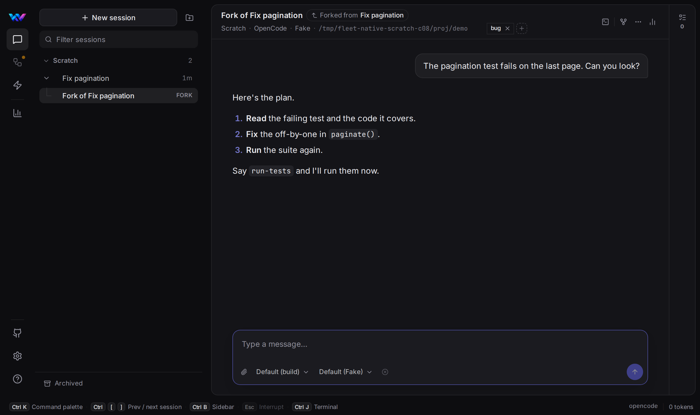
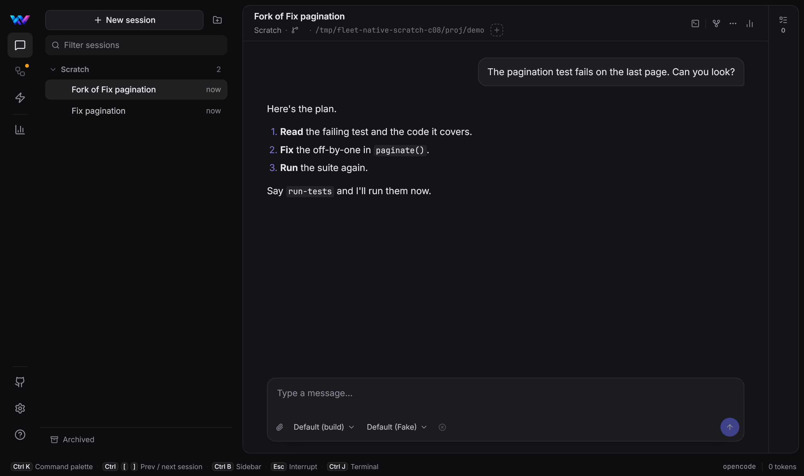
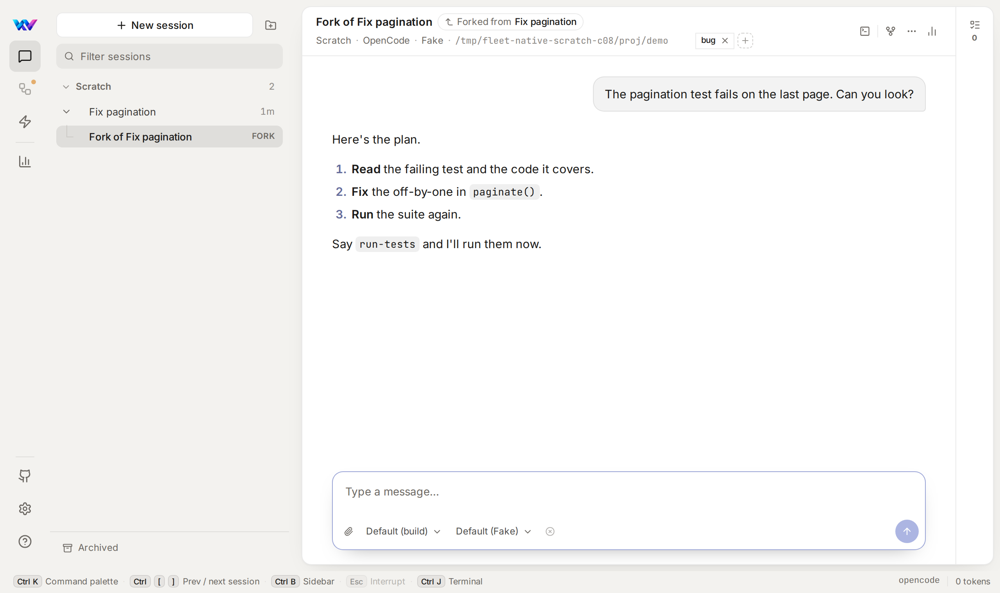
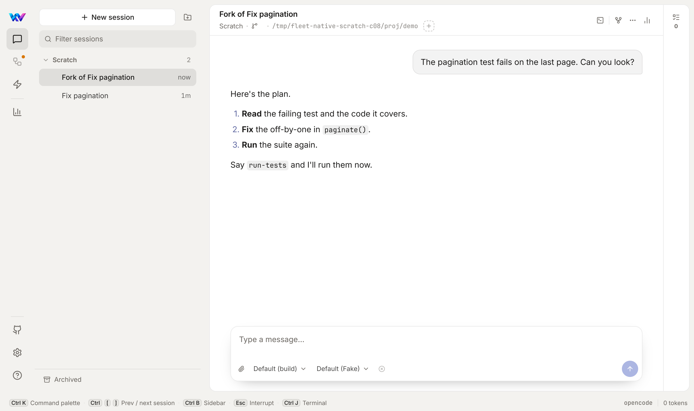
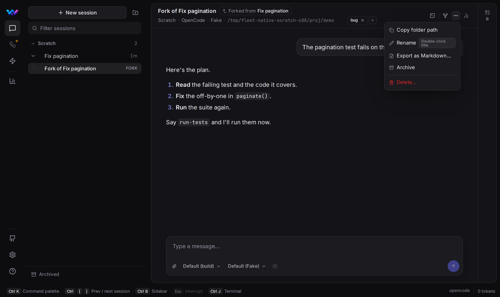

# Component 8: Session header and context

The parity checklist for component 8 of `docs/PORT.md`, and the pieces it is built in.

- **weave-fleet commit read:** `d39cb75ddcc79edb5f7089062915756b2bddc0a3` (`main`, 16 November 2026).
  The server the live checks run against is v0.72.0 (a scratch Fleet; its client is what the "Fleet's
  own client" pictures show). Where `main` is newer than v0.72.0 the row says so.
- **Native app read:** `main` at `99293f3` (`src/view/sheet.rs`, `src/tests_header.rs`, `src/fleet/`, `src/ui/`).
- **Sources** (`client/src/`): `components/session/` `SessionDetailHeader.vue` (1,307 lines),
  `SessionActionToolbar.vue`, `SessionMetadataHeader.vue`, `SessionAnalyticsPopover.vue`,
  `ForkSessionDialog.vue`; `components/session-context/` `SessionContextChips.vue`, `PullRequestPill.vue`,
  `SmartLinkCard.vue`, `SmartLinkRow.vue`, `SmartLinkIcon.vue`, `SessionContextCanvas.vue`; the page that
  hosts them, `routes/sessions.$id.tsx` (it owns the capability logic, the delegated-session banner and the
  fork dialog); `composables/use-session-detail-actions.ts`, `use-session-actions.ts` (`useForkSession`,
  `useAbortSession`, `useRenameSession`, `useDeleteSession`), `use-send-to-agent.ts`,
  `use-smart-link-updates.ts`, `use-session-lineage.ts` (`useSessionTitle`); `stores/smart-links.ts`;
  `lib/smart-links.ts`, `lib/pr-state.ts`, `lib/retry-status.ts`, `lib/session-lineage.ts`,
  `lib/format/`; `lib/session-commands.ts` (the palette commands that act on the open session).
- **Not this component's, though the files sit beside it:** `use-session-context.ts` (the context ring, done
  in component 5); `components/github/*` (`PrStatePill`, `CheckIcon`, `ChecksSummary`, `DiffStat`,
  `ReviewerAvatar`, `GitHubItemIcon`, `GitHubLabel`: component 21 owns the GitHub pages, but the pill and the
  Context tab draw these small parts, so piece F builds them as plain views in `src/view/gh/` and component 21
  reuses them); `TerminalToggleButton` (component 13); `RightPanelSheetButton` (phones only, skipped);
  `WorkflowStepper` under the header (component 18); the recap line (done in 3D).
- **The plugin boundary.** Smart links and the pull request pill come from the GitHub plugin in Fleet: the
  server's GitHub watcher finds the links and pushes `smart_link.updated`; core only offers the places
  (header chip row, Context tab). In native, `src/fleet/smart_links.rs` holds the links as generic "session
  context" data keyed by `providerId`, and the views read `resourceType == "pull_request"` and `providerId`
  only where Fleet's does. Nothing in `src/view/header*` imports GitHub code; the chip row asks
  `smart_links` for what it has. Component 21 adds the pages; it must not need a change here.

**Row numbers:** 1.x the header's title row, 2.x the meta row, 3.x tags and the folder path, 4.x banners
and chips under the title, 5.x the action toolbar and its ⋯ menu, 6.x the page's action logic and the
palette commands, 7.x the fork dialog, 8.x the analytics popover, 9.x the progress strip, 10.x the header's
context chips, 11.x the pull request pill and its popover, 12.x the Context tab, 13.x the smart-link data
and events. Numbers have gaps on purpose.

The gap, visible in the pictures (one scratch Fleet v0.72.0, a session and its fork, 1280×760, scale 2;
native ran headless with `--server`): Fleet's header has two lines, the title with a "Forked from <title>"
pill and, under it, `Scratch · OpenCode · Fake · /path`, a `bug` tag with its × and a dashed +; native
shows the title alone, then `Scratch ·` and a branch icon with **no name** (the session has no branch;
native draws the icon anyway), no harness or model (it shows them only for invented data), and a tag
button that does nothing. Fleet's ⋯ menu lists Copy folder path, Rename (hint "Double-click title"),
Export as Markdown…, Archive and, below a rule, Delete…; native's is three stubs. The fork button and
the analytics button open nothing in native. Not shown, because the scratch Fleet has no GitHub: the
pull request pill and chips, "Started from" chips, the Context tab. Those need a GitHub-shaped link;
piece F's tests and mock data stand in for them, and the pictures for G, H, I and J are taken from a
scratch Fleet whose links are inserted over `POST /api/sessions/{id}/smart-links` with an invented
`github.com/example/demo/pull/N` URL (the server marks it `not_found` or `not_connected`; the enriched
look comes from mock data in scenes, beside Fleet's own client shown with a recorded link). Say in each
pull request which of the two a picture is.

## What the native app has today

- `src/view/sheet.rs` `header()`: the two-line frame (min 56, border under), title (14/600), the meta row
  with project name, branch icon and name, path (mono 11.5, truncates), a dead add-tag button, and the
  actions: terminal, Abort (only while working: `interrupt`), a rule, Fork, ⋯ (opens the kit's `more`
  menu), analytics. Fork, analytics, terminal and add-tag do nothing.
- `src/ui/menus.rs` `more()`: three entries, two stubs (component 1's note, `01-kit.md`).
- Already in Rust, to reuse (do not port again): `fleet::groups::lineage_of` / `lineage_origin_of` /
  `LineageKind` (6A); `conv::working::describe_retry` / `retry_attempt_label` and `conv::retry::format_countdown`
  (3I); `composer::format::{format_count, format_money}` (5C); `fleet::row_status::{format_date, format_relative}`;
  `fleet::row_chips::{PrBadge, PrState, Checks}` (6D, filled only from mock data; piece F fills it from the
  server); the row's `lifecycle`, `activity`, `retrying`, `checkout_removed_at`, `checkout_restoring`,
  `archived`, `harness_type`, `selected_model`, `last_model_id` (`fleet::rows::Row`); the harness list and the
  model names (5D); row rename, archive-with-Undo, delete confirm (6H, 6I: `fleet::actions`); the export
  dialog (3S); machines (`State::machine_name` and the machine of the open session, 17); the status glyph
  (`view::status`); `progress_ring` and `Row.progress` (6D); the kit's popover, menu, dialog, confirm, select,
  toast (component 1).
- Not there: tags (`Row` has none), `directory` and `branch` from the server (the live row has no branch
  shown), `totalTokens` / `totalCost` on the row (`Session.tokens` is invented), `origin`,
  `capabilities.canAbort/canFork/canArchive/canDelete/forkDisabledReason`, `workspaceId` use for the
  checkout restore, any smart link, the fork request, `PATCH tags`.

## Part 1: the title row (`SessionDetailHeader.vue`)

| # | Element / behaviour | Source | Native today |
|---|---|---|---|
| 1.1 | Frame: `display:flex`, min-height 56, `border-bottom 1px --border`, padding `8px` top and bottom, `max(1rem, inset)` sides = 14 px, 20 px (`1.25rem`) once the header is 48 rem (672 px) wide or more (container query). Title row and meta row stacked with gap 3. `.session-detail-header__main` has margin -4/-8 and padding 4/8 so the rename ring isn't clipped | SDH css 836-872, 1293 | Done (piece B): sides 14 px, 17.5 px from 672 px of column (`centre_w`); the 3/−4,−8 main margin isn't needed (no clipped ring yet: C) |
| 1.2 | The glyph: shown before the title only while no session list is on screen (`!sessionListShown`): `StatusGlyph` with `glyphStatus`, activity, and the label | SDH 423-429 | Done (piece B): `session-header-glyph` while the list is hidden; test "shows the row's glyph before the title…" |
| 1.3 | `sessionStatusIndicator`: `disconnected` when lifecycle is disconnected; `not-answering` when the machine isn't answering and activity is busy, delegating or retry; `retry`; `waiting` for `waiting_input`; `working` for busy or delegating; else `idle` | SDH 211-230 | Done (pieces A and B): `header::indicator` drives the glyph and the "Not answering" word |
| 1.4 | `sessionStatusLabel`: Working, Disconnected, Not answering, `Retrying (attempt 3 of 10)…` or `Retrying…`, Needs input, Idle. Drawn nowhere in Fleet except the glyph's label and a screen-reader span (`role=status`, `data-status`) | SDH 231-246 | Done (pieces A and B): `header::status_label`; Fleet draws it only as the glyph label and a screen-reader span (component 26 for the span) |
| 1.5 | `glyphStatus`: working or retry → `active`; waiting → `waiting_input`; lifecycle disconnected, completed, stopped, error stay; else `idle` | SDH 250-266 | Done (pieces A and B): `header::glyph_status` |
| 1.6 | Title `h2`: 14/600, tracking -0.005em, line-height 1.3, truncates with an ellipsis, `dir=auto`; empty or blank reads "Untitled session" | SDH 125, 882-892 | Done (piece B): "Untitled session" comes from the model; `dir=auto` stays impossible in Rune |
| 1.7 | The title is editable unless archived or rename is disabled: tooltip "Double-click to rename", focusable, hover fill `--text` 5%, focus ring 2 px `--accent`, margin-inline -6 / padding-inline 6, radius 6, cursor text | SDH 444-456, 791-806 | Done (piece C): `session-title` is focusable (F2), hover fill 5 %, focus ring 2 px, tooltip "Double-click to rename"; none while archived (the ⋯ menu's Rename is D) |
| 1.8 | Rename by double-click, F2 on the focused title, or ⋯ → Rename. The input takes the title's place: `flex 1 1 auto`, max-width 480, border 1 px `--accent`, radius 6, background `--card-bg`, ring `0 0 0 3px --accent-dim`, 14/600, placeholder "Session name", aria-label "Session name"; all of the title is selected; Enter saves, Esc discards, blur saves; saves only a non-empty trimmed title that differs; handled once (Enter then blur does not save twice) | SDH 159-200, 430-443, 808-826 | Done (piece C): `session-title-input` takes the title's place (max 480, accent border, 3 px ring, all selected); Enter saves, Esc discards, blur saves (polled, once); a blank or unchanged title is not sent. The pill is hidden while editing. Tests "asks to edit the title on double-click", "saves a changed title on Enter", "keeps the old title on Escape" |
| 1.9 | The rename request: `PATCH /api/sessions/{id}` with the title, optimistic, roll back on failure; its error is a red line under the toolbar (5.20) | `useSessionDetailActions.handleRename`, `useRenameSession` | Done (pieces C and D): the rename is optimistic and rolled back on a refusal (C); a refusal is now the red line under the toolbar (D, `toolbar.rs` `rename_error`). Test "a_refused_header_rename_is_a_red_line_and_the_old_title_comes_back" |
| 1.10 | "Started by" pill after the title, hidden while editing: for a fork or an agent-started session that wasn't moved out: border 1 px `--border`, radius 999, padding 2/8, 12 px muted, max-width 50%, up-left arrow icon 12, label (`Forked from`, `Started by`, `Subagent of`) then the parent's title in bold `--text` 500 that truncates; hover fill 5%; title and aria-label "This session was forked from <title>"; the parent's title comes from the list, else is fetched once (`useSessionTitle`), else "another session". A subagent's session gets the banner in 4.6 instead, never this pill | SDH 128-153, 457-471, 894-937; route `startedBy` 223-236 | Done (piece B): `session-lineage-link`, half of the room at most; the parent's title from the list, else read once (`parent_titles`), else "another session" |
| 1.11 | Click opens the parent in place (plain left click); with Ctrl, Cmd or Shift it is a link for a new window. The parent is looked up in the list for its machine's `instanceId`. A phone shows only the icon (skipped) | SDH 144-153 | Done (piece B): a click opens the parent in place when the list holds it; one on another machine isn't opened (open: needs 17's elsewhere store); no new-window click |
| 1.12 | The retry note: while the indicator is `retry`, a line after the title in `--status-waiting-text`, 12/500, truncating, ticking every second: `Retrying · attempt 3 of 10 · in 12 s · API overloaded (529)`, leaving out what the harness didn't say; the tooltip is the same text | SDH 267-288, 472-479, 1197-1207; `lib/retry-status.ts` | Done (piece B): `session-retry-note`, amber 12/500, truncates. Ticking every second was not checked (open) |
| 1.13 | The Archived badge (secondary `Badge`) while `retentionStatus == "archived"` | SDH 488-494 | Done (piece B): `session-archived-badge` |
| 1.14 | The removed-checkout chip, shown when `checkoutRemovedAt` is set, a restore is under way, or the "restored" note is up: pill, border `--status-waiting` 45%, fill 10%, 11 px, text `--status-waiting-text`. Variants: "Putting the checkout back…" with an xs spinner (restoring here or `checkoutRestoring` from elsewhere); "Checkout removed" with an underlined **Restore now** button; "Checkout restored. Dependencies and .env aren't back." (quiet: transparent, muted) for 6 s after a restore; the tooltip is the long sentence "Fleet removed this session's checkout on <date> to save space. The branch <b> and this conversation are kept; your next message puts it back." or the restore error; an inline red `role=alert` error after the button | SDH 72-104, 495-523, 1002-1032 | Drawn (piece B): the chip in its three forms, tooltip the long sentence. **Restore now** is wired and the inline error is drawn (piece C) |
| 1.15 | Restore now: `POST /api/storage/worktrees/{workspaceId}/restore` on the session's machine; no `workspaceId` does nothing; failure keeps the server's sentence (`extractApiError`, fallback "Couldn't put the checkout back."); success patches the row (`checkoutRemovedAt: null`, `checkoutRestoring: false`) and shows the note | SDH 84-104 | Done (piece C): `State::restore_checkout` posts on the session's own machine; no `workspaceId` does nothing; the server's sentence (`detail`, `error`, `title`, `message`, else "Couldn't put the checkout back.") shows in the chip and its tooltip; success clears the row's removal and shows the note 6 s. Both tests ported by name |
| 1.16 | Actions area: `margin-left 0.75rem`, gap 2, never shrinks: the slot (terminal toggle, then the toolbar in 5.x), then analytics (8.x) | SDH 689-696 | Done (piece B): `ml 10.5`, never shrinks; the buttons' behaviour is D and E |

## Part 2: the meta row

One line, 12 px muted, `white-space: nowrap`, items separated by a `·` at 60 % opacity; the row is cut at its
end, and the path gives way first (`min-width 24`).

| # | Element | Source | Native today |
|---|---|---|---|
| 2.1 | Machine chip, only when the user has more than one machine (`machines.hasMachines`): mono 10.5/600, padding 1/6, radius 5, `--coral` 14 % fill and `--coral-text`; "quiet" (muted 14 %, muted text) and " · not answering" when the machine stopped answering. Tooltip "Runs on <name>" / "<name> isn't answering". The name is the machine the open session runs on (the live one, or the other machine it was opened from) | SDH 114-119, 527-533, 946-960 | Done (piece B): `session-machine`; the chip shows from the model's machine, which scenes can make without a link |
| 2.2 | Project name (`--project`, 14 rem max, ellipsis); "Ungrouped" is the label for a blank name but the span shows only when `projectName` is set | SDH 208, 534-539 | Done (piece B) |
| 2.3 | Harness label: the harness's display name from `GET /api/harnesses`, else the raw type; hidden with no harness; separator only when both project and harness exist | SDH 290-295, 540-550 | Done (piece B): the model's harness label; live check shows `OpenCode` as Fleet does |
| 2.4 | Profile: when the session started with a profile, a separator then a `Layers` icon (11) and the name in `--accent-text`, 12 rem max; tooltip "Started with the <name> profile, which it keeps" | SDH 551-564, 972-982 | Done (piece B): `session-profile-label`, drawn from `harness_profile_name` (needs the detail read; a scene hasn't one: tested by the model's tests) |
| 2.5 | Model: `selectedModel.modelID`, else `lastAssistantModelId`, through `modelDisplayName` with the session's model list; hidden when unknown; tooltip "The model the next prompt will get"; 14 rem max | SDH 296-301, 565-577 | Done (piece B): `session-model-label`, from the open conversation's last model, else the row (the scratch Fleet's list row has none; Fleet's client shows "Fake" the same way) |
| 2.6 | Branch: separator, a `GitBranch` icon 12 (muted) and the name in mono 11.5 `--text`, ellipsis at `18ch + 16px`, tooltip "Branch <name>"; hidden when none | SDH 578-594, 989-1043 | Done (piece B): icon and name only when a branch is known; 18ch + 16 px cap |
| 2.7 | Directory (the worktree for a worktree session): a separator when something precedes it; the path in mono 11.5 at 80 % opacity, brightening on hover; cut at the **last separator**: the head (`/a/b`) gives way first with an ellipsis, the leaf (`/demo`) only after the head is gone | SDH 388-393, 595-608, 1045-1080 | Done (piece B): head from the start with an ellipsis, leaf drawn apart and kept. Copy button: piece C |
| 2.8 | Copy path button (3.x) | | Done: see 3.x (`session-copy-directory`, piece C) |
| 2.9 | A phone shows only harness and model (skipped) | SDH 1225-1291 | Skipped |

## Part 3: tags and the folder path

| # | Element | Source | Native today |
|---|---|---|---|
| 3.1 | Tags row after the meta items (`margin-left 4`, gap 4, no shrink): an outline `Badge` per tag with the tag text and an × (12 px icon, muted → text on hover, aria-label "Remove tag <tag>") | SDH 639-655, 1131-1158 | Done (piece C): `session-tag-<tag>` with `session-tag-remove-<tag>` (10.5/600, outline, radius 6) |
| 3.2 | Remove a tag: `PATCH /api/sessions/{id}/tags` with `{ tags: [rest] }`; on success the store is patched; on failure only a console error (no UI) | SDH 313-362 | Done (piece C): `PATCH …/tags` with the whole list; the row takes it only once the server has, a failure changes nothing (Fleet logs to the console) |
| 3.3 | The add button: a 20×20 dashed-border (45 % muted) square, radius `--radius-btn - 2`, a `+` (12), 70 % opacity → full with `--text` border on hover; tooltip and aria-label "Add tag"; replaced by the input while adding | SDH 668-677, 1160-1180 | Done (piece C): `add-tag` opens the field |
| 3.4 | The tag input: min-width 120, 1 px `--border` (`--ring` on focus), radius `--radius-btn - 2`, fill `--card-bg`, padding 1/8, 12 px, placeholder "Tag name…", focused at once. Enter adds, Esc cancels, blur adds. A blank or duplicate tag just closes it; a new one is appended and sent | SDH 320-386, 657-666, 1182-1195 | Done (piece C): `tag-input`; Enter and blur add (blur polled), Esc cancels, blank or repeated only closes |
| 3.5 | Copy folder path button after the path: 20×20, radius `--radius-btn - 2`, a `Copy` icon (13), hidden until the directory is hovered or focused (always 75 % on touch); aria-label "Copy folder path"; tooltip the path | SDH 609-627, 1082-1129 | Done (piece C): `session-copy-directory`, shown while the path is hovered. Open: it doesn't show for keyboard focus alone (Rune has no focus-visible opacity), and the screen-reader "Folder path copied" line (no live region in Rune) |
| 3.6 | After a copy: the icon turns into a check in `--running-text`, the word "Copied" (11/500) shows, a polite `sr-only` "Folder path copied"; all go after 1.5 s. A refused clipboard does nothing, no message | SDH 395-415, 628-637 | Done (piece C): `tx.copy`, the check in `--running-text` and "Copied" for 1.5 s. Rune's `Tx::copy` gives no answer, so a refusal can't be seen: `directory_copied(false)` is what it would do and the test calls it |

## Part 4: banners and what sits under the header

| # | Element | Source | Native today |
|---|---|---|---|
| 4.1 | Banner column under the header: gap 12, padding `12 16 0`; empty means nothing is drawn | SDH 699, 1209-1218 | Done (piece B): `session-banners`, gap 12, padding 12/16/0; none when empty |
| 4.2 | Stopped banner for lifecycle `stopped`, `completed` or `disconnected`: 1 px `--border`, `--secondary` fill, padding 12/16, 14 px muted text. Disconnected: "Connection to this session was lost. Weave will reconnect automatically when the backend becomes reachable again, or send a message to reconnect now."; otherwise "This session isn't running. Send a message to pick it up again." | SDH 302-311, 700-710 | Done (piece B): `session-stopped-banner`, both sentences |
| 4.3 | Archived banner: a `--status-waiting` 10 % fill with a 30 % bottom border, padding 8/16, 13 px text "This session is archived and read-only."; with a **Restore** pill button (28 tall, radius 999, 12/500, border `--border`, fill `--panel-bg`; the `ArchiveRestore` icon 13, or a large spinner while restoring; disabled at 60 %) when the session can be restored | SDH 712-738, 744-789 | Drawn (piece B): `session-archived-banner` and `session-restore-button` (piece C's test checks it is offered only when archived); Restore is wired in D. Piece L: a 16 px spinner replaces the icon and the pill is at 60 % while the restore is on its way |
| 4.4 | Restore: `archiveQueue.restore(id)` (un-archive, `PATCH /api/sessions/{id}/retention`); clears an optimistic retention state; a failure is shown by the archive queue's toast | `useSessionDetailActions.handleRestore`, 6I | Done (piece D): the menu's Restore (and `State::toolbar_restore`) sends `PATCH /api/sessions/{id}/retention` `{retentionStatus:"active"}` on the session's machine, clears `archived` on success and lists again; a refusal is a toast with the server's words. The archived banner's Restore button calls the same. Tests `restore_sends_the_retention_and_the_session_is_active_again`, `a_refused_restore_is_a_toast_and_the_session_stays_archived` |
| 4.5 | Archived makes: rename off, the composer disabled (done, 5), Fork hidden, the ⋯ menu offers Restore instead of Archive, and Rename is removed | route 289-303, 5.x | Done (piece D): archived makes Fork absent, the menu offers Restore not Archive and no Rename (`offers_restore_for_an_archived_session`) |
| 4.6 | Delegated subagent banner (a session with a `parentSessionId`): a bar under the header, `--muted` 32 % fill, bottom border, padding 12/14; a 32 px round bot icon in `--primary` 16 %; the caption "DELEGATED SUBAGENT SESSION" (11.5 px, 700, 0.08em, uppercase, muted); then a link "From <parent title>" (bold, tooltip the title) or, when the parent is unknown, the words "Opened from a parent session"; a **Back to parent** button (32 tall, border, `--background`, 14/500) on the right. Both go to the parent, with its `instanceId` if the list has it. A read-only subagent (harness can't prompt) also gets the "SubagentPromptLine" instead of the composer (3M has the line) | route 546-640, 207-262 | Done (piece B): `session-delegated-banner` with the link, the unknown-parent words and Back to parent (both open the parent when listed). A parent on another machine isn't opened |
| 4.7 | `WorkflowStepper` under the banners | route 545 | Component 18 |

## Part 5: the action toolbar and the ⋯ menu (`SessionActionToolbar.vue`)

Toolbar buttons are `toolbar-icon` buttons, `size-7` (28 px) with a 14 px icon, gap 2; the list wraps.

| # | Element | Source | Native today |
|---|---|---|---|
| 5.1 | Terminal toggle (`TerminalToggleButton`) first, desktop only | route 513 | Open: the terminal toggle stays a dead button until component 13 |
| 5.2 | Abort: shown only when `canAbort`; danger variant, `OctagonX`, tooltip "Abort", a large spinner while aborting; disabled while any action is pending or with no session or instance. `POST /api/sessions/{id}/abort`; failure shows under the toolbar | SAT 76-93; `useAbortSession` | Done (piece D): shown from `capabilities.canAbort` (fallback running and active), danger look, a 20 px spinner while it runs, off while any action is pending; `POST /api/sessions/{id}/abort`, a refusal is the line under the toolbar. Tests `abort_*`, `a_refused_abort_is_a_red_line_under_the_toolbar`. **Gap:** "no instance" disabling is not modelled (the native row has no instance id) |
| 5.3 | A 1×16 divider (`--border`, margin-inline 2) | SAT 95-98 | Done |
| 5.4 | Fork: a wrapper holds the tooltip (a disabled button shows none): "Fork: a new session with a copy of this conversation", or the harness's `forkDisabledReason` ("This session can't be forked." when none given); the button `GitFork`, aria-label "Fork" or "Fork: <reason>", disabled while pending, with no session, or when it can't fork. Hidden when it can't fork and no reason is given (archived sessions) | SAT 100-118; route 298-303 | Done (piece D): `show_fork`, tooltip `fork_tip()`, label `fork_label()`, off while pending or when it can't fork; hidden for archived. Tests `says_what_fork_does_when_it_is_on`, `shows_fork_off_with_its_reason_when_the_harness_cant_fork`. Rune has no hover text on a disabled element's wrapper, so the tip sits on the button |
| 5.5 | The ⋯ button: `Ellipsis`, tooltip and aria-label "More actions", a large spinner while renaming, archiving or deleting, disabled with no session | SAT 120-141 | Done (piece D): opens the menu; a spinner while renaming, archiving or deleting |
| 5.6 | The menu: right-aligned, 14 rem (`w-56`), non-modal. Items 14 px `size-3.5` icons | SAT 142-232 | Done (piece D): `ui::menus::more` builds the items from `HeaderModel` (14 rem; the kit menu is modal where Fleet's is not) |
| 5.7 | Copy folder path (first, only when there is a directory; tooltip the path): copies, no toast | SAT 80-86, 177-185 | Done (piece D): first row when there is a directory, copies it, no toast, no "Copied". Tests `copies_the_folder_path_from_the_first_row_of_the_more_menu`, `has_no_copy_row_without_a_folder`. The tooltip with the path is not drawn (menu rows have no tooltips in the kit) |
| 5.8 | Rename (not archived; disabled while pending): starts 1.8; the right-aligned hint "Double-click title" (hidden on touch) | SAT 186-200 | Done (piece D): not archived, off while pending, starts 1.8, hint "Double-click title". Test `rename_in_the_menu_starts_the_title_edit` |
| 5.9 | Export as Markdown… (always): opens 3S's dialog for this session | SAT 201-208 | Done (piece D): opens the export dialog (`asks_to_export_from_the_more_menu`) |
| 5.10 | Archive (when `canArchive`, i.e. not archived and capabilities allow; disabled while pending): queues the archive with Undo (6I) and the session leaves | SAT 209-217; `handleArchive` | Done (pieces D and L): Archive goes through the same Undo queue as the list (`State::archive_sessions`, 6I): the session leaves the list at once, nothing is sent for six seconds, Undo sends nothing, a refusal says "Couldn't archive \"<title>\"." Tests `archive_waits_for_undo_then_sends_the_retention_and_the_session_is_archived`, `undo_after_the_header_archive_sends_nothing`, `a_refused_archive_says_so_and_the_session_stays` |
| 5.11 | Restore (archived; disabled while pending) | SAT 218-226 | Done (piece D): see 4.4 |
| 5.12 | A rule, then Delete… (destructive style, when `canDelete`; disabled while pending or with no instance): the confirm "Delete this session?" with the title as the subject, body "It and its session data are deleted for good.", button "Delete session" / busy "Deleting…", failure text "Couldn't delete the session." and a retry; on success go to the sessions view (the list, no session open) | SAT 227-241; `handleDelete` | Done (piece D): rule, Delete… (destructive) when `canDelete`, the confirm with Fleet's words, busy and retry, failure text also under the toolbar; the session leaves the list. Tests `asks_first_naming_the_session_with_the_delete_run_inside_the_confirm_then_goes_home`, `stays_on_the_session_when_the_confirm_is_cancelled`, `a_refused_delete_keeps_the_dialog_open_and_the_words_under_the_toolbar`, `delete_is_not_offered_when_the_session_cannot_be_deleted`. "Go home": the native app opens the first session, as 6H decided (`deleting_the_open_session_opens_another`); Fleet's "/" landing is not built |
| 5.13 | Phone-only rows (usage, Show terminal, Fork) | SAT 148-176 | Skipped (phone) |
| 5.14 | Action errors: one `role=alert` line each, 10 px `--error-text`, full width under the buttons, from abort, delete and rename failures | SAT 243-250; `actionErrors` | Done (piece D): `toolbar-error-<n>`, 10 px `--error-text`, under the buttons, for abort, delete and rename. Fleet's line is `width:100%` inside a shrink-wrapped wrapper; native holds it to the buttons' width and wraps |
| 5.15 | "Pending" = abort, restore, delete or rename in flight; it disables the other actions | `isAnyActionPending` | Done (piece D): `State::toolbar_pending` (abort, restore, delete, rename) turns the other actions off |

## Part 6: the page's logic and the palette commands

| # | Element | Source | Native today |
|---|---|---|---|
| 6.1 | The effective lifecycle and activity: optimistic state, then an override, then the row, then the detail; a sent prompt not yet echoed counts as `busy`; a `retry` row keeps `retry` for the header only | route 264-343 | Done (pieces A and B): `effective_lifecycle`, `effective_activity`, `header_activity`, read by the header |
| 6.2 | Capabilities from the row (`canAbort`, `canArchive`, `canFork`, `forkDisabledReason`, `canDelete`, `canPrompt`) with fallbacks when the row has none: abort when running and active; archive when not archived; fork and delete on | route 289-303 | Done (piece A): `Row.capabilities` and `Actions::resolve` with the route's fallbacks (`capabilities_*` tests); the buttons use it in piece D |
| 6.3 | Session detail fallback (`GET /api/sessions/{id}`) for a session not in the list (another machine's, or one opened by link): title, harness, profile, directory, branch, tokens, cost, tags, retention | route 150-205 | Done (piece A): `GET /api/sessions/{id}` on the session's own machine (`State::load_header_detail`, `link_for`), kept in `State.header_details`; a machine that doesn't answer shows `NotAnswering` and the chip's "not answering" |
| 6.4 | Palette `copy-session-id` (this session's id to the clipboard, errors ignored) and `export-raw-messages` (a JSON file named `<title with [^a-z0-9-_] → "-", trimmed>-conversation.json`, content `{ sessionId, title, exportedAt, messages }`, 2-space indent) | `ActivityStream.vue` 503-539 | Done (piece D): `copy_session_id`, and `export_raw_messages` through the save dialog (`session_commands.rs`), named like Fleet's download (letters keep their case), content `{ sessionId, title, exportedAt, messages }` with 2-space indent. Messages are written from the loaded conversation with the keys Fleet's `AccumulatedMessage` has, each message's keys in alphabetical order. Tests `copy_session_id_puts_this_sessions_id_on_the_clipboard`, `export_raw_messages_saves_the_messages_as_json_named_after_the_session` |
| 6.5 | `export-conversation` (3S done), `focus-prompt` (5), `scroll-top`, `scroll-bottom` (3J) | `lib/session-commands.ts` | Done elsewhere |
| 6.6 | Fork's handler opens the dialog only when forking is allowed; the dialog is not mounted otherwise | route 709-718, `handleFork` | Done (piece D): `toolbar_fork` only when `can_fork` (`fork_opens_the_fork_dialog_when_allowed`, `fork_is_not_offered_when_the_harness_cannot_fork`); it sets `bar.fork_for` and says the dialog is piece E's |

## Part 7: the fork dialog (`ForkSessionDialog.vue`)

| # | Element | Source | Native today |
|---|---|---|---|
| 7.1 | Dialog `sm:max-w-lg` (512): title "Fork session"; description "A new session with a copy of this conversation, up to the last reply that finished. From there the two conversations go their own ways. Both work in the same folder, so each sees the files the other changes." | FSD 93-99 | Done (piece E): `view::fork`, on `ui::dialog` (448 wide, the same as Fleet's `sm:max-w-lg` at 14 px), with the title, the description wrapped, the close button; opens from the Fork button and the palette (`toolbar_fork`). Test `the_dialog_names_the_source_and_prefills_the_title_the_server_would_give` |
| 7.2 | "Source session" (14/500) over the source title (14 muted; "Untitled session" when blank) | FSD 107-117 | Done (piece E): "Source session" over the title (`source_title`: "Untitled session" when blank) |
| 7.3 | "New session title" label and an input prefilled `Fork of <source title>` (what the server calls a fork given none), placeholder "Enter a title", disabled while forking; the form resets every time the dialog opens or the title changes; a blank title is sent as `null` | FSD 36-39, 119-136 | Done (piece E): "New session title", the field prefilled `Fork of <title>` and selected, placeholder "Enter a title", off while forking; the form starts over on every open (`ForkDialog::open`); a blank title is sent as `null` (`a_blank_title_is_sent_as_null_and_a_typed_one_trimmed`). **Gap:** Fleet also restarts the form when the source's title changes while the dialog is open; native keeps what was typed |
| 7.4 | Submit button "Fork session" / "Forking…" (disabled while forking); Enter submits. `POST /api/sessions/{id}/fork` with `{ title }`; the dialog closes on success and the new session opens (`/sessions/{new id}?instanceId=…`) | FSD 41-58; `useForkSession` | Done (piece E): "Fork session" / "Forking…" (off), Enter submits, `POST /api/sessions/{id}/fork` `{ title }`, closes on success and opens the new session (`enter_submits_and_the_title_goes_out_trimmed`, `forking_disables_the_dialog_and_a_second_press_sends_nothing`) |
| 7.5 | Fork's side effects: the new session is built from the source's row (`buildForkedSessionListItem`) with `forkedFromSessionId` and `spawnKind: "fork"`, added to the live list or, for another machine's session, to that machine's elsewhere list (`upsertElsewhere`); made active; announced as a session upsert | `useForkSession` 587-598 | Done (piece E): `fleet::fork::forked_row` is `buildForkedSessionListItem` (the source's folder, branch, tokens, cost and project; `forkedFromSessionId`, `spawnKind: "fork"`), read by the list's own parser, added with `store::upsert` (or `upsert_elsewhere` for another machine's session), made the open session, then the list is read again. Test `a_fork_closes_the_dialog_opens_the_new_session_and_lists_it_under_its_parent`. **Gap:** the "session upsert" announcement (`dispatchSessionUpsert`) has no native listener, so none is sent. With no server the fork is made from the invented row (`the_fork_without_a_server_is_made_from_the_invented_row`) |
| 7.6 | Failure: an `ErrorNote` in the dialog with the server's message (fallback "Failed to fork session"); the dialog stays open; cleared on the next open | FSD 138-141 | Done (piece E): `ErrorNote` with the server's message (`error`, `detail`, `title`), "Failed to fork session" when the answer names no session; the dialog stays open and the next open clears it (`a_refused_fork_keeps_the_dialog_open_with_the_servers_words_and_the_next_open_clears_them`, `a_fork_that_names_no_session_is_a_failure`) |
| 7.7 | Fork on another machine uses that machine's connection | `useForkSession(machineOf)` | Partly (piece E): the request goes through `link_for(id)` and the result is kept per machine (`machine_key_of`), so another machine's session forks there; checked only by reading and the home path, as component 17 has no second machine here |

## Part 8: the analytics popover (`SessionAnalyticsPopover.vue`)

| # | Element | Source | Native today |
|---|---|---|---|
| 8.1 | Trigger: a `toolbar-icon` button with `ChartNoAxesColumn` (14), tooltip "Session analytics", aria-label "Show session analytics"; when either number is known the button is "active" (fill `--bg`, border, text colour). Hidden on a phone | SAP 56-70, 112 | Done (piece E): opens the card; the button is filled with a border once either number is known; tooltip "Session analytics", label "Show session analytics". Phone hiding is not applicable |
| 8.2 | The popover: 240 wide, no padding, bottom, end-aligned; a header (padding `.65rem .75rem .55rem`, border under) with the eyebrow "SESSION ANALYTICS" (9 px / 700 / 0.07em, muted) and "Usage summary" (0.86 rem / 650) | SAP 72-85 | Done (piece E): eyebrow "SESSION ANALYTICS" and "Usage summary" with the border under. **Measured on Fleet's own popover, not the source:** the box is 252 wide with 14 px padding and no radius (the scoped `padding: 0` loses to the popover's own padding); the native card matches that |
| 8.3 | Two cells on a 1 px `--border` gap grid, each padding `.65rem .75rem`: label (9 px / 650 / 0.045em uppercase muted), value (1 rem / 700), helper (9 px muted). "Total tokens" = `formatCount` or "—", "Across this session"; "Total cost" = `formatMoney` ("<$0.01" under half a cent) or "—", "Estimated spend" | SAP 12-37, 87-102 | Done (piece E): two cells on a 1 px gap, "Total tokens" / "Across this session" and "Total cost" / "Estimated spend", "—" for none, "<$0.01" under half a cent (`the_popover_shows_the_two_numbers`, `the_popover_says_a_dash_for_a_number_the_server_does_not_have`, `money_rounds_to_cents_and_a_trace_says_less_than_a_cent`) |
| 8.4 | Wording differs from the status bar's "0 tokens" (that is component 9) | | Done: the popover says "—" where the status bar says "0 tokens"; nothing shared |

## Part 9: the progress strip (`SessionMetadataHeader.vue`)

Used at the foot of the right panel (`SessionsV2RightPanel.vue` 273); owner for the panel itself is component 10.

| # | Element | Source | Native today |
|---|---|---|---|
| 9.1 | A 36 px button along the panel's foot: border-top 1 px, 12 px muted → text on hover (4 % fill), focus ring 2 px inset; shown when `progress.total > 0` and the Progress tab isn't the open tab | SMH 14-20, 77-98 | Done (piece K): `view/progress_strip.rs`, 36 px, 1 px rule above, 12 px muted to text on hover with a 4 % wash, 2 px inset focus ring; shown when the open session's row has `progress.total > 0` and the tab isn't `PROGRESS_TAB`. Test `is_hidden_with_no_items_and_on_the_progress_tab` |
| 9.2 | A 1 px accent bar along the top edge, `done/total` wide (300 ms ease-out; none with reduced motion); a 14 px `ProgressRing` (2 px stroke), the heading (the plan step's group title, plan title or path with markdown stripped, else "Todos") with a trailing `·`, the current line ("Next: 2. Title", "Every step is ticked", the current todo, "Every todo is done"), and `done/total` tabular | SMH 21-60, 99-171 | Partly (piece K): bar (none at zero done), 14 px ring, "Todos ·", the current todo or "Every todo is done", `done/total`. **Gaps:** the bar's 300 ms width ease is not drawn (RUNE.md); the plan form (group title, "Next: 2. Title", "Every step is ticked") waits for component 10; the heading ellipsis is not capped at 45 % |
| 9.3 | Tooltip and aria-label "N of M steps|todos done. <current>. Open the Progress tab"; a click opens the Progress tab | SMH 39-47 | Partly (piece K): tooltip and label "N of M todos done. <current>. Open the Progress tab"; a click sets `PROGRESS_TAB`, which is the Plan tab until component 10 builds Progress (so the strip shows on Context and hides on Plan). Test `a_click_opens_the_progress_tab_and_the_strip_goes_away` |
| 9.4 | The plan itself (`plan` with groups and steps, `currentPlanStep`) comes from `lib/session-progress.ts` and `useSessionProgress` | | Open (component 10): the strip shows the todo form until then. Fleet's v0.72.0 client shows the todo form for a todowrite session, as drawn here |

## Part 10: the header's context chips (`SessionContextChips.vue`)

Right of the title block, `margin-left .75rem`, never shrinks; renders nothing with no automation origin, pending
origin or header link (`role=list`, aria-label "Session context", gap 6).

| # | Element | Source | Native today |
|---|---|---|---|
| 10.1 | Loads the session's links (`ensureLoaded`) when the session changes | SCC 31-38 | Done (piece G): `ensure_links_loaded` is called when the session's header detail loads (`load_header_detail`) |
| 10.2 | Chips: the session's pull request becomes the pill (11.x); the origin link (relationship `origin`, not the pill's) is a "from #N" button; the others (own, pinned) are chips, at most 2 (`MAX_CHIPS`), then "+N" | SCC 40-55 | Done (piece G): `fleet::context_chips::ContextChips::of` and `view::header_context`; pill, "from #N", at most 2 chips, then "+N" |
| 10.3 | Automation origin chip (`origin.sourceType == "automation"`): `Zap` (13) and the automation's title or "Automation", max-width 220, tooltip "Started by automation: <title>", aria-label "Started by automation <title>. Show in Context" | SCC 56-61, 100-113 | Done (piece G): the chip reads `Row.origin` (the list row already carries it); tested by `names_the_automation_a_session_was_started_by` |
| 10.4 | Pending origin (a GitHub origin on the record that the server hasn't turned into a link yet, `providerId == "builtin.github"`, URL has `/pull/N` or `/issues/N`): a `GitPullRequest` or `CircleDot` icon and "from #N", tooltip "Started from pull request #N: <title>" | SCC 63-75, 115-129 | Done (piece G): `a_github_origin_the_server_has_not_made_a_link_yet_shows_from_the_record`; no picture (the scratch Fleet's origin can't be made without GitHub) |
| 10.5 | Origin link: the link's icon (`SmartLinkIcon`) and "from #N"; tooltip and aria-label from `describe` ("Pull request #N: <title>. Session started from this. <status label>") | SCC 77-84, 131-147 | Done (piece G): the icon is the link's own in its state's colour (neutral before GitHub answers); `describe` tested |
| 10.6 | Other chips: height 26, padding 0 9, gap 5, radius `--radius-btn`, 12 px; the icon, then "#N" in 11.5; attention (failing check or conflict on an open pull request) tints the chip (`context-chip--attention`) | SCC 163-181, css | Done (piece G): sizes from the CSS; the attention tint is `--pr-blocked` at 45% border. Gap: hover is a 5% wash only (no transition) |
| 10.7 | Overflow chip "+N", aria-label "N more linked pull requests and issues. Show in Context" | SCC 183-193 | Done (piece G): `two_chips_then_a_count_of_the_rest_that_shows_the_first_one_left_out` |
| 10.8 | Every chip: `showRightPanel()`, `canvases.introduce(id, "context")`, `open(id, "context")`, then `requestFocus(id, linkId or "origin")` — the Context tab opens and flashes that card | SCC 86-91 | Done as far as it can be (pieces G, I, L): the panel opens on the Context tab (`show_context_tab`) and `request_focus` is made, so the card flashes. Fleet's `canvases.introduce` / `open(id, "context")` is the tab strip of component 10; the panel has two tabs until then |

## Part 11: the pull request pill and its popover (`PullRequestPill.vue`)

| # | Element | Source | Native today |
|---|---|---|---|
| 11.1 | The trigger: a 26-tall button, max-width 280, radius `--radius-btn`, 12 px, coloured by `data-pr` (open `--pr-open`, draft, blocked, merged, closed; tone from `--pr-*` and `--pr-*-text`): a number part (icon 13, `#N`, 11.5/500, padding 0 8) and, once GitHub has answered (`enrichmentStatus == "resolved"`), a words part (padding 0 8, gap 5): a check icon for an open pull request with checks (failure, pending or success), the words from `prWords`, a chevron (12). Before GitHub answers: a neutral (draft-coloured) number only. aria-label and tooltip "Pull request #N: <title>. <words>" | PRP 109-145, css | Done (piece G): trigger drawn for every state, scenes `context-pill-*`. Gaps: the check icon turns by fade |
| 11.2 | `prState`: merged, closed, `draft` (grey whatever its checks), `blocked` (failing checks, conflict, changes requested, unresolved threads), else `open`. `prWords`: Merged, Closed, "Draft", "Draft · checks failing", up to two block reasons joined by " · " plus "+N" ("1 failing" alone becomes "Checks failing", "Conflicts", "Changes requested", "N thread(s)"), then for an open one: "N of M checks done", "Checks running", "Ready to merge" (approved and checks), "Approved" (approved, no checks), "Waiting for review", "Checks passed", "Open" | `lib/pr-state.ts` | Done (piece F): `fleet::pr_state` (`pr_state`, `pr_words`, `block_reasons`, the labels and the checks words), the four tests of `pr-state.test.ts` under their names plus `the_rest_of_the_words_are_a_count_and_the_extremes_keep_their_form` |
| 11.3 | The popover (380 wide, collision padding 8, offset 6, bottom, end): header (padding `12 14 10`): the state pill (`Open`, `Blocked`, `Draft`, `Merged`, `Closed`), `repo #N`, the diff stat (+additions −deletions) when known; the title as a link (13/600, opens on GitHub); `headRef → baseRef` (default base `main`) as 11 px mono chips (max 180) and the reviewers' avatars (state ring) | PRP 147-206 | Done (piece H): `view::pr_popover` head: state pill, `repo #N`, diff stat, the title (opens the page), branch chips, reviewer avatars; 380 wide, under the pill, end-aligned, 6 offset. Gaps: the title has no underline on hover; the window's 8 px collision padding is Rune's `anchored` default; avatars show the initial, not the picture |
| 11.4 | Merged: a "Merged into <base>" line with a `GitMerge` icon and the note "Nothing is left to do on this branch. You can archive the session." | PRP 208-224 | Done (piece H): `session-pr-merged`, the line and the note |
| 11.5 | Open: a checks section (the `ChecksSummary` bar and counts, then up to 4 rows of the checks still running or failing: check icon, name, and **Send to agent** for a failing one, "running" or the conclusion otherwise); a review section ("<names> requested changes" or "N unresolved thread(s)" with up to 3 threads: avatar, `path:line`, the first comment's quote, **Send**); a conflict section "Conflicts with <base>" | PRP 225-339 | Done (piece H): checks section (bar, counts that wrap onto their own line as in Fleet, up to 4 running or failing rows), review section (names or thread count, up to 3 threads), conflict section. Tested by `lists_the_checks_still_running_or_failing...`, `the_review_section_names...` |
| 11.6 | Send buttons (22 tall, radius 6, 11.5 px): `Send` icon and "Send to agent"/"Send"; while sending a spinner; "Sent" with a check, disabled, once sent; each keyed so they work alone. `POST /api/sessions/{id}/prompt` with `{ text, userMessageId }`; errors "Couldn't send to the agent (HTTP n)." / "Couldn't reach Fleet to send this to the agent." as a `role=alert` line | `use-send-to-agent.ts` | Done (piece H): `fleet::send_to_agent`, keyed per session and button; plain `POST /api/sessions/{id}/prompt` `{ text, userMessageId }` (no model pick, no pending message, as in Fleet); "Sent", disabled while sending and once sent; the two error sentences. Tests `each_send_button_works_alone`, `a_button_is_off_while...`, `says_what_fleet_answered_when_it_refuses`, `says_so_when_fleet_cannot_be_reached`. With no server at all it says it can't reach Fleet. Gap: the thread button shows no spinner (Fleet's doesn't either) |
| 11.7 | The prompt texts the buttons send (`formatCheckFailurePrompt`, `formatReviewThreadPrompt`, `formatFixPrompt` joined with `\n\n---\n\n`): exact wording is in `lib/smart-links.ts` 262-322 and must be ported byte for byte, including the untrusted-content comment lines | `lib/smart-links.ts` | Done (piece F): `format_check_failure_prompt`, `format_review_thread_prompt`, `format_fix_prompt` in `fleet::smart_links`. Compared byte for byte with the texts Fleet's own TypeScript writes for the same invented input (`tests/fixtures/smart-link-prompts.json`, `the_prompts_are_what_fleet_writes_byte_for_byte`), plus `includes_captured_failure_logs_when_sending_a_check_to_the_agent`. The buttons that send them are piece H's |
| 11.8 | Footer (gap 6, padding `10 14`): for merged, **Archive session** (archives, closes the popover); for open with failing checks or threads the primary button "Fix failing checks" / "Address review" / "Fix checks and address review", then "Sent to the agent" with a check, a spinner while sending; for open, nothing blocking and approved, **Merge on GitHub** (a link); then **Show in Context** (ghost, pushed to the end: closes and shows 10.8) and an icon link "Open on GitHub" | PRP 341-411 | Done (piece H): the four forms (Archive session, the three Fix labels with "Sent to the agent" and a spinner, Merge on GitHub, none) then Show in Context and the Open on GitHub icon. Archive uses the same Undo window as the list. Fleet's footer also clips the icon when the Fix button is long; ours does the same |
| 11.9 | The words are given to the session list's badge and its tooltip (`Pull request #187 · 1 failing`); piece F makes the row's `PrBadge` come from the links instead of mock data | `PrBadge.vue`, 6D | Done (piece F): the row's badge (and tooltip `Pull request #187 · 1 failing`) comes from `SmartLinks::pr_badge` (`PrBadge::of_link`, only once `enrichmentStatus` is `resolved`); a badge written on a mock row still wins, for the scenes. Test `the_rows_badges_come_out_of_the_links_the_same_as_the_ones_written_on_the_rows`; scene `pr-badges-links` beside Fleet's own list |

## Part 12: the Context tab (`SessionContextCanvas.vue`, `SmartLinkCard.vue`, `SmartLinkRow.vue`)

The tab is a tab of the content panel (component 10 owns the panel and its tab strip); this component draws what is
inside it.

| # | Element | Source | Native today |
|---|---|---|---|
| 12.1 | On open: load the session's links (`GET .../smart-links/all`) and the origin record (`GET /api/sessions/{id}/origin`, aborted on change; failure ignored) | SCX 41-60 | Done (piece I): `State::keep_context` asks for the links (`ensure_links_loaded`) and the origin records once per session shown, when the tab is on screen (a frame hook; the Vue `watch`); a failure of the records is ignored. Not aborted on a change: the answer is stored per session id, so a late one can't land on another session |
| 12.2 | Notice "Connect GitHub to see status, checks and reviews." with a **Connect GitHub** button when any link is `not_connected`: goes to Settings → plugins → GitHub | SCX 130-136, 235-246 | Done (piece I): one notice for any number of `not_connected` links; the button sets the rail to Settings (`connect_github`) until component 16 has the GitHub plugin's page |
| 12.3 | Sections, each an uppercase label (10.5 px) over its cards or rows: "Started from" (the automation origin as a row with `Zap`, the title, and "Automation · 
 · <time ago>"; or the origin link: a card for a pull request, a row with the note "Session started here" for an issue); "This session's pull request(s)" (own links, cards); "Pinned" (cards for pull requests, rows for issues); "Mentioned in conversation" (rows) | SCX 248-339 | Done (piece I): all four sections and the automation row (`fleet::context_tab::Groups`, `automation_origin`). **Cards are piece J's**: until then a pull request in any section draws as a `SmartLinkRow`, so Fleet's card is missing its meta line, checks and review signals; the origin pull request has no "Session started here" note (Fleet's card has none either) |
| 12.4 | Loading: a large spinner labelled "Loading what's attached…" while the first load runs and nothing is held | SCX 341-348 | Done (piece I): a 20 px spinner (`LOADER_CIRCLE`; Rune has no turning animation, it fades like the others) labelled "Loading what's attached…"; shown only while nothing is held |
| 12.5 | Error: "Couldn't load what's attached to this session." with the reason ("Fleet answered HTTP 500." / "Couldn't reach Fleet.") and Try again | SCX 349-354 | Done (piece I): `context-error`, with the reason and Try again (`retry_links`), never shown beside held links |
| 12.6 | Empty: a paperclip icon, "Nothing attached yet", "Pull requests and issues mentioned in the conversation, and pull requests this session opens, show up here." (compact) | SCX 355-361 | Done (piece I): the paperclip, the title and the line, compact |
| 12.7 | Attach: a "Attach a pull request or issue" link button with a `+`; opens a form: label, a URL input (`https://github.com/owner/repo/pull/123`, no autocomplete), **Attach** (disabled when blank or busy) and Cancel; Esc cancels; a 400 says "Paste a link to a GitHub pull request or issue.", another status "Couldn't attach the link (HTTP n).", a network failure "Couldn't reach Fleet to attach the link."; success clears and closes | SCX 363-420; store `addLink` | Done (piece I): the form, Enter submits, Esc cancels, all three failure sentences, success clears and closes; Attach is off when blank or busy. Not drawn: the browser's `type=url` check (Fleet's input lets the server say 400 too) |
| 12.8 | Workspace: a "Workspace" section with a definition list: Branch (icon, name), Isolation (when not `existing`), Directory; shown when any exists | SCX 421-448 | Done (piece I): Branch (from the header's branch), Isolation (from the list's `isolationStrategy`, new on `Row.isolation`), Directory; Fleet's own client clips a long path where native ends it with "…" |
| 12.9 | Footer (when there are links): "GitHub checked <time ago>" (from the newest `lastCheckedAt`, "Waiting for GitHub" when none; ticks every 15 s) and **Refresh** (a spinner for at least 1.2 s; `POST .../smart-links/refresh`; results arrive as pushed updates) | SCX 449-470 | Done (piece I): "GitHub checked <time ago>" or "Waiting for GitHub" (re-read every 15 s) and Refresh with a spinner for 1.2 s; `POST .../refresh` (results arrive as pushed updates). The v0.72 client Fleet's scratch server serves words the age "1m ago"; `main`'s source (which this port follows) says "1 minute ago" |
| 12.10 | Focus request: a header chip's request scrolls the target (`[data-link-id]`, or the origin section) into view and flashes it (`context-flash`) once, again on a repeat request (nonce) | SCX 108-124 | Done (piece I): a header chip's request (`request_focus`) scrolls the target into view (`scroll_into_view_in`) and flashes an accent ring for 1.2 s (`context_tab::ContextTab::flash_ring`); a repeat request flashes again (the nonce). No reduced-motion switch yet (component 26) |
| 12.11 | `SmartLinkRow`: icon, title link (the title without its `owner/repo #N:` prefix, else "Pull request #N" / "Issue #N"), a detail line "<note> · Pull request #N · <status label> · N failing" or "Checking GitHub…", "GitHub not connected", "Not found on GitHub", "Couldn't check GitHub"; actions Pin to header (mentioned links), Unpin (pinned), Dismiss (anything but the origin) | SLR 1-183 | Done (piece I): `view::smart_link_row`: the icon, the title (a link, opens the browser), the detail line in Fleet's order, Pin to header / Unpin / Dismiss with the same optimistic changes and roll-backs as piece F |
| 12.12 | `SmartLinkCard`: header with the icon, the title link, a meta line (state pill with the words while open, or the pending note; `head → base` chip and the diff stat for open pull requests; GitHub labels as coloured chips), a trail (`#N` with an external-link icon, Unpin, Dismiss) | SLC 1-200 | Done (piece J): `view::smart_link_card` (`fleet::smart_link_card::Card`): the icon, the title (a link), the meta line (the pill with the words while open, the pending note, `head → base`, the diff stat, a chip per label), the trail (`#N` with the external-link icon, Unpin on pinned, Dismiss on all but the origin). Cards draw for own links, the origin pull request and pinned pull requests; mentioned links and issues stay rows. The origin card has no "Session started here" note (Fleet's has none) |
| 12.13 | Card signals (open, resolved pull requests): **Checks** (expandable, open by default when failing; summary "1 failing · 1 running · 1 passed" or "All 3 passed"; a bar; every run with its icon, name, "Send to agent"/"Sent", "running", and an external link), **Reviews** ("Changes requested by <names>", "Approved by …", "Waiting for …" or "N reviewer(s)" with avatars at 16 px), **Review** (expandable: "N unresolved thread(s)", each thread with file name and line, the first comment, Send, an external link), **Merge conflicts** ("with <base>"). Merged: one static "Merged · No longer checked" line. A card with something needing the user gets the attention border | SLC 200-460 | Done (piece J): all four signals, the merged line, the bar, the attention border (`context-checks-<id>`, `context-review-<id>`, `context-send-<id>-check-<name>` and so on). Gaps: a card's Checks opens on its first draw only in Fleet (a `ref` set once), here it follows "failing" until the user presses it; the Send buttons' sent state is shared with the header popover (keys per session, Fleet's are per component); the avatar picture isn't fetched (initial, as the popover); the Reviews and Review rows' hover wash is only on the pressable ones, as Fleet's |

## Part 13: smart-link data, events and state

| # | Element | Source | Native today |
|---|---|---|---|
| 13.1 | `SmartLink` and its wire form (`metadataJson` is a JSON string; bad JSON gives empty metadata; unknown `relationship` becomes `mentioned`, unknown `enrichmentStatus` becomes `resolved`) | `lib/smart-links.ts` | Done (piece F): `parse_wire_link` (`parses_wire_links_and_defaults_unknown_relationship_and_status`; a real server's wire is `a_link_a_real_server_has_not_been_able_to_check_reads_and_has_no_badge`) |
| 13.2 | Derived: `linkNumber` (metadata number, else `#N` of the resource id, else the URL), `linkTitle` (prefix stripped, else "Pull request #N"), `linkHref` (`htmlUrl` else URL), labels, CI status and runs, unresolved review threads (not resolved, not outdated), CI failures, merge conflict (open and `mergeable == false`), `checkState`, `summarizeChecks`, `linkPrFacts`, reviewers, diff, `needsAttention`, `isHeaderLink`, `isVisibleLink` (not dismissed, no mentioned `not_found`), `formatCheckedAgo` | `lib/smart-links.ts`, `lib/pr-state.ts` | Done (piece F): every derived function in `fleet::smart_links` (`link_number`, `link_title`, `has_title`, `link_href`, `link_labels`, `ci_status`, `review_threads`, `ci_failures`, `has_merge_conflict`, `check_state`, `summarize_checks`, `link_pr_facts`, `link_reviewers`, `link_diff`, `needs_attention`, `is_header_link`, `is_visible_link`, `format_checked_ago`), with the seven tests of `smart-links.test.ts`. `format_checked_ago` writes `Intl.RelativeTimeFormat`'s English words itself ("yesterday", "last week", a date from eight weeks) |
| 13.3 | The store: links per session (full list, from `/all`), header links for every session (one `GET /api/smart-links`), a focus request with a nonce, per-session loading and load error; `sessionPullRequest` (own, then origin, then pinned; open before merged or closed), `sessionsFor(resourceId)` (for GitHub pages), `headerLinks` order origin, own, pinned, `lastCheckedAt` | `stores/smart-links.ts` | Done (piece F): `SmartLinks` (the store, in memory) and `State::{ensure_links_loaded, ensure_header_links_loaded}`; `session_pull_request`, `sessions_for`, `header_links`, `last_checked_at`, `is_loading`, `load_error`, `request_focus` with its nonce. Tests of `stores/smart-links.test.ts`, the async ones against a fake server. Native's `sessions_for` returns ids sorted, Fleet's in insertion order (a Set); nothing depends on it |
| 13.4 | Actions: `addLink` (`POST .../smart-links`), `setPinned` (`PATCH .../{id}/pin` or `/unpin`, optimistic, rolled back on a refusal or a failure), `dismiss` (`PATCH .../{id}/dismiss`, same), `refresh` (`POST .../refresh`) | store | Done (piece F): `State::{add_link, set_link_pinned, dismiss_link, refresh_links}`; pin and dismiss change at once and are put back on a refusal or a failure (`pins_optimistically_and_rolls_back_when_the_server_refuses`, `dismissing_hides_the_link_at_once_and_brings_it_back_when_the_server_refuses`). `add_link` and `refresh_links` hand the answer to a callback the Context tab (piece I) will use. `refresh_links` has no test of its own |
| 13.5 | Events: `smart_link.updated` on the `sessions` topic carries a wire link: applied to the header links always and to a loaded full list; ignored without `id` or `sessionId`; after a reconnect every header link is read again, and a failed reload keeps what is held | `use-smart-link-updates.ts` | Done (piece F): `State::on_smart_link_event` (in `dispatch`, so 02's reducer needs no change: it already lists the event), `reload_header_links` on a reconnect (`on_reconnected_for` home), a failed reload keeps what is held. The five tests of `use-smart-link-updates.test.ts`; the first and last are re-aimed because native has no mounting (the connection starts the load; the state listens to the `sessions` topic for good) |
| 13.6 | The header links are read at start for the session list's badges (6D) | | Done (piece F): the header links are read when the connection starts (`connect_to`) and after a reconnect; the list's badges come from them |
| 13.7 | A session on another machine reads its links from that machine (`apiFetchOn(machine.connection)`) | store, `useSendToAgent` | Done in code (piece F): every call goes through `link_for(session)`, which is the session's machine; checked only by reading, as component 17 has no second machine here |
| 13.8 | `GET /api/sessions/{id}/origin` records: `{ sourceType, title, summary, actionId, createdAt }` | SCX 28-60 | Done (piece F): `read_origin_records` and `State::load_origin_records` (`GET /api/sessions/{id}/origin`; a failure leaves the tab as it was) keep `SmartLinks::origins`. Piece I reads them (its file list names an origin record: it needs only the view) |

## What stays out of reach, and why

- **Phone layouts** of the header and menu (`@media max-width 716px`, phone ⋯ rows, `useIsMobileNav`): not part of the port (AGENTS.md).
- **`dir="auto"`** on the title and the rename input: Rune has no text direction detection (as in 05's 1.6).
- **Opening in a new window with Ctrl/Cmd-click** on the Started-by pill (1.11): a browser gesture; native selects the session.
- **External links** (the title, `#N`, check and thread links, Merge on GitHub, Open on GitHub) open in the system browser through the same call 3E's file links use; no in-app browsing.
- **GitHub avatars**: `ReviewerAvatar` loads `avatarUrl` images; native draws the initial in a circle until images from URLs are fetched on a thread (as 3N's images are); the verdict ring is drawn either way. Say so in the picture notes.
- **Live GitHub on the scratch Fleet**: the scratch server isn't connected to GitHub, so links stay `not_connected`; the enriched states are checked from scenes (mock data) beside Fleet's own client run against a recorded link, and said so in the pull request.
- **Screen reader roles and live regions** (`role=status` span, `aria-live` "Folder path copied", `role=list` chips): component 26.
- **WorkflowStepper** (18), **TerminalToggleButton** (13), the **Context tab's host** (10), **Settings → plugins → GitHub** (16/21).

## Fleet's tests, and where each lands

Counts are `it(...)` cases in the files named. Ported tests keep Fleet's names (in Rust, `snake_case`).

| Fleet test file | Cases | Lands in |
|---|---|---|
| `lib/__tests__/retry-status.test.ts` | 4 | piece A (`conv::working` already has most: add the missing names) |
| `lib/__tests__/session-lineage.test.ts` `lineageOf` (2), moving out (3) | 5 | done in 6A/6M; piece A checks each name exists |
| `lib/__tests__/pr-state.test.ts` | 4 | piece F |
| `lib/__tests__/smart-links.test.ts` | 7 | piece F |
| `stores/__tests__/smart-links.test.ts` | 11 | piece F |
| `composables/__tests__/use-smart-link-updates.test.ts` | 5 | piece F |
| `composables/__tests__/use-session-detail-actions.test.ts` | 2 | piece D |
| `components/session/__tests__/SessionDetailHeader.test.ts` | 20 | A: status (5), lineage (3), machine not answering (1); B: header composer state (1, becomes "no timer while archived"); C: rename and restore (5), removed checkout (2), folder path (3) |
| `components/session/__tests__/SessionActionToolbar.test.ts` | 11 | D (the phone ones, "keeps_fork_and_the_token_count_in_the_more_menu_on_a_phone" and "has_no_phone_rows_on_a_desktop", are skipped: phone) |
| `components/session/__tests__/SessionRoute.detail.test.tsx` | 29 | (piece L audit: the ported cases live under prefixed names in `src/tests_header*.rs`, `src/fleet/tests/`; the "runs no timer or DOM polling while an archived session stays open" case has no counterpart, native has no DOM polling; the store-building cases are 6B/17F's, the phone ones skipped) D: abort (3), fork (2), delete (4), rename, archive (2), restore (2), back to parent (2); the store-building ones (first 12) are 6B/17F's; named in D's table |
| `components/session-context/__tests__/SessionContextChips.test.ts` | 6 | G (5) and H (the "sends every failing check…" and "offers to archive…" cases) |
| `components/session-context/__tests__/SessionContextCanvas.test.ts` | 6 | I (4) and J (2) |
| `ForkSessionDialog`, `SessionAnalyticsPopover`, `SessionMetadataHeader` | none | the pieces write cases from reading (like 6A did) |
| `ActivityStream.commands.test.ts`: copy-session-id, export-raw-messages | 2 | D |

## The pieces

Twelve pieces, in build order, one pull request each. Each starts from this file alone. A piece takes only its rows
and files; plain Rust with no Rune in it where it can be; Fleet's tests under the same names; views at Fleet's sizes,
tokens and wording; pictures beside Fleet's own client on a scratch Fleet (`scripts/scratch-fleet.sh`; its own ports
and folder), same state and size, both themes; the PR says what was checked on which system. Every piece updates its
rows here, the row of component 8 in `docs/PORT.md`, and `docs/RUNE.md`.

### Piece A: header data (plain Rust, no view)

**Done** (this pull request). Not built here, for a reason: `Row.branch` (the session's `branch` stays `Session.branch`, which the `session_branch` event already patches; `HeaderModel` takes it, and the detail's when the list has none); `lineageOf` and moving out were confirmed, not rebuilt (6A's code, Fleet's five cases ported as `lineage_of_*` and `moving_a_session_out_*` in `src/fleet/tests/header.rs`). Row 1.14's Restore request, 1.2's hide-list test and the tag rows stay with B and C. The request for the record is checked on a scratch Fleet, not in a unit test (the fake servers have no `/api/sessions/{id}`).

- **Rows:** 1.3, 1.4, 1.5, 1.12 (words), 2.5, 2.7 (the split), 6.1, 6.2, 6.3 (data), 8.3 (formats), 1.14 (labels).
- **Files:** new `src/fleet/header.rs` (the `HeaderModel` built from the row, the detail and the state: status indicator and label, glyph status, retry note, harness and model labels, directory head and leaf, capabilities with Fleet's fallbacks, `fork_disabled_reason`, the removed-checkout sentences, usage strings); `src/fleet/rows.rs` (add `tags`, `branch`, `directory`, `total_tokens`, `total_cost`, `origin`, `capabilities`, `harness_profile_name` from the list and `GET /api/sessions/{id}` on a thread); `src/fleet/tests/header.rs`.
- **Depends on:** 6A/6B (rows), 3I (`describe_retry`), 5C (formats), 17 (machine answering: `machine_poll`).
- **Tests:** `retry-status.test.ts`'s four; `SessionDetailHeader status` (5), `for a session on a machine that isn't answering` (1); `lineageOf` and moving out (5, confirm existing); the route's `canAbort`/`canFork` fallbacks as `capabilities_*` cases.
- **Pictures:** non-visual: the header drawn by the old code reading the new model (a scene and a screenshot of the live fork showing its branch and harness), plus a test table of the status words.

### Piece B: the header drawn

**Done** (PR for piece B). Pictures: `shots/parity/08-session-header-and-context/piece-b/` (live fork and archived beside Fleet's client; the rest from scenes, because a scratch Fleet can't make a retry, a stopped session or a machine that stops answering). Left open, with reasons: 1.14's Restore now (C), 4.3's spinner (D), the archived header still shows Fork (D hides it, row 4.5), the ticking retry note, opening a parent on another machine, and the header's height is 0.8 px under Fleet's.

- **Rows:** 1.1, 1.2, 1.6, 1.10, 1.11, 1.12, 1.13, 1.16, 2.1-2.7, 4.1-4.3 (drawn, Restore wired in D), 4.6.
- **Files:** `src/view/sheet.rs` (header moves out) → `src/view/header.rs` (title row, meta row), `src/view/header_banners.rs` (stopped, archived, delegated); `src/lib.rs` scenes: `header-fork`, `header-retry`, `header-archived`, `header-stopped`, `header-disconnected`, `header-machine`, `header-long-text` and `-light` pairs; `src/tests_header.rs` additions.
- **Depends on:** A, 17's `machine_name`.
- **Tests:** "shows no visible status while a sessions list is on screen", "shows the row's glyph before the title…", "names a retry and its attempt next to the title", "says a session stopped on a question needs input…", the three lineage cases, "says the machine isn't answering, instead of Working", "cuts the path from the start…", plus an Esc-less "a long title truncates, the pill keeps half".
- **Pictures:** the live fork (as in this file's pictures, now matching), a retrying session, an archived one with its banner, a stopped one, a long title and path, a subagent's session with its banner; native beside Fleet, dark and light.

### Piece C: rename in the header, tags, copy path, checkout chip

- **Rows:** 1.7-1.9, 1.14, 1.15, 3.1-3.6.
- **Files:** `src/view/header.rs`, new `src/fleet/header_actions.rs` (rename, tags, restore checkout, copy: requests on threads), `src/fleet/http.rs` (`patch_tags`, `restore_worktree`), `src/tests_header.rs`.
- **Depends on:** B, 6H (the inline field and `rename_body`).
- **Tests:** "asks to edit the title on double-click", "does not offer rename for an archived session", "saves a changed title on Enter", "keeps the old title on Escape", "offers Restore on the archived banner", "offers Restore now while the checkout is removed, and puts it back", "shows the server's sentence when the restore fails, and no chip when nothing was removed", "copies the full path, says Copied, and clears it after 1.5 s", "stays quiet when the clipboard refuses"; new: tags add, remove, duplicate, blur adds, request body.
- **Pictures:** editing the title, a tag being added, "Copied" showing, the removed-checkout chip in its three forms (made by `PATCH`-free means: a scene; Fleet's own client run with a worktree session whose checkout was removed via the storage API if it can be made, else Fleet's CSS only, said in the PR).

**Done** (PR for piece C). Pictures: `shots/parity/08-session-header-and-context/piece-c/` (title editing, a tag being added and "Copied" live, beside Fleet's own client; the removed-checkout chip's forms from scenes: a scratch Fleet can't make a removed checkout, since Fleet only removes one to save disk space). Tests: `src/tests_header_edit.rs`. Left open, with reasons: copy button on keyboard focus alone, the screen-reader line, a refused clipboard can't be seen (Rune), the header's ticking checkout note was checked by the clock only.

### Piece D: the toolbar, the ⋯ menu and the session commands

- **Rows:** 4.4, 4.5, 5.1-5.15, 6.4-6.6, 1.9 (error line), 7.1's opener.
- **Files:** `src/view/header.rs` (toolbar), `src/ui/menus.rs` (`more()` → real items from `HeaderModel`), `src/fleet/header_actions.rs` (abort, delete, archive, restore handlers; "go home"), `src/fleet/session_commands.rs` (copy id, raw export to a file through the save dialog 3S used), `src/ui/commands.rs`, `src/tests_header.rs`, `src/fleet/tests/header_actions.rs`.
- **Depends on:** A, B, C (rename), 6H, 6I, 3S.
- **Tests:** the toolbar file's 9 desktop cases (named above), `use-session-detail-actions.test.ts`'s two, the route's abort (3), fork-opens (2), delete (4), rename, archive (2), restore (2), back-to-parent (2) as header-action tests, `copy-session-id puts this session's id on the clipboard`, `export-raw-messages downloads…`.
- **Pictures:** the toolbar with Abort (working), the ⋯ menu open (normal, archived, no-directory), a fork disabled with its reason (made by a session on a harness that can't fork, or a mock row), the delete confirm; native beside Fleet, both themes.

### Piece E: the fork dialog and the analytics popover

- **Rows:** 7.1-7.7, 8.1-8.4.
- **Files:** new `src/view/fork.rs`, `src/view/analytics.rs`, `src/fleet/fork.rs` (request, row builder call, open the new session), `src/fleet/http.rs` (`fork`), `src/lib.rs` scenes (`fork-dialog`, `fork-dialog-forking`, `fork-dialog-error`, `analytics`, `analytics-empty` and light), tests.
- **Depends on:** D, 17E (another machine: only a test with a stub).
- **Tests:** written from reading (Fleet has none for the dialog): prefill, blank title sends null, Enter submits, forking disables, failure keeps the dialog open, success opens the new session and lists it under its parent; the popover's "—" and money rounding; the route's `fork_opens_the_fork_dialog_when_allowed` / `fork_is_not_offered_when_the_harness_cannot_fork` if not in D.
- **Pictures:** the dialog (default, forking, failed), the popover with numbers and with "—", live: a fork made from the native app shown in Fleet's list; both themes beside Fleet.

### Piece F: smart-link data, pull request state and the badge (plain Rust, plus the small GitHub parts)

- **Rows:** 13.1-13.8, 11.2, 11.7, 11.9, 6D's PR badge from data.
- **Files:** new `src/fleet/smart_links.rs` (wire, derived functions, store), `src/fleet/pr_state.rs` (state and words), `src/fleet/smart_link_feed.rs` (the loads and the `smart_link.updated` events, reconnect reload, the actions), `src/view/gh/` (`pr_state_pill`, `check_icon`, `checks_summary`, `diff_stat`, `reviewer_avatar`, `item_icon`, `label`: small views G, H, I and J use and component 21 reuses), `src/fleet/row_chips.rs` (`PrBadge` from `sessionPullRequest`), `src/fleet/tests/smart_links.rs`.
- **Depends on:** 2 (events), 6D.
- **Status: done.** Gaps, each with its reason: the small views have no live Fleet picture because the scratch Fleet has no GitHub (they appear only in the pill and the Context tab, pieces G to J), so `gh-parts` is a scene alone and the badges are shown beside Fleet's own list with the same invented links handed to Fleet's client (the browser's `GET /api/smart-links` answered by the picture script, since the real server marks an invented link `not_connected`); the reviewer avatar draws the initial, not the picture (`avatarUrl` is read but not fetched); the pending check icon fades like every spinner here (no turning animation in Rune).
- **Tests:** all of `pr-state.test.ts` (4), `smart-links.test.ts` lib (7), the store (11), `use-smart-link-updates.test.ts` (5), the prompt texts (byte for byte, including "includes captured failure logs when sending a check to the agent").
- **Pictures:** the session list's PR badges from real links (invented URLs on the scratch Fleet, then enriched from mock data in a scene), the small parts in a scene (`gh-parts`, each state), both themes beside Fleet's own badges.

### Piece G: the header's context chips and the pull request pill (trigger)

- **Rows:** 10.1-10.8, 11.1.
- **Files:** new `src/view/header_context.rs`, `src/view/header.rs` (slot), `src/lib.rs` scenes (`context-chips`, `context-pill-open`, `-blocked`, `-draft`, `-merged`, `-closed`, `-pending`, `-automation`, `-overflow` + light), `src/tests_header.rs`.
- **Depends on:** B, F.
- **Tests:** `SessionContextChips.test.ts`: "shows where the session came from, its pull request as a pill, and pinned links as chips", "opens the Context tab at the origin when clicked", "names the automation a session was started by", "renders nothing when the session has no context".
- **Pictures:** every pill state, the chip row with origin, an automation and "+2", native beside Fleet's own client with the same recorded link.

### Piece H: the pull request popover and Send to agent

- **Rows:** 11.3-11.8.
- **Files:** new `src/view/pr_popover.rs`, `src/fleet/send_to_agent.rs` (keyed sending, `POST .../prompt`), scenes (`pr-popover-blocked`, `-checks`, `-review`, `-merged`, `-ready`, `-sending`, `-sent`, `-error` + light), tests.
- **Depends on:** G, F, 5A (prompt sending), 6I (archive from the merged popover).
- **Tests:** "sends every failing check and open thread to the agent from the pill", "offers to archive the session once its pull request is merged", plus keyed sending, sent state, error lines.
- **Pictures:** each section and the footer's four forms; native beside Fleet's popover, both themes.

### Piece I: the Context tab, shell and rows

**Done** (this pull request). Pictures: `shots/parity/08i-context-tab/` (native beside Fleet's own client for the empty tab, two pinned links that GitHub can't check, the attach form and its refusal, dark and light; the states a scratch Fleet can't make (loading, a load error, the sections with checks, an automation origin, the flash) are from scenes). Left open, with reasons: reduced-motion. (Piece J has since added the card; the focus request's key is on it.) **What component 10 must take over:** the tab strip (native holds a two-tab stand-in, Plan and Context, in `view::sheet::panel_head`; Fleet's real strip lists Changes, Files, canvases opened by `canvases.introduce`, "+" and the widen/collapse buttons), `canvases.introduce(id, "context")` and `open(id, "context")` (row 10.8: `State::show_in_context` now switches the stand-in to Context), and the "Context N" count on its tab (Fleet shows the number of links; native shows none). `State::keep_context` is called from `poll` while the Context tab is on screen: when component 10 moves the tab, `context_visible()` is the one place to change.

- **Rows:** 12.1-12.12 except cards, 12.10.
- **Files:** new `src/view/context_tab.rs`, `src/view/smart_link_row.rs`, `src/fleet/context_tab.rs` (origin record, attach form state, focus request, refresh); the panel hook in `src/view/sheet.rs` (a Context tab in the content panel until component 10 owns the strip), scenes (`context-empty`, `-loading`, `-error`, `-links`, `-attach`, `-attach-error`, `-not-connected`, `-flash`) + light, tests.
- **Depends on:** F, G (chips open it).
- **Tests:** `SessionContextCanvas.test.ts`: "groups links by how they relate to the session", "asks once to connect GitHub when links can't be checked", "says it's loading, not that nothing is attached, until the links arrive", "says the links couldn't be loaded, not that nothing is attached, and tries again", "explains an empty session".
- **Pictures:** each state beside Fleet's tab, both themes.

### Piece J: the smart-link card

**Done** (this pull request). Pictures: `shots/parity/08j-smart-link-card/` (`beside-*.png`: native left, Fleet's own client right, both themes, for failing, review, merged, conflict, pending, labels). Fleet's pictures come from a scratch Fleet (v0.72.0) whose smart-link endpoints a Playwright route answers with the same invented links, because the scratch Fleet has no GitHub; the native ones are scenes `context-card-*`. Fleet's pill reads "Blocked" for a blocked pull request (it uses the words only while open), as native does.

- **Rows:** 12.12, 12.13, the card's sections of 12.3.
- **Files:** new `src/view/smart_link_card.rs`, scenes (`context-card-failing`, `-review`, `-merged`, `-conflict`, `-pending`, `-labels`) + light, tests.
- **Depends on:** I, H's Send buttons (shared with it).
- **Tests:** "sends a failing check to the agent from a visible button"; expand and collapse of Checks and Review; pin, unpin and dismiss with roll-back ("pins optimistically and rolls back when the server refuses").
- **Pictures:** each card state beside Fleet's.

### Piece K: the progress strip

- **Rows:** 9.1-9.4.
- **Files:** new `src/view/progress_strip.rs`, `src/fleet/progress_line.rs` (heading and current line), the panel slot in `src/view/sheet.rs`, scenes (`progress-strip`, `-done`, `-plan`) + light, tests.
- **Depends on:** 6D's progress data; the plan form waits for component 10 (todos only until then).
- **Tests:** written from reading (Fleet has none): heading and current-line wording for todos, hidden at zero or on the Progress tab, the percent bar, the click opens the tab.
- **Pictures:** the strip beside Fleet's in both themes, a todo list session on the scratch Fleet.

### Piece L: sweep (done, 16 November 2026)

Left open, with owners: 5.1 terminal toggle (component 13), 9.2-9.4 and the plan form (component 10), 4.7 WorkflowStepper (18), 7.7 on a real second machine (checked by reading only: no second scratch Fleet was run), the 9.2 width ease and 11.1/10.6 fades (Rune, RUNE.md). Live: a scratch Fleet's own client was drawn beside the scenes (`shots/parity/08l-sweep/`); the native app could not be pointed at the scratch Fleet's one session for a same-state picture (it opens the draft when the only session is archived), so the native pictures are mock scenes and the data differs. The abort, fork, delete and export actions were not run live in this piece; they are covered by the fake-server tests of pieces D and E.

- **Rows:** every row not closed, 1.2 and every "verify", the tests table.
- **Files:** `docs/parity/08-*`, tests missing, `shots/parity/08l-sweep/`.
- **Depends on:** A to K.
- **Work:** every Fleet test listed above has its Rust test or an owner; every row ticked, closed or given an owner; a live run on a scratch Fleet of every action (rename, tag, copy, fork, archive, restore, delete, abort, export) with the scripted model's keywords; a second scratch Fleet as a machine for 2.1 and 7.7 if 17E is done; the whole header beside Fleet's in every state, both themes; component 8's row in `docs/PORT.md` closed.
