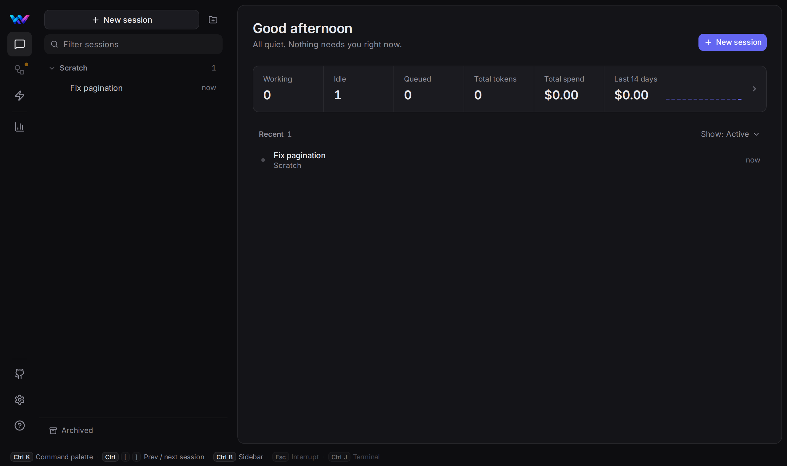
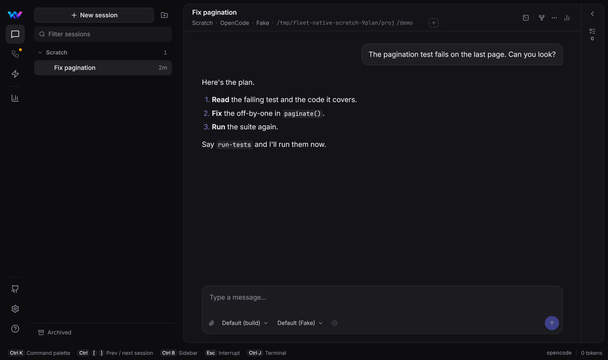
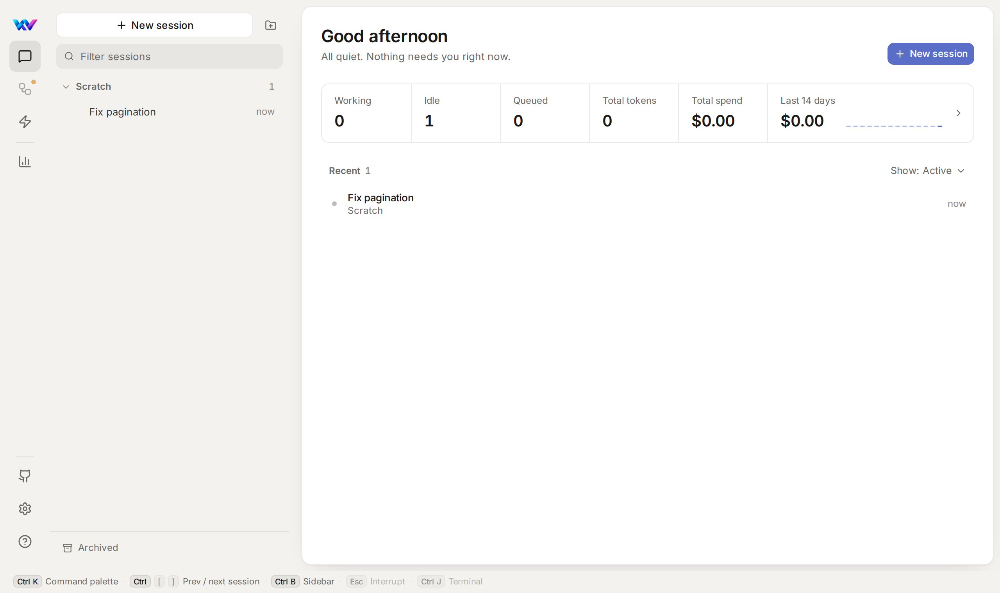
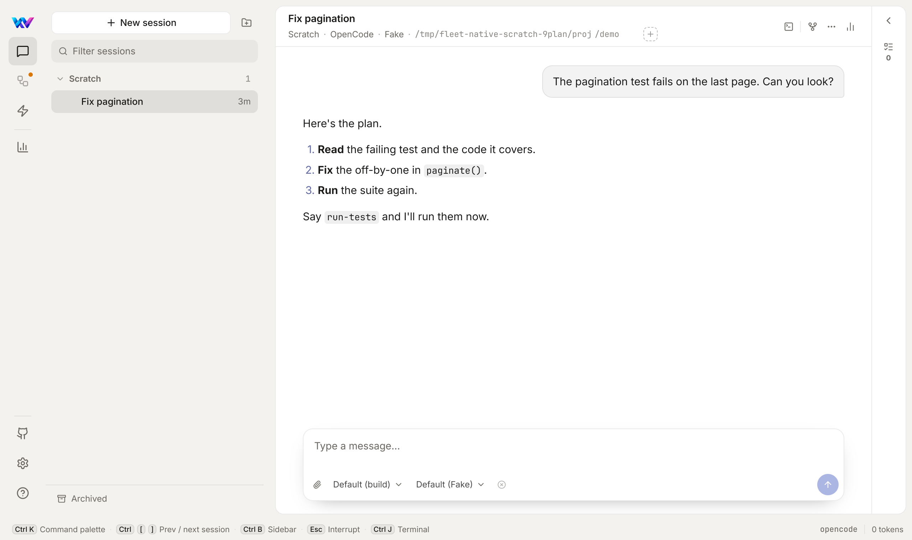
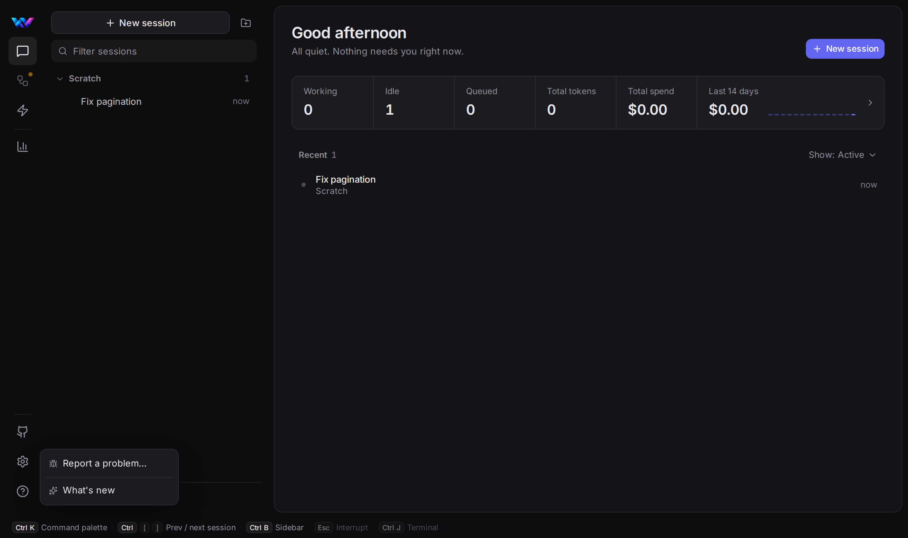
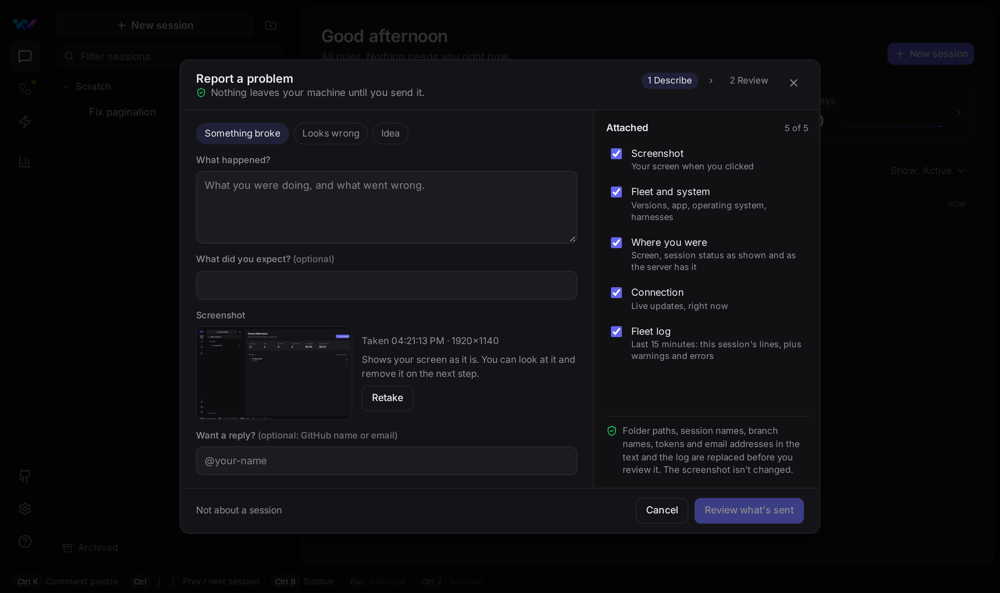
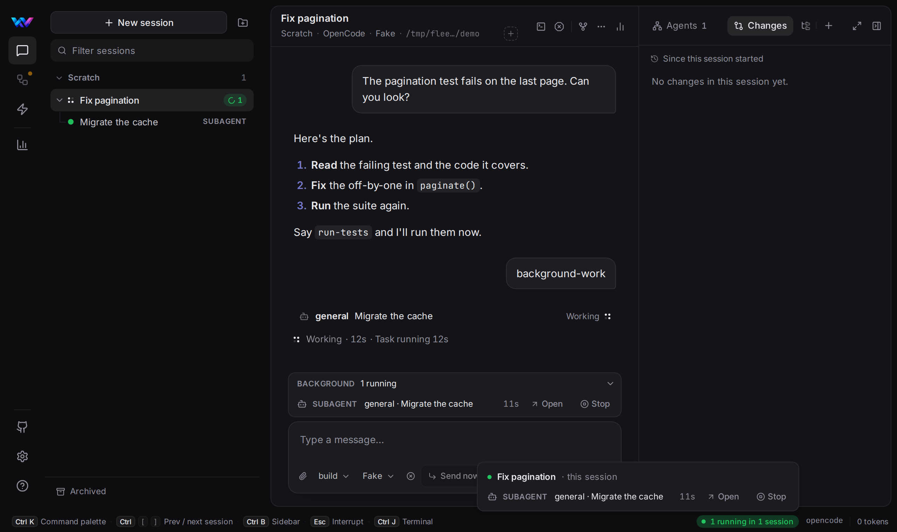

# Component 9: App frame

The parity checklist for component 9 of `docs/PORT.md`, and the pieces it is built in.

- **weave-fleet commit read:** `938cbd6865928d032f60f54bef7be57a1b702721` (`main`, 16 November 2026). The server the
  pictures ran against is v0.72.0 (a scratch Fleet; its client is what "Fleet's own client" shows). Where `main` is
  newer than v0.72.0 the row says so.
- **Native app read:** `main` at `dcf1d86` (`src/view.rs`, `src/view/rail.rs`, `src/view/status.rs`,
  `src/view/update.rs`, `src/fleet/`, `src/ui/`).
- **Sources** (`client/src/`): `components/layout/` `AppShell.vue`, `IconRail.vue`, `RailButton.vue`, `core-rails.ts`,
  `ContextPanel.vue`, `CenterContent.vue`, `StatusBar.vue`, `RunningWorkCounter.vue`, `UsageLimitsPopover.vue`;
  `lib/rails.ts`, `composables/use-context-panel.ts`, `stores/sidebar.ts`; `components/notices/` `NoticeCard.vue`,
  `NoticeChips.vue`, `stores/notices.ts` and the notice sources (`composables/use-memory-notices.ts`,
  `use-dream-notices.ts`, `use-update-notices.ts`, `use-restart-notice.ts`, `use-fleet-update-notices.ts`,
  `use-stale-window-notice.ts`); `components/report/ProblemReportDialog.vue`, `stores/problem-report.ts`,
  `lib/problem-report.ts`; `components/auth/` `AuthGate.vue`, `LoginPage.vue`, `OnboardingGate.vue`;
  `components/skills/` `ImproveSkillDialog.vue`, `SkillDiff.vue`, `lib/skill-versions.ts`; `routes/__root.tsx`,
  `routes/index.tsx` (the landing rule), `components/dashboard/` `FleetDashboard.vue`, `SummaryBar.vue`,
  `DashboardSessionRow.vue`, `RetentionFilter.vue`, `lib/needs-you.ts`; `composables/use-running-work.ts`,
  `lib/running-work.ts`, `lib/usage-providers.ts`, `lib/usage-limits.ts`, `composables/use-usage-limits.ts`.

**What this component takes on that its row in `docs/PORT.md` didn't name.** The **home dashboard** (`/`, the Sessions
rail's own page and the screen Fleet opens on) was listed under component 23 (`dashboard`). It is moved here: it is
what every start shows, and the startup rule ("Fleet opens on its home dashboard; native opens the first session",
handed to this component by 2I) can't be ported without it. Component 23 keeps Mission control, Jobs and the Board.

**What its row named that goes elsewhere.** The skills **Editor** and **History** dialogs open only from Settings →
Skills & tools → Built in (`BuiltInSkillsTab.vue:187,195`), so they go to component 16 with that page. The **Improve**
dialog opens from a skill's tool card in the conversation (`ToolCard.vue:256`), so it stays here. The **pairing page**
(`/pair`, `components/phone/PairPage.vue`) is the phone's side of pairing: the root layout gives it the phone shell
(`__root.tsx:38`), so it is out of scope (desktop only); the desktop's side (Add a phone) is Settings, component 16.

**Row numbers:** 1.x the frame, 2.x the rail, 3.x the Help menu, 4.x the status bar, 5.x running work, 6.x usage
limits, 7.x the notices store, card and chips, 8.x the notice sources, 9.x Report a problem, 10.x the landing rule and
home dashboard, 11.x sign-in, 12.x Improve a skill. Numbers have gaps on purpose.

| Fleet's own client (v0.72.0), at start | The native app today, same Fleet |
|---|---|
|  |  |
|  |  |

The gap, visible in the pictures (one scratch Fleet v0.72.0 with one session, 1280×760, scale 2; native ran
headless with `--server` and `--theme`): Fleet opens on its **home dashboard** ("Good afternoon", the status line,
New session, the summary bar with the 14-day spend, the Recent list with its "Show: Active" filter) with no session
selected; native opens the first session. Fleet's Help (?) opens a menu with **Report a problem…** and **What's new**;
native's does nothing. Fleet's status bar dims Interrupt and Terminal when they can't run, and shows **"1 running in 1
session"** while background work runs, which opens the list of that work; native draws every hint at full strength
and has no counter, usage chip or notice chips. Not shown: the usage chip (the scratch Fleet has no provider), notices
(the scratch Fleet raises none on its own), the sign-in page (a loopback Fleet signs the caller in). Those pieces take
their pictures from scenes beside Fleet's client with the answers put in by Playwright route interception, and say so.

## What the native app has today

- `src/view.rs` `root`: `[rail][context]` over the status bar; main row padding 8, `--main-bg`; the Sessions rail
  draws `[session-list][gutter][sheet]` (left gutter 200-500, default 306, `SIDEBAR_*`); Settings opens the
  Machines page (17J); every other rail draws `notice()` ("Only the Sessions shell is rebuilt in this prototype.");
  `/welcome` and `/repositories` own the context (`on_bare_page`).
- `src/view/rail.rs`: logo, Sessions, Workflows **dimmed with an amber dot** (v0.72.0's look; `main` takes a Labs rail
  out while it is off, 2.3), Automations, divider, Analytics, spacer, divider, GitHub, Settings, Help (no menu). The
  tooltip is Rune's `.help()`, not Fleet's CSS one (2.8).
- `src/view/status.rs`: the five hints (only the palette one is a button), the self-updater's item
  (`view/update.rs`, native-only: component 25's self-update), the connection note (native-only, 4.12), "opencode |
  N tokens" with thousands separators.
- Behind them, done and to reuse: the commands `nav-prev-session`, `nav-next-session`, `toggle-sidebar`,
  `interrupt-session`, `toggle-terminal`, `report-problem` (a `Run::Waiting(9)` stub) in `src/ui/commands.rs`; the
  sidebar's open state and width, persisted (`fleet/settings.rs`, 6F); `fleet::prefs::Prefs` (the server's
  preferences); `fleet::list_work::ListWork` (`GET /api/work/running` and `work.*` across sessions, 2C/3K: unordered,
  no view); `view::work::work_row` and `fleet::work_actions` (one session's background work, 3K/3L); `fleet::usage`
  (`GET /api/usage/limits`, `usage.limits`, `tightest_window`, `usage_tone`, `window_label`: 5F); `fleet::row_status`
  (row status, glyph, relative times); `fleet::archive_queue`; `fleet::interrupted` and the three interruption calls
  (`http.rs`); `fleet::auth` (a token per address, never printed) and `fleet::local_token`; `view::diff` (3C);
  `ui::toast` (the archive Undo toast: not the notice card); the kit's menu, popover, dialog, confirm, select, input,
  textarea, switch (component 1).
- Not there: Fleet, Board and Jobs rails; the Help menu; disabled hints; the running-work counter and its popover; the
  usage chip and popover; any notice; Report a problem; the home dashboard and the landing rule; the sign-in page; the
  Improve dialog.

## Part 1: the frame (`AppShell.vue`, `ContextPanel.vue`, `CenterContent.vue`)

| # | Element / behaviour | Source | Native today |
|---|---|---|---|
| 1.1 | `.app` column: `.main` (flex, gap 8, padding 8, `--main-bg`) over the status bar | AppShell 397-420 | Done |
| 1.2 | `.main`: rail, the context panel (`ContextPanel`, width 306, 200-500, `aria-label="Context panel"`) and its gutter only while `!panelCollapsed && panel !== null`; then the workspace sheet | AppShell 330-352; ContextPanel | Done for Sessions; other rails: 2.12 |
| 1.3 | Workspace sheet: flex 1, `--panel-bg`, 1 px `--border`, `--radius-panel`, `--sheet-shadow`, overflow hidden; holds the centre and the right panel | AppShell 438-448 | Done (`sheet.rs`) |
| 1.4 | Gutters: 8 px wide with -4 px margins, hover or drag fill `rgba(91,110,199,.15)`; left gutter drag clamps 200-500 | AppShell 214-246, 457-471 | Done (`view.rs` `gutter`) |
| 1.5 | Right gutter and panel widths (360 default, 280 min, 480 kept for the conversation, Widen 760, review 60%), the panel as a sheet when it doesn't fit | AppShell 172-312 | Component 10 |
| 1.6 | `CenterContent`: padding 24 and scroll on every route except `/sessions/…` (no padding, no scroll) | CenterContent 31-50 | **Done (9D)** for Home: the page is a panel with a scroll and 24 px padding, its column centred. Other pages pad their own |
| 1.7 | Ctrl/⌘ B (`toggle-sidebar`) collapses the context panel of **any** rail, remembered (`weave:left-collapsed`) | `stores/sidebar.ts`, AppShell 109 | Done in A: `State::context_panel_shown` (`sidebar_open` and the rail has a panel); the command now remembers it (`set_sidebar_open`). Other rails draw no panel yet, so only Sessions shows the effect |
| 1.8 | Mounted once: palette (1, done), Go to file (11), `ProblemReportDialog` (9.x), `ArchiveUndoToast` (6, done), `NoticeCard` (7.x), `ModsSafeModeBanner` (22) | AppShell 359-455 | See owners |
| 1.9 | The open session's views ask the session's machine (`MachineScope`); the machine you're on follows the open session | AppShell 117-127, `MachineScope.vue` | Done by 17 (`link_for`) |
| 1.10 | Phone layout: drawer, hamburger, sheet panels, touch swipe, fold gap | AppShell | Out of scope (desktop only) |

## Part 2: the rail (`IconRail.vue`, `RailButton.vue`, `core-rails.ts`, `lib/rails.ts`, `use-context-panel.ts`)

| # | Element / behaviour | Source | Native today |
|---|---|---|---|
| 2.1 | Rail: width 48, padding 8 0, column, centred; logo 32×32 `object-fit: contain`, mb 4; dividers 24×1 `--border`, my 4; the bottom divider `margin-top: auto` | IconRail 336-381 | Done |
| 2.2 | Order: top (Fleet -10, Sessions 0, Board 10, Workflows 20, Jobs 25, Automations 30), divider, secondary (Analytics), divider, plugin rails (GitHub), bottom (Settings 40), then Help | core-rails 66-83, IconRail 93-104, 280-330 | Done in A (`fleet::rails::rails`, `top`/`secondary`/`bottom`); Fleet, Board, Jobs draw once on |
| 2.3 | A Labs rail (Fleet `features.mission-control.enabled`, Board, Workflows, Jobs; all default off) **leaves the rail while off** and is back, unmarked, once on. Its address still opens and its "turn it on" notice fills the whole context (`noPanel`). **v0.72.0 drew Workflows dimmed with an amber dot instead** (the pictures); `main` is ported | core-rails 59-80; rails.test "the Labs feature %s" | Done in A: all four leave the rail while off (v0.72.0 drew Workflows dimmed: the Fleet pictures); their address still opens and no panel is drawn (their pages' own notices are those components') |
| 2.4 | A rail marked `off` (none of Fleet's own today; a plugin's): icon dimmed .55, a 6 px **muted** dot at -3/-5, tooltip "<label> · switched off" | RailButton, IconRail 444-462 | Done in A: `off` dims the glyph .55 with a 6 px muted dot and "<label> · switched off". No rail is marked off today (`State.rail_marked_off`), so only a test draws it |
| 2.5 | Button 40×40 (icon-only), radius `--radius-btn`, mb 2, `--muted`; hover/focus fill `--text` 5% and ink `--text`; active fill 9% and ink `--text`; icon 18 | IconRail 395-430 | Done |
| 2.6 | Badge (red, 14 px, top 4 right 2): wired for plugin rails, kept hidden (`showPluginRailBadges = false`) | IconRail 61, 464-478 | Nothing to draw |
| 2.7 | Plugin rails come from `GET /api/plugins` (polled every 30 s); GitHub shows only while its plugin is there | IconRail 197-233, `lib/rails.ts` | Done in A, with a note: `GET /api/plugins` is polled every 30 s on a thread (`plugin_poll`) and kept in `State.plugins`; as in Fleet the answer draws nothing (the badge is hidden). GitHub is there unless `plugins.disabled` lists it |
| 2.8 | Tooltip (icon-only): CSS `::after` at left 52, centred, `--color-popover` on `--color-popover-foreground`, 11 px, padding 4 10, radius 0, fades in and slides 4 px right on hover or focus | IconRail 480-505 | Done in A: an overlay (`rail::tip`) at once, 16 px clear of the button, centred, popover colours, 11 px. Not drawn on keyboard focus (native rail buttons take no focus ring yet), and no fade or 4 px slide |
| 2.9 | Click: sets the active rail (not for a Settings shortcut) and navigates to its address (Sessions → `/`, Fleet → `/fleet`, …) | IconRail 235-245 | Done in A and C (`State::press_rail`): Sessions goes Home with nothing selected, and any rail takes the window off a bare page to Home. No address is navigated: the app has no URL, the rail is the state |
| 2.10 | The route picks the rail: `/board`, `/analytics*`, `/automations*`, `/workflows`, `/jobs*`, `/fleet*`, `/settings*` their own; `/` and `/sessions/*` Sessions; a plugin's address its rail; anything else (`/welcome`, `/repositories`) **no rail** | IconRail 128-185 | Done in A as `rail_for_path` over Fleet's addresses (tested by name); the window follows `State.rail` and `on_bare_page`, since it has no address bar |
| 2.11 | A rail nobody contributes (a gone plugin's id) opens Sessions and `/`; an unknown id is kept in the store but never persisted | `useStaleRailRedirect`; rails.test 312-345 | Done in A: `stale_redirect` and `State::settle_rail` (after the preferences are read): GitHub switched off while it is the rail opens Sessions. An unknown id can't exist (`Rail` is an enum), so "kept but never persisted" has nothing to port |
| 2.12 | The context panel is the active rail's own (Sessions → the session list; Settings → its menu; Analytics → its machine panel; Automations, Workflows, Jobs, Fleet → their lists; Board → its controls) or none; never another rail's | `use-context-panel.ts`, `railPanel` | Done in A as `fleet::rails::has_panel` (a rail off, none or unknown has none). Sessions is the only panel drawn; the other panels are their components' |
| 2.13 | Phone view button (`Smartphone`, only in the phone drawer) | IconRail 268-280 | Out of scope |

## Part 3: the Help menu (`IconRail.vue`)

| # | Element / behaviour | Source | Native today |
|---|---|---|---|
| 3.1 | Help button (`CircleHelp` 18, tooltip "Help", testid `rail-help`) opens a dropdown, side right, align end, width 224 (`w-56`) | IconRail 282-300 | Done (piece B). Width is `w-56` at Fleet's 14 px root = 196 px, not 224 (the 224 above assumed a 16 px root); same as the header's ⋯ menu  |
| 3.2 | "Report a problem…" (`Bug` 14) → `problemReport.show({from: "help"})` | IconRail 304-310 | Done (piece B): runs the `report-problem` command, which toasts "isn't in the native app yet (component 9)" until piece Q  |
| 3.3 | Separator, then "What's new" (`Sparkles` 14) → Settings, section Updates & about (`useWhatsNew`) | IconRail 311-318, `use-whats-new.ts` | Done (piece B): opens Settings with `settings_section = "updates"`; the Updates page itself is component 16  |

## Part 4: the status bar (`StatusBar.vue`)

| # | Element / behaviour | Source | Native today |
|---|---|---|---|
| 4.1 | Bar: height 28, padding 0 12 2, gap 10, 11 px `--muted`, `--main-bg` | SB 257-270 | Done |
| 4.2 | Hint: flex gap 4, padding 2 5, `--muted`; `kbd` 10 px/500, padding 2 4, `--text` on `--text` 6%, 1 px `--border`, radius `--radius-btn - 3`; separators "·" in `--border` | SB 318-383 | Done |
| 4.3 | Each hint is a **button** running its command (`mousedown.prevent` keeps the keyboard where it was); hover/focus fill `--text` 6% and ink `--text`, pressed 10%; disabled opacity .45, cursor default; `title` "<label> (<shortcut>)", or the command's own reason when disabled, "Not available yet" when missing | SB 37-50, 296-317 | Done (piece B), two gaps: the pressed tint (10%) and the key-lit border colour have no Rune API (only a hover fill), so they are hover-only; hints are out of the Tab order (see `docs/RUNE.md`, component 9 B)  |
| 4.4 | Prev / next: one hint with `[` and `]` as their own small buttons (padding 1; the key lights: border `--muted`, fill `--text` 14%, pressed 20%); disabled with the command's reason when there's no other session | SB 118-148, 325-352 | Done (piece B): `[` and `]` are their own buttons, lit by a fill on hover (no border change, as 4.3)  |
| 4.5 | Interrupt: disabled "Open a session to interrupt it" with no session; "Nothing to interrupt: the session isn't working" unless the activity is busy, delegating or retry; else "Interrupt the session (Esc)" | SB 60-73 | Done (piece B), in `fleet::status_hints::interrupt_hint`  |
| 4.6 | Terminal hint only while `config.terminalEnabled` | SB 175-191 | Done (piece B): `GET /api/config/client` `terminalEnabled`, read with the preferences; with no server the hint is drawn (scenes), with one it waits for the answer (Fleet's default is off)  |
| 4.7 | While the terminal has the keyboard: "Terminal has the keyboard · Esc Ctrl K Ctrl B go to the shell · Ctrl J Hide terminal · Ctrl Shift C Copy" (accent text) | SB 82-114 | Component 13 |
| 4.8 | End cluster (margin-left auto, gap 10), in order: running work (5.x), usage chip (6.x, unless the `UsageLimitsChip` preference is `"false"`), notice chips (7.x), the mod chip (22, only on a session's page), the session part | SB 222-254 | Order kept (piece B): the session part stays last; the slots for running work, usage, notices and the mod chip are filled by pieces H, J, M and component 22 |
| 4.9 | Session part, only with an active session (the dashboard clears it): `harnessType` in mono 11/500 (fallback "claude-opus-4"), "|" in `--border`, `formatCount(totalTokens)` + " tokens" ("0 tokens" without), tabular | SB 75-99, 245-254 | Done (piece B): `harnessType` from the session row, fallback "claude-opus-4"; the invented sessions say "opencode"  |
| 4.10 | macOS shows ⌘, others Ctrl | SB 28-31 | Done |
| 4.11 | Under 768 px the hints hide | SB 400-405 | Native cuts them instead (fine: no phone layout) |
| 4.12 | **Native only:** the connection note ("Connecting to …", "Can't reach Fleet at …. Trying again…", the sign-in line) in `--error`. Fleet's status bar has no connection line: its desktop shell owns its server (component 24) and the header says Disconnected (8). Kept: a native app pointed at a server needs to say why nothing loads. The later note's raw-error wording is already fixed (`state.rs:748`) | `state.rs` | Native-only, kept |
| 4.13 | **Native only:** the self-updater's item (component 25). See 8.10 | `view/update.rs` | Native-only |

## Part 5: running work (`RunningWorkCounter.vue`, `use-running-work.ts`)

| # | Element / behaviour | Source | Native today |
|---|---|---|---|
| 5.1 | Data: `GET /api/work/running` (live machine) on start and reconnect, then `work.started/updated/ended` on `sessions`; keeps running items only; sorted by `startedAt` then id; grouped by session in first-appearance order | URW 340-382 | **Done (G)**: `ListWork` loads on start and reconnect and follows `work.*`; `running_sorted` (start, then id), `groups` (first appearance), `session_count`, `label`; `placed_work_groups` adds the open session first, the title ("Untitled session"), the place (workspace name, else project; "this session") and the instance id |
| 5.2 | Hidden while nothing runs; no loading or error state | RWC 60 | **Done (H)**: `view::running_counter::chip` is `None` while the list is empty, and an open popover shuts when the last item ends (`shut_running_popover_if_idle`); no loading or error state |
| 5.3 | Chip: height 18, padding 0 8 0 7, radius 999, 11/500 tabular, `--running` 14% fill (24% on hover or open), `--running-text`; a 6 px `--running` dot; "N running in 1 session" / "N running in M sessions"; title "<label>: show what runs in the background" | RWC 24-28, 174-200 | **Done (H)**: `chip` in `src/view/running_counter.rs`, drawn in `status::end` before the session part; fill `--running` 14%, 24% on hover and while open; Fleet's focus ring (2 px `--running`) has no Rune API, so the chip takes no ring (see `docs/RUNE.md`) |
| 5.4 | Popover: side top, align end, offset 6, width 460 (max window - 16), radius `--radius-card`, padding 6, gap 6, max height min(480, 70vh), scrolls; `aria-label` "Running in the background" | RWC 62-73, 233-241 | **Done (H)**: `overlay`, anchored over the chip, side top, align end, offset 6; width 460 or the window less 16; scrolls past min(480, 70% of the window); label "Running in the background"; a press outside shuts it |
| 5.5 | Groups: the open session's first; header row (padding 6 8 4, radius 7, 12.5/600 `--text`, hover 5%): dot, title (ellipsis; "Untitled session"), "· this session" or "· <workspace or project>" (muted, 400, never shrinks); a click opens that session and closes the popover | RWC 30-56, 205-231 | **Done (H)**: `group`: the open session first, dot, title (truncated), "· this session" or "· <place>"; a press opens that session and shuts the list (the Cmd/Ctrl/Shift-click new-tab case is a browser link, not ported) |
| 5.6 | Rows: `BackgroundWorkRow` with `now` ticking (1 s in the first minute, then 1 min), Output, Open, Details, Events, Stop | RWC 108-116; `BackgroundWorkRow.vue` | **Done in G (the data and actions)**: `work_item` also searches `list_work`, and a Stop answer is applied to both lists; `conv::work_clock::next_tick_ms` is the clock over the list's items (a second in the first minute, then a minute; none while nothing runs). The row's `now` and the popover are H **Done (H)**: rows are `work_row` as the strip draws them; `keep_work_clock` ticks the list's times while it is open (`WorkStrip::list_changed`) |

## Part 6: usage limits (`UsageLimitsPopover.vue`, `lib/usage-providers.ts`, `lib/usage-limits.ts`, `use-usage-limits.ts`)

| # | Element / behaviour | Source | Native today |
|---|---|---|---|
| 6.1 | Data: `GET /api/usage/limits` and `usage.limits`, reload on reconnect | UUL | Done (5F) |
| 6.2 | Provider fields `accountKey`, `source`, `harnesses`, `readAt`, `credits {remaining, limit, used, unit}` | UP 31-47 | **Done in I**: `ProviderUsage` holds `account_key`, `source`, `harnesses`, `read_at` and `credits`; `credits_text` and `ai_credits_line` word the two lines |
| 6.3 | Chip hidden with no providers; "Usage" (no bar) with providers but no readable window; else the tightest live window: `Gauge` 12, "<provider> <short label>" ("Claude 5 h", "GitHub Copilot org"), a 30×4 bar (track `currentColor` 22%), "<n>%"; tones quiet (no fill, `--muted`), warn (`--status-waiting` 14%, `--status-waiting-text`), used (`--error` 14%, `--error-text`); title and label "<provider>'s <label> is N% used; it resets <when>." | UL 60-85, 380-422 | **Done (J)**: `view::usage_chip` (the chip, `fleet::usage_chip::chip` its words and title) in `status::end` after running work; hidden with no provider or the `UsageLimitsChip` preference "false"; "Usage" with no bar when nothing reads; Gauge 12, 30×4 bar, the three tones. Gap: Fleet's focus ring (no Rune API) |
| 6.4 | Labels: long ("5-hour limit", "Weekly limit", "Weekly Opus limit", "Weekly Sonnet limit", "Organization limit", "Primary limit", "Secondary limit"), short ("5 h", "week", "Opus week", "Sonnet week", "org", "primary", "secondary"); `resetLabel` "resets <formatWhen>" | `usage-limits.ts`, UP | **Done in I**: `window_short_label`, `provider_window_label`, `provider_window_short_label`, `reset_label` (`fleet::usage_rules`); the pace tick and note (`expected_share`, `tick_percent`, `pace_note`) with them |
| 6.5 | Popover: side top, align end, offset 8, width 380, max height 560, padding 12 14, radius `--radius-panel`, `--card-bg`, `--menu-shadow`, 12 px | UL 426-436 | **Done (J)**: `view::usage_popover::overlay`, side top, align end, offset 8, width 380 (window − 16), max height 560, padding 12 14, `RADIUS_PANEL`, `--card-bg`, menu shadow, a press outside or Esc shuts it |
| 6.6 | Per provider (12 px gap and a top rule between): name and account (muted) heading; "also on <machines>"; "read from <source>, last asked <time>" | UL 205-245 | **Done (J)**: heading with name and account, "also on <machines>", "read from <source>, last asked <time>" (`read_line`; the time is `2:05 PM`, v0.72.0's browser writes `07:59 PM`) |
| 6.7 | `ok`: a row per live window (grid `minmax(70,1fr) 90 36 112`, gap 8, padding 3 0; tone ink `--accent-text`/waiting/error; the label in `--text`): label, 6 px bar with the **pace tick** (2 px white with a 1 px black 45% ring, at the even share; title "An even share of this window by now: N%"), percent, reset; the **pace note** "Ahead of pace: at this rate it runs out about <duration> before it resets" (11 px waiting text); credits ("Credits: $7.60 left of $10.00", "$x used"); GitHub's "AI credits used this month: 307,846" (title "GitHub's count; it can run a few minutes behind.") | UL 246-300 | **Done (J)**: a row per live window (label wraps as Fleet's grid cell does, 90 bar, 36 percent, 112 reset), the pace tick (white, 1 px ring from `theme.rs`) with its title, the pace note, credits and GitHub's AI credits with their title. Gap: the reset column is not clipped as Fleet's browser clips a long "resets Sat 2:02 AM" |
| 6.8 | States without bars: `not_allowed` ("Fleet found a sign-in in <source>. Allow it to ask <name> how much you've used? …" + **Allow** (accent, padding 3 12, radius 6), or "Open <machine> to allow it there." for another machine); `no_window` "Pay-per-token: no limits to show."; `signed_out` "Sign in again in <source>."; `unsupported` "Fleet can't read this sign-in yet."; else "Can't read this right now."; none at all "No provider sign-ins found." | UL 301-350 | **Done (J)**: Allow (disabled while it runs; "Open <machine> to allow it there." off this machine), pay-per-token, signed out, unsupported, can't read, none at all |
| 6.9 | Allow: `POST /api/usage/limits/{provider}/allow` (revoke `DELETE`), then reload; the button is disabled while it runs | UUL 477-483 | **Done in I (the state)**: `State::set_usage_allowed` (`POST`, or `DELETE` to revoke, no body), then the limits are read again; `Usage::allowing` is the disabled button; a refusal changes nothing. The button is J |
| 6.10 | While open: `GET /api/usage/limits?watch=true` now and every 60 s, and the same on every other machine that answered its last check; their answers kept per machine (a failure keeps the last); with two or more machines, uppercase 10 px machine headings and an account shown once with "also on …" (`groupUsageByMachine`) | UUL 489-511, UL 40-55 | **Done in I (the state)**: `Usage::watch`/`unwatch` (counted: popovers share one timer), `keep_usage_watch` in the poll reads `?watch=true` at once and every 60 s, and each other machine that answered its last check (`usage_other_machines`) on its own thread with its own token; a failed answer keeps the last (`Usage::others`); `group_usage_by_machine`. **Headings and "also on" lines done (J)** |
| 6.11 | `now` refreshes every minute and on open, so a window that resets drops off without a push | UL 57-59 | **Rules done in I** (every rule takes `now`; a window that reset is left out, tested). **Done (J)**: the poll redraws each minute and on open; the popover watches while `ui.open` is it, however it was shut (`Usage::popover_watched`) |
| 6.12 | On a phone a bottom sheet | UL 352-378 | Out of scope |

## Part 7: notices: the store, the card, the chips (`stores/notices.ts`, `NoticeCard.vue`, `NoticeChips.vue`)

| # | Element / behaviour | Source | Native today |
|---|---|---|---|
| 7.1 | A notice: `id`, title, body, icon (default `CircleArrowUp`), tone accent or warn, actions (label, icon, tone primary/danger/quiet, run), items (text, label, kind highlight/new/fixed), `more`, link (label, href, run), `chip` (its status-bar text once settled), `quiet` (chip only), `expiresMs`, `onChipClick`, `holdMs`, `onEscape`, `countdown` | ST 4-52 | Done in K: `fleet::notices::Notice` (actions, link and chip clicks are names the source hears, not closures) |
| 7.2 | `post` (same id replaces in place; a new one waits, unless quiet or already shown, which go straight to a chip), `update` (pins the open card, so a question stays), `openNext`, `reopen` (from a chip, pinned), `settle` (no chip → removed), `remove`, `removeWhere(prefix, keep)`; one card at a time | ST 116-185 | Done in K: `Notices` with post, update, open_next, reopen, settle, remove, remove_where, expire |
| 7.3 | A shown id never opens as a card again, across restarts (last 50 ids, `weave:notices-shown`; native: the settings file) | ST 62-79 | Done in K: the last 50 ids in the settings file (`noticesShown`), read before a notice posted early is queued |
| 7.4 | A card opens only at a quiet moment: 3 s after start, 2.5 s after the last key typed into a text field, the window visible and focused; checked every 500 ms and on focus | NC 28-35, 257-261 | Done in K: `Quiet` (3 s, 2.5 s after typing, focused, visible), checked every 0.5 s and on focus and visibility. "Typing" is a key through a focused control or a changed draft; other text fields are added by their own pieces |
| 7.5 | Card: fixed right 12, bottom 40 (lifted 8 px above the composer when it would cover it, `data-notice-avoid`), width 264 (340 with items), padding 12 12 10, 1 px `--border`, radius `--radius-panel`, `--card-bg`, shadow `0 1px 0 --text 4% inset, 0 16px 36px -16px rgba(0,0,0,.4)` | NC 139-180, 399-417 | None |
| 7.6 | Top row: 26×26 icon tile (radius 8, `--accent-dim`/`--accent`; warn `--status-waiting` 15%/`--status-waiting`), title 13/600, body 12/1.45 muted with the link inline (underlined, muted, hover `--text`), close 22×22 `X` 14 "Dismiss (Esc)" | NC 279-330, 419-476 | None |
| 7.7 | Items (padding-left 36, gap 7, 12.5 px, a 5 px accent dot, `--running` for fixed, a muted label before the text), "more" line; countdown bar (3 px, accent, shrinks over the hold, paused while hovered or focused); actions (height 26, padding 0 10, radius 7, 12/500; primary accent, danger `--error` 16%, quiet transparent; a leading quiet button -10 px) | NC 331-389, 508-649 | None |
| 7.8 | Hold 8 s (or `holdMs`), paused on hover or focus (at least 1 s left after a pause), never for a pinned card; Esc inside the card runs `onEscape` and settles | NC 87-126, 205-210 | None |
| 7.9 | Enter 260 ms (fade, up 8 px, scale .98); settle 320 ms: the card shrinks to its chip's corner and fades; no chip or reduced motion → gone at once | NC 235-255, 656-663 | None |
| 7.10 | Chips (status bar, gap 6): height 18, padding 0 8 0 7, radius 999, `--accent-dim`/`--accent-text`, 11/500, a 6 px accent dot with a ring that pulses twice; quiet chips transparent, muted, `--running` dot, no ring; fade in 220 ms after 180 ms; a click runs `onChipClick` or reopens the card | CH 8-141 | None |

## Part 8: the notice sources

| # | Notice | Source | Native today / owner |
|---|---|---|---|
| 8.1 | **Fleet restarted** (`restart-cut-off:<at>`, warn, `RotateCw`, hold 30 s): "Fleet restarted" or "Fleet updated to v<x>"; "N sessions were cut off." / "Continuing N sessions."; up to 5 items (a lost question says "…: the question was lost. Ask again."), "+N more"; one line per other machine that restarted; link "Next time, continue these by itself?" (sets `RestartContinueAuto`); **Continue all** (`POST …/interruption/continue` each), **Dismiss all** (`DELETE …/interruption` each), or in automatic mode **Stop all** (`POST /api/sessions/interruptions/stop-automatic`, also on Esc); a machines-only variant "A machine restarted" | `use-restart-notice.ts` | Per-session cards and calls done (3I); the notice, `stop-automatic` and the preference missing |
| 8.2 | **Remembered** (`memory-saved-<id>-<updated>`, `Lightbulb`, hold 6 s with countdown, expires 2 min): "Remembered for this machine / <repo> / this repository", the note's text; **Undo** (update back to the previous text, or forget the note and put the previous back); on failure "Couldn't undo it" + reason | `use-memory-notices.ts` | `memory.saved` not read |
| 8.3 | **Machine updated** (`fleet-updated:<machine>:<to>`, within 3 days): "<name> updated to <to>", "At HH:MM, <when nothing was working / overnight / when you restarted it / by Update machines now>."; once, the rule sentence and "Change the rule"; What's new, Dismiss. **Chip** `fleet-updates-waiting`: "↑ N machines can update" or "Updating machines · k of n", opens Settings → Updates › Machines | `use-fleet-update-notices.ts`, `lib/fleet-updates.ts` | Machine info from 17; `update.rollout` read but unused |
| 8.4 | **What's new after an update** (server variant) and "Updated to …" quiet chip | `use-update-notices.ts` 235-300 | Component 16 (needs release notes and Settings → Updates & about) |
| 8.5 | **Dream** notices ("Fleet updated <repo>'s notes", See what changed → Settings → Memory) | `use-dream-notices.ts` | Component 16 (Memory and Dreaming) |
| 8.6 | "Couldn't change mods" | `use-start-without-mods.ts` | Component 22 |
| 8.7 | "<skill> is now your version N" with Undo | `ImproveSkillDialog.vue` 136-163 | 12.x (here) |
| 8.8 | Stale window ("This window is still running the old version. Reload…") | `use-stale-window-notice.ts` | Not applicable: native loads no web bundle from the server |
| 8.9 | Desktop app updates through the Electron bridge (ready: "Fleet X is ready", Restart / Later, the working-sessions warning; available: Download) | `use-update-notices.ts` 60-230 | Electron only; see 8.10 |
| 8.10 | **Native's self-updater** (component 25) shows an item and a dialog, not a card. Fleet's equivalent is 8.9's card and chip. Whether the updater moves onto the notice card is **the owner's call** (open decision 1); until then 4.13 stays | `src/update/`, `view/update.rs` | Open decision |

## Part 9: Report a problem (`ProblemReportDialog.vue`, `stores/problem-report.ts`, `lib/problem-report.ts`)

| # | Element / behaviour | Source | Native today |
|---|---|---|---|
| 9.1 | Opened from Help (`from: "help"`), the palette (`report-problem`, "Tell the Fleet maintainers what went wrong."), a turn failure card ("This turn stopped early: 
", with the session), Electron's menu (n/a). `show` waits 200 ms for a menu to close and takes the screenshot first; no-op while open | store; IconRail 296; `use-commands.ts:783`; `ActivityStream.vue:126` | Palette row is a stub |
| 9.2 | Frame: 820 wide, max height min(720, window - 32), `--panel-bg`, 1 px `--border`, radius 12, no close X of the kit's; overlay black 80%; Esc and the overlay close it, except while sending | D 280-420 | None |
| 9.3 | Header (padding 16 20 12, rule under): "Report a problem" 15/600; `ShieldCheck` 13 `--running` + "Nothing leaves your machine until you send it." / "This is everything that will be sent." / "Sent to the Fleet maintainers."; steps "1 Describe › 2 Review" (pills, the active `--accent-dim`); close 26×26 | D | None |
| 9.4 | Describe (grid `1fr 290`): kind pills Something broke / Looks wrong / Idea; "What happened?" textarea (4 rows, 10,000 max, placeholder "What you were doing, and what went wrong."); "What did you expect? (optional)"; Screenshot (200×120 thumb, "Taken HH:MM:SS · w×h", "Shows your screen as it is…", Retake / Taking…; or "Couldn't take a screenshot. The report works without one."); "Want a reply? (optional: GitHub name or email)" "@your-name" | D | None |
| 9.5 | Attached aside (`--main-bg` 45% tint, left rule): "Attached" and "n of 5"; checkboxes Screenshot / Fleet and system / Where you were / Connection / Fleet log with their details; an unticked one muted and struck through; footer `ShieldCheck` + "Folder paths, session names, branch names, tokens and email addresses in the text and the log are replaced before you review it. The screenshot isn't changed." | D | None (the kit has no checkbox) |
| 9.6 | Footer: "About: <session title>" or "Not about a session"; Cancel; **Review what's sent** (disabled while the description is blank; spinner while preparing) | D | None |
| 9.7 | `POST /api/reports/prepare` with the ticked parts and what the client knows (app "Desktop app <version> · <os>", screen name, the session's shown status, window size and scale, theme, connection facts for the live machine and the session's machine, private values: every machine's name and address and this Fleet's address) → `{title, body, log, labels, replacements, problems, canSend}` | L; `api/generated/schema.d.ts:2904-2936` | None |
| 9.8 | Review (grid `180 1fr`): files report.md (label count pill), fleet.log, screenshot; Title input; "<n> private details replaced · 3 folders, 1 session name…" or "No private details found."; **Show what was removed** switch (originals struck in `--error-text` before each `‹kind-n›` label); "Left out: <item>. <reason>" rows; the mono preview (11.5/1.65) with labels on `--accent-dim`; the screenshot view with "Remove screenshot" | D | None |
| 9.9 | Review footer: Back; "Only the Fleet maintainers will see this." or "Sending is off on this Fleet. Save it as a file instead."; **Save as file** (`POST /api/reports/file` → zip, name from `content-disposition`); **Send report** (`POST /api/reports/send` → `{id}`) | D | None |
| 9.10 | Sent: a 34 px `--running` 15% circle with `Check`, "Report sent", "Only the Fleet maintainers can see it. If you talk to us about it, mention `<id>`.", "You left a contact, so a reply goes to <contact>."; Copy report id → "Copied"; Done | D | None |
| 9.11 | Errors in the footer (`role=alert`): "Couldn't gather the report. Try again.", "Couldn't send the report. Try again, or use Save as file.", "Couldn't save the report."; the server's `error` wins | D | None |
| 9.12 | Screenshot: Electron's `captureWindow` or a DOM render, 2 s timeout, 4 MB cap. Native needs the app's own frame as PNG; if Rune can't hand one to the app, ship "Couldn't take a screenshot" and write the smallest case into `docs/RUNE.md` | `lib/problem-report.ts` | Unknown: piece Q checks |

## Part 10: the landing rule and the home dashboard (`routes/index.tsx`, `components/dashboard/`)

| # | Element / behaviour | Source | Native today |
|---|---|---|---|
| 10.1 | Fleet opens at `/`: the Sessions rail, the session list with **nothing selected** (`setActiveSessionId(null)`), the dashboard in the sheet. Sessions in the rail goes to `/` too | `routes/index.tsx`, core-rails | **Done (9C)**: a start with sessions goes to `Route::Home` (nothing selected); an empty list still goes to New session. Scenes and headless runs keep opening the first invented session. The dashboard itself is D (a placeholder with the greeting draws now) |
| 10.2 | Landing: only the first `/` of a start, once the preferences have loaded, goes to `/fleet` when Mission control is on (replace); a deep link never lands, nor does a later `/` | `routes/index.tsx` 20-43 | **Done (9C)**: `dashboard::Landing` (`home-landing.test.ts`; the phone case skipped, desktop only). It records `landed`; `/fleet` is component 23, which routes on it |
| 10.3 | Page: centred column, max 1040, gap 24, inside 24 px padding, scrolls (1.6) | FD 353-360 | None |
| 10.4 | Header: greeting by the local hour (before 5 "Working late", before 12 "Good morning", before 18 "Good afternoon", else "Good evening"), 21/600; status line ("2 sessions need you, 3 working." / "1 session working." / "All quiet. Nothing needs you right now."), 12.25 muted; **New session** (sm, `Plus`) → the new-session page | FD 124-192, `PageHeader` | **Done (9D)**: `view/dashboard.rs` `header`: the greeting 21/600, the status line 12.25 muted, **New session** (Sm, `Plus`) → the new-session page. v0.72.0's own client draws the button lower than `main`'s source says (bottom-aligned, not centred); native follows `main` |
| 10.5 | Harness banner when no harness is ready (not on another machine, not cloud): "No harness is ready yet" / "Fleet runs sessions through a harness such as OpenCode or Claude Code. Install one to start." / **Set up a harness** | FD 196-218 | `no_harness_reason`, `open_harness_setup` exist (7). **weave-fleet `main` (Fleet #1049, after v0.72.0)** also shows `noHarnessReason` as a muted line inside the banner (`harness-setup-banner-reason`): **Done (9D)**: `harness_banner`, the reason as a muted line under the text; **Set up a harness** opens the wizard at the harness step. Not drawn when the window is on another machine (cloud mode is never met). Not made live: the scratch Fleet has OpenCode, so the banner is shown from the `home-harness` scene only |
| 10.6 | Summary bar (`/api/fleet/summary` every 30 s while visible): Working, Idle, Queued, Total tokens, Est. spend (**v0.72.0 says "Total spend"**); minus sessions waiting to archive; the "Last 14 days" button (spend from `/api/analytics/daily`, 14 bars 6 wide, today's in `--accent`, the rest 45%) → Analytics | `SummaryBar.vue` | **Done (9F)**: `fleet/summary.rs` (reads on threads, numbered, a failure keeps what was held; the summary every 30 s and the spend every 5 min while Home is shown in the Sessions rail, on another machine with that machine's token; counts less a queued archive, read again once it settles) and `view/summary_bar.rs` (five cells, the spend button with 14 bars, today's in `--accent`, → the Analytics rail). **Follows `main`: "Est. spend"** (v0.72.0's client says "Total spend"). Sizes read from the live client: bar 76 high, cells 74, label 18, value 30. Not ported: the narrow-window layouts (≤900 px stacks, ≤560 px three columns; the window can't be that narrow), the bars' hover titles (Rune has no tooltip on a plain rect; the button's label carries the total), the `visibilitychange` guard (the poll runs only while Home is shown in the Sessions rail). With no server the numbers come from the invented sessions and a fixed fortnight. The scratch Fleet has no spend, so bars with height are shown from a scene only |
| 10.7 | States: "Loading sessions…" with a spinner; error note "Couldn't load sessions." + reason; empty (dashed box, `MessageSquare` 28, "No sessions yet" / "No archived sessions", "Start a session to put an agent to work. It shows up here while it runs, and when it needs you.", New session and the filter) | FD 222-256 | **Done (9D)** from the scenes `home-loading`, `home-error`, `home-empty`; a live empty Fleet wasn't made. Fleet's empty box has a dashed border; Rune draws none, so it is solid. The filter beside New session works (9E) |
| 10.8 | Sections: **Needs you** (waiting for input, error, or a workflow waiting; `--status-waiting` 5% box), **Working**, **Recent** (8, then "Show N more" / "Show fewer"; empty "Nothing else here") with "Show: Active / Archived / All" on the right (shared with the sidebar's Archived view); top-level only, hidden and archiving rows left out, newest first | FD 93-140, 258-330; `lib/needs-you.ts`; `RetentionFilter.vue` | Buckets, filter and order **done (9C)** (`session_bucket`, `shown`, `sections`; hidden and sub-agent rows never reach the list); drawing is D **9D draws the three sections** (Needs you on the 5% box, Working, Recent with the filter's label, "Nothing else here"). **Done (9E)**: Recent shows the first 8 and "Show N more" / "Show fewer" (`home-more`, ends with the page); the filter opens a menu of Active / Archived / All with a check after the shown one (`menus::retention`, `Item::end_check`) and sets `store.retention`, the sidebar's too, and the list is read again; no workflow run waits until component 23 |
| 10.9 | Row (min height 48, padding 6 10, radius 8, hover `--text` 5%): live glyph or a 6 px quiet dot, title 13/500 and "project · branch" 12 muted, progress (text, 14 px ring, "done/total"), "Archived" tag, the status label (Needs input in a waiting pill, Error, Retry …, Failed, Cut off by a restart, else the compact time); a click, Enter or Space opens the session | `DashboardSessionRow.vue` | `row_status`, glyphs, ring exist (6) **Done (9D)** `view/dashboard_row.rs`: glyph or quiet dot, title, place, progress (now, ring, done/total), Archived tag, the status word in its tone; a click, Enter or Space opens the session. Hover actions are **done (9E)** |
| 10.10 | Row actions on hover: Archive (**through the archive queue with Undo, as the list does**; v0.72.0: direct, no Undo) and Delete (confirm "Delete this session?", "It and its session data are deleted for good.", "Delete session"); none on another machine | DSR 29-90, 170-200 | **`main` (Fleet #1049, after v0.72.0): Archive goes through the archive queue, with the same 6 s Undo as the list**; v0.72.0 archived directly. Native follows `main` (E). Delete: confirm "Delete this session?", "It and its session data are deleted for good.", "Delete session"; none on another machine. Confirm and requests exist (6, 8). **Done (9E)**: Archive (`State::archive_sessions`, the list's queue and toast) and Delete (`ask_delete_session`, the same confirm) beside the row, shown while it has the pointer or focus, on 28 px buttons; each follows `capabilities` (`canArchive`, `canDelete`); none on another machine. Archive uses the list's rule (an archived row has none) rather than Fleet's capability-first one, as the header does; Fleet's `lifecycle !== running` fallback applies only when the server sends no capabilities and is not ported. Fleet fades the strip over a gradient; native fills it with the row's hover colour (no gradient on a rect that Rune can fade) |
| 10.11 | Another machine (after Work here): its `/api/sessions?limit=100` every 15 s, read-only rows, "Couldn't read that machine's sessions" | FD 40-90 | **Done (9E)**: `fleet/dashboard_machine.rs` (`Other`: numbered requests, loading from the first frame, a failure keeps the last list, reads again every 15 s and when the filter changes, ends when the page is left); the page draws those rows with no actions, a click opens the session on that machine (`open_machine_row`); the machine's own token and addresses (`get_on`). Not ported: the phone heading case. The summary bar and spend on that machine are F |

## Part 11: sign-in (`AuthGate.vue`, `LoginPage.vue`, `OnboardingGate.vue`)

| # | Element / behaviour | Source | Native today |
|---|---|---|---|
| 11.1 | Gate: `GET /api/config/client` and `/api/user/me`; "Checking your session…"; a 401 goes to `/login?returnUrl=…`; another failure says "Client config request failed with status N." / "Unable to verify your session." | AuthGate 18-128 | The link stops as `Refused`; a status-bar line says to pass `--token` |
| 11.2 | Login page: `GET /api/auth/status` → token mode, OIDC (cloud) or unknown; a loopback caller is signed in by the server | LoginPage 55-85 | — |
| 11.3 | Token form: card (max 336, padding 28 35, radius 10, shadow), logo tile 63 px, "Weave" mono 26/700, "Agent Fleet", "Orchestrate AI coding agents across your projects.", "Access token" password field "Paste your token", the hint "It's in the sign-in link Fleet prints when it starts, and in Settings → Machines on a device that's already signed in. …", **Continue** / "Signing in…", error "Invalid token"; build line | LoginPage 167-291 | None |
| 11.4 | Native: the typed token becomes the home address's token in `fleet::auth` and the link retries; held for this run only (not written to disk) unless the owner decides otherwise (open decision 2). The browser's cookie, `returnUrl`, `?token=` and password-manager field don't apply | — | None |
| 11.5 | OIDC sign-in and sign-up, the onboarding wizard: cloud mode only | LoginPage 260-283, OnboardingGate | Out of reach: a desktop app on a local Fleet never meets cloud mode |
| 11.6 | Another machine's refused token ("<name> didn't accept this device's token…", "Back to this machine") | AuthGate 71-85 | Component 17 (done: `machines.rs:229`) |
| 11.7 | `OnboardingGate` otherwise renders the harness-setup wizard | OnboardingGate 42 | Component 7 (done) |

## Part 12: Improve a skill (`ImproveSkillDialog.vue`, `SkillDiff.vue`, `lib/skill-versions.ts`)

| # | Element / behaviour | Source | Native today |
|---|---|---|---|
| 12.1 | "Improve" on a finished skill tool card whose skill is built in (`GET /api/skills/built-in` names them); testid `tool-card-improve` | `ToolCard.vue:256-265`, `use-activity-messages.ts:157` | None |
| 12.2 | Dialog (max 588): "Improve <name>" with "Fleet's" / "Yours · vN" pill; "Say what it should do differently. …"; "What should it do differently?" (3 rows, 2,000 max, Ctrl/⌘ Enter asks); "What the model reads": the skill and the note (always), "What you asked, and the reply", "The tool calls in that turn", "The whole conversation, from a copy of this session", each "~N tokens", total "Asked once, on this session's model"; **Propose a change** / "Asking the model…" | ISD | None |
| 12.3 | `POST /api/skills/built-in/{name}/improve` `{sessionId, note, context?, wholeConversation?}` → proposal; failure back to the form with the server's words | `skill-versions.ts:125` | None |
| 12.4 | Proposal: the note quoted, `SkillDiff` (mono 11.5 header, "+N −N", max 340, "No differences."), "The question used N tokens (M from the cache)."; Change the note, Edit by hand / Show the diff, **Keep it** (`POST …/versions`) then the notice 8.7 with Undo (`PUT …/active`) | ISD, SkillDiff | `view::diff` exists (3C) |
| 12.5 | Editing by hand: Fleet uses CodeMirror; native uses the kit's textarea (mono), said so | `ProfileConfigEditor.vue` | — |
| 12.6 | Editor and History dialogs | `SkillEditorDialog.vue`, `SkillHistoryDialog.vue` | Component 16 |

## What stays out of reach, and why

- **Phone layouts** (the drawer, sheet panels, the phone usage sheet, `/phone`, `/pair`): not part of the port.
- **Browser and Electron things** with no native meaning: the stale-window notice (8.8), the Electron update bridge (8.9;
  see 8.10), the DOM screenshot (9.12 has its own path), cookies and `returnUrl` (11.4), password-manager fields,
  `navigator.onLine`.
- **OIDC and the onboarding wizard** (11.5): cloud mode only.
- **Mission control's landing target** (10.2): the rule is ported; `/fleet` is component 23.
- **Screen reader roles and live regions** (`role=status` on the card, `aria-live`, `aria-keyshortcuts`): component 26.
- **Owned elsewhere:** the right panel and its gutter (10), Go to file (11), the terminal's status-bar variant (13),
  What's new, Dreaming, the Editor/History dialogs, Add a phone (16), the mod chip and safe-mode banner (22),
  Board/Jobs/Mission control pages (23).

## Fleet's tests, and where each lands

Counts are `it(...)` cases. Ported tests keep Fleet's names (in Rust, `snake_case`).

| Fleet test file | Cases | Lands in |
|---|---|---|
| `components/layout/__tests__/rails.test.ts` | 26 (3 of them run once per Labs feature, `describe.each` × 4) | A |
| `components/layout/__tests__/ContextPanel.test.ts` | 4 | A (plugin panels: as rules on the rail list; the placeholder panel is drawn only when a plugin rail has no panel) |
| `stores/__tests__/sidebar.test.ts` | 9 | A: "tracks the active rail and panel visibility", "persists both panel states"; the rest are 6F's and 10's (confirm by name) |
| `components/layout/__tests__/StatusBar.test.ts` | 11 | B (9), J ("shows the usage chip unless the Settings switch hides it"); "hides the terminal from the terminal's own hints…" goes to 13 |
| `components/layout/__tests__/StatusBar.characterise.test.ts` | 2 | B (as view tests of the two states, not snapshots) |
| `components/layout/__tests__/StatusBar.mods.test.ts` | 7 | Component 22 |
| `components/layout/__tests__/MachineScope.test.ts` | 1 | Done in 17 (confirm by name in W) |
| `components/layout/__tests__/CollapsedRightRail.test.ts`, `shell-font-scale.test.ts` | 4, 1 | Component 10; the font scale one is a CSS check (26) |
| `routes/__tests__/home-landing.test.ts` | 5 | C (4; the phone one skipped) |
| `components/dashboard/__tests__/FleetDashboard.machine.test.ts` | 4 | E (3; the phone heading one skipped) |
| `components/dashboard/__tests__/FleetDashboard.archive.test.ts` | 1 | E |
| `components/dashboard/__tests__/SummaryBar.archive.test.ts` | 2 | C ("takes a pending session off Working…"), F ("drops a session from Idle…") |
| `DashboardSessionRow`, `RetentionFilter`, greeting, status line | none | C, D, E write cases from reading |
| `components/layout/__tests__/RunningWorkCounter.test.ts` | 4 | G (the counts and order, as logic) and H (the view) |
| `composables/__tests__/use-running-work.test.ts` | 12 | 10 done in 3K; G: the 2 `useRunningWorkAcrossSessions` cases |
| `lib/__tests__/running-work.test.ts`, `use-session-stream.running-work.test.ts` | 11, 1 | Done in 3K (confirm in W) |
| `lib/__tests__/usage-providers.test.ts` | 18 | 4 done (5F); the other 14 done in I (`fleet/tests/usage_rules.rs`, same names) |
| `lib/__tests__/usage-limits.test.ts` | 5 | Done in I (`usage_rules.rs`: short labels, reset label; the rest confirm 5F's) |
| `composables/__tests__/use-usage-limits.test.ts` | 5 | Done in I (against a fake server; the poll's clock is handed in) |
| `components/layout/__tests__/UsageLimitsPopover.test.ts` | 14 | J (13; the phone sheet skipped) |
| `stores/__tests__/notices.test.ts` | 9 | K |
| `components/notices/__tests__/NoticeCard.test.ts` | 12 | K (1-3, as the gate), L (4-10), M ("sits in the bottom-right corner, lifted above a composer…", "links to the release notes": as a link that runs) |
| `composables/__tests__/use-restart-notice.test.ts` | 11 | N |
| `composables/__tests__/use-memory-notices.test.ts` | 6 | M |
| `composables/__tests__/use-fleet-update-notices.test.ts` | 5 | O |
| `use-update-notices.test.ts` (20), `use-dream-notices.test.ts` (6) | 26 | 16 (the server variant and dreams); the Electron-bridge cases with decision 1 |
| `use-stale-window-notice.test.ts` | 5 | Not ported: not applicable (8.8) |
| `lib/__tests__/problem-report.test.ts` | 5 | P |
| `components/report/__tests__/ProblemReportDialog.test.ts` | 10 | P (3-5: the request), Q (1-2), R (6-10) |
| `AuthGate`, `LoginPage`, `OnboardingGate` | none | S writes cases from reading |
| `components/skills/__tests__/ImproveSkillDialog.test.ts` | 4 | U |

## Open decisions (the owner's)

1. **The self-updater and the notice card** (8.10). Fleet's desktop app tells of an update with a card and a chip
   (Restart / Later, and a warning when sessions are working); native's component 25 built a status-bar item and a
   dialog. Piece V moves it onto the card when the owner says yes; nothing else waits on it.
2. **Keeping a typed sign-in token** (11.4). Piece S holds it for the run only; writing it to disk (and where: the
   system's keychain or the app's data folder) is the owner's call.

## The pieces

Twenty-three pieces, in build order, one pull request each. Each starts from this file alone. A piece takes only its
rows and files; plain Rust with no Rune in it where it can be; Fleet's tests under the same names; views at Fleet's
sizes, tokens and wording; pictures beside Fleet's own client on a scratch Fleet (`scripts/scratch-fleet.sh`, its own
ports and folder), same state and size, both themes; the PR says what was checked on which system. Every piece updates
its rows here, the row of component 9 in `docs/PORT.md`, and `docs/RUNE.md`. Where the scratch Fleet can't make a state
(a usage provider, a notice, a sign-in), Fleet's client gets it from Playwright route interception or a posted event,
and the picture says so. Icons a piece needs that `src/icons.rs` lacks (`GAUGE`, `CIRCLE_ARROW_UP`, `RADAR`,
`ROTATE_CW`, …) come from `tools/gen-icons.py`.

Tracks: A, B; then C, D, E, F (home); G, H (running work) and I, J (usage) can run beside the home pieces; K, L, M
before N, O and U; P, Q, R; S; T, U; V when decided; W last.

### Piece A: the rail from the Labs switches and the route

**Done** (pictures in `shots/parity/09-app-frame/A/`). Not done, with reasons: the rail's tooltip on keyboard focus and its 150 ms fade (Rune's help overlay has no focus path and the anchored overlay's scale entrance stands in); the Mission control navigation target (23). Differences found: the v0.72.0 client dims Workflows while off; `main` hides it (rows 2.3).

- **Rows:** 1.7, 2.2, 2.3, 2.4, 2.7, 2.8, 2.9 (not Sessions → home: C), 2.10, 2.11, 2.12.
- **Files:** new `src/fleet/rails.rs` (the rail list from the preferences `features.<x>.enabled` and `GET /api/plugins`
  every 30 s on a thread; placement and order; `off`/`hidden`/`no_panel`; the route → rail rule; the stale redirect);
  `src/lib.rs` (`Rail` gains `Fleet`, `Board`, `Jobs`); `src/view/rail.rs` (from the list; the muted off dot; Fleet's
  tooltip look as an overlay); `src/view.rs` (a rail with no panel fills the context with its notice; Ctrl B collapses
  any rail's panel); `src/tests_rails.rs`.
- **Depends on:** nothing new (`fleet::prefs`, `fleet::settings`).
- **Tests:** `rails.test.ts` (all but the Mission control navigation target, which opens the Fleet rail's notice until
  23), `ContextPanel.test.ts` (4, as rules), `sidebar.test.ts` "tracks the active rail and panel visibility", "persists
  both panel states".
- **Pictures:** the rail with every Labs switch off (Workflows gone) and with Mission control and Board on (preferences
  set with `PUT /api/preferences/...` on the scratch Fleet), a tooltip, both themes, beside Fleet's.

### Piece B: the Help menu and the status bar's hints

- **Rows:** 3.1, 3.2 (opens the stub until Q), 3.3, 4.3, 4.4, 4.5, 4.6, 4.8 (the slots, empty), 4.9.
- **Files:** `src/view/rail.rs` (the menu: kit menu, 224 wide, side right, align end), `src/view/status.rs` (hints as
  buttons that run the commands, disabled with the command's reason, no keyboard taken; the end cluster's order),
  `src/ui/commands.rs` (`disabled` reasons for prev/next and interrupt, `terminalEnabled` from `/api/config/client`),
  `src/tests_status_bar.rs`.
- **Depends on:** A (the rail file).
- **Tests:** `StatusBar.test.ts` hints (8 of 9) and "runs a command unless it's missing or disabled";
  `StatusBar.characterise.test.ts` (2) as view tests.
- **Pictures:** the Help menu open; the bar with no session (Interrupt dimmed) and with a working session (Interrupt
  lit), both themes, beside Fleet's.

### Piece C: home: the landing rule and the dashboard's data (plain Rust) — **done**

- **Rows:** 10.1, 10.2, 2.9 (Sessions → home), 10.8 (the buckets and order, no view), 10.4 (words).
- **Files:** `src/fleet/store.rs` (`Route::Home`; a start with sessions goes home with nothing selected; an empty list
  still goes to New session, 7's rule), new `src/fleet/dashboard.rs` (`session_bucket`, `updated_at`, filters,
  `greeting`, `status_line`, `counts_without_archiving`, the landing rule as a function of first-start, deep link and
  the Mission control preference), `src/view.rs` (home draws a placeholder sheet until D), `src/lib.rs` (scenes start
  where they did), tests.
- **Depends on:** A (the rail), 6 (rows, archive queue, retention).
- **Tests:** `home-landing.test.ts` (4), `SummaryBar.archive.test.ts` "takes a pending session off Working if it's in a
  turn, else off Idle", plus greeting, status-line and bucket boundaries written from reading.
- **Pictures:** non-visual: the app started live showing the session list with nothing selected and the placeholder
  sheet, beside Fleet's start; a table of greetings and status lines in the PR.

### Piece D: home: the page — **done**

- **Rows:** 1.6, 10.3, 10.4, 10.5, 10.7, 10.8 (drawn), 10.9.
- **Files:** new `src/view/dashboard.rs` (page, header, banner, states, sections), new `src/view/dashboard_row.rs`
  (the row), `src/lib.rs` scenes `home`, `home-needs-you`, `home-empty`, `home-loading`, `home-error`, `home-harness`
  and `-light` pairs, `src/tests_dashboard.rs`.
- **Depends on:** C.
- **Tests:** written from reading: opens a session on click, Enter and Space; the status label tones; no row selected.
- **Pictures:** the start screen beside Fleet's (as in this file), a needs-you session (`ask-me`), an empty Fleet,
  both themes.

### Piece E: home: row actions, the filter, Show more, another machine — **done**

- **Rows:** 10.8 (Show more, the filter), 10.10, 10.11.
- **Files:** `src/view/dashboard_row.rs` (hover actions), `src/view/dashboard.rs` (filter menu, Show N more),
  `src/fleet/dashboard.rs` (another machine's list every 15 s with a request number), tests.
- **Depends on:** D, 17 (machines, Work here).
- **Tests:** `FleetDashboard.machine.test.ts` (3), `FleetDashboard.archive.test.ts` (1).
- **Pictures:** row hover with Archive and Delete, the filter open, "Show 3 more", another machine's dashboard (two
  scratch Fleets), both themes.

### Piece F: home: the summary bar — **done**

- **Rows:** 10.6.
- **Files:** new `src/fleet/summary.rs` (`GET /api/fleet/summary` every 30 s while visible, `/api/analytics/daily`
  every 5 min, on threads; mock numbers), new `src/view/summary_bar.rs` (five cells, the spend button and sparkline →
  Analytics), tests.
- **Depends on:** D.
- **Tests:** `SummaryBar.archive.test.ts` "drops a session from Idle as soon as it's archived, and puts it back on
  Undo"; the bar heights written from reading.
- **Pictures:** the bar with a session working and one idle, both themes, beside Fleet's.

### Piece G: running work across sessions (plain Rust) — **done**

- **Rows:** 5.1, 5.6 (actions on another session's item).
- **Files:** `src/fleet/list_work.rs` (sorted `running`, `groups`, `session_count`, the label; session title, place
  and instance from the list), `src/fleet/work_actions.rs` (`work_item` also searches `list_work`; a stop answer
  applies to both), `src/conv/work_clock.rs` (a clock over the list's items while the popover is open), tests.
- **Depends on:** nothing new.
- **Tests:** `use-running-work.test.ts` "loads what runs everywhere and groups it by session", "counts work as it
  starts and stops counting it when it ends, without asking again"; `RunningWorkCounter.test.ts`'s counts and order as
  logic.
- **Pictures:** non-visual: a scratch Fleet with `background-work` in two sessions, the label and groups printed by a
  test against it, and Fleet's counter showing the same.
- **Done:** all of it. Gaps: the instance id is read from the list row's `instanceId`, but native routes a session by its id
  alone, so H's click needs only the session id; the `RunningWorkCounter.test.ts` view cases (the hidden counter, the
  chip, the popover's rows) are H's. Fleet's "hidden while nothing runs" (5.2) is H's too: `label()` has no case for it.
  `fleet::tests::live::live_running_work` (ignored) prints the label and groups against a scratch Fleet.

### Piece H: the running-work counter and its popover — **done**

- **Rows:** 5.2, 5.3, 5.4, 5.5, 5.6 (drawn).
- **Files:** new `src/view/running_counter.rs` (chip, popover with group headers, rows from `view::work::work_row`),
  `src/view/status.rs` (its slot), scenes `running-one`, `running-many`, `running-long-title` (+ `-light`), tests.
- **Depends on:** B, G.
- **Tests:** `RunningWorkCounter.test.ts` (4) as view tests.
- **Pictures:** the counter and its popover beside Fleet's (as `fleet-running-open-*.png` here), both themes.
- **Done:** all of it (rows 5.2 to 5.6). Tests: `src/tests_running_counter.rs` ports `RunningWorkCounter.test.ts`'s four cases under their names and adds
  the heading, the chip's look and the ticking times. Scenes: `running-closed`, `running-one`, `running-many`, `running-long-title` (+ `-light`).
  Gaps: the focus ring (5.3, no Rune API); Fleet's popover sizes to `min(480px, 70vh)` and ours reads the window height Rune last reported
  (`s.ui.sel.window`), 760 before the first report. Pictures: Fleet's states are made live (`fleet-running-*`, a scratch server
  with `background-work` in four sessions); native ones are scenes, because the scripted model's 30 s job ends before a software-rendered
  start finishes, and the live Fleet shows its Home page while the scenes show the open session's conversation, so the popover is beside
  the same popover, not the same page.

### Piece I: usage limits: the rules and the state (plain Rust)

- **Rows:** 6.2, 6.4, 6.9, 6.10, 6.11.
- **Files:** new `src/fleet/usage_rules.rs` (wider `ProviderUsage`, short and reset labels, `provider_windows`,
  `tightest_window` with its provider, `expected_share`, `pace_note`, `group_usage_by_machine`, credits lines),
  `src/fleet/usage.rs` (`?watch=true` every 60 s while watched, other machines' answers, allow and revoke, the
  `UsageLimitsChip` preference), `src/fleet/http.rs`, `src/mock.rs`, tests.
- **Done:** all five rows' rules and state (the views are J). Pictures are non-visual: Fleet's own popover for a body put in by
  Playwright, and the table the native rules give for it (`shots/parity/09i-usage-rules/`). Open, for J: the chip's own label
  and title text, `readLine` ("read from X, last asked T"), the popover itself, the phone sheet (out of scope), `src/mock.rs`
  gains no richer providers yet (nothing draws them until J).
- **Depends on:** 5F, 17.
- **Tests:** `usage-providers.test.ts` (the 14 not done), `usage-limits.test.ts` (5, confirming 5F's), 
  `use-usage-limits.test.ts` (5).
- **Pictures:** non-visual: Fleet's own popover with a provider put in by Playwright beside a test table of the same
  labels and pace notes.

### Piece J: the usage chip and popover — **done**

- **Rows:** 6.3, 6.5, 6.6, 6.7, 6.8.
- **Files:** new `src/view/usage_chip.rs`, new `src/view/usage_popover.rs`, `src/view/status.rs` (the slot),
  `src/theme.rs` (the tick's white and ring, named), `tools/gen-icons.py` (`gauge`), scenes for quiet, warn, used,
  each state, two machines, pace (+ `-light`), tests.
- **Depends on:** B, I.
- **Tests:** `UsageLimitsPopover.test.ts` (13), `StatusBar.test.ts` "shows the usage chip unless the Settings switch
  hides it".
- **Pictures:** each chip tone and the popover beside Fleet's own with the same `/api/usage/limits` answer
  (Playwright route interception), both themes.
- **Done:** all five rows (`shots/parity/09j-usage-popover/`). Tests: `src/tests_usage_popover.rs` ports 12 of `UsageLimitsPopover.test.ts`'s 13 under their names (the phone sheet skipped) and the `StatusBar.test.ts` case. Scenes: `usage-chip-{quiet,warn,used,no-bar}`, `usage-popover-{providers,states,pace,machines}` (+ `-light`). Fleet's pictures are of the v0.72.0 client with the answer put in by route interception (the scratch Fleet has no provider); it words the pace duration in whole hours ("2 h") where `main`, which native follows, says "1 h 40 min".

### Piece K: notices: the store and the quiet moment (plain Rust)

- **Rows:** 7.1, 7.2, 7.3, 7.4.
- **Files:** new `src/fleet/notices.rs` (the model, timers on the app clock, shown ids in the settings file, the gate
  as a function of start time, last key typed, focus and visibility), `src/fleet/settings.rs`, tests.
- **Depends on:** nothing new.
- **Tests:** `notices.test.ts` (9), `NoticeCard.test.ts` 1-3 as gate cases.
- **Pictures:** non-visual: a scene with a notice posted shows nothing for 3 s, then the placeholder card (a plain
  box until L), with the timeline in the PR.

### Piece L: notices: the card

- **Rows:** 7.5 (not the lift), 7.6, 7.7, 7.8.
- **Files:** new `src/view/notice_card.rs`, `src/ui/mod.rs` (an overlay layer for it), scenes `notice-plain`,
  `notice-items`, `notice-warn`, `notice-countdown` (+ `-light`), tests.
- **Depends on:** K.
- **Tests:** `NoticeCard.test.ts` 4-10.
- **Pictures:** each scene beside Fleet's own card raised by a posted event (Fleet's own card from a `memory.saved`
  event sent by Playwright; the scratch Fleet's model doesn't save notes), both themes.

### Piece M: notices: chips, settling, the lift, and Remembered

- **Rows:** 7.5 (the lift above the composer), 7.9, 7.10, 8.2.
- **Files:** new `src/view/notice_chips.rs`, `src/view/notice_card.rs` (enter and settle animations; the composer's
  rect from its `on_layout`), `src/view/status.rs` (the slot), new `src/fleet/memory_notice.rs` (`memory.saved`, Undo
  through `/api/memory`, as `lib/agent-memory.ts` calls it), tests.
- **Depends on:** B, L.
- **Tests:** `NoticeCard.test.ts` 11-12, `use-memory-notices.test.ts` (6).
- **Pictures:** a card settling into its chip (a short video), the card above the composer, a saved-note card, both
  themes.

### Piece N: the Fleet restarted notice

- **Rows:** 8.1.
- **Files:** new `src/fleet/restart_notice.rs` (from the interrupted rows; Continue all, Dismiss all, Stop all,
  `RestartContinueAuto`; other machines' lines from 17), `src/fleet/http.rs` (`stop-automatic`), tests.
- **Depends on:** M, 3I, 17.
- **Tests:** `use-restart-notice.test.ts` (11).
- **Pictures:** the scratch Fleet restarted with `slow-task` running (the card with Continue all), automatic mode,
  both themes, beside Fleet's.

### Piece O: machine update notices

- **Rows:** 8.3.
- **Files:** new `src/fleet/update_notices.rs` (the updated card, the rule sentence once via `UpdateRuleNotice`, the
  waiting and rollout chip from `update.rollout` and `GET /api/update/rollout`), tests.
- **Depends on:** M, 17 (machine info: `update.lastUpdate`).
- **Tests:** `use-fleet-update-notices.test.ts` (5).
- **Pictures:** the chip and the card from scenes beside Fleet's own with the same machine answers (Playwright).

### Piece P: Report a problem: the data and the requests (plain Rust) — **done**

- **Rows:** 9.1 (the store), 9.7, 9.9 (requests), 9.11.
- **Files:** new `src/fleet/report.rs` (kinds, stages, ticked parts, the client facts, private values, the label
  splitter and the replacement summary, prepare/send/file on threads, the zip written to the downloads folder, error
  words), `src/fleet/http.rs`, tests.
- **Depends on:** nothing new.
- **Tests:** `problem-report.test.ts` (5), `ProblemReportDialog.test.ts` 3-5 as request tests.
- **Pictures:** non-visual: a prepared report from the scratch Fleet printed (its labels), beside Fleet's Review
  screen for the same text.
- **Done:** rows 9.1 (the store: `ReportState` with `show` a no-op while open, `hide`, and no close while sending), 9.7, 9.9 (the
  requests) and 9.11 (the footer's words; the server's `error` wins). `src/fleet/report.rs`, `src/fleet/http.rs`
  (`report_prepare`, `report_send`, `report_file`), `src/tests_report.rs`. Tests: `problem-report.test.ts`'s five cases under their
  names (the browser-name part of "names the browser, or the desktop app" is only the desktop line: there is no browser here) and
  `ProblemReportDialog.test.ts` 3-5 as requests, against a stand-in server on this machine, plus the zip's name and place, the
  late answer and the blank description. Live: `live_report` (ignored) prepares and saves against a scratch Fleet and prints the labels;
  it never sends, because a Fleet's `/send` reaches the real inbox. Picture: `shots/parity/09p-report-requests/fleet-review.png`,
  Fleet's Review for the same text as the native run (same title, "3 private details replaced · 1 folder, 1 token, 1 email address").
  Gaps: the connection facts that need the hub's topic counts ("Subscribed", "Open session") are Q's to give, as is the session's shown
  status; `Client` takes them as given. Save as file writes to the home folder's `Downloads` (Fleet's browser download), not a dialog.

### Piece Q: Report a problem: Describe, and the screenshot

- **Rows:** 9.1 (entry points: Help, palette, the failure card), 9.2, 9.3, 9.4, 9.5, 9.6, 9.12.
- **Files:** new `src/view/report.rs` (frame, header, Describe, aside; a checkbox in `src/ui/controls.rs`),
  `src/ui/commands.rs`, `src/view/failure.rs` (Report this), the screenshot (the app's last frame as PNG if Rune can,
  else the "Couldn't take a screenshot" state and a `docs/RUNE.md` case), scenes, tests.
- **Depends on:** B, P.
- **Tests:** `ProblemReportDialog.test.ts` 1-2.
- **Pictures:** Describe beside Fleet's (as `fleet-report-*.png` here), with and without a screenshot, both themes.

### Piece R: Report a problem: Review and Sent

- **Rows:** 9.8, 9.9 (drawn), 9.10, 9.11 (drawn).
- **Files:** `src/view/report_review.rs` (files list, title, replacements bar and switch, problems, the preview, the
  screenshot view), `src/view/report.rs` (Sent, footers), scenes, tests.
- **Depends on:** Q.
- **Tests:** `ProblemReportDialog.test.ts` 6-10.
- **Pictures:** Review with removed shown, Sent, and "Sending is off on this Fleet" (the scratch Fleet has no inbox,
  so that one is live), both themes, beside Fleet's.

### Piece S: sign-in

- **Rows:** 11.1, 11.2, 11.3, 11.4.
- **Files:** new `src/fleet/sign_in.rs` (`/api/auth/status`, the gate's states and words, a typed token into
  `fleet::auth` and the link retried), new `src/view/sign_in.rs` (the page: card, logo, field, hint, Continue, error),
  `src/fleet/link.rs` (`Refused` opens the page instead of only the status line), scenes, tests.
- **Depends on:** nothing new.
- **Rune:** no masked text field (`docs/RUNE.md`, 17J): the token shows while it is typed; say so in the PR.
- **Tests:** written from reading (Fleet has none): a wrong token says "Invalid token"; a right one connects; the
  token is never drawn or logged.
- **Pictures:** a scratch Fleet started with `--require-token` reached at its LAN-style address (not loopback) beside
  Fleet's `/login` for the same server, both themes; the picture shows no token.

### Piece T: Improve a skill: the data, the diff and the button

- **Rows:** 12.1, 12.3, 12.4 (the diff).
- **Files:** new `src/fleet/skills.rs` (`GET /api/skills/built-in` names, improve, versions, active; the turn's
  exchange and tool calls; token estimates), new `src/view/skill_diff.rs` (on `view::diff`), `src/view/toolcard.rs`
  (Improve), tests.
- **Depends on:** 3 (tool cards).
- **Tests:** written from reading for the token estimate and the request bodies.
- **Pictures:** a skill tool card with Improve, and a `SkillDiff`, from scenes beside Fleet's (a scratch Fleet has no
  built-in skill run: say so).

### Piece U: Improve a skill: the dialog

- **Rows:** 12.2, 12.4, 12.5, 8.7.
- **Files:** new `src/view/improve_skill.rs`, scenes for compose, asking, proposal, editing, error, tests.
- **Depends on:** T, L (the Undo notice).
- **Tests:** `ImproveSkillDialog.test.ts` (4).
- **Pictures:** each stage beside Fleet's with the same answers (Playwright), both themes.

### Piece V: the self-updater on the notice card (only if decision 1 says so)

- **Rows:** 8.10, 4.13.
- **Files:** `src/update/`, `src/view/update.rs`, a notice source for "Fleet X is ready" with Restart / Later and the
  working-sessions warning (`GET /api/desktop/status` is Electron's: native counts its own working sessions).
- **Depends on:** M, decision 1.
- **Tests:** the matching `use-update-notices.test.ts` cases 1, 4, 5, 7.
- **Pictures:** the card and chip beside Fleet's desktop app's (from a recording of Fleet's client with the bridge
  mocked by Playwright).

### Piece W: sweep

- Every row checked against Fleet once more; each Fleet test named above found by name or marked; the pictures of the
  whole frame (start, a working session, the counter, the usage chip, a notice) beside Fleet's on Linux, and on
  Windows and macOS from `main`'s run; `docs/PORT.md` row 9 marked done with the gaps named.
