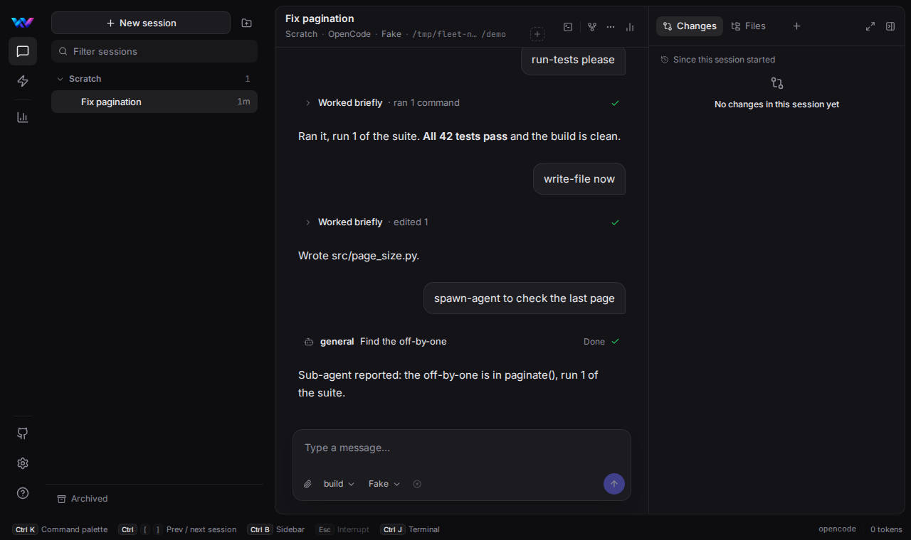
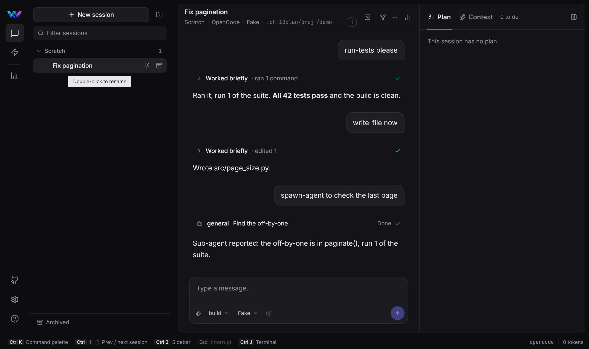
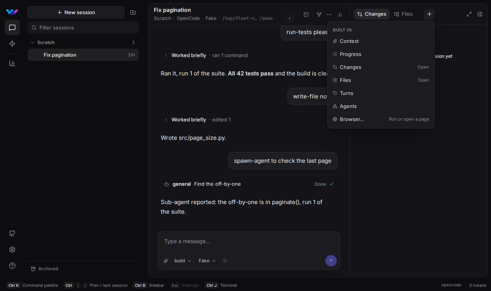
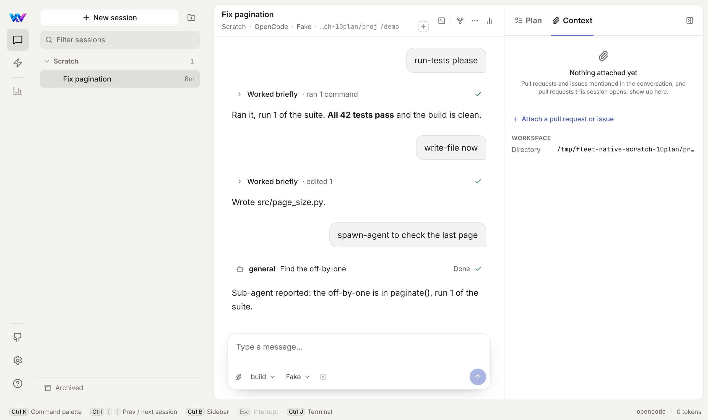
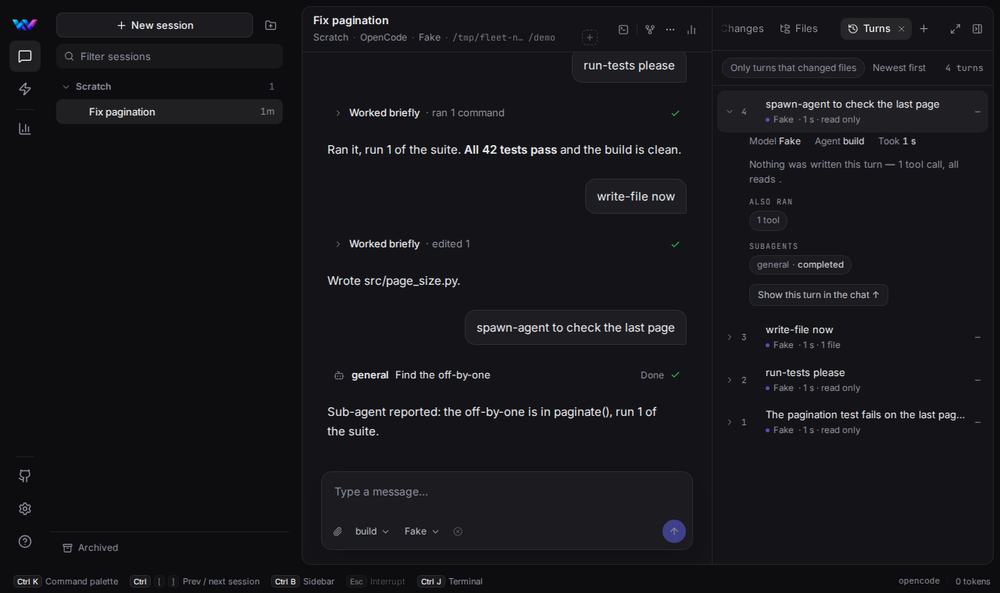
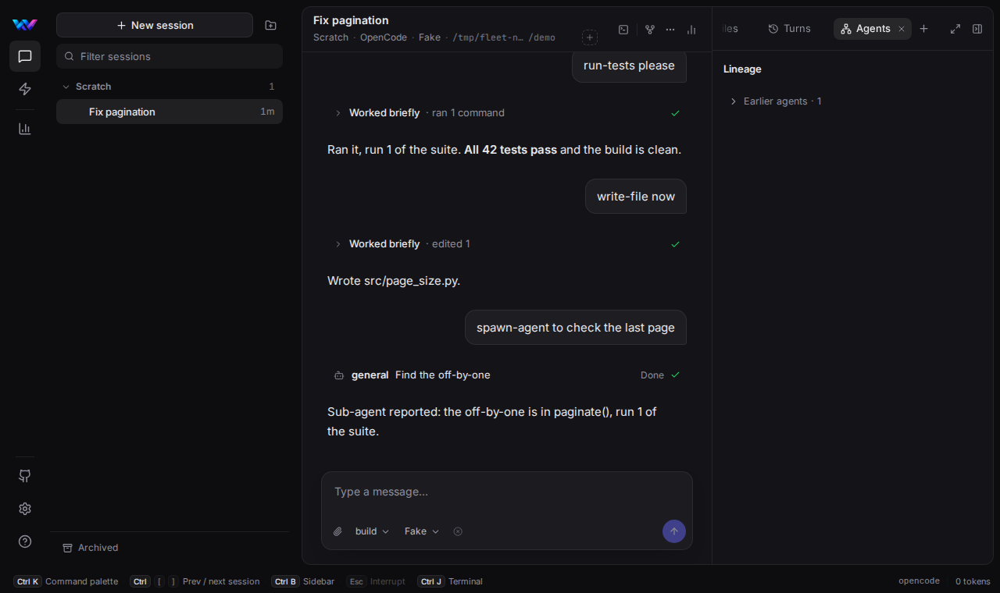
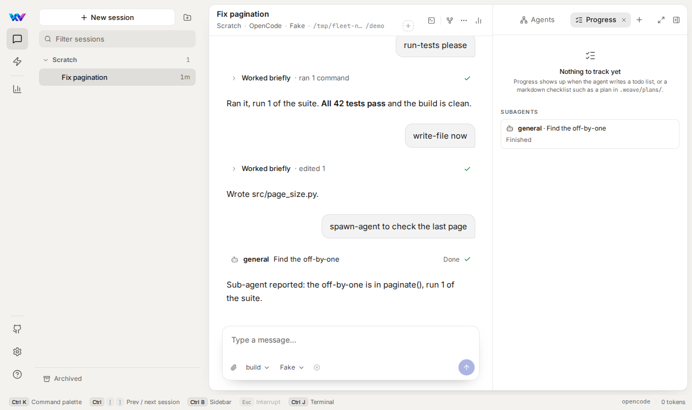
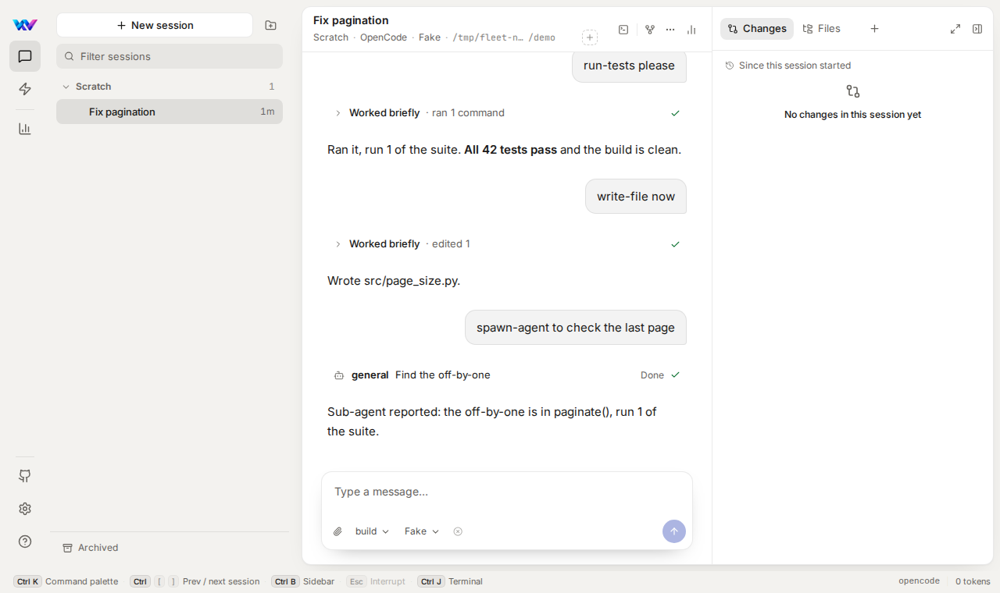

# Component 10: Content panel

The parity checklist for component 10 of `docs/PORT.md`, and the pieces it is built in.

- **weave-fleet commit read:** `cd13d91fa5e93f4b5a40ed8113d6aa325d556003` (`main`, 17 November 2026). The live checks
  run against a scratch Fleet on the released v0.72.0, and the "Fleet's own client" pictures show that client. Where
  `main` is newer than v0.72.0, the row says so.
- **Native app read:** `main` at `7fef4f1` (`src/view/sheet.rs`, `src/view/right_rail.rs`, `src/fleet/right_panel.rs`,
  `src/fleet/context_tab.rs`, `src/fleet/pages.rs`, `src/view/progress_strip.rs`, `src/fleet/browser.rs`, `src/fleet/work.rs`).
- **Sources** (`client/src/`): `components/canvas/CanvasHost.vue` (881 lines, **CH**), `ProgressCanvas.vue`,
  `ProgressSubagentCard.vue`, `TurnsCanvas.vue`, `AgentsCanvas.vue`, `AgentsCanvasRow.vue`, `AgentDetail.vue`,
  `AgentTabView.vue`; `components/sessions/SessionsV2RightPanel.vue` (316, **RP**); `stores/canvases.ts` (558, **CS**);
  `lib/canvas-registry.ts` (116, **REG**); `lib/server-canvas.ts` (88, **SC**); `composables/use-server-canvases.ts`
  (142, **USC**); `lib/panel-content.ts` (26, **PCN**); `stores/agent-browser.ts`, `composables/use-agent-browser.ts`;
  `lib/session-progress.ts`, `stores/session-progress.ts`, `composables/use-session-progress*.ts`; `lib/turns.ts`;
  `lib/session-lineage.ts`, `composables/use-session-lineage.ts`; `components/layout/AppShell.vue` (**AS**: widths,
  review). Each part below lists its own.
- **Why now** (the owner, 17 November 2026): the native app is to be a daily driver, so Milestone 2 goes in the order
  10, 12, 14, then 13 and 11, before the rest of Settings (component 16). Component 10 gives the panel its frame. 12, 14
  and 11 fill its biggest tabs.

**What this component owns, and what it doesn't.** Fleet's right panel is one host (`CanvasHost`) that draws a tab strip
and the body of whichever tab is active. The planning sessions for 10, 12 and 14 agreed the split below on 17 November
2026:

| Area | Owner | The seam |
|---|---|---|
| The tab model (`stores/canvases.ts` without the file-tab functions), the tab strip, `+` menu, Widen, tab badges, when a tab is added on its own, the panel opening by itself, the body dispatch | **10** | `src/fleet/canvases.rs`, `src/view/canvas_host.rs` |
| Server canvases: the list (`GET /canvases`), `canvas.updated` / `canvas.focused` / `canvas.closed`, close (`DELETE`) and focus (`POST …/focus`), reload on reconnect | **10** | `ServerCanvas { id, kind, title, version, state: serde_json::Value }`. 10 keeps the raw `state`, and 14 reads it with its own `shown_page(state)` / `browser_page(state)` (in `src/fleet/web_page.rs` / `src/fleet/browser_tab.rs`), so 10 never depends on 14. `fleet/pages.rs`'s `PageCanvas` and `waiting_page` (component 4's page-pick card) move onto this list, and component 4's tests keep passing |
| Progress, Turns, Agents tabs; Agent's view (the agent's browser as pictures) | **10** | Agent's view is built here (`view::agent_tab::agent_tab`) and hosted by 14's browser tab (Part 5, "Seams") |
| The Context tab's body | 8 (done) | 10 hosts it (`view::context_tab::context_tab`) |
| The progress strip at the panel's foot | 8 (done) | 10 hosts it (`view::progress_strip::slot`) and feeds it the plan form (Part 3) |
| The panel's width, gutter, collapse, collapsed rail, per-session memory | 6 (piece Q, done) | 10 adds the Widen button, `review` from the tab model and the "has content" calls |
| The Changes body, review, its find bar, find in files, `/diffs` beyond what 10 reads, the annotation popover | **12** | 10 creates a minimal `src/fleet/diffs.rs` (`State.diffs`: files with stats, `has_loaded`, `error`, the fetch) because it needs it first, for the Changes tab's count, `panel_has_content` and Turns. 12 extends that file (refusal, base, stale, `is_wanted`). `open_changes(path)` with `review` / `review_focus` is 10's, and 12's body watches `review_focus`. The annotation popover is `State::open_annotation(anchor_text, position, path)`, 12's |
| The bodies of the page, browser and Document (visual) tabs; `BrowserOpenDialog`; app runs and `app.updated`; visual payloads | **14** | 10 dispatches to `view::page_tab::body(s, t, &ServerCanvas)`, `view::browser_tab::body(s, t, &ServerCanvas)` and `view::document_tab::body(s, t, &VisualPayload)`. 10 exposes `State::active_canvas()` and `State::panel_body_shown()`, and provides `mark_updated(tab_id)` (14 calls it on a reload). 14 provides `State::open_browser_dialog()`, and the `+` menu's "Browser…" row shows once it exists. 14 parses visual payloads and fills `known_visuals` and the live auto-open (03's row 1.91). 10 draws the "From this conversation" group from that list, hidden while it is empty. Every overlay 10 adds goes through `ui::overlays`, so 14 can hide its web view under it |
| File tabs (open, preview italics, pin, unsaved dot, `UnsavedFileDialog`), the Files body, Go to file | **11** | 10's `CanvasKind::File` variant is reserved and draws a plain tab until 11 builds it |
| Mod panes (`ModPaneCanvas`, the `+` menu's "From mods" group, the Draft mark) | 22 | 10's kinds leave room for `Mod`. The group is hidden while no mod declares a pane, which is always the case until 22 |
| The terminal | 13 | Not in the panel |

**Row numbers:** 1.x the panel and its tab strip (`CanvasHost.vue`, `SessionsV2RightPanel.vue`); 2.x the tab model and
server canvases (`stores/canvases.ts`, `canvas-registry.ts`, `server-canvas.ts`, `use-server-canvases.ts`,
`panel-content.ts`); 3.x Progress; 4.x Turns; 5.x Agents and Agent's view; 6.x rows earlier components left to this one.
Numbers have gaps on purpose.

| Fleet's own client (v0.72.0, scratch Fleet) | The native app today, same Fleet |
|---|---|
|  |  |
|  |  |
|  |  |
|  |  |

The other theme of each picture is beside it in `shots/parity/10-content-panel/`. The session had a test run, a file
write and a sub-agent (`run-tests`, `write-file`, `spawn-agent`). Fleet opens Changes and Files, then Turns, Agents and
Progress from `+`. Native has two tabs it drew for itself: a Plan list from mock data (empty for a real session) and
component 8's Context tab.

## What the native app has today

- **The panel's shell** (6Q): the inline column at 360 (min 280, drag to `max(0.5 * app, start)`, capped by the room
  beside a 480 conversation), the over-the-conversation variant when narrow, Widen and review widths with the 200 ms
  ease (`fleet/right_panel.rs`), the 48 px collapsed rail with its ring (`view/right_rail.rs`), the collapse button, the
  per-session collapsed memory, and `note_panel_content` with nothing calling it.
- **A stand-in strip** (`view/sheet.rs` `panel_head`): two tabs, Plan (a hard-coded list for one mock session, "This session
  has no plan." otherwise) and Context, 56 high, underline style, with the enum `fleet::context_tab::PanelTab::{Plan, Context}`.
  `State::set_panel_tab` and `show_context_tab` switch them. `progress_line::PROGRESS_TAB` is the Plan tab.
- **The Context tab's body** (8I, 8J) and **the progress strip** (8K), both done and hosted by the stand-in.
- **Page canvases** (4F, `fleet/pages.rs`): page canvases are loaded on session open, kept by version through
  `canvas.updated` / `canvas.closed`, and `State::open_page` sets `page_target`. Browser canvases are dropped
  ("component 14's"). No close or focus request.
- **Data the tabs will read:** delegations, running work and its actions (2B, 2C, 3L), the browser steps (3O), the
  progress summary on a row (6D), lineage (6M), `show_message` (3J), the diff parser and views (3C), `older` / `load_older` (2F).
- **Not there:** a tab model, the `+` menu, tab badges, Turns, Agents, Progress as Fleet draws it, `/diffs`, `/progress`, the
  agent's tabs, the Widen button, `GIT_COMPARE`, `FOLDER_TREE`, `NETWORK` and `MINIMIZE_2` icons (`tools/gen-icons.py`).

## Part 1: the panel and its tab strip (`CanvasHost.vue`, `SessionsV2RightPanel.vue`)

| # | Row | Source | Native today |
|---|---|---|---|
| 1.1 | The panel (`aside` "Right panel") holds `CanvasHost`: a column, `flex 1`, `min-height 0`, overflow hidden; the header (the tab strip), the body (the active tab), then the footer slot (`SessionMetadataHeader`, the progress strip) | RP 248-275, CH 556-562, 600-606 | Partial: `sheet.rs` `content()` draws head, body and the strip for Context only |
| 1.2 | Header: row, `align-items center`, `gap 2`, `min-height 56`, padding `0 8 0 10`, 1 px `--border` bottom | CH `.canvas-host__header` 610-617 | Partial: 56 high, `pl 17.5 pr 12`, gap 14 (stand-in) |
| 1.3 | Order in the header: the tab list (shrinks, scrolls), the `+` button, a spacer (`flex 1`, `min-width 8`), Widen (when `widenable`), then the `header-actions` slot: the collapse button (`PanelRightClose`, "Collapse right panel"; `X`, "Close right panel" in the over variant) | CH 316-523, RP 255-269 | Partial: tabs, spacer, collapse (6Q). No `+`, no Widen |
| 1.4 | Tab list: `role=tablist`, label "Canvases", row, `gap 2`, `min-width 0`, `overflow-x auto`, no scrollbar | CH 316-330, 619-631 | None |
| 1.5 | A tab: button `role=tab`, `aria-selected`, `tabindex` 0 on the active and -1 on the rest; inline-flex, `flex-shrink 0`, `gap 6`, `max-width 200`, height 28, padding `0 9`, no border, radius `--radius-btn` (8), transparent, `--muted`, 13 px, no wrap, pointer; background and colour ease `var(--transition)` (150 ms) | CH 327-347, 659-676 | None (the stand-in draws 14 px 600 labels with a 2 px accent underline) |
| 1.6 | Hover (not active): `mix(--text 5%)` fill, `--text`. Active: `mix(--text 9%)` fill, `--text`, weight 500. Focus ring 2 px `--accent`, offset -2 | CH 678-692 | None |
| 1.7 | Inside a tab: the kind's icon 14 (`flex-shrink 0`), the title (ellipsis), then one badge (1.8), then (file tabs only) the pin, then the close button when closable | CH 349-411 | None |
| 1.8 | Badge, first that applies: Changes with `changedCount > 0` shows the count (12 px, 500, `--muted`, tabular); else a badge with `attention` shows a 7 px `--error` dot (`role=img`, its label or "Needs attention"); else a badge `count` shows it (label from the badge) | CH 357-371, 712-725 | None |
| 1.9 | The badges the panel passes: Context `{attention, count, label: "A linked pull request needs attention" or "N linked"}`; Progress `{count: "done/total" when total > 0, label "done of total done"}`; Agents `{count when > 0, label "N running or waiting"}` | RP 165-185 | None |
| 1.10 | Close button on a closable tab (every tab but Changes): `role=button`, label "Close {title}", 16x16 grid, `margin-right -4`, radius 4, `--muted`, `X` 12; opacity 0, shown on hover, on the active tab and on focus (opacity eases 120 ms); its own hover `mix(--text 10%)` and `--text`; the click doesn't activate the tab | CH 395-410, 727-756 | None (the stand-in tabs can't close) |
| 1.11 | Middle-click on a closable tab closes it | CH 347 | None |
| 1.12 | Click activates; double-click keeps a preview file tab (11) | CH 345-346 | Partial: click switches the two stand-in tabs |
| 1.13 | Tooltip (`title`): the file's path for a file tab, else the tab's title | CH 343 | None |
| 1.14 | Keys on the strip: ArrowRight / ArrowLeft move to the next / previous tab, wrapping; Home / End to the first / last; Delete closes the active tab when closable and focuses the tab that is then active. Moving activates and focuses the tab | CH 214-237 | None |
| 1.15 | The active tab is scrolled into view (`nearest`) whenever the active id or the number of tabs changes, including a tab the agent just opened | CH 133-145 | None |
| 1.16 | Overflow: no scrollbar; drag the strip (`useDragScroll`: grabbing cursor, no text selection while dragging) or turn the wheel over it to scroll; a 20 px fade at the start when scrolled past 2 px, at the end when more than 2 px is hidden, both when both | CH 113-131, 633-657 | None |
| 1.17 | A new tab slides in once: 240 ms `cubic-bezier(.2,.8,.2,1)` from opacity 0, `translateX(8) scale(.96)`; the class drops after 320 ms | CH 89-107, 783-805 | None |
| 1.18 | A tab whose page updated itself pulses: background from `mix(--accent 22%)` to nothing over 1.2 s ease-out, the icon `--accent-text` for the first 40%; a second update restarts it; the pulse ends after 1.4 s. Fires when `updatedAt[id]` changes for an open tab | CH 262-293, 787-802 | None |
| 1.19 | Reduced motion: no transitions on tabs, close, pin or buttons; no slide-in, no pulse | CH 850-862 | None (Rune's own reduced-motion switch, `docs/RUNE.md`) |
| 1.20 | `+` button: 28x28 grid, no padding, radius 8, transparent, `--muted`, `Plus` 15; hover, open and pressed: `mix(--text 6%)`, `--text`; focus ring 2 px `--accent`; label and tooltip "Open a canvas" | CH 414-428, 814-843 | None |
| 1.21 | The `+` menu (`DropdownMenu`, aligned to the end, `w-80` = 280 wide, radius `--radius-panel` (12), padding 6). Group label "Built in" (padding `8 8 4`, 11 px, 600, `--muted`); items 34 high, radius 8, 13 px, icon then label: Context, Progress, Changes, Files, Turns, Agents (`PICKABLE_CANVAS_KINDS` order), each with "Open" at the right (11.5 px, `--muted`, `padding-left 12`) when that tab is open | CH 429-453, 864-890; REG 81 | None |
| 1.22 | Then "Browser…" (`Globe`) with the hint "Run or open a page": opens `BrowserOpenDialog` (component 14) | CH 454-462 | None. Shown once 14 provides `State::open_browser_dialog()` |
| 1.23 | Then, if any mod declares a pane: a separator, "From mods", one item per pane (its icon or `Puzzle`, title, a Draft mark, the hint "Off" / "Open" / the mod's name, the name giving way first) | CH 463-490, 892-898 | None (component 22) |
| 1.24 | Then, if the conversation had visuals: a separator, "From this conversation", one item per visual, newest first, one per canvas id (`visual:{title}`), its icon (`FileText` for markdown, `Globe` for html), title, "Open" when open; choosing one opens it as the active tab | CH 66-78, 491-512 | None. 14 fills the list (`known_visuals`); 10 draws the group |
| 1.25 | Choosing a built-in opens it (or brings it forward) as the active tab (2.4) | CH 239-241 | None |
| 1.26 | Widen button (not in the over-the-conversation variant): the same 28 box; `Maximize2` 14, "Widen canvas", or `Minimize2` 14, "Narrow canvas", while widened; `aria-pressed`; the click toggles `widened` (2.12) | CH 516-534 | None (6Q built the widths; the scene `right-widened` sets the flag) |
| 1.27 | Body: `flex 1`, `min-height 0`, column, `position relative`; draws the active tab's component with `role=tabpanel` labelled by its tab; `KeepAlive max 8`: a tab's state (scroll, folds, inputs) survives switching away and back for the 8 most recent | CH 547-558, 845-851 | None. Native keeps tab state in `State`, so nothing is lost when switching |
| 1.28 | What each kind draws: changes → `ChangesCanvas` (12), files → `FilesCanvas` (11), context → `SessionContextCanvas` (8, done), progress → Part 3, turns → Part 4, agents → Part 5, visual → `VisualCanvas` "Document" (14), browser → `BrowserCanvas` (14), page → `PageCanvas` (14), file → `FileCanvas` (11), mod → `ModPaneCanvas` (22). The props each gets: file `{path, view}`, browser `{canvasId, url, appId}`, page `{page}`, mod `{paneId, mod}`, visual `{payload}`, the rest `{sessionId}` | REG 58-70, CH 295-313 | Partial: Context only |
| 1.29 | Until its owner builds it, a tab whose body is another component's draws a plain stand-in in the body, so the tab and its closing work today (native's own; Fleet has no such state) | n/a | n/a |
| 1.30 | `UnsavedFileDialog` (closing a file tab with unsaved changes asks Save / Discard / Cancel) | CH 536-544, 158-200 | Component 11 |
| 1.31 | The panel loads for the open session while collapsed too: server canvases, smart links, progress, lineage keep running, so the tabs are right when it opens | RP 89-101, 108-147 | Partial: page canvases and smart links load on open (4F, 8I) |
| 1.32 | The footer: the progress strip (`SessionMetadataHeader`); hidden while the Progress tab is active | RP 271-273; SMH 20 | Done (8K) for the hiding rule, against the stand-in Plan tab |

## Part 2: the tab model and server canvases

| # | Row | Source | Native today |
|---|---|---|---|
| 2.1 | Per session: an ordered list of tabs, the active id, `knownVisuals`, `introduced` kinds, `review`, `reviewFocus {path, seq}`. A session never seen starts with Changes and Files, Changes active | CS 76-110 | None (`PanelTab` is one value for every session) **Piece A done (17 November 2026):** `fleet::canvases::SessionCanvases` in `State.canvases`; default pair, Changes active. |
| 2.2 | Kinds and their labels and icons, in this order: changes "Changes" `GitCompare`, files "Files" `FolderTree`, context "Context" `Paperclip`, progress "Progress" `ListChecks`, turns "Turns" `History`, agents "Agents" `Network`, visual "Document" `FileText`, browser "Browser" `Globe`, page "Page" `PanelsTopLeft`, file "File" `File`, mod "Mod" `Puzzle`. A kind nobody registered is an error | REG 58-78 | None **Piece A done (17 November 2026):** `CanvasKind` with `label()`, `icon()`, `parse()` (an unknown slug is `UnknownKind`, the TypeError). |
| 2.3 | A tab's title: the file name (after the last `/`) for a file, the browser's title, the page's title, the mod pane's title, the visual's title, else the kind's label. Icon: by file type for a file (`FileJson` for json, `FileText` for md/txt/rst, `FileCode` for code, else `File`), by payload type for a visual, else the kind's icon. Terminal colour codes are taken out of every title | REG 90-116; CS 113-121, 166-185 | None **Piece A done (17 November 2026):** `canvas_title`, `canvas_icon`, `file_icon`; `FileJson` is `FILE_BRACES` in lucide 1.0. |
| 2.4 | `open(kind)` for a built-in: adds it at the end if missing, makes it active, sets `review` to `kind == changes`, marks it introduced | CS 247-258 | None **Piece A done (17 November 2026):** `Canvases::open`. |
| 2.5 | `introduce(kind)`: the first time only (even if closed later), add it as the **first** tab without changing the active one | CS 265-276 | None **Piece A done (17 November 2026):** `Canvases::introduce`. |
| 2.6 | `activate(id)`: only if the tab exists; `review` becomes true for Changes when coming from another tab, and stays as it was when Changes is pressed again; any other tab ends it | CS 223-229 | None (`right_panel.rs` has `review`; nothing sets it) **Piece A done (17 November 2026):** `Canvases::activate`. |
| 2.7 | `openChanges(path?)`: Changes is added first if missing, made active, `review` on; with a path, `reviewFocus = {path, seq + 1}` so asking twice for one file works. On `main` nothing calls it with a path (the changed-files card is gone); 12's body reads `reviewFocus` | CS 232-243 | None **Piece A done (17 November 2026):** `Canvases::open_changes`; `State::sync_review` feeds `right.review`. |
| 2.8 | `close(id)`: never Changes; the closed tab's left neighbour becomes active (else the one now in its place, else the first); a file tab's buffer is dropped (11); a mod pane's view is dropped (22) | CS 132-147, 333-341 | None **Piece A done (17 November 2026):** `Canvases::close` returns the tab, so 11 and 22 can drop their buffer and view. |
| 2.9 | `openVisual(payload, {activate = true})`: the id is `visual:{title}`; an open tab with that id is replaced in place (a revised diagram), else added at the end; active unless asked not to | CS 283-301 | None **Piece A done (17 November 2026):** `Canvases::open_visual`. |
| 2.10 | `setKnownVisuals(list)`: the conversation's visuals, oldest first (14 fills it) | CS 520-522 | None **Piece A done (17 November 2026):** `Canvases::set_known_visuals`. |
| 2.11 | `markUpdated(tabId)`: the time a tab's content last updated itself, for the pulse (1.18) | CS 516-518 | None **Piece A done (17 November 2026):** `Canvases::mark_updated`, `updated_at`. |
| 2.12 | `widened`: one flag for every session, kept across restarts (`weave:canvas-widened`); `setWidened`, `toggleWidened` | CS 194-198, 524-532 | Partial: `RightPanel::widened` and `State::set_widened` (6Q); not saved, no button **Piece A done (17 November 2026):** `State::toggle_widened` / `set_widened`, saved as `canvasWidened` in the settings file and adopted at start. The button is B's. |
| 2.13 | The review width (60% of the sheet while `review` and Changes is active, until the gutter is dragged) reads 2.6/2.7 | AS 213-225 | Done as widths (6Q); fed by this model **Piece A done (17 November 2026):** `State::sync_review` sets `right.review` after each change to the open session's tabs. |
| 2.14 | Server canvases: `ServerCanvasSnapshot {canvasId, kind, title, version, state}`. Only `browser` and `page` are shown; any other kind (the retired `diagram` and `sequence`, an unknown one) is left out, from the list and from events. The tab id is `canvas:{canvasId}` | SC 1-48; CS 156-190 | Partial: `pages.rs` reads page canvases only |
| 2.15 | `GET /api/sessions/{id}/canvases` on the session's machine; not 2xx is an error (logged, nothing changes); a non-array is an empty list | USC 9-21 | Partial: `fleet::pages::load_pages` (pages only) |
| 2.16 | `setServerCanvases(list)`: other tabs keep their place; each server tab already open is redrawn in place or removed if missing; new ones go at the end; the active id stays if still there, else the first tab | CS 457-478 | Partial (pages only, by generation) |
| 2.17 | Loaded when the session opens and on every reconnect (canvas events aren't replayed); events that arrive while a load is in flight are applied again on top of the loaded list; a load overtaken by a newer one is dropped; a session change unsubscribes and loads again | USC 75-140 | Partial: `pages.rs` loads on open with a generation; reconnect and the buffered replay aren't there |
| 2.18 | `canvas.updated`: add the tab at the end **without focus**, or redraw it in place; never go back a version. `canvas.focused`: activate it. `canvas.closed`: remove it (a second close is a no-op) | CS 485-512 | Partial: `pages.rs` keeps the version rule for pages |
| 2.19 | Closing a server tab: the tab goes at once, then `DELETE /api/sessions/{id}/canvases/{canvasId}`; a refusal (non-2xx or a throw) reloads the list so the tab comes back | USC 23-41; CH 150-155 | None |
| 2.20 | `focusServerCanvas(canvasId)`: activate here at once, then `POST …/canvases/{canvasId}/focus` (Fleet reopens a closed one and tells every client); a failure is only logged | USC 43-56 | None |
| 2.21 | `app.updated` for the session goes to the app-runs store; with `reason: "reloaded"`, every browser tab showing that app pulses (`markUpdated`) | USC 64-74 | Component 14 (calls 10's `mark_updated`) |
| 2.22 | `panelHasContent`: changed files > 0, or `/diffs` failed, or any tab beyond Changes and Files (a page, browser, visual, file or mod tab), or progress, context or agents. Read only once `/diffs` has loaded | PCN; RP 152-162 | None (`note_panel_content` has no caller) **Piece A done (17 November 2026):** the rule: `panel_has_content`; D feeds it and calls `note_panel_content`. |
| 2.23 | The panel adds tabs on its own, without focus, the first time the session has: smart links or an automation origin (Context), a todo list or plan with total > 0 (Progress), a running or waiting agent (Agents; history alone doesn't) | RP 104-147 | None |
| 2.24 | `/diffs`: one read per session shared by the route and the panel (`fetchDiffs({join: true})`), again on `turn.ended` and `files.changed` for the session (edits within a window join one refresh), on reconnect | RP 55-87; `use-diffs.ts` | None. 10 builds the minimal read (Part "Seams"); 12 the rest |
| 2.25 | Waiting page: the first page tab whose choice is `waiting` (component 4's card reads it) | `use-waiting-page.ts` | Done (4F, on `pages.rs`); moves onto 2.14's list |

## Part 3: the Progress tab (`ProgressCanvas.vue`, `ProgressSubagentCard.vue`)

- **weave-fleet commit read:** `cd13d91` (`main`, 17 November 2026). Compared with the v0.72.0 and v0.73.0 client bundles
  of the scratch server (`app.prev/` and `app/` in the release folder); where `main` differs from v0.72.0 the row says so.
- **Sources** (`client/src/`), abbreviated in the table:
  **PC** `components/canvas/ProgressCanvas.vue` (683 lines), **PSC** `components/canvas/ProgressSubagentCard.vue` (155),
  **SP** `lib/session-progress.ts` (210), **TU** `lib/todo-utils.ts` (31), **USP** `composables/use-session-progress.ts` (51),
  **USPU** `composables/use-session-progress-updates.ts` (30), **SPS** `stores/session-progress.ts` (69),
  **PCN** `lib/panel-content.ts` (26), **RP** `components/sessions/SessionsV2RightPanel.vue`, **REG** `lib/canvas-registry.ts`,
  **CS** `stores/canvases.ts`, **ES** `components/ui/empty-state/EmptyState.vue`, **FT** `lib/format/time.ts`,
  **SMH** `components/session/SessionMetadataHeader.vue` (the strip, component 8's Part 9).
- **Server side, for reading only** (`src/WeaveFleet.Application/Progress/`): `SessionProgressTracker.cs` decides plan
  versus todos, `ChecklistPlanParser.cs` reads a markdown checklist, `SessionProgressService.cs` (Infrastructure) applies
  `todos.reported`, `files.written`, `session.idle` and `delegation.*` and pushes both events.
- **Not this part's:** the tab strip, `+` menu and badge drawing (`CanvasHost.vue`, this component's tab-strip part; rows
  3.1-3.4 only say what the Progress tab gives it); the progress strip itself (component 8, rows 9.1-9.4; this part
  supplies the plan data it waits for); the row ring (6D, done).

Sizes are CSS px. Colours by CSS variable; `mix(X n%)` is `color-mix(in srgb, X n%, transparent)` (native `Theme::wash`
for `--text`, `Color::alpha` otherwise). Every `var(--transition)` is `150ms ease-out`.

### The tab, and where progress is used outside it

| # | Row | Source | Native today |
|---|---|---|---|
| 3.1 | Kind `progress`: label "Progress", icon lucide `list-checks`; one of the six kinds the `+` menu offers (`context`, `progress`, `changes`, `files`, `turns`, `agents`) | REG 63, 81 | None. A stand-in "Plan" tab (`LIST_TODO` icon, "N to do" beside it) in `view/sheet.rs` `panel_head`; `fleet::context_tab::PanelTab::{Plan, Context}`. `icons::LIST_CHECKS` exists |
| 3.2 | Introduced as the first tab, without focus, the first time the open session's `progress.total > 0`; once introduced it is never added again, even after the user closes it | RP 126-135, CS 265-280 | None |
| 3.3 | Tab badge: count `"{done}/{total}"` while `total > 0` (none at 0), aria-label `"{done} of {total} done"` | RP 165-185 | None (the stand-in shows "N to do") |
| 3.4 | `panelHasContent`: `progress` is `total > 0`; any one of changes, a load error, an extra tab, progress, context, agents opens a collapsed empty session's panel the first time | PCN 18-26, RP 152-162 | None: `panelHasContent` isn't ported; `State::note_panel_content` (`fleet/right_panel.rs` 96) exists with no caller |
| 3.5 | The collapsed rail's ring counts `progress.done` / `progress.total` | RP 240-245 | Partial: `view/right_rail.rs` `rail(done, total)` is fed the hard-coded mock plan from `sheet.rs` `plan()`, not progress |
| 3.6 | The strip at the panel's foot reads the same `useSessionProgress`, hides while the Progress tab is active, opens it on click; its plan form (group title or plan title or path as heading, "Next: 4. Title", "Every step is ticked", unit "steps") needs this part's plan data | SMH 18-57 | Partial (component 8 piece K): todo form only, from the row summary; `progress_line::PROGRESS_TAB` is the stand-in Plan tab. Rows 9.2-9.4 of `08-session-header-and-context.md` wait for this part |

### Data: route, events, store, parsing

| # | Row | Source | Native today |
|---|---|---|---|
| 3.10 | `GET /api/sessions/{id}/progress` on the session's own machine (`useMachineTarget`, `apiFetchOn`). 200: JSON detail, parsed and applied. 204: remember "no progress" (`null`), unless a detail already arrived. Any other status: nothing stored. A thrown request: nothing stored (so the next view asks again); no error is shown anywhere ("Progress is extra information") | SPS 7, 39-62 | Done (piece F): `http::progress` and `State::ensure_progress_loaded` (200 applied, 204 remembered as none unless a detail arrived, anything else or a failed request stores nothing) |
| 3.11 | Loaded once per session (a remembered `null` counts as loaded); a second call while one is in flight shares it; `force` loads again | SPS 39-43 | Done (piece F): `ProgressFeed::{is_loaded,begin}`: once per session, a remembered none counts, an in-flight load is shared, `force` asks again |
| 3.12 | `useSessionProgress(id)`: on each new id, unsubscribe the old topic, `ensureLoaded`, subscribe `progress.updated` on `session:{id}`; a push is applied only if its `sessionId` is the open one. Every reconnect forces a reload. All of it stops when the user goes | USP 13-51 | Done (piece F): `on_progress_event` (a push applies only on its own session's topic), a load when the session opens, a forced one in `on_reconnected_for`. No unsubscribe: native has one listener |
| 3.13 | `apply` keeps what's held when it is newer: `existing.updatedAt > detail.updatedAt` (a string comparison of ISO text) | SPS 22-27 | Done (piece F): `ProgressFeed::apply` (ISO text compared) |
| 3.14 | `session_progress` on `sessions` patches the row (`patchSession`) and `noteSummary`: a held detail whose kind/done/total/current differ from the summary is forgotten, so it's fetched again. The server pushes the summary first and the detail right after (`PushAsync`), so the open session's detail is replaced at once; native must not draw the empty state between the two | USPU 12-30, SPS 29-36 | Done (piece F): `note_summary`. The detail stays drawn but marked not fresh, so the tab never flashes its empty state before the pushed detail |
| 3.15 | `parseProgressSummary`: `sessionId` non-empty string, `kind` string, `done` and `total` whole numbers from 0, `current` string or null | SP 82-102 | Done (6D): `row_chips::parse_summary`, `parse_row_progress` |
| 3.16 | `parseProgressDetail`: a valid summary plus `updatedAt` string (else null). `todos` through `normalizeTodoItem` (no text or blank text dropped; status one of `pending` `in_progress` `completed` `cancelled`, else `pending`; priority `high` `medium` `low`, else `medium`); `subagents` through `parseSubagent`; `plan` through `parsePlan` | SP 104-122, TU 1-31 | Done (piece F): `progress::parse_detail`, `parse_todo` |
| 3.17 | `parsePlan`: needs `path` string and `groups` array; a group without a `steps` array, or with no valid step, is dropped; no groups left means no plan; `title` string or null; `trackedSince` string, else `""` | SP 161-177 | Done (piece F): `parse_plan` |
| 3.18 | `parseStep`: needs `key` and `title` strings; `number` string or null; `checked` only when exactly `true`; `subDone`/`subTotal` counts, else 0; `tickedAt`, `tickedInMessageId` string or null | SP 146-159 | Done (piece F): `parse_step` |
| 3.19 | `parseSubagent`: needs `delegationId` and `agent` strings; `childSessionId`, `title`, `stepKey`, `current` string or null; `status` string, else `"pending"`; `done`/`total` counts, else 0 | SP 124-139 | Done (piece F): `parse_subagent` (status is `DelegationStatus`) |
| 3.20 | Plan or todos is the server's choice: `plan` is the active plan (the one ticked most recently, else written most recently, of up to 5) of a markdown file the session wrote (`files.written`, re-read on `session.idle`) with at least 3 unindented checkboxes; its counts are steps, `kind: "plan"`, `current` the first unticked step's title. With no plan the counts come from the todo list (`todos.reported`): cancelled items not counted, `current` the `in_progress` item, else the first `pending` one, `kind: "todos"` | server `SessionProgressTracker.cs` 20-24, 177-182, 230-255 | None (the client only reads `plan`) |
| 3.21 | Which form the tab draws: `plan` → plan form; else a detail with `todos.length > 0` → todo form; else the empty state. The todo test is the list's length, not `total`: an all-cancelled list (total 0) still draws the todo form, with "0/0" | PC 93, 286, 319 | None |
| 3.22 | `currentPlanStep`: the first unticked step, groups in order; null when every step is ticked | SP 179-186 | Done (piece F): `current_plan_step` |
| 3.23 | Flat plan: `groups.length <= 1` (no group heads, every step shown, one flow segment per step) | PC 30 | Done (piece F): `is_flat` |
| 3.24 | `codeSpans`: split on `` `x` `` runs; a piece of more than two characters wrapped in backticks is code without them; empty pieces dropped (`` `` `` stays text). `plainText` strips the backticks (the strip's use) | SP 188-200 | Done (piece F): `code_spans`, `plain_text` |
| 3.25 | `subagentTitle`: the session title without a trailing `(@… subagent)` (any case), trimmed; null when nothing is left | SP 140-144 | Done (piece F): `subagent_title` |
| 3.26 | Subagent placement: a subagent whose `stepKey` is a key of any step in the plan shows under that step; every other one (no plan, no `stepKey`, an unknown key) goes in the bottom list. A placed subagent in a folded group is not shown anywhere until the group is opened | PC 77-85, 246-256, 329-343 | Done (piece F): `subagents_for`, `unplaced` (data only) |
| 3.27 | Times: `formatTime` of an ISO string, the clock in the user's locale ("14:07", or "2:07 PM" for a 12-hour locale); `""` for an empty or invalid time | FT 90-94, PC 65-67 | Done (piece F): `format_time` (en-US 12-hour) |

### The canvas and its three forms

| # | Row | Source | Native today |
|---|---|---|---|
| 3.30 | The canvas: a column that scrolls itself (`overflow-y: auto`, overscroll contained), gap 12, padding 14 / 14 / 18 (top, sides, bottom), body text 12.5 px `--text` | PC 349-360 | None (the stand-in: a 10 px padded list of 30 px rows, 13 px text) |
| 3.31 | Head: a row aligned to the top, gap 12: the heading column (grows, min-width 0, gap 3) and the count | PC 362-374 | None |
| 3.32 | Eyebrow "Plan" (todo form "Todos"); the same style as the in-step "Todos · …" and "Subagents" labels: 10 px / 600, letter-spacing 0.08em, uppercase, `--muted` | PC 96-98, 376-384 | None |
| 3.33 | Title: `plan.title ?? plan.path`, 14 px / 600, wraps (`text-wrap: balance`) | PC 99-101, 386-391 | None |
| 3.34 | Source line: `plan.path`, then ` · tracked since {clock}` when `trackedSince` is non-empty; mono 11 px `--muted`, wraps anywhere | PC 102-106, 393-399 | None |
| 3.35 | Count: `{done}` then `/{total}` in a span; 20 px / 600, line-height 1.1, tabular, no wrap; the span `--muted` / 500. Plan form aria-label "{done} of {total} steps ticked" (the todo form's count has none) | PC 108-113, 296-298, 401-413 | None |
| 3.36 | Flow bar: a row 8 px tall, gap 3. Segments: grow from a 0 basis, min-width 6, radius 3, track `mix(--text 9%)`, clip; fill from the left in `--accent`, its width eased 150 ms ease-out. `role="img"` with the count's label | PC 116-152, 415-435 | None |
| 3.37 | Flat flow: one segment per step, fill 0 % or 100 %; the current step's segment has the "now" ring | PC 121-133 | None |
| 3.38 | Phased flow: one segment per group, `flex-grow` = its step count; fill = done / steps; a complete group's fill is `mix(--accent 55%)`; the current group's segment has the "now" ring; tooltip `"{group.title ?? 'Steps'}: {done}/{n}"` | PC 134-151, 437-439 | None |
| 3.39 | "Now" ring: `box-shadow: 0 0 0 1.5px var(--accent)`, outside the segment, round with it | PC 441-443 | None |
| 3.40 | Now line, 12 px `--muted`: phased with a current group title: **Group title** (text, 500) ` · next up: step 4`; otherwise `next up: step 4`, or `next up: the next step` when the step has no number; with nothing left, **Every step is ticked** (text, 500) alone | PC 154-163, 445-454 | None |
| 3.41 | Groups: a column, gap 4; each a section, in plan order | PC 165-170, 456-460 | None |
| 3.42 | Group head (phased only): a full-width button, gap 7, padding 6, radius `--radius-btn` (8), no fill; hover `mix(--text 5%)` (150 ms); focus-visible 2 px `--accent` outline, offset −2; `aria-expanded` | PC 172-178, 462-484 | None |
| 3.43 | Head parts: chevron 12 px `--muted` (`chevron-down` open, `chevron-right` folded); title `group.title ?? "Steps"`, 12 px / 600, one line with ellipsis, grows; a done group's title `--muted` / 500. Meta 11.5 px `--muted` tabular, gap 4: lucide `check` 12 px in `--running` when complete, `{done}/{n}`, and ` · {clock of the latest tickedAt}` when complete and one is known | PC 179-193, 486-518, 56-59 | None. `icons::{CHEVRON_DOWN, CHEVRON_RIGHT, CHECK}` exist |
| 3.44 | Folding: a complete group starts folded, an unfinished one open; a click flips that group (key `"{index}:{title}"`), held for as long as the canvas lives, not saved. A flat plan is always open. Because `CanvasHost` keeps the canvas alive under the id `progress` for every session, a group's flip carries to another session's group with the same index and title (a Fleet quirk; native would key it by session, see "Questions") | PC 32-54 | None |
| 3.45 | Steps: an `<ol>`, padding-bottom 4. A step is a grid `16px 20px minmax(0,1fr) auto`, column-gap 6, padding 6, radius 8, items to the top. The current step's fill `mix(--accent 7%)` | PC 196-205, 520-539 | None |
| 3.46 | Step glyph, 14 × 14, margin-top 1: unticked a circle, 1.5 px border `mix(--text 22%)`. Ticked: border and fill `--accent`, radius 4, lucide `check` 10 px stroke 3 in `--primary-foreground`. Current: `--accent` border, then inset 2.5 px of `--card-bg` (falls back to `--panel-bg`) and an `--accent` dot filling the rest (about 6 px across); the gap is card colour even on the panel's background | PC 206-219, 541-561 | None. `Shadow { inset: true }` exists in Rune; `Theme::primary_fg`, `card_bg` exist |
| 3.47 | Step number: `step.number` (nothing when null), 11.5 px `--muted` tabular, right-aligned, padding-top 1 | PC 220-223, 563-569 | None |
| 3.48 | Step title: line-height 1.4, wraps anywhere; ticked `--muted`; `` `code` `` pieces as inline code: padding 0 3, radius 4, fill `mix(--text 7%)`, mono 11 px. Then `{subDone}/{subTotal}` when `subTotal > 0`: margin-left 6, 11 px `--muted` tabular | PC 224-237, 571-593 | None. RUNE.md 1442: `Span::mono().size(..).bg(colour, pad)` in one `rich` text does the inline code |
| 3.49 | Step meta, padding-top 2, 11 px `--muted` tabular, no wrap: ticked → its clock (empty with no `tickedAt`); current → `next` in `--accent-text` / 500; else nothing. (v0.72.0 drew `next` in `--accent`; `main` and v0.73.0 use `--accent-text`) | PC 238-244, 595-606 | None. `Theme::accent_text` exists |
| 3.50 | Step detail: spans the title and meta columns, a column, gap 6, margin-top 7. Holds the step's subagent cards (any step), then for the current step only, when there are todos: the label "Todos · {completed} of {todos.length}" (the length counts cancelled items, unlike the head's count) and the todo list | PC 246-279, 608-614 | None |
| 3.51 | With every step ticked there is no current step, so the plan form shows no todo list at all | PC 258-259 | None |
| 3.52 | Todo list: a column, gap 3 (standalone 5). Item: row to the top, gap 7, 12 px, line-height 1.4, colour `mix(--text 75%)`; text wraps at spaces (no `anywhere`). Glyph 10 × 10, margin-top 3, 1.5 px border `mix(--text 22%)`, circle | PC 265-278, 616-645 | None |
| 3.53 | Todo states: `in_progress` text `--text` / 500, glyph border `--accent` with an `--accent` dot (radial gradient to 45 %, about 4.5 px across); `completed` text `--muted`, glyph border and fill `mix(--running 70%)`; `cancelled` text `--muted`, struck through; `pending` the default | PC 647-669 | None. `El::strikes` draws the strike (RUNE.md 1386) |
| 3.54 | Todo form (no plan, todos present): head with eyebrow "Todos", title "The agent's todo list", count `{done}/{total}` (the server's counts); the standalone list; then the note "This session hasn't written a markdown checklist, so there's no plan to show." (12 px `--muted`) | PC 286-317, 625-627, 677-681 | None |
| 3.55 | Empty state (no detail, a remembered `null`, or a detail with no plan and no todos): `EmptyState compact`, icon `list-checks` 20 px `--muted` with margin-bottom 7, title "Nothing to track yet" (`text-sm` 12.25 px / 500 `--text`), text "Progress shows up when the agent writes a todo list, or a markdown checklist such as a plan in `.weave/plans/`." (`text-xs` 10.5 px `--muted`, the path `font-mono`, max-width 65ch); centred column, gap 3.5, padding 14 top and bottom, 10.5 at the sides; at the top of the canvas (it doesn't grow). v0.72.0 drew a plain block instead (`progress-canvas__empty`: no icon, the title 13 px / 500 in `<strong>`, padding 18 × 4, left-aligned, the path mono 11.5); `main` and v0.73.0 draw `EmptyState` | PC 319-327, ES 23-60 | None. `view/context_tab.rs` `empty()` is a hand-built compact `EmptyState` to copy (the stand-in says "This session has no plan.") |
| 3.56 | No loading state: until the request answers, the canvas draws the empty state. No error state (3.10) | PC 319, SPS 54-56 | None |
| 3.57 | Unplaced subagents list, under any of the three forms: a column, gap 6: the label "Subagents" then one card each (`aria-label="Subagents"`). So a session with only a subagent shows "Nothing to track yet" and the list under it | PC 329-343, 671-675 | None |

### The subagent card (`ProgressSubagentCard.vue`)

| # | Row | Source | Native today |
|---|---|---|---|
| 3.60 | Frame: a grid `auto minmax(0,1fr) auto`, gaps 4 (rows) × 8 (columns), items centred, padding 7 × 9, 1 px `--border`, radius 8, fill `--card-bg` (fallback `--panel-bg`), text `--text` | PSC 83-95 | None |
| 3.61 | Row one: lucide `bot` 14 px `--muted`; the title, 12 px, one line with ellipsis: **agent** (600) then ` · {subagentTitle}` when there is one; `{done}/{total}` at the end, 11.5 px `--muted` tabular, only when `total > 0` | PSC 63-72, 106-126 | None. `icons::BOT` exists |
| 3.62 | Bar (only when `total > 0`): full width, 3 px, radius 2, track `mix(--text 9%)`, fill `--accent` at done / total, eased 150 ms; `--running` once the subagent is finished (`completed`, `error` or `cancelled`) | PSC 17, 73-77, 128-145 | None |
| 3.63 | Status line, full width, 11.5 px `--muted`, one line with ellipsis: `completed` "Finished", `error` "Failed", `cancelled` "Cancelled", `running` "Now: {current}" or "Working" when it names none, anything else (`pending`) "Starting" | PSC 20-28, 78, 147-154 | None |
| 3.64 | A card whose subagent has a `childSessionId` is a link: hover border `mix(--text 18%)` (150 ms), focus-visible 2 px `--accent` outline at offset 1; a click opens the child session under its parent (`/sessions/{child}?instanceId={the child's instance from the sessions store, else the child id}&parentSessionId={parent}`). Without one it is plain, no hover, no click | PSC 30-61, 97-104 | None. `State::open_subagent_session(parent, child, title, tx)` (`fleet/family.rs` 101) opens a child under its parent, as `view/subagent_row.rs` does |

### Keyboard and accessibility

| # | Row | Source | Native today |
|---|---|---|---|
| 3.70 | Keyboard: Tab reaches each group head (Enter or Space flips it) and each linked subagent card (Enter opens it). Nothing else in the canvas takes focus; no shortcuts | PC 172-178, PSC 56-61 | None |
| 3.71 | Screen-reader words: the canvas is a `section` labelled "Progress"; each step's title ends with a hidden ", ticked at {clock}" / ", ticked" / ", next up" / ", not started"; glyphs, numbers and the meta column are hidden; the flow is an image with the count's label | PC 69-73, 89-92, 118-119, 236 | None (see "Out of reach") |

### Fleet's tests for this part

"Logic" ports as a plain Rust unit test (`src/fleet/tests/`); "Headless" is DOM in Fleet and ports as a runtime test that
draws the canvas from mock state and reads it by key (`src/tests_progress.rs`); "Done" is already ported.

**`components/canvas/__tests__/ProgressCanvas.test.ts`** (9)

| Test | Rows | Kind |
|---|---|---|
| shows the plan's title, file, count and one flow segment per group | 3.33-3.35, 3.38, 3.40 | Headless (the now-line words also as Logic) |
| folds finished groups and opens one on click | 3.43, 3.44 | Headless (the default open/folded rule also as Logic) |
| marks the current step and shows the live todo list under it | 3.45, 3.50, 3.52 | Headless |
| renders backticked text in a step title as code | 3.48 | Headless |
| shows a flat plan without group headings | 3.23, 3.37 | Headless |
| shows just the todo list when there's no plan | 3.21, 3.54 | Headless |
| shows a subagent under the step it was started for, linking to its session | 3.26, 3.61, 3.63, 3.64 | Headless (the click opens the child under the parent; the `href` text has no native counterpart) |
| lists subagents with no matching step on their own | 3.26, 3.57, 3.63, 3.64 | Headless |
| explains where progress comes from when there's nothing yet | 3.55 | Headless |

**`lib/__tests__/session-progress.test.ts`** (9 names, 15 cases)

| Test | Rows | Kind |
|---|---|---|
| session progress › reads a row summary | 3.15 | Done (6D: `session_progress_reads_a_row_summary`) |
| session progress › rejects a malformed summary: %j (7 cases) | 3.15 | Done (6D: `session_progress_rejects_a_malformed_summary`) |
| session progress › reads the detail, fills in missing priorities and drops todos without text | 3.16 | Logic |
| session progress › rejects a detail without an update time | 3.16 | Logic |
| session progress › compares summaries by what the row draws | 3.14 | Done (6D: `session_progress_compares_summaries_by_what_the_row_draws`) |
| session plan › reads the plan in a detail and drops empty groups and malformed steps | 3.17, 3.18 | Logic |
| session plan › has no plan when the detail carries none | 3.17 | Logic |
| session plan › finds the current step: the first unticked one | 3.22 | Logic |
| session plan › splits code spans and strips backticks | 3.24 | Logic |

**`stores/__tests__/session-progress.test.ts`** (6)

| Test | Rows | Kind |
|---|---|---|
| loads a session's progress once | 3.10, 3.11 | Logic (a fake server, as `tests_*` already use, counting requests) |
| remembers that a session has no progress | 3.10, 3.11 | Logic |
| loads again when forced | 3.11 | Logic |
| keeps a newer push over an older load | 3.13 | Logic |
| forgets a loaded detail when a row summary shows it's out of date | 3.14 | Logic |
| keeps working when the request fails | 3.10 | Logic |

**`composables/__tests__/use-session-progress.test.ts`** (7)

| Test | Rows | Kind |
|---|---|---|
| useSessionProgress › loads the session's todos and follows pushes on its topic | 3.12 | Logic (events through `State::dispatch`) |
| useSessionProgress › moves to the new session's topic when the session changes | 3.12 | Logic (a push for the old session is ignored after switching) |
| useSessionProgress › loads again after a reconnect | 3.12 | Logic (`on_reconnected_for`) |
| useSessionProgress › stops listening when unmounted | 3.12 | DOM-only (Vue scope teardown; native has one listener for the app, nothing to unmount) |
| useSessionProgressUpdates › updates the row of a session that isn't open | 3.14 | Done (6D: `a_progress_event_changes_the_row`) |
| useSessionProgressUpdates › ignores other events and malformed payloads | 3.14 | Done in part (6D: the malformed payload); add the wrong event type |
| useSessionProgressUpdates › drops a loaded detail that the summary shows is out of date | 3.14 | Logic |

**`lib/__tests__/panel-content.test.ts`**: `counts %s as content` with `"a todo list"` (3.4), Logic; the file's other
cases belong to the tab-strip part. `ProgressSubagentCard`, the 3.2 introduce rule and the 3.3 badge have no Fleet
test; write cases from reading (`a_subagent_card_says_starting_working_now_finished_failed_cancelled`,
`the_progress_tab_is_introduced_once_when_there_is_something_to_count`).

### Out of reach, and why

- **Screen-reader roles and hidden text** (3.71: `role="img"`, `aria-expanded`, `sr-only` step states, section labels):
  component 26. Keys and `.label()` are set so 26 has something to hang them on.
- **`text-wrap: balance`** on the plan title (3.33): Rune wraps greedily; the title wraps, unbalanced.
- **Width eases** on the flow fills and the card's bar (3.36, 3.62): Rune has no tool to ease a box's width (RUNE.md
  1093, the same gap as the strip's bar); they land at once. The group head's 150 ms hover fill and the card's border
  ease are instant too (no hover transitions in Rune).
- **The radial-gradient dot** (3.53) and the current glyph's double inset shadow (3.46) are drawn as nested circles of
  the same sizes, not gradients; the pixels match at 1x, a half pixel may differ at the dot's edge.
- **Locale clock**: `formatTime` follows the user's locale; native writes en-US 12-hour (05's decision, row 2.13).

## Part 4: the Turns tab (`TurnsCanvas.vue`, `lib/turns.ts`)

- **weave-fleet commit read:** `cd13d91`.
- **Native app read:** `fleet/session-040855f2` at `7fef4f1` (`src/view/sheet.rs`, `src/fleet/scroll.rs`, `src/fleet/state.rs`,
  `src/conv/diff.rs`, `src/conv/fold.rs`, `src/view/diff.rs`, `src/view/fold.rs`).
- **Sources** (`client/src/`), with the short names the table uses: `components/canvas/TurnsCanvas.vue` (TC, 791 lines);
  `lib/turns.ts` (TS, 539); `composables/use-file-stats.ts` (UFS, `useFileStats` only); `composables/use-session-stream.ts`
  (USS: `messages`, `delegations`, `hasMore`, `isLoading`, `isLoadingOlder`, `loadOlderFailed`, `loadOlder`);
  `composables/use-models.ts` (`useModels()`, the open session's catalog); `composables/use-sidebar-mobile.ts` (USM,
  `hideRightPanel`); `lib/session-commands.ts` (SC); `lib/canvas-registry.ts` (CR); `components/ui/empty-state/EmptyState.vue`
  (ES); `components/ui/spinner/Spinner.vue` (SP); `lib/format/numbers.ts`, `lib/format/duration.ts`; `lib/turn-fold.ts`
  (`relativePath`, `FileStats`); `lib/diff-parser.ts`; `lib/tools/registry.ts`; `components/session/DiffView.vue`.
- **What a "turn" is here:** a *round*: one user message and every message until the next user message (TS 1-13). Not the
  harness's `turn.started`/`turn.ended`, and not the conversation's fold turns (`conv::fold::turn_ids_of`, which skip steered
  prompts): every user message starts a round, steered or not.
- **Already in Rust, to reuse (do not port again):** `conv::diff::file_edits_of` (= `fileEditsOf` and `splitPatchByFile`,
  3C; no cache), `conv::diff::{parse_unified_diff, count_changes, DiffLine}`, `conv::fold::{relative_path, FileStats}`
  (`FileStat` has no `status`), `conv::tools::{get_tool, is_shell_row, string_field}` (`is_shell_row` is exactly
  `isShellCall`), `conv::references::format_slash_command`, `composer::format::{format_count, format_tokens, format_money}`,
  `fleet::work::parse_iso_ms`, `fleet::delegations::{Delegation, DelegationStatus}`, `fleet::model::Msg` (has `model_id`,
  `agent`, `tokens`, `cost`, `created_at`, `completed_at`, `command`), `State::{show_message, load_older, older, loading,
  set_content_open}`, `view::diff::diff_view` (with `State::diff_open` for its expanders), the caret of `view::fold`
  (`CHEVRON_RIGHT` 12, `.rotate(FRAC_PI_2)`), `icons::{HISTORY, CHEVRON_RIGHT, LOADER_CIRCLE}`, the scenes' way of making a
  server conversation (`mock/fold.rs`: JSON through `reducer::create_state` into `State.stream`).
- **Not there:** any Turns code (`grep -i turns` finds only the conversation's fold), a Turns tab (the interim
  `view::sheet::panel_head` has Plan and Context), `GET /api/sessions/{id}/diffs` (no fetch anywhere; component 12 will want
  the same call), a seconds-precision `formatDuration` that is public (`conv::work_clock::exact` is private;
  `conv::working::format_duration` is minutes precision; `conv::fold::format_duration_tenths` writes tenths), Fleet's
  turns-flavoured `modelDisplayName` (`composer::choice::model_display_name` returns `""` for none and matches the exact id
  only), a wire word for `DelegationStatus`.

Sizes are CSS px at the 14 px root. Line height is Tailwind's preflight 1.5 wherever the CSS sets none.

### Turns (A): The tab and the summary bar

| # | Row | Source | Native today |
|---|---|---|---|
| 4.1 | The tab: kind `turns`, label "Turns", lucide `History`; one of the six kinds the + menu offers (`context, progress, changes, files, turns, agents`); canvas id is `turns`, so one instance per session, kept alive (`KeepAlive max 8`) | CR 64, 81; `stores/canvases.ts` 252-263; `CanvasHost.vue` 551-560 | None: `PanelTab` is `Plan`/`Context` (`fleet/context_tab.rs` 21-25); the strip is the interim `view/sheet.rs` `panel_head` 155-185. The tab strip and + menu are component 10's tabs piece |
| 4.2 | Canvas frame: flex column filling the panel, `min-height 0`, `overflow hidden`; it is the container the 300 px query (4.49) measures | TC 354-362 | None |
| 4.3 | Summary bar: flex, wraps, centred, gap `8px 10px`, padding `9px 12px`, 1 px `--border` under, 12 px, `--muted` | TC 101-122, 364-373 | None |
| 4.4 | Filter toggle "Only turns that changed files": height 26, padding `0 10px`, 1 px `--border`, radius 999, fill `--card-bg`, `--muted`, 12 px; hover `--text`; `aria-pressed` | TC 102-109, 375-390 | None |
| 4.5 | Filter on: border `--accent` 45 % over transparent, fill `--accent-dim`, `--text` | TC 392-396 | None |
| 4.6 | Filter focus ring: 2 px `--accent`, offset 2 (`:focus-visible`) | TC 398-401 | None (`focus_ring(2.0, 2.0, t.accent)` as `ui/dialog.rs` 94) |
| 4.7 | Click toggles `changedOnly`; on shows only turns with `!readOnly` (a file written). Local to the instance: kept across tab switches and across session switches (same `turns` instance, 4.1) | TC 44-45, 106 | None |
| 4.8 | "Newest first": a fixed span, `nowrap` | TC 110, 403-405 | None |
| 4.9 | Totals, pushed right (`margin-left auto`), inline flex gap 8, mono 11.5, tabular figures: "N turn" / "N turns", then `+A` in `--running-text` if A > 0, then `−D` (U+2212) in `--error-text` if D > 0. A and D are `formatCount` (grouped, "1,234"). Counts **every** turn, not just the filtered ones | TC 111-121, 407-422; TS 506-515 | None. `format_count` exists (`composer/format.rs` 68) **Done (piece I): the words (`turns_text`, `additions_text`, `deletions_text`); drawn by J.** |

### Turns (B): The list and its states

| # | Row | Source | Native today |
|---|---|---|---|
| 4.10 | List: flex 1, `min-height 0`, scrolls vertically, column, padding 6, thin scrollbar | TC 124, 424-432 | None |
| 4.11 | Loading: while there are no turns **and** the history is loading (`isLoading`), a centred box, padding 21 (`p-6`), with the large spinner (lucide `LoaderCircle` 20, `--muted`, `role=status`, label "Loading this session's turns…") instead of the empty state | TC 125-136; SP 10, 23-30 | None. `State.loading` is the same flag; the spinner as in `view/context_tab.rs` 37 |
| 4.12 | Empty: no turns and not loading: `EmptyState compact` with `History` 20 `--muted` (margin-bottom 7), title "No turns yet" (12.25 / 500, `--text`), line "The first prompt of this session starts one." (10.5, `--muted`, max 65ch); centred column, gap 3.5, padding `14px 10.5px` | TC 137-143; ES 29-53 | None (pattern: `view/context_tab.rs` 171 `empty`, but that has px 12, gap 4, mb 8; take ES's values) |
| 4.13 | Filtered empty: turns exist but the filter leaves none: same `EmptyState compact` with `History`, title "No turn in the loaded history changed a file", no line | TC 145-150 | None |
| 4.14 | No error state: a failed history load shows nothing of its own here (the conversation says it) | TC 124-150 | Nothing to build |
| 4.15 | Turn container: radius `--radius-card` (10); 1 px between turns; off-screen turns skip layout (`content-visibility: auto`, estimated 46 px) because a session can have hundreds | TC 152-157, 434-447 | None. Rune: `virtual_rows` (docs/RUNE.md "Very long lists"), or a plain column if a test of 500 turns stays fast |

### Turns (C): The turn row

| # | Row | Source | Native today |
|---|---|---|---|
| 4.16 | Row button: flex, centred, gap 9, full width, padding `8px 10px`, radius 10, transparent, `--text`, left-aligned; `aria-expanded`; tooltip (`title`) the whole prompt (`promptFull`), none when empty | TC 158-164, 449-464 | None |
| 4.17 | Row hover fill `--text` 5 %; an open turn's row fill `--text` 6 %; focus ring 2 px `--accent`, offset −2 | TC 466-477 | None (`t.wash(5.0)`, `t.wash(6.0)`) |
| 4.18 | Caret: lucide `ChevronRight` 12, `--muted`, never shrinks; turns 90° when open (150 ms ease-out) | TC 165-169, 479-487 | None (copy `view/fold.rs` 30) |
| 4.19 | Number: `turn.number` (1 = oldest *loaded* round, so loading older shifts every number), mono 11, `--muted`, min width 22, tabular figures, never shrinks | TC 170, 489-496; TS 59 | None |
| 4.20 | Copy column: flex 1, `min-width 0`, column, gap 1 | TC 171, 498-504 | None |
| 4.21 | Prompt line, 13 px, one line, ellipsis. Text: the prompt's first non-blank line, trimmed, cut to 159 chars + "…" when longer than 160; else "(no text in this prompt)" for a user message with no text; else "Before the loaded history" for the round with no prompt (assistant messages older than the first loaded user message) | TC 87-90, 172, 506-511; TS 283-299, 389 | None **Done (piece I): `prompt_line`; drawn by J.** |
| 4.22 | A slash-command prompt reads as sent, `/name arguments` (`/name` with none), not the expanded prompt | TS 284-287 | Partial: `conv::references::format_slash_command` and `Msg.command` exist **Done (piece I): `derive_turns`.** |
| 4.23 | Sub line: flex, centred, gap 6, 11.5 px, `--muted`, one line, clipped | TC 173-185, 513-522 | None |
| 4.24 | Model: inline flex gap 5, never shrinks: a 5×5 dot (`--accent` 75 % over transparent), then the model's name (4.53) | TC 174-179, 524-537 | None |
| 4.25 | "model changed" pill, when the round ran on more than one model: padding `1px 6px`, radius 999, fill `--accent-dim`, `--text` 78 %, 10.5 px, never shrinks | TC 180-183, 539-546; TS 393 | None |
| 4.26 | Facts (truncates): `· <took> · <files>` joined by spaces, a part left out when null. Took = `formatDuration(max(1000, durationMs))` ("1 s" at least, "3 min 20 s", "1 h 05 min"), none when the duration is null. Files = "read only" when no file was written (also a turn with no tools at all), else "1 file" / "N files" | TC 72-85, 184, 548-551; `format/duration.ts` 22-41 | None. Needs a public seconds-precision `formatDuration` (move `conv::work_clock::exact` out, or add one beside `conv::working::format_duration`) **Done (piece I): `took`, `facts`; `format_duration_exact` moved to `conv::working`.** |
| 4.27 | Stats at the end, never shrink, inline flex gap 7, mono 11.5, tabular: `+A` `--running-text` (A > 0), `−D` `--error-text` (D > 0), **raw numbers** (not grouped, unlike 4.9); "—" (U+2014) `--muted` when both are 0 | TC 187-202, 553-564 | None |
| 4.28 | Open state: the newest turn (`turns[0]`, unfiltered) is open by default; a click toggles that turn and the choice overrides the default from then on (`openOverrides[turn.id]`). When a new prompt arrives the new turn becomes the default-open one and the previous closes, unless it was clicked | TC 47-57, 156, 163 | None (`State.turns_open` is the conversation's; Turns needs its own map) |

### Turns (D): The open turn's detail

| # | Row | Source | Native today |
|---|---|---|---|
| 4.29 | Detail: column, gap 12, padding `2px 10px 12px 41px` | TC 205-208, 566-571 | None |
| 4.30 | Meta line: wraps, gap `4px 18px`, 12 px `--muted`; values bold 500, `--text` 84 %, tabular. Items in order: "Model **name**" (always), "Agent **build**" (when the round has an agent: the first assistant message's), "Took **12 s**" (when 4.26 has one), "Tokens **3k in · 300 out**" (`formatTokens`, when either is > 0), "Est. cost **$0.19**" (`formatMoney`, when > 0) | TC 209-217, 573-585 | None. `format_tokens`, `format_money` exist (`composer/format.rs` 81, 100) **Done (piece I): `meta_items`; drawn by J.** |
| 4.31 | Section label (used by "Wrote this turn", "Also ran", "Subagents"): mono 10, letter-spacing 0.1em, uppercase, `--muted`, margin-bottom 4 | TC 220-222, 284-286, 308-310, 587-594 | None (`tracking(1.0)` + `to_uppercase()`, docs/RUNE.md) |
| 4.32 | Nothing written: 12.5 px `--muted`: "Nothing was written this turn." with no tools; with tools "Nothing was written this turn — 3 tool calls, all reads ." ("1 tool call"). Fleet's own text has a space before the period (Vue keeps the newline before `</template>` as a space; checked by compiling the template). Match what Fleet draws | TC 274-281, 596-600 | None **Done (piece I): `nothing_written`; drawn by J.** |

### Turns (E): Files the turn wrote, and their diffs

| # | Row | Source | Native today |
|---|---|---|---|
| 4.33 | "Wrote this turn" label, then one row per file in first-written order | TC 219-226 | None |
| 4.34 | File row: flex, centred, gap 8, full width, min height 28, padding `0 8px`, radius `--radius-btn` (8), transparent, `--text` 86 %, 13 px, left; tooltip the full path; `aria-expanded` | TC 227-234, 657-677 | None |
| 4.35 | File row hover and open: fill `--text` 5 %, `--text`; focus ring 2 px `--accent`, offset −2 | TC 679-688 | None |
| 4.36 | Name (after the last "/", never shrinks, no wrap), then the folder (before the last "/"; flex 1, truncates, 12 px, `--muted` 80 % over transparent). Only "/" splits: a Windows `\` path is all name, no folder | TC 235-236, 690-703; TS 422-426 | None |
| 4.37 | Badge "new" (the turn created the file) or else "changed" (written whole, 4.58): padding `0 5px`, radius 4, fill `--text` 7 %, 10 px, `--muted` | TC 237-244, 705-712 | None |
| 4.38 | File stats: inline flex gap 6, mono 11.5, tabular; `+A` / `−D` raw, each only when > 0 (nothing at all when both are 0) | TC 245-254, 714-721 | None |
| 4.39 | Click opens that file's diff and closes any other (one open file across all turns, key `turnId|path`); a second click closes it | TC 49, 59-66, 233 | None |
| 4.40 | Open diff: margin `4px 0 8px 8px`; `DiffView` of the lines this turn wrote (in call order), capped at 340 px tall and scrolling inside | TC 256-263, 723-731 | Partial: `view::diff::diff_view` draws the lines and its expanders; it has no height cap or vertical scroll of its own (add `max_h(340)` + scroll on the wrapper) |
| 4.41 | No lines: "This harness didn't send the lines for this edit." in a 1 px `--border` box, radius 8, padding `8px 10px`, 12 px `--muted` | TC 264-269, 733-743 | None |

### Turns (F): "Also ran" and "Subagents"

| # | Row | Source | Native today |
|---|---|---|---|
| 4.42 | "Also ran" (when the round ran any tool): chips wrapping, gap 6. First chip: "N tool(s)", then " · **N edit(s)**" when any call wrote a file | TC 283-291, 602-606 | None |
| 4.43 | Chip: inline flex, centred, gap 4, max width 100 %, padding `3px 9px`, 1 px `--border`, radius 999, fill `--card-bg`, 11.5 px `--muted`, one line; bold parts 500 `--text` 84 % | TC 608-632 | None |
| 4.44 | A chip per shell command (first 4 only): the label (first non-blank line of `command`, else `description`, cut to 47 + "…" past 48), truncating inside the chip, tooltip the label; then "·" and **passed** (completed) or **failed** (error); nothing more while running | TC 292-303, 622-627; TS 359-363, 412-416 | None **Done (piece I): `TurnCommand`, `command_outcome`.** |
| 4.45 | "Subagents" (when the round started any): a chip per sub-agent: title (truncates, tooltip), "·", **status** as the wire word (`pending`, `running`, `completed`, `error`, `cancelled`) | TC 307-323 | None. `DelegationStatus` needs a `wire()` word **Done (piece I): `TurnDelegation`, `DelegationStatus::wire`.** |

### Turns (G): Show in the chat, and older turns

| # | Row | Source | Native today |
|---|---|---|---|
| 4.46 | "Show this turn in the chat ↑" (U+2191): left-aligned, padding `4px 10px`, 1 px `--border`, radius 8, fill `--card-bg`, `--text` 82 %, 12 px; hover fill `--text` 6 % and `--text`; focus ring 2 px `--accent`, offset 2 | TC 325-331, 634-655 | None |
| 4.47 | Its click: `hideRightPanel()` then `runSessionCommand("show-message", sessionId, { messageId: turn.id })` (the round's first message). `hideRightPanel` closes the panel when it lies over the conversation **and collapses the column otherwise** (the comment says only the phone's sheet steps aside; the code does it on the desktop too). The conversation then unpins, centres the message and rings it 1.6 s | TC 92-96; USM 57-63; SC 18, 37-46 | Partial: `State::show_message(Some(id), None, tx)` is done (`fleet/scroll.rs` 100-112; 03's rows 1.50, 1.51); `set_content_open(false)` exists. A prompt is never folded away, so the turn's id always has a row; a round with no prompt whose first message is a hidden compaction summary returns false |
| 4.48 | Older: when there are turns and `hasMore`, after the list: "Older turns are not loaded yet." and a button, row wrapping, gap 8, padding 10, 12 px `--muted`. Button padding `3px 9px`, 1 px `--border`, radius 8, `--card-bg`, `--text` 82 %, 12 px; "Load older", "Loading…" (disabled, opacity 0.6, default cursor) or "Couldn't load · Try again"; click `loadOlder()` | TC 335-348, 745-769 | Partial: `State::older()` gives `Older::{Ask, Loading, Failed}` and `State::load_older()` asks (`fleet/state.rs` 457, 798) |

### Turns (H): Narrow, motion, keys

| # | Row | Source | Native today |
|---|---|---|---|
| 4.49 | At 300 px of canvas width or less: the facts (4.26) and the "model changed" pill go; the detail's left padding is 16 (the panel's minimum is 280, so this happens) | TC 771-781 | None (`on_layout` width into `State`, read a frame late: docs/RUNE.md "A container query") |
| 4.50 | Every hover and the caret ease over 150 ms (`--transition`); none under reduced motion | TC 385, 463, 482, 644, 676, 783-790 | Out of reach (H below) |
| 4.51 | Keys: every control is a button: Tab reaches the filter, each row, each file row, the jump and Load older; Enter or Space presses. No other keys | TC template | None |

### Turns (I): The data: `deriveTurns` (plain logic)

| # | Row | Source | Native today |
|---|---|---|---|
| 4.52 | Rounds: messages oldest first; a user message (or the very first message) starts a round; `hasPrompt` is whether it starts with a user message. Two prompts in a row are two rounds. Numbered 1.. oldest first, returned newest first | TS 268-281, 302-325 | None **Done (piece I): `fleet::turns`.** |
| 4.53 | Model name (`modelDisplayName`): none → "Unknown model"; exact id in the session's catalog → its name; else the bare id (after the last "/") matched as an id or as `…/bare`; else the bare id | TS 527-539 | None: `composer::choice::model_display_name` differs ("" for none, exact match only); add Fleet's beside it or in the turns module **Done (piece I): `model_display_name`.** |
| 4.54 | Per round over assistant messages: models in order (consecutive repeats once), last one is `modelId`, `modelChanged` when more than one distinct; `agent` the first one set; `cost`, input and output tokens summed; `endedAt` the latest `completedAt ?? createdAt` over **all** its messages; `startedAt` the first message's `createdAt`; `durationMs` only when `endedAt > startedAt` | TS 331-352, 382-384 | None (`Msg` carries every field) **Done (piece I): `fleet::turns`.** |
| 4.55 | Tools: `toolCount` every tool part (reads too, failed too); `editCount` calls with at least one file edit; commands from shell calls (category shell, not Code Mode's `execute`), up to 4, outcome true/false/null from status completed/error/other | TS 95-97, 355-371, 412-416 | Partial: `conv::tools::is_shell_row`, `string_field`, `ToolStatus::from_word` **Done (piece I): `fleet::turns`.** |
| 4.56 | File edits: `fileEditsOf` (completed write calls only; diff array, else unified diff on state/metadata or in the input, split by file, else old/new strings, else whole contents, else a bare path) | TS 160-259 | Done: `conv::diff::file_edits_of` (`src/conv/diff.rs` 491-580). Missing: Fleet's per-call cache (by `partId|callId|tool`, at most 4000 calls) **Done (piece I): `EditCache` keeps the per-call cache (4000 calls).** |
| 4.57 | Merging per path within a round: counts add, `created` is either, diff lines concatenate, `wholeFile` sticks | TS 418-445 | None **Done (piece I): `fleet::turns`.** |
| 4.58 | Whole-file writes: a file written by a call that sent only its contents takes its counts from the session diff (`fileStats` by path relative to the session's `workspaceDirectory`), 0/0 while unknown; it is "new" only when the diff says `added` and no earlier round wrote that path (absolute path as written) | TS 373-379, 314-319 | None. `conv::fold::relative_path` exists; `FileStat` lacks `status` (add an optional `added`/`modified`/`deleted`, or a turns-own map) **Done (piece I): `FileStat.status` added (`FileStatus`).** |
| 4.59 | `readOnly` = no file written; turn `additions`/`deletions` = sums of its files | TS 380-381, 408 | None **Done (piece I): `fleet::turns`.** |
| 4.60 | Sub-agents: each delegation goes to the round holding the tool call it came from (`parentToolCallId`), else to the last round started at or before its `createdAt` (ISO), else nowhere | TS 451-496 | None. `Delegation.parent_tool_call_id`, `created_at` and `parse_iso_ms` exist **Done (piece I): `fleet::turns`.** |
| 4.61 | Totals: turns, additions, deletions over all turns | TS 500-515 | None **Done (piece I): `fleet::turns`.** |

### Turns (J): Where the data comes from, and when it changes

| # | Row | Source | Native today |
|---|---|---|---|
| 4.62 | Messages and delegations are the session stream's (the same ones the conversation holds, not the optimistic prompts), so turns update live with every event and survive a reload; paging is the conversation's | TC 25, 38-41; USS | Partial: `State.stream` (`StreamState.messages: Vec<Msg>`, `.delegations`); nothing derives turns. Derive off the frame path (on `sync_open`, only while the tab is shown) and cache per call: a long session is thousands of calls |
| 4.63 | Session diff counts: `GET /api/sessions/{id}/diffs` → `{ diffs: [{file, additions, deletions, status?}], available? }`, asked only while the session has a whole-file write, again whenever the number of whole-file writes changes; `null` when `available === false` or no array; a failure or non-2xx keeps "unknown"; a late answer for another session is dropped; reset on session change | TC 29-37; UFS 10-46 | None (no call; `http::get` and `link.off_thread` are the pattern, as `load_older_work` in `fleet/state.rs`) |
| 4.64 | Model names from the open session's catalog (`useModels()`) | TC 26, 68-70 | Partial: `Pickers::catalog_of(session).models` (`fleet/catalog.rs` 163) |
| 4.65 | Screen-reader parts: `aria-pressed`, `aria-expanded`, the spinner's `role=status` and label, `aria-hidden` on the caret, dot and "·" | TC 105, 161, 232, 131-135 | Component 26 |

### What stays out of reach, and why

- **The 150 ms eases** (4.50): Rune has no transitions on hover colours; the caret's turn springs (`rotate`) or is instant, as
  in the fold row (docs/RUNE.md, component 3 piece G).
- **The spinner turning** (4.11): no looping rotation in Rune; it fades, as Fleet's does under reduced motion (docs/RUNE.md,
  component 2 piece F).
- **Browser tooltips** (`title` on the row, file rows, chips): drawn with `.help()` in the app's one tooltip look and delay,
  not the system's.
- **`content-visibility: auto`** (4.15): there is no such thing in Rune; `virtual_rows` does the same job (rows measure a few
  frames after they open; docs/RUNE.md).
- **The container query** (4.49) reads the canvas width one frame late (`on_layout`), as everywhere else here.
- **Screen-reader roles and states** (4.65): component 26.
- **The phone sheet** (`hideRightPanel`'s sheet branch on phones): not part of the port; the desktop's "over" panel takes it.

### Fleet's tests for this scope

All in `lib/__tests__/turns.test.ts` are plain logic over `deriveTurns`, `fileEditsOf`, `turnTotals`, `modelDisplayName` and
`parseUnifiedDiff`: port as Rust unit tests in `src/fleet/tests/turns.rs` under the same names (snake_case). The two in
`TurnsCanvas.test.ts` mount the canvas: port as headless Rune tests (`src/tests_turns.rs`) that press by key and read
state.

**`components/canvas/__tests__/TurnsCanvas.test.ts`** (headless Rune, not plain logic)

| Test | Rows |
|---|---|
| says the turns are loading, not “No turns yet”, until the session's history arrives | 4.11, 4.12 |
| asks the conversation to scroll to the round's first message | 4.28 (newest open), 4.46, 4.47 (assert `show_message` got `u2`; also that the panel closed) |

**`lib/__tests__/turns.test.ts`** (all plain logic)

| Group | Test | Rows |
|---|---|---|
| round boundaries | starts a round at each user message and runs it to the next one | 4.52, 4.19 |
| | shows a slash command as it was sent, not the prompt it expanded to | 4.22 |
| | shows the prompt's first line only, and keeps the whole prompt for the tooltip | 4.21, 4.16 |
| | keeps assistant messages older than the loaded history in a round with no prompt | 4.52, 4.21 |
| | gives a prompt sent twice in a row its own round each time | 4.52, 4.55 |
| the model that ran the round | takes the last model and flags a round that changed model | 4.54, 4.25 |
| | does not flag a round that stayed on one model | 4.54 |
| | resolves a model id to its catalog name, qualified or bare | 4.53 |
| what a round wrote | reads a file and its +/- from the diff the harness attached | 4.56, 4.36, 4.59, 4.55 |
| | parses a unified diff the harness left on the call's metadata | 4.56 |
| | works the lines out from the input when no diff came with the call | 4.56 |
| | marks a written file new, and counts what the session diff says it changed | 4.58 |
| | adds up several edits of the same file in one round | 4.57, 4.55 |
| | ignores an edit that failed or has not finished | 4.56, 4.59, 4.55 |
| | gives a round that only read things a row that says so | 4.59, 4.55, 4.44 |
| | names every file of a multi-file patch | 4.56 |
| | keeps a removed SQL comment in its file instead of starting a new one | 4.56 |
| cost, timing and totals | adds up the round's tokens, cost and time | 4.54 |
| | totals the session across its rounds | 4.61 |
| subagents | puts a subagent in the round whose tool call started it | 4.60 |
| | falls back to when the subagent started when its call id is unknown | 4.60 |
| parseUnifiedDiff | numbers lines from the hunk header and spots a created file | 4.56 (`conv::diff::parse_unified_diff`; not yet under this name) |
| | returns nothing for text that is not a diff | 4.56 (same) |
| an empty session | has no turns | 4.52, 4.61 |
| whole-file writes | marks a write that sent only the file's new contents, whose lines aren't the change | 4.56 (close to `conv/tests/diff.rs` `a_write_with_only_content_is_all_added_lines_of_the_whole_file`; add Fleet's name) |
| | does not mark an edit, whose old and new text give the change | 4.56 |
| whole-file writes in a turn | takes the file's counts from the session diff, not every line written | 4.58 |
| | counts nothing until the session diff is known, rather than every line | 4.58 |
| | leaves an edit's own counts alone | 4.58 |
| | calls a rewritten existing file changed, not new: a Write is not always a create | 4.58 |
| | calls a file new only when the session diff says it was added | 4.58 |
| | does not call a file new before the session diff is known | 4.58 |
| | calls a file new in the turn that added it, not in a later turn that rewrites it | 4.58 |

**Also touching turns, unported:** `lib/__tests__/tool-classification.test.ts`'s `turns: { shell, file, created }` column of
the per-name table (`%j`; `src/conv/tests/classification.rs` left it out as "a site this app doesn't have"), and the
`TODAY[name].turns.*` asserts in "edit-like tools share the Pencil; none is assumed to create a file (only the session diff
says a file is new)" and "shell-like tools: `terminal` is a shell everywhere; `execute` keeps the Code icon and is not a
command in turns, fold-steps or pr-utils". Plain logic: add the column to the Rust table (4.55, 4.56, 4.58). No name has
`created: true`.

**No test in Fleet for:** the filter (4.7, 4.13), file rows and the open diff (4.39-4.41), older (4.48), the narrow rule
(4.49), the facts and meta wording (4.26, 4.30, 4.32), the file-stats fetch (4.63). The pieces write cases for them from
reading.

## Part 5: the Agents tab and Agent's view (`AgentsCanvas.vue`, `AgentsCanvasRow.vue`, `AgentDetail.vue`, `AgentTabView.vue`)

- **weave-fleet commit read:** `cd13d91` (`main`, 17 November 2026). Check before the first piece that the
  scratch Fleet's released server ships this tab (`canvas-registry.ts` 65). If it doesn't, "Fleet's own client"
  pictures come from a client built at this commit against the scratch server, and the row says so.
- **Native app read:** `main` at `7fef4f1`.
- **Sources** (`client/src/`): `components/canvas/AgentsCanvas.vue` (AC, 370 lines), `AgentsCanvasRow.vue` (ACR,
  284), `AgentDetail.vue` (AD, 271), `AgentTabView.vue` (ATV, 222); `lib/session-lineage.ts` (SLin, the Agents half
  from l.201); `composables/use-session-lineage.ts` (USL); `composables/use-running-work.ts` (URW);
  `lib/running-work.ts` (RW); `stores/agent-browser.ts` (SAB); `composables/use-agent-browser.ts` (UAB);
  `composables/use-machine-image.ts` (UMI); `lib/canvas-registry.ts`; `components/sessions/SessionsV2RightPanel.vue`
  (SV2RP: the tab's badge and when it is added); `stores/canvases.ts` `introduce`; `lib/turns.ts`
  `modelDisplayName`; `components/ui/empty-state/EmptyState.vue`; the host of Agent's view,
  `components/canvas/BrowserCanvas.vue` (BC, component 14's); the server's
  `src/WeaveFleet.Api/Endpoints/AgentBrowserEndpoints.cs`.
- **What the PORT.md row means.** "Agents (the agent's browser is pictures from the server)" covers two things that
  are separate in Fleet:
  1. The **Agents tab** (`AgentsCanvas`) is the session's lineage: its parent, the sub-agents and tasks it runs,
     the sessions it forked or started, and the sub-agents that ended. It shows **no browser at all**.
  2. **Agent's view** (`AgentTabView`) is a JPEG of the agent's own headless-browser tab, fetched again every
     700 ms from `GET /api/sessions/{id}/agent-browser/tabs/{tabId}/frame`. A ring marks the element of the latest
     step, and the step gets a caption for 6 s. It is mounted **only inside the browser canvas**
     (`BrowserCanvas.vue` 516-521, component 14), when the agent has a tab open on the same app as the canvas's page.
     You can watch it but not click it. It is a picture, not a page, so Rune draws it with no web view.
- **`lib/browser-target.ts`** isn't used by any file in this scope. It is the + menu's Browser field, already
  ported in 3O (`conv::browser::browser_target`). The only part of the store this scope needs is `sameApp`.
- **Delegations** (`fleet::delegations`) aren't read by the Agents tab. It reads running work (`RunningWorkItem`)
  and the session list. Delegations feed the conversation's sub-agent rows (3M).

**Row numbers:** 5.1-5.5 the tab's entry, 5.6-5.9 the canvas and its head, 5.10-5.16 the sections, 5.17-5.24 a
row, 5.25-5.26 selection, 5.27-5.39 the detail, 5.40-5.50 the data, 5.51-5.57 the agent's browser data, 5.58-5.68
Agent's view, 5.69-5.71 where the browser canvas hosts it (component 14's, listed for the seam).

### What the native app has today

- The content panel's head (`src/view/sheet.rs` `panel_head`, l.155-185) holds two tabs, Plan and Context
  (`fleet::context_tab::PanelTab`). There is no tab strip from `CanvasHost`, no + menu and no Agents tab.
  `src/icons.rs` has no `network` icon. `ARROW_UP_RIGHT`, `CIRCLE_STOP`, `BAN`, `CHECK`, `X`, `CHEVRON_DOWN`,
  `BOT` and `INFO` are there.
- Already in Rust, to reuse (don't port again):
  - Running work: `fleet::work` (`RunningWorkItem`, `to_item`/`to_items`, `is_running`, `apply_item`,
    `work_elapsed_ms`, `work_result`, `work_failed`, `parse_iso_ms`, `elapsed_tick_ms`) and the open stream's
    `running_work`. `list_work` holds every session's running work (`GET /api/work/running`).
  - `http::work_all` (`GET /api/sessions/{id}/work?all=true`). Today only `State::load_older_work` uses it
    (`src/fleet/state.rs` 692-718), and only for the open session, into `work.older`.
  - Stop: `State::stop_work`, `on_work_stopped`, `work.stopping`, `work.stop_errors` with Fleet's words
    (`src/fleet/work_actions.rs`). Output reads: `http::work_output`, `conv::work_output`.
  - Opening a child: `State::open_child` (work_actions.rs 166) and `State::open_subagent_session(parent, child,
    title)` (`src/fleet/family.rs`; it opens a sub-agent's session even when the list doesn't hold it).
  - The parent: `State::parent_title`, `load_parent_title`, `open_parent` (`src/fleet/header_parent.rs`, this is
    Fleet's `useSessionTitle`).
  - Lineage: `groups::lineage_of` / `lineage_origin_of` / `LineageKind` (moved-out handled);
    `lineage::agent_state` (Fleet's `sessionAgentState`, four states: Running, Waiting, Idle, Failed);
    `lineage::kind_label` (subagent, fork, started).
  - Words and numbers: `conv::working::format_duration` (`formatDuration` at minutes precision);
    `conv::work_clock::time_title` (exactly ACR's `stateTitle`: "Started …" / "Ran for …, from …");
    `composer::format::format_tokens`; `composer::choice::model_display_name` (exact id only; see 5.23); the
    harness display names (`pickers.harnesses`, used at `src/fleet/header.rs` 371).
  - The agent's browser steps: `conv::browser::{BrowserStep, Steps}` and `State::load_browser` /
    `apply_browser_event` (`src/fleet/browser.rs`). These cover steps only. `BrowserStep` doesn't read `tabId`,
    `url`, `at` or `box`, and the load drops `tabs` and `focusedTabId`.
  - Pictures: `fleet::images` (`want`, `ready`, `forget`; authenticated GET on a thread, `ImageCache` decode,
    JPEG allowed). `assets/mock_page.png` is an invented 1280×800 page, already used by the 3N/3O scenes.
  - Topics: `Link::watch` / `unwatch` (`src/fleet/link.rs` 142, 165). A watched session's snapshot is recorded
    but **not handed to `State`** (link.rs 601-606: only the open session's goes to `on_snapshot`). Its events
    reach only `dispatch` subscribers (link.rs 579-582). Nothing reads another session's messages, so AD's
    activity (5.34) needs a side stream.
- Not reusable as views: `view::subagent_row` (the session list's running sub-agent), `view::agent_row` (the
  conversation's sub-agent call) and `view::work` (the background strip) are other components' rows. Their
  helpers (the glyph pulse through `Cycle`, `RADIUS_*`, `sans`/`mono`) are reusable.

#### Agents (1): the tab's entry (`canvas-registry.ts`, `SessionsV2RightPanel.vue`)

| # | Row | Source | Native today |
|---|---|---|---|
| 5.1 | The kind `agents`: label "Agents", icon lucide `network`. Its order is 5 among the core kinds (after Turns, before Document). Its body is `AgentsCanvas` with `sessionId` | canvas-registry.ts 59-71 | None: `panel_head` has Plan and Context only; there is no `NETWORK` icon (add `network` to the `gen-icons.py` command in README) |
| 5.2 | Can be picked from the + menu: `PICKABLE_CANVAS_KINDS` = context, progress, changes, files, turns, agents | canvas-registry.ts 81 | None (the + menu belongs to the CanvasHost piece) |
| 5.3 | Added without taking focus the first time something in it is running or waiting (`activeCount > 0`), once per session. `introduce` puts it **first** in the session's tabs and remembers it in `introduced`, so a tab the user closed stays closed. Lineage that is only history doesn't add it | SV2RP 137-150; stores/canvases.ts 270-280 | None |
| 5.4 | The tab's badge: the count is `activeCount` while > 0, with aria-label "`{n}` running or waiting". CanvasHost draws the badge | SV2RP 165-184; CanvasHost.vue 368-371 | None |
| 5.5 | `panelHasContent({… agents})`: a running or waiting agent counts as content, so a collapsed panel opens by itself | SV2RP 152-163 | Partial: `right_panel.note_panel_content` (src/fleet/right_panel.rs 96) exists; agents don't count yet |

#### Agents (2): the canvas and its head (`AgentsCanvas.vue`)

| # | Row | Source | Native today |
|---|---|---|---|
| 5.6 | Frame: column, gap 16, height 100%, scrolls (`overflow:auto`), padding 14 top, 14 sides, 20 bottom, font 13 | AC 284-292 | None |
| 5.7 | Head: "Lineage" (h3, 13/600, margin 0); baseline row with gap 8. It is always drawn, the empty state included | AC 131-140, 294-304 | None |
| 5.8 | Summary after the title, 12px `--muted`: "`{n}` running" and "`{m}` waiting for you", joined with " · ". A part at 0 is left out, and with both at 0 the span is gone. It counts Running now's rows by state | AC 114-121, 135-139, 306-309 | None |
| 5.9 | Empty, when there is no parent and all three sections are empty: `EmptyState compact`. Icon `network` 20 `--muted`, margin-bottom 7 (`mb-2`). Title "Subagents this session's agent starts, and sessions it forks or starts, show here" in `text-sm` (12.25)/500 `--text`, centred. Padding 10.5 sides / 14 top and bottom (`px-3 py-4`), gap 3.5. No description | AC 123, 142-147; EmptyState.vue | None (no kit empty state; draw it in the view) |

#### Agents (3): the sections

| # | Row | Source | Native today |
|---|---|---|---|
| 5.10 | Section: column, gap 2. Head (h4): row, centred, gap 6, padding 0 6 4, 11px/600, letter-spacing 0.04em, uppercase, `--muted`. The count: `margin-left:auto`, 500, letter-spacing 0, tabular figures | AC 311-335 | None |
| 5.11 | Order and words: **Parent** (no count); **Running now** `{count}`; **Started by this session** `{count}`; then the Earlier fold. Each shows only when it has rows | AC 149-279 | None |
| 5.12 | The parent row (shown when `lineageOf(self)`). Name: the parent's title from the list, else read once from `GET /api/sessions/{id}`, else "Parent session". State: `sessionAgentState` of the parent's list item, else `idle`. No kind label (the `parent` prop). `runsOn` = project name · harness · model of the parent. Note: `lineageParentNote`, which is "started this session", "forked into this session" or "delegated this session". Not expandable (no `aria-expanded`). A press opens the parent: `/sessions/{parentId}` with the parent's `instanceId` (none when it isn't listed) and no `parentSessionId` | AC 76-112, 149-169; SLin 78-85; USL 17-51 | Partial: title, the fetch and opening are `header_parent.rs` (`parent_title`, `load_parent_title`, `open_parent`); the note words aren't anywhere (06's 2.108) |
| 5.13 | Running now: the session's sub-agent and task work items that are running, then its forks and started sessions that are running or waiting. Notes: a waiting row says "asked a question"; a running work item with no `childSessionId` says "no session of its own" | AC 70-74, 171-204; SLin 298-303 | Partial: `lineage::agent_state`, `work::is_running` |
| 5.14 | Started by this session: forks and started sessions (from the session list) whose `lineageOf` parent is this session and that aren't running or waiting. Only direct children (a grandchild is in its own parent's tab). A session the user moved out (`lineageDetachedAt`) isn't listed. A sub-agent's hidden session (`parentSessionId`) isn't listed as a session: it appears once, through its work item | SLin 285-304 | Partial: `groups::lineage_of` (drops moved-out), the list's `Listing` |
| 5.15 | The Earlier fold: a button (row, centred, gap 6, padding 6, radius 6, `--muted`, 12.5px, left-aligned; hover `--text`; focus ring 2px `--accent` inset 2). `chevron-down` 14 is turned -90° while closed, eased `--transition` (150 ms ease-out). Words: "Earlier agents · `{n}`". Closed to begin with, with `aria-expanded`. Its rows are the ended sub-agent and task items, newest first, by `endedAt` (else `startedAt`; unreadable is 0) | AC 239-279, 337-369; SLin 299-305 | None |
| 5.16 | Shells and monitors are never listed; they stay in the background strip | SLin 229-232, 285 | None (logic) |

#### Agents (4): a row (`AgentsCanvasRow.vue`)

| # | Row | Source | Native today |
|---|---|---|---|
| 5.17 | A button laid out as a grid: columns `8px minmax(0,1fr) auto`, column gap 10, row gap 1, centred, full width. Padding 7 top and bottom, 8 sides; radius 8; transparent; `--text` 13px; left-aligned. Hover fill `--text` 5%. Selected (hovered or not): `--card-bg`. Focus ring 2px `--accent` inset 2. The background eases 150 ms | ACR 59-70, 121-152 | None |
| 5.18 | The mark, in an 8×8 box. Idle: a ring of 1.5px `--muted`, no fill. Running: a filled `--running` dot that pulses (opacity 1 → 0.45 → 1, 2 s, forever; still under reduced motion). Waiting: filled `--status-waiting` (= `--idle`). Done: `check` 12 in `--running`. Failed: `x` 12 in `--error`. Stopped: `ban` 12 in `--muted` | ACR 71-91, 154-192, 274-283 | Partial: the icons exist; the pulse can be a `Cycle` on opacity, as other views do |
| 5.19 | First line (row, baseline, gap 6): the name (500, one line, ellipsis, doesn't shrink, max-width 100%), then the task (12.5px `--muted`, one line, ellipsis). Name: work `title` ‖ `label` ‖ "subagent"; a session's trimmed title ‖ "Untitled session". Task: the work's `label` when it differs from its `title`, else none | ACR 92-98, 194-218; SLin 248-273 | None |
| 5.20 | The state word (column 3): 12px `--muted`, tabular figures, one line. Running is `--running-text`, waiting `--status-waiting-text`, failed `--error-text`. Text: running = `formatDuration(elapsed, minutes)` ("38 s", "1 min", "1 h 05 min") for a work row, "working" for a session row. Waiting "needs you". Failed: "lost" when `endedReason` is lost, else "failed". Stopped "stopped". Done: its run time when ≥ 1 s, else "done". Idle "idle" | ACR 30-45, 99-102, 220-237 | Partial: `conv::working::format_duration`, `work::work_elapsed_ms` |
| 5.21 | The state word's tooltip, on work rows only. Running: "Started `{formatDateTime(startedAt, seconds)}`". Ended: "Ran for `{formatDuration(elapsed)}` (with seconds), from `{…}`" | ACR 47-52 | Done as logic: `conv::work_clock::time_title` (same strings); view None |
| 5.22 | The sub line (columns 2-3): 12px `--muted`, one line, clipped. It holds: the kind (not on the parent row: 10.5px/600, 0.04em, uppercase, line-height 18, margin-right 6; "subagent", "fork", "started", "task"); then `runsOn` (ellipsis); then the note (doesn't shrink, "· " before it when `runsOn` is there, margin-left 4) | ACR 28, 103-116, 239-272 | Partial: `lineage::kind_label` has no "task" |
| 5.23 | `runsOn` = "`{harness}` · `{model}`", whichever parts are known, else none. Harness: the child session's `harnessType` for a session row, else this session's (a sub-agent runs in its parent's harness), shown by the harness list's `displayName`, else the type. Model: the one the row's own session last answered with (kept per row once its detail has read it, 5.34), else the listed session's `selectedModel.modelID` ?? `lastAssistantModelId`. The name comes from `lib/turns` `modelDisplayName`: an exact id first, then a bare or qualified match (`anthropic/x` ↔ `x`), else the bare id | AC 39-68; lib/turns.ts 527-539 | Partial: harness names exist; `composer::choice::model_display_name` matches exact ids only (it returns the id, never a bare/qualified match). Use a `lib/turns` port, not a change to the composer's |
| 5.24 | Labels: `aria-label` is name, task, kind (not on the parent), runsOn, note and state joined with ", ". `aria-expanded` on expandable rows. `data-kind`, `data-state` | ACR 54-69 | None (screen readers are component 26; give the label through `.label()`) |

#### Agents (5): selection

| # | Row | Source | Native today |
|---|---|---|---|
| 5.25 | Which detail shows: the row picked, else **the first running row that has a work item** (opened without asking). Pressing the shown row closes it: the choice becomes `""`, so the automatic one doesn't come back. Pressing another switches. The detail is drawn right under its row, in the same section. The parent row isn't selectable (a press opens it, 5.12) | AC 37-47, 183-203, 218-236, 258-277 | None |
| 5.26 | The fold's state and the choice belong to the mounted tab. The remembered history (5.46) is per session and outlives the tab (a module-level map) | AC 37-38; USL 53-60 | None |

#### Agents (6): the detail (`AgentDetail.vue`)

| # | Row | Source | Native today |
|---|---|---|---|
| 5.27 | Box: a `dl` grid with columns `auto minmax(0,1fr)`, gap 4 rows / 14 columns. Margin 2 top, 0 right, 6 bottom, 18 left; padding 10/12; 1px `--border`; radius `--radius-card` (10); `--card-bg`; 12.5px. `dt` `--muted`; `dd` one line with an ellipsis | AD 96-99, 179-201 | None |
| 5.28 | "Asked to": the work's `label` ?? the first line of the first user message in its own session. Its tooltip is the full text | AD 46, 100-105 | None |
| 5.29 | "Tools": "1 call" or "`{n}` calls", then " · " and the three tools it used most (most used first), by display name (`read` → Read, `mcp__fleet__bash` → Bash). Hidden at 0 calls | AD 47-52, 106-111; SLin 339-375 | None (`conv::tools::get_tool` gives display names) |
| 5.30 | "Tokens": "`{formatTokens(in)}` in · `{formatTokens(out)}` out", summed over its assistant messages. Hidden when both are 0 | AD 53-56, 112-117 | Partial: `composer::format::format_tokens` |
| 5.31 | "Ended": `workResult` (its `detail`, else failed, stopped, lost or done). Ended work rows only | AD 58, 118-121 | Done as logic: `work::work_result` |
| 5.32 | Latest: the last non-empty line of its session's last assistant text. Else, for a work item with no session and `canReadOutput`, the last non-empty line of its output, read once (`GET /api/sessions/{id}/work/{item.id}/output`, offset 0; an answer for another item is dropped). The box spans both columns: margin-top 2, padding 6/8, radius 6, fill `--text` 5%, `--muted`, mono 11.5, one line, ellipsis, tooltip the full line | AD 37-44, 57, 122-129, 203-215; SLin 377-380 | Partial: `http::work_output` |
| 5.33 | "Reading its session…" (12px `--muted`, spans both columns, margin-top 2) while the row's session loads and there's no latest line | AD 130-135, 217-223 | None |
| 5.34 | Where the activity comes from: the row's **own session stream** (snapshot and events on `session:{child}`), for any row that has a session (a sub-agent's child, a fork, a started session). Its latest `modelID` is passed up to name the row (5.23) | AD 32-35; AC 49-51 | None: watched topics' snapshots aren't handed to `State` (link.rs 601-606). This needs a side stream: watch the child, hand its snapshot over, reduce its events with the existing reducer, unwatch when the detail closes |
| 5.35 | The actions row (spans both columns, row, gap 6, margin-top 4) shows when Open or Stop does. A button: inline-flex, gap 6, height 28, padding 0 10, 1px `--border`, radius 7, transparent, `--text`, 12.5px. Hover fill `--text` 6% (not while disabled). Focus ring 2px `--accent` offset 1. Disabled: opacity 0.6. Icons 13 | AD 136-161, 229-270 | None |
| 5.36 | **Open session** (`arrow-up-right`), when the row has a session. A work row opens its child **under this session**: `/sessions/{child}?instanceId={listed instanceId ?? child}&parentSessionId={this}`. A fork or started session opens on its own: `instanceId` from the list, no `parentSessionId`. A modified or non-left click is left to the browser (a new tab) | AD 65-84, 140-149 | Partial: `open_subagent_session` (family.rs) for work rows; the list's own open for forks and started sessions |
| 5.37 | **Stop** (`circle-stop`), when `work.canStop` and it runs. While a stop is out it reads "Stopping…" and is disabled. The stopping set is shared with the strip; only Running now passes it. `POST /api/sessions/{id}/work/{item.id}/stop`. The ended item that comes back is applied at once, so the row moves to Earlier agents | AD 60, 86-92, 150-160; AC 200; URW 132-153 | Partial: `stop_work` / `on_work_stopped` / `work.stopping`. `work_item` looks only in `running_work` and `list_work`, and the answer must update the tab's history (5.46) too |
| 5.38 | Stop refused: a line in 12px `--error-text` (`role=alert`, spans both columns): the server's words, else "It couldn't be stopped (HTTP `{n}`)." or "It couldn't be stopped.". Cleared on the next press | AD 63, 86-92, 168-174 | Done as logic: `work.stop_errors`; view None |
| 5.39 | With neither Open nor Stop, while a work item runs with no session and no Stop: "Runs inside the tool call. Interrupt the turn to stop it." (12px `--muted`) | AD 61-62, 162-167 | None |

#### Agents (7): the data (`session-lineage.ts`, `use-session-lineage.ts`, `use-running-work.ts`)

| # | Row | Source | Native today |
|---|---|---|---|
| 5.40 | `buildAgentsLineage(sessionId, sessions, work)` → `{running, started, earlier}`. Keys `work:{id}` and `session:{id}`; kind `task` or `subagent` for work, `fork` or `started` for sessions | SLin 201-307 | None |
| 5.41 | `sessionAgentState`: `waiting_input` (session or activity) → waiting; `active` → running; `error` → failed; else idle | SLin 240-246 | Done: `lineage::agent_state` (the row needs six states; add Done and Stopped in the new type, not in `lineage::AgentState`, which `family.rs` matches) |
| 5.42 | `workState`: running when `isWorkRunning`; failed when `workFailed`; stopped when `status` or `endedReason` is cancelled; else done | SLin 234-238 | Partial: `is_running`, `work_failed` |
| 5.43 | `summarizeAgentActivity(messages)` → asked (the first line of the first user text), toolCalls, topTools (top 3 by count), tokensIn and tokensOut (the assistants' `tokens.input`/`output`), latest (the last non-empty line of the last non-blank text part), modelId (the last assistant `modelID`) | SLin 311-375 | None |
| 5.44 | `latestOutputLine(output)`: the last non-empty trimmed line | SLin 377-380 | None |
| 5.45 | The session's work: `useRunningWork(id)`. The snapshot's `runningWork` and `work.*` on the `sessions` topic; `GET /api/sessions/{id}/work` when nothing has said yet; again on reconnect. The shared clock ticks by `elapsedTickMs` (every 1 s in the first minute, then every 60 s) | URW 35-37, 200-230, 275-325 | Partial: the stream's `running_work`, `list_work`, `elapsed_tick_ms` |
| 5.46 | History: `GET /api/sessions/{id}/work?all=true` when the tab mounts and when the session changes (`loadHistory`). Ended items are kept per session by `applyWorkItem`, with what the stream says now over what was kept | AC 32-33; USL 53-60, 90-107, 121; URW 281-297 | Partial: `http::work_all` exists (used once, by `load_older_work`); nothing keeps a history per session |
| 5.47 | Forks and started sessions come from the session list. Fleet loads the list itself when nothing has, for a phone whose sidebar isn't mounted | USL 82-88 | Done: on desktop the list is always loaded (component 6) |
| 5.48 | Models: `useModels(sessionId)`; harnesses: `useHarnesses` `displayName` | AC 28-29 | Partial: the session's model catalog (5D), `pickers.harnesses` |
| 5.49 | Parent title: from the list, else `GET /api/sessions/{id}` once (`title` trimmed, else null), kept | USL 17-51 | Done: `header_parent.rs` |
| 5.50 | `activeCount` = Running now's length (the badge, 5.3-5.5); `hasLineage` | USL 108-112 | None |

#### Agents (8): the agent's browser data (`stores/agent-browser.ts`, `use-agent-browser.ts`)

| # | Row | Source | Native today |
|---|---|---|---|
| 5.51 | `AgentTab` = `{id, url, title, loading, loadError?, canGoBack, canGoForward, generation}`; per session `{tabs, focusedTabId, steps}` | SAB 11-28 | None: `conv::browser::Steps` holds steps only |
| 5.52 | Loaded by `GET /api/sessions/{id}/agent-browser` → `{tabs, focusedTabId, steps}` (missing ones read as empty) when the session opens and after a reconnect. `setFromServer` replaces the tabs and focus and merges the steps | UAB 8-15, 26-63; SAB 55-61 | Partial: `load_browser` (src/fleet/browser.rs) runs then but keeps only `steps` |
| 5.53 | `applyStep` keeps the tabs, for an `ok` step with a `tabId`. `tabs.close` removes the tab, and if it had focus the last remaining tab gets it (else none). A step with a `url` updates the tab or adds it (title from the step, else kept; `loading:false`; the other fields kept, else false/0); `tabs.open` and `tabs.focus` focus it. A failed step leaves the tabs alone. A step already seen (same `seq`) changes nothing | SAB 62-90 | None (the steps half is done: `Steps::apply`) |
| 5.54 | The `BrowserStep` fields this part reads: `tabId`, `url`, `title`, `at` (ISO), `box {x, y, width, height}` (on the tab's 1280×800 screen), `summary`, `ok`, `kind` | lib/domain-events.ts 564-586 | Partial: `BrowserStep::read` has seq, kind, summary, detail, ok, error, callId, title, screenshot; it doesn't read `tabId`, `url`, `at`, `box` |
| 5.55 | `sameApp(a, b)`: same scheme, same host, and the same port (an empty port reads as "80"). `localhost`, `127.0.0.1`, `[::1]` and `*.localhost` count as one host. Either one unreadable → false | SAB 30-42 | None (no `url` crate in `Cargo.lock`; hand-parse as 3O's `normalize` does) |
| 5.56 | `tabFor(session, url)`: among the tabs on the same app as `url`, the focused one, else the last; none without a url | SAB 97-104 | None |
| 5.57 | `lastStepOn(session, tabId)`: the newest step on that tab | SAB 105-113 | None |

#### Agents (9): Agent's view (`AgentTabView.vue`)

| # | Row | Source | Native today |
|---|---|---|---|
| 5.58 | Props `sessionId`, `tabId`, `active`. `active` is the host canvas being on screen: BC sets it in `onActivated`/`onDeactivated` | ATV 12-17; BC 67, 368-376 | None |
| 5.59 | The stage: absolute, fills the page area, clips, background `color-mix(--text 6%, --panel-bg)`, no text selection | ATV 102-106, 145-151 | None |
| 5.60 | The picture: `GET /api/sessions/{id}/agent-browser/tabs/{tabId}/frame?n={nonce}`. The answer is a JPEG with `Cache-Control: no-store`; a closed tab is a 404 with `{error: "The agent's tab is closed."}`. On the home machine the `` loads the URL with the cookie; on another machine it is fetched with that machine's token and shown as a blob | UAB 16-19; UMI 11-49; AgentBrowserEndpoints.cs 33-48 | Partial: `fleet::images` fetches with the token on a thread and decodes JPEG |
| 5.61 | Refresh: a 700 ms timer (`FRAME_MS`) ticks the clock. A new picture is asked for only while `active` and the window is visible | ATV 19-20, 77-98 | None (`poll` + `tx.wake_after`; native has `window_visible`) |
| 5.62 | No flicker: the last picture that loaded stays up until the next one has loaded | ATV 32-43 | None (keep two image keys, forget the older one) |
| 5.63 | Placement: 1280×800 at all times, kept in shape and pinned to the top. `scale = min(w/1280, h/800)`, `left = (w − 1280·scale)/2`, `top = 0`. Alt "What the agent's tab shows now"; can't be dragged | ATV 23-25, 48-55, 107-115, 153-160 | None. `pixels_fit(Fit)` only centres, so size and place the element from the stage's `on_layout` instead |
| 5.64 | No picture yet: centred, 13px `--muted`. "Loading the agent's tab…", or "The agent's tab is closed." once a load has failed. A picture already shown stays up through later failures (`v-if="shown"` comes first) | ATV 116-121, 162-170 | None. In Fleet `failed` turns true only on the token path (UMI 28-43): on the home machine a 404 leaves "Loading the agent's tab…" up. Native has one path (fetch); say which way it goes |
| 5.65 | The ring, for 6 s after the latest step on this tab (`STEP_MS`, from `step.at`), when it has a `box`. Its rect is the box times `scale`, offset by `left`/`top`, padded 4 on every side. Border 2px `--accent`, radius 6, shadow `0 0 0 4px` `--accent` 22%; it doesn't take the pointer. It moves with 200 ms ease-out on left, top, width and height (none under reduced motion) | ATV 21-22, 45-46, 64-75, 122-127, 172-179, 217-221 | None |
| 5.66 | The caption, in the same 6 s window: `step.summary`, `role=status`. Left 12; bottom = the space under the picture + 12; max-width 100% − 24; padding 6/10; radius 8; background `rgb(20 20 24 / 0.86)`, text `#f2f2f5` (both are literals in ATV, with no CSS variable: add them to `theme.rs` named after the class); 12px; wraps anywhere. A failed step's background is `color-mix(--error 80%, black)` | ATV 57-62, 128-136, 181-197 | None |
| 5.67 | The tag "agent's tab · 1280×800": right 12, the same bottom; padding 3/7, radius 6, 11px `--muted`, background `--panel-bg` 85%, 1px `--border`. Hidden when the browser canvas is 420 px wide or less (`@container browser-canvas`) | ATV 137-140, 199-215 | None |
| 5.68 | `now` follows the 700 ms tick whether or not the view is active, so a ring and caption end on time | ATV 80-83 | None |

#### Agents (10): where the browser canvas hosts it (component 14 draws these; listed for the seam)

| # | Row | Source | Native today |
|---|---|---|---|
| 5.69 | The **Your view / Agent's view** pair, only while `agentTab` (5.56 with the canvas's `target.href ?? url ?? app.url`). Group "Whose view". The pair: inline-flex, gap 2, margin 0 4 0 2, padding 2, radius 8, fill `--text` 7%. A button: height 24, padding 0 9, radius 6, 12px `--muted`, gap 6; pressed is `--panel-bg`, `--text`, shadow `0 1px 2px rgb(0 0 0 / .18)`. Agent's view has a 6px `--accent` pip. Tooltips "Your view: the page in your browser" and "Agent's view: a live picture of the agent's own tab". At 520 px or less the words are "You" and "Agent" | BC 81-87, 447-475, 757-804 | None (14) |
| 5.70 | Banners. Your view: `info` 14, "The agent is trying this page in its own browser. What it types and clicks doesn't show here.", and a button "Agent's view" (height 24, padding 0 9, `--radius-btn`, `--panel-bg`, 1px `--border`, 12px). The band: fill `--accent` 12%, bottom border `--accent` 25%, padding 7/12, gap 10, 12px `--text`. Agent's view: `bot` 14, "Live picture of the agent's tab. You can watch, not click. Its sign-ins and cookies are its own.", `--muted`, fill `--text` 5%, bottom border `--border` | BC 486-513, 806-843 | None (14) |
| 5.71 | The choice goes back to Your view when the agent's tab goes away | BC 84-87 | None (14) |

### Fleet's tests, and where each lands

Ported tests keep Fleet's names (in Rust, `snake_case`). "Logic" means a plain Rust unit test with no window;
"Runtime" means a headless `Runtime` test that presses keys and reads state. Nothing here needs the DOM.

**`components/canvas/__tests__/AgentsCanvas.test.ts`** (7)

| Fleet case | Rows | Kind, piece |
|---|---|---|
| loads the session list itself when nothing has, so forks and started sessions show | 5.47, 5.14 | The phone case: on desktop the list is always loaded. The "started sessions show" half is covered by the next case. Name it in the table as covered, not ported |
| shows the parent, what runs now, the sessions it started, and earlier agents folded | 5.8, 5.12-5.16, 5.20, 5.22, 5.23, 5.46 | Logic for the model (summary "1 running · 1 waiting for you", parent runsOn "tidytempo · Claude Code"-style, note "· started this session", kinds `[subagent, fork]`, "1 min", "needs you", "OpenCode 2 · GPT-5.5", "Earlier agents · 1", "38 s"), with invented names; Runtime for the fold (`agents-earlier-toggle`) and the history request. Pieces A (model) and B (fold) |
| opens the first running agent's detail: what it was asked, tools, tokens, latest output, Open session and Stop | 5.25, 5.28-5.30, 5.32, 5.23, 5.36, 5.37 | Logic for the detail model ("2 calls · Read, Grep", "38.2k in · 1.9k out"); Runtime with a fake server for Open (the child opens under the parent) and Stop (the row moves out of Running now). piece L |
| offers only what the harness allows: no Open or Stop for a subagent without a session or a stop | 5.13, 5.36, 5.37, 5.39 | Logic (the actions model and "no session of its own"). piece K; the element check in B |
| selecting another row shows its detail; selecting it again closes it | 5.25, 5.36 | Runtime (keys `agents-row-*`, `agents-detail`); the fork opens on its own. piece L |
| fetches the parent's title when the list doesn't have it, and opens it | 5.12, 5.49 | Runtime with a fake `GET /api/sessions/{id}` (as the header's parent tests do). piece L |
| says what it will show when there's nothing yet | 5.9 | Logic (`is_empty`) + element exists. Pieces A and B |

**`lib/__tests__/session-lineage.test.ts`**, the Agents tab's cases (06 left them to "another component")

| Fleet case | Rows | Kind, piece |
|---|---|---|
| moving a session out of its parent › puts a session moved out at the top of the list, and out of its parent's Agents tab | 5.14 | Logic. The list half is ported as `moving_a_session_out_puts_it_at_the_top_of_the_list` (src/fleet/tests/lineage.rs 108); add the `buildAgentsLineage(...).started == []` half. piece K |
| buildAgentsLineage › splits running agents, sessions it started, and earlier agents newest first | 5.13-5.15, 5.40-5.42 | Logic. piece K |
| buildAgentsLineage › lists only its own children: a child's children are in that child's tab | 5.14 | Logic. piece K |
| buildAgentsLineage › lists a subagent's session once, through its work | 5.14, 5.19 | Logic. piece K |
| summarizeAgentActivity › reads what it was asked, its tool calls, tokens, latest words and model | 5.43, 5.28-5.30, 5.32 | Logic. piece K |

**`stores/__tests__/agent-browser.test.ts`**. The four that `03-conversation-parts-tests.md` marks "belongs to
component 10" land in piece M.

| Fleet case | Rows | Kind, piece |
|---|---|---|
| keeps the agent's tabs from its steps: opened, moved and closed | 5.53 | Logic. piece M |
| a failed step doesn't move the tab | 5.53 | Logic. piece M |
| finds the agent's tab for the page a canvas shows, whatever loopback name either uses | 5.55-5.57 | Logic. piece M |
| same app means same scheme, port and machine | 5.55 | Logic. piece M |
| lists a call's steps in order, once each; keeps steps that arrived while the session was loading | (3O's) | Done (`src/conv/tests/browser.rs`); they must still pass once tabs are added |

**`composables/__tests__/use-agent-browser.test.ts`**

| Fleet case | Rows | Kind, piece |
|---|---|---|
| loads the agent's tabs and steps when the session opens | 5.52 | The tabs half (tabs `["tab-1"]`, focused `tab-1`). Runtime with a fake answering `/api/sessions/{id}/agent-browser`; 03-tests left this half to component 10. piece M |
| applies browser.step events from the session's topic | 5.53 | Ported for the steps as `use_agent_browser::applies_browser_step_events_from_the_sessions_topic`; add Fleet's `tabs[0].title == "Demo app"` check. piece M |
| ignores other events…; loads again after a reconnect; follows the session… | (2's, 3O's) | Done or component 2's |

**Elsewhere:** `lib/__tests__/canvas-registry.test.ts` (2: the kinds and the pickable list, `agents` among them)
belongs to the CanvasHost piece, not here. `SessionsV2RightPanel.test.ts` stubs `activeCount` at 0 and tests
nothing about this tab. `AgentsCanvasRow`, `AgentDetail` and `AgentTabView` have no tests of their own. Write
cases from reading, for example:
- `the_state_word_says_done_for_one_that_answered_at_once`
- `a_lost_agent_says_lost`
- `the_inside_turn_note_shows_with_neither_open_nor_stop`
- `the_frame_sits_at_the_top_scaled_to_fit`
- `the_ring_and_caption_go_six_seconds_after_the_step`
- `no_new_frame_is_asked_for_while_the_view_is_hidden`

Of the other "belongs to component 10" rows in `03-conversation-parts-tests.md`, the canvas Show button and the
retired diagrams are other parts of component 10, not this tab's.

### Out of reach, and why

- **New-tab gestures** (5.36, 5.12: Ctrl/Cmd/Shift or a middle click to open elsewhere): a browser gesture, so native
  opens in place, as 08 did for the header's pill.
- **Screen-reader roles** (`aria-label` on the rows, `aria-expanded`, `role=status` on the caption, `role=alert`):
  component 26. The label strings come from a plain function, so the tests can read them (`ElementInfo` has no
  tooltip text, RUNE.md).
- **Eases**: the hover background, the chevron's 150 ms turn and the ring's width/height ease are instant
  (RUNE.md: hover has no transition, a box's width can't be eased). The ring's position can spring through
  `.offset()` with `offset_motion` (RUNE.md, "a change made by `poll`…").
- **Reduced motion** isn't read anywhere yet (RUNE.md, the same gap as the other fades). The pulse and the ring
  move regardless.
- **Container queries** (5.67, 5.69 at 420/520 px) work one frame late through `on_layout` (RUNE.md), which is fine.
- **The top-aligned picture**: `pixels_fit` only centres (RUNE.md, 3N). Placing the element ourselves (5.63) does
  it exactly, so this isn't a gap.
- **The web view over Agent's view**: decision 1's `wry` view sits on top of everything Rune draws, so the browser
  canvas must hide its web view while Agent's view is showing (component 14's job, below).

## Part 6: rows earlier components left to this one

| # | Row | Where it was left | Lands in |
|---|---|---|---|
| 6.1 | The Widen button (the widths are done) | 06 row 1.127 | Piece B (1.26) |
| 6.2 | Something sets `review` (Changes opened to review) | 06 row 1.128 | Piece A (2.6, 2.7) **Piece A done (17 November 2026):** `State::edit_canvases` + `sync_review`. |
| 6.3 | `note_session_content` gets its callers: the panel opens by itself the first time an empty session has something | 06 row 1.132 | Piece D (2.22) |
| 6.4 | Tabs added on their own: Context, Progress, Agents | 06 row 1.133 | D (Context), G (Progress), L (Agents) |
| 6.5 | Tab badges: Context, Progress, Agents | 06 row 1.134 | B (how a badge looks, Context's), G (Progress), L (Agents) |
| 6.6 | One `/diffs` read per session, shared | 06 row 1.135 | Piece D (2.24) |
| 6.7 | The annotation popover | 06 row 1.136 | Component 12 |
| 6.8 | The panel's body is `CanvasHost`, its foot the progress strip | 06 row 1.138 | Piece B |
| 6.9 | The progress strip's plan form (heading, "Next: 4. Title", "Every step is ticked", "steps") | 08 rows 9.2-9.4 | Done in piece F (`progress_line`, scenes `progress-strip-plan*`, compared with Fleet's strip) |
| 6.10 | The strip's click opens the Progress tab (today the stand-in Plan tab: `progress_line::PROGRESS_TAB`) | 08 row 9.3 | Piece B (points it at the `progress` kind) |
| 6.11 | The Context tab's host and the chips' `introduce` + `open("context")` | 08 Part 12, row 10.8 | Piece B |
| 6.12 | `show-message` sent from the Turns tab ("Show this turn in the chat") | 03 row 1.50 | Piece J |
| 6.13 | Visual canvases from the conversation: the picker group, the live auto-open | 03 row 1.91 | 14 parses and fills `known_visuals`; piece E draws the group; `open_visual` is piece A's |
| 6.14 | The tool card's "Show" (a finished call that opened a canvas: focus it and open the panel) and "Diagram retired" for `fleet_canvas_open` / `fleet_canvas_patch` | 03 row 3.10; 03-tests: "offers Show only on a finished call that has a canvas", "offers to show the canvas a finished tool opened", "says quietly that a retired diagram is gone instead of offering to show it", "offers no canvas for a retired diagram call, by any harness's name for it" | Piece C |
| 6.15 | `open-file(path, line, keep)` from message links | 03 row 516 | Component 11 |
| 6.16 | The agent's tabs (`sameApp`, `tabFor`) and its tests: "keeps the agent's tabs from its steps: opened, moved and closed", "a failed step doesn't move the tab", "finds the agent's tab for the page a canvas shows, whatever loopback name either uses", "same app means same scheme, port and machine" | 03 rows 5.11-5.14, 03-tests 765-769 | Piece M |
| 6.17 | Find in files (`find-text.ts`, `use-find-text.ts`, `FindInFilesResults.vue`) | 03 line 873 named 10 | Component 12 (PORT.md's row 12 has "find in files") |
| 6.18 | The `+` menu's Browser field (`browser-target.ts`, already ported in 3O as `conv::browser::browser_target`) | 03 row 5.14 | Component 14 (`BrowserOpenDialog`); piece E shows the row |
| 6.19 | "Open page" on the page-pick card shows the page's tab | 04 row 6.3 | Piece C activates the tab (`focus_server_canvas`); the body is 14's |
| 6.20 | `CollapsedRightRail.test.ts` (4 cases): drawn in 6Q, not ported by name | 09 row 281 | Piece B, under Fleet's names |
| 6.21 | `sidebar.test.ts`: "keeps the right panel collapsed for a session with nothing to show, and opens it on the first change", "lets a remembered choice win over the empty-session default", "doesn't open a session that already had changes when the app loaded", "remembers the right panel per session" (6Q tested these under its own names) | 09 row 276 | Piece D, under Fleet's names |
| 6.22 | Opening a child session from a row (3L's `State::open_child`, 03 rows 4.18 and 4.45) is the Agents tab's Open session too. Check in piece L that a child opens for a real Fleet now that lineage rows are in the list (6M); 3L found it did nothing while the list dropped child sessions | 03 piece L notes | Piece L |

## What stays out of reach, and why (the frame)

- **The overflow fades** (1.16) are a CSS mask over the strip. Rune has no mask. Draw a gradient of the header's own
  colour over each edge if Rune can fill a box with a linear gradient at the pinned rev; if it can't, leave the
  fades out and write the case into `docs/RUNE.md`.
- **The slide-in's scale** (1.17): draw opacity and `translate_x` only if Rune's transforms at the pin can't scale a
  child. Say which in the pull request.
- **Middle-click to close** (1.11): only if Rune reports which mouse button was pressed. Check that first. If it
  doesn't, write the smallest case into `docs/RUNE.md`.
- **Roles and labels** (`tablist`, `tab`, `aria-selected`, `tabpanel`, `aria-controls`): set `.role()` and `.label()`
  where Rune has them. The screen-reader pass is component 26's.
- **`KeepAlive`** (1.27) has no native counterpart and doesn't need one: every tab's state lives in `State`.
- **The grabbing cursor** while dragging the strip, if Rune has no such cursor (`Cursor`'s list at the pin).

## Fleet's tests for the frame and the model, and where each lands

The tests for Progress, Turns and Agents are listed in Parts 3, 4 and 5.

| File | Case | Lands in |
|---|---|---|
| `stores/__tests__/canvases.test.ts` | "starts every session with Changes and Files, Changes active", "keeps canvases separate per session", "opens a visual as a new active tab and updates it in place when revised", "can open a visual without taking focus", "closing the active canvas activates its left neighbour", "never closes Changes", "reopens a closed built-in canvas at the end and focuses it", "introduces Context as the first tab once, without taking focus", "persists Widen across reloads", "titles visuals by title, then file name, then a generic label", "openChanges makes Changes active for review and can ask for a file", "leaving Changes ends the review; clicking its tab again starts it", "titles a visual without them" (terminal codes) | A |
| same, `useCanvasesStore server canvases` | "adds a tab for canvas.updated and brings it forward on canvas.focused", "redraws the same tab in place on a later version", "ignores an update older than the tab it would replace", "removes the tab on canvas.closed, and a second close is a no-op", "ignores focus for a canvas that isn't open", "skips the retired diagram and sequence kinds, which an older server may still send", "skips a canvas kind it can't show", "replaces only the server canvases when a list loads"; "shows a browser canvas as a browser tab with its page, app and title" and "shows a page canvas as a page tab with Fleet's copy and its title" for the kind, id and title (reading `state` is 14's); "titles a page canvas's tab and frame without them" | C |
| same, `useCanvasesStore file tabs`, `unpinFile`, "closing a file tab drops its buffer" | 14 cases | Component 11 |
| `lib/__tests__/canvas-registry.test.ts` | "has these kinds, each with its own label", "offers these in the + menu, in this order", "titles a canvas by its file, page, browser, payload, or kind", "icons a canvas by its file, payload or kind", "throws for a kind nobody registered" | A |
| same | "a server canvas of a kind the client does not know › is left out of the session's canvases" | C |
| same | "visual renderers › has a different renderer for each payload type", "has none for a type nobody handles" | Component 14 |
| `lib/__tests__/panel-content.test.ts` | "has something to show when the changes failed to load: the panel opens on the error and Try again, not shut as if empty", "is empty for a fresh session" | A (the rule), D (fed) |
| `lib/__tests__/server-canvas.test.ts` | "knows browser and page canvases, and not the retired diagram and sequence kinds" | C |
| same | "reads a page canvas's state and fills what's missing", "reads the choice a page waits on, and drops a malformed one", "addresses the page on Fleet, escaping each part of the file name" | Component 14 (the choice part is done in 4F) |
| `composables/__tests__/use-server-canvases.test.ts` | "loads the session's canvases and applies its canvas events", "replays events that arrive while the list loads, so an older list can't undo them", "ignores canvases of a retired kind, from the list and from live events", "loads again on reconnect, since canvas events aren't replayed", "loads and subscribes again when the session changes", "removes the tab at once and asks the server to close it", "brings the tab back when the server refuses", "brings a canvas forward here and through Fleet, which reopens a closed one" | C |
| same | "keeps the session's apps current and pulses the tabs of a page Fleet reloaded" | Component 14 (C provides `mark_updated`; E draws the pulse) |
| `components/canvas/__tests__/CanvasHost.test.ts` | "shows Changes and Files tabs with Changes active and its change count" (the count once D lands; B ports it without), "switches canvases when a tab is clicked", "adds a tab for a document the agent rendered and closes it again", "does not offer to close Changes", "moves between tabs with the arrow keys", "shows an attention dot or a count from tab badges", "toggles Widen", "has no Widen where the panel already fills the screen" (the over variant) | B |
| same | "closes a server canvas through the server" | C |
| same | "pulses a tab whose page updated itself" | E |
| same, `file tabs` | 7 cases | Component 11 |
| `CanvasHost.characterise.test.ts` | "draws the tabs as they always did" | B (the strip's elements by key) |
| `CanvasHost.paneMenu.test.ts` | "has no From mods group when no mod declares a pane" | E. The other two: component 22 |
| `CanvasHost.mods.test.ts` | 5 cases | Component 22 |
| `components/sessions/__tests__/SessionsV2RightPanel.test.ts` | "does not run its own diffs instance when the session's route already holds one", "doesn't take a failed /diffs for an empty session, so the panel isn't shut over the error", "runs its own diffs instance when no route holds one" | D (native has one `State.diffs`: the first and third say one request per session open, whoever asks) |
| `components/layout/__tests__/CollapsedRightRail.test.ts` | "shows the chevron, the ring and the count of steps left when the session has steps", "leaves the ring out when there are no steps", "asks to expand when the rail is clicked", "makes the button fill the rail and stack from the top" | B |
| `stores/__tests__/sidebar.test.ts` | the four right-panel cases in 6.21 | D |
| `composables/__tests__/use-content-panel.test.ts` | 9 cases (the Files explorer's context) | Component 11 |

## The pieces

In build order, one pull request each. A fresh session can build a piece from this file. Every piece updates its rows
here, component 10's row in `docs/PORT.md`, and `docs/RUNE.md` for what it learns. **F, I and K** are logic with no view,
and can be built any time after A if a track is free. Each says where its scratch-Fleet state comes from.

**The scratch Fleet for every piece:** `scripts/scratch-fleet.sh` with your own ports and `WORK` folder. The scripted model
(`mobile/e2e/fakellm.py` in a weave-fleet clone of current `main`) answers `run-tests`, `write-file`, `edit-file`
(copy `src/paginate.py` into the demo project as weave-fleet's `mobile/e2e/start-fleet.sh` does), `spawn-agent`,
`background-work`, `show-page` (a page canvas that waits for a pick), `long-reply`, `slow-task`. It has no keyword for a
todo list, a plan, a browser canvas or the agent's browser: those states come from mock scenes, and the pull request says
which. For Fleet's own client in a state the model can't make, answer the one request through a Playwright route, as 8J
did for smart links, and say so.

### Piece A: the tab model (plain Rust, no view)

- **Rows:** 2.1-2.13, 2.22 (the rule), 6.2.
- **Files:** new `src/fleet/canvases.rs`: `CanvasKind` (Changes, Files, Context, Progress, Turns, Agents, Visual, Browser,
  Page, File, Mod), `CanvasInstance`, `SessionCanvases`, `Canvases` (per session, `widened`, `updated_at`), and the
  functions `open`, `introduce`, `activate`, `open_changes`, `close`, `open_visual`, `set_known_visuals`, `mark_updated`,
  `set_widened`, `title`, `icon`, `label`, `PICKABLE`; `panel_has_content`. `VisualPayload` is a small struct here (title,
  source path, type) that 14 fills. `widened` saved in the app's settings file (`fleet/settings.rs`, key `canvasWidened`).
  `State::set_widened` reads it. `PanelTab` stays until B. New `src/fleet/tests/canvases.rs`. Icons `GIT_COMPARE`,
  `FOLDER_TREE`, `NETWORK`, `MINIMIZE_2`, `FILE_CODE`, `FILE_JSON`, `FILE` through `tools/gen-icons.py`.
- **Depends on:** 6Q (`fleet/right_panel.rs`).
- **Tests:** the A rows of the table above, under Fleet's names. About 450 lines with tests.
- **Pictures:** non-visual. The default scene and `right-widened`, both themes, unchanged, plus the test names in the
  description.

### Piece B: the tab strip drawn

- **Rows:** 1.1-1.15, 1.20, 1.21 (the Built in group), 1.25-1.29, 1.31, 1.32, 6.1, 6.5 (the look; Context's badge), 6.8,
  6.10, 6.11, 6.20.
- **Files:** new `src/view/canvas_host.rs` (the header, a tab, the badge, close, the `+` button and its Built in menu
  through `ui::menu`, Widen, the body dispatch with a stand-in body for Changes, Files, Progress, Turns, Agents, page,
  browser, Document and file tabs). Each stand-in names the kind and the component that fills it, in `--muted`
  13 px, centred. `view/sheet.rs`: `content()` and `panel_head()` give way to `canvas_host::host`. The collapse button
  moves into the header-actions place. `PanelTab` goes: `set_panel_tab`, `show_context_tab` and `PROGRESS_TAB` use the
  model. `State::active_canvas()` and `State::panel_body_shown()` for 14. The keys: `canvas-tab-{id}`,
  `canvas-tab-close-{id}`, `canvas-add`, `canvas-widen`, `canvas-body`. Scenes: `panel-tabs` (Changes, Files, Context
  with a count, Progress `3/7`, Agents `1`, a long-titled page tab cut at 200), `panel-tabs-attention`, `panel-menu`,
  `panel-widened`, `panel-over`, each `-light`. New `src/tests_canvas_host.rs`.
- **Depends on:** A; 8I and 8K (the bodies it hosts).
- **Tests:** the B rows of the table above, under Fleet's names. Keys, as Runtime tests. About 650 lines.
- **Pictures:** the panel as it opens on a scratch session (Changes and Files), the `+` menu open, Context opened from
  it, Widen on. Native beside Fleet's own client, 1280x760, both themes. A narrow window (the over variant, no Widen).

### Piece C: server canvases and the tool card's Show

- **Rows:** 2.14-2.20, 2.25, 6.14, 6.19.
- **Files:** `src/fleet/canvases.rs` gains `ServerCanvas {id, kind, title, version, state: Value}`, `set_server_canvases`
  and `apply_canvas_event`. New `src/fleet/server_canvases.rs` (on `State`): the load on a thread with a generation
  and the events buffered while it is out, reload on `on_reconnected_for`, `close_server_canvas` (`DELETE`, reload on
  refusal), `focus_server_canvas` (`POST …/focus`). `http.rs` gains the two calls. `fleet/pages.rs`'s load and events
  move here, and its `PageCanvas` reads from the list (component 4's tests unchanged). `State::open_page` becomes
  `focus_server_canvas` + open the panel. The tool card's Show button and "Diagram retired" (03 row 3.10) in
  `view/toolcard.rs`. Page and browser tabs show their title, with the stand-in body until 14.
- **Depends on:** A, B.
- **Tests:** the C rows of the table above; 03's four Show cases (6.14). About 600 lines.
- **Pictures:** live: `show-page` makes the page's tab (native's stand-in body beside Fleet's page), the tool card's Show
  bringing it forward after the tab was closed, the tab closed with its ×. Both themes.

### Piece D: the session's diffs, the Changes count, and the panel opening by itself

- **Rows:** 2.22 (fed), 2.23 (Context), 2.24, 6.3, 6.4 (Context), 6.6, 6.21; 1.8 (the Changes count).
- **Files:** new `src/fleet/diffs.rs`, the minimal read 12 extends (agreed with 12's plan): `Diffs {files:
  Vec<FileDiff>, has_loaded, error, …}`, `FileDiff {file, status, additions, deletions, binary, truncated}` on
  `State.diffs` per session, `GET /api/sessions/{id}/diffs` on a thread, an answer for an older request dropped, the list
  replaced only when its key (file, status, additions, deletions) changed, a fetch at once on `turn.ended`, a 250 ms window
  on `files.changed` that later edits join (one request at a time, one more if the window closed while one was out), and a
  fetch on reconnect. The panel's watcher in `State` (`panel_has_content` → `note_session_content`, Context introduced from
  smart links or an automation origin). The Changes tab's count. Tests in `src/fleet/tests/diffs.rs` and `src/tests_canvas_host.rs`.
- **Depends on:** A, B.
- **Tests:** the D rows of the table above. About 450 lines.
- **Pictures:** live: a collapsed empty session opening by itself when `edit-file` changes a file, with "Changes 1" in
  both clients. Both themes.

### Piece E: the menu's other groups and the strip's motion

- **Rows:** 1.16-1.19, 1.22-1.24 (drawn; 1.23 hidden until 22), 1.18's trigger from `updated_at`.
- **Files:** `src/view/canvas_host.rs` (or `src/view/canvas_menu.rs` if the host passes about 500 lines): "Browser…"
  (shown once `State::open_browser_dialog` exists), "From this conversation" from `known_visuals`; the strip as a
  horizontal scroll with drag and wheel, the fades, the active tab kept in view, the slide-in, the pulse. Scenes
  `panel-overflow` (twelve tabs, scrolled to the middle), `panel-menu-visuals`, `panel-pulse`, each `-light`.
- **Depends on:** B (C for a real pulse).
- **Tests:** "pulses a tab whose page updated itself", "has no From mods group when no mod declares a pane"; written from
  reading: the active tab is scrolled into view when the agent opens one past the edge. About 400 lines.
- **Pictures:** many tabs overflowing with the fades, in both clients (open every built-in, plus two `show-page` pages);
  the menu with "From this conversation" from a scene (the scripted model makes no visual). A short video of the
  slide-in (`--video`). Both themes.

### Piece F: progress data (plain Rust, no view)

**Done.** Rows 3.10-3.14, 3.16-3.19, 3.22-3.27 and 6.9 are done. Open, with reasons: 3.20 is server-side only; 3.21's rule is held in the data and drawn by G; 3.4 (`panel_has_content`) needs piece A's `canvases.rs`, which is not on `main` yet, so A adds the progress flag from `State::progress`; the `panel-content.test.ts` case "a todo list" lands with it. The 3.6 strip's click still opens `PROGRESS_TAB` (B points it at the Progress kind).

- **Rows:** 3.10-3.27, 3.4 (the rule), 3.6 (the plan form's words for the strip), 6.9.
- **Files:** new `src/fleet/progress.rs` (`ProgressDetail`, `Plan`, `PlanGroup`, `PlanStep`, `Subagent`, `TodoItem`,
  `parse_detail`, `current_plan_step`, `code_spans`, `plain_text`, `subagent_title`, `is_flat`, `group_open_default`,
  `subagents_for` / `unplaced`, `now_line`, `step_state`); new `src/fleet/progress_feed.rs` (on `State`: per session
  `Option<ProgressDetail>`, "loaded" kept apart from "never asked", the in-flight set, `ensure_loaded` on a thread to the
  session's machine, `apply` by `updatedAt`, the row summary from 6D, `progress.updated` in `State::dispatch`, the
  reload on reconnect, a load when a session opens). `progress_line.rs` reads the plan for the strip. New
  `src/fleet/tests/progress.rs`. Reuse `row_chips::Progress`, `DelegationStatus::from_wire`, `work::parse_iso_ms`.
- **Depends on:** A (only for `panel_has_content`'s progress flag); 6D; component 2.
- **Tests:** Part 3's "Fleet's tests" rows marked for F. About 400 lines.
- **Pictures:** the strip (component 8's view) in the plan form from a mock plan, beside Fleet's own strip in the same
  state (its `/progress` answered by a Playwright route), both themes. Closes 08's rows 9.2-9.4.

### Piece G: the Progress tab drawn

- **Rows:** 3.1-3.3, 3.5, 3.30-3.57, 3.70; 6.4 and 6.5 for Progress.
- **Files:** new `src/view/progress_tab.rs` (head, flow, now line, groups and steps, both todo forms, the empty state;
  split out `src/view/progress_steps.rs` if it passes about 500 lines); the dispatch in `canvas_host.rs`; the fold state on
  `State` keyed by session and group; the badge and `introduce`; the collapsed rail's ring from progress (3.5); mock
  details in `src/mock/progress.rs`; scenes `progress-plan`, `-plan-flat`, `-plan-done`, `-todos`, `-empty`, each
  `-light`; `src/tests_progress.rs`.
- **Depends on:** B, F.
- **Tests:** Part 3's rows marked for G. About 600 lines.
- **Pictures:** each scene beside Fleet's own client in the same state (routes for the plan and todo forms), both themes;
  live, the empty tab with the Subagents list after `spawn-agent` (the picture above).

### Piece H: Progress, the subagent cards

- **Rows:** 3.26 (drawn), 3.50 (cards), 3.57, 3.60-3.64, 3.70 (cards).
- **Files:** new `src/view/progress_subagent.rs`; the card in both places in `progress_tab.rs`; scenes
  `progress-subagent-step`, `progress-subagents`, each `-light`.
- **Depends on:** G; 3L's `State::open_child`.
- **Tests:** Part 3's rows marked for H. About 250 lines.
- **Pictures:** live `spawn-agent` and `background-work` (Starting, Working, Finished) in both clients; the step card from
  a scene. Both themes.

### Piece I: turns, the logic (plain Rust, no view)

**Done.** Rows 4.9, 4.21, 4.22, 4.26, 4.30, 4.32 (their words), 4.44, 4.45 and 4.52-4.61 are done in `src/fleet/turns.rs`
(`derive_turns`, `derive_turns_cached`, `turn_totals`, `model_display_name`, the words, `EditCache`). The cache is an explicit value
the caller owns (J keeps one on `State`), not a global: Fleet's is a module global, but tests run in parallel here and would share
call ids. `FileStat` has an optional `status`; `DelegationStatus::wire()`; `conv::working::format_duration_exact` is the old
`work_clock::exact`. All 33 of `turns.test.ts` and the `turns` column of `tool-classification.test.ts` are ported
(`src/fleet/tests/turns.rs`, 48 tests with the cases from reading). Open: 4.62-4.64 (where the data comes from, the
`/diffs` fetch) are J's; 4.65 is component 26. `fileEditsOf`'s own cases stay in `conv/tests/diff.rs`.

- **Rows:** 4.9 (totals), 4.21, 4.22, 4.26, 4.30, 4.32 (words), 4.44, 4.45, 4.52-4.61.
- **Files:** new `src/fleet/turns.rs` (`SessionTurn`, `TurnFile`, `TurnCommand`, `TurnDelegation`, `derive_turns`,
  `turn_totals`, Fleet's `model_display_name` with "Unknown model", the words, a bounded cache around
  `conv::diff::file_edits_of`); `FileStat` gains an optional status; `DelegationStatus::wire()`; a public seconds-precision
  `format_duration` (moved from `conv::work_clock`). New `src/fleet/tests/turns.rs`.
- **Depends on:** 3C, 3F, component 2. Nothing of this component.
- **Tests:** all 33 of `turns.test.ts` under their names, the `turns` column of `tool-classification.test.ts`, and the
  cases from reading in Part 4. About 700 lines, 400 of them tests.
- **Pictures:** non-visual. The default and folded-conversation scenes unchanged, both themes, plus the test names.

### Piece J: the Turns tab drawn

- **Rows:** 4.1-4.20, 4.23-4.51, 4.62-4.64, 6.12.
- **Files:** new `src/view/turns.rs` (summary bar, list states, row, detail, file rows with `view::diff::diff_view`, chips,
  "Show this turn in the chat", older; the detail in `src/view/turn_detail.rs` if past about 500 lines); new
  `src/fleet/turns_tab.rs` (`changed_only`, the open overrides, the open file, the derived turns kept per open session,
  `show_turn_in_chat` = collapse the panel + `show_message`; the per-file status from `State.diffs`, piece D); scenes
  `turns`, `turns-diff`, `turns-filter`, `turns-filter-empty`, `turns-empty`, `turns-loading`, `turns-older`,
  `turns-narrow`, each `-light`, from `src/mock/turns.rs`; `src/tests_turns.rs`.
- **Depends on:** B, D, I.
- **Tests:** "TurnsCanvas" 2 cases by name, and the cases from reading in Part 4. About 750 lines.
- **Pictures:** a scratch session of five turns (`run-tests`, `edit-file`, `write-file`, `spawn-agent`, a plain prompt):
  the tab as it opens, `edit-file`'s turn with its diff, the filter on, a new session ("No turns yet"); native beside
  Fleet's, both themes. Loading, the filtered empty state and older turns from scenes.

### Piece K: the Agents tab's data (plain Rust, no view)

- **Rows:** 5.12-5.16, 5.19-5.23 (words), 5.28-5.33 and 5.36-5.39 (what shows), 5.40-5.46, 5.50.
- **Files:** new `src/fleet/agents.rs` (`AgentRowState`, `AgentRow`, `AgentsLineage`, `build_agents_lineage`,
  `work_state`, `state_text`, `kind_label`, `parent_note`, `runs_on`, `summary`, `is_empty`, `shown_key` / `select`,
  `summarize_agent_activity`, `latest_output_line`, `Detail`); `State.agents_history` filled by a load (reusing
  `http::work_all`) on show, session change and reconnect, and kept by `on_work_stopped`. Reuse I's
  `model_display_name` if I has landed, else write it here and let I reuse it. New `src/fleet/tests/agents.rs`.
- **Depends on:** 2C, 6M, 8 (`header_parent`), 3L.
- **Tests:** Part 5's rows marked for K. About 450 lines.
- **Pictures:** non-visual. A scene unchanged, plus the model printed for a scratch session after `spawn-agent` and
  during `background-work`.

### Piece L: the Agents tab drawn, with its actions

- **Rows:** 5.1-5.11, 5.17-5.18, 5.24-5.27, 5.33-5.39 drawn, 5.34 (the child's activity), 6.4 and 6.5 for Agents, 6.22.
- **Files:** new `src/view/agents.rs` (canvas, head, sections, fold, empty state), `src/view/agents_row.rs` (row and
  detail; the detail in `agent_detail.rs` if past about 500 lines); the badge and `introduce`; the child's activity
  through a side stream (`src/fleet/side_stream.rs`: watch the child's topic, take its snapshot, unwatch when the detail
  closes); mock `src/mock/agents_tab.rs`; the scenes Part 5 lists, each `-light`.
- **Depends on:** B, K.
- **Tests:** Part 5's rows marked for L. About 750 lines. **If it passes 800**, the side stream (5.33, 5.34) becomes
  its own pull request (L2) and the detail is drawn from the work item alone first.
- **Pictures:** live: `spawn-agent` (Earlier agents · 1, its detail), `background-work` (Running now · 1, the badge, the
  row moving to Earlier), a fork's Parent row; scenes for waiting, started, failed, lost, stopped, a refused Stop and
  long text. Both themes.

### Piece M: the agent's tabs and Agent's view

- **Rows:** 5.51-5.68, 6.16.
- **Files:** `src/conv/browser.rs` (read `tabId`, `url`, `at`, `box` in a step), new `src/fleet/agent_browser.rs` (tabs
  and `focusedTabId` from the load, `same_app`, `tab_for`, `last_step_on`), `src/fleet/browser.rs` keeps the tabs, new
  `src/fleet/agent_tab.rs` (the 700 ms frame clock only while active and the window is visible, the two image keys,
  placement, ring and caption timing), new `src/view/agent_tab.rs` (`agent_tab(s, t, session, tab_id, active) -> El`);
  the caption's colours in `theme.rs`. Scenes `agent-tab`, `-failed-step`, `-loading`, `-closed`, `-narrow`, each
  `-light`, drawn in the panel's body until 14's browser tab hosts it.
- **Depends on:** 3O, 3N. Not on B.
- **Tests:** Part 5's rows marked for M, and 6.16's four. About 450 lines.
- **Pictures:** scenes only: the scripted model never drives the agent's browser, so Fleet's own client can't be put in
  this state. Say so.

### Piece N: the sweep

- Every row still open is ticked or given a reason. Every scene in both themes is put beside Fleet's own client. A live
  run covers every tab on a scratch Fleet. 6.x is closed in the documents of 03, 04, 06, 08 and 09. Component 10's row
  in `docs/PORT.md` is marked done.

## Found in Fleet (for the report, not to fix from here)

- `TurnsCanvas.vue` 278-280: "Nothing was written this turn — …, all reads ." has a space before the full stop (the
  newline before `</template>` survives as a space). The scratch Fleet's picture above shows it.
- `TurnsCanvas.vue` 92-96: the comment says only the phone's sheet steps aside before "Show this turn in the chat", but
  `hideRightPanel()` also collapses the desktop column. Native follows the code.
- `TurnsCanvas.vue` 733-743: `.turn__diff-empty` is declared twice (harmless).
- `ProgressCanvas.vue`: a folded plan group's state carries over to a group with the same position and title in another
  session, because one Progress canvas stays alive for every session. Native keeps it per session.
- `use-machine-image.ts` 28-43: on the home machine, a closed agent tab leaves "Loading the agent's tab…" up instead of
  "The agent's tab is closed.", because only the token path sets `failed`.
- `stores/agent-browser.ts` `sameApp` reads an empty port as 80 for https too (harmless: the scheme is compared first).

## Decided here

- **Stand-in bodies.** Until 11, 12 and 14 fill them, the Changes, Files, page, browser, Document and file tabs show a
  plain stand-in (1.29). The tabs, their titles, closing and focus work now, so a page the agent shows is still seen.
- **Fold state is per session** (above), not Fleet's shared one.
- **"Show this turn in the chat" collapses the panel**, as Fleet's code does.
- **The PORT.md row's wording.** "Agents (the agent's browser is pictures from the server)" covers two things: the
  Agents tab (lineage, no browser) and Agent's view (pictures of the agent's browser tab), which Fleet hosts inside
  the browser tab. Piece M builds Agent's view and component 14 hosts it.
