# Component 11: Files and file viewer

The parity checklist for component 11 of `docs/PORT.md`, and the pieces it is built in.

- **weave-fleet commit read:** `51fdd3a` (`main`, 18 November 2026). The live checks run against a scratch Fleet on the
  released v0.72.0, and the "Fleet's own client" pictures show that client. `main` differs from v0.72.0 in these files
  only in looks: the tree, the Files toolbar and the search results use `Spinner`, `ErrorNote` and `EmptyState` (with
  the `folder-tree` icon) where v0.72.0 had its own blocks and "…" was "..."; the tree's selected row and badges use
  `--primary-foreground` instead of white; the crumbs' and editor's `--accent` became `--accent-text`; the editor's
  invalid, inserted and deleted tokens use the `-text` colours; Go to file says a failed search failed ("Couldn't
  search for files.", weave-fleet #1063) where v0.72.0 said "No files match."; the image size uses `formatBytes`.
  Port `main`; each row says when it is newer than v0.72.0.
- **Native app read:** `main` at `e95633d` (`src/fleet/canvases.rs`, `src/view/canvas_host.rs`, `src/fleet/http.rs`,
  `src/fleet/finder.rs`, `src/composer/files.rs`, `src/conv/references.rs`, `src/view/message.rs`, `src/view/review.rs`,
  `src/ui/code_box.rs`, `src/ui/commands.rs`, `src/web/body.rs`, `src/fleet/diff_contents.rs`, `src/fleet/drafts.rs`).
- **Sources** (`client/src/`): `components/canvas/FilesCanvas.vue` (29 lines, **FC**), `components/session/FileBrowserPanel.vue`
  (522, **FBP**; the names half, the contents half is component 12's), `components/session/FileBrowserTreeNode.vue` (323,
  **TN**), `composables/use-file-browser.ts` (197, **UFB**), `composables/use-find-files.ts` (155, **UFF**),
  `lib/file-matches.ts` (`narrowFileMatches`); `components/canvas/FileCanvas.vue` (928, **FV**),
  `components/canvas/UnsavedFileDialog.vue` (65, **UD**), `components/canvas/LinesBar.vue` (227, **LB**, shared with
  component 12), `components/canvas/GoToFileDialog.vue` (266, **GTF**), `stores/go-to-file.ts` (29, **GS**),
  `stores/file-buffers.ts` (134, **FB**), the file-tab functions of `stores/canvases.ts` (**CS** 126-147, 343-456),
  the file-tab parts of `components/canvas/CanvasHost.vue` (**CH** 155-211, 288-290, 337-404, 541-548, 688-746),
  `lib/code-editor/` (1,350: `buffers.ts` **BUF**, `file-buffer.ts` **FBF**, `text-format.ts` **TF**, `minimal-change.ts`
  **MC**, `agent-lines.ts` **AL**, `line-pick.ts` **LP**, `merge.ts` **MG**, `editor-extensions.ts` **EE**, `theme.ts`
  **TH**, `languages.ts` **LG**, `completion.ts` **CMP**, `wrap-preference.ts` **WP**), `lib/line-quote.ts` (**LQ**),
  `composables/use-diff-base.ts` (84, **UDB**), `composables/use-file-live-updates.ts` (111, **ULU**),
  `composables/use-session-image.ts` (81, **USI**), `composables/use-unsaved-files-guard.ts` (**UG**), the
  `go-to-file` command (`composables/use-commands.ts` 417-432, `lib/keybinding-types.ts` 23), and where a file is
  opened from: `components/session/ActivityStream.vue` 476-482, `MessageBubble.vue` 128-157, `lib/file-references.ts`,
  `stores/file-links.ts`, `components/workflows/WorkflowRunCard.vue` 50-60, `ChangesReview.vue` 90-93. Tests:
  `FileCanvas.test.ts` (21), `GoToFileDialog.test.ts` (5), `FileBrowserTreeNode.test.ts` (2), `use-file-browser.test.ts`
  (2), the Tree and File selection blocks of `FileBrowserPanel.test.ts` (5), the "file tabs" block of
  `canvases.test.ts` (14), the file-tab cases of `CanvasHost.test.ts` (6), `file-buffers.test.ts` (4),
  `use-file-live-updates.test.ts` (7), `use-diff-base.test.ts` (4), `use-unsaved-files-guard.test.ts` (1),
  `lib/code-editor/__tests__/` (`file-buffer` 20, `line-pick` 8, `text-format` 6, `wrap-preference` 5, `completion` 8),
  `MessageBubble.file-links.test.ts` (4), "opens the file, keeping the tab on Ctrl-click" of
  `MessageBubble.attached-files.test.ts`.
- **Decision 3** (`docs/PORT.md`): a read-only file viewer first (**slice 1**, pieces A to O), editing and saving later
  (**slice 2**, pieces P to V). Slice 1 shows a file as Fleet does, with every way of getting to it; slice 2 makes it
  an editor. Fleet's viewer is CodeMirror, which is an editor first: where a row is about typing, saving or a caret it
  belongs to slice 2.
- **Why now** (the owner, 17 November 2026): Milestone 2 goes 10, 12, 14, then 13 and 11, so the native app can be a
  daily driver. Reading the files a session touched, and opening one from a message, are part of every working day.

**What this component owns, and what it doesn't.** Agreed with the plans of components 10, 12 and 14 (their checklists
name the same seams):

| Area | Owner | The seam |
|---|---|---|
| The tab model, the strip, the `+` menu, badges, `close`, `mark_updated`, the body dispatch | 10 (done) | `src/fleet/canvases.rs` reserves `CanvasKind::File` (`file: Option<String>` on `CanvasInstance`, `file_id`, `file_name`, `file_icon`, titles and icons). 11 adds the file tab's fields (`preview`, `view`), `open_file`, `keep_file`, `unpin_file`, `set_file_view`, and the body for `Files` and `File` in `view/canvas_host.rs` `body()`, replacing the stand-in. `Canvases::close` already returns the tab so 11 can drop its buffer |
| The Files tab (tree, file names search, toolbar), the file tab (bar, code view, Diff, images, Rendered), picked lines, Go to file, live updates of open files, editing and saving | **11** | This file |
| The "File contents" half of the Files tab: find in files, its toggles, results and hint | 12 (pieces O, P) | 11 draws the Files body with the `File names \| File contents` switch; 12's piece P fills the contents half. Until then "File contents" is drawn off with the tooltip "Searching inside files comes with Find in files" |
| Changes, its review, Open file in a changed file's header | 12 | 12's piece M calls 11's `State::open_file(session, path, OpenFile { keep: true, view: Some(FileView::Diff) })` (12's row 13.3); until 11's piece F lands the button stays off as it is today |
| The lines bar (`LinesBar.vue`) and `lib/line-quote.ts` | 11 and 12 | Whichever of 11's piece K and 12's piece L builds first makes `src/view/lines_bar.rs` and `src/conv/line_quote.rs`; the other reuses them |
| The annotation popover over rendered Markdown | 12 (piece N) | 11's Rendered view calls `State::open_annotation(anchor_text, position, path)` once 12's piece N exists; until then a rendered file can't be asked about (named in piece I) |
| Rendered HTML files | 14 (piece E, done) | 11 puts `web::html_body(s, t, key, content)` in the body and adds the file tab to `web::wanted` (14's row 14.86) |
| File links in a message, attached-file chips | 3 (drawn) and **11** | 3 left rows 2.27, 2.28 and 1.92 with no owner because Rune's `Markdown` had no inline hook; the pin now has `Markdown::code_link`, so 11's piece M takes them: the resolve request, the links and the open. Session and skill chips (3's 2.25, 2.26) stay 3's |
| Find in files' "open a hit" | 12 (piece P) | Calls 11's `open_file` at a line with `view: Edit` for Markdown and HTML (12's row 14.12) |
| A workflow's "You" step opening its plan files | 18 | Calls `open_file(.., keep: true)` for each file (`WorkflowRunCard.vue` 50-60) |
| The terminal's links | 13 | Web addresses only; no file opens from the terminal in Fleet |

**Row numbers:** 1.x the Files tab, 2.x file tabs in the strip, 3.x reading a file (the buffer store), 4.x the file
tab's bar and states, 5.x the code view, 6.x Diff, the changed-lines stripe and a deleted file, 7.x images and
Rendered, 8.x picking lines and the lines bar, 9.x Go to file, 10.x keeping open files in step with the disk, 11.x
opening a file from elsewhere, 12.x find in a file, 13.x editing and saving (slice 2), 14.x what Fleet has proposed but
not built. Numbers have gaps on purpose.

| Fleet's own client (v0.72.0, scratch Fleet) | The native app today |
|---|---|
| 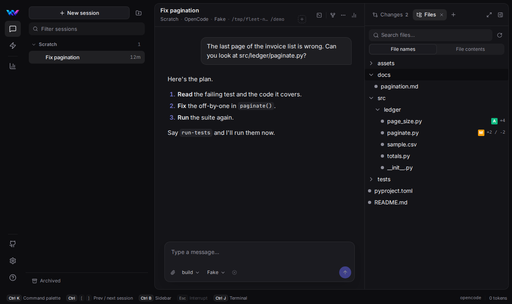 | 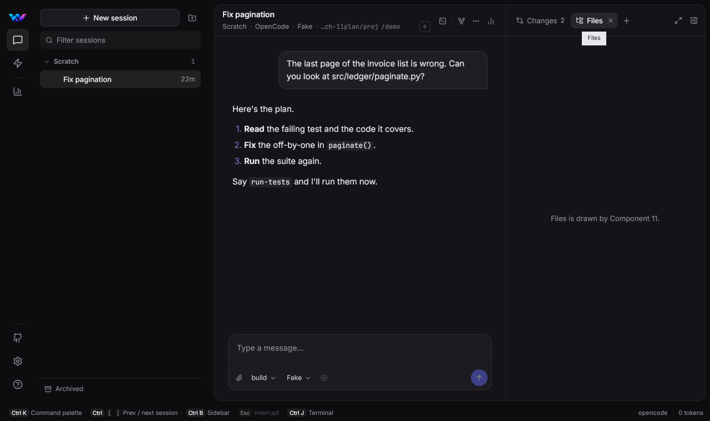 |
| 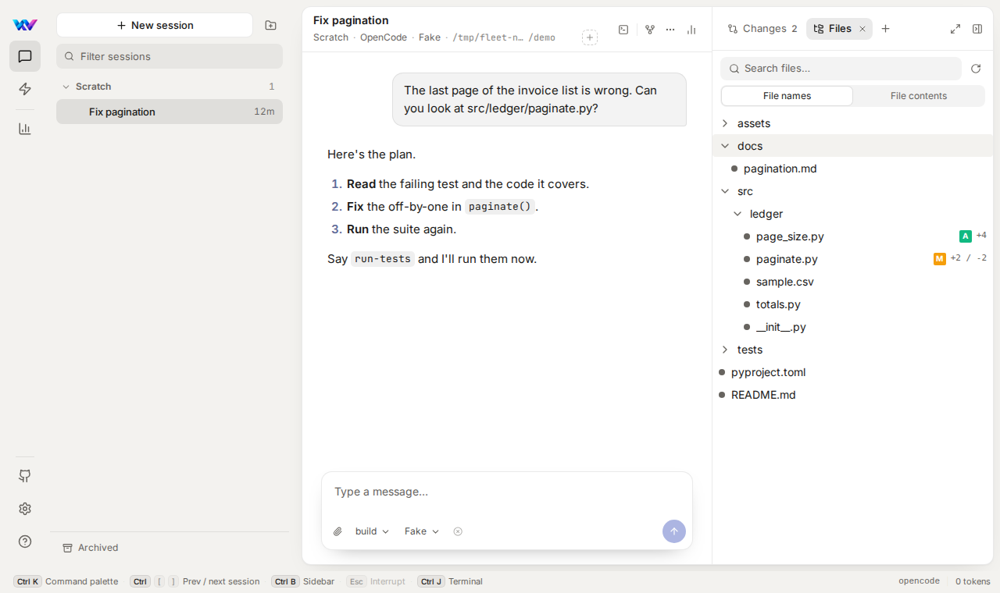 | 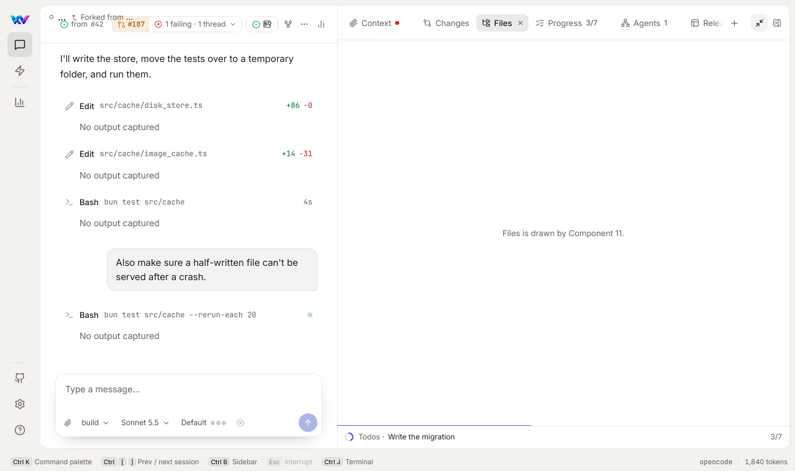 |
| 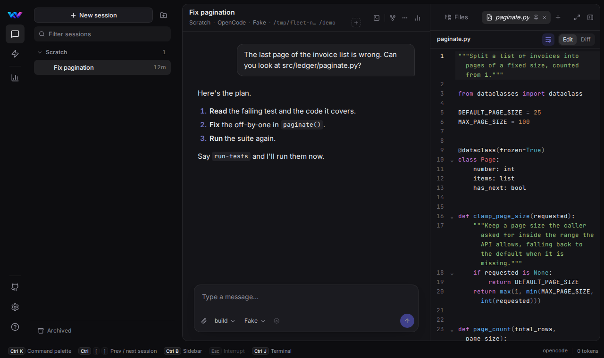 | 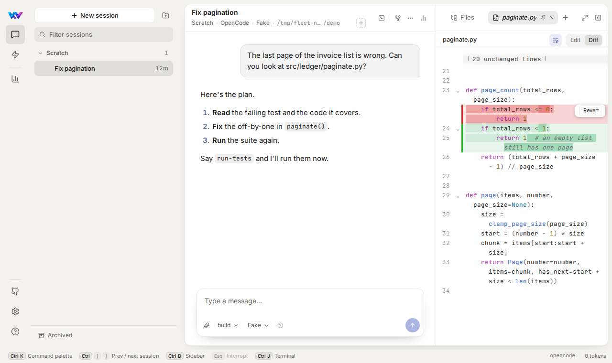 |
| 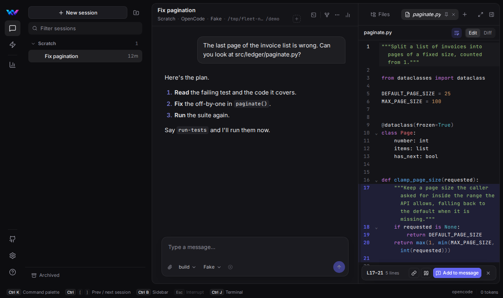 | 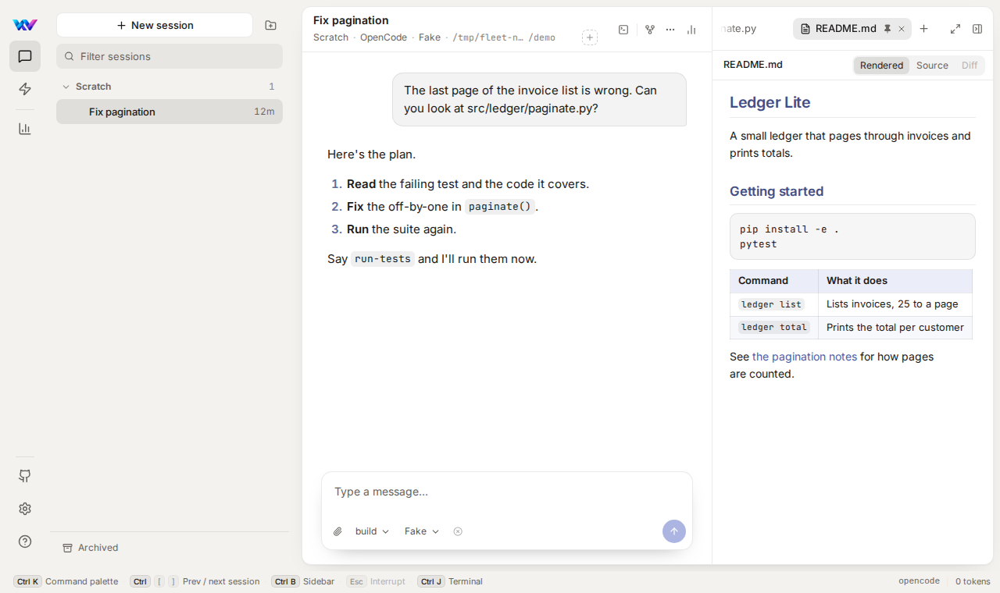 |
| 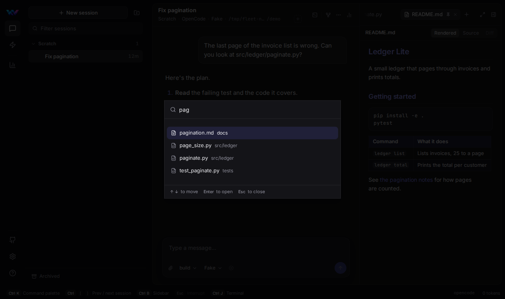 | 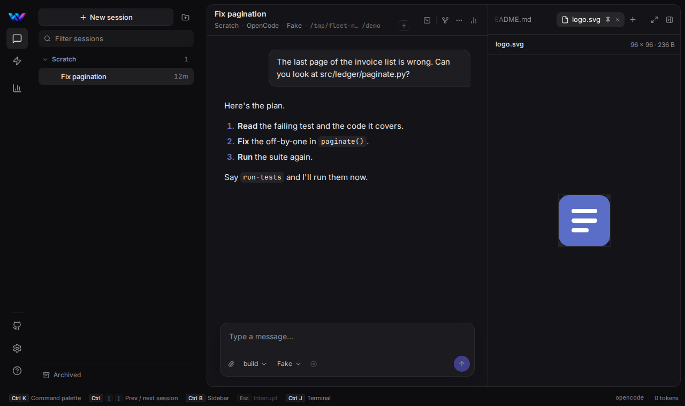 |
| 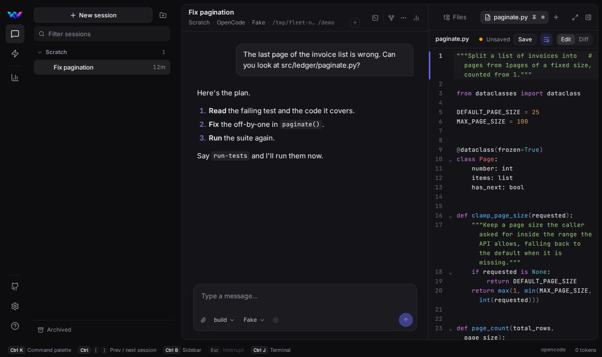 | |

The other theme of each picture is beside it in `shots/parity/11-files/`. The scratch project is an invented one
("Ledger Lite": `src/ledger/paginate.py`, `totals.py`, a test, `README.md`, `docs/pagination.md`, `assets/logo.svg`),
committed, then `paginate.py` edited and `page_size.py` added on disk so the session has changes. Fleet's Files tab
lists the tree with `A +4` and `M +2 / -2`; a click opens `paginate.py` in an italic preview tab, wrapped and
highlighted; Diff folds 20 unchanged lines and shows the hunk with Revert; two clicks on the line numbers pick lines
17-21 and dock the lines bar; `README.md` opens Rendered; Ctrl+P lists four files for "pag". The native app has no file
viewer at all: the Files tab draws "Files is drawn by Component 11.", nothing opens a file, and Ctrl+P is listed in the
palette as waiting. The native light picture is the `panel-tabs-light` scene (invented data) with Files picked: a live
run against the scratch Fleet drew dark whatever theme the settings file named (see the pull request).

## What the native app has today

- **The tab model's file reservations** (10A): `CanvasKind::File`, `CanvasInstance.file: Option<String>`, `file_id`
  (`file:{path}`), `file_name`, `file_icon` (`FileJson`, `FileText`, `FileCode`, `File` by extension, `fileIcon`),
  tab titles and icons for a file tab, `Canvases::close` returning the closed tab, `mark_updated` and the pulse. No
  `preview`, `view`, `open_file`, `keep_file`, `unpin_file` or `set_file_view`.
- **The panel's Files tab** exists from the start of every session (Changes, Files), and its body is
  `canvas_host::stand_in` ("Files is drawn by Component 11."). A `File` tab draws the same stand-in.
- **Requests** (`src/fleet/http.rs`): `GET …/files/content?path=` (read, 12I), `PUT …/files/content` (write, 12I),
  `GET …/diffs/file?path=` (the before and after of one changed file, 12C), `GET …/find/files?q=` (the `@` list, 5K).
  Not there: `GET …/files/browse?path=`, `GET …/files/image?path=`, `POST …/files/resolve`.
- **File search for the `@` list** (5K): `fleet::finder` loads `find/files` on a thread with the 80 ms wait, a newer
  search replacing an older and the last answer narrowed meanwhile (`composer::files::narrow_file_matches` is
  `narrowFileMatches`, with `file-matches.test.ts`'s 3 cases). Go to file and the Files search reuse it.
- **The diff data** (12A, 12C): `State.diffs` (files with status and `+`/`−` counts, `by_file`), `fleet::diff_contents`
  (one file's before and after, cached), `conv::diff::parse_diff_lines` and `conv::review::word_marks`.
- **Reading a file as message text names it** (3E): `conv::references::parse_file_reference` (`parseFileReference`
  with its accept and reject tables). Nothing asks the server which paths are files, and nothing opens one.
- **Attached-file chips** (3E, `view/message.rs` `file_chip`): drawn and pressable, the press does nothing.
- **Changes' Open file** (12E): drawn off, "Opening files comes with the file viewer".
- **The palette** (`ui/commands.rs`): "Go to file…" (Ctrl/Cmd+P) and "Find in files…" (Ctrl/Cmd+Shift+F) are listed
  and wait (`Run::Waiting(11)`), off without an open session.
- **The code box** (`ui/code_box.rs`, 16I): a mono multi-line `text_input` with a line-number column, for the
  profile editor. It is the nearest thing to an editor the app has; its comment lists what it lacks (`docs/RUNE.md`:
  "No code editor").
- **Rendered HTML** (14E): `web::html_body` and `html_document`, scripts refused; the file tab isn't in `web::wanted`.
- **Drafts and the composer** (5): `State::append_draft_reference`, the `focus-prompt` command.
- **The code colours** (`Theme::syntax`, 16E): the eight `--syntax-*` colours of the chosen code theme, as code blocks
  use them.

**What Rune has for this, at the pin** (`f1f54ce`, read for this plan): `rune_kit::syntax::highlight(lang, code)` with
`lang_for_path(path)` (about 80 languages, the first 128 KiB of a source coloured, cached per source) and
`SyntaxTheme::spans`; `rune_kit::line_selection` (the press, shift and drag gesture on line numbers, `LineSelection`
with `step`); `rune_kit::tree` (`FileNode`, `TreeModel`, `TreeItem` with an icon, label, change counts, a dot and a
badge); `virtual_rows`, `selectable` text in a `selection_group` with `on_selection_change`; `ImageCache` (PNG, JPEG,
GIF, WebP, SVG); `Markdown::code_link(colour, f)` (inline code that names something becomes a link) with `on_link_tx`
and `link_help`; `text_input` with `.spans(..)` (syntax colours over an editable text, through undo and IME) and
`App::on_ime` with `.ime_cursor()` for an editor the app draws itself; `App::on_close`. What it lacks (`docs/RUNE.md`,
"No code editor"): line numbers that follow a wrapped field, an unwrapped multi-line field, a fold gutter, a merge
view, a search panel. Slice 1 needs none of those (it draws the lines itself); slice 2 starts with a spike (piece P).

## Part 1: the Files tab (`FilesCanvas.vue`, `FileBrowserPanel.vue` names half, `FileBrowserTreeNode.vue`, `use-file-browser.ts`)

| # | Row | Source | Native today |
|---|---|---|---|
| 1.1 | The tab's body: a column, `flex 1`, `min-height 0`, scrolls vertically; it holds the panel: a column, gap 6, padding-top 8 | FC 340-351; FBP 298-303 | **Done (piece D, 18 November 2026).** |
| 1.2 | Toolbar: row, gap 4, padding `0 8 0 10`. Search box: height 30, grows, padding `0 10`, gap 6, fill `--text` 5 %, 1 px transparent border, radius `--radius-btn`; focused: no fill, border `--accent` 55 %. `search` icon 14 `--muted`; the field 13 px `--text`, placeholder "Search files…" (`--muted`), label "Search files"; a clear button (`x` 14, padding 2, radius 2, `--muted`, hover fill `--border` and `--text`, "Clear search") while the query isn't empty | FBP 142-185, 331-387 | **Done (piece D, 18 November 2026).** |
| 1.3 | Refresh: 28×28, radius `--radius-btn`, `--muted`, hover fill `--text` 6 % and `--text`; `rotate-cw` 14, a small `Spinner` in its place while the root loads (then disabled, 50 %); "Refresh files". Refresh keeps which folders were open: clears, loads the root, then opens each again in turn | FBP 186-194, 305-328; UFB 450-467 | **Done (piece D, 18 November 2026).** |
| 1.4 | The search-in switch under the toolbar: margin `0 10`, padding 2, gap 2, fill `--text` 5 %, radius `--radius-btn`; two buttons (grow, padding `3px 8px`, 12 px, `--muted`, radius 6): **File names** (default) and **File contents**; the pressed one `--text` on `--card-bg` with a 1 px `--border` ring; role group "Search in" | FBP 197-200, 413-437 | **Done (piece D, 18 November 2026).** |
| 1.5 | The root loads when the tab shows for a session (`GET /api/sessions/{id}/files/browse`), and again for another session, which first clears everything (entries, open folders, loading, error). A missing session id is the error "No session ID provided" | UFB 377-395, 469-493; `session-files.ts` 14-31 | **Done (piece D, 18 November 2026).** |
| 1.6 | Root states: "Loading files…" (a large `Spinner` `--muted` and the words, 12 px `--muted`, column, gap 8, padding `24px 16px`) while loading with nothing to show; an `ErrorNote` (margin 12) with the error ("Failed to browse directory: <status> <text>"); an `EmptyState` (compact, `folder-tree`): "No files found", "The session directory is empty or not yet initialized." Newer than v0.72.0 (`Spinner`, `ErrorNote`, `EmptyState`) | FBP 252-270; UFB 386-391 | **Done (piece D, 18 November 2026).** |
| 1.7 | The tree: every root entry, folders and files in the server's order (folders first), even when some files changed | FBP 272-280; FBP test "shows_every_root_entry_even_when_some_files_changed" | **Done (piece D, 18 November 2026).** |
| 1.8 | A row: row, gap 8, padding `4px 8px`, indent `8 + 16 × depth` px, radius 4, no text selection, pointer; hover fill `--bg`. A folder: `chevron-right` / `chevron-down` 16 `--muted`, the name; a small `Spinner` while it loads. A file: an 8 px `--muted` dot, the name. Name: 14 px `--text`, grows, one line with an ellipsis | TN 136-174, 202-272 | **Done (piece D, 18 November 2026).** |
| 1.9 | A changed file's marks (from `State.diffs`, 12's row 1.11): a 16×16 badge, radius 2, 10 px 700 in `--primary-foreground` (white in v0.72.0): **A** `#10b981`, **M** `#f59e0b`, **D** `#ef4444`; then `+N / -N` (only the non-zero parts, ` / ` between) in 11 px monospace `--muted`; screen readers hear "added, 4 additions" | TN 51-102, 162-173, 274-310 | **Done (piece D, 18 November 2026).** |
| 1.10 | The selected file (the one last clicked, `contentPanel.selectFile`): fill `--primary`, name `--primary-foreground` 600, dot white; it stays filled on hover | TN 104-108, 226-242 | **Done (piece D, 18 November 2026).** |
| 1.11 | A folder opens on click: `GET …/files/browse?path=<folder>`; while loading, a "Loading…" row (12 px italic `--muted`, indented one level more); an empty folder shows "No files" the same way. Closing a folder forgets its entries, so opening it again reads it again. A failed read sets the panel's error ("Failed to load directory: <path>" when the request gives no message) | TN 110-117, 176-193, 312-322; UFB 397-437 | **Done (piece D, 18 November 2026).** |
| 1.12 | A click on a file selects it and, 250 ms later (one double-click interval, shared by every row so a click elsewhere cancels it), opens it in a **preview** tab; a double-click opens a **kept** tab at once and nothing else | TN 1-4, 119-133; `FileBrowserTreeNode.test.ts` (2) | **Done (piece D, 18 November 2026).** |
| 1.13 | The tree follows the agent: `files.changed` on the session's topic reloads the root 500 ms after the last one (a burst reloads once); the wait is dropped on a session switch. Only the root is read again (open folders keep what they had) | UFB 495-533 | **Done (piece D, 18 November 2026).** |
| 1.14 | Searching by name: a query of 2 or more characters (trimmed) replaces the tree with results from `GET …/find/files?q=`: folders (ending in `/`) are left out; the list follows each key from the last answer while the next is awaited (80 ms wait; an empty query or one ending in `/` lists at once) | FBP 37-42, 220-249; UFF all | **Done (piece E, 18 November 2026).** |
| 1.15 | Search states: "Searching…" (large `Spinner`, as 1.6); an `ErrorNote` with the error (margin 12); `EmptyState` (compact, no icon) "No files found", "Try a different search query". A result: a button, the whole path, 12 px `--text`, padding `8px 12px`, one line with an ellipsis, a 1 px `--border` line under each but the last, hover fill `--bg`. Newer than v0.72.0 (`Spinner`, `ErrorNote`, `EmptyState`) | FBP 219-249, 492-521 | **Done (piece E, 18 November 2026).** |
| 1.16 | Opening from the results: a click opens a preview tab (and selects the file); Enter in the field opens the first result as a kept tab; Esc clears the query and leaves the field | FBP 117-136; FBP tests "calls_selectFile…", "opens_the_first_search_result_as_a_kept_tab_on_enter" | **Done (piece E, 18 November 2026).** |
| 1.17 | Narrow windows (`max-width 716px`): the search box 38 high, the switch's buttons padding `7px 8px` | FBP 453-466 | Out of scope: the phone layout. The desktop window's own width never meets it with the panel inline, so it isn't ported |

## Part 2: file tabs in the strip (`stores/canvases.ts`, `CanvasHost.vue`)

| # | Row | Source | Native today |
|---|---|---|---|
| 2.1 | A file tab: id `file:{path}`, kind `file`, with `{ path, preview, view }`; `view` is `rendered`, `edit` or `diff`. `hasRenderedView`: `.md`, `.markdown`, `.mdx`, `.htm(l)`; `isImagePath`: `.png .jpg .jpeg .gif .webp .avif .bmp .ico .svg`; the default view is Rendered for those with one, else Edit | CS 37-50, 126-142 | **Done** (11A, 18 November 2026): `FileTab { path, preview, view }` on `CanvasInstance.file`, `FileView`, `has_rendered_view`, `is_image_path`, `default_file_view` |
| 2.2 | `openFile(session, path, { keep, view })`: a file that's open already is focused, keeps its view unless one is given, and becomes kept if asked; a new one opens active. A preview (not `keep`) **replaces the current preview in place** when that one has no unsaved changes (its buffer is dropped); otherwise the old preview becomes kept and the new tab goes at the end. A kept open never replaces the preview | CS 343-394; `canvases.test.ts` "opens a file as an active preview tab…", "the next single click replaces a clean preview in place", "keeps a preview with unsaved changes…", "a kept open doesn't replace the preview", "focuses a file that's open already…", "opening a preview again with keep keeps it" | **Done** (11A): `Canvases::open_file` with the unsaved check as a predicate the caller passes (always false until slice 2; the dirty branch is tested with the predicate true); it returns the replaced path, whose buffer (B) the caller drops |
| 2.3 | `keepFile` (the pin, typing in it, a double-click on the tab) and `setFileView` change only that tab | CS 396-410, 443-456; test "keepFile and setFileView change only that tab" | **Done** (11A): `keep_file`, `set_file_view` |
| 2.4 | `unpinFile`: a kept tab becomes the preview; the previous preview closes (buffer dropped) unless it has unsaved changes (then it is kept); the active tab stays unless it closed. Unpinning a preview does nothing | CS 411-441; tests "unpinFile" (4) | **Done** (11A): `unpin_file` returns the closed preview's path |
| 2.5 | Closing a file tab drops its buffer (`close`); Changes is never closed | CS 333-341; test "closing a file tab drops its buffer" | **Model done** (11A): `Canvases::close` returns the tab, whose path is the buffer to drop. Dropping it waits for the buffer store (B) |
| 2.6 | The tab: the file's icon 14 (`fileIcon`), its name (`fileName`), the tooltip is the whole path; a **preview tab's name is italic**; a double-click keeps it | CH 337-357, 721-724; `CanvasHost.test.ts` "shows a file tab by name with its path…", "draws a preview tab in italics and keeps it on double-click" | **Done (piece F, 18 November 2026):** italic preview names (`name_italic`), double-click keeps (`State::keep_preview_tab`). The tab's file is passed to its body by the strip (the body itself is piece G) |
| 2.7 | The pin, before the close button: 16×16, radius 4, margin-right −4, `--muted`, hidden (opacity 0) until the tab is hovered, active or focused, fades 120 ms; hover fill `--text` 10 % and `--text`; `pin` 12, **filled** when the tab is kept; labels "Pin {name}" / "Unpin {name}", tooltips "Pin: keep this tab open when you open another file" / "Unpin: the next file you open replaces this tab"; a press toggles keep / unpin and doesn't activate the tab | CH 208-211, 372-390, 688-719; test "pins a preview tab from its pin button, and unpins it again" | **Done (piece F, 18 November 2026):** `pin_button` (icon `pin`, filled `pin:filled`), `State::toggle_file_pin` (keep, or `unpin_file` with its buffer dropped), keys `canvas-tab-pin-{id}`; a press doesn't activate the tab |
| 2.8 | **Slice 2.** Unsaved changes: a 7 px dot in `currentColor` where the close button is, always shown; on hover it turns back into `×`; label "Close {name} (unsaved changes)"; middle-click and the close button ask first (2.9) | CH 159-161, 391-404, 726-746; test "shows a dot instead of the close button while the file has unsaved changes" | None |
| 2.9 | **Slice 2.** `UnsavedFileDialog` (an alert dialog): "Save changes before closing?", the path in mono `--text`, "has changes that aren't saved. If you close it without saving, they're lost."; Cancel, **Close without saving** (outline), **Save and close** ("Saving…" while it saves; all three off meanwhile). Save and close saves; if the save didn't go through (a conflict or a refusal) the dialog closes and the tab becomes active to show its bar | UD all; CH 163-202, 541-548; tests "closes a clean file straight away", "asks before closing a file with unsaved changes, and can close without saving" | None (10's row 1.30 names it as 11's) |
| 2.10 | The host keeps 8 tab bodies alive (`KeepAlive :max="8"`), which is why buffers live in a store: the 9th tab must not take the first one's text and undo with it | CH 551-560; FB 7-13 | Not needed: native state is never dropped with a view. The buffer store (Part 3) is still one store per session and path, so slice 2 keeps text and undo across tab switches |

## Part 3: reading a file (`stores/file-buffers.ts`, `lib/code-editor/buffers.ts`, `file-buffer.ts`, `text-format.ts`)

| # | Row | Source | Native today |
|---|---|---|---|
| 3.1 | One buffer per session and path, made on first open with the status **loading**; the info the view reads: `status` (`loading`, `ready`, `unavailable`, `error`), `message`, `dirty`, `conflict`, `saving`. A patch that changes nothing leaves the info as it was; sessions and paths stay apart | FB all; `file-buffers.test.ts` (4) | Done (11B): `fleet::file_buffers::FileBuffers`, keyed by machine, session and path (a session id is only unique per machine); `Info` with the same five fields; `patch` says whether anything changed |
| 3.2 | Opening reads once (`GET …/files/content?path=`, on the session's machine): a second open while one is reading waits for it; an **unavailable** file isn't read again by opening it | BUF 91-131 | Done (11B): `open` returns the one read to make (`Link::off_thread`, `http::file_content`); a second open or a refresh while it is on its way, an open file and an unavailable one ask nothing; a failed one (`Error`) is read again. Checked over a fake server: three opens, one request. Not checked on a live scratch Fleet: no view opens a file yet (11F/G) |
| 3.3 | Why a file can't be shown: truncated → "Too large to edit here (over 512 KB)."; binary, no content or no hash → "This file is binary or not UTF-8 text, so it can't be edited here." (status `unavailable`). A failed read → status `error`: "This file isn't in the session's folder any more." when the failure says 404, else "The file couldn't be read." | FBF 21-29; BUF 113-120; tests "says why a file can't be edited", FV "says why a file too large to edit can't be opened", "says why a binary file can't be opened" | Done (11B): both messages, the 404 and the general failure, under Fleet's test names |
| 3.4 | The text format: a leading BOM is taken off the text and remembered; the line break is the file's most common one (`\r\n`, `\r` or `\n`; ties and none are `\n`); the text keeps every byte otherwise (a file with mixed breaks keeps the odd ones inside its lines) | TF all; `text-format.test.ts` (round trips for LF, CRLF, CR, mixed, BOM; "keeps the BOM out of the editor text", "splits a CRLF file into lines") | Done (11B): `conv::text_format` (`read_text_format`, `to_disk_text`, `same_text_format`), all 14 round-trip layouts plus the two read cases; "editing keeps the file's line breaks" (3) is piece Q's |
| 3.5 | Lines are split on the file's own break only, numbered from 1 | TF 64-71 | Done (11B): `split_lines` / `join_lines`; `a\n` is two lines. Lines are char strings, not CodeMirror's UTF-16 units: any column or position another piece takes from them counts chars |
| 3.6 | A buffer leaves when its tab closes, when a preview it was is replaced, or when the session goes; `openPaths(session)` lists a session's open files for the live updates (Part 10) | FB 104-121; CS 337, 391 | Done (11B): `remove`, `open_paths`, `unsaved`, and `State::close_file_buffer`. Piece F wired the tab closing (`close_tab`) and the pin's unpin; a preview replaced is wired by `open_file`; open: the session going (piece C) |

## Part 4: the file tab's bar and states (`FileCanvas.vue`)

| # | Row | Source | Native today |
|---|---|---|---|
| 4.1 | The tab body: a column, `flex 1`, `min-height 0`; the bar, an optional notice (slice 2), then the body | FV 364-368, 625-632 | Done (11G): `view::file_tab::file_tab`, a column filling the tab |
| 4.2 | The bar: row, gap 8, min height 38, padding `0 10 0 14`, 1 px `--border` under it | FV 369, 634-641 | Done (11G): the bar, min height 38, padding `0 10 0 14`, a 1 px `--border` under it |
| 4.3 | Crumbs (tooltip the whole path): row, gap 3, 12.5 px `--muted`, one line; each folder, then `chevron-right` 11 (not shrinking); then the file name in 500 `--text` with an ellipsis. **Below 430 px of panel the folders and chevrons hide** (the file name is enough), which the 360 px panel always is | FV 370-386, 643-663, 891-896 | Done (11G): crumbs with the whole path as the tooltip; the folders and chevrons hide under 430 px of panel (`right_shown_w`), which the default 360 px panel always is; the name truncates |
| 4.4 | A spacer, then the state (12 px `--muted`, gap 8, no wrap): an image's "96 × 96 · 236 B" (7.2); slice 2's "Changed on disk", "Saving…" or "Unsaved" + Save (13.x) | FV 387-419, 669-688 | Spacer done (11G); the state is empty until the image (piece I) and slice 2 |
| 4.5 | **Wrap** (only while the code view shows): height 26, padding `0 8`, gap 5, radius 7, 12 px `--muted`, hover `--text`; on: fill `--accent-dim`, `--accent-text`; `wrap-text` 14 and the word "Wrap" (the word hides below 430 px, padding then `0 6`); pressed state; tooltip "Wrap long lines (Alt Z)" (`⌥Z` on macOS) | FV 421-437, 836-859, 891-906 | Done (11H): `file_tab::wrap_button` (icon `text-wrap`, Lucide's new name for `wrap-text`), shown while the code view shows (Edit, Diff), the word gone and padding 6 under 430 px |
| 4.6 | The view switch (once the file is ready): padding 2, gap 1, radius 8, fill `--text` 5 %; buttons height 22, padding `0 8`, radius 6, 12 px `--muted`; on: fill `--text` 10 %, `--text`. **Rendered** (only for Markdown and HTML), **Edit** (named **Source** when Rendered exists), **Diff** (off at 45 % with the tooltip "No changes in this file" when the file has no changes, else "Diff against the last commit"). Focus ring 2 px `--accent`, offset 1 | FV 439-475, 715-752 | Done (11G): the switch with Rendered (Markdown and HTML), Edit or Source, Diff (off with its tooltip); the press sets the tab's view (`set_active_file_view`). Rendered draws the code until piece I; Diff draws the code until piece J |
| 4.7 | Which view shows: asked for Diff with no changes shows Edit; Rendered shows only for a file that has it; the code view shows for Edit and Diff | FV 65-73 | Done (11G): `file_tab::shown_view`; Rendered for a file without one shows nothing in Fleet and the code here (a state no tab can reach: `open_file` picks the view by the file) |
| 4.8 | States in the body (13 px `--muted`, padding `14px 18px`): "Opening {path}…" while loading; the unavailable or error message (3.3), with role status | FV 527-552, 810-815 | Done (11G): "Opening {path}…", the unavailable and error messages, `role=status`; "deleted in this session" is piece J's |
| 4.9 | A toast inside the tab (not the app's): bottom 18, centred, max width 100 % − 32, padding `7px 12px`, radius 9, fill `--text`, ink `--panel-bg`, 12.5 px 500, one line with an ellipsis; fades and rises 8 px in 160 ms; shown 2.6 s; **lifted to bottom 58 while the lines bar shows** | FV 257-266, 613-620, 861-889 | None (12's piece L builds the same local toast for Changes; share it) |

## Part 5: the code view (CodeMirror, `editor-extensions.ts`, `theme.ts`, `languages.ts`, `wrap-preference.ts`)

| # | Row | Source | Native today |
|---|---|---|---|
| 5.1 | The text: monospace 12.5 px, line height 1.6 (20 px), no ligatures, `--text`, padding `6px 0` top and bottom of the whole text; the view fills the tab and scrolls | TH 35-40; FV 788-796 | Done (11G): `view::code_view`, mono 12.5 at 20 px, `--text`, padding 6 top and bottom, scrolls both ways |
| 5.2 | The line numbers: an opaque gutter on `--panel-bg` (code scrolled sideways never shows through), `--muted` 70 %, padding `0 10 0 8`, min width 34, right aligned, pointer (they pick lines, Part 8); the active line's number `--text` | TH 45-50 | Done (11G): opaque gutter on `--panel-bg` that holds still under sideways scrolling (`sticky_left`), `--muted` 70 %, padding `0 10 0 8`, min width 34, wider with more digits. Not yet: the pointer and the active line's `--text` number (pieces K and slice 2) |
| 5.3 | Colours by language (`languageFor`): CodeMirror's language-data by file name, plus aliases (`csproj fsproj vbproj props targets slnx nuspec xaml axaml resx plist` → XML; `jsonc json5` → JSON; `zsh` → shell; `env editorconfig` → properties; a dotfile such as `.env.local` counts by its parts); anything else plain | LG all; `completion.test.ts` "languageFor" (2) | Done (11G): `conv::file_language::language_for` over `lang_for_path` with Fleet's aliases, the 12 cases of `languageFor` and the plain ones. Gap: Rune has no lexer for properties files, so `.env` and `.editorconfig` draw plain (the name is Fleet's, `properties`) |
| 5.4 | Token colours: keywords `--syntax-keyword`; strings, regexps, characters `--syntax-string`; numbers `--syntax-number`; booleans, null, atoms, self, escapes, units, links (underlined) `--syntax-literal`; comments `--syntax-comment` **italic**; meta and annotations `--syntax-comment`; function names `--syntax-function`; types, classes, namespaces, tag names `--syntax-type`; properties, attributes, labels `--syntax-attr`; headings `--md-heading` 600; strong 600; emphasis italic; strikethrough; punctuation, brackets, operators `--muted`; invalid `--error-text`; inserted `--running-text`; deleted `--error-text` (the last three newer than v0.72.0) | TH 11-31 | Done (11G) kind by kind from `Theme::syntax`: keyword, string and regexp, number, comment (italic), function, property and attribute, type, link (underlined), heading (600; `--md-heading` is only defined inside a reasoning block, so it keeps `--text`), punctuation and operators `--muted`, inserted `--running-text`, deleted `--error-text`. Gaps: Rune's kinds don't split booleans and null (`--syntax-literal`) from numbers, nor namespaces and tag names from other names, so those take the number and type colours or none; bold and italic Markdown aren't kinds |
| 5.5 | **Wrap**, on by default for every file; a file turned off is remembered (only files that differ from the default, the latest 200; a broken stored value is ignored); the button and **Alt+Z** toggle it for this file | WP all; EE 50-107, 138; `wrap-preference.test.ts` (5); FV tests "wraps long lines by default; the Wrap button turns it off for that file, remembered", "Alt Z toggles wrap in the editor" | Done (11H): `fleet::wrap_pref::WrapPrefs` with the 5 tests, kept in the settings file as `fileWrapOff` (a list of paths, oldest first; Fleet's localStorage object); Alt+Z acts while the file's code shows and focus is not in another field (the code view takes no focus here) |
| 5.6 | A wrapped line hangs: its first row starts where it always does, the rows it wraps onto start under its indent plus two columns (`padding-left: (indent+2)ch + 6px; text-indent: -(indent+2)ch`), the indent counted with tabs, at most 24 columns | EE 52-89 | None. Rune has no negative text indent: draw the line's leading whitespace as its own fixed column and wrap the rest beside it (rows hang under the indent, not indent + 2); say so in the piece |
| 5.7 | Unwrapped, long lines scroll sideways under the fixed gutter | TH 45-46 | Done (11G): long lines scroll sideways under the held gutter (`scroll_xy`); wrapping is piece H |
| 5.8 | Selecting text with the pointer and copying it (Ctrl/Cmd+C) | CodeMirror | Done (11G): each line's text is `selectable` in one `selection_group`, the numbers stay out of a copy; the selection is `--accent` 30 %. Tabs are drawn as spaces to the next stop of 4, so a copy has spaces |
| 5.9 | The active line (where the caret is): fill `--text` 3 %; the selection `--accent` 30 %; the caret 2 px `--accent`; matching brackets `--accent` 25 %; other occurrences of the selected word `--accent` 14 %; special characters (control characters) drawn as `--error` placeholders | TH 41-61; EE 113-126 | Selection colour and special characters done (11G: control characters as `--error` placeholders, as CodeMirror's `specialChars`); the rest is **slice 2** (a caret is an editor's) |
| 5.10 | Folding: a fold gutter (chevrons `--muted` 70 %, padding `0 2`) by the language's syntax; a folded run shows a placeholder (fill `--text` 6 %, `--muted`, padding `0 6`, radius 4) | EE 117; TH 54-55 | Gap: Rune's highlighter gives tokens, not a syntax tree, so there is nothing to fold by. Not ported in slice 1; slice 2's piece U decides whether indentation folding is worth it |
| 5.11 | Large files: everything up to 512 KB opens; CodeMirror draws only what's on screen | FBF 21-29 | Done (11G): `virtual_rows` builds the rows near the window (test: 20,000 lines build under 300 rows); colours are worked out once per buffer revision and cached. Rune colours only the first 128 KiB, the rest draws plain (`docs/RUNE.md`) |

## Part 6: Diff, the changed-lines stripe and a deleted file (`use-diff-base.ts`, `merge.ts`, `agent-lines.ts`)

| # | Row | Source | Native today |
|---|---|---|---|
| 6.1 | The git base: a file among the session's changes (`State.diffs`, not an image) reads its contents at the base once (`GET …/diffs/file?path=` → `before`; "" for an added file); kept for the latest 50 by machine, session, base and path; a failed read isn't kept; read again when what the changes are compared with moves; nothing is read while the file isn't changed | UDB all; `use-diff-base.test.ts` (4) | Done (11C): `fleet::file_base::Bases` (machine, session, `Base::key`, path; the latest 50; a failed read isn't kept; a second ask while one is on its way waits) over `http::diff_file`, and `State::load_file_base` / `file_base`: nothing is read while the file isn't among `State.diffs` or is an image; a moved base reads again under its new key. Changes keeps its own cache (`diff_contents`): the two answers aren't shared, only the request. |
| 6.2 | A file "has changes" when it is among the session's changes, or (slice 2) when its buffer is unsaved | FV 56-61 | Done, slice 1 half (11C): `State::file_in_changes` / `file_has_changes`; the unsaved half reads `FileBuffers::is_dirty`, always false until slice 2 |
| 6.3 | **Diff**: the whole file with the base's removed lines shown inline above the lines that replaced them (`unifiedMergeView`): changed or inserted lines on `--running` 10 %, removed lines on `--error` 10 %; the changed words inside them on `--running` 25 % / `--error` 28 % (no strike-through); a 3 px change gutter (`--running` for new and changed, `--error` for removed); removed lines have no new line number | MG 37-45; TH 92-99 | None. `conv::review::word_marks` gives the word marks; the line pairing is `conv::diff::parse_diff_lines` |
| 6.4 | Unchanged runs fold: margin 3 around each change, at least 8 lines to fold; a fold is a bar "N unchanged lines" (as in the picture) that opens on a click | MG 42 | None |
| 6.5 | Diff shows a file with no git base against its last-read text (slice 2: against the saved text) | FV 172 | None |
| 6.6 | **Slice 2.** Each change has a **Revert** button floating at the line's end (a backing `--panel-bg` with a shadow, buttons 11 px, 1 px `--border`, radius 5, `--card-bg`, padding `1px 8px`, hover `--text` 8 %): it puts the base's lines back **in the buffer** (not on disk; the file is then unsaved) | MG 16-35; TH 100-109 | None |
| 6.7 | In Edit, lines that differ from the base (or, for a file git sees as unchanged, from the text as read) get a 3 px `--accent` stripe (radius 2) in a gutter of their own, 2 px from the numbers; a deletion marks the line after it; line breaks and a BOM in the base don't count. Not drawn in Diff (it has its own gutter). Recomputed 300 ms after the text changes | AL 1-111; MG 47-56; FV 90-109; `file-buffer.test.ts` "changedLines" (3) | Which lines: done (11C): `conv::changed_lines::changed_lines` (a Myers line diff, a run of removals marks the line after it, or the last line; `base_lines` drops a BOM and splits on any break) under Fleet's three names. The 300 ms recompute and the stripe are the view's (G/J) |
| 6.8 | Lines the agent just changed **flash** once: `--accent` 28 % fading to nothing over 1.6 s | AL 31-41; TH 91, 110; FBF 116-122 | Which lines and when: done (11C): `Buffer::apply_disk_file` gives the lines, `Live::flash` keeps them from the app's clock and `Live::flashing` says how far along (progress 0 to 1 over 1.6 s; the view eases it and draws `--accent` 28 %). Drawing it is G's |
| 6.9 | A file the session **deleted** (in the changes as deleted, its read failed, its base known): "This file was deleted in this session. Its last version:" (the note style, role status), then its last version, read-only, all of it as removed lines with numbers | FV 62-63, 194-198, 533-544; MG 58-74 | None |

## Part 7: images and Rendered (`use-session-image.ts`, `FileCanvas.vue`)

| # | Row | Source | Native today |
|---|---|---|---|
| 7.1 | An image is only ever shown, never in the code view, at any size: `GET …/files/image?path=` as bytes from the session's machine (with its token); read again when the tab comes back to the front; "Opening {path}…" while it loads | USI all; FV 216-241, 554-581; FV test "shows an image as a picture with its pixel size and file size, never in the editor, however large" | None |
| 7.2 | Shown centred, padding 24, scaled down to fit (never up), over a checkerboard of `--border` squares (16 px) with a 1 px `--border` ring; the bar says "{w} × {h} · {size}" (`formatBytes`), or the size alone for an SVG with no size of its own | FV 223-229, 817-834; FV test "shows an SVG as a picture too, with its size alone when it has no pixel size" | None. Rune's `ImageCache` reads PNG, JPEG, GIF, WebP and SVG; AVIF, BMP and ICO would say they can't be shown (a gap) |
| 7.3 | "This file isn't in the session's folder any more." on a 404, else "The image couldn't be read."; a picture that doesn't decode: "This image couldn't be shown." | USI 375-389; FV 222; FV test "says so when the image is no longer there" | None |
| 7.4 | **Rendered Markdown**: the file's text through Fleet's Markdown renderer, padding `16px 22px 28px`, scrolls; it follows the text as it changes (slice 2: unsaved edits too) | FV 243-253, 582-594, 798-803; FV test "Markdown opens rendered from the buffer, annotatable, with Source and Diff beside it" | None. `rune_kit::Markdown`; 14's row 14.83 notes the same open gap for the Document tab (Fleet's `MarkdownRenderer` is smaller with accent-tinted headings and a rule under h1/h2): share the style |
| 7.5 | Rendered Markdown can be asked about: selecting text offers the annotation popover (12's row 9.2) | FV 251-253, 591-592 | None. Waits for 12's piece N (`State::open_annotation`) |
| 7.6 | **Rendered HTML**: the file's text in a sandboxed frame, no padding, no scripts; not annotatable | FV 249, 585, 805-808 | None. 14's `web::html_body` exists; the file tab must be added to `web::wanted` (14's row 14.86) |

## Part 8: picking lines and the lines bar (`line-pick.ts`, `LinesBar.vue`, `line-quote.ts`)

| # | Row | Source | Native today |
|---|---|---|---|
| 8.1 | A click on a line number picks that line; Shift-click extends from where the pick started (either way); a plain click starts a new pick; dragging down the numbers extends until the button comes up; the pick isn't the text selection | LP all; `line-pick.test.ts` "a click on a line number picks that line…", "shift-click extends…", "a plain click starts a new pick", "dragging down the numbers…" | None. `rune_kit::line_selection` has the gesture |
| 8.2 | Picked lines: fill `--accent` 14 % across the line and its number; the number `--accent` 600 | TH 51-53 | None |
| 8.3 | The pick stays through scrolling and a click in the text, goes when text is selected or on **Esc**; it moves with lines added above it (the agent's edit) | LP 23-33, 115-123; tests "Esc clears the pick", "survives a click in the text, but not selecting text", "moves with lines added above it" | None |
| 8.4 | A text selection also counts as lines for the bar: the lines it spans, but not a line it ends at the start of | LP 43-51; test "spans the selection's lines, not the line it ends at the start of" | None |
| 8.5 | The lines bar, docked at the foot of the tab while lines are picked or selected (and the code view shows): role toolbar "Picked lines"; the label "L17–21" (`L7` for one), the count "5 lines" / "1 line"; **Copy link** (`link` 13, tooltip "Copy {path}:17-21"), **Quote** (`quote` 13, "Copy the lines as a quote"), **Add to message** (primary, `message-square-plus`), Clear (`x`, "Clear (Esc)"); its buttons don't take the selection away | LB all; FV 602-611; 12's row 12.3 for the sizes | None. Shared with 12's piece L (see the seams) |
| 8.6 | Copy link copies `{path}:17-21` (`{path}:7` for one line) and says "Copied {path}:17-21"; Quote copies a heading (the reference), then the lines in a fence longer than any run of backticks in them, with the file's extension as its language, and says "Copied L17–21 as a quote"; a failed copy says "Couldn't copy to the clipboard"; × clears the pick, or the text selection | FV 327-353; LQ all; FV test "picked lines show in the bar; Copy link and Quote copy them, and × clears them" | None |
| 8.7 | Add to message puts `@{path}:17-21` in the session's draft, clears the pick and focuses the composer | FV 355-360; FV test "Add to message puts a line reference in the draft and focuses the composer" | None (`append_draft_reference` and `focus-prompt` exist) |

## Part 9: Go to file (`GoToFileDialog.vue`, `stores/go-to-file.ts`, the `go-to-file` command)

| # | Row | Source | Native today |
|---|---|---|---|
| 9.1 | The command: "Go to file…", category Session, icon `file-search`, **Ctrl+P / ⌘P** everywhere, also from the composer and the editor; description "Open a file from this session by name." with a session, else "Open a session to find its files." and off; keywords file, open, find, quick open, editor | `use-commands.ts` 417-432; `keybinding-types.ts` 23 | Partial: listed, waits; the description doesn't change without a session |
| 9.2 | The dialog: no close button, `sm:max-w-lg` (32rem: 448 at Fleet's 14 px root), no padding; screen-reader title "Go to file" and description "Type part of a file's name, then press Enter to open it." | GTF 88-103 | None |
| 9.3 | The field row: height 46, padding `0 14`, gap 8, 1 px `--border` under it, `--muted`; `search` 15; the field 14 px `--text`, placeholder "Go to file…", no spell check; it opens empty with the first row active | GTF 104-121, 184-202, 42-47 | None |
| 9.4 | Nothing typed: the files open in this session's tabs, under the group label "Open" (11 px 600 `--muted`, padding `6px 10px`); none open: "Type to find a file in this session." (12 px `--muted`) | GTF 30-40, 142-153, 210-221 | None |
| 9.5 | Typed: files from `find/files` (folders left out), narrowed while the next answer comes (1.14's rules); "Searching…" while the first answer is awaited; a failed search with nothing to show: `ErrorNote` compact "Couldn't search for files." with the reason (newer than v0.72.0, weave-fleet #1063); none: "No files match." | GTF 25-28, 129-147; tests "filters to files as you type, leaving out folders", "says the search failed instead of saying no file matches", "says so when nothing matches" | None |
| 9.6 | The list: max height min(360, 55 % of the window), scrolls, padding 6. A row: height 32, padding `0 10`, gap 8, radius 7, 13 px `--muted`; the file's icon 14, its name `--text` (not shrinking), its folder 12 px with an ellipsis; the active row fill `--accent-dim` and `--text`; the pointer moving over a row makes it active; a click opens it | GTF 154-173, 204-251 | None |
| 9.7 | Keys: ↓ and ↑ move the active row and wrap at both ends, keeping it in view; Enter opens the active row; Esc or a click outside closes | GTF 66-85, 89-92 | None |
| 9.8 | Opening: the file opens as a **kept** tab, takes the keyboard (focus on open, 11.1), the right panel shows, the dialog closes | GTF 57-64; GS all; test "Enter opens the chosen file as a kept tab and closes" | None |
| 9.9 | The foot: padding `8px 14px`, gap 14, 1 px `--border` above, 11.5 px `--muted`: "↑ ↓ to move", "Enter to open", "Esc to close", the keys in 500 10.5 px | GTF 174-178, 253-265 | None |
| 9.10 | Lists the files already open when nothing is typed | test "lists the files already open when nothing is typed" | None |

## Part 10: keeping open files in step with the disk (`use-file-live-updates.ts`, `buffers.ts` `refreshBuffer`, `file-buffer.ts` `applyDiskFile`)

| # | Row | Source | Native today |
|---|---|---|---|
| 10.1 | An open file is read again: on `files.changed` naming it (an absolute path from the agent ending in `/{path}`, or the path itself; backslashes count as slashes), on `turn.ended` or `session.idled` (shell edits send no file event), when its tab comes to the front, and when the window gets focus back. Events wait 500 ms for the burst to settle and read each file once; the tab and focus cases read at once. Only the session's own topic counts; files that aren't open aren't read | ULU all; `use-file-live-updates.test.ts` (7) | Done (11C): `fleet::file_live` (`is_same_file`, `Live` with the 500 ms settle that each queue restarts, a burst read once; the open session's topic only; `files.changed`, `turn.ended`, `session.idled`; the window's focus back through `App::on_focus`; a file tab coming to the front, seen once per coming forward by `keep_file_front` in `poll`) with `State::after_file_read` pulsing the tab (`mark_updated`) on an update or a conflict and keeping the flash. All 7 of `use-file-live-updates.test.ts` (the two stop events as one case each) over a fake server |
| 10.2 | What a new version means: the same hash changes nothing; a clean buffer takes the new text as one smallest replacement (the common start and end stay, so the scroll and pick stay put), its changed lines flash (6.8) and the tab pulses (`mark_updated`); a change of line-break style or BOM starts afresh; a file that became binary or too large becomes unavailable with its message; an unavailable file that is readable again becomes ready | BUF 133-189; FBF 83-125; MC all; tests "does nothing when the hash on disk is the same", "takes the agent's change into a clean buffer, out of undo history", "keeps CRLF when the agent changes a CRLF file", "starts a fresh state when the agent changes the line breaks", "a file that became binary while clean can't be edited any more", `minimalChange` (4) | Done (11B), without the flash and the tab pulse (they need the view: 11G, 11C): `conv::minimal_change` and `Buffer::apply_disk_file` return the changed lines for them; all of Fleet's cases except the undo one (no undo until slice 2: the text and the lines are checked instead) |
| 10.3 | Overlapping reads of one file share one; a read while a save is in flight is skipped (slice 2) | BUF 145-147, 155 | Done (11B): shared reads; the "save in flight" skip is in `refresh` and tested with `Patch { saving }`; nothing sets it until piece R |
| 10.4 | **Slice 2.** A buffer with unsaved edits is never touched: the new version becomes the conflict (13.6) | FBF 92-94; test "never touches a dirty buffer: a disk change is a conflict" | None |

## Part 11: opening a file from elsewhere

| # | Row | Source | Native today |
|---|---|---|---|
| 11.1 | Focus on open: a file picked in Go to file, or opened at a line from a message or a find-in-files hit, takes the keyboard once its view is drawn; at a line, the view scrolls that line to the middle and the caret goes to its start (slice 1: the line is marked as the active line instead). Opening a file that's open already at another line moves to that line; a line past the end goes to the last line. The request is taken once, for that session and path only | GS all; FV 153-163, 186; FV tests "opens at the line a message named, with the cursor there", "moves an open file to another line a message named, or its last line when past the end" | **Model half done** (11A): `fleet::go_to_file::GoToFile` (`show`, `hide`, `ask_focus`, `take_focus`: taken once, for that session and path). Taking the keyboard and the line is the view's (G, M) |
| 11.2 | **File links in message text** (3's rows 2.27, 2.28): the paths the message names (`parseFileReference`, done in 3E) are asked of the server in batches (`POST …/files/resolve` `{ paths }` → `{ files: [{ path, relativePath }] }`), kept per session; those that are files draw as links (Fleet: dotted `--accent` 70 % underline, offset 3; hover and focus `--accent-text` on `--accent-dim`, solid underline; tooltip "Open {path}[ at line N] · Ctrl-click keeps the tab", ⌘-click on macOS; a Tab stop) | `lib/file-references.ts`, `stores/file-links.ts`, `MessageBubble.vue` 124-157, 296-312; `MessageBubble.file-links.test.ts` "links the paths that are files in the session's folder, and leaves the rest as code" | None. `Markdown::code_link(colour, f)` makes such inline code a link (its own look: coloured, underlined at 40 % under the pointer, no chip); `on_link_tx` opens; `link_help` gives the tooltip |
| 11.3 | A link opens on a click (a preview tab), Ctrl/Cmd-click keeps the tab; Enter on a focused link does the same; Shift, Alt, another button, or a click that ended a drag selecting text don't open; at a line Markdown and HTML open on their source (Edit); the right panel shows | MessageBubble.vue 150-157; ActivityStream.vue 476-482; tests "opens a preview tab at the line on a click, and keeps the tab on a Ctrl-click", "opens from the keyboard with Enter", "doesn't open when the click ended a drag that selected text" | None |
| 11.4 | When a turn ends, paths that weren't files are asked again (`fileLinks.forgetMissing`, 3's row 1.92) | ActivityStream.vue | None |
| 11.5 | An **attached-file chip** in a user message opens its file (a preview; Ctrl/Cmd-click keeps it) | MessageBubble.vue 192-226; test "opens the file, keeping the tab on Ctrl-click" | Partial: the chip is drawn and its press does nothing (`view/message.rs` `file_chip`) |
| 11.6 | Changes' **Open file** opens a kept tab on Diff (12's row 13.3); a find-in-files hit opens a preview at its line (12's row 14.12); a workflow's You step opens its files kept and shows the panel (component 18) | ChangesReview.vue 90-93; FBP 70-76; WorkflowRunCard.vue 50-60 | None: 11 provides `open_file` and `open_file_at`; the callers are 12's pieces M and P and component 18 Piece F (18 November 2026) added the tab-strip half: nothing else was needed from it; 12's piece M can turn Open file on. |

## Part 12: find in a file (CodeMirror's search panel)

| # | Row | Source | Native today |
|---|---|---|---|
| 12.1 | Ctrl/Cmd+F with the keyboard in the code view opens CodeMirror's search panel at the **top** of the view (`search({ top: true })`): a field (1 px `--border`, radius 5, 12 px), **next**, **previous**, **all**, the checkboxes **match case**, **regexp**, **by word**, and a close button; panel fill `--card-bg`, 1 px `--border` under it, 12 px sans, padding `6px 8px`; Enter next, Shift+Enter previous, Esc closes; F3 / Ctrl+G step too | EE 127, 141; TH 76-86 | None |
| 12.2 | Matches: fill `--idle` 25 % with a 1 px `--idle` 45 % outline; the current one `--idle` 45 %; the view scrolls to it | TH 59-60 | None. 12's `conv::changes_find` and 3's `conv::find` have the counting and stepping to reuse |
| 12.3 | **Slice 2.** The replace row (replace field, **replace**, **replace all**), only in an editable file | CodeMirror `searchKeymap` | None |

## Part 13: editing and saving (slice 2)

| # | Row | Source | Native today |
|---|---|---|---|
| 13.1 | The code view is an editor: a caret (2 px `--accent`), typing, the selection, the active line (5.9), undo and redo, Tab indents (2 spaces by default), indent on input, brackets close and match, multiple selections and rectangular selection (Alt-drag), drag and drop of text | EE 110-148 | None. Piece P decides how (Rune's `text_input` with `.spans`, or an editor drawn with `ime_cursor`) |
| 13.2 | Dirty is "the text differs from the saved text" (typing back to it is clean again); typing in a preview tab keeps it (the agent's changes don't) | FBF 66-69; FV 98-109; tests "is dirty after typing and clean again when the text goes back", "typing in a preview tab keeps it" | None |
| 13.3 | The bar while dirty: a 7 px `--idle` dot, "Unsaved", **Save** with its key (`Ctrl S` / `⌘S`, 500 10.5 px `--muted`; the key hides below 430 px): height 24, padding `0 9`, 1 px `--border`, radius 7, `--card-bg`, 12 px 500, hover border `--accent`; "Saving…" while saving | FV 395-419, 669-713 | None |
| 13.4 | Save (the button, **Ctrl/Cmd+S** in the editor): nothing to save → toast "No changes to save"; else `PUT …/files/content` `{ path, content, baseHash }` with the text in the file's own breaks and BOM; done → "Saved {path}", the buffer is based on the new hash and stays dirty if typing went on during the save; a refusal → "Couldn't save: {reason}" | FV 268-277; BUF 191-227; FBF 71-75, 127-131; `session-files.ts` 61-95; tests "shows Unsaved after typing, and saves with the hash it read", "Ctrl S saves through the editor's keymap", "is clean after a save, and dirty again if typing went on during it" | Partial: the request is in `http.rs` |
| 13.5 | Pasted or dropped text takes the file's line break; a new line in a CRLF file is CRLF; an untouched mixed file keeps its odd breaks after an edit elsewhere | TF 57-71; `text-format.test.ts` "editing keeps the file's line breaks" (3) | None |
| 13.6 | A **conflict** (the file changed on disk with unsaved edits, or a save lost the race with a 409 carrying what's on disk): the state "Changed on disk" with an `--error` dot, and the notice under the bar (fill `--idle` 14 %, padding `8px 12px`, 12.5 px/1.45, 1 px `--border` under it, rises in 240 ms, role alert): "**The agent changed {name} while you were editing.** Nothing was overwritten." with **Compare**, **Keep mine**, **Use the agent's**; when what's on disk is no longer text: "**{name} changed on disk and can't be shown here any more.** Nothing was overwritten." with **Keep mine** only. Save does nothing during a conflict | FV 395-401, 478-509, 754-786; tests "when the save loses the race (409)": "shows the bar and changes nothing" | None |
| 13.7 | **Keep mine** saves over exactly the version shown (its hash), still losing to a newer change: "Saved your version of {name}"; **Use the agent's** replaces the buffer with what's on disk as one undoable edit; **Compare** shows the agent's version (red) against yours (green) with per-change **Take the agent's** and **Keep mine**, and the info notice (`--accent-dim`, role status) "**Red is the agent's version, green is yours.** Take the agent's lines hunk by hunk, then press Done and save." with **Done** (primary): the buffer is then based on the agent's version and stays unsaved: "Merged. Save to write it." or "You took the agent's version" | FV 279-305, 510-525; BUF 229-247; FBF 133-167; MG 16-35; tests "Use the agent's replaces the buffer", "Keep mine saves over the agent's version it showed", "Compare shows the merge view; Done rebases on the agent's version and stays unsaved", "\"Use the agent's\" replaces the buffer, as an edit you can undo", "after Compare the buffer is based on the agent's version and still unsaved" | None |
| 13.8 | Diff is editable, with Revert per change (6.6) | MG 11-14; FV test "Diff shows the git base against the buffer, editable" | None |
| 13.9 | Closing a tab with unsaved changes asks (2.8, 2.9); a preview with unsaved changes isn't replaced (2.2, 2.4) | CS; CH | None |
| 13.10 | Leaving with unsaved files asks first (the browser's `beforeunload`; the desktop app's window close) | UG all; `use-unsaved-files-guard.test.ts` (1) | None. `App::on_close` runs before a close; whether it can keep the window open is for piece T to read at the pin |
| 13.11 | Completion: words already in the file, the language's own keywords and snippets, and import paths (`from "./`, `import("../`, `require("@/` …) completed one folder at a time from the session's files (`find/files?q=<folder>`, cached 10 s), JS/TS extensions left off, the file itself left out; the popup: mono 12 px, max 14 em, padding 4, rows radius 5, the chosen row `--accent-dim`, the matched letters `--accent` 600, details 11 px sans `--muted` | CMP all; BUF 32-55; TH 70-75; `completion.test.ts` "importFolder" (3), "importPathSource" (4) | None |
| 13.12 | The agent's edits while the file is clean go in out of undo history (10.2), so Ctrl+Z never undoes the agent | FBF 116-119 | None |

## Part 14: what Fleet has proposed but not built

The brief named the file viewer proposal in Fleet (a page made for the owner on 15 October 2026, "Better file
viewer", options A to D). Read against weave-fleet `main` at `51fdd3a`:

| # | Row | In Fleet `main`? | Here |
|---|---|---|---|
| 14.1 | A: wrap with a hanging indent and Alt+Z, picking lines by their numbers, the lines bar with Copy link, Quote, Add to message | **Yes** (Parts 5 and 8) | Ported (pieces H and K) |
| 14.2 | B: Widen becomes Focus (the panel takes the session list and the conversation, a 46 px strip in their place, Ctrl+Shift+Enter) | No | Not ported. Port it when Fleet ships it |
| 14.3 | C: pop a file out over the window, or into a window of its own | No (the proposal says not now) | Not ported |
| 14.4 | D: Go to file with recent files, `@symbol` and `:line`; path-bar menus of neighbouring files; an outline; a tree that works from the keyboard; search results that lead with the file name | No: Go to file lists open tabs only, the crumbs are text, the tree is click-only | Not ported. If Fleet builds it, `:line` and recent files are cheap here (Go to file already opens at a line, 11.1); symbols need a syntax tree Rune's highlighter doesn't give (5.10) |

## Fleet's tests and where each goes

| File | Cases | Piece |
|---|---|---|
| `stores/__tests__/canvases.test.ts`, "file tabs" | 14 (10 plus `unpinFile` 4) | A |
| `stores/__tests__/file-buffers.test.ts` | 4 | B |
| `lib/code-editor/__tests__/text-format.test.ts` | round trips and 2 (read side) | B; "editing keeps the file's line breaks" (3) Q |
| `lib/code-editor/__tests__/file-buffer.test.ts` | `minimalChange` 4, "opens clean", "says why a file can't be edited", "does nothing when the hash…", "takes the agent's change…", "keeps CRLF…", "starts a fresh state…", "a file that became binary…" | B, C |
| the same | `changedLines` 3 | C |
| the same | "is dirty after typing…", "never touches a dirty buffer…", "\"Use the agent's\"…", "after Compare…", "is clean after a save…", "goes through the mounted editor…" | Q (the last is CodeMirror's own: say so) |
| `composables/__tests__/use-file-live-updates.test.ts` | 7 | C |
| `composables/__tests__/use-diff-base.test.ts` | 4 | C |
| `components/session/__tests__/FileBrowserTreeNode.test.ts` | 2 | D |
| `composables/__tests__/use-file-browser.test.ts` | 2 | D |
| `components/session/__tests__/FileBrowserPanel.test.ts`, Tree | 3 | D |
| the same, File selection | 2 | E |
| the same, Find in files | 9 | 12's piece P |
| `components/canvas/__tests__/CanvasHost.test.ts`, file tabs | "shows a file tab…", "draws a preview tab in italics…", "pins a preview tab…" | F |
| the same | "shows a dot instead of the close button…", "closes a clean file straight away", "asks before closing a file with unsaved changes…" | T |
| `lib/code-editor/__tests__/wrap-preference.test.ts` | 5 | H |
| `lib/code-editor/__tests__/completion.test.ts` | `languageFor` 2 | G |
| the same | `importFolder` 3, `importPathSource` 4 | U |
| `components/canvas/__tests__/FileCanvas.test.ts` | "opens the file in the editor, clean" (as a viewer), "says why a file too large…", "says why a binary file…" | G |
| the same | "wraps long lines by default…", "Alt Z toggles wrap in the editor" | H |
| the same | images (3), "Markdown opens rendered from the buffer…" (without the annotation until 12N) | I |
| the same | "Diff shows the git base against the buffer, editable" (read-only half) | J; the editable half R |
| the same | "picked lines show in the bar…", "Add to message puts a line reference…" | K |
| the same | "opens at the line a message named…", "moves an open file to another line…" | M |
| the same | "shows Unsaved after typing…", "Ctrl S saves…", "typing in a preview tab keeps it" | R |
| the same | "when the save loses the race (409)" (4) | S |
| `lib/code-editor/__tests__/line-pick.test.ts` | 8 | K |
| `components/canvas/__tests__/GoToFileDialog.test.ts` | 5 | L |
| `components/session/__tests__/MessageBubble.file-links.test.ts` | 4 | M |
| `MessageBubble.attached-files.test.ts` | "opens the file, keeping the tab on Ctrl-click" | M |
| `lib/__tests__/file-references.test.ts`, the markdown cases | 7 (3 left them with no owner) | M |
| `composables/__tests__/use-unsaved-files-guard.test.ts` | 1 | T |

## The pieces

Twenty-two pieces in two slices, in build order, one pull request each. Each starts from this file alone. A piece
takes only its rows and files; plain Rust with no Rune in it where it can be; Fleet's tests under the same names; views
at Fleet's sizes, tokens and wording; pictures beside Fleet's own client on a scratch Fleet, same state and size, both
themes; the PR says what was checked on which system. Every piece updates its rows here, component 11's row in
`docs/PORT.md`, and `docs/RUNE.md`.

**The scratch Fleet for this component** (`scripts/scratch-fleet.sh` on its own ports and folder): the project needs
folders, code, Markdown and an image, committed, then a file changed and one added on disk so the session has changes.
The planning session's pictures used an invented "Ledger Lite" project: `README.md` (headings, a code block, a table, a
link), `docs/pagination.md`, `src/ledger/{__init__,paginate,totals}.py` (`paginate.py` has a docstring line long enough
to wrap at 360 px), `src/ledger/sample.csv`, `tests/test_paginate.py`, `pyproject.toml`, `assets/logo.svg`; after the
session starts, `paginate.py` gets two lines changed and `src/ledger/page_size.py` is added. Make the same files (say so
in the PR). The scripted model builds its paths from **its own `HOME`**: start it with a `HOME` whose `src/demo-app`
points at the scratch project, never your own. Fleet's pictures: Playwright at 1280×760, `localStorage['weave:theme']`
for the theme; the Files tab is `[role=tab]` "Files", tree rows are `.file-browser-tree-node__directory` and
`[data-testid="file-node-<path>"]`, the view switch `[data-testid=file-view-diff]`, the line numbers
`.cm-lineNumbers .cm-gutterElement`, Go to file `Control+p` and `[data-testid=go-to-file-input]`.

### Slice 1: a read-only file viewer

#### Piece A: file tabs in the model (plain Rust, no view)

- **Rows:** 2.1-2.5, the model half of 11.1 (`focus_on_open`: set, taken once for its session and path).
- **Files:** `src/fleet/canvases.rs` (`FileView`, `FileTab { path, preview, view }` in place of `file: Option<String>`,
  `has_rendered_view`, `is_image_path`, `default_file_view`, `open_file`, `keep_file`, `unpin_file`, `set_file_view`;
  the unsaved check is a predicate the caller passes, always false until slice 2), new `src/fleet/go_to_file.rs` (the
  store: which session's dialog is open, `focus_on_open`, `take_focus`), tests in `src/fleet/tests/canvases.rs`.
- **Depends on:** 10A (done).
- **Tests:** `canvases.test.ts` "file tabs" (14) under Fleet's names; the two unsaved cases with the predicate stubbed
  true.
- **Pictures:** non-visual: the test run.

#### Piece B: reading a file (plain Rust, no view)

- **Rows:** 3.1-3.6, 10.2 (the clean-buffer update and the smallest replacement, without the flash), 10.3 (shared
  reads).
- **Files:** new `src/fleet/file_buffers.rs` (the store per machine, session and path: status, message, text, lines,
  format, hash; open reads once on a thread through `Link::off_thread`; Fleet's messages; `open_paths`), new
  `src/conv/text_format.rs` (`read_text_format`, `to_disk_text` for slice 2, `same_text_format`), new
  `src/conv/minimal_change.rs`, tests.
- **Depends on:** A.
- **Tests:** `file-buffers.test.ts` (4); `text-format.test.ts`'s round trips and the two read cases; `minimalChange`
  (4); `file-buffer.test.ts` "opens clean", "says why a file can't be edited", "does nothing when the hash on disk is the
  same", "takes the agent's change into a clean buffer, out of undo history" (no undo yet: the text and the changed
  lines), "keeps CRLF…", "starts a fresh state…", "a file that became binary while clean can't be edited any more".
- **Pictures:** non-visual: the test run, and a request log of opening one file twice on the scratch Fleet (one read).

#### Piece C: keeping open files in step, the git base and changed lines (plain Rust, no view) — **done, 18 November 2026**

- **Rows:** 10.1, 6.1, 6.2 (slice 1 half), 6.7 (which lines), 6.8 (which lines flash and when).
- **Files:** new `src/fleet/file_live.rs` (`is_same_file`, the 500 ms settle, the topic's events, tab to front and
  window focus, `mark_updated` on an update), `src/fleet/file_base.rs` (the base per machine, session, base key and
  path, the latest 50, failures not kept; reuse `http::diff_file`), new `src/conv/changed_lines.rs` (`changed_lines(base,
  text)`: a line diff, a deletion marks the line after it, breaks and a BOM in the base don't count), tests.
- **Depends on:** B; 12A (`State.diffs`, done).
- **Tests:** `use-file-live-updates.test.ts` (7), `use-diff-base.test.ts` (4), `changedLines` (3), same names.
- **Pictures:** non-visual: the test run, and a request log on the scratch Fleet of `run-tests` ending (`turn.ended`
  reads the open files once).
- **Done:** the rows above, 20 `file_live` tests and 7 `changed_lines` tests. The request log is over a fake server, not a
  scratch Fleet: no view opens a file yet, so a live app has no buffer to keep in step (F/G open one). Left to the view
  pieces: the stripe and its 300 ms recompute (G/J), drawing the flash and the tab pulse (G, F). The tab's own timer for
  the tab-forward read is `poll`, not an event: the tab model (10/11A) has no "tab activated" call to hook.

#### Piece D: the Files tab: toolbar and tree — **done, 18 November 2026**

- **Rows:** 1.1-1.13 (1.4 with "File contents" off and its tooltip; 1.14-1.16 are E's).
- **Files:** new `src/fleet/file_browser.rs` (root and folder reads on threads, open folders, loading per folder, the
  error, refresh re-opening, the session switch, the 500 ms reload on `files.changed`, the selected file, the 250 ms
  single-click wait); `http.rs` (`files_browse`); new `src/view/files_tab.rs` (body, toolbar, switch, states) and
  `src/view/file_tree.rs` (rows, badges, `Loading…`, `No files`); `src/view/canvas_host.rs` (the Files body);
  `src/theme.rs` (the three badge colours, named as Fleet's fixed hex); scenes `files-tab`, `files-tab-loading`,
  `files-tab-empty`, `files-tab-error` and light.
  Consider `rune_kit::tree` for the rows only if it draws Fleet's row exactly (14 px names, the dot, the badge); else
  draw them.
- **Depends on:** A, B is not needed (opening a file opens a tab; its body is G's).
- **Tests:** `FileBrowserTreeNode.test.ts` (2), `use-file-browser.test.ts` (2), `FileBrowserPanel.test.ts` Tree (3).
- **Pictures:** the tree with `src/ledger` and `docs` open beside Fleet's (`fleet-files-*.png` in
  `shots/parity/11-files/`); loading, empty and error from scenes.
- **Done:** rows 1.1-1.13 (1.17 stays out of scope). 1.4's "File contents" is drawn off with its tooltip. Fleet's
  "Loading…" row under an open folder is unreachable in Fleet (a folder only counts as open once it has loaded) and is
  kept in the model (`Row::Loading`) with a test, never drawn in practice. A request for the root of a session with no
  server (an invented one) is answered at once from `mock::files_tab`. Tests: `FileBrowserTreeNode.test.ts` (2),
  `use-file-browser.test.ts` (2), the Tree block (3), as `src/tests_files_tab.rs` and `src/fleet/tests/file_browser.rs`.
- **Gaps, with reasons:** the search box's focused look is the 1 px ring in `--accent` 55 % over the 5 % fill, where Fleet
  drops the fill (Rune can't change a fill on focus-within); the disabled "File contents" is dimmed to 50 %, Fleet's
  isn't disabled; the tree isn't virtualised (Fleet's isn't either). Selected-row look is from a scene only: in Fleet a
  click opens the preview tab and the tree leaves the screen 250 ms later.

#### Piece E: the Files tab: searching by name — **done, 18 November 2026**

- **Rows:** 1.14-1.16.
- **Files:** `src/fleet/file_browser.rs` (the query, reusing `fleet::finder`'s file search and `narrow_file_matches`),
  `src/view/files_tab.rs` (results, states, clear, Enter and Esc), scenes `files-search`, `files-search-none` and
  light.
- **Depends on:** D.
- **Tests:** `FileBrowserPanel.test.ts` File selection (2).
- **Pictures:** "pag" in the Files search beside Fleet's; "No files found" (`shots/parity/11-files/*-files-search*`).
- **Done:** rows 1.14-1.16. The box has its own `FileSearch` (same rules as the `@` list, a separate store so the two never answer each other); a click opens a preview at once (no 250 ms wait, as `selectFile` does), Enter a kept tab. Tests: the File selection pair, plus the states, Esc, and two over a fake server (one request after the wait, folders left out, the refusal's words). Checked live against a scratch Fleet (v0.72.0) with an invented repository; order of results matches the server's.
- **Gaps, with reasons:** none new. While a query awaits its answer Fleet shows "Searching…" even if the last answer could be narrowed; so does this app (the narrowed list is used only once loading ends).

#### Piece F: file tabs in the strip

- **Rows:** 2.6, 2.7; the open half of 11.6 (12's Open file can now be turned on by 12's piece M).
- **Files:** `src/view/canvas_host.rs` (italic preview names, double-click keeps, the pin with its tooltips and fade,
  the body dispatch for `File` to a stand-in body until G), icons `pin` (`tools/gen-icons.py`, filled and outline),
  scenes `file-tabs`, light.
- **Depends on:** A; 10B (done).
- **Tests:** `CanvasHost.test.ts` "shows a file tab by name with its path, and passes the file to the canvas", "draws
  a preview tab in italics and keeps it on double-click", "pins a preview tab from its pin button, and unpins it
  again".
- **Pictures:** a preview tab and a kept tab with the pin shown, beside Fleet's strip; a click on a tree file replacing
  the preview (two pictures).

#### Piece G: the file tab: bar, states and the code view — **done, 18 November 2026**

- **Rows:** 4.1-4.4, 4.6-4.8, 5.1-5.4, 5.7, 5.8, 5.9 (the selection colour and special characters only), 5.11.
- **Files:** new `src/view/file_tab.rs` (the bar: crumbs, spacer, the view switch; the states), new
  `src/view/code_view.rs` (lines in `virtual_rows`, the number gutter on `--panel-bg`, the text selectable in a
  `selection_group`, sideways scroll), new `src/conv/file_language.rs` (`lang_for_path` with Fleet's aliases), the
  syntax colours from `Theme::syntax` per 5.4, `src/view/canvas_host.rs` (the `File` body), scenes `file-code`,
  `file-opening`, `file-too-large`, `file-binary`, `file-missing` and light.
- **Depends on:** B, F.
- **Tests:** "opens the file in the editor, clean" (as: opens the file in the viewer), "says why a file too large to
  edit can't be opened", "says why a binary file can't be opened", `languageFor` (2); one more: a 20,000-line file
  builds only the rows on screen.
- **Pictures:** `paginate.py` unwrapped (Wrap off in Fleet) beside Fleet's, both themes; the too-large and binary
  notes. Write in `docs/RUNE.md` where the 128 KiB colour limit shows.

#### Piece H: wrap

- **Rows:** 4.5, 5.5, 5.6.
- **Files:** `src/view/code_view.rs` (wrapped rows with the hanging indent as its own column), new
  `src/fleet/wrap_pref.rs` (the per-file choice in the settings file, the latest 200), `src/view/file_tab.rs` (the
  button, Alt+Z), icon `wrap-text` if missing, scenes `file-wrap`, light.
- **Depends on:** G.
- **Tests:** `wrap-preference.test.ts` (5), FV "wraps long lines by default; the Wrap button turns it off for that file,
  remembered", "Alt Z toggles wrap in the editor".
- **Pictures:** `paginate.py` wrapped beside Fleet's `fleet-file-code-*.png`; line 17's docstring hanging.

#### Piece I: images and Rendered

- **Rows:** 7.1-7.4, 7.6; 7.5 waits for 12's piece N (say so in the PR).
- **Files:** new `src/fleet/session_image.rs` (`files/image` on a thread with the machine's token, read again when the
  tab comes forward), `http.rs` (`files_image`), `src/view/file_tab.rs` (the image body with its checkerboard, the
  meta, the Markdown body sharing the Document tab's style, the HTML body through `web::html_body`), `src/web/wanted.rs`
  (the file tab), scenes `file-image`, `file-image-missing`, `file-markdown`, `file-html` and light.
- **Depends on:** G; 14E (done).
- **Tests:** FV images (3), "Markdown opens rendered from the buffer, annotatable, with Source and Diff beside it"
  (without "annotatable" until 12N).
- **Pictures:** `logo.svg` and `README.md` Rendered beside Fleet's; an HTML file (add `docs/report.html` to the
  scratch project) in a live window on Linux.

#### Piece J: Diff, the stripe and a deleted file

- **Rows:** 6.2-6.5, 6.7 (drawn), 6.8 (drawn), 6.9.
- **Files:** new `src/conv/file_diff.rs` (the whole-file unified rows from the base and the text: inline removed lines,
  changed-word marks from `conv::review::word_marks`, folds with margin 3 and at least 8), new `src/view/file_diff.rs`
  (the rows, the change gutter, the "N unchanged lines" bar opening on a click), `src/view/code_view.rs` (the stripe
  gutter, the flash from the app clock), `src/view/file_tab.rs` (Diff on and off, the deleted note), scenes
  `file-diff`, `file-stripe`, `file-deleted` and light.
- **Depends on:** C, G.
- **Tests:** "Diff shows the git base against the buffer" (read-only), plus: Diff off with no changes and its
  tooltip, a deleted file's last version, folds of 8 or more with 3 around.
- **Pictures:** `paginate.py`'s Diff beside `fleet-file-diff-*.png`; the stripe in Edit; a flash (a script on the
  scratch Fleet: the scripted model's `edit-file` on an open file).

#### Piece K: picking lines and the lines bar

- **Rows:** 8.1-8.7, 4.9.
- **Files:** `src/view/code_view.rs` (the gesture through `rune_kit::line_selection`, the picked fill, Esc), new
  `src/conv/line_quote.rs` and `src/view/lines_bar.rs` **unless 12's piece L made them** (then reuse), the tab's local
  toast (shared with 12's piece L the same way), `src/fleet/file_lines.rs` (Copy link, Quote, Add to message), icons
  `link`, `quote`, `message-square-plus` if missing, scenes `file-lines`, light.
- **Depends on:** G; drafts (5A, done).
- **Tests:** `line-pick.test.ts` (8), FV "picked lines show in the bar; Copy link and Quote copy them, and × clears
  them", "Add to message puts a line reference in the draft and focuses the composer"; `line-quote` label and fence
  cases.
- **Pictures:** lines 17-21 picked beside `fleet-file-lines-*.png`; the draft after Add to message.

#### Piece L: Go to file

- **Rows:** 9.1-9.10, 11.1 (taking the keyboard and the line, in the code view).
- **Files:** new `src/view/go_to_file.rs` (the dialog through `ui::overlays`, so 14's web views hide under it),
  `src/fleet/go_to_file.rs` (the query, a second `finder` search, keys, pick), `src/ui/commands.rs` ("Go to file…" runs,
  its description without a session), `src/view/code_view.rs` (focus on open: scroll the line to the middle, mark it),
  scenes `go-to-file-open`, `go-to-file`, `go-to-file-none`, `go-to-file-error` and light.
- **Depends on:** A, G.
- **Tests:** `GoToFileDialog.test.ts` (5).
- **Pictures:** the dialog with "pag" beside `fleet-go-to-file-*.png`; empty with the open files; the failure.

#### Piece M: opening a file from elsewhere

- **Rows:** 11.2-11.6 (3's rows 2.27, 2.28, 1.92 move here: tick them in `docs/parity/03-conversation-parts.md` too).
- **Files:** new `src/fleet/file_links.rs` (`POST …/files/resolve` in batches on threads, kept per session,
  `forget_missing` on `turn.ended`), `http.rs` (`files_resolve`), `src/view/conversation.rs` or `src/view/message.rs`
  (`Markdown::code_link` for resolved paths, `on_link_tx` with the modifiers, `link_help`), `src/view/message.rs`
  (`file_chip` opens), `State::open_file_at(session, path, line, keep)` for 12's piece P, scenes `message-file-links`,
  light.
- **Depends on:** A, L (focus on open).
- **Tests:** `MessageBubble.file-links.test.ts` (4), "opens the file, keeping the tab on Ctrl-click",
  `file-references.test.ts`'s 7 markdown cases, FV "opens at the line a message named, with the cursor there" (the
  line, no caret), "moves an open file to another line a message named, or its last line when past the end".
- **Pictures:** a reply naming `src/ledger/paginate.py:24` as a link beside Fleet's, and the file open at line 24 after
  a click (the scripted model's `long-reply` or a prompt that names a path; say how). The link's look differs from
  Fleet's (no dotted underline at rest): write it in `docs/RUNE.md` and the PR.

#### Piece N: find in a file

- **Rows:** 12.1, 12.2.
- **Files:** new `src/view/file_find.rs` (the panel at Fleet's look without replace), `src/fleet/file_find.rs` (query,
  match case, regexp, by word, stepping with wrap, the current match scrolled into view; reuse `conv::find`'s counting),
  keys bound on the code view so Ctrl/Cmd+F there doesn't open the conversation's find, scenes `file-find`, light.
- **Depends on:** G.
- **Tests:** ours: the panel opens on Ctrl/Cmd+F in the code view only, Enter and Shift+Enter step and wrap, match case
  and by word narrow the matches, Esc closes and gives the keyboard back.
- **Pictures:** "page" found in `paginate.py` beside Fleet's panel (Ctrl+F in Fleet's editor).

#### Piece O: slice 1 sweep

- **Rows:** every slice 1 row still open.
- **Files:** this file (every Fleet test case of slice 1 with its Rust test or owner), `docs/PORT.md`.
- **Depends on:** A-N.
- **Tests:** whatever the list shows missing.
- **Pictures:** closing pictures of every state beside Fleet's, both themes; a live run on the scratch Fleet: open from
  the tree, from Go to file, from a message link and from Changes' Open file; `edit-file` on an open file (the flash);
  the window regaining focus reading it again.

### Slice 2: editing and saving

#### Piece P: the editor spike (stop and report if Rune can't)

- **Rows:** none ticked; it decides how 13.1 is built.
- **Files:** a scene and a measurement only: `paginate.py` and a generated 10,000-line (about 500 KB) file in an
  editable view, two ways: Rune's multi-line `text_input` with `.spans(..)` for the colours and a number column beside
  it, and a code view drawn by the app with `.ime_cursor()` and `App::on_ime` (the lines stay G's `virtual_rows`).
  Measure typing latency, scrolling, caret movement, IME, undo, and what wrap does to the numbers (`ui::code_box`'s
  known gap) in a release build on real hardware if one is at hand, else say it wasn't.
- **Depends on:** O.
- **Output:** `docs/RUNE.md` (what each way can and can't do, numbers), the choice for pieces R-U in this file. If
  neither is good enough for a 500 KB file, stop and ask the owner (decision 3 may need to change, for example a
  read-only viewer with "Open in" for editing).
- **Pictures:** both spikes typing into `paginate.py`.

#### Piece Q: buffer edits (plain Rust, no view)

- **Rows:** 13.2 (dirty), 13.4 (the save's model and request), 13.5, 13.6 (the conflict's model), 13.7 (the model of
  Keep mine, Use the agent's, Compare's rebase), 10.3 (no read while saving), 10.4, 13.12.
- **Files:** `src/fleet/file_buffers.rs` (the editable text, the saved text, dirty, save on a thread with the base
  hash, 409 to a conflict, `mark_saved` with typing during the save, `take_disk_version` as one undo step,
  `rebase_on_disk`), `src/conv/text_format.rs` (paste conversion, `to_disk_text`), tests.
- **Depends on:** P (the text type the editor keeps), B.
- **Tests:** `file-buffer.test.ts` "is dirty after typing…", "never touches a dirty buffer…", "\"Use the agent's\"
  replaces the buffer, as an edit you can undo", "after Compare…", "is clean after a save, and dirty again if typing went
  on during it"; `text-format.test.ts` "editing keeps the file's line breaks" (3).
- **Pictures:** non-visual: the test run.

#### Piece R: editing in the tab

- **Rows:** 13.1 (as P chose; multiple and rectangular selections only if P found them cheap), 13.3, 13.4 (the view
  and keys), 13.8, 6.6, 5.9 (the caret, the active line, bracket matching).
- **Files:** `src/view/code_view.rs` or its editable twin (P's choice), `src/view/file_tab.rs` (Unsaved, Saving…,
  Save with its key, the toasts), `src/view/file_diff.rs` (editable, Revert per change), `src/fleet/canvases.rs`
  (typing keeps a preview), scenes `file-unsaved`, `file-saving` and light.
- **Depends on:** Q.
- **Tests:** FV "shows Unsaved after typing, and saves with the hash it read", "Ctrl S saves through the editor's
  keymap", "typing in a preview tab keeps it", "Diff shows the git base against the buffer, editable".
- **Pictures:** Unsaved beside `fleet-file-unsaved-*.png`; a save on the scratch Fleet (the file on disk changed, the
  Changes count moved).

#### Piece S: conflicts and Compare

- **Rows:** 13.6 (the view), 13.7 (the view), 2.2's and 2.4's unsaved branches for real.
- **Files:** `src/view/file_tab.rs` (the notice, its rise), `src/view/file_compare.rs` (the agent's against yours,
  per-change Take the agent's and Keep mine, Done), scenes `file-conflict`, `file-conflict-gone`, `file-compare` and
  light.
- **Depends on:** R.
- **Tests:** FV "when the save loses the race (409)" (4).
- **Pictures:** the conflict bar beside Fleet's: type in `paginate.py`, then the scripted model's `edit-file` changes it
  on disk; Compare.

#### Piece T: closing and quitting with unsaved files

- **Rows:** 2.8, 2.9, 13.9, 13.10.
- **Files:** `src/view/canvas_host.rs` (the dot), new `src/view/unsaved_dialog.rs` (through `ui::confirm` if it fits
  three buttons, else its own), `src/lib.rs` (`on_close` asks while any file is unsaved, if Rune lets it keep the
  window; else write the gap in `docs/RUNE.md`), scenes `file-unsaved-tab`, `file-unsaved-close` and light.
- **Depends on:** R.
- **Tests:** `CanvasHost.test.ts` "shows a dot instead of the close button…", "closes a clean file straight away",
  "asks before closing a file with unsaved changes, and can close without saving"; `use-unsaved-files-guard.test.ts`
  (1) as "asks before quitting only while a file has unsaved changes".
- **Pictures:** the dot and the dialog beside Fleet's.

#### Piece U: completion, brackets and replace

- **Rows:** 13.11, 12.3, 13.1 (closing and matching brackets, indent on input), 5.10 (decide: indentation folding or
  a written gap).
- **Files:** new `src/conv/completion.rs` (`import_folder`, the import path source, words in the file), the popup on
  `ui` (the composer's autocomplete popup's look is close: reuse what fits), `src/view/file_find.rs` (replace row),
  scenes `file-complete`, `file-replace` and light.
- **Depends on:** R.
- **Tests:** `completion.test.ts` "importFolder" (3), "importPathSource" (4); ours for replace and replace all.
- **Pictures:** an import path completing in a `.ts` file beside Fleet's (add one to the scratch project).

#### Piece V: slice 2 sweep, component 11 done

- **Rows:** every row still open.
- **Files:** this file, `docs/PORT.md`.
- **Depends on:** P-U.
- **Pictures:** closing pictures of every slice 2 state beside Fleet's, both themes; a live run: edit, save, a
  conflict from the agent, Compare, close with unsaved changes.
