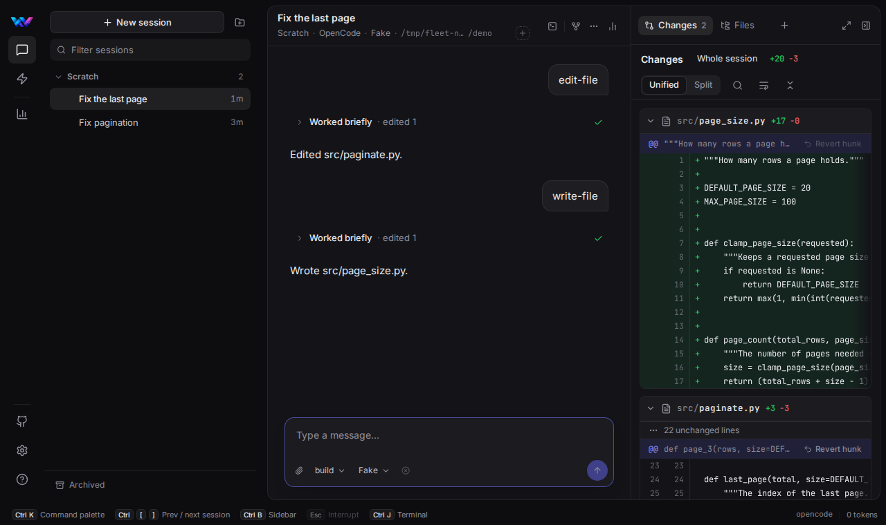
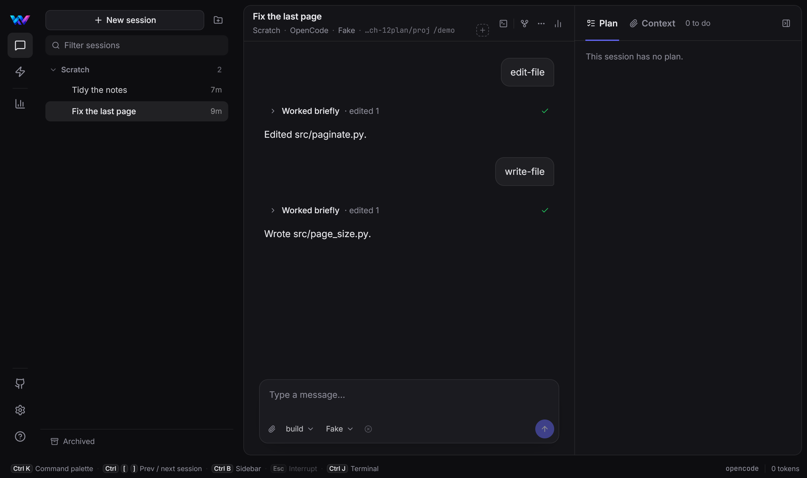

# Component 12: Changes and review

The parity checklist for component 12 of `docs/PORT.md`, and the pieces it is built in.

- **weave-fleet commit read:** `cd13d91` (`main`, 17 November 2026). The server the live checks run against is v0.72.0
  (a scratch Fleet; its client is what the "Fleet's own client" pictures show). Where `main` is newer than v0.72.0 the
  row says so: since v0.72.0, `main` changed the load error to `ErrorNote` with Try again, the empty Changes to
  `EmptyState` with the compare icon, the revert asks through `confirmAction` (subject, "Revert file" / "Revert
  change", destructive) instead of an alert dialog with "Revert", the `+N −N` colours to `--diff-add-text` /
  `--diff-del-text`, the find bar's count and note to `--idle-text`, and gave the hunks' sideways scrollers a region
  role and a tab stop. Find in files on `main` uses `ErrorNote`, `EmptyState` and `Spinner` where v0.72.0 had its own
  blocks. Port `main`.
- **Native app read:** `main` at `7fef4f1` (`src/conv/diff.rs`, `src/view/diff.rs`, `src/view/sheet.rs`,
  `src/fleet/right_panel.rs`, `src/fleet/drafts.rs`, `src/conv/find.rs`, `src/ui/confirm.rs`, `src/ui/commands.rs`).
- **Sources** (`client/src/`): `components/canvas/ChangesCanvas.vue` (193 lines), `ChangesReview.vue` (1,794),
  `ChangesFindBar.vue` (182), `LinesBar.vue` (227, shared with the file tab); `lib/diff-review.ts` (275),
  `lib/changes-find.ts` (168), `lib/diff-base.ts`, `lib/review-selection.ts`, `lib/line-quote.ts`,
  `lib/find-text.ts`; `composables/use-diffs.ts` (263), `use-file-diff-contents.ts` (115), `use-changes-find.ts` (129),
  `use-find-text.ts` (120), `use-canvas-annotation.ts`, `use-annotation.ts`; `api/session-files.ts` (the reads,
  writes, restore and `searchSessionChanges`); `stores/find-in-files.ts`; `components/session/FindInFilesResults.vue`
  (349) and the contents half of `FileBrowserPanel.vue`; `components/annotations/AnnotationPopover.vue` (135),
  `lib/format-annotation-prompt.ts`; the `find-in-files` command in `composables/use-commands.ts`. Tests:
  `ChangesCanvas.test.ts` (7), `ChangesReview.test.ts` (40), `diff-review.test.ts` (13), `changes-find.test.ts` (10),
  `use-diffs.test.ts` (11), `use-file-diff-contents.test.ts` (3), `find-text.test.ts` (4), `use-find-text.test.ts` (7),
  the "Find in files" block of `FileBrowserPanel.test.ts` (9).
- **Not this component's, though the files sit beside it:** the tab strip, the Changes tab's place and count badge,
  `openChanges`, `activate` and the review width (component 10: `CanvasHost.vue`, `stores/canvases.ts`,
  `AppShell.vue`; the width rule is already `src/fleet/right_panel.rs`); the file tab, its Diff view and `openFile`,
  the Files tab's tree and name search, Go to file (component 11: `FileCanvas.vue`, `FilesCanvas.vue`,
  `FileBrowserPanel.vue`'s names half, `use-diff-base.ts`); the tool card's inline diff (`DiffView.vue`, done in
  component 3, piece C) and the fold row's file counts (`use-file-stats.ts`, done in 3G); rendered HTML (component 14:
  a card with Open, decision 1); the phone's `ChangesSheet.vue` (out of scope).
- **Not reachable in Fleet's desktop app at `cd13d91`, so not ported:** `FilesChangedView.vue` (658),
  `FilesChangedFileList.vue` (542) and `DiffsTray.vue` (620). The view shows only for the URL `?view=files`, which
  nothing in the app, the desktop shell or a deep link produces; the tray opens through `openDiffsTray`, which nothing
  calls (only `SessionRoute.view-mode.test.tsx` does). `openChanges(path)` with its `reviewFocus` also has no caller on
  `main` (the changed-files card that used it is gone); component 10 keeps it and this component's review answers it
  (13.1), so a caller added later works. Worth telling Fleet: three components and a store path are dead code there.

**Row numbers:** 1.x the changes list (`/diffs`), 2.x one file's contents, 3.x the review model, 4.x the Changes body's
states, 5.x the review's header, 6.x a file's section, 7.x hunks, folds and lines, 8.x drawing what's near, 9.x Rendered
and asking about it, 10.x revert, 11.x find in changes, 12.x selecting lines, 13.x what other components ask of Changes,
14.x find in files. Numbers have gaps on purpose.

The gap, visible in the pictures (one scratch Fleet v0.72.0, the scripted model's `edit-file` and `write-file` in one
session, 1280×760): Fleet's panel opens on its **Changes 2** tab: the header (Changes, Whole session, `+20 −3`, Unified |
Split, find, wrap, collapse all), then a card per file, `src/page_size.py +17 −0` all green, `src/paginate.py +3 −3`
with "22 unchanged lines" folded above its hunk and the hunk's `@@ def page_3(…` header with Revert hunk. The native
app has no Changes at all: its panel holds two stand-in tabs, Plan and Context. The other pictures in
`shots/parity/12-changes-and-review/` show what the pieces build towards: Split, the find bar at "1 of 26", the revert
question, an empty session ("Since this session started", "No changes in this session yet") and Find in files in the
Files tab, each in both themes.

## What the native app has today

- **No Changes tab or body.** `src/view/sheet.rs` draws the panel with stand-in Plan and Context tabs; component 10
  builds the real strip and gives Changes its place (its first tab, fixed, with the count).
- **The diff parser and the card's rows** (`src/conv/diff.rs`, 3C): `parse_diff_lines(before, after)` is Fleet's
  `parseDiffLines` (the 6,000 edit-distance limit included), `DiffLine { kind, content, old, new }`, `count_changes`.
  The review builds on these lines. `rows()` and `view::diff` are the tool card's `DiffView` (runs past 10 lines cut
  to 3 at each edge), **not** the review's hunks: the review has its own model (part 3) and rows (part 7), which reuse
  `view::diff`'s tints and number-column technique, not its rows.
- **The review width rule** (`src/fleet/right_panel.rs`): `RightPanel.review`, `REVIEW_SHARE = 0.6`, `user_sized`.
  Component 10 sets `review`.
- **Find helpers** (`src/conv/find.rs`, 3P): `count_occurrences` (case-blind, no overlap) and `is_find_shortcut`
  (Ctrl/Cmd+F by platform). The review's find reuses both; its marks and stepping are its own (part 11).
- **The confirm dialog** (`src/ui/confirm.rs`: `Confirm` with title, subject, body, confirm label, destructive), the
  toast (`src/ui/toast.rs`), the clipboard through `Tx::copy` (`fleet/header_actions.rs` shows the pattern), drafts'
  `append_draft_reference` and `append_draft_text` (`src/fleet/drafts.rs`), the settings file for remembered choices
  (`src/fleet/settings.rs`), the `files.changed` and `turn.ended` events read (`src/fleet/events.rs`), and
  `rune_kit::markdown` for Rendered.
- **The palette lists "Find in files…"** (`src/ui/commands.rs`, Ctrl/Cmd+Shift+F) as waiting for component 11.
- **Icons to add** (`tools/gen-icons.py`, never by hand): `git-compare`, `wrap-text`, `chevrons-down-up`,
  `chevrons-up-down`, `message-square-plus`, `quote`, `link`, `chevron-up` if missing. Present: `file-text`,
  `external-link`, `copy`, `undo-2`, `ellipsis`, `history`, `git-branch`, `search`, `text-search`, `x`.
- **Rune can do what this needs** (looked up at the pinned rev `f1f54ce`): selectable text in a `selection_group`
  with `on_selection_change` (each selected text with its path and range: part 12), `virtual_rows` and
  `on_scroll_offset` (part 8), `Tx::copy`. Nothing here needs the pin moved.

## Part 1: the changes list (`use-diffs.ts`, `api/client.ts`)

| # | Element / behaviour | Source | Native today |
|---|---|---|---|
| 1.1 | `GET /api/sessions/{id}/diffs` on the session's machine answers `{ diffs: FileDiffItem[], available, base?, refusal? }` (a bare array from an old server counts as available). `FileDiffItem`: `file`, `before`, `after` (empty in the list: contents come per file, 2.1), `additions`, `deletions`, `status` (`added`, `deleted`, `modified`), `isBinary`/`binary`, `isTruncated`/`truncated` | UD 70-140, client.ts 325-355 | Done in piece A (`fleet::diffs`, 17 November 2026) |
| 1.2 | `base`: `{ kind: "branch", branch, commit }` (where the folder's branch left the main branch) or `{ kind: "session" }` (the folder as the session found it). Kept while `baseKey` (`branch:<commit>` or `session`) doesn't move | UD 46-50, 131-132 | Done in piece A (`fleet::diffs`, 17 November 2026) |
| 1.3 | `refusal`: `{ message, fixCommand }` when git refuses the folder (another user owns it) | UD 130, client.ts 343 | Done in piece A (`fleet::diffs`, 17 November 2026) |
| 1.4 | State per session: `diffs`, `byFile`, `available`, `refusal`, `base`, `isLoading`, `hasLoaded` (the first answer or failure arrived: until then an empty list means "not known yet"), `isStale`, `error` (`HTTP <status>` or the thrown message) | UD 10-33 | Done in piece A (`fleet::diffs`, 17 November 2026) |
| 1.5 | The list is replaced only when its key (file, status, counts per file) changed, so what derives from it doesn't redo on every edit event | UD 41-44, 127-128 | Done in piece A (`fleet::diffs`, 17 November 2026) |
| 1.6 | Another session: everything resets at once (empty, not loaded, not stale, no error); an answer for an older request is dropped (`requestId`) | UD 197-211, 120-123 | Done in piece A (`fleet::diffs`, 17 November 2026) |
| 1.7 | `join`: a request for the same machine and session already on its way is shared (opening a session: the page and the panel both ask); after an edit or a revert the caller asks afresh | UD 89-105 | Done in piece A (`fleet::diffs`, 17 November 2026) |
| 1.8 | Events on the session's topic: `turn.ended` for this session fetches at once; `files.changed` for this session opens a 250 ms window and fetches at its end, edits inside it join it (not pushed back); one refresh at a time, and one still running when the window ends is followed by exactly one more | UD 161-193, 223-245 | Done in piece A (`fleet::diffs`, 17 November 2026); `files.changed` and `turn.ended` on the open session's topic, the window ends on a thread |
| 1.9 | `isWanted`: while nothing shows the diffs (the panel closed), a file change only marks the list stale; it loads when the panel opens and the list is stale | UD 161-166, 213-221; `sessions.$id.tsx` 145-148 | Done in piece A (`fleet::diffs`, 17 November 2026); `isWanted` is `content_open` (the phone tray has no desktop counterpart) |
| 1.10 | The session opening asks once (`join`) | `sessions.$id.tsx` 186-195, `SessionsV2RightPanel` 76-84 | Done in piece A (`fleet::diffs`, 17 November 2026); `after_open` asks (joined), and a reconnect asks afresh |
| 1.11 | What the list feeds elsewhere: the Changes tab's count (`diffs.length`, component 10), `panelHasContent`'s `changedFiles` and `changesFailed` (component 10), the file tree's changed marks and the file tab's diff (component 11) | `CanvasHost.vue` 63, 358; `panel-content.ts`; `FileBrowserPanel.vue` 27-33 | Seam done: `State.diffs`; the readers are 10's and 11's |
| 1.12 | `diffBaseLabel`: branch → "Compared with `<branch or main>`", the short commit (7), tooltip "What this branch changes since it left main at `abc1234`, committed or not. Rebasing onto main or pulling it doesn't add other people's work."; session → "Since this session started", tooltip "This folder isn't on a branch of its own, so its changes are compared with how it was when the session started." | `lib/diff-base.ts` | Done in piece A (`fleet::diffs`, 17 November 2026); `diff_base_label`, words identical (drawn in piece D) |

## Part 2: one file's contents (`use-file-diff-contents.ts`)

| # | Element / behaviour | Source | Native today |
|---|---|---|---|
| 2.1 | `GET /api/sessions/{id}/diffs/file?path=…` answers one `FileDiffItem` with `before` and `after` (git asked about that file only, weave-fleet #942) | UFDC 85-100 | None |
| 2.2 | An entry per path: `loading`, `ready` (the item) or `error` (`HTTP <status>` or the message) | UFDC 6-9 | None |
| 2.3 | Each path is fetched for a **version** (`status:additions:deletions`); a newer version replaces a request still waiting, and an answer for an older version is dropped. `load` does nothing when that version is already there; `reload` always asks again | UFDC 77-114 | None |
| 2.4 | A cache of the last 200 answers by machine, session and path: a reopened panel or a session switched back to draws at once, and is still fetched again quietly and replaced | UFDC 11-28, 80-83 | None |
| 2.5 | At most 4 file requests at once per machine; the rest queue (a long list, as find loads, can't hold up the app's other requests) | UFDC 30-58 | None |
| 2.6 | One session's file never shows in another | UFDC test 3 | None |

## Part 3: the review model (`lib/diff-review.ts`)

| # | Element / behaviour | Source | Native today |
|---|---|---|---|
| 3.1 | `buildReview(diffLines, context = 3)`: no changes → no items; changes whose context would touch or overlap (gap ≤ 6) form one hunk; a hunk has 3 lines of context each side; the unchanged runs between and after are folds (`fold-<start>`, `hidden`, the lines); hunks are `hunk-<n>` with `from`/`to` indices, `startLine` (first non-removed line's new number, else old, else 1) | DR 120-163 | Done in piece B (`conv::review`, 17 November 2026) |
| 3.2 | A hunk's name: the nearest line at or above its start that isn't a removal, isn't blank, doesn't start with whitespace or `}`, `)`, `]`; trimmed, cut to 63 chars + "…" past 64 | DR 107-118 | Done in piece B (`conv::review`, 17 November 2026) |
| 3.3 | `wordMarks(from, to)`: tokens (`\s+`, `[A-Za-z0-9_$]+`, any other char); the shared head and tail tokens are left out; nothing marked when they share nothing, or the change covers more than 70 % of the longer line; a side with nothing of its own gets none | DR 43-77 | Done in piece B (`conv::review`, 17 November 2026) |
| 3.4 | Each run of removals followed by a run of additions pairs them in order and marks each pair; a hunk over 600 lines is a rewrite and gets no marks | DR 80-97, 142-143 | Done in piece B (`conv::review`, 17 November 2026) |
| 3.5 | `splitRows`: context on both sides; a run of removals beside the run of additions after it, the shorter side padded with nothing | DR 167-189 | Done in piece B (`conv::review`, 17 November 2026) |
| 3.6 | `markedSegments(content, marks)`: the line in plain and marked pieces | DR 192-208 | Done in piece B (`conv::review`, 17 November 2026) |
| 3.7 | `textWithRangeReverted(diffLines, {from,to}, trailingNewline, raw?)`: added lines inside the range dropped, removed lines inside come back, everything else as the file has it now; with `raw` (before and after as read) every line keeps the ending it had in its own file (CRLF, LF, CR, mixed), a line that lost its ending takes the file's most common one, the last line ends as the file ends now, and a BOM stays | DR 210-275 | Done in piece B (`conv::review`, 17 November 2026) |

## Part 4: the Changes body's states (`ChangesCanvas.vue`)

| # | Element / behaviour | Source | Native today |
|---|---|---|---|
| 4.1 | The body fills the tab: a column, `overflow:hidden` | CC 112-118 | None |
| 4.2 | The base line, only while there are no changes: 12 px `--muted`, padding `10px 16px 0`, gap 6; `git-branch` (branch) or `history` (session) icon 12 at `--muted` 75 %; the label; the short commit in mono 11.5 at `--muted` 80 %; the tooltip is the label's detail (1.12) | CC 43-61, 121-142 | None |
| 4.3 | Loading: "Loading changes…", 13 px `--muted`, padding `14px 18px`, until the first answer (`hasLoaded`) | CC 62-68, 144-149 | None |
| 4.4 | Load failed (no changes and an error): `ErrorNote` "Couldn't load the changes." with the reason and **Try again** (disabled while it runs), margin 12 (`m-3`). **Newer than v0.72.0** (v0.72.0 drew its own block with "Trying…") | CC 69-77 | None |
| 4.5 | Git refused the folder: the server's message; "To let git read it, run this once:" in `--muted`; the command in a mono 12 box (padding `6px 8px`, 1px `--border`, fill `--muted` 10 %, wraps anywhere, selects whole); a **Copy command** button (min height 28, padding `4px 12px`, 1px `--border`) that reads "Copied" after copying | CC 78-100, 151-189 | None |
| 4.6 | Empty: `EmptyState compact` with the `git-compare` icon, "No changes on this branch yet" (branch) or "No changes in this session yet". **Newer than v0.72.0** (was a plain line with a full stop) | CC 101-106 | None |
| 4.7 | Otherwise the review (parts 5-12) | CC 107-110 | None |
| 4.8 | Both themes; long refusal message and command wrap | CC css | None |

## Part 5: the review's header (`ChangesReview.vue` 736-822)

| # | Element / behaviour | Source | Native today |
|---|---|---|---|
| 5.1 | Header: min-height 46, padding `6px 10px 6px 14px`, gap 10, wraps, 1px bottom `--border`, 12.5 px | CR 1259-1269 | None |
| 5.2 | "Changes" 14/600 | CR 737-739, 1271-1275 | None |
| 5.3 | "Whole session" (height 28, padding `0 8 0 10`, `--text-muted` falling back to `--text`); its tooltip is the base label and commit (1.12), or "Which changes to show". Always the whole session: no scope to pick | CR 99-102, 740-744, 107-109 | None |
| 5.4 | Totals: `+N` in `--diff-add-text` 500, `−N` (U+2212) in `--diff-del-text` 500, mono 12, tabular, gap 6. **Newer than v0.72.0** (the `-text` colours) | CR 745-751, 1292-1309 | None |
| 5.5 | Unified \| Split segments: a 2px-padded group, radius 8, fill `--text` 6 %; buttons padding `3px 10px`, radius 6, 500, `--muted`; the pressed one `--panel-bg`, `--text`, a 1px `--border` ring | CR 753-774, 1311-1334 | None |
| 5.6 | Layout: Unified below 1,100 px of panel and Split from 1,100, until the user picks; the pick is remembered (`weave:changes-layout`) | CR 48-87 | None |
| 5.7 | Icon buttons 28×28, radius 7, `--muted`, hover fill `--text` 7 % and `--text`, pressed `--accent-dim` and `--accent`, icons 15: **Find** ("Find in changes (Ctrl+F)", toggles the bar), **Wrap** ("Wrap long lines", remembered as `weave:changes-wrap`), **Collapse all** / **Expand all** (chevrons-down-up / chevrons-up-down; Expand when every file is shut) | CR 775-821, 1341-1362, 89-97, 147-150 | None |
| 5.8 | A notice line above the files after a revert that did nothing or failed: 12.5 px, padding `8px 10px`, 1px border `--error` 40 % over `--border`, radius 8, **Dismiss** at the right in `--muted` | CR 842-855, 1375-1394 | None |
| 5.9 | The body under the header scrolls: padding `12px 12px 16px`, gap 10 between files, files sorted by path | CR 837-841, 1364-1373, 104-106 | None |

## Part 6: a file's section

| # | Element / behaviour | Source | Native today |
|---|---|---|---|
| 6.1 | Card: 1px `--border`, radius 8, `--panel-bg`, clips its code | CR 857-865, 1396-1403 | None |
| 6.2 | Header: height 36, padding `0 10 0 8`, gap 8, 1px bottom `--border` (none when shut), fill `--text` 4 % over `--panel-bg` (7 % on hover); **sticks** to the top of the scrolling body (`top: -12px`) while its file scrolls under it; a button: click, Enter or Space opens and shuts it; focus ring 2px `--accent` inset | CR 866-874, 1405-1430 | None |
| 6.3 | In it: chevron 14 `--muted` (turned −90° when shut, 120 ms), `file-text` 15 `--muted`, the path in mono 12.5/500 with the folder part in `--muted` 400, truncating, tooltip the whole path; `+N −N` (mono 12) | CR 875-894, 1432-1476 | None |
| 6.4 | Actions on hover or focus within the header (always shown without hover; on touch only Copy path, skipped): a **Diff \| Rendered** segment (small: padding `1px 8px`, 12 px) for `.md`, `.markdown`, `.mdx`, `.htm(l)` (9.x); **Revert file** (`undo-2` 14 and the words; disabled with the reason "A binary file can't be reverted from here" / "A file this large can't be reverted from here", tooltip "Revert file: delete this new file" for an added one, else "Revert file"); **Open file** (`external-link`, 11's file tab on its Diff view, kept); **Copy path** (`copy`). Buttons height 24, padding `0 6`, radius 6, 12 px `--muted`, hover fill `--text` 9 %, disabled 45 % | CR 895-960, 1462-1512, 421-436, 90-93 | None |
| 6.5 | Which start open: the first 8 files of the list as it first arrives; shut whatever their place: lockfiles and generated files (`package-lock.json`, `npm-shrinkwrap.json`, `yarn.lock`, `pnpm-lock.yaml`, `bun.lock(b)`, `Cargo.lock`, `Gemfile.lock`, `poetry.lock`, `uv.lock`, `composer.lock`, `go.sum`, `packages.lock.json`, `Pipfile.lock`, `flake.lock`, `*.min.js`, `*.min.css`, `*.lock`, `*.map`) and diffs over 1,500 changed lines. Decided once per review | CR 117-137 | None |
| 6.6 | The body's states, in `.rfile__note` (padding `12px 14px`, 12.5 px `--muted`): "Loading…" (holding the file's pending height, 8.3); "Couldn't load this diff." with **Try again** (1px `--border`, padding `2px 10px`); "Binary file — no diff available"; "File too large to diff"; "No line changes." | CR 975-1014, 1514-1529, 231-242 | None |

## Part 7: hunks, folds and lines

| # | Element / behaviour | Source | Native today |
|---|---|---|---|
| 7.1 | Hunk header: height 28, padding `0 6 0 12`, gap 8, fill `--accent-dim`, mono 11.5 `--muted`, one line: `@@` in `--accent-text` 500, the hunk's name or "line N" (truncating), **Revert hunk** at the right (`undo-2` 12, sans 500 11.5, height 22, padding `0 8`, radius 6; disabled while reverting or when the file isn't `modified`, with the tooltip "Revert the whole file instead") | CR 1097-1117, 1535-1583 | None |
| 7.2 | A fold row: full width, height 26, padding `0 12`, gap 8, 1px `--border` above and below, fill `--text` 3 % over `--panel-bg` (7 % and `--text` on hover), sans 12 `--muted`: `ellipsis` 14 and "N unchanged line(s)"; a click draws its lines (context rows) in place | CR 1022-1034, 1585-1604, 286-300 | None |
| 7.3 | A line: mono 12, line height 20, no ligatures: old number and new number (each 36 wide, padding-right 8, 11.5 px `--muted` 65 %, right-aligned, not selectable; the new one has a 1px right `--border`), the marker (20 wide, centred, `+` or `−` U+2212, `--muted`; `--diff-add-text` / `--diff-del-text` on changed lines), the text (padding-right 16) | CR 1124-1148, 1632-1683 | None |
| 7.4 | Tints: added lines `--diff-add` 10 %, removed `--diff-del` 9 % (the number cells too); word marks `--diff-add` 26 % and `--diff-del` 24 %, radius 2 | CR 1241-1245, 1723-1762 | None (3C's tints are the card's: reuse the colour mixing, not the numbers) |
| 7.5 | No wrap: each hunk's lines scroll sideways together, the scrollbar hidden, the right edge fading over 28 px; the line numbers stick to the left only once that hunk is scrolled sideways (a sticky number everywhere slowed every repaint in the browser) | CR 1606-1626, 1647-1669, 714-723 | None |
| 7.6 | Wrap: lines wrap anywhere, no sideways scroll, no fade | CR 1616-1645 | None |
| 7.7 | Split: one grid per hunk, old and new columns sharing widths so one sideways scroll moves both (thin scrollbar); a column's numbers are 34 wide, one number per side; a padded cell is hatched (135°, `--text` 6 % lines every 5 px); 1px `--border` between the columns; with Wrap the two columns are equal and don't scroll | CR 1152-1201, 1764-1793, 1747-1749 | None |
| 7.8 | A folded run opened in Split draws as context rows on both sides | CR 1058-1093 | None |
| 7.9 | A long diff draws its first 600 changed lines (a hunk is cut too); **Show N more lines** (a fold-styled button) draws the rest | CR 257-283, 1204-1212 | None |
| 7.10 | Hunks' sideways regions are a tab stop when lines don't wrap, labelled "Changes to `<path>` at `<name or line N>`" or "Unchanged lines of `<path>`". **Newer than v0.72.0** | CR 290-296 | None (keyboard reach is component 26's audit; the arrow keys scrolling is this) |

## Part 8: drawing what's near (`ChangesReview.vue` 156-209)

| # | Element / behaviour | Source | Native today |
|---|---|---|---|
| 8.1 | An open file's contents are fetched and its lines drawn only once its section comes within 600 px of the visible part of the review, and it stays drawn after (weave-fleet #941) | CR 156-209 | None |
| 8.2 | A file not drawn yet holds about its height: `min(additions + deletions + 8, 600) × 20` px, so files below it don't all come into view and load at once; it keeps that height while it loads | CR 173-179, 963-974 | None |
| 8.3 | A file's lines are worked out once per loaded entry and version; another file loading doesn't redo them | CR 220-255 | None |

## Part 9: Rendered, and asking about it

| # | Element / behaviour | Source | Native today |
|---|---|---|---|
| 9.1 | Diff \| Rendered on a Markdown or HTML file (6.4): Rendered draws the file's new text with the Markdown renderer (padding `8px 14px`); HTML with the HTML renderer | CR 302-313, 1001-1008, 1531-1533; `stores/canvases.ts` 131 | None. Markdown: `rune_kit::markdown`. HTML: component 14's card with Open (decision 1) |
| 9.2 | Selecting text in rendered Markdown offers to ask the agent about it: the right panel's popover (`AnnotationPopover`, `useAnnotation`, `formatAnnotationPrompt`) puts the question in the draft. Shared with the file tab (11) and the visual tab (14); HTML in Changes isn't annotatable | CR 547-550, 1005-1007; `SessionsV2RightPanel.vue` 206-236, 278-284; `use-canvas-annotation.ts` | None. Owned here (agreed with component 10's planner, 17 November 2026) through one `State::open_annotation(anchor_text, position, path)` that 11 and 14 call |

## Part 10: revert

| # | Element / behaviour | Source | Native today |
|---|---|---|---|
| 10.1 | Revert file asks first (`confirmAction`): "Revert this file?", the path in mono, the body by status: added "Deletes the file: the session created it. Its contents are lost."; deleted "Puts the deleted file back as it was."; modified "Puts the file back as it was before the agent changed it. The agent's edits to it are lost."; **Revert file**, destructive. **Newer than v0.72.0** | CR 340-355 | None (`ui::confirm` exists) |
| 10.2 | Revert hunk asks: "Revert this change?", the path, "Puts these lines back as they were. The agent's other edits to the file stay.", **Revert change**, destructive | CR 356-366 | None |
| 10.3 | One revert at a time; nothing happens unless the file's contents are loaded | CR 368-374 | None |
| 10.4 | A deleted file: `POST /api/sessions/{id}/files/restore` with the before text and no hash; a 409 (something new is at that path) says "`<path>` exists again, so nothing was reverted." | CR 376-379; `session-files.ts` 106-130 | None |
| 10.5 | An added file: read it (`GET …/files/content?path=`); if it differs from the diff's after text, ask for its diff and the list again and say "`<path>` changed while you were reviewing it. Its diff is refreshed; revert again if you still want to."; else restore with no content and the read hash (deletes it); a 409 says "`<path>` changed on disk, so nothing was removed." | CR 380-390 | None |
| 10.6 | A modified file or any hunk: read it; stale as in 10.5; else write (`PUT …/files/content` with `path`, `content`, `baseHash`) the before text (file) or `textWithRangeReverted` with raw texts (hunk); a 409 says "`<path>` changed on disk, so nothing was reverted." | CR 391-408; `session-files.ts` 76-104 | None |
| 10.7 | Then the list is asked again (not joined), and the file's diff is asked again only if the file is still in it | CR 409-412 | None |
| 10.8 | A failed request: "Could not revert `<path>`: `<reason>`" (the server's `error` when it gave one) | CR 413-417 | None |

## Part 11: find in changes (`ChangesFindBar.vue`, `use-changes-find.ts`, `lib/changes-find.ts`)

| # | Element / behaviour | Source | Native today |
|---|---|---|---|
| 11.1 | The bar under the header: padding `6px 10px 6px 14px`, gap 4, wraps, 1px bottom `--border`, `--card-bg`, 12 px. Field: grows from 160, 80-320 wide, height 28, padding `0 8`, 1px `--border`, radius 6, `--background`, 13 px, placeholder "Find in changes", no clear button, 2px `--accent` focus ring; count (min 64, `--idle-text`, tabular): "" for a blank query, "Searching…" or "No matches", "n of m"; Previous ("Previous match (Shift+Enter)", chevron-up) and Next ("Next match (Enter)", chevron-down) disabled with no matches; Close ("Close (Esc)", x); 28×28, radius 6, icons 16, hover `--accent` 14 %, disabled 40 % | CFB all | None |
| 11.2 | "N collapsed file(s) not searched" at the right, `--idle-text`, tooltip "Lockfiles and very large diffs start collapsed and are searched once you open them": files that start shut (6.5), are shut, aren't loaded, and that the machine says hold the text (or all such files when it can't say). **Newer than v0.72.0** (colour) | CFB 135-141; CR 534-543 | None |
| 11.3 | Opening: Ctrl+F (Cmd+F on a Mac) while focus is in Changes (a click in the diff gives it focus; no ring), or the header's Find button. A one-line selection under 200 chars inside Changes becomes the query. The field takes focus with its text selected; Ctrl/Cmd+F again inside the field selects it. The key never reaches the conversation's find or the app | UCF 50-56, 101-127; CF `selectedQuery` | None (`conv::find::is_find_shortcut` exists) |
| 11.4 | Closing: Esc or Close; the marks go, focus goes back to Changes; Esc never reaches the app (where it would stop the agent) | UCF 58-63, 118-122 | None |
| 11.5 | Stepping: Enter next, Shift+Enter previous (in the field); F3 and Ctrl+G (Cmd+G on a Mac) next, with Shift previous, anywhere in Changes while the bar is open; wraps at both ends. A new query, or the first matches arriving, goes to the first | CFB 37-42; UCF 75-95; CF `stepShortcut` | None |
| 11.6 | What is searched: the diff data, not what's drawn: every loaded file's hunk lines and folded lines in drawn order, case-blind, no overlaps, each line once though Split draws an unchanged line twice | CF `findLines`, `findChangesHits`; CR 441-448 | None |
| 11.7 | Stepping to a match draws it: opens its file, marks it near, switches Rendered back to Diff, opens its fold, draws the rest of a long diff; then scrolls it into view about mid-height, a little below the sticky header, and sideways as little as it takes (not under the stuck numbers, not under the fade) | CR 450-460; CF `scrollRangeIntoView` | None |
| 11.8 | Marks: every match drawn in its own highlight, the current one stronger, on both copies of a line in Split; never clearing the conversation's; put back after anything redraws (layout, folds, files opening, Rendered, a file loading) | CF `markChangesMatches`; UCF 65-73, 101 | None |
| 11.9 | Server search (weave-fleet #941): 120 ms after typing, `GET /api/sessions/{id}/diffs/search?q=` answers which changed files hold the text (`{ files: [{ file, count }] }`); only those load. An older Fleet (any non-OK) or a query with non-ASCII letters (git's `-i` folds ASCII only) loads every file instead. A newer query aborts the older request | CR 474-514; `session-files.ts` 152-176 | None |
| 11.10 | While the bar is open, files find wants load (they hold the text, or the machine can't say), except those that start shut; "Searching…" while the server search or any wanted file is loading | CR 516-533 | None |

## Part 12: selecting lines (`LinesBar.vue`, `lib/review-selection.ts`, `lib/line-quote.ts`)

| # | Element / behaviour | Source | Native today |
|---|---|---|---|
| 12.1 | A text selection inside one file's lines picks lines: a row the selection only touches at its edge (starts at its end, or ends at its start) is left out; in Split, a drag that starts in one column selects down that column only (the other column's text isn't selectable meanwhile), and a press in the other column first drops the old selection | CR 552-616 | None (Rune: a `selection_group` per column, `on_selection_change`) |
| 12.2 | `selectionLines`: any line the file still has → new side, in new numbers (removed lines drop out); removed lines only → old side, old numbers; `{ first, last }` | `review-selection.ts` | None |
| 12.3 | The lines bar, docked under the review: margin `0 8 8`, padding `5px 6px 5px 12px`, 1px `--border`, radius 10, `--card-bg`, a large soft shadow, 12 px, one line; the file name (gives way first), the label in bold ("L7", "L18–27", or "Old L4"), the count ("1 line", "10 lines"); **Copy link** (only for new lines; tooltip "Copy `<path>:18-27`"), **Quote** ("Copy the lines as a quote"), **Add to message** (primary), Clear ("Clear (Esc)"); its buttons keep the selection | LB all; CR 618-627, 1218-1228 | None (component 11 lists `LinesBar`: whichever builds first makes `view/lines_bar.rs`, the other reuses it) |
| 12.4 | Copy link: `path:7` or `path:18-27`, toast "Copied `<link>`" | CR 657-659; LQ `lineReference` | None |
| 12.5 | Quote: a heading (`path:18-27`, or `path:4 (before)` for old lines), then the lines (new or old text, line endings dropped) in a fence longer than any backtick run inside, tagged with the file's extension; toast "Copied L18–27 as a quote" | CR 629-636, 660-663; LQ `lineQuote`, `sliceLines` | None |
| 12.6 | Add to message: new lines go into the draft as an `@path:18-27` reference; old lines as the quote text; the selection clears and the composer takes focus | CR 668-680 | None (`drafts.rs` has both appends) |
| 12.7 | The toast: centred 18 px above the bottom (58 with the bar up), padding `7px 12px`, radius 9, `--text` on `--panel-bg`, 12.5/500, one line, fades and rises 8 px over 160 ms, gone after 2.2 s; "Couldn't copy to the clipboard" when copying fails | CR 638-656, 1690-1721 | None (`ui::toast` or a local one: Fleet's is local to Changes) |
| 12.8 | A selection outside the review shows no bar | CR test | None |

## Part 13: what other components ask of Changes

| # | Element / behaviour | Source | Native today |
|---|---|---|---|
| 13.1 | A focus request (`reviewFocus { path, seq }`, set by component 10's `open_changes(path)`): once that file is in the list, open its section, mark it near, and scroll it to the top smoothly; each request once (`seq`) | CR 682-704 | None |
| 13.2 | The Changes tab's count and the panel's "has content" read `State.diffs` (1.11) | `CanvasHost.vue` 358; `panel-content.ts` | Data side done in piece A (`State.diffs`: `files()`, `has_loaded`); the count and `panel_has_content` are 10's |
| 13.3 | Open file (6.4) asks component 11 to open the path in a kept tab on its Diff view | CR 90-93 | None (until 11's file tab exists, the button is drawn disabled with the tooltip "Opening files comes with the file viewer") |

## Part 14: find in files (`FindInFilesResults.vue`, `FileBrowserPanel.vue` contents half, `use-find-text.ts`, `lib/find-text.ts`)

| # | Element / behaviour | Source | Native today |
|---|---|---|---|
| 14.1 | The Files tab's "File names \| File contents" switch (names is the default; 11 owns the names search and the tree). In contents mode the field reads "Search inside files…" ("Search inside files" for screen readers) and gains **Aa** (Match case) and **.\*** (Regular expression) toggles before the clear button | FBP 44-52, 143-200 | None |
| 14.2 | Under 2 characters, contents mode shows the tree with a hint under it: "Type to search inside every file in this folder." and "Ignored files and build folders are left out." | FBP 282-285; UFT 8 | None |
| 14.3 | `GET /api/sessions/{id}/find/text?q=&regex=&matchCase=` 250 ms after typing pauses, on the session's machine; a newer query, switch or session aborts the older request; another session drops the old answer; the last answer stays in view while the next one comes | UFT 37-117 | None |
| 14.4 | Answer: `{ files: [{ path, total, matches: [{ line, column, text, ranges: [{start,end}] }] }], matches, stopped: null \| "limit" \| "deadline", engine: "git" \| "walk" }` | `lib/find-text.ts` 1-29 | None |
| 14.5 | Failures, never shown as "no matches": 400 → "That isn't a valid pattern." and the server's reason in mono 11.5; 404 → "This machine can't search inside files yet." and "The Fleet running on it is older. Update it from Settings → Updates & about, then search again."; anything else or a thrown request → "The search failed." and the reason (`The search failed (HTTP <n>).` by default) | FIFR 58-71; UFT 54-83 | None |
| 14.6 | Before the first answer: a spinner and "Searching…" (12 px `--muted`, padding `24px 16px`) | FIFR 73-76 | None |
| 14.7 | The summary (11.5 `--muted`, padding `2px 6px 6px`, dimmed to 60 % with the list while a newer search runs): "N match(es) in M file(s) · 0.1 s", or "First N matches, in M files" at the cap, "· stopped after 10 s" at the deadline, "· not a git repository" for the walk engine | FIFR 35-46 | None |
| 14.8 | No matches: `EmptyState compact` "No matches for “`<query>`”" with "Check the spelling, or try the regex switch." (or "Try turning off the regex switch."), "Match case is on." when it is, and the walk sentence; a deadline with nothing found says "The search ran out of time before it found anything." / "That isn't “no matches”. Try a longer or more exact search." instead | FIFR 48-51, 84-97 | None |
| 14.9 | A file group: a button with the file's icon (13), name 600, folder 11 px `--muted` truncating, and the total in a pill (10.5 px, `--text` 8 %); then up to 5 lines (`MATCHES_PER_FILE`) each with its number (min 3.2ch, right, `--muted`) and the cut line in mono 12/1.55 at `--text` 82 %, matches marked in `--idle` 30 %; **Show N more in this file** | FIFR 99-126, 220-334 | None |
| 14.10 | Notes after the list: "Showing the first N matches." / "There are more. Search for something longer, or turn on the regex switch."; "Stopped after 10 seconds." / "These are the matches found so far."; the walk sentence. Cards: 12.5 px, padding `9px 12px`, 1px border (warn `--idle` 45 %, error `--error` 45 %), radius `--radius-card` | FIFR 128-139, 168-216 | None |
| 14.11 | Keys in the field: ↓ and ↑ move the active line through the lines shown (ringed: 1px `--accent` 50 %, fill `--text` 7 %; kept in view); Enter opens the active line (or the first); Esc clears the query and leaves the field. A new answer starts with every file folded and the first line active | FBP 59-87, 117-131 | None |
| 14.12 | Opening a line (click or Enter): component 11's file tab, a preview tab, at that line; Markdown and HTML open on their source (Edit), not Rendered; the right panel shows | FBP 69-75 | None (until 11's file tab, opening is a no-op with the reason in the row's tooltip) |
| 14.13 | Ctrl+Shift+F (Cmd+Shift+F on a Mac), or the palette's "Find in files…" ("Search inside the files of this session's folder.", disabled with "Open a session to search its files." when none is open; works from the composer too): opens the Files tab and shows the panel, then once that tab is on screen it switches to contents and focuses the field with its text selected. A request for another session is left alone | `use-commands.ts` 433-452; `stores/find-in-files.ts`; FBP 89-106 | Listed in the palette, waiting (`ui/commands.rs`) |
| 14.14 | Query and results stay when switching names ↔ contents and back | FBP test | None |

## What stays out of reach, and why

- **`FilesChangedView`, `FilesChangedFileList`, `DiffsTray`:** nothing in Fleet's desktop app opens them (top of this
  file). If Fleet wires them up again, the catch-up session adds them.
- **Touch layouts** (`@media (hover: none)`, the phone widths of find-in-files): desktop only.
- **Screen-reader roles** (`role=search`, `aria-live` on the count, regions on the hunks, `aria-pressed`): Rune has
  roles and labels; what it can't say goes to component 26's audit, as in earlier components.
- **The toast's 160 ms rise:** drawn if Rune's motion allows it in a few lines, else it appears at once (say so in the
  piece).

## Fleet's tests, and where each lands

| Fleet test file | Cases | Piece |
|---|---|---|
| `use-diffs.test.ts` | all 11 | A |
| `diff-review.test.ts` | all 13 | B |
| `use-file-diff-contents.test.ts` | all 3 | C |
| `ChangesCanvas.test.ts` | all 7 | D |
| `ChangesReview.test.ts` | "shows one section per file with totals, hunks, and folded unchanged runs", "collapses a file section when its header is clicked", "always shows the whole session, with no scope to pick", "offers Try again on a file whose diff failed to load…", "a lockfile starts shut, and opens on a click" | E |
| | "marks only the changed word on a changed line", "opens a folded run of unchanged lines on click", "wraps long lines only when asked", "a huge diff draws its first lines and shows the rest on a click" | F |
| | "draws split as old and new columns and remembers the pick", "keeps line numbers in place only in a hunk scrolled sideways" | G |
| | "fetches and draws an open file only once it comes near the visible part, and keeps it drawn" | H |
| | "asks before reverting a hunk…", "reverts nothing when the confirm is cancelled", "refuses to revert from a stale picture of the file", and the 5 of "reverting files that aren't plain edits" except the lockfile and huge-diff cases | I |
| `changes-find.test.ts` | `findLines`, `findChangesHits` (3), `stepShortcut` (2), `selectedQuery` | J |
| | `markChangesMatches` (2) | K |
| `ChangesReview.test.ts` "find in changes" | "asks the machine which files hold the text…", "searches every file itself when the machine can't say…", "searches a collapsed file, opens it on the match…", "loads files that start collapsed past the first few when the bar opens", "finds a match in a folded unchanged run and opens the run…" | J |
| | "opens on Ctrl+F inside Changes…", "counts matches across files, steps with Enter and Shift+Enter, and wraps", "says No matches, and steps on F3 and Ctrl+G", "opens and closes from the Find button in the header", "counts an unchanged line once in split view and marks both of its copies", "keeps its marks when the layout switches", "shows the diff of a file viewed as Rendered when a match is in it" | K |
| `ChangesReview.test.ts` "selecting lines" | the first 5 | L |
| | "rendered markdown can be asked about, like a file tab's"; "offers Rendered for a markdown file only"; "opens a changed file in a file tab on Diff from its header" | M |
| `find-text.test.ts`, `use-find-text.test.ts` | all 4, all 7 | O |
| `FileBrowserPanel.test.ts` "Find in files" | all 9 | P |

## The pieces

Seventeen pieces, in build order, one pull request each. Each starts from this file alone. A piece takes only its
rows and files; plain Rust with no Rune in it where it can be; Fleet's tests under the same names; views at Fleet's
sizes, tokens and wording; pictures beside Fleet's own client on a scratch Fleet (`scripts/scratch-fleet.sh` on its
own ports and folder, the scripted model's `edit-file` and `write-file`; `edit-file` needs `src/paginate.py` in the
demo project, made as weave-fleet's `mobile/e2e/start-fleet.sh` makes it, and the scripted model builds its paths from
**its own `HOME`**, so start it with a `HOME` whose `src/demo-app` points at the scratch project, never your own),
same state and size, both themes; the PR says what was checked on which system. Every piece updates its rows here, the
row of component 12 in `docs/PORT.md`, and `docs/RUNE.md`.

**Seams, agreed with component 10's planner (17 November 2026):** 10 makes the minimal `src/fleet/diffs.rs` first
(piece A extends it); 10 owns the tab model (`src/fleet/canvases.rs`:
`open_changes(path)` setting `review` and `review_focus`, `activate`), the strip, the Changes tab's place and its
count badge, and draws a stand-in Changes body until piece D replaces it. This component owns `State.diffs` (10 reads
it for the count and `panel_has_content`), the Changes body, and the annotation popover (`State::open_annotation`, used
by 11 and 14). Component 11 owns the file tab (`open_file`, its Diff view) and the Files tab's tree and name search;
pieces M, O and P call into it, and until it exists the calls are drawn disabled with a reason. Component 14 owns
rendered HTML (a card with Open).

### Piece A: the changes list (plain Rust, no view)

- **Done (17 November 2026):** rows 1.1-1.12 and 13.2 (data side), `src/fleet/diffs.rs`, `src/fleet/tests/diffs.rs`, `src/mock/diffs.rs` (tests only until a scene needs it). `use-diffs.test.ts`'s 11 are ported under the same names plus the cases for `diff_base_label`, a refusal, a bare array and a failure. Left to later pieces: the count on the tab (10) and drawing the base label (D).

- **Rows:** 1.1-1.12, 13.2 (the data side).
- **Component 10 builds first** (agreed 17 November 2026): its first data piece makes a minimal `src/fleet/diffs.rs`
  (`Diffs` per session with `files: Vec<FileDiff>` (`file`, `status`, `additions`, `deletions`, `binary`,
  `truncated`), `has_loaded`, `error`, the fetch on a thread joined by session, a refetch on reconnect and on the
  session's events, the list replaced only when its key changed, older answers dropped), because the tab count,
  `panel_has_content` and the Turns tab need it. This piece **extends that file**; if 10 hasn't landed, it makes it in
  that shape.
- **Files:** `src/fleet/diffs.rs` (adds `by_file`, available, refusal, base, loading, stale and `mark_stale`,
  `is_wanted` from the panel being open, the 250 ms edit window and one refresh at a time if 10 left them out,
  `diff_base_label`), `src/fleet/events.rs` (hand `turn.ended` and `files.changed` to it, if 10 didn't),
  `src/fleet/tests/diffs.rs`; mock data in `src/mock.rs` (an invented session
  with an added, a modified, a deleted and a lockfile change, plus one with none).
- **Depends on:** component 2 (events, the machine's HTTP), 17 (the session's machine).
- **Tests:** `use-diffs.test.ts`'s 11 under the same names; `diff_base_label` cases for both kinds and a missing branch
  name.
- **Pictures:** non-visual: the app against the scratch Fleet with the count on 10's Changes tab if 10 has drawn it,
  else a test run and a log of `State.diffs` as the scripted model edits (say which).

### Piece B: the review model (plain Rust, no view)

- **Done (17 November 2026):** rows 3.1-3.7, `src/conv/review.rs`, `src/conv/tests/review.rs`: `diff-review.test.ts`'s 13 under the same names plus cases for the hunk's start line, a cut name, the 600-line rewrite, the 70 % rule and a lone CR. Marks are byte offsets (Fleet's are UTF-16); the 70 % rule counts UTF-16 units as Fleet does. `split_rows` borrows its lines. Not done: the printout beside Fleet's own hunks for the scratch Fleet's `paginate.py` (the model draws nothing; the PR shows an invented file's printout, and the 13 ported tests are the parity check).

- **Rows:** 3.1-3.7.
- **Files:** new `src/conv/review.rs` (`ReviewLine` over `conv::diff::DiffLine` with `index` and `marks`, `ReviewItem`
  hunk or fold, `build_review`, `word_marks`, `split_rows`, `marked_segments`, `text_with_range_reverted` with raw
  texts), `src/conv/tests/review.rs`.
- **Depends on:** 3C's `parse_diff_lines`.
- **Tests:** `diff-review.test.ts`'s 13 under the same names.
- **Pictures:** non-visual: the test run, and a scene-free printout of `build_review` over the scratch Fleet's
  `src/paginate.py` diff beside the hunks Fleet draws for it.

### Piece C: one file's contents (plain Rust, no view)

- **Rows:** 2.1-2.6.
- **Files:** new `src/fleet/diff_contents.rs` (entries by path, versions, `load`, `reload`, the 200-entry cache by
  machine, session and path, at most 4 requests per machine on threads), `src/fleet/tests/diff_contents.rs`.
- **Depends on:** A.
- **Tests:** `use-file-diff-contents.test.ts`'s 3.
- **Pictures:** non-visual: a test run, and a log of the requests a 12-file mock change makes (never more than 4 at
  once).

### Piece D: the Changes body's states

- **Rows:** 4.1-4.8, 1.12 (drawn).
- **Files:** new `src/view/changes.rs` (the body: base line, loading, `ErrorNote` with Try again, the refusal with Copy
  command and "Copied", `EmptyState compact`, else the review's slot); a shared full `ErrorNote` (message, reason, Try
  again) and `EmptyState compact` in `src/ui/` if no earlier piece made them shared (look first: several views have
  their own); 10's Changes tab body points here; scenes `changes-loading`, `changes-failed`, `changes-refused`,
  `changes-empty-session`, `changes-empty-branch` and `-light` pairs; `src/tests_changes.rs`; icons `git-compare`.
- **Depends on:** A; 10's strip (if 10 hasn't landed, mount it in the stand-in panel and say so).
- **Tests:** `ChangesCanvas.test.ts`'s 7.
- **Pictures:** an empty session beside Fleet's (`fleet-empty-*.png` in this file's folder is the reference); the failed
  and refused states from scenes beside Fleet's own client with the scratch Fleet's `/diffs` failing (stop git reading
  the folder, or point at a session on a stopped machine) where it can be made, else the scene alone, said so.

### Piece E: the review's header and file sections

- **Rows:** 5.1-5.5, 5.7 (Collapse all; Find and Wrap drawn, wired in F and K), 5.9, 6.1-6.6 (Revert file drawn
  disabled until I, Open file per 13.3, Copy path working).
- **Files:** new `src/view/review.rs` (header, file cards, sticky file header, collapse state, auto-open and
  start-shut rules), `src/fleet/review.rs` (the review's state per session: collapsed, the open-at-start decision;
  plain Rust), loads every open file at once for now (H narrows it); scenes `review` and `review-light` with the mock
  change; `src/tests_review.rs`; icons `chevrons-down-up`, `chevrons-up-down`.
- **Depends on:** A, C, D. Draws each file's lines as plain context-free rows until F (or put E and F in one PR if
  both stay under 800 lines).
- **Tests:** the 5 of E in the table above.
- **Pictures:** the review beside Fleet's (`fleet-review-*.png`), both themes; a file's Loading, Couldn't load with Try
  again, Binary and Too large notes from scenes.

### Piece F: hunks, folds and lines (Unified, Wrap, Show more)

- **Rows:** 7.1 (Revert hunk drawn, wired in I), 7.2-7.6, 7.9, 7.10, 5.7 (Wrap remembered in the settings file).
- **Files:** `src/view/review_lines.rs` (hunk header, fold row, line rows with number and code columns at a fixed row
  height, the code column scrolling sideways per hunk, the fade, wrap), `src/fleet/review.rs` (open folds, drawn-all,
  wrap preference), `src/fleet/settings.rs` (`changes_wrap`), scenes `review-hunks`, `review-wrap`, `review-long` and
  light pairs; icon `wrap-text`.
- **Depends on:** B, E.
- **Tests:** the 4 of F in the table.
- **Pictures:** the scratch Fleet's `src/paginate.py` hunk, its folds opened and shut, wrapped and not, beside
  Fleet's; a 2,000-line mock diff with Show N more lines.

### Piece G: Split

- **Rows:** 5.5, 5.6, 7.7, 7.8.
- **Files:** `src/view/review_split.rs` (two columns per hunk, each its own column of fixed-height rows so they stay
  level and scroll sideways together, padding hatch, the auto layout from 1,100 px of panel), `src/fleet/settings.rs`
  (`changes_layout`), scenes `review-split` and light.
- **Depends on:** F.
- **Tests:** the 2 of G. "keeps line numbers in place only in a hunk scrolled sideways" becomes: the number column
  doesn't move when the hunk scrolls (the native layout keeps them fixed by construction; say so).
- **Pictures:** Split beside Fleet's (`fleet-split-*.png`), and at a panel over 1,100 px where it starts as Split.

### Piece H: drawing what's near

- **Rows:** 8.1-8.3.
- **Files:** `src/view/review.rs` (`on_scroll_offset` into a `Cell` the state owns; each file's top from the heights
  known so far; files within 600 px marked near and loaded; pending heights), `src/fleet/review.rs` (`near`, the
  per-entry line cache).
- **Depends on:** E, F.
- **Tests:** "fetches and draws an open file only once it comes near the visible part, and keeps it drawn"; one more:
  a 40-file mock change asks for only the files near the top.
- **Pictures:** non-visual mostly: the request log of opening a 40-file change, and the review scrolled half-way with
  the files above drawn and the files below holding their height.

### Piece I: revert

- **Rows:** 10.1-10.8, 5.8, 6.4 (Revert file), 7.1 (Revert hunk).
- **Files:** new `src/fleet/revert.rs` (the three cases, the stale check, the requests on threads, the notice words),
  `src/fleet/session_files.rs` if the file read, write and restore requests don't exist yet (component 11 needs them
  too: put them where both can reach them), `src/ui/confirm.rs` (two `Confirm` constructors), `src/view/review.rs` (the
  notice), `src/tests_review_revert.rs`.
- **Depends on:** B (`text_with_range_reverted`), E, F.
- **Tests:** the 8 of I.
- **Pictures:** the revert question beside Fleet's (`fleet-revert-confirm-*.png`); the live revert of the scratch
  Fleet's hunk (before, after: the file leaves Changes); the stale notice.

### Piece J: find in changes, the logic (plain Rust)

- **Rows:** 11.3 (the selected query), 11.5 (`step_shortcut`), 11.6, 11.7 (what reveal opens), 11.9, 11.10, 11.2
  (the count).
- **Files:** new `src/conv/changes_find.rs` (`find_lines`, `find_changes_hits`, `step_shortcut`, the reveal plan),
  `src/fleet/changes_find.rs` (open, query, current, hits; the server search with 120 ms debounce and a request number
  in place of abort; non-ASCII falls back; which files to load; unsearched count), tests.
- **Depends on:** A, B, C, E (collapse and folds to reveal).
- **Tests:** the J rows of the table.
- **Pictures:** non-visual: the test run, and a request log for "page" on the scratch Fleet (one `/diffs/search`, then
  only the files it named).

### Piece K: the find bar, marks and keys

- **Rows:** 11.1, 11.3-11.5 (keys), 11.7 (scroll), 11.8, 5.7 (Find).
- **Files:** new `src/view/changes_find.rs` (the bar), `src/view/review_lines.rs` and `review_split.rs` (marks in the
  line text, the current one stronger), `src/fleet/changes_find.rs` (keys bound on the Changes body so Esc and Ctrl+F
  stop there), scenes `review-find` and light; icons `chevron-up` if missing.
- **Depends on:** J, F, G.
- **Tests:** the K rows of the table.
- **Pictures:** the bar at "1 of 26" for "page" beside Fleet's (`fleet-find-*.png`); No matches; a match inside a fold
  opened by stepping; the collapsed-files note.

### Piece L: selecting lines and the lines bar

- **Rows:** 12.1-12.8.
- **Files:** `src/conv/line_quote.rs` (`selection_lines`, `line_range_label`, `line_count_label`, `line_reference`,
  `slice_lines`, `line_quote`; plain), `src/view/lines_bar.rs` (if component 11 hasn't made it), `src/view/review_lines.rs`
  and `review_split.rs` (a selection group per column, `on_selection_change` to lines), the local toast, scenes
  `review-lines` and light; icons `link`, `quote`, `message-square-plus`.
- **Depends on:** F, G; drafts (5A).
- **Tests:** the L rows of the table, plus `review-selection` and `line-quote` cases for the labels and the fence.
- **Pictures:** a selection of new lines with the bar beside Fleet's; old lines ("Old L24", no Copy link); the draft
  after Add to message.

### Piece M: Rendered, Open file, Copy path and the focus request

- **Rows:** 9.1, 6.4 (the Diff \| Rendered segment, Open file, Copy path), 13.1, 13.3.
- **Files:** `src/view/review.rs` (the segment; Markdown through `rune_kit::markdown`; HTML through component 14's card
  when it exists; until then Rendered on an HTML file says "Open it to see it rendered", and the PR says so), `src/fleet/review.rs`
  (rendered set, the focus request answered once per `seq`).
- **Depends on:** E; 10's `review_focus`; 11's `open_file` for Open file (drawn disabled until then).
- **Tests:** "offers Rendered for a markdown file only", "opens a changed file in a file tab on Diff from its header"
  (or its disabled form until 11), plus a focus-request test (open, scroll, once per `seq`).
- **Pictures:** a Markdown file's Diff and Rendered beside Fleet's (make one with the scripted model's `write-file`
  pointed at a `.md`, or a shell `run-tests` step that writes one; say how).

### Piece N: asking about rendered text (the annotation popover)

- **Rows:** 9.2.
- **Files:** new `src/fleet/annotation.rs` (`State::open_annotation(anchor_text, position, path)`, the prompt from
  `formatAnnotationPrompt`, into the draft), `src/view/annotation.rs` (`AnnotationPopover.vue` at Fleet's sizes),
  the Rendered view's selection offering it.
- **Depends on:** M; read `components/annotations/AnnotationPopover.vue`, `composables/use-annotation.ts`,
  `lib/format-annotation-prompt.ts`, `lib/annotation-types.ts` and `SessionsV2RightPanel.vue` 206-284 first and list
  their rows here before building (this file names the parts; their rows are that piece's first step).
- **Tests:** "rendered markdown can be asked about, like a file tab's"; the popover's own tests if Fleet has them
  (`components/annotations/__tests__`).
- **Pictures:** the popover over rendered Markdown in Changes beside Fleet's; the draft it leaves.

### Piece O: find in files, the logic (plain Rust)

- **Rows:** 14.3, 14.4, 14.5 (the failure kinds), 14.13 (the request: ask and take; the palette command and its key).
- **Files:** new `src/fleet/find_text.rs` (the request on a thread, 250 ms debounce, min 2 characters, a request number
  in place of abort, 404 / 400 / other, `took_ms`; `segments_of`, `visible_hits`), `src/ui/commands.rs`
  ("find-in-files" no longer waits: opens 10's Files tab, shows the panel, asks), tests.
- **Depends on:** 10 (opening the Files tab), 17 (the machine).
- **Tests:** `find-text.test.ts`'s 4 and `use-find-text.test.ts`'s 7, same names.
- **Pictures:** non-visual: the test run and a request log of typing "pag", "page" with a pause.

### Piece P: find in files, the view

- **Rows:** 14.1, 14.2, 14.5-14.12, 14.14.
- **Files:** new `src/view/find_in_files.rs` (the results list, summary, notes, empty and failure states, the active
  line), the contents half of 11's Files body (the names/contents switch, the toggles, the hint), scenes
  `find-in-files`, `find-in-files-none`, `find-in-files-limit` and light.
- **Depends on:** O; **component 11's Files tab** (its toolbar and tree). If 11 hasn't built it, this piece waits.
- **Tests:** the 9 "Find in files" cases of `FileBrowserPanel.test.ts`.
- **Pictures:** "page" in File contents beside Fleet's (`fleet-find-in-files-*.png`); no matches; a bad pattern; the
  older-Fleet note from a scene.

### Piece Q: sweep

- **Rows:** every row still open.
- **Files:** this file (every Fleet test case listed with its Rust test or owner), `docs/PORT.md`.
- **Depends on:** all above.
- **Tests:** whatever the list shows missing.
- **Pictures:** closing pictures of every state beside Fleet's, both themes; a live run of `edit-file`, `write-file`,
  find, revert and Find in files on the scratch Fleet.
