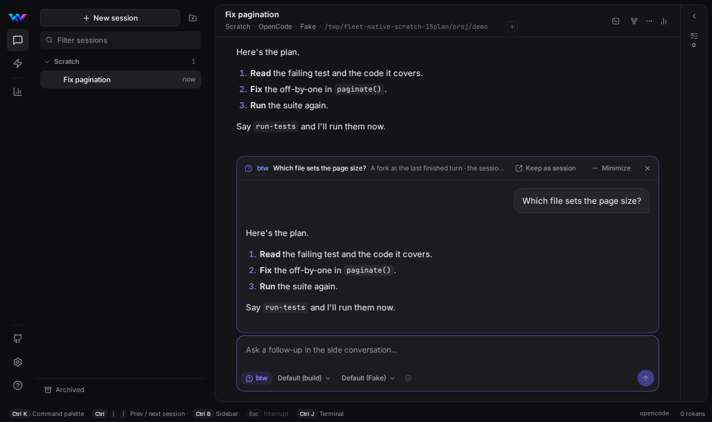
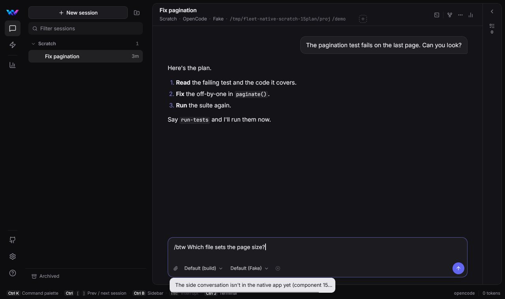
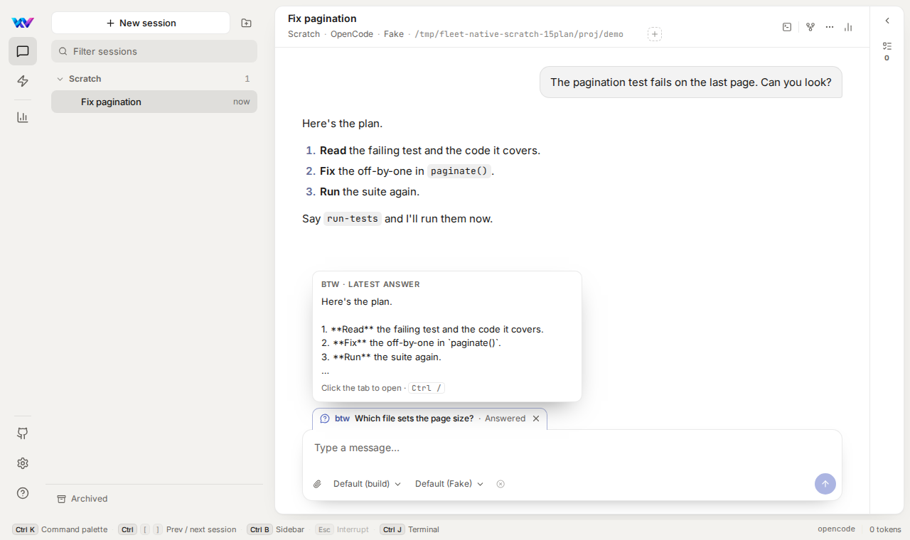
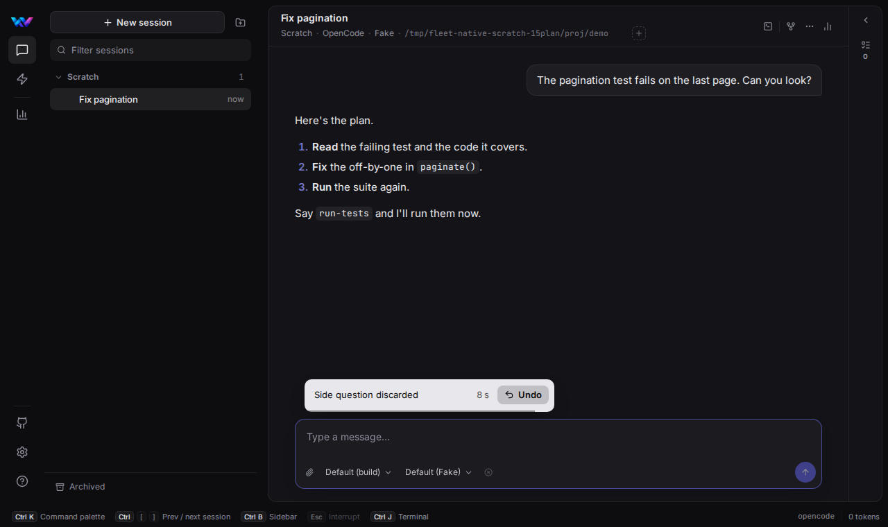

# Component 15: Side conversation

The parity checklist for component 15 of `docs/PORT.md`, the `/btw` panel, and the pieces it is built in.

- **weave-fleet commit read:** `107c794` (`main`, 19 November 2026).
- **Server the live checks run against:** v0.72.0. It has every route below: a scratch Fleet answered `POST /side`,
  `GET /side`, `PUT /side/minimized`, `DELETE /side` and `POST /side/restore` the way `main`'s client expects (the
  pictures). No difference between `main` and v0.72.0 was found for this component.
- **Native app read:** `main` at `3976527`.
- **Paths** are weave-fleet's under `client/src/` unless they start with `src/`, `docs/` or `server:`. Short names:
  SCP `components/session/SideConversationPanel.vue`, USC `composables/use-side-conversation.ts`, LSC
  `lib/side-conversation.ts`, AS `components/session/ActivityStream.vue`, CO `components/session/Composer.vue`, RT
  `routes/sessions.$id.tsx`, DS `lib/draft-storage.ts`.
- **Row numbers:** 1.x where it sits and the open card, 2.x the header, 3.x the body (the side session's stream), 4.x
  minimizing, 5.x the tab, 6.x the peek, 7.x discard and Undo, 8.x Keep as session, 9.x the state and the routes, 10.x
  the composer's side (component 5's, mostly done), 11.x out of reach.

The gap, visible in the pictures (the other theme of each, the tab without the peek, and the native side-mode scene are
in the same folder): in Fleet, `/btw Which file sets the page size?` forks the session at its last finished turn and
shows the fork's answer in a card above the composer, whose input now goes to it ("Ask a follow-up in the side
conversation…", the `btw` pill). Minimize folds the card into a tab on the composer's top edge that says Answered,
Thinking or New answer and shows the latest answer on hover; × discards it with an 8 s Undo. The native app has the
composer's half only (component 5, piece M): the pill, the placeholder and the draft swap are drawn in scenes
(`composer-side`, `composer-side-typed`), but with a server `/btw` says "The side conversation isn't in the native app
yet (component 15 of the port)" and keeps the draft. Fleet's pictures were taken with Playwright at 1280×760 against a
scratch Fleet with the scripted model; the native one live against the same server at the same size (a live run draws
dark only, so the light native picture is the `composer-side-typed-light` scene).

## What "done" means

1. `/btw <question>` (and anything typed while the panel is open) asks in the side conversation through Fleet's routes;
   the panel opens above the composer at once ("Forking the session at its last finished turn…"), then shows the side
   session's own messages after the boundary, streaming live.
2. The header: icon, `btw`, the question, the hint, Keep as session, Minimize, ×, at Fleet's sizes and colours.
3. Minimize (button or Ctrl+/) folds it into the tab; the tab says Thinking, New answer (with its dot, pulsing for an
   answer that landed on this page) or Answered, peeks the latest answer on hover, opens on click or Ctrl+/. Opening it
   marks the answer seen on the server.
4. × discards at once and offers Undo for 8 s (or what the server says is left after a reload), with a countdown and a
   draining bar; Undo brings it back as it was. A new side question ends a discarded one's Undo.
5. Keep as session makes it a session of its own and opens it.
6. Everything the server keeps survives a restart of the app: the side conversation, minimized or not, the seen answer,
   the Undo window; the drafts are the app's (component 5's drafts file).
7. Fleet's tests for it pass here under the same names (list below).

## What the native app already has

| Part | State | Where |
|---|---|---|
| `/btw` parse (`parseSideQuestion`) and the route (`Route::Side`), the bare `/btw` error "Type a question after /btw." | Done (component 5, pieces A and M) | `src/composer/route.rs` `parse_side_question`, `src/fleet/modes.rs` `NO_QUESTION` |
| `/btw` in the `/` popup only for a harness that can fork (`supportsSideConversations`) | Done (component 5, piece K) | `src/fleet/autocomplete.rs`, `src/fleet/catalog.rs` |
| Side mode in the composer: the pill, the accent border, the placeholder, no Send now, the Allowed chip hidden | Done, driven by `State::side_open` (only scenes set it) | `src/view/composer.rs`, `src/composer/status.rs` `mode_of` |
| The question sent with the composer's agent, model and effort, terminal lines in front; the draft clears and comes back on a refusal | Done up to the hand-off: `State::ask_side_question` builds a `SideAsk` and gives it to `side_panel` (`Missing` shows the toast) | `src/fleet/modes.rs` |
| Each side keeps its own draft (`side-main.<id>`, `side.<id>.<side>`), swapped when one side conversation opens or minimizes | Done, driven by `State::side_id` / `side_open` | `src/fleet/modes.rs` `keep_side_drafts`, `src/composer/drafts.rs` |
| A deleted session's side drafts are forgotten (`use-session-actions.test.ts` "forgets a deleted session's unsent drafts, and only its own") | Done | `src/composer/drafts.rs` (the `side.<id>.` and `side-main.<id>` prefixes) |
| Hidden sessions (a side conversation is one) left out of the session list | Done | `src/fleet/sessions.rs` (`isHidden`) |
| `compareMessageIds`, which `messagesAfter` needs | Done | `src/fleet/reducer.rs` `compare_message_ids` |
| Watching a second session's topic on the live connection (`Cmd::Watch` / `Unwatch`, a fresh snapshot after a reconnect) | Done, but `on_snapshot` / `on_events` drop anything that isn't the open session | `src/fleet/link.rs`, `src/fleet/topics.rs`, `src/fleet/state.rs` |
| Optimistic prompts per session (`showSentPrompt`) | Done for the open session (`Prompts::add`, merged in `sync_open`) | `src/fleet/prompts.rs`, `src/fleet/state.rs` |
| The conversation's stream view | Done, but bound to the open session: its rows read `s.session()` and `s.fold_plan` | `src/view/conversation.rs` `stream` |
| Icons `MESSAGE_CIRCLE_QUESTION_MARK`, `MINUS`, `X`, `UNDO_2` | Generated | `src/icons.rs` |
| `SquareArrowOutUpRight` (Keep as session) | **Missing**: add with `tools/gen-icons.py` | |
| Tokens `accent`, `accent_text`, `card_bg`, `main_bg`, `text`, `muted`, `border`, `RADIUS_CARD` 10, `RADIUS_BTN` 8, `RADIUS_PANEL` 12, `Theme::mix` | Done | `src/theme.rs` |
| A fork that opens the new session in the list (the way Keep as session will) | Done for Fork | `src/fleet/fork.rs` (`forked_row`, then open) |

## The checklist

### 1. Where it sits, and the open card

| # | Fleet | Source | Native |
|---|---|---|---|
| 1.1 | Mounted for the open session in chat view, after the activity stream, the workflow run card and finish bar, and the recap line, right above the composer. It comes before the choice between the composer and a read-only sub-agent's prompt line, so it shows for both. Not mounted in the Files changed view | RT 651–656 | Done (piece B): `view::sheet` draws `view::side::panel` between the recap line and the composer, so it shows for either. The native app has no separate Files changed view in the sheet (the changes are a panel tab), so there is nothing to leave it out of |
| 1.2 | Shown when there is a side conversation or the first question is making one (`side !== null \|\| starting !== null`); nothing at all otherwise (no DOM) | SCP `shown` | Done (piece B): `State::side_shown`; nothing is drawn otherwise (test "shows nothing when the session has no side conversation") |
| 1.3 | Section: `flex-shrink: 0`, padding `6px 24px 0`; minimized, padding-top 0. `aria-label="Side conversation"`, `data-minimized` | SCP `.side-conversation` | Done (piece B): section `side-conversation` (region, label "Side conversation"), padding 6/24, none above when folded. `data-minimized` has no native meaning |
| 1.4 | The card: column, `max-width: 760px`, centred, height `min(42vh, 400px)` (42 % of the window's height, at most 400), overflow hidden, border 1px `color-mix(--accent 45%, --border)`, radius `--radius-panel + 2` (14), `--card-bg` | SCP `.side-conversation__card` | Done (piece B): `side-card`, 42 % of the window's height at most 400, column 760, border `accent_border(45)`, radius 14, `card_bg` (test "the card is 42 percent of the window and at most 400") |
| 1.5 | Window 640 px wide or narrower: padding `6px 12px 0`, the hint and the action buttons' words hidden (icons only) | SCP `@media (max-width: 640px)` | Done (piece B): window 640 px or narrower: 12 px each side, no hint, icons only (test "a window 640 wide or narrower hides the hint and the words") |

### 2. The header

| # | Fleet | Source | Native |
|---|---|---|---|
| 2.1 | Row, items centred, gap 8, padding `8px 8px 8px 14px`, bottom border 1px `--border`, 12px | SCP `.side-conversation__head` | Done (piece B): `side-head` |
| 2.2 | `MessageCircleQuestionMark` 14 px `--accent`; "btw" `--accent-text` 600 | SCP `__icon`, `__label` | Done (piece B) |
| 2.3 | The title: the side session's title without its `btw: ` prefix (`/^btw:\s*/`), or the question being asked while it forks; `--text` 500, one line with ellipsis, shrinks; its full text as the tooltip | SCP `title`, `__title` | Done (piece B): `plain_title`; the question while it forks; its full text as the tooltip |
| 2.4 | The hint "A fork at the last finished turn · the session carries on", `--muted`, grows, ellipsis | SCP `__hint` | Done (piece B): `side-hint` |
| 2.5 | Keep as session (only once the fork exists): toolbar-icon button `sm`, height 26, 12px, `SquareArrowOutUpRight` 14 + "Keep as session", title "Keep as a session of its own" | SCP | Done (piece B): `side-keep`, once the fork exists |
| 2.6 | Minimize (only once the fork exists): `Minus` 14 + "Minimize", title "Minimize (Ctrl /); the composer goes back to the session" (`⌘ /` on a Mac) | SCP `shortcut` | Done (piece B): `side-minimize`, once the fork exists, the tip with `Ctrl /` (`⌘ /` on a Mac) |
| 2.7 | ×: toolbar-icon button `toolbar` size, `X` 14, label "Discard the side conversation", title "Discard (you can undo it for a few seconds)"; disabled while forking | SCP | Done (piece B): `side-close`, dimmed and without a press while forking (test "the cross is disabled while forking…") |

### 3. The body: the side session's stream

| # | Fleet | Source | Native |
|---|---|---|---|
| 3.1 | Column, grows, `min-height: 0`; while forking, "Forking the session at its last finished turn…" centred, `--muted` 13px, `role=status` | SCP `__body`, `__starting` | Done (piece B): `side-forking`, `role=status` |
| 3.2 | Once forked: the whole conversation view (`ActivityStream`) of the side session, keyed by its id, padding `12px 16px 8px` instead of the main one's | SCP, AS | Done (pieces B, C): `conversation::stream` draws the side session through `Which::Side`; piece C feeds it from the live stream (`src/fleet/side_stream.rs`: the topic is listened to while the parent is open, its snapshot and events go to `on_side_snapshot` / `on_side_events` and not to the open session; test "shows the side conversation's own messages, after what it copied", "a snapshot and events for the side session reach the panel and not the main conversation"). Left to the open mask and `improvable` reading the open session's stream (a tool card's Improve, the hidden pages): the side's own rows draw without them |
| 3.3 | Only the messages after `boundaryMessageId` (`messagesAfter`): after the boundary when it is among them; else those whose id sorts after it (`compareMessageIds`), or all of them when none or every one does; all with no boundary | LSC `messagesAfter`, AS `sessionMessages` | Done (piece A, C): `side::messages_after`, the three `messagesAfter` tests; piece C applies it to the stream (`sync_side`) |
| 3.4 | No "older messages" for a side conversation (its older ones are its session's): `hasMore` only while nothing was cut | AS `hasMore` | Done (piece C): the side stream draws no "older messages" row, whatever its snapshot's `hasMore` says (`stream` is given `older: None`) |
| 3.5 | Not in a side conversation: the find bar's key (Ctrl/Cmd+F stays the main conversation's), the page-pick card, the mod draft cards | AS 446, 890, 898 | Done (piece B): the side stream is built with no find bar, no page-pick card and no mod cards; Ctrl/Cmd+F stays the main conversation's |
| 3.6 | Still in it: permission asks of the side session (answerable there), questions, the failure card and Retry, the interrupted card, the working line, tool cards, everything a message draws | AS | Done for what Fleet's panel shows, with two gaps (piece C): the working line (`side-working-indicator`: elapsed time and the call it runs, test "the working line reads the side conversation"), tool cards and every message part (the same rows as the main stream), permission asks of the side session (loaded for its id, `permission.asked`/`replied` kept for it, drawn as cards in the panel and answerable by mouse: "its permission asks wait in the panel"), its questions (cards made for its id). Gaps: the keys of a permission card (1, 2, Esc, arrows) answer the open session's first ask only, so a side ask is answered by mouse; two cards of one kind (the session's and the side's) at once share their element keys. The failure card's Retry and the interrupted card were not checked live (the scripted model has no failing turn) |
| 3.7 | The question shows at once as a sent prompt in the side session (`showSentPrompt(sideId, {id, correlationId, body})`) | USC `ask` | Done (piece C): `on_side_asked` shows the question as a sent prompt of the side session and `sync_side` merges it; test "the question shows before the server's echo" (live: it shows at once, as in the pictures) |
| 3.8 | The stream reports its progress after its snapshot has loaded (not before: an empty stream that hasn't loaded isn't "no answer"): `working` (a turn is streaming), the newest assistant message with text (`latestAnswer`, trimmed body) and its id | AS 325–349 | Done (piece C): `sync_side` reports `working`, the newest assistant message with text (trimmed) and its id to `report_side_progress`, only once its snapshot is in and only when it changed; tests "progress is reported only after the snapshot", "events before the snapshot follow it" |
| 3.9 | It stays mounted while minimized (folded, `inert`): its stream keeps running, so the tab can report | SCP `__fold-inner` | Done (piece C): the link listens to the side session as long as its parent is open and it exists, folded or not (`keep_side_stream`), so the tab can report; a reconnect subscribes it again and its new snapshot replaces the stream (test "a reconnect listens again"; the topic code is in `Link::watch_side`, `Topics::mark_side`) |

### 4. Minimizing

| # | Fleet | Source | Native |
|---|---|---|---|
| 4.1 | Minimize folds the card away where it stands: grid rows 1fr → 0fr over 280 ms ease-out; the tab takes its place | SCP `__fold` | Done (pieces B, D): the card keeps its size and its box shrinks to nothing over 280 ms, ease-out, from the app's clock (`side_open_share`; test "the fold runs over 280 ms"); the tab takes its place (piece D). One found folded when it loads has no card to fold (Fleet draws nothing until the load is done), and the fold runs a little past its end so the frame that draws it settled is not skipped (test "the fold settles to nothing on a drawn frame") |
| 4.2 | Saved on the server at once (`PUT /api/sessions/{id}/side/minimized {minimized}`), shown before the answer; the answer replaces `side` (keeping the local `seenAnswerId`) when it's still the same side; a refusal sets the error "The side conversation couldn't be minimized/opened (HTTP n)." | USC `setMinimized` | Done (piece A): `State::set_side_minimized`, shown at once, the answer replaces the side keeping the local seen id, the refusal texts |
| 4.3 | Opening it: the unread pulse stops; the newest answer (when not working) is marked seen (`PUT /side/seen {answerId}`, local first, the server's failure ignored) | USC `setMinimized`, `markSeen` | Done (piece A): opening stops the pulse and marks the newest finished answer seen (`PUT /side/seen`, the failure ignored) |
| 4.4 | Ctrl+/ (⌘/ on a Mac; no Alt, no Shift) toggles minimized when there is a side conversation, anywhere in the window except inside a code editor (where it comments a line); it is then consumed. Without a side conversation it is left alone | SCP `handleKeydown` | Done (piece B): `State::side_key`, consumed with a side conversation (folded or not), left alone without one, with Alt or Shift, or while the code editor has the keyboard (tests "Ctrl+/ folds it and opens it again", "leaves Ctrl+/ alone without a side conversation", "…inside a code editor is left alone") |
| 4.5 | Folding keeps where the stream was scrolled (top, and whether within 80 px of the end); opening puts it back, at the end if it was there (a new answer is), and focuses the composer | SCP `watch(minimized)` | Focus half done (piece B): opening puts the caret in the composer (test "Ctrl+/ folds it…"). Scroll half: the stream stays built at its size inside the fold box, so its scroll position is never touched (by construction, no test of its own; the pictures' answers are shorter than the card) |
| 4.6 | Opening and minimizing swap the composer's draft (component 5's row 9.6) and its mode (side mode only while open) | CO 335–350 | Done by component 5, needs `side_id`/`side_open` set (piece A) |

### 5. The tab (minimized)

| # | Fleet | Source | Native |
|---|---|---|---|
| 5.1 | Wrap: relative, z 2, `max-width: 760px`, centred, margin-bottom −5 (it sits over the composer's top border) | SCP `.side-tab-wrap` | Done (piece D): `side-tab-wrap`, the column's width at most 760, 5 px over the composer (`mb(-5)`), painted above it (`paint_order(2)`, the composer comes after it in the column); a zero-high `side-peek-anchor` is always its first child so the tab keeps its place in the tree when the peek comes and goes (see `docs/RUNE.md`) |
| 5.2 | Tab: inline row, gap 4, `max-width: min(100%, 520px)`, margin-left 14, padding `3px 4px 5px 10px`, border 1px accent-45 % mix, no bottom border, radius `10 10 0 0`, `--card-bg`, 12px; enters over 260 ms (from opacity 0, 8 px down, scaleY .6, from its bottom left) | SCP `.side-tab` | Done (piece D): `side-tab` at 31 high, `max-width` 520, 14 in, padding `3 4 5 10`, border `accent_border(45)`, `card_bg`, top corners 10 and no bottom edge (Rune has no per-corner paint radius: it is drawn with all four and the bottom cut off). Enters over 260 ms from opacity 0, 8 px down, from its bottom left; the scale is uniform 60 % to 100 % (Rune's `scale` is not per axis, Fleet's is `scaleY`), tests "the tab enters over 260 ms" |
| 5.3 | The open button: gap 7, the icon and "btw" as in the header, the question (500, ellipsis), the state; label "Open the side conversation: <title>"; click opens | SCP `.side-tab__open` | Done (piece D): `side-open`, label "Open the side conversation: <title>", click opens (test "minimizes into a tab and opens from it"; live: clicks open it and the server keeps it) |
| 5.4 | The state, `--muted`, preceded by "·" when not empty: **Thinking** with three 4 px dots blinking (1.2 s, .2 s apart, opacity .25↔1) while working; else **New answer** with a 7 px `--accent` dot when unread; else **Answered** when there is an answer; else nothing | SCP `.side-tab__state`, USC `unread` | Done (piece D): "·", then Thinking with three 4 px dots blinking from the clock (`dot_opacity`), or New answer with its 7 px accent dot, or Answered, or nothing (tests "the tab says Thinking then New answer…", "the dots blink a fifth of a second apart", "says nothing for a tab with no answer") |
| 5.5 | Unread: minimized, the stream has reported, not working, there is an answer, and its id isn't the side's `seenAnswerId` | USC `unread` | Done (pieces A, D): `SideState::unread`; the tab draws it as New answer |
| 5.6 | The dot pulses (a ring growing to 7 px, 1.6 s, twice) only for an answer that landed on this page while folded (it was working, or the answer id changed, after the first report); not for one found after a restart | USC `pulse`, `reportProgress` | Done (pieces A, D): `SideState::pulse`, `report_progress`; the dot's ring grows to 7 px twice over 1.6 s from the clock (`side_pulse_phase`, test "the tab says Thinking then New answer with its dot…"; "a new answer found after a restart does not pulse") |
| 5.7 | An answer that finishes while it is open is marked seen at once | USC `reportProgress` | Done (piece A): `report_side_progress` marks it seen and tells the server |
| 5.8 | × on the tab: 22 × 22, same label and title as the header's ×, discards | SCP `.side-tab__close` | Done (piece D): `side-tab-close`, 22 square, label and tip as the header's ×, discards (test "the toast offers Undo and Undo brings it back") |

### 6. The peek

| # | Fleet | Source | Native |
|---|---|---|---|
| 6.1 | Hover or keyboard focus within the tab shows the peek above it: absolute, `bottom: 100% + 8`, left 14, z 5, `width: min(380px, 100% − 28)`, padding `10px 12px`, border `--border`, radius `--radius-card`, `--card-bg`, shadow `0 16px 36px -18px rgba(0,0,0,.5)`, 13px; fades and rises 4 px over 160 ms; never takes the pointer | SCP `.side-peek` | Done (piece D): the peek is over the tab from hover on the tab's wrap or keyboard focus on the open button (`:focus-within` on the tab's own × is not carried: focus on the × does not show it), 8 px above, 14 in, `min(380, wrap - 28)` wide, padding `10 12`, border, radius 10, `card_bg`, the shadow, 13px; it fades and rises 4 px over 160 ms and `inert` takes no pointer (tests "the peek shows over the tab on hover and fades in 160 ms") |
| 6.2 | "btw · latest answer": `--muted` 11px 600, `.06em` spacing, upper case | SCP `__eyebrow` | Done (piece D): `BTW · LATEST ANSWER`, muted 11px 600, tracking .06em |
| 6.3 | The text: "Thinking about your question…" while working, else the latest answer as plain text (Markdown not drawn, line breaks kept), else "No answer yet."; `--text`, line-height 1.5, at most 6 lines with an ellipsis | SCP `__text` | Done (piece D): "Thinking about your question…", else the latest answer as plain text with its line breaks, else "No answer yet.", at most 6 lines with an ellipsis (`max_lines(6)`; tests "the peek says Thinking while it works", "says nothing for a tab with no answer"; compared live with Fleet's, same cut) |
| 6.4 | Foot "Click the tab to open · `Ctrl /`" (`--muted` 11.5px; the key in a 1px-bordered, 4-radius mono 11px box) | SCP `__foot` | Done (piece D): "Click the tab to open ·" and the key in a bordered mono 11px box (`Ctrl /`, `⌘ /` on a Mac) |
| 6.5 | Losing focus hides it | SCP `@blur` | Done (piece D): focus leaving the open button hides it (`keep_side_tab` reads the focus each frame); the pointer leaving does too |

### 7. Discard and Undo

| # | Fleet | Source | Native |
|---|---|---|---|
| 7.1 | × discards at once: the panel goes, the Undo toast shows, then `DELETE /api/sessions/{id}/side`; a refusal (or a network error) puts it back and says "The side conversation couldn't be discarded (HTTP n)." | USC `close` | Done (piece A): `State::discard_side`; the Undo toast is piece D |
| 7.2 | Undo is offered for `SIDE_DISCARD_UNDO_MS` = 8 000 ms; when the window ends the side's draft is forgotten (`side.<id>.<side>` cleared) | USC `offerUndo` | Done (piece A): `offer_undo` on the app's clock (8 s); `keep_side` ends it and forgets the draft |
| 7.3 | Undo: `POST /side/restore`; the side comes back as it was (minimized or open, `{...discarded, ...answer}`); a refusal drops the offer and says "The side conversation couldn't be brought back (HTTP n)." | USC `undoDiscard` | Done (piece A): `State::undo_side_discard` |
| 7.4 | After a restart (no side conversation, no discard known): `GET /side/discarded` → `{sideConversation, undoRemainingMs}`; when time is left, Undo again for that long | USC `load` | Done (piece A): the load asks `GET /side/discarded` when there is no side |
| 7.5 | A new side question while Undo is offered: when the server made a different side, the old Undo, its timer and its draft go | USC `ask` | Done (piece A): `on_side_asked` |
| 7.6 | The toast's dock: on the composer's column, right above it, `max-width: 808px`, padding `6px 24px` | SCP `.side-toast-dock` | Done (piece D): `side-undo-dock`, on the composer's column right above it, at most 808 wide, padding `6 24` |
| 7.7 | The toast, inverted: `width: min(360px, 100% − 28)`, margin-left 14, radius `--radius-card`, background `--text`, text `--main-bg`, 13px, shadow `0 12px 32px -12px rgba(0,0,0,.45)`; enters and leaves over 180 ms (opacity, 6 px); `role=status` | SCP `.side-toast` | Done in part (piece D): `side-undo-toast`, `min(360, width - 28)`, 14 in, radius 10, `--text` on `--main-bg`, 13px, the shadow, `role=status`, enters over 180 ms (opacity, 6 px). Open: the 180 ms leave: it goes at once when Undo is used or its window ends (Rune draws nothing for a removed element, so a leave needs the toast kept alive; not worth it for 180 ms), owner: none, left as it is |
| 7.8 | Row (gap 12, padding `9px 8px 9px 14px`): "Side question discarded"; "<n> s" (opacity .7, tabular figures, right) counting down every 250 ms from the window's own length (`ceil`); Undo button (`Undo2` 14 + "Undo", 600, padding `4px 10px`, radius `--radius-btn`, background `--main-bg` 18 %) | SCP | Done (piece D): "Side question discarded", "<n> s" (muted .7, tabular figures) counted from the app's clock with `ceil`, Undo (`Undo2` + "Undo", 600, `4 10`, radius 8, `--main-bg` 18 %) (tests "the toast counts down and its bar drains over the window", "the toast shows the time the server says is left" ("5 s")) |
| 7.9 | The bar under it: 2 px, `--main-bg` 45 %, shrinking from the left to nothing, linearly, over the window | SCP `.side-toast__drain` | Done (piece D): `side-undo-drain`, 2 px, `--main-bg` 45 %, its width the share of Undo's own window that is left, shrinking linearly (from the clock, so a window the server says is 5 s long drains over 5 s) |

### 8. Keep as session

| # | Fleet | Source | Native |
|---|---|---|---|
| 8.1 | `POST /api/sessions/{id}/side/keep` → the side conversation (now a session of its own); the panel goes; the app opens it (`/sessions/<sideId>?instanceId=<its instance>`) | USC `keep`, SCP `handleKeep` | Done (piece A): `State::keep_side_as_session` posts, drops the side, opens the session and reads the list again (a list read that does not yet hold the session may move the route off it: to check live in piece B, where the button makes it reachable); the panel button is piece B; the button (`side-keep`) is drawn in piece B and tested against the fake server ("keep as session asks the server and opens the kept session") |
| 8.2 | A refusal keeps the panel and says "The side conversation couldn't be kept (HTTP n)." | USC `keep` | Done (piece A) |

### 9. The state and the routes

| # | Fleet | Source | Native |
|---|---|---|---|
| 9.1 | One state per parent session, kept while other sessions are open: `side`, `loaded`, `asking`, `starting`, `error`, `reported`, `working`, `latestAnswer`, `latestAnswerId`, `pulseAnswerId`, the put-away drafts, `discarded`, `undoMs`, the Undo timer | USC `states` | Done (piece A): `SideState` per session in `State::sides`, kept while others are open (the put-away drafts are the drafts file's, as component 5 keeps them) |
| 9.2 | Loaded the first time a session shows: `GET /api/sessions/{id}/side` (200 → the side, 204 → none); a question asked meanwhile wins; then 7.4; a failure leaves it closed and asks again next time | USC `load` | Done (piece A): `keep_side` starts the load the first time a session shows; a failure is tried again on the next visit |
| 9.3 | After loading, the drafts: put-away drafts of side conversations that are gone are forgotten; with a side, its draft and the session's put-away one come back; with none, a put-away session draft goes back in the composer | USC `restoreDrafts` | Done (piece A): `restore_side_drafts` |
| 9.4 | Ask: trimmed, nothing while one is on its way; `starting` = the question when there is no side yet; `POST /api/sessions/{id}/side {text, agent, model, effort, correlationId: "side-<32 hex>"}` → `{sideConversation, correlationId, messageId}`; asking a minimized one opens it (the server says so too); refusal: the reason from `{error}`, `detail` or `title`, else "The side question couldn't be asked (HTTP n)." | USC `ask`, `errorMessage` | Done (piece A): `State::ask_side`, `on_side_asked`; with no server the side is made here (scenes, tests) |
| 9.5 | The error shows in the composer's error box, first of all its errors | CO `sendError` | Done (piece A): `State::side_error`, first in `view::composer` |
| 9.6 | Every route goes to the session's own machine | `composables/__tests__/session-calls-machine.test.ts` "reads the side conversation" | Done (piece A): `link_for(session)` for every call; `reads_the_side_conversation_on_the_sessions_machine` |
| 9.7 | No live events: the server pushes nothing about a side conversation; another window's minimize or discard shows on the next load | server, USC | Same in native (nothing to port) |

### 10. The composer's side (component 5)

| # | Fleet | Source | Native |
|---|---|---|---|
| 10.1 | `/btw <question>` and side-mode text go to `ask` with the composer's agent, model and effort; the draft clears at once and comes back on a refusal unless something new was typed | CO `handleSideSend` | Done (piece A): `ask_side_question` asks for real; `SidePanel` and `SideAsk` are gone |
| 10.2 | Side mode (pill, border, placeholder, no Send now, Allowed hidden) while `isOpen`: a side that isn't minimized, or the first question forking | USC `isOpen`, CO | Done (piece A): `keep_side` sets `side_open` from the state each frame |
| 10.3 | The draft swap on open and minimize, discard and Undo of the same side | CO 335–350 | Done (piece A): `side_id` is the side, or the one just discarded, so discard and Undo swap too |

### 11. Out of reach, and why

| # | Fleet | Why not |
|---|---|---|
| 11.1 | Touch: a 450 ms long press on the tab peeks; the lifting finger isn't a tap | Rune doesn't say whether a press is a finger or a mouse. A desktop with a touch screen gets hover's behaviour. Component 26 if Rune adds pointer types |
| 11.2 | `prefers-reduced-motion` turns off the fold, the peek's fade, the tab's entrance, the dots, the pulse and the drain | The native app has no reduced-motion setting yet (component 26) |
| 11.3 | The phone's sheet (`components/phone/session/SideConversationSheet.vue`) | The phone is out of scope (`docs/PORT.md`) |
| 11.4 | The `session.side_question` action tracking | The native app sends no analytics |

## Fleet's tests, and where they go

- `lib/__tests__/side-conversation.test.ts`, `parseSideQuestion` (3): done by component 5.
- `lib/__tests__/side-conversation.test.ts`, `messagesAfter` (3): "keeps what comes after the boundary", "keeps
  everything without a boundary, or when it isn't loaded", "keeps what sorts after a boundary that isn't among them".
  **Piece A.**
- `components/session/__tests__/SideConversationPanel.test.ts`, "SideConversationPanel" (9) and "SideConversationPanel
  after a reload" (5). Their state half is piece A's (a fake server, `crate::test_http`), their view half the piece that
  draws it:
  - "shows nothing when the session has no side conversation": A (state), B (no panel drawn).
  - "shows the side conversation's own messages, after what it copied": C.
  - "minimizes into a tab, keeps the conversation mounted, and saves it on the server": A (the `PUT`), D (the tab).
  - "comes back minimized after a reload": A, D.
  - "says Thinking while it works, then New answer when one lands while it's folded, until it's opened": A (the state
    words from progress reports, `PUT /seen` on opening), D (drawn, the pulse).
  - "Ctrl+/ folds it and opens it again", "leaves Ctrl+/ alone without a side conversation": B.
  - "discards at once, offers Undo, and Undo brings it back as it was": A, D.
  - "stops offering Undo after its window": A, D.
  - "keeps it as a session and opens it": A (the `POST`), B (it opens).
  - "says New answer for one newer than the one seen, without the pulse", "says Answered for the one already seen": A.
  - "offers Undo again for the time the server says is left": A (state), D ("5 s").
  - "shows nothing once the window has closed": A.
  - "a new side question ends the Undo of a discarded one": A.
- `composables/__tests__/session-calls-machine.test.ts` "reads the side conversation": A.
- `components/__tests__/Composer.test.ts` "Composer side questions (/btw)" and "Composer with a minimized side
  conversation": done by component 5 against the stand-in (`SidePanel::Accepts`/`Refuses`); piece A keeps them passing
  against the real state (a fake server), and the refused one gets Fleet's reason text.

## Pieces

In build order. Each is one pull request; each starts from this file.

### A. The state and the routes (no view)

- **Rows:** 4.2, 4.3, 5.5, 5.6, 5.7, 7.1–7.5, 8.1 (the request), 8.2, 9.1–9.6, 10.1–10.3 (connected), 3.3 (`messages_after`).
- **Files:** new `src/fleet/side.rs` (the per-session state as plain Rust: `SideConversation`, `Undoable`, `SideProgress`,
  `messages_after`, `unread`, `pulse`, `report_progress`, `offer_undo`, the error texts; no Rune), new `src/fleet/side_http.rs`
  or functions in `src/fleet/http.rs` (`GET /side`, `GET /side/discarded`, `POST /side`, `PUT /side/minimized`, `PUT
  /side/seen`, `DELETE /side`, `POST /side/restore`, `POST /side/keep`, each on a thread, on the session's machine);
  `src/fleet/modes.rs` (`ask_side_question` asks for real: `SidePanel` goes, `SIDE_MISSING` goes; the composer's
  `side_open`/`side_id` follow the state each frame); `src/lib.rs` (the field, the load when a session opens; the
  Undo timer in `poll` from the clock); tests in `src/fleet/tests/side.rs`.
- **Depends on:** nothing new.
- **Tests:** `messagesAfter`'s 3; the state halves of the 14 panel tests above, under their names; "reads the side
  conversation" (machine); component 5's side tests still pass.
- **Pictures:** live against a scratch Fleet, beside Fleet's own client at the same size: `/btw <question>` puts the
  native composer into side mode (pill, placeholder, accent border, the draft cleared) where today it toasts. Both
  themes (dark live; light from a scene, as live runs draw dark).

### B. The panel, open (view, from mock data)

**Done (20 November 2026)**, pictures in `shots/parity/15b-panel/`. The panel is drawn from invented data (scenes) or from a live Fleet's state with an empty body: the live stream is piece C's.

- **Rows:** 1.1–1.5, 2.1–2.7, 3.1, 3.2 (drawn from a `Session` other than the open one), 3.5, 4.1, 4.4, 4.5, 8.1 (it opens).
- **Files:** new `src/view/side.rs` (the section, the card, the header, the forking line, the fold); `src/view/conversation.rs`
  (`stream` takes which conversation to draw, the open one or the side one: its rows read their session and fold plan through
  that choice instead of `s.session()` and `s.fold_plan`; no older row, find bar or page-pick for the side); `src/view/sheet.rs`
  (the panel between the recap line and the composer); `src/icons.rs` via `tools/gen-icons.py` (`square-arrow-out-up-right`);
  Ctrl+/ in the window's keys (not inside the code editor); a mock side conversation in `src/mock.rs`; scenes `side-open`,
  `side-starting`, `side-narrow` and their `-light` twins.
- **Depends on:** A.
- **Tests:** "Ctrl+/ folds it and opens it again", "leaves Ctrl+/ alone without a side conversation", "keeps it as a session and
  opens it" (the opening), "shows nothing when the session has no side conversation" (nothing drawn); native: the header's
  buttons by key, × disabled while forking, focus goes to the composer on opening.
- **Pictures:** the open panel beside Fleet's (`fleet-open-dark.png`, `fleet-open-light.png` in this folder show the
  state), the forking line, the window at 640 px wide; both themes.

### C. The side stream, live

**Done (20 November 2026)**, pictures in `shots/parity/15c-side-stream/` (live, against a scratch Fleet with the scripted model: `/btw`, the answer streaming at step 20 held, then the finished answer; Fleet's own client beside it, both themes). Not checked live: a side ask (the scripted model's "ask-permission" runs in the open session, not in a fork); it is covered by a test. The forking line itself is piece B's scene (`side-starting`): live, the fork is too quick for a picture on a software renderer.

- **Rows:** 3.2 (live), 3.3, 3.4, 3.6, 3.7, 3.8, 3.9.
- **Files:** `src/fleet/side.rs` or a new `src/fleet/side_stream.rs` (its own `StreamState`, fold plan and pin; the side
  session's topic watched while the parent is open, unwatched when it goes; `on_snapshot` / `on_events` hand a side
  session's to it instead of dropping them; the optimistic question; the progress report after its snapshot); `src/fleet/state.rs`
  (the routing); `src/view/side.rs` (the body draws it); the side session's permission asks answerable in the panel.
- **Depends on:** B.
- **Tests:** "shows the side conversation's own messages, after what it copied"; native: a snapshot and events for the side
  session reach the panel and not the main conversation; progress is reported only after the snapshot; the question shows
  before the server's echo; a reconnect re-subscribes.
- **Pictures:** live against a scratch Fleet: `/btw` with the forking line, then the answer streamed in, beside Fleet's
  same state; both themes.

### D. The tab, the peek and Undo

**Done (20 November 2026), component 15 closed**, pictures in `shots/parity/15d-tab-peek-undo/` (live against a scratch Fleet with the scripted model, native beside Fleet's own client, both themes: Thinking with its peek, Thinking, New answer with its peek, New answer, Answered, the Undo toast; Fleet's own 17-minute-old tab and the native one read the same server). The code is `src/view/side_tab.rs` (the tab, the peek, the toast), `src/fleet/side_tab.rs` (their motion from the clock: the entrance, the dots, the pulse, the peek's fade, the toast's entrance and drain) and the scenes `side-tab`, `side-tab-thinking`, `side-tab-new`, `side-peek`, `side-undo` with their `-light` twins.

- **Rows:** 5.1–5.4, 5.8, 6.1–6.5, 7.6–7.9, and the view halves of 5.5, 5.6.
- **Files:** `src/view/side.rs` (or `src/view/side_tab.rs` if it passes 500 lines): the tab with its state words, dots and
  pulse, the peek on hover and focus, the Undo dock with its countdown and draining bar, the entrance and fade timings; scenes
  `side-tab`, `side-tab-thinking`, `side-tab-new`, `side-peek`, `side-undo` and their `-light` twins.
- **Depends on:** A, B (C for the live check).
- **Tests:** the view halves of "minimizes into a tab…", "comes back minimized after a reload", "says Thinking … until it's
  opened" (the pulse drawn), "discards at once, offers Undo…", "stops offering Undo after its window", "offers Undo again for
  the time the server says is left" ("5 s").
- **Pictures:** the tab, the peek and the Undo toast beside Fleet's (`fleet-tab-*`, `fleet-peek-*`, `fleet-undo-*` in this
  folder), both themes; a live run that minimizes, gets a new answer, discards and undoes.

## Component 15 closed (20 November 2026)

- **Rows:** every row of sections 1 to 10 is Done, and each says where (rows 7.7's leave, 6.1's focus on the tab's own ×, 5.2's
  scale axis and 4.5's scroll half are the small gaps, each written in its row). Section 11 stays out of reach, each with its owner
  (touch and reduced motion: component 26; the phone's sheet: out of scope; the analytics action: none). Open elsewhere: nothing
  of this component's.
- **Fleet's tests:** `side-conversation.test.ts` `parseSideQuestion` (3, component 5) and `messagesAfter` (3, piece A);
  `SideConversationPanel.test.ts` "SideConversationPanel" (9) and "SideConversationPanel after a reload" (5), all 14 ported under
  their names in `src/fleet/tests/side.rs` (state), `side_panel.rs` (the panel), `side_stream.rs` ("shows the side conversation's
  own messages…") and `side_tab.rs` (the tab, the peek, the toast); `session-calls-machine.test.ts` "reads the side
  conversation" (piece A); `Composer.test.ts` "Composer side questions (/btw)" and "Composer with a minimized side conversation"
  (component 5, passing against the real state). Nothing of Fleet's tests for this component is left unported.
- **Live walk (20 November 2026, a scratch Fleet and its scripted model):** `/btw long-reply` made the fork, the panel streamed in
  it; Minimize folded it into the tab (Thinking, the dots); hover showed the peek ("Thinking about your question…"); after the
  model finished, the tab said New answer and the peek held the answer cut at six lines, as Fleet's does (the pictures); opening
  it by a click marked the answer seen on the server; Minimize again said Answered; × discarded and showed the toast with "7 s"
  left and its bar draining; `POST /side/restore` brought it back folded. The live walk found two bugs a test did not: the tab did
  not open on a click that came as the pointer arrived (the peek inserted a sibling before it and Rune dropped the press), and the
  card's top border stayed on the last frame of a fold. Both are fixed and tested.
- **Checked on:** Linux only (headless, lavapipe). Not checked on Windows or macOS: the pictures for them come from `main`'s run.
