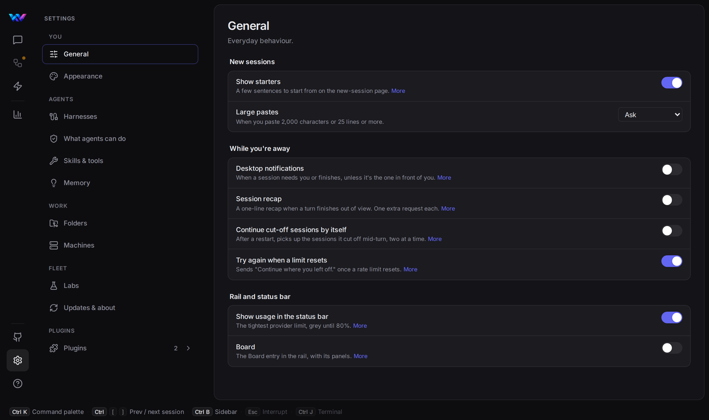
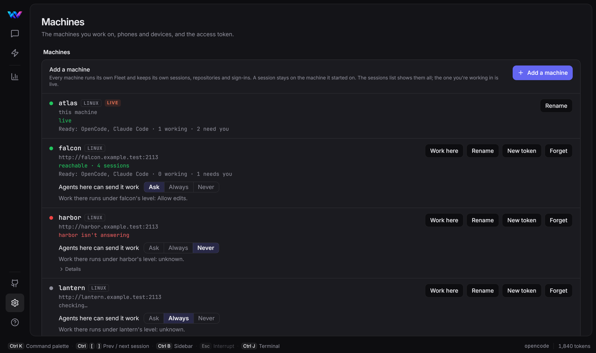
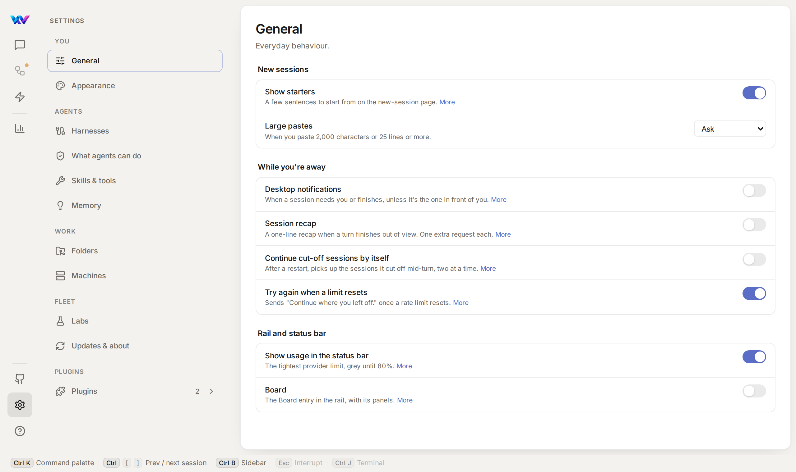
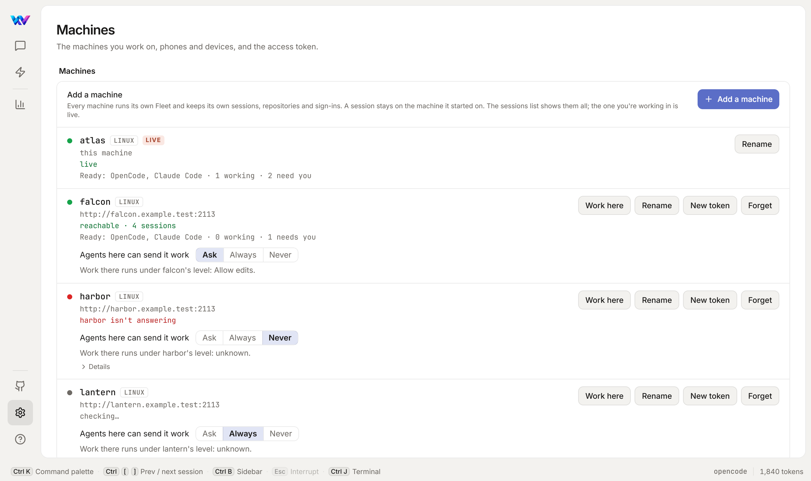
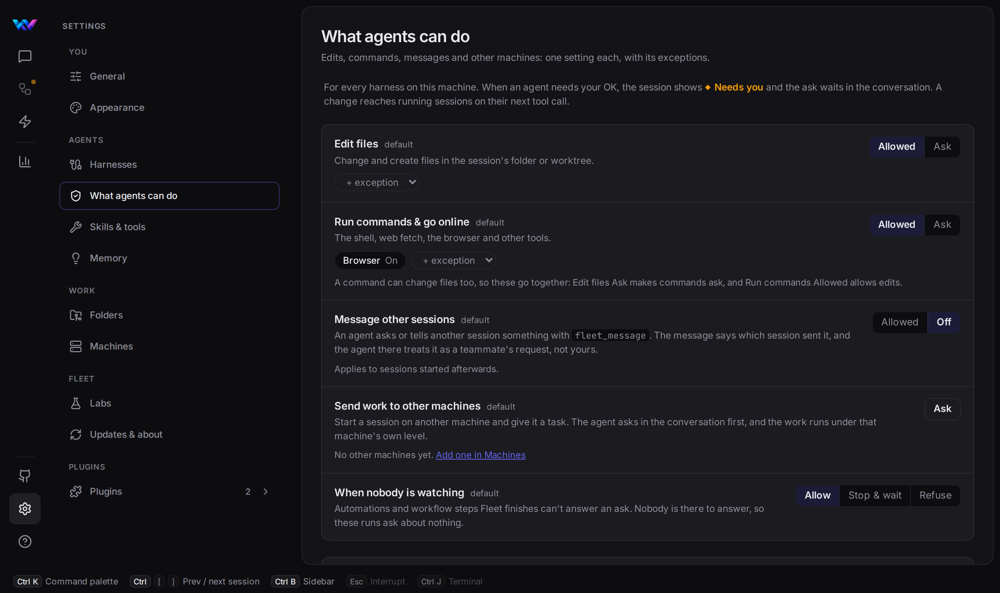
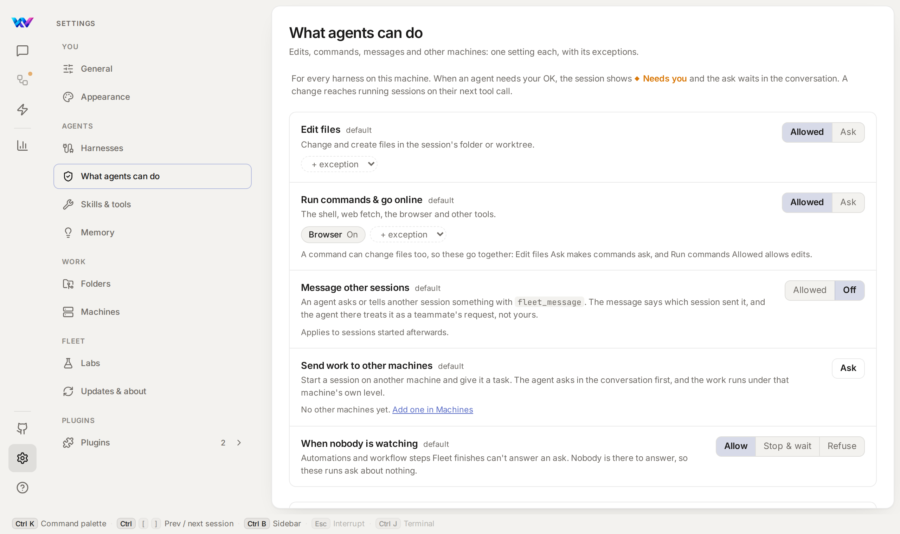

# Component 16: Settings

The parity checklist for component 16 of `docs/PORT.md`, and the pieces it is built in.

- **weave-fleet commit read:** `d12ba59` (`main`, 16 November 2026: "fix(client): the dashboard's Archive has the 6 s
  Undo and its no-harness banner says why (#1049)"). The pictures ran against the released server v0.72.0 (a scratch
  Fleet; its client is what "Fleet's own client" shows). The clone is shallow, so rows can't always tell what is newer
  than v0.72.0; where a part suspects it, its notes say so, and each piece checks against the scratch Fleet before
  taking its pictures.
- **Native app read:** `main` at `711ee5e` (`src/view.rs`, `src/view/machines_page.rs`, `src/view/machine_card.rs`,
  `src/view/machine_switch.rs`, `src/fleet/prefs.rs`, `src/fleet/rails.rs`, `src/fleet/machine_*.rs`,
  `src/fleet/harness_setup*.rs`, `src/ui/`, and every place that says "component 16").
- **Sources** (`client/src/`): `components/settings/` (all 55 files, 17,200 lines, and `__tests__/`),
  `components/skills/SkillEditorDialog.vue`, `SkillHistoryDialog.vue`, `components/ui/page-header/`,
  `components/layout/core-rails.ts`, `CenterContent.vue`, `composables/use-settings-nav.ts`,
  `use-settings-machine.ts`, `use-machine-choice.ts`, `use-update-status.ts`, `use-fleet-updates.ts`,
  `use-whats-new.ts`, `use-update-notices.ts`, `use-dream-notices.ts`, `use-memory-notices.ts`, `use-skills.ts`,
  `use-skill-catalog.ts`, `use-tools.ts`, `use-built-in-skills.ts`, `use-preference-switch.ts`, the `*-feature.ts`
  switches, `stores/` (preferences, theme, machines, mods, built-in-skills), `lib/` (permissions, permission-reach,
  harness-profile, harness-sign-in, agent-memory, dreaming, release-notes, fleet-updates, code-themes, skill-versions,
  mods), `plugins/` (registry, slots, the three built-in plugins).

**What this component takes on that its row in `docs/PORT.md` didn't name.** The skills **Editor** and **History**
dialogs (component 9 handed them over: they open from Built-in skills), the **dream notice** (9's row 8.5) and the
**What's new after an update** notice and "Updated to …" chip (9's row 8.4), the **Mods tab** of Skills & tools (its
kept-mods logic is shared with component 22, Part 8 says how), the **Plugins** pages and the **GitHub plugin's
connection page** (component 8's "Connect GitHub" lands there; the rest of GitHub is component 21's).

**What goes elsewhere.** Job seats on a machine card go to component 23 (Jobs); the Labs live machine feeds are
component 17's open rows 17.25/17.26 and are built in this component's sweep only if the owner wants them; the
GitHub repository cache, bookmarks and rail panel are component 21's.

**Row numbers:** 1.x the shell (menu, header, primitives, routing, entry points), 2.x General, 3.x Appearance, 4.x
Labs, 5.x Harnesses, 6.x What agents can do (with the Browser group), 7.x API keys, 8.x Skills & tools (with Built
in, the Editor and History dialogs, Mods), 9.x Memory and Dreaming, 10.x Folders, 11.x Plugins, 12.x what is left of
Machines after component 17, 13.x Updates & about. Numbers have gaps on purpose.

Sizes are Fleet's CSS pixels at its 14 px root: Tailwind's spacing and type are in rem, so `px-4` is 14, `py-3` 10.5,
`gap-6` 21, `text-sm` 12.25, `text-xs` 10.5, `text-2xl` 21, `h-6` 21.

| Fleet's own client (v0.72.0), Settings → General | The native app today, the Settings rail |
|---|---|
|  |  |
|  |  |

The gap, visible in the pictures (Fleet: one scratch Fleet v0.72.0, 1280×760 at scale 2, the theme set before load;
native: the `machines-page` scenes with component 17's invented machines, same size): Fleet's Settings rail opens a
**menu** in the left panel (SETTINGS, then You, Agents, Work, Fleet and Plugins with their pages) and the picked page
in the sheet; native has **no menu** and opens component 17's Machines page straight away (17's decision 7), so every
other page is unreachable and the menu's absence looks broken. Not pictured on Fleet's side: Harnesses, Machines and
Updates & about, because on a scratch Fleet they show this computer's home folder (the harness path) or its machine
name; the pieces that build them take their pictures with invented data put in by Playwright request interception.

## What the native app has today

- `src/view.rs` `root`: `Rail::Settings => machines_page::page(s, &t)`: Machines fills the whole context (17J,
  decision 7 of `docs/parity/17-machines.md`). No menu, no gutter, no other page.
- `src/view/machines_page.rs` (17J, K, M): the Machines page with its own header ("Machines" 21/600, the line), its own
  sheet and scroll; private `group` (`SettingGroup`) and `setting_row` (`SettingRow` without More or Adds);
  `machine_card.rs` (cards, agent-work segments), `add_machine.rs` (the form), `machine_switch.rs` (the Settings machine
  switch widget and a scene of the menu header only, 17N), `src/fleet/machine_choice.rs` (`MachineChoice`).
- `State.settings_section: Option<&'static str>`: set by the permission card's "Permission settings"/"Machine
  settings" (`src/view/permission.rs:326`) and Help → What's new (`src/ui/menus.rs:58`); nothing reads it.
- `State.add_machine_asked`: the session list's "Add a machine" row (`src/fleet/machine_view.rs:39`) opens Settings
  and the add form (`src/fleet/pairing.rs:222`).
- Toasts that say Settings isn't there yet: New project's and the new-session machine chip's "Add a machine…"
  (`src/fleet/new_project.rs:126`, `src/fleet/new_session/machines.rs:144`), "Manage profiles"
  (`src/view/profile_picker.rs:60`), the no-harness link on another machine (`src/fleet/new_session/harness.rs:460`),
  the setup rows' update strip and sign-in (`src/view/harness_setup_rows.rs:271`), the Repositories page's
  "Workspace settings" (`src/fleet/repositories.rs:149`); the palette's "Add a machine" waits for 17 and "Open
  plugins" for 16 (`src/ui/commands.rs`); "Connect GitHub" only sets the rail (`src/fleet/context_tab.rs:314`).
- Settings values read elsewhere but never written by a page: `fleet::prefs::Prefs` (`GET`/`PUT /api/preferences`,
  optimistic with roll-back; shared with Settings by design), `LargePastes` (`src/fleet/uploads.rs`),
  `NewSessionStarters` and the Workflows switch (`src/fleet/new_session/feeds.rs`), the Labs rail switches
  (`src/fleet/rails.rs`), Mission control (`src/fleet/dashboard.rs`), the permission level (`src/asks/rules.rs`),
  `REPORT_FOCUS` (constant, `src/fleet/presence.rs`), `State.thinking` and `State.inline_diffs` (no control, not kept).
- `src/ui/controls.rs::switch` is the kit's small `Switch` (28×16), not `SettingSwitch`; `src/ui/select.rs` is the
  kit's select; `ui::dialog`, `ui::confirm`, `ui::toast`, `ui::chip` and `ui::directory_picker` exist.
- Icons for the menu: `CABLE`, `SHIELD_CHECK`, `WRENCH`, `LIGHTBULB`, `FOLDER_GIT_2`, `SERVER`, `REFRESH_CW`, `PUZZLE`,
  `CHEVRON_DOWN`, `SETTINGS_2` are generated; `SLIDERS_HORIZONTAL`, `PALETTE` and `FLASK_CONICAL` are not yet.

## Decisions

Made here, as the planning session (the owner can overturn any):

1. **A page that isn't built yet** shows its header and one bordered note at Fleet's sizes (the look of
   `SettingsPage`'s "comes in a later step" note: `rounded-btn border px-4 py-3 text-sm text-muted`): "<Title> isn't
   in the native app yet." Every entry point opens its page from piece A on, so the "isn't in the native app yet"
   toasts go; a page that lands replaces its note.
2. **No addresses.** Fleet's `/settings`, `/settings/plugins` and `/settings/plugins/<id>` become `State.settings`
   (`SettingsNav`: the page, the anchor, the harness tab, the Memory repository, the add-machine ask), set by the
   menu and every entry point; the rail remembers the last page while the app runs, as Fleet's module state does.
3. **Code boxes** (profile JSONC, Weave config, the skill Editor) are a plain mono multi-line text box with a line-number
   column and no live highlighting, as component 9's Improve dialog does; a code editor is not part of this component.
4. **Secret fields** (API keys, the GitHub token, harness keys) follow component 17's token field: shown as typed until
   Rune has a password field (`docs/RUNE.md`); never in a picture with a value.
5. **Tooltips** port as `help` text (the window's one tooltip look); where Fleet's `title` holds something a test
   reads, it is also in the element's label.
6. **The time field** of nightly dreaming is a text box that takes `HH:MM` and says when it doesn't.
7. **Strikethrough** (an old note in a dream's change) is drawn dimmed with its "now reads" label; Rune has no
   strikethrough (`docs/RUNE.md`).
8. **Theme cards**: System, Dark and Light only; Fleet's other themes are out of scope (`docs/PORT.md`).
9. **Font size** is stored and applied with the rest of Appearance only if Rune can scale the whole window at run time;
   otherwise the choice is stored, the row says it takes effect after a restart, and the gap is written down (piece F
   checks which).
10. **Mods tab** stays in this component (it is Settings chrome with Settings tests); component 22 extends the same
    `src/fleet/settings/mods_kept.rs` with drafts. **Built-in skills** is a plugin's page (Plugins › Built-in skills),
    not a tab of Skills & tools, exactly as in Fleet.
11. **API keys** (`credentials`) has a menu entry under Agents since weave-fleet #1050 (before it nothing reached the page), so it is a normal piece (AO). The menu shows it from piece A, with the not-yet note.
12. Settings follows the machine you're on from piece C, before any machine page is built, so no page is ever written
    to ask home directly.

Open, the owner's:

1. **Phones, the desktop side** (Add a phone with its QR code, Devices with access, the public address field). Component
   9 says it is 16's, component 17's decision 9 says phones are out. Recommendation: in; only the phone's own side
   (`/pair`, the phone shell) stays out. Piece AN is built only on a yes. A QR encoder is either a new crate or about
   300 lines of our own.
2. **"This browser"**, the chip on Appearance, Machines and Plugins with another machine picked: native wording.
   Recommendation: "This app".
3. **Desktop notifications** (General → While you're away): the native app can't raise an OS notification today. Build
   delivery (a crate or a platform call, each a cost on three systems), or draw and save the switch only and say so in
   the row. Recommendation: save the switch now (piece D), delivery as its own later piece.
4. **The Fleet app row on Updates & about**: Fleet's is Electron's updater (semver, "Restart to update"); native's
   updater is build numbers from the rolling release, with one dialog. Recommendation (piece V assumes it): keep the
   native updater and its dialog; the row shows "Fleet app", the build, the status line, "Check for updates" (wakes the
   checker) and "Update and restart" (opens the dialog). Tied to component 9's decision 1.
5. **Set it up from here (SSH)**, component 17's optional piece L: build it (piece AP) or leave it unbuilt.
6. **Labs "Keep every machine live"**: the switch is drawn and saved in piece T; whether native then runs live feeds
   (17.25/17.26) is the owner's (the sweep builds it on a yes).

## Part 1: the shell (`SettingsRoute.vue`, `SettingsPage.vue`, `SettingsNavPanel.vue`, `use-settings-nav.ts`, `core-rails.ts`, `CenterContent.vue`, `ui/page-header`)

Settings is one route whose menu picks the page. The menu (`SettingsNavPanel`) is the Settings rail's context panel,
in the same resizable left panel the session list uses (`ContextPanel.vue`, transparent on `--main-bg`); the page is
drawn in the raised sheet (`CenterContent`, padding 24, scrolls). `SettingsPage` puts the page's own title and line
on top (`PageHeader`), then the page in `grid gap-6` (21 px). Every page is a column of `SettingGroup`s (a title over
one bordered card of `SettingRow`s); those primitives are rows 1.40-1.52.

| # | Element / behaviour | Source | Native today |
|---|---|---|---|
| 1.1 | The Settings rail draws `[settings-menu][gutter][settings-detail]`: the menu in the left panel (the session list's width, 306 default, gutter 200-500, collapsed with Ctrl/Cmd+B like the list), the detail in the sheet; never the session list or the right panel | `core-rails.ts` `SettingsContextPanel`, `AppShell.vue` 100-120, `ContextPanel.vue` | None: the rail opens the Machines page alone (`src/view.rs:120`, 17's decision 7) |
| 1.2 | Detail pane: `CenterContent` body padding 24, `overflow: auto` (one scroll for the whole page); the page is `grid grid-cols-1 gap-6` (21) | `CenterContent.vue`, `SettingsPage.vue` template | Partial: `machines_page::page` has its own sheet, padding 24 and scroll |
| 1.3 | Addresses: `/settings` (every core page), `/settings/plugins` (the overview), `/settings/plugins/<id>` (a plugin's page); the address picks the section and picking a section moves the address | `SettingsRoute.vue` | None (native has no address bar; `Route`/`rail` stand in, see decision 2) |
| 1.4 | Opening Settings resets the Settings machine switch to the machine you're on (a pick from an earlier visit is forgotten) | `SettingsRoute.vue` `resetSettingsMachine()`, `use-settings-machine.ts` | Partial: `MachineChoice::reset` exists (17N); nothing calls it for Settings |
| 1.5 | The page shown first is General; the last page picked is kept while the app runs (module-level `activeSection`) | `use-settings-nav.ts` | None |
| 1.10 | Menu panel: header row `padding-top: 4`; "SETTINGS" `0.71429rem` (10) 600 uppercase, tracking .05em, `--muted`, padding 14 16 10 | `SettingsNavPanel.vue` `.panel-header` | Partial: `machine_switch::scene_page` draws the header only (17N's scene) |
| 1.11 | Under the header, only when other machines exist: the Settings machine switch (padding 0 12 6) | NavPanel `.panel-machine`, `SettingsMachineSwitch.vue` | Partial: the switch widget exists (`src/view/machine_switch.rs`, 17N); not in a menu |
| 1.12 | Nav: padding 0 12 12; a group per heading, `gap: 4`, `margin-bottom: 8`; heading `margin: 8 0 2`, padding 0 12, 10 px 600 uppercase .05em `--muted`; `role=group`, `aria-label` = heading | NavPanel `.settings-nav*` | None |
| 1.13 | Groups and entries, in order: **You**: General (`SlidersHorizontal`), Appearance (`Palette`); **Agents**: Harnesses (`Cable`), What agents can do (`ShieldCheck`), Skills & tools (`Wrench`), Memory (`Lightbulb`), API keys (`KeyRound`; added by weave-fleet #1050, after `d12ba59`); **Work**: Folders (`FolderGit2`), Machines (`Server`); **Fleet**: Labs (`FlaskConical`), Updates & about (`RefreshCw`); **Plugins**: Plugins (`Puzzle`) | NavPanel `coreGroups`, `groups` | None. Icons `SLIDERS_HORIZONTAL`, `PALETTE`, `FLASK_CONICAL` are not generated yet (`tools/gen-icons.py`) |
| 1.14 | Entry: full width, `min-height: 36`, padding 0 12, gap 10, border 1 transparent, radius `--radius-btn`, 12 px (`0.85714rem`) 500 `--muted`, icon 16; hover fill `--bg`, ink `--text`; focus-visible ring 2 `--accent` offset 2; active (`aria-current=page`): border `--accent` 40%, fill `--panel-bg` 88% + `--accent` 12%, ink `--text` | NavPanel `.settings-nav__item*` | None |
| 1.15 | Plugins entry: a count on the right (`ml-auto`, 11 px `--muted`): plugins that are on and not always-on; a fold button over its right end (28 wide, at right 4, `--muted`, hover `--text`), `ChevronDown` 14 turned -90° while folded, "Fold Plugins"/"Unfold Plugins", `aria-expanded` | NavPanel `pluginsItem`, `.settings-nav__fold` | None |
| 1.16 | Plugins' children: one per plugin that is on and has a settings page (`getConfigPages()`), its own icon (15) or `Settings2`; `min-height: 32`, `margin-left: 14`; unfolded while a plugin page is open unless folded by hand; the chevron folds or unfolds from anywhere | NavPanel `unfolded`, `toggleFold` | None |
| 1.17 | Updates & about: an 8 px dot on the right while an update is available (`--accent`) or staged (`--idle`), "Update available"; a badge with the number of other machines that have an update waiting (`useFleetUpdatesWatch().waiting`, rows not `app`; the Settings menu starts machine polling while mounted) (10 px 600, `--accent` fill, primary-foreground ink, px 5, leading 16), "N machine(s) can update" | NavPanel 140-160, `use-update-status.ts`, `use-fleet-updates.ts` | None (Part 13 owns the data) |
| 1.18 | The menu has no Features page, no Mods entry (a tab of Skills & tools), no Integrations group (API keys is in Agents since #1050) | `SettingsNavPanel.test.ts` | n/a |
| 1.20 | Page header: title `text-2xl` (21) 600, tracking tight (-0.525), line-height 1.25, `--text`; the line under it `text-sm` (12.25) `--muted`, line-height 1.5, margin-top 4; title row wraps with gap 6 10 | `ui/page-header/PageHeader.vue` | Partial: `machines_page` draws Machines' header by hand at these sizes |
| 1.21 | Each page's title and line, word for word: General "Everyday behaviour."; Appearance "How Fleet looks."; Harnesses "The runtimes Fleet drives sessions with. Everything about one harness is on its tab."; What agents can do "Edits, commands, messages and other machines: one setting each, with its exceptions."; Skills & tools "What agents can use: skills, tools and, with Mods on, mods."; Memory "What Fleet remembers about each repository."; Folders "Where your repositories are, how worktrees are named, and the disk they take."; Machines "The machines you work on, phones and devices, and the access token."; Labs "Experiments. They can change or go away, and each is off until you turn it on."; Updates & about "Every version and update: Fleet, harnesses and machines, and what's new."; Plugins "Add-ons that put things in Fleet: rail icons, settings pages and pickers. Turn one off and everything it adds goes with it."; API keys "Credentials for model providers."; a plugin's page: its display name and description ("Plugin" if unknown) | `SettingsPage.vue` `PAGES`, `header` | Partial: Machines only |
| 1.22 | With other machines: a chip beside the title naming the machine the page shows (mono 11 px 600, `--coral-text` on `--coral` 14%, padding 1 6, radius 4), or "This browser" (`--muted` on `--text` 8%) on Appearance, Machines, Plugins and plugin pages | `SettingsPage.vue` `.settings-machine-chip` | None (Part 12) |
| 1.23 | Another machine picked, on a page that isn't one of the machine pages (harnesses, folders, permissions, skills, memory, updates, credentials) nor a browser page: a bordered note "<Title> on <machine> comes in a later step." with "Show <live>'s <Title>" (outline, small) that picks the live machine | `SettingsPage.vue` `comesLater` | None (Part 12) |
| 1.24 | The pane fades in over 180 ms when the machine changes (none with reduced motion) | `SettingsPage.vue` `.settings-machine-pane` | None (Part 12) |
| 1.25 | **Native: a page not ported yet** shows, under its own header, one bordered note at Fleet's sizes: "<Title> isn't in the native app yet." (decision 1). Machines shows component 17's page | — | None |
| 1.30 | Old ids still land: `features`→general, `workspace`→folders, `storage`→folders#storage, `browser`→permissions#browser, `tools`→skills#tools, `mods`→skills#mods, `system`→updates, `weave`→harnesses#weave (tab chosen by the page), `workflows`→labs#workflows, `integration:<id>`→`plugin:<id>` | `use-settings-nav.ts` `LEGACY_SECTION_TARGETS`, `resolveSettingsTarget` | None |
| 1.31 | An anchor (a group, row or tab) scrolls into view once and is then let go, except on Harnesses and Skills & tools, which pick their tab from it and keep it; an anchor whose group isn't drawn yet is kept until it is | `SettingsPage.vue` watch, `OWN_ANCHOR_PAGES` | None |
| 1.32 | `openHarness(id, anchor)`: Harnesses on that harness's tab, optionally at `weave`/`may-do`/`profiles`; `openMemory(repo)`: Memory with that repository; `openAddMachine()`: Machines at `add-machine` with the form asked for | `use-settings-nav.ts` | Partial: `open_add_machine` (`src/fleet/machine_view.rs`) sets the rail and `add_machine_asked` |
| 1.40 | `SettingGroup`: `<section id="settings-group-<id>" data-setting-group>`, heading row `mb-2` (7) `px-1` (3.5), `h2` `text-sm` 600 `--text`, optional hint `text-xs` `--muted` at the right (baseline aligned, gap 10.5); body `divide-y divide-border overflow-hidden rounded-card border border-border bg-card-bg` | `SettingGroup.vue` | Partial: `view::machines_page::group` draws exactly this, private to that file |
| 1.41 | `SettingRow`: `flex items-start justify-between gap-4` (14), `px-4 py-3` (14, 10.5); left column `min-w-0 flex-1`, right `shrink-0`. Title `text-sm` 500 `--text`, with a `badge` slot after it (gap 7). Summary `text-xs` `--muted`, `mt-0.5`. Shown when the row has a summary or a `more` slot | `SettingRow.vue` | Partial: `machines_page::setting_row(t, title, summary, control)`, no More, no adds, private |
| 1.42 | "More" link after the summary (ml-1, `--accent-text`, underline on hover): toggles the full text, label "More" / "Less"; the full text is `mt-1 text-xs --muted` below the summary. `aria-expanded`, `aria-controls`; test ids `setting-more-<id>`, `setting-more-text-<id>` | `SettingRow.vue` 38-45 | None (hover underline: out of reach, see below) |
| 1.43 | "Adds" line (when `adds` is set): `mt-1 text-xs --accent-text`: "↳ Adds: <text> · Open" ("Open" underlined button; hidden by `noOpen`); `Open` emits `open`. Test ids `setting-adds-<id>`, `setting-open-<id>` | `SettingRow.vue` 58-72 | None |
| 1.44 | `below` slot under everything in the left column (cards, error notes). Row ids `settings-row-<id>` and `data-setting-row` let a link or the settings search reach a row | `SettingRow.vue` | None |
| 1.45 | `SettingSwitch`: 38.5 x 21 track (`h-6 w-11`), 2px transparent border, rounded full, 200 ms colour; on `--accent`, off `--border`; thumb 17.5 white with shadow, moves 17.5; focus ring 2px `--accent` offset 2 on `--card-bg`; disabled 60% and not-allowed; `pending` adds the same ring. A spinner (muted) sits left of the track, gap 7, while `saving` | `SettingSwitch.vue` | Partial: `ui::controls::switch` is Switch.vue (28 x 16.1), a different control; Settings needs its own |
| 1.46 | `SettingSegments`: a radio group; choices 12.5 px, padding 4 11, `--muted`; the picked one `--accent` 18% fill, `--text`, 600; border `--border`, radius btn, `--main-bg`; rules between; arrows move and pick, wrapping; disabled shows progress | `SettingSegments.vue` | None |
| 1.47 | A row's select (native `<select>`, e.g. Large pastes "Ask"): the kit's select at the row's size | `GeneralSection.vue` | Partial: `ui::select` |
| 1.48 | `ErrorNote compact`: row gap 7, `text-xs --error-text`, 14px `AlertCircle`, message; `mt-2` inside a row | `ui/error-note/ErrorNote.vue` | Partial: grep `src/view/failure.rs` for the look; no shared compact note |
| 1.50 | Palette "Go to Settings" (`nav-settings`) opens Settings on the page last shown | `use-commands.ts` 372 | Partial: sets the rail (`src/ui/commands.rs:121`) |
| 1.51 | Palette "Add a machine" (`add-machine`): Machines with the form open | `use-commands.ts` 381 | Partial: listed as waiting for 17 (`Run::Waiting(17)`), though 17K is built |
| 1.52 | Palette "Open plugins" (`open-marketplace-panel`): Settings → Plugins | `use-commands.ts` 765 | Partial: `Run::Waiting(16)` |
| 1.60 | Entry points into Settings from other components, each to its page: the permission card's "Permission settings" (permissions) and "Machine settings" (machines) | `PermissionCard.vue:144` | Partial: sets `settings_section`, nothing opens (`src/view/permission.rs:326`) |
| 1.61 | Help → What's new: Updates & about | `use-whats-new.ts:24` | Partial: sets the rail and `settings_section = "updates"` (`src/ui/menus.rs:58`); the menu shows Machines |
| 1.62 | Add a machine: the session list's foot row, the New project dialog, the new-session machine chip, the automation composer, the palette | `SessionsPanel.vue:344`, `NewProjectDialog.vue:100`, `NewSessionComposer.vue:94`, `AutomationComposer.vue:117` | Partial: the list row works (`machine_view.rs`); New project and the new-session chip show "Adding a machine is in Settings, which isn't in the native app yet (component 16)." (`src/fleet/new_project.rs:126`, `src/fleet/new_session/machines.rs:144`) |
| 1.63 | Profile picker's "Manage profiles": Harnesses on that harness's Profiles tab, or Harnesses | `ProfilePicker.vue:35` | Partial: toast "Profiles are managed in Settings, …" (`src/view/profile_picker.rs:60`) |
| 1.64 | The new-session page's no-harness link on another machine ("Open <machine>'s Settings"): Harnesses on that machine | `NewSessionComposer.vue:689-697` | Partial: toast (`src/fleet/new_session/harness.rs:460`) |
| 1.65 | Harness setup rows' hand-offs (update strip, sign-in): Harnesses | 07 C13.80 | Partial: toast "<what> comes with Settings, …" (`src/view/harness_setup_rows.rs:271`) |
| 1.66 | Repositories page "Workspace settings" / "Open settings": Folders | `RepositoriesPage.vue:84` | Partial: toast (`src/fleet/repositories.rs:149`) |
| 1.67 | Context tab "Connect GitHub": the GitHub plugin's page (`/settings/plugins/github`) | `SessionContextCanvas.vue:154` | Partial: sets the rail only (`src/fleet/context_tab.rs:314`) |
| 1.68 | Starters' "Settings → General → Show starters brings them back." (words only) | `NewSessionStarters.vue` | Done (words) |
| 1.69 | Later entry points owned by other pages' pieces: dream notices → Memory with the repository (Part 9), machine-update notices → Updates#machines (Part 13), Automations → Labs / Memory (components 18-19), workflow run boxes → Skills / Harnesses (component 20) | `use-dream-notices.ts:38`, `use-fleet-update-notices.ts:47`, `AutomationDetailPanel.vue:340`, `BuiltinAutomationDetail.vue:127`, `WorkflowRunBox.vue:155-160` | None |

### Piece A: done (16 November 2026)

Built in `src/fleet/settings_nav.rs`, `src/view/settings.rs`, `src/tests_settings_nav.rs`; pictures in `shots/parity/16a-settings-shell/`.

- **Done:** 1.1 (menu in the session list's width panel with its gutter and Ctrl/Cmd+B), 1.2 (one scroll, padding 24, gap 21), 1.3 (as `State.settings`, decision 2), 1.5, 1.10, 1.12-1.14, 1.18, 1.20, 1.21, 1.25, 1.30, 1.32, 1.50-1.52, 1.60-1.67 (each opens its page; Manage profiles opens the picker's harness at `profiles`; Connect GitHub opens `plugin:github`, which shows the not-yet note until AD-AF).
- **Open, with owner:** 1.4 and 1.11 (the machine switch in the menu and the reset on opening: piece C), 1.15-1.16 (Plugins count, fold, children: Part 11), 1.17 (update dot, machine badge: Part 13), 1.22-1.24 (machine chip, "comes later" note, fade: Parts 11-12 with C), 1.31 (anchor scrolling: piece B; the anchor is stored and cleared by no page yet), 1.40-1.48 (primitives: piece B), 1.42-1.44, 1.69 (other pieces). Hover underline and the focus ring colours are as in the rest of the app.
- **Differences from Fleet seen in the pictures:** the menu rows are within a pixel of Fleet's; hover uses `main_bg` for `--bg`.
- Fleet's tests ported under their names: the table of old ids, "sends an old integration id…", "leaves current ids alone", "stores the new page and anchor…", "opens Harnesses on a harness's tab…", "sends the old Weave id…", "opens Memory with the repository", "goes to Machines at the Add a machine row…", "groups the pages under You, Agents, Work and Fleet…", "has no Mods entry…". The Plugins-entry cases wait for Part 11.

### Piece B: done (16 November 2026)

Built in `src/view/settings/kit.rs` (the primitives), `src/view/settings/kit_scene.rs` (the scene page), `src/fleet/settings/anchor.rs` (the anchor rule), `src/tests_settings_kit.rs`; Machines now draws with the kit. Pictures in `shots/parity/16b-setting-primitives/`. The API keys menu entry (weave-fleet #1050) from piece A's unfinished follow-up is in the same pull request.

- **Done:** 1.31 (the rule is `anchor::settle`; `State::keep_settings_anchor` runs in `poll` and scrolls once with `Tx::scroll_into_view`; Harnesses and Skills & tools keep the anchor; an anchor with no drawn target waits), 1.40 (`kit::group`), 1.41 (`kit::Row`), 1.42 (More / Less, `aria-expanded` as `expanded`), 1.43 (Adds line, Open, no Open with no way there), 1.44 (below slot, `settings-row-<id>` keys), 1.45 (`kit::setting_switch`: saving spinner, pending ring, disabled), 1.46 (`kit::segments` with arrows that pick and wrap), 1.48 (`kit::error_note`). Machines uses `kit::group`, `kit::Row` and `kit::segments`; its keys `machines-group` and `machine-access` are now `settings-group-machines` and `settings-group-phones`.
- **Open, with reason:** 1.47 (a row's select: piece D uses `ui::select` at the row's size when General needs it; nothing here draws one). More's text sits after the summary on the same line only when the summary fits on one line: a wrapped summary puts More on the next line (Rune has no clickable inline run). The More and Open hover underline is not drawn (the link has no hover style). A pending switch's ring is drawn inside the track, not 2 px outside it. Each later piece adds its page's groups to `anchor::targets`; until a page does, an anchor aimed at it waits, as Fleet's does for a group that isn't drawn.
- **Fleet's tests ported under their names:** all six of `SettingRow.test.ts`; from `SettingsPage.test.ts` "scrolls to a group once and then lets the anchor go, so coming back doesn't scroll again" (on Machines' Phones group), "lets go of the Permissions › Browser anchor too" (the rule for a page that doesn't keep its anchor; the Browser spot itself is piece M's), "keeps the anchor on Skills & tools, which picks its tab from it" (the rule; Skills draws no target yet), "keeps an anchor whose group isn't on the page yet". Ours: segments pick by click and by arrows and wrap; a saving switch is disabled; the poll scrolls to Add a machine once; every target the page lists is drawn.

### Piece D: done (16 November 2026)

Built in `src/fleet/settings/switches.rs` (the switch table, `State::save_setting` with its saving set and roll-back, `toggle_setting`, the read when General opens), `src/view/settings/general.rs`, `src/tests_settings_general.rs`; pictures in `shots/parity/16d-general/` (Fleet's own client beside native, both themes: every default, and every switch the other way round with the first More open; the Large pastes list open, native only because a system `<select>` can't be photographed).

- **Done:** 2.1-2.8, 2.9-2.10, 2.11 (switch saves `DesktopNotifications`; no permission step), 2.14-2.29 (the board switch is the same path, so the rail follows it at once), 2.30 (loading disables every switch but Large pastes; saving spinner and disabled; the usage chip shows no spinner, as Fleet), 2.31 (optimistic write; a refusal puts the old value back and reads them all again), 2.32 (the page reads preferences each time General opens), 2.33 (`Switch::enabled`), 4.17 (the switch logic is shared with Labs).
- **Decision followed (owner's 3, unanswered):** the plan's recommendation: the switch is drawn and saved, and the row says in a muted line "This app doesn't show them yet. The choice is kept for Fleet on your phone and in the browser." Delivery is piece G and waits for the owner.
- **Open, with reason:** 2.12 and 2.13 (the permission errors: native asks for no permission, so there is nothing to refuse; they come with delivery). 2.26's reader and the usage chip were already wired (`usage::chip_enabled`). `REPORT_FOCUS` in `fleet/presence.rs` still always reports focus; reading `SessionRecap` and `DesktopNotifications` there is component 2's row 6.6. Restart-continue's and Retry-after-limits' behaviour (`RestartContinueAuto`, `RetryAfterLimits`) and the recap banner are not read yet by those components; the switches only save.
- **Differences from Fleet seen in the pictures:** the select's open list is Rune's panel, not the system's; the select box is about 3 px shorter than Chrome's; the demo data's rail icons differ.
- **Fleet's tests ported under their names:** all four of `GeneralSection.test.ts`. Ours: each row's summary and More word for word, defaults of every switch, each switch's key, notifications saved with the note, a refused save, loading and saving waits, the groups as anchors.

### Piece E: done (16 November 2026)

Built in `src/fleet/settings/code_themes.rs` (the six schemes, `match`, availability, labels, the lift), `src/fleet/settings/appearance.rs` (`Appearance`: theme, code theme, font size, thinking; `State::set_theme`, `toggle_theme`, `set_code_theme`, `set_font_size`, `set_thinking`, `with_code_theme`), `Theme::syntax` now takes a palette (`src/theme.rs`), `src/tests_settings_appearance.rs`; pictures in `shots/parity/16e-appearance-data/` (Fleet's own client beside native: the same reply with a code block under Match theme dark and light, Monokai, GitHub dark and light, and Darcula on a light window, which both show as One Light).

- **Done:** 3.7 (the choice sets `State.dark`, `None` for System, and is kept), 3.8 (System follows the computer live as before; a stored value that isn't a theme reads as System; no old key to migrate), 3.15 (the palettes; `Theme::syntax` holds the chosen scheme), 3.16 (the lift, as pure functions with Fleet's rules), 3.17 (markdown code blocks read the chosen scheme through `State::with_code_theme`, worked out once per choice and scheme), 3.20 data half (the four sizes are stored with their pixels), 3.23 (Thinking is kept and read at start), 3.24 (four keys of `settings.json`: `theme`, `codeTheme`, `fontSize`, `thinking`; only non-defaults are written; read at start with the rest of the file), 3.26 (`toggle_theme` keeps the choice; the palette's toggle and cycle commands and Ctrl+Shift+L use it).
- **Open, with reason:** 3.20's run-time effect: the window doesn't scale with the size (`ui::rem` is a `const fn`; piece F decides, per decision 9 the row will say it takes effect after a restart). The Files editor and diffs don't draw syntax colours natively yet, so only Markdown code blocks follow the code theme. Fleet's other eight themes are out of scope.
- **Differences seen in the pictures:** Fleet's code colours in a light window and Monokai match the native ones to the eye; Fleet's picture has its session list and header from the scratch Fleet, native's from invented data.
- **Fleet's tests ported under their names:** all seven of `code-themes.test.ts` and the five code theme cases and the two theme cases of `theme.test.ts`. The two Fleet cases that read the bare scheme from `style.getPropertyValue` (jsdom has no surfaces to lift to) read the lifted colour here, because the window always has surfaces; the lift has its own cases. Ours: every colour reads at 4.5:1 on all six backgrounds for every available scheme in both themes, colours that read are kept, `normalize_hex`, `mix_hex`, the grounds are the theme's own colours, a restart brings back the theme, Thinking, font size and code theme, and unknown or wrongly typed values read as defaults.

### Requests, events and preferences

The shell itself asks nothing: the menu reads the plugin registry (Part 11), the update status (Part 13) and the Mods
switch (`mods.loadSwitch()`, Part 8) for its count, dot and badge.

### Fleet's tests

- `SettingsNavPanel.test.ts` (7): "groups the pages under You, Agents, Work and Fleet, and has no Features page" (A);
  "has no Mods entry of its own: Mods is a tab of Skills & tools" (A); "has a Plugins entry, no Integrations group,
  and a child per plugin that is on, from the registry" (Part 11's overview piece); "drops a plugin's child when it is
  switched off, and brings it back when it is on" (Part 11); "folds the Plugins entry with its chevron" (Part 11);
  "puts the update dot on Updates & about" (Part 13); "puts the number of machines that can update on Updates &
  about, beside the dot" (Part 13).
- `SettingsPage.test.ts` (5): "scrolls to a group once and then lets the anchor go, so coming back doesn't scroll
  again", "lets go of the Permissions › Browser anchor too", "keeps the anchor on Skills & tools, which picks its tab
  from it", "keeps an anchor whose group isn't on the page yet" (B); "names the machine on a page that comes later and
  offers the live machine's page" (Part 12).
- `SettingRow.test.ts` (6): "shows the summary, and More opens today's full text word for word", "has no More link
  without a full text, and carries a stable id", "says what it adds with an Open link, and emits open", "shows
  nothing about adds without it, and no Open link when there is nowhere to go", "passes aria-label and test id to the
  switch button and emits click", "titles a group and gives it a stable id" (B).
- `composables/__tests__/use-settings-nav.test.ts` (8, one table of 9): "%s lands on %s (%s)", "sends an old
  integration id to that plugin's page, and keeps plugins as the overview", "leaves current ids alone", "stores the
  new page and anchor when given an old id", "opens Harnesses on a harness's tab, at a group", "sends the old Weave id
  to Harnesses at its Weave group, leaving the tab to be chosen", "opens Memory with the repository", "goes to
  Machines at the Add a machine row and asks for the form" (A).
- `composables/__tests__/settings-follow-machine.test.ts` (2): Part 12.

Fleet source: `client/src/` at weave-fleet `d12ba59`. Native: this repo at `711ee5e`. Sizes are Fleet's CSS px at the 14px root (`text-sm` = 12.25, `text-xs` = 10.5, `px-4` = 14, `py-3` = 10.5, `gap-6` = 21, `mt-0.5` = 1.75). `rounded-card` = `RADIUS_CARD` 10, `rounded-btn` = `RADIUS_BTN` 8.

(The shared frame — `SettingsPage`, `SettingGroup`, `SettingRow`, `SettingSwitch`, `ErrorNote` — is Part 1, rows 1.20-1.48.)

## Part 2: General (`GeneralSection.vue`, `SettingRow`, `SettingGroup`, `SettingSwitch`)

Three groups in `flex flex-col gap-6` (data-testid `general-section`): "New sessions" (Show starters, Large pastes), "While you're away" (Desktop notifications, Session recap, Continue cut-off sessions by itself, Try again when a limit resets), "Rail and status bar" (Show usage in the status bar, Board). Everything is a server preference on the live machine (`GET /api/preferences`, `PUT /api/preferences/{key}`); another machine shows the S.4 box. The page calls `ensureLoaded()` and disables every switch while the store is loading. Switches built with `usePreferenceSwitch` flip optimistically and roll back (and refetch) when the save fails; the page itself shows no error for them.

| # | Element / behaviour | Source | Native today |
|---|---|---|---|
| 2.1 | Page root `flex flex-col gap-6` (21), `data-testid="general-section"`; calls `preferencesStore.ensureLoaded()` on mount | GS 79-83, 22 | None |
| 2.2 | Group "New sessions", id `new-sessions` | GS 84-87 | None |
| 2.3 | Row "Show starters" (id `starters`), summary "A few sentences to start from on the new-session page." | GS 88-92 | None |
| 2.4 | More text: `On the new-session page, offer a few sentences to start from, such as "Explore the code". A starter fills the box; nothing is sent until you press Enter.` | GS 93-96 | None |
| 2.5 | Switch, aria-label "Show starters", test id `starters-switch`; preference `NewSessionStarters`, on unless the value is "false"; `saving` spinner; disabled while preferences load or while saving | GS 97-107, `lib/starters.ts` | Partial: the preference is read (`fleet::new_session::feeds::STARTERS_PREFERENCE_KEY`, `starters_shown`) and written to "false" by the page's own dismiss (`new_session/starters.rs` 88); no switch to turn it back on |
| 2.6 | Row "Large pastes" (id `large-pastes`), summary "When you paste 2,000 characters or 25 lines or more." No More link | GS 109-114 | None |
| 2.7 | Control: a native `<select>`, aria-label "Large pastes", test id `large-pastes-select`, `rounded-md border border-border bg-transparent px-2 py-1 text-sm text-text`, no outline; options "Ask" (`ask`, default), "Always attach" (`attach`), "Paste as text" (`text`). Saves on change; no saving state, no disabled while loading | GS 115-135, 43-47 | Partial: the preference `LargePastes` is read (`composer::attached::LARGE_PASTES_KEY`, `fleet/uploads.rs large_pastes()`, 05-composer row 11.7); no control to change it |
| 2.8 | Group "While you're away", id `away` | GS 139-142 | None |
| 2.9 | Row "Desktop notifications" (id `notifications`), summary "When a session needs you or finishes, unless it's the one in front of you." | GS 143-147 | None |
| 2.10 | More: "Tell me when a session needs an answer, or finishes, while I'm looking at something else. Nothing is sent about the session in front of you." | GS 148-151 | None |
| 2.11 | Switch aria-label "Enable desktop notifications"; preference `DesktopNotifications` ("true" / "false", off by default); spinner while saving. Turning on first asks the browser for permission (`requestNotificationPermission`, only from a click), then saves; turning off just saves | GS 70-77, 174-182 | None. The native app has no notification path (grep `src/` finds none; `fleet/presence.rs` `REPORT_FOCUS` is a constant `true` "until Settings exists") |
| 2.12 | Permission error: "This browser can't show desktop notifications." (unsupported); "Your browser is blocking notifications for Fleet. Allow them in its site settings, then try again." (denied or still "default"); in both cases the preference is not saved | GS 58-68 | None: native wording must change ("This computer"?), see Notes |
| 2.13 | After saving as on, if the permission later turns out not granted: "Your browser is no longer allowing notifications for Fleet." in the `below` slot (compact ErrorNote, `mt-2`); the first error replaces it | GS 158-169 | None |
| 2.14 | Row "Session recap" (id `recap`), summary "A one-line recap when a turn finishes out of view. One extra request each." | GS 188-192 | None |
| 2.15 | More: "When a turn finishes while you're looking at something else, write a one-line recap above the composer for when you come back. Each recap is one extra request to the session's model." | GS 193-196 | None |
| 2.16 | Switch aria-label "Enable session recap"; preference `SessionRecap`, off by default | GS 197-207, `use-session-recap.ts` | None. The `session.recap` event and the banner are component 8's (parity 02 row 6.6); the `SetSessionFocusAsync` call is sent always |
| 2.17 | Row "Continue cut-off sessions by itself" (id `restart-continue`), summary "After a restart, picks up the sessions it cut off mid-turn, two at a time." | GS 209-213 | None |
| 2.18 | More: `When Fleet restarts while a session is mid-turn, Fleet sends it a message labelled "Sent by Fleet after the restart" that names the call that didn't finish. Only sessions cut off less than 2 hours ago, not waiting on a question, with their folder still there. Two at a time. A notice lists them and has Stop all.` | GS 214-219 | None |
| 2.19 | Switch aria-label "Continue cut-off sessions by itself", test id `restart-continue-switch`; preference `RestartContinueAuto`, off by default (it sends a message the user didn't type) | GS 220-230, `use-restart-notice.ts` | None. The notice itself is component 9 piece (parity 09 row 8.1) |
| 2.20 | Row "Try again when a limit resets" (id `retry-after-limits`), summary `Sends "Continue where you left off." once a rate limit resets.` | GS 232-236 | None |
| 2.21 | More: `When a model provider's rate limit or usage limit stops a turn, send "Continue where you left off." when the limit resets, or after a wait when the provider doesn't say. What you queued waits for it.` | GS 237-240 | None |
| 2.22 | Switch aria-label "Try again when a limit resets", test id `retry-after-limits-switch`; preference `RetryAfterLimits`, **on** unless "false" | GS 241-251, `use-session-retry.ts` | None. Native retry behaviour: `fleet/retry.rs` (check what it reads) |
| 2.23 | Group "Rail and status bar", id `rail` | GS 255-258 | None |
| 2.24 | Row "Show usage in the status bar" (id `usage-chip`), summary "The tightest provider limit, grey until 80%." | GS 259-263 | None |
| 2.25 | More: "Fleet asks the providers you've signed in to how much you've used, read-only: Claude automatically, the others after you press Allow. The chip shows the tightest limit, grey until 80%. Turn it off to hide it; nothing else changes." | GS 264-266 | None |
| 2.26 | Switch aria-label "Show usage in the status bar", test id `usage-limits-chip-switch`; preference `UsageLimitsChip`, on unless "false". Unlike the others it passes no `saving` (no spinner) | GS 268-276 | None. The chip is drawn (09 piece J, `src/view/status.rs`, `fleet/usage.rs`) but 09 row 4.8's "unless `UsageLimitsChip` is "false"" is not wired: grep finds no reader of the key |
| 2.27 | Row "Board" (id `board`), summary "The Board entry in the rail, with its panels." | GS 278-282 | None |
| 2.28 | More: "Show the Board entry in the left rail and enable the board workspace panels." | GS 283-285 | None |
| 2.29 | Switch aria-label "Enable Board feature"; preference `features.board.enabled`, off by default; saving spinner; on a failed save the error message (`Error.message`, or "Failed to update Board feature setting.") shows in a compact ErrorNote under the summary. Note: this one calls `setBoardFeatureEnabled`, which awaits `preferencesStore.set`; that method swallows errors (it rolls back and refetches), so the error note practically never shows | GS 286-312, `use-board-feature.ts` | Partial: key read by `fleet::rails::BOARD_KEY` (rail on/off); no switch |
| 2.30 | Switch states for every row: loading (disabled until `preferencesStore.isLoading` ends), saving (spinner + disabled), older server (a server that doesn't know a key answers the GET without it and the default applies; the PUT of an unknown key is accepted by the generic endpoint) | GS, `use-preference-switch.ts` | None |
| 2.31 | Optimistic write and rollback: write shows at once; on error body or a thrown request the old value (or its absence) is put back, but only if nothing newer was written, and the whole map is refetched | `stores/preferences.ts set` | Partial: `fleet::prefs::Prefs` has `set`/`roll_back`/`adopt`; `fleet::selector put_preference` does the request (check name) |
| 2.32 | `GET /api/preferences` is read once per store (`ensureLoaded`: only when not fetched and not loading); failures are silent and the defaults apply | `stores/preferences.ts` | Partial: the app loads it at start and on reconnect (parity 04 row 5.4); the page needs a fresh read on open to see what the phone or browser changed |
| 2.33 | The switch's "default" rule: `defaultOn` true means on unless the stored value is "false"; false means on only if "true". Three are on by default (starters, retry-after-limits, usage chip); the rest are off | `use-preference-switch.ts` | None |

## Part 3: Appearance (`AppearanceSection.vue`, `stores/theme.ts`, `lib/code-themes.ts`)

The page belongs to this browser, not to a machine: it is in `BROWSER_PAGES`, its chip says "This browser", and every value is in `localStorage`, not on the server (`weave:theme`, `weave:code-theme`, `weave:font-family`, `weave:font-size`, `weave:thinking`). Two groups in `grid gap-6`: "Look" (Theme, Code theme, Font, Font size) and "Conversation" (Thinking). Natively these become the app's own small settings file (`fleet/settings.rs`, which already stands in for `localStorage`) and "This browser" becomes a decision (see Notes). PORT.md puts Fleet's themes other than light and dark out of scope.

| # | Element / behaviour | Source | Native today |
|---|---|---|---|
| 3.1 | Page root `grid gap-6` (21); groups "Look" (id `look`) and "Conversation" (id `conversation`) | AS 128-131, 307-310 | None |
| 3.2 | Row "Theme" (id `theme`), summary "Active: <resolved theme label>. System follows your computer." (e.g. "Active: Default Dark.") | AS 131-136 | None |
| 3.3 | Card grid under the summary (`mt-3` 10.5, `grid gap-3` 10.5): 1 column, 2 from 640px, 3 from 768px, 4 from 1024px (viewport breakpoints, not the pane's width) | AS 138-139 | None |
| 3.4 | Card (button): column, gap 10.5, `rounded-card` (10), 1px border, `p-3` (10.5), left aligned, colour transition. Selected: `--accent` border on `--accent-dim`, and a 14px `Check` `--accent-text` at the right of the label row. Unselected: `--border`, hover border `--accent` 50% | AS 140-146, 166-173 | None (hover border colour: out of reach) |
| 3.5 | "System" card first: swatch `h-10` (35) `rounded-btn` 1px `--border` 60%, gradient left to right `#0a0a0b` -> `#0a0a0b` -> `#f1f5f9` (literal hexes, not tokens: add to `theme.rs` as named tokens or draw as a decision), 14px `Monitor` icon centred, white 70%; label "System" (`text-xs` 500 `--text`) | AS 146-165 | None |
| 3.6 | Ten theme cards in order from `themes`: "Default Dark" (dark), "Light" (light), "Weave Classic", "Black (OLED)", "Nord", "Dracula", "Solarized Dark", "Solarized Light", "Monokai", "GitHub Dark". Swatch: 35 tall, `rounded-btn`, `p-1.5` (5.25), gap 1.75, bottom-aligned, background = swatch 0; three bars: swatch 1 (flex 1, full height), swatch 2 (8 wide... `w-2` = 7, 75% height), swatch 3 (7 wide, 50% height, opacity 0.6), each `rounded-sm`. Swatches are literal hexes per theme (`stores/theme.ts` 49-60) | AS 168-205, `stores/theme.ts` | None. Native has two themes only (`Theme::of(dark)`); PORT.md: the other eight are out of scope |
| 3.7 | Clicking a card calls `setTheme`: stores `weave:theme`, sets `data-theme` and `color-scheme`, and re-applies the code theme. Natively: set `State.dark` (`Some(bool)` or `None` for System) and save | `stores/theme.ts setTheme/applyTheme` | Partial: `State.dark: Option<bool>` exists and the scenes set it; nothing lets a user choose, nothing persists, and System follows `cx.system_dark()` (`view.rs` 108) |
| 3.8 | System follows the OS live: a `prefers-color-scheme` listener re-applies the theme only while "System" is chosen. A stored value that isn't a theme id reads as "system"; the old key `weave:theme-mode` ("light" / "dark") is migrated once when `weave:theme` is empty | `stores/theme.ts readStoredTheme, initializeTheme` | Partial: `cx.system_dark()` is read each frame, so it follows live; no stored value, no migration (not needed natively: nothing to migrate) |
| 3.9 | Row "Code theme" (id `code-theme`), summary "Syntax colours for files and code blocks. Match theme uses your theme's own scheme where it has one, otherwise One Dark or One Light. Darcula, Monokai and Nord are for dark themes." | AS 207-211 | None |
| 3.10 | Cards in a `role=group` aria-label "Code theme", same grid as 3.3, `data-code-theme=<id>`, `aria-pressed`. Seven cards in order: "Match theme" (with a note = what it resolves to, e.g. "· One Dark"), "Darcula", "Monokai", "GitHub", "One Dark" (reads "One Light" on a light theme), "Solarized", "Nord" | AS 212-232, 33-53, `lib/code-themes.ts` | None |
| 3.11 | Preview in each card: `<pre>` with `aria-hidden`, `font-mono text-[10px] leading-[1.5]`, padding `px-2 py-1.5` (7, 5.25), `rounded-btn`, 1px `--border` 60%, `--card-bg`, overflow hidden; three lines: `const run = (name) => true;` / `"nord": 42 // ok` / `Fleet.start()` with tokens coloured keyword (`const`), function (`run`, `start`), attr (`name`), literal (`true`), string (`"nord"`), number (`42`), comment (`// ok`), type (`Fleet`); everything else `--text` | AS 233-262 | None |
| 3.12 | Card label row: `text-xs` 500 `--text`; note after the label in `--muted` as "· <note>"; check mark when selected. Notes: Match theme card says what it resolves to; an unavailable card says "Dark themes only" | AS 263-277 | None |
| 3.13 | Unavailable cards (Darcula, Monokai, Nord on a light theme): disabled, `cursor-not-allowed`, 50% opacity, still previewed in their own dark colours | AS 220-224, 49-52 | None |
| 3.14 | Active card: a stored dark-only scheme on a light theme shows "Match theme" as active (the stored value is kept and comes back on a dark theme) | AS 19-22; `resolveCodeThemeId` | None |
| 3.15 | Palette data: six schemes, each eight hex colours for keyword, string, number, comment, function, attr, type, literal, dark and (for GitHub, One Dark, Solarized) light; `match` picks Nord, Monokai, GitHub (for GitHub Dark), Solarized (both Solarized themes) else One Dark / One Light | `lib/code-themes.ts` 36-141 | Partial: `Theme::syntax()` holds One Dark / One Light only, used by `view/prose.rs`; the comment says "the code themes land with Settings" |
| 3.16 | Previews and the applied palette are lifted to read at 4.5:1 on every code background (the three surfaces and each with `--text` 4%): `readablePalette` mixes toward black or white in 1% steps until each colour reads; colours that already read stay | `lib/code-themes.ts readablePalette, contrastRatio, mixHex, normalizeHex, codeBackgrounds` | None (pure functions, portable as they are) |
| 3.17 | Choosing a code theme stores `weave:code-theme` ("match" if unknown) and writes the eight `--syntax-*` variables that code blocks and the editor read. Natively: `Theme::syntax()` must take the choice. Every code surface (markdown code blocks in `view/prose.rs`, the Files editor, diffs if they use syntax) has to read it | `stores/theme.ts setCodeTheme, applyCodeTheme` | Partial: see 3.15 |
| 3.18 | Row "Font" (id `font`), summary "The interface font." Control: 2-column grid from 640px (`grid gap-3 sm:grid-cols-2`), one card "Inter" (`text-sm` 500, in Inter's stack `"Inter Variable", "Inter", system-ui, -apple-system, sans-serif`), always selected with a 14px check, `p-3`, `rounded-card`. Click stores `weave:font-family` (only "inter" is valid) | AS 279-304, `stores/theme.ts` | None. Only Inter exists, so the row is a one-card picker; the app bundles Inter |
| 3.19 | Row "Font size" (id `font-size`), summary "The base size of the interface." Control: joined segments in a `rounded-card` border, 4 buttons "S" (13px root), "M" (14, default), "L" (15), "XL" (16); each `px-4 py-2` (14, 7), `text-sm` 500; selected `--accent` fill with `--primary-foreground` text, others `--muted`, hover `--text` on `--card-bg`; first rounded left, last right, 1px `--border` divider between. Not `aria-pressed` (the Thinking one is) | AS 306-332 | None |
| 3.20 | Choosing a size sets the root font size to 13/14/15/16 px and everything in `rem` follows. Stored as `weave:font-size`; an unknown value reads "m". Natively `ui::rem(n)` is `const fn n * 14.0`: the size becomes a runtime value read from `State`/`Theme`, a change across every view that calls `rem()` | `stores/theme.ts applyFontSize`; `src/ui/mod.rs` 29 | None. Large change: a const fn used everywhere, see Notes and Out of reach |
| 3.21 | Row "Thinking" (id `thinking`), summary = the active option's help text, which changes with the choice | AS 335-340, 63-77 | None |
| 3.22 | Options and help texts: "Folded" ("One line per block, with its gist. Click a line to open it."), "Open" ("Every block in full."), "Hidden" ("Not shown. The harness and the history still keep it.") | AS 63-67 | None |
| 3.23 | Control: segments as 3.19, `role=group` aria-label "Thinking", `aria-pressed`, test ids `thinking-folded`, `thinking-open`, `thinking-hidden`, `self-start`. Default "folded"; stored as `weave:thinking`, an unknown value reads "folded" | AS 341-370, `stores/theme.ts` | Partial: `State.thinking: conv::gist::Thinking` (Folded/Open/Hidden) drives `view::reasoning` and the conversation; defaults to Folded; no control and no persistence (parity 03 row 3.70 and the tests file say "remembering the choice belongs to component 16") |
| 3.24 | The theme/size/font/code-theme/thinking choices persist across runs and are read at start (before the first frame, to avoid a flash) | `stores/theme.ts` readStored* | Partial: `fleet/settings.rs` writes a small JSON file on a thread (`State::adopt_settings`, `save_settings`); no appearance keys yet |
| 3.25 | `inlineToolDiffs`: **not on this page**. It is a `workspace-ui` store toggle reached from the command palette ("Show inline tool diffs" / "Hide inline tool diffs") | `use-commands.ts` 689 | Partial: `State.inline_diffs` exists (`lib.rs` 282), read by the tool cards; the palette command belongs to component 15; listed here only because 03 said "Settings: inlineToolDiffs". Not a Settings row |
| 3.26 | Appearance also holds `toggleTheme()` (light <-> dark by current scheme, used by a palette command and a shortcut) | `stores/theme.ts toggleTheme` | Partial: `lib.rs` 1381 (`s.dark = Some(!s.drawn_dark.get())`) is a scene helper; the real command is 15's |
| 3.27 | Selected card and segment states are the only feedback; no saving, loading or error states exist on this page (local values) | AS | None |

## Part 4: Labs (`LabsSection.vue`, `use-workflows-feature.ts`, `use-preference-switch.ts`)

One group "Experiments" with the hint "Each is off until you turn it on" (page root `flex flex-col gap-6`, test id `labs-section`). Five rows: Keep every machine live (only when there is more than one machine), Jobs, Mission control, Search older notes, Workflows. Each Labs row says what it adds while it is on ("↳ Adds: ...") with an Open link to the place it adds. All are server preferences of the live machine, and another machine shows the S.4 box. (Fleet `main` has Mission control and Jobs here; they are not in release v0.72.0, which has fewer rows: check the other group's note on that.)

| # | Element / behaviour | Source | Native today |
|---|---|---|---|
| 4.1 | Group "Experiments" (id `experiments`) with the hint "Each is off until you turn it on" at the right of the title | LS 77-81 | None |
| 4.2 | Row "Keep every machine live" (id `live-machines`), shown only when `machines.hasMachines` (another machine is known); summary "Other machines update as they change, not every 15 seconds." More: "Other machines' sessions update as they change, instead of every 15 seconds, and open here." | LS 83-90 | None |
| 4.3 | Switch aria-label "Keep every machine live", test id `live-machines-switch`; preference `LiveMachines`, off by default. No adds line | LS 91-100, `lib/machines.ts` 203 | None. 17-machines row 17.25 waits for it: "Live feeds (Labs 'Keep every machine live')": one feed per machine instead of polling (300 ms fold, 60 s safety read, 15 s poll while the hub is down, close after 5 min off screen). Not started: needs this pref plus a feed per machine |
| 4.4 | Row "Jobs" (id `jobs`): summary "One queue; Fleet starts each job wherever a seat is free."; adds (while on) "Jobs in the rail, seats on each machine"; Open -> route `/jobs` | LS 102-108 | None |
| 4.5 | More: "One queue of jobs. Fleet starts each on whichever of your machines has a free seat. Give machines seats in Settings → Machines." Switch aria-label "Enable Jobs", test id `jobs-switch`, preference `Jobs`, off by default | LS 109-123 | Partial: key read by `fleet::rails::JOBS_KEY` (rail on/off); the Jobs page is component 23; no switch |
| 4.6 | Row "Mission control" (id `mission-control`): summary "One screen for every running agent. It becomes the first screen."; adds "Fleet in the rail, the first screen"; Open -> `/fleet` | LS 125-131 | None |
| 4.7 | More: "One screen for every running agent on every machine: what needs you, what each is doing right now, and a nudge box. It becomes the first screen when Fleet opens." Switch aria-label "Enable Mission control", test id `mission-control-switch`, preference `features.mission-control.enabled`, off by default | LS 132-146 | Partial: key read by `fleet::dashboard::MISSION_CONTROL_KEY` (first screen, `fleet/home.rs`) and `fleet::rails::FLEET_KEY` (rail); `lib.rs` 435 sets it for a scene; no switch |
| 4.8 | Row "Search older notes" (id `memory-search`): summary depends on Memory: on -> "Sessions read a short list of notes and search the rest."; off -> "Needs Memory on. Sessions read a short list of notes and search the rest."; adds "Two groups in Memory" only while this and Memory are both on; Open goes to Settings → Memory (`setActiveSection('memory')`, not a route) | LS 148-155 | None |
| 4.9 | More: "Every session reads 15 notes about its repository and 8 about the machine, and finds the rest with a search tool when it starts on a new area. A new note goes in the short list and the least used one moves down to search. Nothing is deleted, and turning this off puts every note back in the prompt. A weaker model may never search, so this stays here until it has been checked on every harness. Needs Memory on." | LS 156-160 | None |
| 4.10 | Switch aria-label "Enable searching older notes", test id `memory-search-switch`; preference `MemorySearch`, off by default; disabled while Memory (`Memory` = "true") is off **and** this is off, so a switch that is already on can still be turned off | LS 161-174 | None. Memory page is another group's |
| 4.11 | Row "Workflows" (id `workflows`): summary "Workflows in the rail; Fleet runs their steps and stops where one asks you."; adds "Workflows in the rail"; Open -> `/workflows` | LS 176-182 | None |
| 4.12 | More: "Show Workflows in the rail, and let Fleet run workflows: it moves between steps and stops where a step asks you. Off: no runner, no step tool, nothing changes." Switch aria-label "Enable workflows", test id `workflows-switch`, preference `Workflows`, off by default; own saving state | LS 183-197, `use-workflows-feature.ts` | Partial: key read by `fleet::rails::WORKFLOWS_KEY` and `new_session::feeds::WORKFLOWS_PREFERENCE_KEY`/`workflows_enabled`; `new_session/starters.rs` 102 writes it locally; no switch |
| 4.13 | "Adds" line shown only while the switch is on (`addsWhenOn`), for Jobs, Mission control, Search older notes, Workflows; hidden when off | LS 52-54 | None |
| 4.14 | Open: navigates to the route (`router.navigate`) or the Settings page; natively sets `State.rail` (or `settings_section`). Does not close or change the switch | LS 56-58 | None |
| 4.15 | Not rows, on purpose (Fleet's tests assert their absence): no GitHub Copilot switch (a harness), no Updates in Machines switch (always in Updates & about), no Mods switch (a plugin, in Settings › Plugins), no Dreaming row (lives in Memory) | LabsSection.test | n/a |
| 4.16 | Hand-off: Labs rails leave the rail while off and return on (09 row 2.3, Done in piece A, reads the prefs from `fleet::rails`); this page is the only writer | `fleet/rails.rs` | Partial: reader done |
| 4.17 | The "pref changes from elsewhere" case: a switch flipped on another device shows after the next `GET /api/preferences`; Fleet doesn't subscribe to a pref event (none found in `lib/domain-events.ts`; check) | `stores/preferences.ts` | None |

### Requests, events and preferences

Requests (live machine; the two switch composables also work for the machine Settings shows, which these pages never use):
- `GET /api/preferences` -> `{ "<key>": "<value>", ... }` (text values), on page mount if not loaded.
- `PUT /api/preferences/{key}` body `{ "value": "<string>" }`; any non-error answer is success. On error or no connection the old value is restored and the map refetched.
- No other request: the notifications permission is the browser's (Notification API).

Server preference keys used by these three pages:

| Key | Page row | Default |
|---|---|---|
| `NewSessionStarters` | 2.5 | on unless "false" |
| `LargePastes` | 2.7 | "ask" (`attach`, `text`) |
| `DesktopNotifications` | 2.11 | "false" |
| `SessionRecap` | 2.16 | "false" |
| `RestartContinueAuto` | 2.19 | "false" |
| `RetryAfterLimits` | 2.22 | on unless "false" |
| `UsageLimitsChip` | 2.26 | on unless "false" |
| `features.board.enabled` | 2.29 | "false" |
| `LiveMachines` | 4.3 | "false" |
| `Jobs` | 4.5 | "false" |
| `features.mission-control.enabled` | 4.7 | "false" |
| `MemorySearch` / `Memory` | 4.10 | "false" / "false" |
| `Workflows` | 4.12 | "false" |

Browser-only keys (`localStorage`, here the app's own settings file): `weave:theme` (system or a theme id), `weave:code-theme` (match or a scheme id), `weave:font-family` (inter), `weave:font-size` (s m l xl), `weave:thinking` (folded open hidden). Events: none; no SignalR event feeds these pages.

### Fleet's tests

| File | Cases | Names | Port |
|---|---|---|---|
| `components/settings/__tests__/GeneralSection.test.ts` | 4 | "shows starters by default, and saves turning them off"; "has no Usage limits switch, and a status bar switch that is on until turned off"; Large pastes: "always shows, and saves the choice"; "groups the everyday settings, and keeps each full text behind More" | piece D (all four) |
| `AppearanceSection.test.ts` | 4 | "lists Match theme and the six schemes, with the current one checked"; "picking a scheme stores it and applies its colours"; "each card previews code in that scheme's own colours"; "on a light theme the dark-only schemes can't be picked and Match theme shows as in use" | piece E (first, third, fourth); piece B (second, as the store half) |
| `LabsSection.test.ts` | 9 | "doesn't offer to keep machines live with only this one"; "offers it, off, once there's another machine, and saves the choice"; "has no GitHub Copilot switch: Copilot is a harness like the others"; "has no Updates in Machines switch: machine updates are always in Updates & about"; "has no Mods switch: Mods is a plugin, switched in Settings › Plugins"; "has no Dreaming row: Dreaming lives in Memory"; "holds the Workflows switch, which saves the Workflows preference"; "won't turn on Search older notes while Memory is off"; "saves the Search older notes choice once Memory is on" | piece F (all) |
| `SettingRow.test.ts` | 6 (4 + 2 in "SettingSwitch and SettingGroup") | "shows the summary, and More opens today's full text word for word"; "has no More link without a full text, and carries a stable id"; "says what it adds with an Open link, and emits open"; "shows nothing about adds without it, and no Open link when there is nowhere to go"; "passes aria-label and test id to the switch button and emits click"; "titles a group and gives it a stable id" | piece A (the shell, other group; listed here so nothing is dropped) |
| `stores/__tests__/theme.test.ts` | 7 | "initializes from system theme and applies it to the document"; "persists explicit theme choices and toggles between light and dark"; code theme: "defaults to matching the app theme and writes that theme's syntax tokens on the document"; "persists an explicit code theme and applies it over the app theme"; "re-applies the syntax tokens when the app theme changes under 'match'"; "reads a stored code theme back and ignores an unknown one"; "keeps a dark-only scheme for dark themes and uses Match theme on a light one" | piece B (data and store rules), written against the settings file; "document" and "data-theme" mechanics not ported |
| `lib/__tests__/code-themes.test.ts` | 7 | "offers Darcula, Monokai, GitHub, One Dark, Solarized and Nord"; "gives every scheme a dark palette with all eight tokens as hex colours"; "'match' picks the scheme named after the app theme"; "'match' falls back to One Dark on a dark theme and One Light on a light theme"; "an explicit scheme uses its light palette on a light theme when it has one"; "Darcula, Monokai and Nord are for dark themes only"; "a dark-only scheme falls back to Match theme on a light theme" | piece B (all; "app theme" names narrowed to dark/light) |
| `stores/__tests__/preferences.test.ts` | 3 | "goes back to the saved value when the server answers with an error"; "goes back to the last value it had when the server can't be reached at all"; "saves again after a failure" | piece C (preference switches over the existing `Prefs`); some may already exist for `fleet::prefs` (check `src/fleet/tests`) |
| `composables/__tests__/use-session-notifications.test.ts` | 8 | "shows a notification for a session that needs you"; "stays quiet when the setting is off"; "stays quiet when the browser has not granted permission"; "stays quiet about the session this tab is looking at"; "still speaks up about the open session when the window is in the background"; "takes down its own notification when you open that session"; "takes down a pushed notification for the session once it is open and in front"; "ignores other events on the sessions topic" | not ported here: the notification delivery is a separate piece of work (see Notes); only the "setting is off" case lands with piece D if delivery exists |
| `use-session-recap.test.ts`, `use-restart-notice.test.ts`, `use-session-retry.test.ts` | not counted | the behaviours behind switches 2.16, 2.19, 2.22 | not ported: owned by components 8 (recap banner), 9 (restart notice) and 5/8 (retry); this group only writes their preferences |
| `lib/__tests__/page-theme.test.ts` | 3 | "names the app's own colours and fonts as the page's variables"; "gives a light theme the chart series for light grounds"; "is fleet: and the place and theme as JSON, which the page's script reads" | not ported: that is the HTML page canvas (component 14), not Settings |

### Out of reach

- **Fleet's eight other themes** (Weave Classic, Black, Nord, Dracula, Solarized Dark/Light, Monokai, GitHub Dark): out of scope by PORT.md. Each is a block of about 40 CSS variables in `main.css`; native has `Theme::of(dark)` only. The Theme row shows System, Default Dark, Light (a decision, see Notes). The code-theme cards stay (their palette data is eight colours each and works on dark/light), with "Match theme" resolving to One Dark / One Light only.
- **Hover border colour and hover underline**: unselected cards border `--accent` 50% on hover and the "More" link underlines on hover; `docs/RUNE.md` lists no hover border colour and no text underline. Cards use the pressed and focus look; "More" has no hover underline.
- **Native `<select>`**: Large pastes uses a browser select. Native has the kit's select (`src/ui/select.rs`, component 1); use it at the row's size.
- **Desktop notifications**: need an OS notification API. Rune has none (grep found no notification path in `src/`). Needs either a crate (a cost on three systems) or a platform command call; the permission text of 2.12 has no native equivalent. A decision, not a Rune report yet.
- **Font size via root rem**: Fleet scales everything with the root `font-size`. Native `ui::rem` is a compile-time `n * 14.0`; making it variable touches every view and the test measurements. Alternatively the row is drawn and stored but changes only text sizes taken from one helper. A decision.
- **Browser permission, `localStorage`, `data-theme` mechanics, `prefers-color-scheme` listener**: replaced by `fleet::settings` and `cx.system_dark()`.
- **Phone**: nothing on these pages is phone-only, except the `sm`/`md`/`lg` card column counts, which depend on viewport width; natively those are the window's width.

### This part's pieces (detail)

> Local names → the global pieces at the end of this file: B = **E**, C and D = **D** (one piece), E = **F**, F = **T**, G = part of the sweep **AQ**. "The shell" or "piece A" here means global **A** (and **B** for the setting primitives).

Five pieces (B-F) and one conditional (G), in this order. Each is 300-700 lines of Rust. "The shell" is piece A of the whole component (menu, header, `SettingGroup`, `SettingRow` with More and Adds, `SettingSwitch`, `SettingSegments`, `ErrorNote` compact, the S.4 box); the pieces here depend on it. B-F need no server.

**B. Appearance data and the choices that persist** (rows 3.7-3.8, 3.15-3.17, 3.20 data half, 3.23-3.24, 3.26 helper). Plain Rust, no Rune. Files: `src/fleet/settings/appearance.rs` (the `Appearance` struct: theme selection dark/light/system, code theme, font size, thinking; read and write through the existing `fleet::settings` file; validity rules; unknown values fall back to defaults), `src/fleet/settings/code_themes.rs` (the six schemes' palettes, `match`, availability under a colour scheme, labels, `readable_palette`/`contrast_ratio`/`mix_hex`), `src/theme.rs` (`Theme::syntax()` takes a palette) and the hook that sets `State.dark`, `State.thinking` from the stored values at start. Depends on: nothing. Tests ported: all of `code-themes.test.ts` (7) and the store half of `theme.test.ts` (7: "persists explicit theme choices and toggles between light and dark", the five code-theme ones, with `data-theme` read as the stored value); plus "picking a scheme stores it and applies its colours". Pictures: none of its own; shown by E. (If the font-size runtime change is too large, B only stores it and 3.20 is deferred to E's decision.)

**C. Preference switch logic and the General rows' data** (rows 2.1, 2.5 data, 2.30-2.33, 4.17). Plain Rust. Files: `src/fleet/settings/switches.rs` (`Switch { key, default_on }`, `enabled(&Prefs)`, `toggle(&mut Prefs)` returning the PUT to make, a saving set, disabled-while-loading rule; the key list with defaults as constants in one place: `NewSessionStarters`, `LargePastes`, `DesktopNotifications`, `SessionRecap`, `RestartContinueAuto`, `RetryAfterLimits`, `UsageLimitsChip`, `features.board.enabled`, `LiveMachines`, `Jobs`, `features.mission-control.enabled`, `Memory`, `MemorySearch`, `Workflows`), `src/fleet/settings/page_prefs.rs` (the fresh read of preferences when a page opens), and the existing `Prefs` calls. Reuse the PUT path that `fleet::selector put_preference` uses; no new endpoint. Also wires the one missing reader: `UsageLimitsChip` hides the status-bar chip (09 row 4.8) and `RetryAfterLimits`/`RestartContinueAuto`/`SessionRecap` stay read by their owners (this piece only exposes the constants). Depends on: nothing. Tests ported: `preferences.test.ts` (3, against `Prefs` and the handler: write at once, roll back on error, roll back with no connection, save again), plus the default rule (three on by default). Pictures: the status bar with the usage chip hidden by the preference (Fleet's own client with `UsageLimitsChip` = "false" beside native, both themes, a scratch Fleet with `PUT /api/preferences/UsageLimitsChip` `{"value":"false"}`).

**D. General page** (rows 2.2-2.29 views; 2.9-2.13 only the switch and a native wording of the permission error, the actual notification delivery is out of this piece). Files: `src/view/settings/general.rs` (the three groups, rows with their More texts; about 350 lines), a small `src/view/settings/large_pastes.rs` if the select replacement needs its own menu. Depends on: A, C, B not at all. Tests ported: all four `GeneralSection.test.ts` cases, plus a test that each row's text is word for word and each More link opens its text. Pictures: Fleet's General page beside native, both themes, at the same size, four states (everything default; every switch flipped; Desktop notifications with the permission note; More open on two rows). Reached on a scratch Fleet by editing `PUT /api/preferences/<key>`; the "browser is blocking" note needs Playwright with `Notification.permission` stubbed.

**E. Appearance page** (rows 3.1-3.6, 3.9-3.14, 3.18-3.19, 3.21-3.23, 3.27). Files: `src/view/settings/appearance.rs` (the Look group: theme cards, code-theme cards, font, font size) and `src/view/settings/appearance_cards.rs` (card button, swatch, code preview with coloured tokens; split because the preview is the long part). Depends on: A, B. Tests ported: the first, third and fourth `AppearanceSection.test.ts` cases (the second is B's), and cases that the Thinking buttons change `State.thinking` and the "Thinking" summary changes with it. Pictures: Fleet beside native, the same state, both themes, at 1100 px wide and again at 700 px (card columns) for the whole page: System chosen, a code theme chosen, a dark-only code theme on a light theme (disabled cards), each Thinking option. Reached on a scratch Fleet by clicking, or by seeding `localStorage` through Playwright.

**F. Labs page** (rows 4.1-4.16). Files: `src/view/settings/labs.rs` (the five rows with "Adds" and Open). Depends on: A (the Adds line and Open), C. Tests ported: all of `LabsSection.test.ts` (9 `it`s), and that Open sets `State.rail` for Jobs, Mission control, Workflows and the Memory page for Search older notes. Pictures: Fleet beside native, both themes: all switches off with one machine; with another machine known (the extra row); everything on (the Adds lines); Memory off with Search older notes disabled. A second machine needs a scratch pair of Fleets (see `docs/FLEET.md`); the rest is a scratch Fleet.

**G. Hand-offs and sweep**: only if D's notification row or F's Live-machines row leave work behind. Files: whichever of `src/fleet/notify.rs` (desktop notification, off the UI thread) and `src/fleet/machine_poll.rs` (the live feed gate, 17.25) a decision allows. Depends on: D, F and the owner's decision on notifications and on live feeds. Not sized; only built if the owner decides yes. Tests: the eight `use-session-notifications.test.ts` cases, adapted, if delivery is built. Pictures: the notification (a screenshot of the OS notice) can't be taken headless; say so.

### Notes for the planner

- **Decision: the Theme card list.** PORT.md ("Out of scope") leaves Fleet's themes other than light and dark out, so the Theme row would hold three cards (System, Default Dark, Light). It is a visible difference in a "same look" port. Alternatives: ship the eight themes' variables (about 40 each, copied from `main.css`; makes `Theme` an enum of ten), or keep three. Recommend three and list the rest in the checklist as "Open, out of scope".
- **Decision: Appearance's "This browser" chip.** Natively it is "This app". It only shows when more than one machine is known.
- **The Large pastes `<select>`** is the kit's select (`src/ui/select.rs`); no decision needed.
- **Decision: desktop notifications.** Nothing in the native app can show an OS notification. Without them the General row would be a switch that does nothing; an honest option is to draw it, save the preference (so the Fleet phone and browser still honour it) and say in its More text nothing, or hide it until delivery exists. Delivery needs a crate or a platform call: a cost on three systems. Owner's call.
- **Decision: Font size.** Real root-size scaling touches `ui::rem` everywhere (`const fn`). Recommend deferring the effect to its own piece after the pages are in; keep the row and the choice stored.
- **`presence.rs` `REPORT_FOCUS`** is a constant `true` "until Settings exists". When C lands it should read `SessionRecap` and `DesktopNotifications` (Fleet reports focus only while either is on).
- **Wait list from other checklists:** 03 (rows 3.70, "Setting thinking"; test "shows nothing when set to Hidden, and remembers the choice"; `inlineToolDiffs`, which is not on these pages); 02 (row 6.6, `SetSessionFocusAsync` conditional on recap/notifications); 05 (11.7 Large pastes, 14.4 preferences shared with Settings); 09 (4.8 usage chip hidden by `UsageLimitsChip`, test `StatusBar` "shows the usage chip unless the Settings switch hides it", row 8.1 the restart notice's Stop all, and "2.3" Labs rails); 17 (17.25 live feeds waiting on "Keep every machine live", 17.26 held hubs); 07 (starters, a switch to turn them back on); 04 (permission level is Permissions page, another group).
- **Surprising in Fleet:** General's page-level store is `usePreferencesStore()` (live machine) while the switches built with `usePreferenceSwitch` use the scope's target; this only works because General shows nothing for other machines. The Board and Notifications switches write directly with no error shown since `set` never throws. `Large pastes` has no saving state or loading guard; the usage chip switch has no saving spinner.
- **Main vs v0.72.0:** I can't tell from the shallow clone. Likely newer rows: Mission control and Jobs in Labs (09 row 2.3 and 62 say Workflows alone was in v0.72.0, "main takes a Labs rail"), "Continue cut-off sessions by itself", "Try again when a limit resets", "Search older notes", and the Code theme row (the cards use the `--syntax-*` variables and "readable" lift, recent). Check the version the owner means to match.
- **Appearance and Thinking location**: Thinking sits in Appearance in Fleet, even though the session list and conversation read it; native `State.thinking` is already there.
- **Row counts:** shared frame 11 (S.1-S.11), General 33, Appearance 27, Labs 17: 88 rows.

## Part 5: Harnesses (`HarnessesSection.vue`, `HarnessInstallPanel.vue`, `HarnessPathField.vue`, `HarnessProfilesPanel.vue`, `HarnessProfileEditor.vue`, `ProfileConfigEditor.vue`, `HarnessSignInPanel.vue`, `HarnessSignInFlow.vue`, `HarnessUpdateStrip.vue`, `HarnessWeaveGroup.vue`, `WeaveConfigDialog.vue`, `InstallTargetPicker.vue`)

Settings -> Harnesses is one page with a tab per harness. It asks the machine the Settings machine switch names (`harnesses` is in `MACHINE_PAGES`, `SettingsPage.vue:53`); the install/Set-up buttons only act on the live machine (`useMachineTarget().isLive`). Top to bottom: the **Default harness** group (a select, "Set up a harness", "Check again", "Checked 2 minutes ago"), a **tab strip** (a dot for state, the harness name), then the picked harness's **panel**: heading with "Default" and state pills and an Enabled switch; the "Its version and updates are on Updates & about" line and, for harnesses that describe their install (OpenCode 2), the **Install** panel; **Providers** (the sign-in panel, opened by the sign-in flow); the **What it may do** card (a sentence and a link to What agents can do); the **Weave** group (plugin state, Add Weave/Remove, Edit... opening the Weave config dialog); **Profiles** (list, default, editor with a config text box, Test, Save); for GitHub Copilot the **Path to weave-copilot** field; the harness's own **settings** switches, or "No settings yet". The tab shown is `activeHarness` from `use-settings-nav.ts` (remembered while Settings is open), else the default harness's, else the first. `activeAnchor` values `weave` and `may-do` scroll to `[data-setting-group]`; the old `weave` id picks a tab from Fleet's Weave answer. `HarnessUpdateStrip` is not drawn on this page in v0.72+ (it is on Updates & about through `HarnessUpdatesGroup`, and in the setup rows); this part owns the component, the Updates part reuses it. `InstallTargetPicker` is used only by the Skills and Tools pages (Part for Skills and tools), not here; it is listed so nobody builds it twice.

**Already in the native app** (component 7): the setup wizard and its rows (`src/fleet/harness_setup.rs`, `harness_setup_rows.rs`, `src/view/harness_setup.rs`, `harness_setup_rows.rs`), the harness list read as `HarnessEntry` (`src/fleet/new_session/harness_choice.rs`: type, name, available, user_enabled, reason, state, version, executable_path, `setup`, but no `capabilities` beyond four flags, no `presentation`, no `settings`, no `update`, no `checkedAt`, no `cliVersion`), `Profile {id, name, content, is_default}` and `parse_profiles` read-only (`src/fleet/new_session/feeds.rs:356`), the profile chip in the new-session box (`src/view/profile_picker.rs`, whose "Manage profiles" has no page to open yet), `src/fleet/prefs.rs` (read, optimistic set, roll back), Copy buttons (`copy_button` in `harness_setup_rows.rs`, `Tx::copy`), `src/ui/select.rs`, `src/ui/dialog.rs`, `controls.rs` (`input`, `textarea`, `switch`, `tabs`, `badge`). Nothing of this part's own is drawn.

Sizes: Fleet's rem is 14px, so `text-xs` 10.5, `text-sm` 12.25, `text-lg` 15.75, `px-4` 14, `py-3` 10.5, `gap-6` 21, `gap-2` 7, `gap-1` 3.5, `size-1.5` 5.25. Unscoped CSS in the Install, Sign-in, Update parts uses literal px (12.5px body, 13px titles, 11px chips). `--radius-card` 10, `--radius-btn` 8.

| # | Element / behaviour | Source | Native today |
|---|---|---|---|
| 5.1 | Page is a `grid gap-6` (21px) of: Default harness group, tab strip, panel article, Weave dialog (portal). Page sits on the machine named by the Settings machine switch; every request below goes to that machine's own link | HarnessesSection.vue:260; SettingsPage.vue:53 | None |
| 5.2 | On mount: `checkHarnessesAgain()` (a fresh check behind the saved list) and `prefs.refresh()`; `loadBrowser()`; if anchor is `weave`, `weave.ensureLoaded()` | HarnessesSection.vue:80,121 | None (list is read by the new-session page only) |
| 5.3 | Group "Default harness", hint "Used when a new session doesn't pick one." One row titled "Default harness" with summary "The harness a new session starts on." (summary dropped once a check time is known) | HarnessesSection.vue:261-270 | None (the shell's group/row, piece A) |
| 5.4 | Line under the row title: "Checked {relative}" (`text-xs text-muted`, `mt-0.5`, tooltip is the full date time) from `harnesses[0].checkedAt`; "Checking…" while a check runs; clock re-renders every 15 s; absent on a Fleet that checks on every request | HarnessesSection.vue:86-96,272-279 | None; needs `formatRelative`/`formatDateTime` (component 26 or `src/ui/age.rs`) |
| 5.5 | Default select, `aria-label "Default harness"`, h-8 (28px), `rounded-btn`, `px-2`, `text-xs`, border `--border`, bg `--main-bg`. Options are every harness; disabled when the harness is turned off. Value is `resolveDefaultHarness(pref "defaultHarnessType", harnesses)`. Change writes `PUT /api/preferences/defaultHarnessType` | HarnessesSection.vue:283-298,98,173,187; use-enabled-harnesses.ts | Partial: the rule is in `src/fleet/new_session/harness_choice.rs` (default), no select, no write |
| 5.6 | Button "Set up a harness" (outline, sm, Download icon), shown when not cloud mode and the machine is live; opens the setup wizard at the harness step | HarnessesSection.vue:299-308; harness-setup.ts open("harnesses") | Partial: `State::open_harness_setup` (setup wizard is done); no button |
| 5.7 | Button "Check again" (outline, sm, RefreshCw icon; Spinner lg while checking, disabled while checking). Asks the machine to check every harness again, waits | HarnessesSection.vue:310-326; use-harnesses.ts refresh | Partial: `http::harnesses_fresh` (`GET /api/harnesses?fresh=true`) exists for the new-session page; no button |
| 5.8 | Tab strip: `role=tablist`, `aria-label "Harnesses"`, `flex gap-1 overflow-x-auto border-b border-border`; one tab per harness in the server's order | HarnessesSection.vue:332-356 | None; `ui::controls::tabs` is the base |
| 5.9 | A tab: `-mb-px inline-flex gap-2 border-b-2 px-3 py-2 text-sm` (px 10.5, py 7); selected `border-accent text-text`, others `border-transparent text-muted hover:text-text`; a `size-1.5` dot then the name | HarnessesSection.vue:337-355 | None |
| 5.10 | Tab dot colour by state: `ready` `--running`; `sign-in-required`, `update-needed`, `not-working` `--idle`; others (`not-installed`, `disabled`) `--muted` at 50%. Tooltip is the state label | HarnessesSection.vue:160-171 | None |
| 5.11 | Tab shown: `activeHarness`, else the default harness's, else the first; picking a tab sets `activeHarness` (kept while Settings is open, not saved) | HarnessesSection.vue:128-135; use-settings-nav.ts | None |
| 5.12 | Panel heading `h2` `text-lg font-semibold text-text` (15.75) with the harness's display name | HarnessesSection.vue:368 | None |
| 5.13 | "Default" pill (when this is the default): `rounded-full border border-accent/25 bg-accent/10 px-2 py-0.5 text-[10px] font-medium uppercase text-accent-text`, Star 11 icon | HarnessesSection.vue:371-380 | None |
| 5.14 | State pill, same box, classes by state: ready `border-running/30 bg-running/10 text-running-text`; sign-in-required and update-needed `border-idle/30 bg-idle/10 text-idle-text`; not-working `border-error/30 bg-error/10 text-error-text`; not-installed and disabled `border-border bg-main-bg text-muted`. Icon 11: CheckCircle2 (ready), AlertTriangle (sign-in-required, not-working, update-needed), CircleDashed (not-installed, disabled). Labels "Ready", "Not installed", "Sign-in needed", "Not working", "Update needed", "Disabled". A turned-off harness is `disabled` whatever it says | harness-display.ts harnessStatus*; HarnessesSection.vue:381-391,253 | Partial: `HarnessEntry.state` and the setup rows' own chips (`harness_setup_rows.rs`), not this pill; reuse the label and class rule |
| 5.15 | Eyebrow line "{eyebrow} · {description}" (`mt-1 text-xs text-muted`) from `presentation.eyebrow`/`description`; stand-ins "Harness" and "Harness runtime registered by the backend." on a Fleet without presentations | harness-display.ts harnessDisplay; HarnessesSection.vue:393 | None (`presentation` not read; setup rows read icon and pitch) |
| 5.16 | Summary line: off -> "Disabled until enabled by the user."; unavailable -> `reason`, else "{name} is registered but not currently available."; Copilot with a version -> "weave-copilot {version} · Copilot CLI {cliVersion} is installed and ready." (the CLI part only when known); else "{name} is installed and ready." | HarnessesSection.vue:240-250 | None |
| 5.17 | Location line `font-mono text-[11px] text-muted break-all`: "{version} · {executablePath}" | harness-display.ts harnessLocation; HarnessesSection.vue:399-405 | None (fields read) |
| 5.18 | Right of the heading: label "Enabled"/"Disabled" (`text-xs font-medium text-muted`) and a switch, `aria-label "{name} enabled"`. Click writes `PUT /api/preferences/{type}.enabled` "true"/"false". State: pref if set, else `harness.userEnabled`. Never disabled (`canToggle` is always true) | HarnessesSection.vue:407-416,182,216 | Partial: the setup rows read `user_enabled`; no write |
| 5.19 | Unless cloud mode: a `version` group, `scroll-mt-4`: line "Its version and updates are on Updates & about." (`px-1 text-xs text-muted`); the link is `text-accent-text hover:underline`, goes to Updates & about with anchor `harnesses` | HarnessesSection.vue:420-441 | None |
| 5.20 | Install panel (5.40-5.55) under that line when the harness has `setup.mode` | HarnessesSection.vue:436 | None |
| 5.21 | "Providers" section (`data-setting-group="providers"`): `h3` `text-sm font-semibold text-text px-1`, then the sign-in panel (5.60-5.100). Shown when `capabilities.supportsProviderSignIn` and (`available` or state `sign-in-required`) and not cloud mode. Gets `signInCommand` = `setup.signInCommand` and `autoLoad` = the harness is enabled | HarnessesSection.vue:444-458,231 | None |
| 5.22 | "What it may do" card (`data-setting-group="may-do"`, `rounded-card border border-border bg-card-bg px-4 py-3 text-xs text-muted`). With `supportsPermissionLevels`: "Runs at {Ask before changes, Allow edits or Allow everything}" plus ", without the browser" when the harness has no browser or Fleet's browser is off, then "."; without: "Fleet can't hand {name} a permission level or the browser: it asks as its own settings say." Then "Edits, commands, the browser and messages are set in" + underlined link "What agents can do" (goes to the Permissions page) + "." | HarnessesSection.vue:461-479; use-harness-permissions.ts; lib/permissions.ts | None; reads prefs `permissionLevel` and `{type}.permissionLevel` (Permissions part owns the keys) and the browser setting |
| 5.23 | Weave group (5.110-5.140), Profiles section (5.150-5.200), Copilot path field (5.60-5.64), harness settings (5.24) in that order | HarnessesSection.vue:481-546 | None |
| 5.24 | Group "{name} settings" when the harness sends `settings`: a row per switch, title `label`, summary "{On or Off} by default. {description}", a switch `aria-label {label}`. On = saved `"true"`, empty/unset = `setting.default`. Click flips (`PUT /api/preferences/{key}`), disabled while the preferences load or any switch saves, `saving` look on the clicked one; after saving: Copilot keys (`copilot.`) forget the harness's catalog (composer asks again), all harnesses re-listed. Error under the row: `Fleet couldn't change {label}.` or the server's words, compact error note | HarnessesSection.vue:508-540,192-211 | None (`harness.catalog_changed` is already handled by the new-session feeds) |
| 5.25 | No settings and no install description: "No settings yet" (`px-1 text-xs text-muted`) | HarnessesSection.vue:541-546 | None |
| 5.26 | Anchor scrolling: after render, scroll the `[data-setting-group="<anchor>"]` into view (smooth, block start), then clear the anchor; `weave` waits until Fleet's Weave answer or error arrives. The old `weave` id with no tab picked chooses the default harness's tab if Weave is asked about there, else the first harness that is | HarnessesSection.vue:138-158 | None (Rune scroll-into-view by key to check in piece A) |
| 5.27 | While any harness's update waits or runs, re-list the harnesses every 2 s so the tab follows the update | use-harness-update-poll.ts (`HARNESS_UPDATE_POLL_MS` 2000); HarnessesSection.vue:112 | None (a 2 s timer in `poll`, as the setup rows' 2 s one) |
| 5.28 | Cloud mode hides: Set up a harness, the version group and Install panel, Providers, the Copilot path field | HarnessesSection.vue:300,421,445,501 | Not needed (`State.cloud` is always false; `docs/PORT.md`) |
| 5.29 | Another machine: the page lists that machine's harnesses and Weave, edits its preferences, profiles, sign-ins and Weave config; "Set up a harness" and the Install panel's "Install here" are hidden (`isLive` false) | HarnessesSection.vue:300; HarnessInstallPanel.vue:24 | None; component 17 gives the link per machine |
| 5.30 | Older server: no `presentation`, no `capabilities`, no `settings`, no `setup`, no `checkedAt` all fall back (5.15, no sign-in section, no profile section, no Weave tab data) | harness-display.ts | None |
| 5.31 | Harness list order is the server's (OpenCode, OpenCode 2, Copilot, Claude Code, ... as the server sends); Copilot has no switch of its own here beyond 5.18 | HarnessesSection.test.ts "gives GitHub Copilot its own tab" | None |
| 5.32 | `HarnessInfo` fields to read in native: `capabilities` (supportsProfiles, supportsProviderSignIn, supportsPermissionLevels, supportsAgentBrowser), `presentation` (eyebrow, description, icon, shortName, pitch, profileNote), `settings` ({key,label,description,default}), `update` (job, command, latestVersion, installPlan, canInstall, updateAvailable), `setup` (mode, installChoices, folders, notes, installCommand, signInCommand, downloadUrl), `cliVersion`, `checkedAt`, `executablePath` | api/client.ts HarnessInfo; harness-display.ts | Partial: kind, name, available, user_enabled, reason, state, version, executable_path, `setup` (partly), supports_profiles; the rest is missing |
| 5.40 | Install panel box (shown when `setup.mode`): `1px --border`, `--radius-card` 10, padding 14/16, bg `--main-bg`, 12.5px, grid gap 12 | HarnessInstallPanel.vue:60,249-257 | None |
| 5.41 | Head row (gap 8): "Install" (13px/600 `--text`); mode chip = `setup.mode` (accent 10% fill, accent 30% border, `--accent-text`, 11px/500, radius full, padding 1/8), hidden when two places are offered; then the version in mono 11.5px `--muted`: "Not installed yet" or "Needs installing again" when it needs an install (installed or not), else `harness.version` | HarnessInstallPanel.vue:64-81,266-286 | None |
| 5.42 | Needs install = state `not-installed` or `not-working` | HarnessInstallPanel.vue:29 | Partial: the setup rows hold the same rule |
| 5.43 | Two places (more than one `installChoices` and it needs install): lead "It can go in one of two places. Pick one when you install it:" (`--muted`); a card per choice (`1px --border`, `--radius-btn`, padding 10/12, bg `--card-bg`, gap 8) with label (13px/600) and "Recommended" chip, description (`--muted`), a folders list, the command with Copy | HarnessInstallPanel.vue:83-137 | Partial: the setup rows draw the same places and pick (C13.35-C13.44); the panel shows them without a pick |
| 5.44 | Folders list (`dl`, grid `fit-content(15em) 1fr`, gap 4/14): label `--muted`, path mono 11.5px `--text`, wraps anywhere. One list for the harness when there is no choice | HarnessInstallPanel.vue:139-150,324-341 | Partial (setup rows' places, C13.8 style) |
| 5.45 | Notes list (`ul`, disc, padding-left 18, `--muted`, gap 4) from `setup.notes` | HarnessInstallPanel.vue:152-162 | Partial (the setup rows' notes) |
| 5.46 | One installer (needs install, no choice): "Install it in a terminal:" and the command in a box (`code`: 1px `--border`, radius 6, padding 5/8, bg `--card-bg`, mono 11.5px) with a Copy button | HarnessInstallPanel.vue:164-189 | Partial (`copy_button`) |
| 5.47 | Copy button: `1px --border`, `--radius-btn`, padding 5/10, bg `--card-bg`, 12px/500, Copy icon 14, hover border accent 50% (no hover border in Rune: wash instead); after a copy shows Check and "Copied" for 1.5 s | HarnessInstallPanel.vue:42-55,376-393 | Done (`copy_button`, `harness_setup_rows.rs:413`) |
| 5.48 | Button "Install {displayName} here" (Download 14), shown when the machine is live, it needs install and there is an installer or places; opens the setup wizard at the harness step | HarnessInstallPanel.vue:191-203 | Partial: `open_harness_setup` exists; no button |
| 5.49 | Sign-in command: when installed and not needing install and `setup.signInCommand`: "Or sign in to a provider in a terminal:" (Fleet signs in itself) or "Sign in to a provider in a terminal:", the command, Copy | HarnessInstallPanel.vue:205-230,209 | None |
| 5.50 | Link "Download {displayName}" (ExternalLink 12, `--accent-text`/500) when `setup.downloadUrl` and not installed; opens in the system browser | HarnessInstallPanel.vue:232-244 | Partial (setup rows' Download link, `Tx::open_url`) |
| 5.60 | Copilot path field box (Copilot only, not cloud): `rounded-card border border-border bg-main-bg p-4` (14) | HarnessPathField.vue:452; HarnessesSection.vue:500-506 | None |
| 5.61 | Label "Path to weave-copilot" (`text-sm font-medium text-text`), hint "Leave it empty to use the copy Fleet installed, or weave-copilot on PATH." (`mt-1 text-xs text-muted`) | HarnessPathField.vue:456-462 | None |
| 5.62 | Input (mono `text-xs`, placeholder "weave-copilot", `px-2.5 py-1.5`, border `--border`, bg `--card-bg`, focus ring accent, no spellcheck, Enter checks) and button "Check" (`px-3 py-1.5 text-xs font-medium`, Spinner xs while checking, disabled while checking). Check: if the text (trimmed) differs from the saved `copilot.path`, `PUT /api/preferences/copilot.path`; then re-list the harnesses. Saved value arrives after preferences load and replaces the draft | HarnessPathField.vue:432-448,464-487 | None (`ui::controls::input` is the base) |
| 5.63 | Result under it: error note (compact) with the server's words or "Fleet couldn't save the path to weave-copilot."; else when available and found: "Found: {version} · {executablePath}" (mono 11px `--muted`); else when unavailable with a reason: the reason (`text-xs text-muted`) | HarnessPathField.vue:488-507 | None |
| 5.64 | Input is a plain visible path, so Rune's missing password field does not matter here | docs/RUNE.md | n/a |
| 5.70 | Update strip: hidden unless a job exists, an update or install is offered, or an error shows. Box: 1px `--border`, `--radius-btn` 8, padding 12/14, bg `--main-bg`, 13px. Warn (too old): idle 40% border, 10% fill; ok (job succeeded): running 35%/10%; error (failed): error 35%/8% | HarnessUpdateStrip.vue:105-118; C13.83 | None (C13.83 describes it) |
| 5.71 | Messages (bold lead + muted rest): waiting "Waiting for {n} working session(s) to finish." / "The update starts as soon as they're idle."; running `job.message` or "Updating {name}…" / "It stops after 5 minutes if it hasn't finished."; over: `job.message` plus "Idle {name} processes restarted. New sessions use the new version." (with `fromVersion`) or "New sessions can use {name} now."; install offer "{name} isn't installed." + `installPlan`; too old `harness.reason` + "{latest} is the latest. New sessions can't use {name} until you update." (or without the first sentence); available "{name} {latest} is available. You have {version}." + "Fleet runs `{command}` once no session is working." or `installPlan` | HarnessUpdateStrip.vue:119-175 | None |
| 5.72 | Buttons: "Cancel" (waiting, `DELETE`), "Done" (succeeded) or "Dismiss" (failed) (`DELETE`), primary "Install", "Update to {latest}", "Update" or "Try again" (failed) with ArrowUpCircle 14 (`POST`). Spinner sm in `--accent-text` while waiting or running. All disabled while a request is out | HarnessUpdateStrip.vue:176-225 | None (setup rows show the offer; buttons toast "isn't in the native app yet") |
| 5.73 | Requests: `POST` and `DELETE /api/harnesses/{type}/update` (no body); after each, re-list the harnesses. Error: the server's `error` or "The request failed (HTTP {n})." or "The request failed." (alert) | HarnessUpdateStrip.vue:40-60 | None |
| 5.74 | After a failure: the command in a box with Copy/Copied, and the output in a `pre` (max height 140, mono 11.5px) | HarnessUpdateStrip.vue:226-250 | None |
| 5.75 | Install offer drawn live: `update.canInstall` shows the download's progress through `job.message` | HarnessUpdateStrip.test.ts last case | Partial (setup rows: "Updating…" only) |
| 5.80 | Sign-in panel box: 1px `--border`, `--radius-card` 10, padding 14/16, bg `--main-bg`, 12.5px, gap 12. Head: KeyRound 14, "Providers" (13px/600), and once loaded a refresh icon button (`aria-label "Check the providers again"`, RefreshCw 12, Spinner xs while loading, disabled while loading) | HarnessSignInPanel.vue:157-186; C13.84 | None |
| 5.81 | Before asking (not auto-loading, nothing yet): "Sign in to the providers {name} uses, with a key or in the browser." and button "Show providers". Asking starts the harness, so a harness that is off waits for the click; an enabled one loads on mount, and when the enabled flag arrives later | HarnessSignInPanel.vue:188-205,98-105 | None |
| 5.82 | While asking (nothing yet): Spinner xs and "Asking {name} which providers it can sign in to…" | HarnessSignInPanel.vue:206-212 | None |
| 5.83 | Load: `GET /api/harnesses/{type}/sign-in` -> `{providers: [{id, name, methods, connections}], note?}`. Failure: error text `Couldn't list {name}'s providers.` or the server's, with "Try again" while nothing is loaded | stores/harness-sign-in.ts:27; HarnessSignInPanel.vue:56-67,309-322 | None |
| 5.84 | Harness `note` (muted, `harness-sign-in-note`) above the groups | HarnessSignInPanel.vue:215-221 | None |
| 5.85 | Notice (role status) after a change: "{Signed in to X.} New sessions can use its models." / "{provider} now uses {label}." / "Signed out of {label} on {provider}." | HarnessSignInPanel.vue:74-111,222-229 | None |
| 5.86 | Group "Signed in" (uppercase 11px title): empty text "Not signed in yet. Sign in below." (one provider) or "No providers yet. Find one below to sign in."; one provider's article: name, chip from `signInSummary` ("Signed in" or "From {env var}", `--accent-text` chip) and a button "Add a sign-in"/"Close" (`aria-expanded`) | HarnessSignInPanel.vue:231-272; lib/harness-sign-in.ts signInSummary | None |
| 5.87 | Connections list under a provider: label; "from Fleet's environment" (muted, kind `env`); chip "In use" (active); buttons "Use this one" (credential, not active) and "Sign out" (credential) which asks again as "Sign out?" (danger look, second click does it); Spinner xs on the one working; all disabled while any works | HarnessSignInPanel.vue:127-148,273-312 | None |
| 5.88 | Use: `POST /api/harnesses/{type}/sign-in/connections/{id}/use`; error "Couldn't switch sign-ins."; sign out: `DELETE .../sign-in/connections/{id}`; error "Couldn't sign out." Both re-list the composers' catalogs and the harnesses | HarnessSignInPanel.vue:112-148; stores/harness-sign-in.ts:101-115 | None |
| 5.89 | One-provider harnesses (Copilot) have no search: "Sign in" group only while it isn't signed in; others get group "Sign in to a provider" with search `Find a provider` (Search icon 12, `type=search`, matches name or id, case-insensitive) | HarnessSignInPanel.vue:43-47,317-347 | None |
| 5.90 | A not-signed-in provider's row: name, id (muted, 11px), a "Sign in"/"Close" button (`aria-expanded`); list max-height 22rem (308px) and scrolls | HarnessSignInPanel.vue:348-382 | None |
| 5.91 | Empty search: `No provider matches “{query}”.` (curly quotes) or "Every provider is signed in." | HarnessSignInPanel.vue:384-389 | None |
| 5.92 | After a sign-in done: close the flow, clear the search, `forgetHarnessCatalogs`, re-list harnesses, reload this list; failure "Couldn't list {name}'s providers again." | HarnessSignInPanel.vue:70-82; stores/harness-sign-in.ts changed | None |
| 5.93 | Flow (opens inside the provider's article, `border-top`, padding-top 10, 12.5px, gap 10): methods as tabs (pills: 1px border, radius full, padding 3/10) when more than one and no attempt running; method label as text. Methods in server order with `env` last (`methodsToOffer`) | HarnessSignInFlow.vue:238-258; lib/harness-sign-in.ts | None |
| 5.94 | Key or browser method form: fields by type: string with `options` -> a select (option text "{label} ({description})"), `boolean` -> a checkbox, `multiselect` -> a checkbox per option, `external` -> a link showing the URL, number/integer -> a number box, else a text box (placeholder, no spellcheck); label is `title` or key with " *" when required; hint from `description`. Fields shown only while every `when` condition (`eq`/`ne` against another answer) holds; hidden fields are never shown | HarnessSignInFlow.vue:362-470; lib/harness-sign-in.ts visibleFields | None |
| 5.95 | Key method: a masked field (type password) labelled by the method, placeholder "Paste your {provider} key" (`data-testid sign-in-key`); button "Sign in" posts `POST .../sign-in/{provider}/key` body `{key, answers}`; key is wiped on success and on close. Errors "Fill in “{field}”.", "Enter the key.", the server's words, "Couldn't sign in." | HarnessSignInFlow.vue:90-110,470-490 | None; **Rune has no password field**, show the key as dots (RUNE.md line 1111 workaround: dots in a plain text, a hidden `TextEdit`) |
| 5.96 | Browser (oauth) method: hint "{provider}'s sign-in page opens in a new tab."; button "Continue in the browser" posts `POST .../attempts` `{methodId, answers}` -> attempt `{id, url, instructions, needsCode, callbackAddress, expiresAt}`, opens the URL in the system browser (`Tx::open_url`), then polls | HarnessSignInFlow.vue:112-135,495-505 | None |
| 5.97 | While an attempt runs: Spinner sm and "Waiting for you to finish on {provider}'s page. It runs out at {time}." (time via `formatTime`); link "Open {provider}'s sign-in page" (ExternalLink 12); the harness's `instructions`; "Copy code" / "Copied" when they hold a code (`/code:\s*([A-Z0-9][A-Z0-9-]{3,})/i`) | HarnessSignInFlow.vue:261-310; lib codeToEnter | None |
| 5.98 | Poll every 2 s: `GET .../attempts/{id}` -> `pending` (again), `complete` (done: "Signed in to {provider}."), `failed` ("The sign-in didn't work: {message or "the provider refused it"}."), else "The sign-in ran out of time. Start it again."; a missed poll tries again | HarnessSignInFlow.vue:136-175 | None (a 2 s timer in `poll`) |
| 5.99 | Code box when `needsCode`: placeholder "Paste the code from the provider", button "Finish"; empty -> "Paste the code the provider showed you."; `POST .../attempts/{id}/code {code}`; error "Couldn't finish the sign-in." | HarnessSignInFlow.vue:311-333,176-195 | None |
| 5.100 | Callback address (provider sends the browser to `localhost`): on another device (a non-loopback host) the note "You're using Fleet from another device. When you approve, {provider} sends your browser to {address}, which only opens on the machine Fleet runs on, so the page won't load here. Copy that page's address from the address bar and paste it below." and the paste box is open; on this computer a text button "Page didn't load after you approved?" opens it. Box placeholder "{address}?code=…", button "Finish sign-in" (disabled when empty), `POST .../attempts/{id}/callback {url}` | HarnessSignInFlow.vue:334-380,196-215; lib isRemoteBrowser | None; the desktop app is always local to its window, but **a Settings machine that is another machine** is the same case: the callback goes to that machine's localhost, so treat "another machine" as remote (decision) |
| 5.101 | "Cancel" ends the attempt (`DELETE .../attempts/{id}`, errors ignored); closing the flow or leaving the page also cancels it and wipes the key | HarnessSignInFlow.vue:216-230,235-240 | None |
| 5.102 | Command method: "{harness} signs in to {provider} by running `{command words}`. Fleet doesn't run commands for you: to use this way, sign in from a terminal on the machine Fleet runs on." and `setup.signInCommand` in a box. Env method: "{harness} also reads {provider}'s key from `A`, `B` or `C`. Set it where Fleet starts, then restart Fleet." Nothing runs from here | HarnessSignInFlow.vue:506-541 | None. **No terminal is needed**: Fleet shows text. The setup wizard's terminal (component 13) is the only terminal-backed sign-in and it is already the setup rows' |
| 5.103 | Error line of the flow (role alert, `--error-text`) | HarnessSignInFlow.vue:545 | None |
| 5.110 | Weave group: id `weave`, title "Weave", hint "Agents, prompts and workflows Weave adds." Shown on every tab; the content is the page's one Weave state shared by tabs | HarnessWeaveGroup.vue:96-116 | None |
| 5.111 | Loading: spinner and "Asking your harnesses which plugins they load…" (`px-4 py-3 text-sm text-muted`, role status). Fleet asks (`GET /api/weave`) only once the group scrolls into view (asking can start a harness), once per page life; a failed ask is not retried by a tab switch; coming back shows the last answer at once | HarnessWeaveGroup.vue:90-110,67-88; use-weave-config.ts | None (Rune needs a "seen" rule: ask when the panel is built; no IntersectionObserver) |
| 5.112 | Answer has no entry for this harness (it can't be asked about Weave): row "Couldn't ask the harnesses about Weave" (summary is the error) with "Check again" (outline sm). Fleet's tab shows the group, other harnesses are absent when `view` lacks them | HarnessWeaveGroup.vue:118-134 | None |
| 5.113 | Row "Weave plugin": summary `describeWeaveInstall` (not checked -> `detection.note`; none -> "Weave isn't in its plugin list." plus " Add Weave puts it in {addTo}."; else the entries joined with " · ", `file://` entries shown as "{package} · local build at {path}", a failed load "{entry} · didn't load: {error}") | HarnessWeaveGroup.vue:136-141; lib/weave-flavors.ts | None |
| 5.114 | Pill by `weavePill`: not checked "Not yet" (off), none "No Weave" (off), "{names joined with ' + '}" ok when every install accepts Fleet's config, "{names} · update" warn when one doesn't, "{names} · didn't load" warn. `rounded-full border px-2 py-0.5 text-[11px] font-medium` with a `size-1.5` dot; ok running 35%/10%, warn idle 35%/10%, off `--border`/`--muted`. Names "Weave" and "Weave Legacy" | HarnessWeaveGroup.vue:142-157; lib weavePill | None |
| 5.115 | Buttons: ghost "Check again" (`GET /api/weave?redetect=true`; Spinner lg while loading; disabled while loading or a plugin change runs), outline "Add Weave" (Plus icon; `POST /api/weave/harnesses/{type}/plugin`; shows "Adding…" and a spinner) when `addTo`, else ghost "Remove" (`DELETE` same path; "Removing…") when the entry was added by Fleet. Every tab's plugin buttons wait while one harness's list is changing | HarnessWeaveGroup.vue:158-205; use-weave-config.ts changePlugin | None |
| 5.116 | While adding: "The first time, the harness downloads Weave from npm, which can take a minute." Else the last notice from `result.message`, `text-xs`, tone ok `--muted`, warn `--idle-text`, error `--error-text`; kept on the page across a tab switch; failure text "Couldn't change {harnessName}'s plugins." | HarnessWeaveGroup.vue:216-236,56-61 | None |
| 5.117 | Check-again error under the row (compact error note) "Couldn't ask the harnesses again: {error}" while the old answer stays | HarnessWeaveGroup.vue:208-215 | None |
| 5.118 | Outdated notice (only this harness's old Weave): box `rounded-btn border border-idle/35 bg-idle/10 px-3 py-2 text-xs`, bold `--idle-text` "Update {Weave or Weave Legacy} to {0.2.0-next.1 or 0.9.0} to use a config kept in Fleet." then "This version only reads `{~/.weave/config.weave or ~/.config/opencode/weave-opencode.jsonc}`. Update it in your opencode.json plugin list, then check again." | HarnessWeaveGroup.vue:237-248; lib weave-flavors.ts | None |
| 5.119 | Both loaded: same box "This harness loads both Weave and Weave Legacy, and both add agents such as Loom. Keep one of them in your plugin list." | HarnessWeaveGroup.vue:249-255 | None |
| 5.120 | Row "Config", summary "Kept in Fleet. Weave reads it in Fleet sessions." (source `fleet`) or "Weave reads your own file in Fleet sessions." with outline "Edit…" (opens the dialog, 5.130) only when some harness loads Weave | HarnessWeaveGroup.vue:259-275,63 | None |
| 5.121 | None loaded: bordered empty state "Weave isn't running in any harness", "Nothing here changes how Fleet works. Sessions use the harness's own agents. Once Weave is in a harness's plugin list, you can set its config here." plus " Add Weave above puts it there for you." when some harness has `addTo`; link "What Weave adds" -> `https://tryweave.io/docs/quickstart/` | HarnessWeaveGroup.vue:277-300 | None |
| 5.122 | The `weave` view shape: `{source: own or fleet, files: {path: text}, harnesses: [{harnessType, harnessName, checked, note, installs: [{flavor, package, entry, error, acceptsFleetConfig, addedByFleet}], addTo}], apply: {folders: [{directory, reloaded}], error}}` | api/client.ts:522-600 | None |
| 5.130 | Weave config dialog: `sm:max-w-3xl` (672 max), `max-h-[90vh]`, scrolls; title "Weave config", description "Whose config Weave reads in Fleet sessions." The draft lives on the page, so closing and reopening, or a tab switch, keeps it | WeaveConfigDialog.vue:243-252; HarnessesSection.test.ts "keeps the Weave config draft" | None (`ui::dialog` hardcodes size, RUNE.md line 191) |
| 5.131 | Source: a radiogroup "Config source" of two cards (`px-3.5 py-3`, `rounded-btn`, grid 2 columns): "Use my own file" with the files (mono 12px, joined with " · ") and "Keep it in Fleet" with "Edited here and tried before it's used. Your own files stay as they are." Chosen: `border-accent/55 bg-accent/10`; not chosen `border-border bg-main-bg`. Fleet's card is disabled with "Needs {Weave 0.2.0-next.1 or Weave Legacy 0.9.0} or later" (joined by " or ") when every loaded Weave is too old, or "Needs Weave to load first" when none loads | WeaveConfigDialog.vue:257-296 | None |
| 5.132 | Own file picked: dashed box, "Weave reads your own files, as it does outside Fleet. Fleet doesn't set anything and doesn't edit them." and, when a Fleet config is possible, outline "Copy into Fleet's config" | WeaveConfigDialog.vue:298-319 | None |
| 5.133 | Fleet picked: a file strip (tabs, `role=tablist` "Files") of mono 11.5px tabs: `config.weave`, each `prompts/*.md` (sorted, with an X remove button, `aria-label "Remove {path}"`), `weave-opencode.jsonc`; only the flavours some harness loads; active tab has `bg-card-bg` and a 2px accent underline, inactive `--muted`. "+ prompt" tab (Weave only) turns into a form: `prompts/` text, a box (placeholder "team.md", Esc cancels), "Add". Names must match `^[A-Za-z0-9_-][A-Za-z0-9._-]*$` ("Use letters, digits, '-', '_' and '.'.") and not repeat ("There's already a prompt with that name."); `.md` is added if missing | WeaveConfigDialog.vue:321-420,206-240; promptNameProblem | None |
| 5.134 | The editor under the tabs: a CodeMirror box (line numbers, history, bracket matching, auto-close, active line, Tab indents, Mod-S saves, highlighting by file name, min height 160, max 360, mono 12px, accent border while focused). `config.weave` has no matching language, so it is plain text; `.jsonc` is JSON and `.md` Markdown | ProfileConfigEditor.vue; lib/code-editor/languages.ts | None. **No code editor in Rune** (RUNE.md line 65): a plain multi-line text box with line numbers drawn beside it, no history beyond the text field's undo, no bracket matching or auto-close, no Tab-indent unless a key handler adds it; highlighting from `rune-kit`'s `syntax::highlight` only if the box can be coloured while editing (probably not) |
| 5.135 | Hint under the editor: "Fleet gives this to Weave as `WEAVE_GLOBAL_CONFIG_DIR` and `WEAVE_OPENCODE_CONFIG_DIR` when it starts OpenCode." (variables of the usable flavours joined with "and"), then for Weave "Prompt files sit next to it in `prompts/`, where `prompt_file` and `prompt_append_file` look for them.", then "Project configs (`<repo>/.weave/config.weave, <repo>/.opencode/weave-opencode.jsonc`) still apply on top." | WeaveConfigDialog.vue:421-449 | None |
| 5.136 | "Copy into Fleet's config" / "Copy from {own paths joined with ' and '}": `GET /api/weave/own?flavor=` per usable flavour; replaces that flavour's files as a set, picks Fleet as source, fills starters; notice "Copied from {paths}. Not saved yet." or "Your own Weave files are empty, so there was nothing to copy." or "Couldn't read your own Weave files." | WeaveConfigDialog.vue:105-132 | None |
| 5.137 | Starters: a missing flavour file starts with the template (Weave: two `#` comment lines; Legacy: `{ // ... }`); picking Fleet fills them | lib/weave-flavors.ts WEAVE_FLAVORS.*.starter | None (copy the two strings exactly) |
| 5.138 | Test (outline sm, Play icon, Spinner lg while busy; Fleet source only): `POST /api/weave/check {flavor, files}` per usable flavour -> `[{harnessType, harnessName, flavor, check: {ok, agents, error, details}}]` | WeaveConfigDialog.vue:134-150; use-weave-config.ts check | None |
| 5.139 | Result card per check (role status): `rounded-card border px-3 py-2.5 text-xs`; ok (running 30%/10%): Check icon, "{harnessName} loads {n} {Weave or Weave Legacy} agent(s)" and the agents as mono 11px pills; failed (error 30%/10%): X icon, the error, details in a `pre` (mono 11px), and "Nothing was saved. Sessions keep using the last saved config." | WeaveConfigDialog.vue:451-499 | None |
| 5.140 | Save (primary sm; disabled while busy or when nothing changed and the source is the saved one; "Checking with OpenCode…" while a Fleet-source save runs): `PUT /api/weave {source, files}`; a failed check saves nothing and returns `checks`; saved shows "Saved. New sessions use it, and running ones pick it up as each folder goes idle." (Fleet) or "Saved. New sessions read your own Weave files." (own); errors "Couldn't try this config." / "Couldn't save the Weave config." Footer row shown when Fleet is picked or the draft differs | WeaveConfigDialog.vue:152-204,517-548 | None |
| 5.141 | Apply status: "Applied to the running folder." / "Applied to all {n} running folders." / "Applied to {done} of {n} running folders. The rest reload when their turn finishes."; a row per folder: its last path part and full path (mono 11px, truncated) and a pill "Reloaded" (running) or "Waiting · turn running" (idle); `apply.error` below in idle text. While any folder waits, the page re-reads `GET /api/weave` every 3 s | WeaveConfigDialog.vue:500-515; use-weave-config.ts APPLY_POLL_MS | None (a 3 s timer in `poll`; follows after coming back) |
| 5.142 | Draft rule: opening or a load fills the draft unless it has unsaved changes; dirty = source or files differ from the saved view; `config.weave` and the prompts vs `weave-opencode.jsonc` tabs follow which Weaves load; a file of a Weave this machine doesn't run is kept out of sight | WeaveConfigDialog.vue:45-90 | None |
| 5.150 | Profiles section (`data-setting-group="profiles"`), only when `capabilities.supportsProfiles`. Head: "Profiles" (`text-sm font-medium text-text`) and "Extra {harness} config that sits on top of your own `opencode.json`. You pick one when you start a session, and the session keeps it." (`max-w-2xl text-xs text-muted`) and outline "New profile" (Plus; disabled while the new editor is open) | HarnessProfilesPanel.vue:306-333 | None |
| 5.151 | Notice (running text, role status): "New sessions start with {name}." / "New sessions start with no profile." and what an editor says on close; cleared when an editor opens | HarnessProfilesPanel.vue:336-343,278-297 | None |
| 5.152 | Load: `GET /api/harnesses/{type}/profiles` on mount. Loading (nothing yet): a spinner lg centred, label "Loading {name}'s profiles…". Failed: error note "Couldn't load {name}'s profiles." with a retry. "No profiles yet" only once the machine has said so | HarnessProfilesPanel.vue:266-272,350-366 | Partial: the read exists for the new-session box (`feeds.rs` `parse_profiles`, per machine, fresh); no loading/failed distinction |
| 5.153 | Empty: bordered empty state, icon Layers, title "No profiles yet", "Every {name} session uses your opencode.json as it is, and the new-session box has no profile chip. Make a profile when some sessions need other providers, models or MCP servers." | HarnessProfilesPanel.vue:367-376 | None |
| 5.154 | List (`overflow-hidden rounded-card border border-border bg-main-bg`): first row "No profile" (Layers 14 `--muted`, `text-sm font-medium`), "Your opencode.json as it is", a "Default" pill when no profile is default (`rounded-full bg-accent/10 px-2 py-0.5 text-[10px] font-medium text-accent-text`, Star 10) and ghost "Set default" when one is | HarnessProfilesPanel.vue:382-419 | None |
| 5.155 | A profile row (`border-t`, `px-4 py-3`, gap 3 units 10.5): Layers icon, name, "Default" pill, summary `profileSummary` (`text-xs text-muted break-words`), usage "No open sessions" / "Used by {n} open session(s)" (`text-[11px]`); buttons ghost "Set default" (not default) and outline "Edit" (Pencil), hidden while that row's editor is open | HarnessProfilesPanel.vue:421-490,299-302 | None |
| 5.156 | Set default: `PUT /api/harnesses/{type}/profiles/default` `{profileId: id or null}`; the list updates in place; error "Couldn't change the default." | HarnessProfilesPanel.vue:289-297; stores/harness-profiles.ts setDefault | None |
| 5.157 | The editor opens inside the row (`border-t bg-card-bg px-4 pb-4 pt-3`); New profile opens a row at the end with "New profile" (`text-sm font-medium`) and the editor; Duplicate re-opens New with the seed | HarnessProfilesPanel.vue:478-511 | None |
| 5.158 | A profile made or edited here shows in the new-session box's profile chip at once (one store) | stores/harness-profiles.ts | Partial: the chip reads its own copy per page; the Settings page must write into the same `Profiles` the chip reads (`feeds.rs`) |
| 5.159 | "Manage profiles" in the new-session profile menu opens this page's Profiles on the harness's tab | profile_picker.rs; docs/parity/07 | None; piece B hands a route (Settings, harnesses, tab, anchor `profiles`) |
| 5.160 | `profileSummary(content)`: parsed as JSON with comments; "Can't read this profile" when it doesn't parse to an object; parts joined with " · ": `model`, "default agent {x}", "{n} provider(s)" (`provider` + `providers` keys), "{n} MCP server(s)" (`mcp`, or `mcp.servers`), "{n} agent(s)" (`agent` + `agents`), "only {a, b}" (`enabled_providers`), "turns off {a, b}" (`disabled_providers`); none of those: "No settings yet" (no keys other than `$schema`) or "{n} setting(s)" | lib/harness-profile.ts | None |
| 5.161 | `parseJsonc`: strips `//` and `/* */` comments outside strings and trailing commas; null for anything that isn't an object | lib/harness-profile.ts | None |
| 5.162 | `NEW_PROFILE_CONTENT`: `{` / `  "$schema": "https://opencode.ai/config.json"` / `  // Anything here layers over your own opencode.json` / `}` and a final newline | lib/harness-profile.ts | None |
| 5.170 | Editor: Name field (label "Name", w-12 label, input h-8 max-w-xs 280, `px-2.5 text-sm`, placeholder "Work, Local models, Reviewer…", max 60 characters); empty name saves as "Untitled profile" | HarnessProfileEditor.vue:101-110,56 | None |
| 5.171 | Config box (5.134) labelled "{name or Profile} config", default `opencode.jsonc` highlighting, Mod-S saves | HarnessProfileEditor.vue:112-116 | None (see 5.134) |
| 5.172 | Under the box: the harness's `profileNote` (`text-xs text-muted`) with backtick pieces as mono `--text` code; then, when the text is not empty and doesn't parse: "This isn't valid JSON yet. Comments and trailing commas are fine." (`--idle-text`) | HarnessProfileEditor.vue:118-141; harness-display.ts splitCode | None |
| 5.173 | Result card (role status): ok -> running 30%/10% with Check 13 and "{harness} loads this profile."; failed -> error 30%/10% with X 13, the error, details in a `pre` (mono 11px, scrolls sideways) | HarnessProfileEditor.vue:143-167 | None |
| 5.174 | Buttons: left (existing profile only) ghost "Duplicate" (new profile named "{name or profile name} copy" with the current text) and ghost "Delete" (error text) which asks "Delete {name}?" then deletes; right ghost "Cancel", outline "Test" (Play; Spinner while testing) and primary "Save" (Spinner and "Checking with {harness}…" while saving). All but Cancel disabled while busy | HarnessProfileEditor.vue:169-229 | None |
| 5.175 | Test: `POST /api/harnesses/{type}/profiles/check {content}` -> `{ok, error, details}`; a refused request becomes `{ok: false, error}` | stores/harness-profiles.ts check | None |
| 5.176 | Save: new `POST /api/harnesses/{type}/profiles {name, content}`; existing `PUT .../profiles/{id} {name, content}`; the server tries the harness first and refuses with the harness's reason (shown in the result card, editor stays open). Closes with "Created {name}. Pick it from the profile chip when you start a session." or "Saved {name}." plus, when the text changed and sessions are open, " New sessions use it now; the {n} open session(s) pick(s) it up when Fleet restarts." (the text is "Saved {name}. New sessions use it now; the 3 open sessions pick it up when Fleet restarts." / "the 1 open session picks it up") | HarnessProfileEditor.vue:52-74 | None |
| 5.177 | Delete: `DELETE /api/harnesses/{type}/profiles/{id}`; "Deleted {name}." or, for the default, "Deleted {name}. New sessions start with no profile."; failure "Couldn't delete the profile." | HarnessProfileEditor.vue:76-93 | None |
| 5.178 | Profile content is opencode.json text. Errors use `error`, `message` or `detail` of the body, else "HTTP {status}" | stores/harness-profiles.ts errorMessage | Partial: `http.rs` has the profile GET only |
| 5.180 | Fleet's own keyboard in this page: Enter in the path box checks; Esc in the new-prompt box cancels; Mod-S in a config box saves; no other shortcut | HarnessPathField.vue; WeaveConfigDialog.vue; ProfileConfigEditor.vue:559 | None |
| 5.181 | `InstallTargetPicker` (label "Install to", select "Global" and repositories, hint "{Every session or Sessions in this repository} · {path}"): used by Skills and Tools only | InstallTargetPicker.vue; lib/install-target.ts | Out of this part (Skills and tools owns it; its lib tests are listed below as "not ported here") |

### Requests, events and preferences

Requests (all on the machine the Settings switch names; CSRF cookie `.WeaveFleet.CSRF` and the machine's token are the link's business):

- `GET /api/harnesses` and `GET /api/harnesses?fresh=true` (Check again, after every change): `HarnessInfo[]`.
- `GET /api/preferences`, `PUT /api/preferences/{key}` `{value}`: keys `defaultHarnessType`, `{type}.enabled`, each harness's own `settings[].key` (`"true"`/`"false"`), `copilot.path`, read-only here: `permissionLevel`, `{type}.permissionLevel`, the agent browser's enabled flag.
- `POST` and `DELETE /api/harnesses/{type}/update` (no body).
- `GET /api/harnesses/{type}/profiles`; `POST` same (`{name, content}`); `PUT .../profiles/{id}` (`{name, content}`); `DELETE .../profiles/{id}`; `PUT .../profiles/default` (`{profileId}`); `POST .../profiles/check` (`{content}` -> `{ok, error?, details?}`). A saved profile answers with `openSessions`.
- `GET /api/harnesses/{type}/sign-in`; `POST .../sign-in/{provider}/key` (`{key, answers}`); `POST .../sign-in/{provider}/attempts` (`{methodId, answers}`); `GET`/`DELETE .../attempts/{id}`; `POST .../attempts/{id}/code` (`{code}`); `POST .../attempts/{id}/callback` (the pasted address); `POST .../sign-in/connections/{id}/use`; `DELETE .../sign-in/connections/{id}`.
- `GET /api/weave` (`?redetect=true`), `PUT /api/weave` (`{source, files}` -> `{saved, checks, config}`), `POST /api/weave/check` (`{flavor, files}`), `GET /api/weave/own?flavor=`, `POST` and `DELETE /api/weave/harnesses/{type}/plugin` (-> `{message, loaded, config}`).
- Setup wizard calls (`GET /api/config/client`, `POST` and `DELETE /api/setup/terminals`) are component 7's and stay there.

Events: no SignalR event of its own. `harness.catalog_changed` (already handled in `src/fleet/new_session`) is why a switch flip or a sign-in asks the composer's catalog again (done in Fleet by `forgetHarnessCatalogs`). Everything else is polled: harness list every 2 s while an update waits or runs, sign-in attempt every 2 s, Weave every 3 s while a save waits for busy folders, the "Checked ... ago" label's clock 15 s.

localStorage: none here. `activeHarness` is in memory only (kept while Settings is open); the harness list is saved per machine by `lib/saved-per-machine.ts` (`harnesses`, 10 s reuse) which native already approximates with the machine cache.

### Fleet's tests

Pieces named as in "Proposed pieces" (A frame, B profiles list, C profile editor, D install, path and update strip, E sign-in panel, F sign-in flow, G Weave group, H Weave dialog).

`components/settings/__tests__/HarnessesSection.test.ts` (31 `it`):
- "renders harnesses section" (A); "shows a harness on until the user turns it off, so a computer with only Claude Code works" (A); "says a harness isn't installed, and why" (A); "shows the version and where Fleet found a harness that needs a sign-in" (A); "shows how OpenCode 2 is installed in place of 'No settings yet'" (D); "shows the harness as it describes itself, the default as the server marks it" (A); "shows a harness's own switches, on by the default it sends until the user sets them" (A); "lists OpenCode 2's providers when Fleet signs in to them, keeping the terminal as the fallback" (E); "still lists a harness's sign-ins while it waits for one, so GitHub Copilot can be signed in to from its card" (E); "offers no sign-in from Fleet when the server doesn't (Fleet runs with sign-in)" (E); "offers no sign-in before OpenCode 2 is installed, and shows its installer" (D); "shows both places OpenCode 2 can go, with each one's folders and installer" (D); "checks again, so a harness installed a moment ago shows up" (A); "opens harness setup at the harness step, except in cloud mode" (A; cloud half not ported: no cloud mode).
- describe "the GitHub Copilot path field": "saves the typed path and checks again, and shows what Fleet found" (D); "says which weave-copilot and which Copilot CLI are installed" (A, summary line 5.16); "is not on other harnesses' cards" (D).
- describe "tabs": "has one tab per harness Fleet lists, in its order, on the default harness's first" (A); "gives GitHub Copilot its own tab, third in Fleet's order, with no switch to turn it on" (A); "remembers the tab while Settings is open" (A); "opens the tab a link names" (A); "spends the anchor once it has scrolled there, so a later save doesn't pull the page back" (A); "the old Weave id opens the default harness's tab when Weave is asked about there" (G); "the old Weave id falls to the first harness with Weave when the default has none" (G); "asks the harnesses about Weave once, not on every visit" (G); "holds Add Weave on every tab while one harness's plugin list is being changed" (G); "keeps the Weave config draft across a tab switch" (H); "follows a harness update from its tab, not only from Updates & about" (D); "shows a Weave group only on harnesses Weave supports" (G); "has no permission controls: it says the level it runs at and links to What agents can do" (A); "says Fleet can't hand a harness without levels a level or the browser" (A).

`HarnessProfilesPanel.test.ts` (10): "says it's loading, not “No profiles yet”, until the machine answers" (B); "says a failed load failed, not that there are no profiles, and tries again" (B); "explains profiles when there are none" (B); "lists profiles with the default, what each changes and who uses it" (B); "shows what the harness says about a profile under the editor, its code as code" (C); "says nothing under the editor when the harness sends no note" (C); "makes a profile the default" (B); "saves an edit and says open sessions keep the old version until Fleet restarts" (C); "keeps the editor open and shows OpenCode's reason when saving fails" (C); "asks before deleting, then deletes" (C).

`HarnessSignInPanel.test.ts` (13): "has no provider search for a harness with one provider, signed in or not" (E); "shows the signed-in providers with the sign-in each uses" (E); "waits for a click before asking a harness that isn't turned on" (E); "finds a provider to sign in to" (E); "signs in with a key and the provider's own fields" (F); "shows the harness's reason when it refuses" (F); "describes the environment method instead of running anything" (F); "signs out after asking once more" (E); "switches to another sign-in" (E); "opens the provider's page and follows the browser sign-in until it's done" (F); "from another device, says the page won't load and takes its address" (F, as the another-machine case, 5.100); "says why a browser sign-in failed" (F); "cancels a browser sign-in left open" (F).

`HarnessUpdateStrip.test.ts` (8): "shows nothing when the harness is current"; "offers a newer version and starts the update"; "says a harness that's too old can't start sessions until it's updated"; "waits for working sessions, and the wait can be cancelled"; "shows a failed update's reason, output and the command to run by hand"; "shows a finished update until it's dismissed"; "shows why the server refused an update"; "offers to install a harness Fleet downloads itself, and shows the download's progress": all (D).

`HarnessWeaveGroup.test.ts` (18), all (G) except as marked: "shows which Weave this harness loads, and only this harness's"; "is absent for a harness Fleet can't ask about Weave"; "says it's asking the harnesses until Fleet answers"; "asks only once the group is seen, since asking can start a harness" (G, with the "seen" rule changed to "asks when the panel is first built", a decision); "doesn't ask again on its own after asking failed: Check again does"; "doesn't ask again when Fleet has answered already"; "says why it can't be asked when Fleet couldn't load Weave"; "says Weave isn't running in any harness, what it adds, and offers nothing to edit"; "asks for the config dialog from Edit, and says whose config Weave reads"; "says why Check again failed, even with what Fleet found before still shown"; "asks for an update only on the tab whose harness loads the old Weave"; "holds Add Weave while another harness's plugin list is being changed"; "asks for an update when the installed Weave can't read Fleet's folder"; "says where Add Weave writes"; "adds Weave to the harness and says what happened"; "shows why an add was refused"; "offers Remove only for the entry Fleet added"; "says why a listed Weave didn't load".

`WeaveConfigDialog.test.ts` (7), all (H): "can't keep the config in Fleet when the installed Weave can't read Fleet's folder"; "asks for Weave to load, not for an update, when the listed Weave didn't load"; "starts Fleet's config from a short template and tries it with the harness"; "shows where Weave couldn't read the config, and that nothing was saved"; "adds a prompt file next to the config"; "lists running folders until each has reloaded"; "switching back to the user's own file is saved as such".

`HarnessUpdatesGroup.test.ts`: the Updates and about part's.

Lib and composable tests behind it:
- `lib/__tests__/harness-display.test.ts` (5): "shows the harness as it describes itself"; "draws a plug for an icon it doesn't know"; "stands in for a Fleet that sends no presentation"; "uses the short name the harness sends, else its display name"; "marks the pieces between backticks as code" (all A; the plug test becomes "an unknown icon draws the plug icon").
- `lib/__tests__/harness-profile.test.ts` (8): "names the model, then what the profile adds"; "counts OpenCode 2's own names for providers, agents and MCP servers too"; "says when a profile limits the providers"; "describes agents and a default agent"; "says a new profile has no settings yet, and counts other settings"; "doesn't pretend to read broken JSON"; "reads comments and trailing commas but keeps // inside strings"; "returns null for anything that isn't an object" (all B).
- `lib/__tests__/harness-sign-in.test.ts` (8): "starts a choice on its first option and a hidden field on its default"; "asks a field only while its condition holds"; "names the first needed field without an answer"; "sends what was asked and the hidden defaults, and numbers as numbers"; "offers the environment last"; "finds the code a device sign-in shows"; "tells this computer from another device" (E, the host test becomes the another-machine rule); "says which sign-in a provider uses" (all E).
- `composables/__tests__/use-harnesses.test.ts` (7): not ported here: it is the shared harness list (Pinia, saved list, 10 s reuse); native has its own cache (`machine_cache.rs`). Cases to carry as Rust tests in piece A for the Settings read: "keeps the newest answer when an older, slower one arrives after it", "asks the machine to check every harness again for Check again and after a change", "keeps each machine's list apart".
- `composables/__tests__/use-enabled-harnesses.test.ts` (7): the new-session part's (component 7 piece B ported it); piece A only reads `resolve_default_harness`.
- `lib/__tests__/install-target.test.ts` (5): not ported here (Skills and tools).
- No test file for `lib/weave-flavors.ts`, `composables/use-weave-config.ts`, `stores/harness-profiles.ts`, `stores/harness-sign-in.ts`, `harness-setup.ts` of its own (they are covered through the components). Piece G and H write plain-Rust tests for `describeWeaveInstall`, `weavePill`, `outdatedFlavorsOf`, `usableFlavorsOf` from the 5.113-5.119 examples.

### Out of reach

- **A code editor** (`ProfileConfigEditor.vue`, CodeMirror): Rune has text fields and syntax colours but no line numbers, bracket matching, auto-close, folding or find (RUNE.md line 65). Both config boxes (profile and Weave) are a plain multi-line text box with a line-number column drawn beside it (decision: how much to build; a read-only coloured view is not an option because the text is edited). No highlighting while typing unless `syntax::highlight` can colour a text field; `.weave` is plain text in Fleet too, so only the profile's JSON and the prompts' Markdown lose it.
- **A password field** for the API key (5.95): none at this pin; draw dots (RUNE.md line 1111) and wipe the text on success and close.
- **Hover border** on every Fleet button here (Copy, install buttons, the ghost buttons): a fill wash instead (RUNE.md).
- **Underline** for "Updates & about" (hover only in Fleet, so no loss), "What agents can do" (always underlined in Fleet: use a `rich` `Span` underline run, RUNE.md line 880).
- **Native `<select>`** for the Default harness choice and the sign-in fields: a box that opens a short list under itself, as the New project dialog's Location (RUNE.md line 847). The tab-order and typing-to-pick of a real select are lost.
- **IntersectionObserver** for the Weave group: Rune has no "seen" test; ask when the panel is first built for the picked tab (a decision, below).
- **`scrollIntoView`** with smooth scroll: check the page's scroll box supports scrolling to a keyed child (piece A looks; if not, jump).
- **The dialog's size**: `ui::dialog` hardcodes size, radius and fill (RUNE.md line 191); the Weave dialog is built from a modal with its own frame, as the setup wizard did.
- **The setup terminal** (Install here, and the command method): not used here. `HarnessInstallPanel` "Install {name} here" only opens the setup wizard, whose rows already have the install and, when component 13 lands, the terminal. Nothing in this part waits for component 13.
- **System browser**: sign-in opens `Tx::open_url`, not tried against a real browser here (as setup row Download link).
- **Cloud mode, phone and browser-only parts** (`isRemoteBrowser`'s Tailscale phone case): not ported. The another-device note is reused for "the Settings machine is another machine".
- **Fleet bugs to report**: none found that break behaviour. `HarnessesSection.vue` has a stale comment ("How it's installed; its version and updates are on Updates & about") over the version group, and `InstallTargetPicker.vue` is in the brief's list but not used here.

### This part's pieces (detail)

> Local names → the global pieces at the end of this file: A = **G**, B = **H**, C = **I**, D = **J**, E = **K**, F = **L**, G = **Y**, H = **Z**. "The shell" or "piece A" here means global **A** (and **B** for the setting primitives).

Eight pieces, 350-750 lines of Rust each. Plain-Rust logic in `src/fleet/settings/harnesses/` (a folder, so no file passes 500 lines), views in `src/view/settings/harnesses/`. All depend on the shell (piece A of Part 1, which builds the menu, `SettingGroup`/`SettingRow`/`SettingSwitch`, the page header, the machine switch, and the not-ported notice) and on a first piece that widens `HarnessEntry`.

**A. The page: default, tabs, panel header, switches** (rows 5.1-5.19, 5.22, 5.24-5.32).
- Files: `src/fleet/settings/harnesses/{mod,card,list}.rs` (`HarnessCard`, status, labels, classes, summary, default rule, `harness_settings` switches, `checked` label; widen `HarnessEntry` with `capabilities`, `presentation`, `settings`, `update`, `cliVersion`, `checkedAt`, keeping its Default so the new-session tests still build), `src/fleet/http.rs` (`PUT /api/preferences/{key}` exists via prefs: reuse), `src/view/settings/harnesses/{page,tabs,panel}.rs`.
- Depends on: the shell. Hands to D, E, G, B the panel's slots (keyed `harness-slot-install`, `-providers`, `-weave`, `-profiles`, `-path`).
- Tests to port: the HarnessesSection ones marked A, harness-display's five, the use-harnesses three named above; plus a state-pill table test (all six states, labels, class tokens) and the 2 s update poll as a clock test.
- Pictures: Fleet's Harnesses page beside native, same state (two harnesses ready, one not installed, one needs sign-in, one off), same size, both themes, on a scratch Fleet with no harness on its PATH for the not-installed card and mock data for the rest; Playwright request interception for "sign-in needed", "update needed" and a harness with `settings` (invented keys).

**B. Profiles: list, default, store, summary** (rows 5.150-5.159, 5.160-5.162, 5.178).
- Files: `src/fleet/settings/harnesses/profiles.rs` (`profile_summary`, `parse_jsonc`, `NEW_PROFILE_CONTENT`, load state loading/loaded/failed, set default, create/update/delete/check requests with the error-words rule), `http.rs` requests, `src/view/settings/harnesses/profiles.rs`. The editor is C; this piece draws the row's editor slot empty.
- Depends on: A. Reuses `new_session::feeds::Profile` and writes into the same store so the new-session chip updates (5.158); hands "Manage profiles" a route (5.159, piece in `profile_picker.rs`).
- Tests to port: the HarnessProfilesPanel ones marked B and all eight `harness-profile` lib tests.
- Pictures: panel with no profiles, loading, failed, three profiles (one default, one used by two sessions, one unreadable), both themes; live with `POST` of invented profiles on a scratch Fleet; the chip updating after "Set default" in a second picture.

**C. Profile editor** (rows 5.170-5.177, 5.134 as a shared text-box widget, 5.180).
- Files: `src/view/settings/code_box.rs` (the multi-line box with line numbers, Tab-indents, Mod-S, max 360, min 160; reused by H), `src/view/settings/harnesses/profile_editor.rs`, test double for a refused save.
- Depends on: B.
- Tests to port: the C ones from HarnessProfilesPanel, plus Tab indents and Mod-S saves (new, headless key presses).
- Pictures: editor open on an existing profile, a new profile, the invalid-JSON line, a failed Test with details, a refused Save, a successful Save notice, both themes.

**D. Install panel, Copilot path, update strip** (rows 5.40-5.50, 5.60-5.64, 5.70-5.75, 5.27).
- Files: `src/fleet/settings/harnesses/{install,update}.rs` (needs-install rule, choices, update job phases, messages), `src/view/settings/harnesses/{install,path_field,update_strip}.rs` (the strip is exported so Updates & about and the setup rows replace their hand-off toast with it).
- Depends on: A. Reuses `copy_button` and the setup rows' places drawing; replaces the "isn't in the native app yet" toast in `harness_setup_rows.rs` for the update strip rows (C13.46/C13.83).
- Tests to port: the D ones from HarnessesSection, all eight HarnessUpdateStrip.
- Pictures: Install panel (not installed with two places, with one command, installed with a sign-in command), the path field (found, reason, error), the strip in every state (offer, too old, waiting, running, succeeded, failed with log, install download); mock for each; a live "Install" of a download on a scratch Fleet is not safe, so only Playwright interception for Fleet's side.

**E. Sign-in panel** (rows 5.21, 5.80-5.92).
- Files: `src/fleet/settings/harnesses/sign_in.rs` (`HarnessSignIns`, load, use, sign out, search, notices, `signInSummary`), `src/view/settings/harnesses/sign_in.rs`; the setup rows' Copilot strip uses it.
- Depends on: A. The flow slot is empty until F.
- Tests to port: E ones from HarnessSignInPanel and HarnessesSection, `harness-sign-in` lib tests (the summary, search, order).
- Pictures: panel before asking, asking, one provider signed in (Copilot), many providers with search, a sign out confirm, "No provider matches", error with Try again; Playwright interception with invented providers; live on a scratch Fleet with a scripted harness if one offers sign-in.

**F. Sign-in flow** (rows 5.93-5.103).
- Files: `src/fleet/settings/harnesses/sign_in_flow.rs` (answers, `visibleFields`, `missingAnswer`, `answersToSend`, `codeToEnter`, attempt poll state machine, remote rule), `src/view/settings/harnesses/sign_in_flow.rs`, a `masked_input` helper in `src/ui/controls.rs`'s neighbour (dots).
- Depends on: E, the masked field.
- Tests to port: F ones from HarnessSignInPanel, the remaining lib sign-in tests.
- Pictures: key form with fields, browser attempt with code and Copy code, the another-machine note and paste box, failed, expired, command and env advice; Playwright interception only (no real provider).

**G. Weave group** (rows 5.110-5.122, 5.26 for `weave` anchor).
- Files: `src/fleet/settings/harnesses/weave.rs` (`WeaveConfigView`, flavours, `describe_install`, `pill`, `outdated`, `usable`, load once, redetect, plugin change lock and notices, 3 s apply poll), `http.rs`, `src/view/settings/harnesses/weave_group.rs`.
- Depends on: A; the Edit... button opens H's dialog.
- Tests to port: HarnessWeaveGroup (18), the G ones from HarnessesSection, plain-Rust tests for the flavours helpers.
- Pictures: asking, no Weave anywhere, loaded and green, outdated, both loaded, add busy, notice tones; live on a scratch Fleet if its harness lists Weave, else Playwright interception with invented plugin entries.

**H. Weave config dialog** (rows 5.130-5.142, the keep-the-draft rule).
- Files: `src/fleet/settings/harnesses/weave_config.rs` (draft, dirty, file tabs, prompt name rule, copy own, test, save), `src/view/settings/harnesses/weave_dialog.rs`; reuses C's code box.
- Depends on: G, C.
- Tests to port: WeaveConfigDialog (7), the H one from HarnessesSection, a key-press test for Esc in the prompt box.
- Pictures: own file, Fleet with `config.weave`, with a prompt, a passing and a failing check, apply rows (reloaded and waiting), the disabled Fleet card with "Needs Weave 0.2.0-next.1 or later"; both themes; Playwright interception.

### Notes for the planner

- **Nothing here needs component 13.** Fleet's sign-in does not use a terminal; the command and environment methods only print text. The only terminal on these pages is the setup wizard's, already built by component 7 (its terminal widget body is component 13's). Install panel's "Install {name} here" just opens the wizard.
- **`HarnessUpdateStrip` is not on this page** in `d12ba59`; it sits on Updates & about (`HarnessUpdatesGroup`) and in the setup rows. Piece D builds it once; the Updates part and component 7's rows reuse it (component 7's C13.83 asks for exactly this). If the Updates part ships before D, it should wait for D rather than fork the strip.
- **`HarnessInstallPanel` and `HarnessSignInPanel` also sit in the setup wizard's rows** (the sign-in panel for Copilot). One build, reused.
- **`InstallTargetPicker` and `lib/install-target.ts` belong to the Skills and tools part**, not here.
- **`HarnessEntry` is narrow** (about 14 fields). Widening it touches component 7's reader; keep its `Default` and its tests green. Piece A should do this alone and first in the PR.
- **Weave state is page-level**, not per tab, so the draft, notices and plugin lock survive a tab switch (tests say so). Put them in `State`, not in the view.
- **The Weave "seen" rule** (IntersectionObserver) has no Rune equivalent. Proposed: ask when a Weave group is first drawn for any tab, once. Fleet asks only when scrolled into view because asking can start a harness; the group is right below the fold on most windows, so the difference is small. Owner may prefer a visible "Ask" button.
- **The code box** is the one real gap (5.134). Decide scope: a plain text box with a line-number column (proposed, piece C) is enough for editing a short opencode.json or config.weave; syntax colours while typing can wait.
- **Another machine for sign-in**: Fleet treats "browser is on another device" as remote. In the native app the window is always on this computer, but a Settings machine that is not this one has the same problem (the callback goes to that machine's `localhost`). Proposed: show the remote note and open the paste box whenever the Settings machine is not live. This is a product decision.
- **Prompts for the key**: the key is held only in the flow and wiped on success and close (comment in Fleet). Native must not log it or keep it in `State` after the request is sent.
- **Looks new on `main` vs v0.72.0** (cannot be told for certain, history is shallow): the Weave group on each tab with Add Weave and Remove (`weave-plugin`), `HarnessPathField` and the Copilot `cliVersion` summary, the Checked-at label and `Set up a harness`/`Check again` buttons, the "What it may do" card replacing the old permission controls (test "has no permission controls"), and the one-store profile list shared with the new-session box. Component 7 saw an older `HarnessSetupRows` that matches its picture; check each against a v0.72.0 scratch Fleet and say so in the PR.
- **Hand-offs to this part**: component 7 (C13.46, C13.48, C13.80-C13.84, "Manage profiles", the Settings button in the no-harness banner), component 4 (permission asks open Settings; the What it may do link goes to the Permissions part), component 9 (the status bar's harness hint links here). **Hand-offs from this part**: the Updates part gets the strip; the Permissions part gets the link target `permissions`.
- **Not in this part**: the "Harnesses" update list on Updates & about (`HarnessUpdatesGroup.vue`).

## Part 6: What agents can do (`components/settings/PermissionsSection.vue`, `BrowserSection.vue`)

The page is the one place for every "can agents ...?" answer. Page header (from `SettingsPage.vue` PAGES): title "What agents can do", line "Edits, commands, messages and other machines: one setting each, with its exceptions." It asks the machine Settings shows (`permissions` is in `MACHINE_PAGES`; `useMachineTarget()`), except the list of other machines, which is only the live machine's. Order on the page: an intro paragraph; one bordered card of five rows (Edit files, Run commands & go online, Message other sessions, Send work to other machines, When nobody is watching); the Browser group (`BrowserSection`, mounted inside the page under `data-settings-anchor="browser"`, not a menu entry of its own); a fine-print line. Each row has one setting, a "default" tag, and its exceptions as chips under it (a harness at a level of its own, a machine set to Always or Never). Edit files and Run commands are two views of one level (`ask`, `edits`, `all`, preference `PermissionLevel`); the server hands a changed level to live sessions, so it holds from the session's next tool call. The legacy id `browser` lands on this page at anchor `browser` (`use-settings-nav.ts` LEGACY_SECTION_TARGETS). Anchors also exist as `data-setting-row` = `edit-files`, `run-commands`, `session-messages`, `other-machines`, `unattended-runs`.

Sizes below are Fleet's CSS px (scoped CSS gives px directly; Tailwind classes at 1rem = 14px: `text-sm` 12.25, `text-xs` 10.5, `px-4` 14, `py-4` 14, `mt-5` 17.5, `gap-6` 21). Tokens are CSS variables of `main.css`.

| # | Element / behaviour | Source | Native today |
|---|---|---|---|
| 6.1 | Page root: grid, gap-6 (21), `data-testid="permissions-section"`; asks the machine Settings shows (`useMachineTarget`), preferences loaded with `ensureLoaded()` on mount | PermissionsSection.vue:39-41,187-190 | None (no Settings page yet; the shell is piece A of component 16). Preferences map exists: `src/fleet/prefs.rs` `Prefs`, `src/fleet/http.rs` put-preference at :271 |
| 6.2 | Intro paragraph, px-1 (3.5), `text-sm` 12.25px, `--muted`: "For every harness on this machine. When an agent needs your OK, the session shows [glyph] Needs you and the ask waits in the conversation. A change reaches running sessions on their next tool call." "Needs you" is a bold (600) inline span with an inline gap 5px, colour `--status-waiting-text`, with the `waiting_input` status glyph before it | :191-195, `.reach-needs` :460-466 | None. Status glyph exists in the session list (`src/view/status.rs`) |
| 6.3 | Card of rows: `overflow hidden`, 1px `--border`, radius `--radius-card` (10), background `--card-bg`; rows separated by a 1px `--border` top line; `data-testid="reach-rows"` | :197, `.reach-rows` :468-473, `.reach-row + .reach-row` :481 | None |
| 6.4 | Row layout: grid, gap 8, padding 14px 16px; head = flex, space-between, align start, gap 16; narrow (max 640px) head stacks as a column (phone width only; desktop never reaches it) | `.reach-row`, `.reach-row__head` :475-490, 642-646 | None |
| 6.5 | Row title: flex wrap, baseline, gap 8, 13.5px weight 600 `--text`; then the default tag: 11px weight 400 `--muted` | `.reach-row__title`, `.reach-tag` :492-521 | None |
| 6.6 | Row summary: margin-top 2, 12px, line-height 1.45, `--muted`; `<code>` in it: padding 0 4px, radius 4, background `--main-bg`, mono font, 11.5px | :502-515 | None |
| 6.7 | Default tag wording: `defaultTag(isDefault, label)` is "default" when the row holds Fleet's default, else "default: <label>" (e.g. "default: Allowed"). Edits and Commands compare to `reachOf(DEFAULT_PERMISSION_LEVEL)` (`all`, so both Allowed); Messages is "default" when Off; Unattended is "default" when Allow; Machines row is always "default" | :98-100,213,298,329,425 | None |
| 6.8 | Segmented control per row (`SettingSegments`): options Allowed / Ask for Edit files and Run commands; `testid` `reach-edits` / `reach-commands` (buttons are `reach-edits-allowed`, `reach-edits-ask`, ...); aria labels "Edit files" and "Run commands and go online". Shape and size are `SettingSegments.vue` (belongs to the shell piece) | :219-225, SettingSegments.vue | None (primitive is the shell's) |
| 6.9 | Row 1 "Edit files": title "Edit files"; summary "Change and create files in the session's folder or worktree."; `data-setting-row="edit-files"` | :202-217 | None |
| 6.10 | Row 2 "Run commands & go online": title "Run commands & go online"; summary "The shell, web fetch, the browser and other tools."; `data-setting-row="run-commands"` | :211-216 | None |
| 6.11 | Level model: `PermissionLevel` ask / edits / all; `reachOf(level)` gives `{edits, commands}`: ask = ask/ask, edits = allowed/ask, all = allowed/allowed | lib/permissions.ts `reachOf` | Partial: `PermissionLevel` (`Ask`/`Edits`/`All`), `parse`, `name`, `PERMISSION_LEVEL_KEY`, `harness_permission_key` in `src/asks/rules.rs`. No `Reach`, no `reach_of` |
| 6.12 | `levelWith(level, row, value)`: no level lets commands run unasked while edits ask, so Edit files Ask gives `ask`; Commands Allowed gives `all`; otherwise edits-allowed gives `edits`, else `ask`. Setting the other row follows | lib/permissions.ts `levelWith` | None |
| 6.13 | Changing a row's default writes `PUT /api/preferences/PermissionLevel` `{value: <level>}` (`levelWith(defaultLevel, row, value)`); optimistic, rolled back and refetched on refusal (store behaviour) | :81-83; stores/preferences.ts | Partial: the write and rollback exist (`Prefs::set`, `roll_back`, `http.rs:271`); level is read, never written |
| 6.14 | Default level read: `toPermissionLevel(PermissionLevel)` else `all`; own level of a harness: `PermissionLevel.<type>`, else the default | use-harness-permissions.ts `defaultLevel`, `ownLevel`, `effectiveLevel` | Done (read): `PermissionLevel::of(harness, pref)` in `src/asks/rules.rs`, used by the Allowed popover |
| 6.15 | Which harnesses show: the enabled ones (`useEnabledHarnesses`: installed and turned on). Split: `supportsLevels` (`capabilities.supportsPermissionLevels === true`) get chips with a select; the rest get a fixed chip | :53-61; use-enabled-harnesses.ts | Partial: harness list and enabled state exist for the harness picker (`src/view/harness_picker.rs`, `src/fleet/harness_setup*.rs`); the capabilities flags are not read |
| 6.16 | Exceptions chips area: flex wrap, centre, gap 6 (below the head) | `.reach-row__exceptions` :523-528 | None |
| 6.17 | Exception chip (a harness whose reach differs from the default on that row): `<label>` pill, padding 2 4 2 10, 1px `--border`, radius 999, background `--main-bg`, `--muted`, 12px; name in `--text` weight 500; a select inside (weight 600, 12px, transparent, `field-sizing: content`, padding 1 2); tooltip = `handedText(harness)` (the harness's own words from `presentation.permissionModes[level]`, else the level's name); testid `reach-exception-<row>-<type>` | :228-248, `.reach-chip` :530-575; use-harness-permissions.ts `handedText` | None |
| 6.18 | Chip select options: "Allowed" / "Ask"; the one equal to the default reads "Allowed (as the default)" / "Ask (as the default)"; aria-label "<displayName>: edit files" or "<displayName>: run commands" | :236-247 | None. A select popup exists (`src/ui/select.rs`) |
| 6.19 | Choosing a value for a harness: `levelWith(effectiveLevel(type), row, value)`; if that equals the default level the harness's own preference is cleared (`PUT /api/preferences/PermissionLevel.<type>` `{value: ""}`), else set to the level | :86-89; use-harness-permissions.ts `setHarnessLevel` | None |
| 6.20 | Fixed chip for a harness Fleet can't hand a level (one per such harness, on both rows): dashed 1px border, padding-right 10: "<name> its own settings: Fleet can't set it"; testid `reach-unleveled-<row>-<type>` | :249-254, `.reach-chip--fixed` | None |
| 6.21 | "+ exception" select (dashed 1px `--border`, 999 radius, padding 2 10, `--muted`, hover `--text`), shown while some leveled harness follows the default on that row; first option "+ exception", then one per candidate "<displayName> · <Allowed or Ask, the opposite of the default>"; aria-label "Add an exception to Edit files" / "Add an exception to Run commands"; testid `reach-add-edits` / `reach-add-commands`. Picking one sets that harness to the opposite value and resets the select | :262-277,91-96; `.reach-add` :566-586 | None |
| 6.22 | Browser chip, Run commands row only: a button pill (same look as the chip, padding-right 10, hover border mixes `--accent` 35%); "<b>Browser</b> <state>"; click goes to `setActiveSection('permissions', 'browser')` which scrolls to the Browser group; testid `reach-browser-chip` | :255-261, 543-550 | None. Hover border colour: Rune has none (`docs/RUNE.md`), use a fill |
| 6.23 | Browser chip state (`browserChip`): "Off" when `settings.enabled` is false; "On, not in <names joined by ", ">" when some enabled harness lacks `capabilities.supportsAgentBrowser` and some has it; "On" when every enabled harness has it; "No harness here can use it" when none has it | :103-110 | None |
| 6.24 | Run commands note, 11.5px `--muted`, line-height 1.45: "A command can change files too, so these go together: Edit files Ask makes commands ask, and Run commands Allowed allows edits." | :279-285, `.reach-row__note` :609 | None |
| 6.25 | Row 3 "Message other sessions": tag "default" when Off else "default: Off"; summary "An agent asks or tells another session something with `fleet_message`. The message says which session sent it, and the agent there treats it as a teammate's request, not yours."; segments "Allowed" / "Off", label "Message other sessions", testid `reach-messages`; note "Applies to sessions started afterwards."; `data-setting-row="session-messages"` | :289-317 | None |
| 6.26 | Messages preference: `SessionMessages` ("true" = Allowed); default Off; the toggle writes `PUT /api/preferences/SessionMessages` `{value: "true"/"false"}`; picking the value already shown does nothing; segments disabled while the preferences load or a save runs (`usePreferenceSwitch`) | :118-123; use-preference-switch.ts; lib/session-messages.ts:28 | None |
| 6.27 | Row 4 "Send work to other machines": tag "default"; summary "Start a session on another machine and give it a task. The agent asks in the conversation first, and the work runs under that machine's own level."; right side a fixed box "Ask" (padding 4 11, 1px `--border`, radius `--radius-btn` 8, 12.5px weight 600 `--text`) with tooltip "Every machine starts at Ask. Set one to Always or Never below."; `data-setting-row="other-machines"` | :320-340, `.reach-fixed` :600-607 | None |
| 6.28 | Other machines list = machines other than home, with a stored agent-work value, when the app is signed in as owner. Exceptions are those whose value is not "ask"; candidates are those at "ask" | stores/machines.ts `agentWorkEntries` :504; :132-133 | Partial: `machines.agent_work` map, `AgentWork`, `parse_agent_work`, `set_agent_work` (`src/fleet/machines.rs`, `machine_actions.rs`); the Machines card has the same three-way control (`src/view/machine_card.rs:151`) |
| 6.29 | Machine exception chip: label with the machine's name, a select Ask / Always / Never (aria-label "<name>: agents here can send it work"), then "· runs at <level name>" (`agentWorkLevelName`: the level the machine reports, "unknown" for a Fleet too old to say); testid `reach-machine-<key>` | :352-372; stores/machines.ts:120 | Partial: `agent_work` level name is on the Machines card (`src/fleet/machine_card.rs`) |
| 6.30 | Machine "+ exception" select: aria-label "Add an exception to Send work to other machines", testid `reach-add-machines`; first option "+ exception", then for each machine at Ask two options "<name> · Always" and "<name> · Never" (value `<key>|always`) | :373-394 | None |
| 6.31 | Saving a machine's value: `PUT /api/machines/{id}` `{agentWork: "ask"/"always"/"never"}` on home; answer `{agentWork}` replaces the local value; failure shows the message in a compact error under the row (clears on the next try) | stores/machines.ts `setAgentWork` :697; :138-145,407-412 | Partial: `set_agent_work` does the same request (17.60); the error note on this page is new |
| 6.32 | Another machine shown: the machine list is the live machine's, so when the shown machine isn't live the row's body is the note "Which machines <shown name> may send work to isn't shown here yet. <live machine name>'s list is on its own page."; testid `reach-machines-live-only`. `shownName` falls back to "this machine" | :341-347,135 | None |
| 6.33 | No other machines: "No other machines yet." and a link button "Add one in Machines" (`--accent-text`, underlined, `setActiveSection('machines')`) | :396-406 | None. Underline: Rune has none on hover; a `rich` span can underline a whole run (`docs/RUNE.md`) |
| 6.34 | On mount, when the shown machine is live: `machines.loadHome()`, `syncFromServer()` (an answer "Always for ..." in a conversation may have changed a value), and `startPolling()` (stopped on unmount). Not live: none of these | :174-183 | Partial: the machines poll and sync exist (`src/fleet/machine_poll.rs`, `machines.rs`) |
| 6.35 | Row 5 "When nobody is watching": tag "default" when Allow else "default: Allow"; summary "Automations and workflow steps Fleet finishes can't answer an ask. <note>"; segments "Allow" / "Stop & wait" / "Refuse" (values `all` / `same` / `deny`), label "When nobody is watching", testid `reach-unattended`; `data-setting-row="unattended-runs"` | :416-439 | None |
| 6.36 | Unattended notes: all = "Nobody is there to answer, so these runs ask about nothing."; same = "A run stops at its first ask and shows Needs you until you answer."; deny = "Anything that would ask is refused, and the agent is told why." | :160-164 | None |
| 6.37 | Unattended preference: `PermissionUnattended` = `all` / `same` / `deny`; anything else reads as `all`; write `PUT /api/preferences/PermissionUnattended` | lib/permissions.ts `toUnattendedPermission`; :165-171 | None |
| 6.38 | Browser group wrapper `data-settings-anchor="browser"`; the page scrolls to it when `activeAnchor` is `browser` (also `data-setting-group`, `data-setting-row`), once, smoothly, anchor spent after | :442-444; SettingsPage.vue:75-90 | None. State already carries `settings_section` only (`src/lib.rs:237`), no anchor |
| 6.39 | Fine print, flex gap 8, 12px `--muted`, line-height 1.5, Info icon 13px in `--accent` with margin-top 3: "**Don't ask again** lasts for the rest of the session, subagents included. A subagent's asks show on the session it works for." ("Don't ask again" bold 600 `--text`) | :446-455, 622-640 | None. Icon `info` is in `src/icons.rs` if generated; check |
| 6.40 | Browser group card (`BrowserSection`): `rounded-card` 10, 1px `--border`, `--card-bg`, padding 14 all round; `data-testid="browser-section"` | BrowserSection.vue:26-28 | None |
| 6.41 | Browser header: flex, gap 14; h2 "Browser" `text-sm` 12.25 weight 600 `--text`; paragraph `text-xs` 10.5 `--muted`: "Agents can open their own tab on a page, read it, click and type, to try what they built. They use Fleet's headless browser, not yours, so your view and your sign-ins don't change."; a spinner (mt 3.5, `--muted`) at the right while loading or saving | :30-44 | None. Spinner exists (`src/ui/`), check |
| 6.42 | Browser error: `ErrorNote` (not compact: tinted `--error` 10%, border `--error` 30%, radius 10, px 10.5 py 7, 12.25px `--error-text`, alert icon 16) with "Fleet couldn't load the browser settings. Try again in a moment." or "Fleet couldn't save that. Try again."; mt 10.5 | :46-50; use-agent-browser-settings.ts:42,69 | None |
| 6.43 | Settings box: mt 17.5, 1px `--border`, radius 10, background `--main-bg`; rows padding 13 16, gap 16, 1px `--border` bottom line except the last; text column: grid gap 2, bold line (`<b>`, 13px weight 500 `--text`) and `<small>` 12px `--muted` | `.browser-settings`, `.browser-row`, `.browser-row__text` :163-209 | None |
| 6.44 | Row "Agents can use a browser": switch (role switch, aria-label "Agents can use a browser", testid `browser-enabled-switch`; track 36x20 radius 999 `--border`, on `--accent`; knob 16 white with shadow, travels 16; disabled opacity 0.6) ; text "Adds browser tools to sessions that can have them (each harness's tab says which). Off: OpenCode 2 doesn't see its browser tools, Claude Code and GitHub Copilot don't see Fleet's from their next message, and OpenCode's answer that the browser is off." Disabled while loading or saving | :53-68, `.browser-switch` :234-274 | Partial: `switch(t, on)` in `src/ui/controls.rs` (size to check against 36x20) |
| 6.45 | Row "Pages agents can open": stacked (column, gap 8); text "Fleet checks every address before the agent's tab goes there, links it clicks included."; a radio group (aria-label "Pages agents can open", grid gap 6) of three radios (12.5px `--text`, gap 9, radio mt 2, accent `--accent`), each "<label>" with a `<small>` description (12px `--muted`): "This session's pages" - "Apps it started and pages in its canvases, on this machine. Recommended."; "Any page on this machine" - "Any localhost address, such as a server you started yourself."; "Any address" - "Includes the internet. Pages can then send what they read anywhere." testids `browser-pages-session` / `-machine` / `-any` | :14-18,70-103,211-232 | None. No radio primitive: draw a ring and dot |
| 6.46 | Row "Run scripts in pages": switch (aria-label "Run scripts in pages", testid `browser-scripts-switch`); text "Lets the agent run its own JavaScript in a page. Useful for checks, but a script can read the page's storage and call other local services." | :105-123 | Partial: `switch` |
| 6.47 | Off state: when the browser is off, the "Pages" and "Scripts" rows have their text and radios at 60% opacity and their controls disabled | :70-72,87-93,105-117,187-190 | None |
| 6.48 | Row "Upload files to pages": always disabled, off (60%) switch (aria-label "Upload files to pages"); text "Not in this version. OpenCode 2 reads the file itself and Fleet only sees its name, so Fleet can't keep uploads inside the session's folder." | :125-138 | None |
| 6.49 | Row "Performance traces and memory snapshots": 60% opacity; a "Later" pill (11px `--muted`, padding 2 8, radius 999, background `--text` 7%); text "Later. OpenCode 2 offers them; Fleet answers "not supported" until they're built." | :140-146, `.browser-later` :276-283 | None |
| 6.50 | Browser fine print, mt 17.5, Info 13 and "The agent's tabs share the browser Fleet uses for screenshots: about 240 MB while a tab is open. They close after 15 minutes without use, and the browser quits two minutes after its last use." (12px `--muted`, gap 8) | :149-158, 285-296 | None |
| 6.51 | Browser settings request: `GET /api/agent-browser/settings` answers `{enabled, pages: "session"/"machine"/"any", scripts}`; before an answer the page shows `{enabled: true, pages: "session", scripts: false}`; `PUT` with the changed fields only (`{enabled}`, `{pages}` or `{scripts}`), the answer replaces the settings; the change shows at once and is put back on failure. Asks the machine Settings shows (`apiFetchOn(target.connection)`); one copy per machine, shared with the chip (6.23) and each harness's tab | use-agent-browser-settings.ts:1-80 | None. Native has only the per-session steps list: `src/fleet/browser.rs` (`GET /api/sessions/{id}/agent-browser`) |
| 6.52 | Loading state: `loading` true on start, spinner shown, controls disabled until the answer | use-agent-browser-settings.ts:25-27,35-47 | None |
| 6.53 | Older server (no `/api/agent-browser/settings`): load fails, error note 6.42, defaults kept (on, session, no scripts). Not tested in Fleet | use-agent-browser-settings.ts:46-48 | None |
| 6.54 | Handing-off buttons from the conversation: Permission card "Permission settings" sets `State.settings_section = Some("permissions")`; the machine-handoff card's "Machine settings" sets `Some("machines")` | PermissionCard.vue:143,375,389 (component 4) | Partial: buttons draw and set `State.settings_section` (`src/view/permission.rs:326`, test `opens_permission_settings`); nothing reads it yet. Closes when Settings' shell opens the page from `settings_section` (component 16 piece A) |
| 6.55 | Harness tab hand-off: the Harnesses page says "Runs at <level name>" and ", without the browser", and has a button to `setActiveSection('permissions')` | HarnessesSection.vue:466-477 | None (owned by the harnesses part of component 16; reads 6.14 and 6.51) |
| 6.56 | "Allowed" popover and the composer's level badge read the same preferences; a change here updates them live (the preferences map is shared) | component 4 5.4 | Done (read): `PermissionLevel::of` over `Prefs`; a write from this page must go through the same `Prefs` so the popover follows |
| 6.57 | Keyboard and focus: every segment, chip select, "+ exception" and the Browser chip is focusable with a 2px `--accent` outline at offset 1 (switch: offset 2); no shortcut keys on the page | :593-598; :271-274 | None. Focus ring: Rune focus style, check `src/ui` |
| 6.58 | Machine other than the live one: all the settings above (levels, messages, unattended, browser) ask that machine; header chip (shell) shows its name; the "Send work" list is replaced by note 6.32 | SettingsPage.vue:53-57,100-110 | None |

### Requests, events and preferences (Part 6)

- `GET /api/preferences` (map of key to text) and `PUT /api/preferences/{key}` `{value}`: `PermissionLevel` (`ask`/`edits`/`all`, unset = `all`), `PermissionLevel.<harness type>` (same values, `""` clears), `PermissionUnattended` (`all`/`same`/`deny`, unset = `all`), `SessionMessages` (`"true"` = on, unset = off).
- `GET /api/harnesses`: `type`, `displayName`, `userEnabled`/`available`/`state` (enabled and installed), `capabilities.supportsPermissionLevels`, `capabilities.supportsAgentBrowser`, `presentation.permissionModes{ask,edits,all}` (tooltips).
- `GET /api/agent-browser/settings` and `PUT /api/agent-browser/settings`: `{enabled, pages, scripts}`; partial body on PUT.
- `GET /api/machines` (agent-work values) and `PUT /api/machines/{id}` `{agentWork}` on home; `GET /api/machine` of each machine gives `capabilities.permissionLevel` for "runs at <level>".
- No SignalR event is read by these two sections. The machines poll (home list) and a live-sessions level change are server-side; a level change reaches running sessions with no client action.

### Fleet's tests (Part 6)

`components/settings/__tests__/PermissionsSection.test.ts` (13 cases, all as "PermissionsSection (What agents can do)"; piece letters from Proposed pieces):
- "keeps today's defaults: edits and commands allowed, messages off, unattended runs allowed, each marked default" (A, B)
- "lists the rows in order: edits, commands, messages, other machines, nobody watching" (B)
- "saves Edit files Ask as the ask level, which makes commands ask too" (A)
- "saves Run commands Ask as the edits level: edits still run" (A)
- "lists a harness at a level of its own under the rows it differs on, and one Fleet can't set on both" (A)
- "adds an exception from + exception, and a harness set back to the default's value follows the default again" (A)
- "says whether agents get the browser on Run commands, and opens the Browser group from it" (A for the chip text; C for the jump)
- "shows the browser as off when agents can't use it" (A)
- "turns messages between sessions on with the same preference Labs had, for sessions started afterwards" (B)
- "says nowhere else that a change waits for new sessions" (B)
- "lists machines set to Always or Never as exceptions, with the level work runs at there, and changes them" (B)
- "points to Machines when there's no other machine" (B)
- "keeps unattended runs allowed until told otherwise" (B)

`lib/__tests__/permission-reach.test.ts` (3 `it`, 8 cases with the `it.each`), all A: "reads each level as two rows"; "from %s, %s %s gives %s" (6 rows: all/edits/ask gives ask, all/commands/ask gives edits, edits/edits/ask gives ask, edits/commands/allowed gives all, ask/edits/allowed gives edits, ask/commands/allowed gives all); "never lets commands run unasked while edits ask". Component 4's checklist (line 364) already says it hands this file to component 16.

Not ported, with reason:
- `lib/__tests__/permission-wording.test.ts` (5 cases): the Permission card's wording; component 4 owns it (done).
- `lib/__tests__/session-messages.test.ts` (8 cases: `parsePeerMessage`, `parsePeerUpdate`, terminal codes): reading a peer message in the conversation, component 3's rows. This page only uses the `SessionMessages` key.
- `lib/__tests__/browser-target.test.ts` (1 case): the + menu's Browser field, component 7.
- `SettingsPage.test.ts` "lets go of the Permissions > Browser anchor too": the anchor mechanism belongs to the shell (piece A of component 16); piece C must show the Browser group has the anchor.
- No test file exists for `BrowserSection.vue` or `use-agent-browser-settings.ts`; piece C writes native tests from rows 6.40-6.53 (flagged as new, not Fleet's names).

### Out of reach (Part 6)

- Hover border colour (the Browser chip and the buttons): Rune's `.hover(c)` is a fill only; use a hover fill.
- Underline on "Add one in Machines" (always underlined in Fleet): possible only as a whole-run `rich` span, not on hover; keep the underline, no hover change.
- `<select>` elements: native uses Rune's popup `src/ui/select.rs`, not a pill-shaped inline select; draw the chip as a pill with the label and a trigger, whose popup holds the options (row 6.18's "(as the default)" wording kept). `field-sizing: content` is automatic in a row.
- Radios: no Rune primitive; draw them.
- Smooth `scrollIntoView` to the anchor: check Rune's scroll API; an instant scroll is a fine fallback.
- Max-width 640 stacking: phone-width only, not ported.

### This part's pieces (detail) (Part 6)

> Local names → the global pieces at the end of this file: A = **M**, B = **N**, C = **O**, D = **AO**. "The shell" or "piece A" here means global **A** (and **B** for the setting primitives).

1. **A. Level model and the Edit files / Run commands rows.** Rows 6.1-6.24, 6.57 (focus), 6.58 (target), 6.54 (opens the page from `settings_section`), 6.56. Files: `src/fleet/settings/permissions.rs` (`Reach`, `reach_of`, `level_with`, `default_tag`, exceptions/candidates for a row from harness list + prefs, `PermissionLevel` reused from `src/asks/rules.rs`; writes through `Prefs` and `http.rs` put-preference with the optimistic path of component 4), `src/view/settings/permissions.rs` (the intro, the card, a `reach_row` helper, chips, "+ exception", Browser chip), a `harness capabilities` reader (`supportsPermissionLevels`, `supportsAgentBrowser`, `presentation.permissionModes`) in the harness model. Depends on the shell (piece A of component 16: menu, `SettingGroup`/`SettingRow`/`SettingSegments`, anchors) and on harness list loading (the harnesses piece's list, or a small reader here). Tests: all of `permission-reach.test.ts`; from PermissionsSection: the defaults case (rows 1 and 2), "saves Edit files Ask...", "saves Run commands Ask...", "lists a harness at a level of its own...", "adds an exception from + exception...", "shows the browser as off...", the chip text of "says whether agents get the browser...". Pictures: native beside Fleet, both themes, same state: defaults on a scratch Fleet with Claude Code and Pi; then one with `PermissionLevel` = `ask` and `PermissionLevel.claude-code` = `edits` (set with `PUT /api/preferences/<key>`); Pi gives the fixed chip. About 600 lines. Hands off: closes 6.54 when it reads `settings_section`.
2. **B. Messages, other machines, nobody watching, fine print.** Rows 6.25-6.37, 6.39, 6.34, 6.32, 6.33. Files: `src/fleet/settings/permissions_more.rs` (unattended parse, messages choice, machine exceptions/candidates and the "runs at" word from `machine_card`, `set_agent_work` reused), `src/view/settings/permissions_rows.rs` (the three rows and the fine print). Depends on A (the `reach_row` helper), machines (component 17, Done). Tests: "lists the rows in order...", "turns messages between sessions on...", "says nowhere else that a change waits...", "lists machines set to Always or Never...", "points to Machines when there's no other machine", "keeps unattended runs allowed until told otherwise". Pictures: Fleet beside native on a scratch home Fleet with two invented machines (one set Always, one Never, one at Ask; set by `PUT /api/machines/{id}`), and the shown machine being another machine (note 6.32). About 450 lines.
3. **C. The Browser group.** Rows 6.38, 6.40-6.53. Files: `src/fleet/settings/browser.rs` (settings struct, defaults, load, partial save, rollback; per-machine copy), `src/view/settings/browser.rs`. Depends on A (page, anchor), the shell's `SettingSwitch`, a new radio drawn in `src/ui/controls.rs`. Tests: native cases for the off state, the three radios, partial PUT bodies, rollback and the two error words, the anchor jump from the chip ("opens the Browser group from it"). Pictures: on and off, each of the three pages choices, the error state (needs a scratch Fleet stopped or a refused PUT, so Playwright interception on Fleet's side; native from a script). About 400 lines.

Part 6 is three pieces; Part 7's one piece is listed below, so the group is four pieces.

## Part 7: API keys (`components/settings/CredentialsSection.vue`)

The page is titled "API keys" with the line "Credentials for model providers." in the Settings header (`SettingsPage.vue` PAGES `credentials`). It asks the machine Settings shows (`useMachineTarget().api`; `credentials` is in `MACHINE_PAGES`). It is one card: heading "Credentials" with an "Add API key" button, an add form, and a grid of stored keys with Update key / Remove. **How it is reached: since weave-fleet #1050 (after `d12ba59`) it is in the Agents group, after Memory** (before that no menu item reached it; the notes below about it being unreachable are from the older read). `SettingsPage.vue:162` mounts it when `activeSection === 'credentials'`, and `use-settings-nav.ts` lists `credentials` in `SettingsPageId`, but nothing in `client/src` (outside tests) calls `setActiveSection("credentials")`; there is no `/settings/credentials` path (`SettingsRoute.vue` knows only `/settings/plugins`). So the page is unreachable in the app on `main`: a leftover. The onboarding wizard (`OnboardingWizard.vue`, step "credentials", `PUT /api/credentials`) is the live place a key is stored. The wording on the page also differs from the menu: header "API keys", card heading "Credentials", button "Add API key", error "Failed to load API keys.". Decision for the planner below.

Sizes: Tailwind at 1rem = 14px: `p-6` 21, `text-lg` 15.75, `text-sm` 12.25, `text-xs` 10.5, `px-3` 10.5, `py-2` 7, `mt-5` 17.5, `p-4` 14, `gap-3` 10.5, `gap-2` 7, `mt-4` 14, `mt-1` 3.5, `[10px]` stays 10. Radii `rounded-card` 10, `rounded-btn` 8.

| # | Element / behaviour | Source | Native today |
|---|---|---|---|
| 7.1 | Reaching the page: only by `activeSection = "credentials"`; no menu item, no route, no caller outside tests. See summary | SettingsNavPanel.vue:56-90; use-settings-nav.ts:15; SettingsPage.vue:162 | None |
| 7.2 | Settings header for the page: title "API keys", line "Credentials for model providers." | SettingsPage.vue:41 | None (shell) |
| 7.3 | Card: `rounded-card` 10, 1px `--border`, `--card-bg`, padding 21, shadow-sm | CredentialsSection.vue:207 | None |
| 7.4 | Card head: flex, column on narrow, row from `md` (768px) with space-between and start; left a `space-y-1` block: h2 "Credentials" `text-lg` 15.75 weight 600 `--text`; p "Store encrypted provider credentials for sessions that require authenticated access." `text-sm` 12.25 `--muted` | :208-216 | None |
| 7.5 | "Add API key" button (shown only while the form is closed): primary (`bg-primary`, `text-primary-foreground`, radius 8, px 10.5 py 7, 12.25px weight 500, gap 7, hover opacity 0.9, disabled opacity 0.6), Plus icon 16 before the label | :218-229, class :24 | None |
| 7.6 | Add form panel (mt 17.5, `--main-bg`, 1px `--border`, radius 10, padding 14; inner spacing 14): h3 "Add API key" 12.25px weight 600; p "The secret value is never returned after it is saved." 10.5px `--muted` mt 3.5 | :232-244 | None |
| 7.7 | "Quick select" label: 10.5px weight 500 uppercase wide-tracked `--muted` | :247-249 | None |
| 7.8 | Provider chips: "Anthropic" and "OpenAI" (pills: 1px `--border`, px 10.5 py 3.5, 10.5px `--text`, hover border `--accent` 50%); a click fills Provider with `anthropic` / `openai`, Type with `api-key`, and Label with "My Anthropic API Key" / "My OpenAI API Key" only when Label is empty (after trim) | :19-22,63-70,250-260 | None |
| 7.9 | Field "Label": caption 10.5px uppercase `--muted`; text input (input class: full width, 1px `--border`, `--main-bg`, radius 8, px 10.5 py 7, 12.25px `--text`, placeholder `--muted`, border `--accent` on focus); placeholder "My Anthropic API Key"; disabled while saving | :264-274, class :27 | Partial: `input(t, edit, placeholder)` in `src/ui/controls.rs` |
| 7.10 | Fields "Provider" (placeholder "anthropic") and "Type" (placeholder "api-key", default value `api-key`): two columns from `md`, gap 10.5; disabled while saving | :276-300 | Partial: `input` |
| 7.11 | Field "Secret value": `type="password"`, placeholder "Paste your API key", disabled while saving | :302-312 | None. Rune has no password field (`docs/RUNE.md:1111`); the value would show as plain text |
| 7.12 | Form validation: if any of label, provider, type, value is empty after trim, the form shows "All fields are required." in an `ErrorNote` and sends nothing | :120-124,314-318 | None |
| 7.13 | Form buttons (flex wrap, gap 7): submit "Save API key" (primary; while saving a spinner and "Saving…", disabled) and secondary "Cancel" (1px `--border`, `--main-bg`, `--text`, hover border `--accent` 50%; disabled while saving); Cancel closes the form and clears every field and the form error. Enter in a field submits | :320-341, class :25 | None |
| 7.14 | Save request: `PUT /api/credentials` `{label, namespace (the Provider field), kind (the Type field), value}` all trimmed; no `metadata` sent; answer 204; then the list is read again and the form closes. On error the form stays open with the message ("Failed to save API key." when the error isn't a message) | :126-149 | None |
| 7.15 | Loading state: spinner and "Loading credentials…" (12.25px `--muted`, gap 7, mt 17.5) | :346-352 | None |
| 7.16 | Load request: `GET /api/credentials` answers a list of `{id, label, namespace, kind, displayHint, ...}` (`CredentialSummary`); errors show in an `ErrorNote` mt 17.5 ("Failed to load API keys." when not a message; "No data returned" when empty body) | :98-118,354-358 | None |
| 7.17 | Empty state: bordered `EmptyState` with a KeyRound icon, title "No API keys stored", description "Add a credential to unlock provider-backed sessions and integrations."; hidden while the add form is open | :360-367 | None |
| 7.18 | Key grid: two columns from `xl` (1280px), else one; gap 10.5; mt 17.5 | :369-372 | None |
| 7.19 | Key card: `--main-bg`, 1px `--border`, radius 10, padding 14; head: KeyRound icon 16 `--muted` + h3 label (12.25px weight 600 `--text`, one line, cut with "...") and under it "<namespace> · <kind>" (10.5px `--muted`, one line cut) ; at the right a pill "Stored" (1px `--running` 30%, fill `--running` 10%, 10px weight 500, `--running-text`, px 7 py 3.5) | :373-398 | None |
| 7.20 | Hint line: mono 10.5px `--muted`, mt 14: "•••• <displayHint>" when the hint has text, else "Stored securely"; the secret is never sent back | :94-96,400-402 | None |
| 7.21 | "Update key" opens an inline edit (mt 14, spacing 10.5): caption "New value", password input, placeholder "Enter updated API key value", disabled while saving; buttons "Save" (Check icon 16 or spinner; "Saving…" while the request runs) and "Cancel" (X icon 16); only one card edits at a time | :404-460,82-92 | None. Password: see 7.11 |
| 7.22 | Update request: empty (trimmed) value gives "API key value is required." (in an `ErrorNote` in that card); else `PUT /api/credentials/{id}` `{value}` trimmed, then reload, then the edit closes; failure shows "Failed to update API key." or the message | :152-178 | None |
| 7.23 | Card buttons when not editing (flex wrap, gap 7, mt 14): "Update key" (secondary, Pencil icon 16) and "Remove" (danger: border `--error` 40%, fill `--error` 10%, text `--error-text`, hover fill 20%, Trash2 icon 16; spinner and "Removing…" while the request runs); both disabled while that key is being removed | :462-486, class :26 | None |
| 7.24 | Remove: no confirmation question. `DELETE /api/credentials/{id}`, closes that key's edit if it was open, reloads; failure "Failed to remove API key." or the message, shown under the grid (mt 14) when no edit is open, else in the editing card | :180-203,488-492 | None |
| 7.25 | After any change the list is read again (`GET /api/credentials`), so the order is the server's; no optimistic update | :143,171,197 | None |
| 7.26 | Machine other than the live one: `GET`/`PUT`/`DELETE` go to the shown machine (`useMachineTarget().api`), not the live one | CredentialsSection.vue:11; settings-follow-machine.test.ts | None |
| 7.27 | Long text: label and "<namespace> · <kind>" are cut to one line; the key grid has no other limit | :383-388 | None |
| 7.28 | Older server without `/api/credentials` or a refusing token: the load error note shows the server's message; the add and update paths show the failure; there is no special wording | :98-118 | None |
| 7.29 | Onboarding wizard's key step (a separate copy of the same requests: presets with placeholders `sk-ant-…` / `sk-proj-…`, `PUT /api/credentials`) | OnboardingWizard.vue:11-100 | None here; component 7 ("first run") owns the first-run flow; check its checklist before this row is touched |
| 7.30 | Keyboard: tab order is the DOM order; Enter submits the form; no shortcut keys | CredentialsSection.vue form | None |

### Requests, events and preferences (Part 7)

- `GET /api/credentials` answers `[{id, label, namespace, kind, displayHint, ...}]`; `PUT /api/credentials` `{label, namespace, kind, value}` (204); `PUT /api/credentials/{id}` `{value}`; `DELETE /api/credentials/{id}`. All on the machine Settings shows. No events, no preferences, no localStorage keys.

### Fleet's tests (Part 7)

No test file for `CredentialsSection.vue`. One case touches it: `composables/__tests__/settings-follow-machine.test.ts` "API keys are read from and saved to that machine" (1 of 2 cases; the other is skills, tools, update status and release notes, which belong to the skills and updates parts). Port it in piece D as: the request goes to the shown machine. All other behaviour (7.4-7.28) has no Fleet test; piece D writes native tests from the rows.

### Out of reach (Part 7)

- Password fields: Rune has none (`docs/RUNE.md:1111`). Native shows the secret as plain text while typed; options: a masked display built from a plain text field and a hidden buffer (a decision, see notes), or accept as with the New token field on the Machines page.
- Uppercase letter-spaced captions: do by writing the uppercase text; letter spacing may be missing.
- Shadow-sm on the card: check `docs/RUNE.md` for a shadow; a 1px line is the fallback.

### This part's pieces (detail) (Part 7)

> Local names → the global pieces at the end of this file: A = **M**, B = **N**, C = **O**, D = **AO**. "The shell" or "piece A" here means global **A** (and **B** for the setting primitives).

4. **D. API keys.** Rows 7.1-7.30. Files: `src/fleet/settings/credentials.rs` (list parse, `Credential`, hint text, form validation, the four requests on the shown machine, reload-after-change) and `src/view/settings/credentials.rs` (card, form, grid; split into `credentials_form.rs` if over about 500 lines). Depends on the shell (page, header line "API keys"), the machine target (component 16 shell's machine switch) and `ErrorNote`/empty-state helpers (shell or component 1's kit; `src/ui/` has `age`, `button`, `chip`, `controls`). Tests: native cases for rows 7.8, 7.12-7.14, 7.17, 7.20-7.25 using a recording fake server in the style of `src/tests_harness_setup.rs`; ported "API keys are read from and saved to that machine". Pictures: Fleet beside native, both themes: the empty state, the list with two invented keys (`PUT /api/credentials` with labels "Build key" / "Review key" and values `test-0001`; the hint comes from the server), the add form with the Anthropic chip clicked and an "All fields are required." error, the edit state. Only reachable on Fleet by a Playwright run that sets the Settings section to `credentials` (no menu item: needs request interception and a store poke, not a click path). About 550 lines in total.

### Notes for the planner (Parts 6 and 7)

- **Reuse from component 4 (done):** `src/asks/rules.rs` (`PermissionLevel` and `name()`, `PERMISSION_LEVEL_KEY`, `harness_permission_key`, `PermissionLevel::of`) is the model of 6.11/6.14; `src/fleet/prefs.rs` (`Prefs` get/set/roll_back) and the put-preference request in `src/fleet/http.rs` are the write path (6.13, 6.19, 6.26, 6.37). The Permission card's two buttons already set `State.settings_section` to `permissions` or `machines` (`src/view/permission.rs:326`; `tests_asks.rs` `opens_permission_settings`). Rows closed by piece A: component 4's hand-off "Settings navigation" (parity 04 lines 80, 247, 378) for the `permissions` target, once the shell consumes `settings_section`; piece B closes the `machines` target only if the Machines page is the shell's target (component 17 built it). `permission-reach.test.ts` is listed in component 4's "Not ported" (line 364) for component 16: piece A takes it. `State.settings_section` is `Option<&'static str>` with no anchor: the shell must add an anchor for `browser` (6.22, 6.38).
- **Reuse from component 17 (done):** `AgentWork`, `parse_agent_work`, `set_agent_work` and the "runs at" level word (`machine_card.rs`) cover the request and word of 6.28-6.31; do not rebuild them. Only the list and the exception chips are new.
- **Not a dead page any more:** weave-fleet #1050 put API keys in the menu (it was unreachable at `d12ba59`, 7.1); piece AO is a normal piece and options (b) and (c) below no longer apply. Decide whether native ports it at all: options are (a) port it, reachable from nowhere but the code (a scene and tests only), (b) port it and add a menu item (a difference from Fleet, against the "port, don't redesign" rule), (c) skip it and put "API keys" in `docs/PORT.md` Decisions as "not ported: unreachable in Fleet; the first-run key step (component 7) is the only way to store a key". I propose (a) as last, after other pieces, because the card is self-contained; but if the owner wants (c) piece D drops and Part 7 has no work. Whichever is picked, tell Fleet's owner: the page has no entry (a Fleet bug to report, not to fix here).
- Password field gap (7.11, 7.21): native shows the key in the clear. The Machines page already did this for the token (`docs/RUNE.md:1111`); decide whether to accept it again or hold the secret in a separate buffer and draw bullets (the text field would show bullets only; paste works on the buffer).
- Part 6's `BrowserSection` is not a menu page: it is mounted inside `PermissionsSection` (`data-settings-anchor="browser"`); the old section id `browser` is a legacy alias for it. Its settings are read by three other places (the Browser chip 6.22-6.23, each harness's tab "without the browser", "Each harness" table mentioned in the composable's comment): keep one per-machine copy of the settings, as Fleet does (`copies` map).
- The page has no `SettingGroup`/`SettingRow` markup of its own: it uses scoped classes `reach-*` and `browser-*`. The "default" tag, chip, "+ exception" and note styles repeat across five rows, so piece A should build `reach_row`, `chip` and `add_exception` helpers once in `src/view/settings/`, not per row.
- Hover and select: Fleet's chips use native `<select>`; Rune does not have an in-line select, so each chip is a trigger plus a popup (`src/ui/select.rs`). Keep test keys equal to Fleet's testids (`reach-exception-<row>-<type>` and so on) so tests read the same.
- Harness capabilities (`supportsPermissionLevels`, `supportsAgentBrowser`, `presentation.permissionModes`) are not read by native today (grep finds nothing). Piece A adds them to the harness model; the harnesses piece of component 16 needs the same fields, so agree one reader (put it in whichever lands first).
- Differences from release v0.72.0 cannot be told from the shallow history; things that look new on `main`: the whole page "What agents can do" with the "default" tag/exceptions design and the Browser group inside it (comments refer to Labs having had the messages switch, and the legacy `browser` section id), and the Unattended row. If the checks run on v0.72.0, confirm the page and `PermissionUnattended` exist there before picture-taking; piece A should say what it saw.
- Scratch-Fleet reach: the machine list rows need two other machines at least added to a scratch home Fleet (component 17's setup). The "No harness here can use it" and "On, not in <names>" browser chip states need harnesses whose capability flags differ: Pi lacks both flags; a scratch Fleet with only Pi enabled shows the former.

## Part 8: Skills & tools (`SkillsToolsPage.vue`, `SkillsSection.vue`, `ToolsSection.vue`, `ModsSection.vue`, `settings/skills/*`, `settings/tools/*`, `settings/mods/*`, `skills/SkillEditorDialog.vue`, `skills/SkillHistoryDialog.vue`, `plugins/builtin/built-in-skills`, `plugins/builtin/mods`)

All paths are under `client/src/`. Short names used in Source: SP = `components/settings/SkillsToolsPage.vue`, SS = `SkillsSection.vue`, TS = `ToolsSection.vue`, MS = `ModsSection.vue`, IS = `skills/InstalledSkillsTab.vue`, SC = `skills/CatalogTab.vue`, SCI = `skills/CustomInstallTab.vue`, BI = `skills/BuiltInSkillsTab.vue`, IT = `tools/InstalledToolsTab.vue`, TC = `tools/CatalogTab.vue`, TCI = `tools/CustomInstallTab.vue`, ITP = `InstallTargetPicker.vue`, MR = `mods/ModRow.vue`, MSH = `mods/ModsShowcase.vue`, SED = `components/skills/SkillEditorDialog.vue`, SHD = `SkillHistoryDialog.vue`, SD = `SkillDiff.vue`.

**What the page is.** Settings → "Skills & tools" (menu line: "What agents can use: skills, tools and, with Mods on, mods."; `SettingsPage.vue:34`) is one page with a tab strip (underline variant, `mb-4`): **Skills**, **Tools** and, only while the Mods switch is on, **Mods**. The old menu ids `tools` and `mods` still land on the right tab (`use-settings-nav.ts:46-47`, anchor read by SP; the page is in `OWN_ANCHOR_PAGES`). Skills and Tools each have the same shape: an intro line and three tabs, **Installed** (what is installed, with Remove, and for skills Check for updates and Update), **Catalog** (cards, Install, an "Install to" picker) and **Custom** (a form: a URL or path for a skill; Native or MCP for a tool). A skill or tool is installed **Global** (the user's `~/.config/opencode`, every session) or into **one repository** (`<repo>/.opencode`), so the same name can be listed twice with different scope badges. **Mods** lists the mods the user kept (switch, Undo, why one turned itself off), a safe-mode callout and a Showcase of Fleet's sample mods with Add. All three ask the machine Settings is showing (`useMachineTarget()`; "skills" is in `MACHINE_PAGES`, `SettingsPage.vue:53`). The page itself holds no machine-specific state.

**Fleet's own skills are not on this page.** The "Built in" list, with its Editor and History dialogs, is `BuiltInSkillsTab.vue`, shown as the config page of the built-in **Built-in skills** plugin (Settings → Plugins → Built-in skills, `plugins/builtin/built-in-skills/index.ts`: id `built-in-skills`, `switchless`, icon Sparkles). Rows 8.60 to 8.90 cover it; the plugin page frame (title, the plugin list entry) is the Plugins page group's and this part only supplies the body. Component 9's Improve dialog also reads the same store (`stores/built-in-skills.ts`).

**Where the Mods tab belongs: here, and component 22 shares its logic.** Component 22 (`components/mods`) draws mods where Fleet shows them: tool-row renders, chips, panes, the status-bar chip, the safe-mode banner, and the draft cards with their review and Keep dialog. The Mods *tab* is Settings UI (a list of rows with a switch and Undo, and a list of samples); it is the same kind of work as the Installed tabs next to it and its tests are Settings tests. It also needs nothing from 22's drawing. What the two share is the data layer: `stores/mods.ts` (switch, kept list, drafts, `mods.changed`) and `lib/mods/kept-api.ts` (the requests). Proposed split: piece 7 here builds the **kept side** (`fleet/settings/mods_kept.rs`: `GET /api/features/mods`, `GET /api/mods`, `POST /api/mods/{name}/{on|off|undo}`, `PUT /api/mods/safe-mode`, the `mods.changed` refresh) and 22 adds the **draft side** (`/api/sessions/{id}/mods/drafts...`) to the same module, or the other way round if 22 is built first. Whichever lands first creates the module; the other extends it. The runtime panel that turns Mods on (Bun download) is the Plugins › Mods page's, see 8.130 to 8.134: listed here so it is not lost, but not part of the seven pieces.

| # | Element / behaviour | Source | Native today |
|---|---|---|---|
| 8.1 | Page: tab strip "Skills", "Tools", "Mods", underline variant (text with a 2 px accent underline under the active one), `mb-4` (14 px) below; data-testid `skills-tools-tabs`. Default tab Skills | SP 36-66 | Partial: `ui::controls::tab`/`tabs` with `TabsVariant::Underline` exist; no page |
| 8.2 | The "Mods" tab exists only while the Mods switch is on: switch = the `Mods` preference (`"true"`/`"false"`) when set, else `GET /api/features/mods` `.on`; read once on mount (`mods.loadSwitch()`) so the first paint is right | SP 12-33, `stores/mods.ts isSwitchedOn`, `lib/mods.ts MODS_PREFERENCE_KEY="Mods"` | None. `fleet/prefs.rs` (`Prefs::get`) exists for the preference |
| 8.3 | Tab chosen from the menu anchor: `tools` opens Tools, `mods` opens Mods only if the switch is on, anything else Skills; follows later anchor changes; landing on `mods` before the switch is known opens it as soon as it is known to be on; the switch going off while Mods is open falls back to Skills | SP 20-33 | None |
| 8.4 | Menu entry "Skills & tools", icon Wrench; page title "Skills & tools" and the line above | `SettingsNavPanel.vue:68`, `SettingsPage.vue:34` | None (shell, piece A of Settings) |
| 8.5 | Machine: skills, tools, catalogs and Mods all ask the Settings machine (`useMachineTarget().api` / `.connection`); on another machine the lists are that machine's, and install paths (`~/.config/opencode`, repository paths) are that machine's | `composables/use-skills.ts:114`, `use-tools.ts`, `stores/mods.ts` (`defineMachineStore`) | None. `fleet/machines.rs` has the per-machine connection |
| 8.6 | Intro line over each of Skills and Tools: "Manage installed skills, browse the catalog, or install from a custom source." / "Manage installed tools, browse the catalog, or install from a custom source." `text-xs` (10.5) muted, `px-1` | SS 20-22, TS 20-22 | None |
| 8.7 | Inner tab strip, underline, `mt-5` (17.5) below the intro, three equal columns (`grid-cols-3`, full width): "Installed", "Catalog", "Custom"; each content `mt-4` (14); default Installed; the strip is not kept when you leave the page (Skills and Tools each start on Installed) | SS 24-52, TS 24-52 | Partial: tabs exist |
| 8.8 | The install target chosen in Catalog or Custom is shared by the two tabs and kept while you switch between them (state in SS/TS, default Global); the Skills and Tools targets are separate | SS 9-11, TS 9-11 | None |
| 8.9 | Error and loading idioms used throughout: spinner + "Loading …" line (`text-sm` 12.25 muted, gap-2); `ErrorNote` (red tint box, `AlertCircle` 16, `text-sm`, `rounded-card` 10, `px-3 py-2`, `--error-text`); `EmptyState` bordered (dashed) with icon, title, description | `ui/error-note`, `ui/empty-state`, `ui/spinner` | Partial: error and empty-state helpers exist per view (`view/pages.rs error_note`, `ui/confirm.rs spinner`); none shared |
| 8.10 | Install target logic: `{global}` or `{project, projectPath}`; `toInstallTarget(scope, path)` (anything but `project` with a path is global); `isSameTarget` (global equals global, projects by path); `targetKey` ("global" / "project:<path>"); `targetFromKey`; `targetBody` (`{scope, projectPath: null|path}` for install bodies); `targetQuery` (`scope`, `projectPath` query for update and remove); `targetLabel` ("Global" or the last segment of the path, split on `/` or `\`) | `lib/install-target.ts` | None |
| 8.11 | "Install to" picker (Catalog and Custom, skills and tools): label "Install to" (`text-xs` medium, uppercase, wide tracking, muted); a select, full width, disabled while an install runs; options "Global", then a group "Repository" with every repository by name (value `project:<path>`); while repositories load: "Loading repositories…"; with none, just Global | ITP 44-66 | Partial: `ui::select` (list under the box, see RUNE.md "No native select") and `fleet/repositories.rs` exist |
| 8.12 | Under the picker, one line: "Every session" (global) or "Sessions in this repository" (project), " · ", then the destination in mono, `break-all`: skills `~/.config/opencode/skills/` or `<path>/.opencode/skills/`; tools `~/.config/opencode/tools/` or `<path>/.opencode/tools/`; MCP (`kind="config"`) `~/.config/opencode/opencode.json` or `<path>/opencode.json`. `text-xs` muted | ITP 22-42, 69-72 | None |

### Skills › Installed (`InstalledSkillsTab.vue`, `composables/use-skills.ts`)

| # | Element / behaviour | Source | Native today |
|---|---|---|---|
| 8.13 | Load: `GET /api/skills` → `{skills:[{name, scope, projectPath, source (0 Bundled, 1 GitHub, 2 Local), repoUrl, ref, localPath, targetHarnesses, installedPaths, installedAt, updatedAt}]}`; loads on mount (the composable calls `fetchSkills()` itself); error text from `extractApiError(.., "Failed to fetch skills")`, "No data returned" when the body is empty | `use-skills.ts:107-146` | None. `fleet/http.rs` has a client; `fleet/settings.rs` is the app's own settings file, not this |
| 8.14 | Loading: spinner + "Loading skills…" | IS 62-69 | None |
| 8.15 | Error with no skills: ErrorNote with the message alone (no Try again). With skills: the same ErrorNote under the list | IS 71-74, 228-231 | None |
| 8.16 | Empty: bordered EmptyState, `Brain` icon, "No skills installed", "Install a skill from the Catalog or Custom tab." | IS 76-83 | None |
| 8.17 | Card per install, key `name\|targetKey`: `rounded-card` (10) border, `--main-bg` fill, `p-4` (14); grid `gap-3` (10.5). At desktop width the text column is on the left and the buttons on the right (`md:flex-row md:justify-between`, gap-4 = 14) | IS 90-102 | None |
| 8.18 | Title row: `Brain` 16 muted, the name (`text-sm` semibold, truncates), then badges: **target** outline badge (`targetLabel`; tooltip is the repository path, or "Every session"); **"Update Available"** (default/accent badge, `ml-2`) when `updateAvailable`; **"Bundled"** (secondary badge) when source Bundled | IS 103-131 | Partial: `ui::controls::badge` has the variants; tooltips: Rune has none (see Out of reach) |
| 8.19 | Description line (`text-sm` muted, `mt-2`): the list API sends none, so for GitHub installs it is the repository URL (`description` is derived: GitHub gives `repoUrl`, others none) | IS 133-138, `use-skills.ts:131` | None |
| 8.20 | Path line (`mt-3`, mono `text-xs` muted, `break-all`): `path \|\| repoUrl \|\| localPath` (path = `localPath` for Local, `repoUrl` for GitHub). For GitHub the same URL therefore appears twice, once as the description and once here (a Fleet quirk; copy it, say so) | IS 139-141, `use-skills.ts:132-139` | None |
| 8.21 | One line per `installedPaths` entry: "→ " + path, mono `text-xs` muted, `mt-1`, `break-all` | IS 142-148 | None |
| 8.22 | Nothing in `installedPaths`: a warning box (coral border 30%, fill 10%, `px-2 py-1`, `text-xs`, `--coral-text`, `AlertTriangle` 12): "Not in any folder a harness reads. Remove it and install it again." | IS 150-160 | None |
| 8.23 | Update-check failure on the card: ErrorNote with `updateCheckError`, `mt-2` | IS 162-166 | None |
| 8.24 | **Check for updates** button (outline, small, `RefreshCw` 16) only for GitHub installs; disabled and "Checking…" with a spinner while checking or updating that install. `GET /api/skills/{name}/update-check?scope=..&projectPath=..` → `{updateAvailable}`; sets the badge; on an error the card gets `updateCheckError` and the list's `error` is set (shown under the list) | IS 170-184, `use-skills.ts:148-173` | None |
| 8.25 | **Update** button (default/accent, small, `RefreshCw`) only while `updateAvailable`; "Updating…" with spinner; `POST /api/skills/{name}/update?scope&projectPath` → `UpdateSkillResponse`, then reloads the list; on error sets the list error and rethrows (the card shows nothing of its own; the error note under the list) | IS 186-199, `use-skills.ts:175-197` | None |
| 8.26 | **Remove** (destructive, small, `Trash2`), not shown for Bundled. First click turns it into "Confirm remove" and shows **Cancel** (outline) beside it; second click: "Removing…" with spinner, `DELETE /api/skills/{name}?scope&projectPath`, then reloads; on error the confirm state stays and the error shows under the list. One confirm at a time (a click on another card's Remove moves the confirm to it) | IS 201-228, `use-skills.ts:199-215` | None. `ui/confirm.rs` is a dialog, not this inline kind |
| 8.27 | Busy state is per install (`name\|targetKey`): checking, updating and removing on one card don't disable another's buttons | IS 15-20 | None |

### Skills › Catalog (`skills/CatalogTab.vue`, `composables/use-skill-catalog.ts`)

| # | Element / behaviour | Source | Native today |
|---|---|---|---|
| 8.28 | Load: `GET /api/skills/catalog` → `{entries:[{name, displayName, description, source (number), repoUrl, ref, subPath, localPath, targetHarnesses, author, version, tags, createdAt, updatedAt}], isStale, cachedAt}`; `isStale` and `cachedAt` are read but not shown anywhere | `use-skill-catalog.ts:73-107` | None |
| 8.29 | Top: the "Install to" picker (8.11), disabled while one is installing. Then loading ("Loading catalog…"), error alone when the catalog is empty, empty state `Brain` "No skills in catalog" / "The skill catalog is empty or unavailable.", else the grid | SC 77-110 | None |
| 8.30 | Grid of cards: two columns from the `sm` breakpoint (640 px; the desktop app is always wider), `gap-3` (10.5); card `rounded-card`, border, main-bg, `p-4`, inside `gap-3` | SC 106-114 | None |
| 8.31 | Card head: `Brain` 16 muted (`mt-0.5`), name = `displayName \|\| name` (`text-sm` semibold, truncates), and if present "by <author>" (`text-xs` muted) | SC 115-131 | None |
| 8.32 | Description (`text-sm` muted, clamped to 3 lines) when present; tag badges (outline, `text-xs`, wrap, gap-1) when any | SC 133-155 | None. Rune clamps with `.truncate()` for one line only (check RUNE.md for a multi-line clamp at build time) |
| 8.33 | Footer (`pt-2`, space between): left, a secondary badge "GitHub" / "Local" / "Bundled" and "v<version>" (`text-xs` muted) when there is one; right, the action | SC 157-212 | None |
| 8.34 | Action: **Installed** (outline, disabled) when a skill of that name is already installed *at the target the picker shows* (same scope and repository; installed elsewhere does not count); else **Install** (accent, small, `Download` 16); while installing that one: spinner + "Installing…", disabled | SC 33-37, 194-211 | None |
| 8.35 | Install: `POST /api/skills/install` `{name, source (0 Bundled, 1 GitHub, 2 Local), repoUrl, ref, subPath: entry.subPath ?? entry.localPath, localPath, targetHarnesses, scope, projectPath}` → `InstallSkillResponse`; then re-reads `GET /api/skills` (the Installed tab's own list reloads when it is next opened) so the button turns to Installed. One at a time (all buttons keep working, but the picker is disabled while installing) | SC 39-66, `use-skill-catalog.ts:109-130` | None |
| 8.36 | Install failure: ErrorNote under the grid (`installError`, "Failed to install skill." when not an Error); else the load error under the grid when there is a catalog | SC 214-221 | None |

### Skills › Custom (`skills/CustomInstallTab.vue`, `parseGitHubUrl`)

| # | Element / behaviour | Source | Native today |
|---|---|---|---|
| 8.37 | Form card (`rounded-card`, border, main-bg, `p-4`, `space-y-3`): heading "Install from URL or path" (`text-sm` semibold), "Install a skill from a GitHub URL or local file path." (`text-xs` muted), the picker (8.11), a label "Skill URL or path" (`text-xs` medium uppercase muted) over a text input (`rounded-btn`, border, `px-3 py-2`, `text-sm`, placeholder "https://github.com/user/skill or /path/to/skill", border turns accent on focus), then the error and a **Install skill** button (accent, `Download`; "Installing…" with spinner; disabled while running) | SCI 52-101 | Partial: `ui::controls::input` exists |
| 8.38 | Submit (button or Enter): empty after trim → "Skill URL or path is required." (no request). Otherwise `installSkill({url, target})`; success clears the field (the picker keeps its choice) and re-reads the list; error shows its message ("Failed to install skill." fallback) | SCI 17-37 | None |
| 8.39 | URL rules: anything containing `github.com` is GitHub: `parseGitHubUrl` accepts `https?://github.com/<owner>/<repo>[.git][/(tree\|blob)/<ref>[/<path>]]`, gives `repoUrl = https://github.com/<owner>/<repo>.git`, `ref`, `subPath` (leading/trailing slash removed), name = last segment of the path, else the repo name. A `github.com` string that doesn't parse: "Invalid GitHub URL format. Expected: https://github.com/owner/repo or https://github.com/owner/repo/tree/branch/path". Anything else is a Local path, name = its last segment (split on `/` or `\`, else "unknown-skill"). Bodies as 8.35 with `source` 1 or 2 and `targetHarnesses: null` | `use-skills.ts:79-96, 217-285` | None |
| 8.40 | Examples card (`rounded-card`, border, `--card-bg`, `p-4`): "Examples" (`text-sm` semibold) and three mono `text-xs` muted lines: "https://github.com/username/skill-name", "https://github.com/username/repo/tree/main/skills/my-skill", "/Users/username/skills/custom-skill" | SCI 103-118 | None |

### Tools › Installed (`tools/InstalledToolsTab.vue`, `composables/use-tools.ts`)

| # | Element / behaviour | Source | Native today |
|---|---|---|---|
| 8.41 | Load: `GET /api/tools` → `{tools:[{name, scope, projectPath, toolType ("native"/"mcp", case-insensitive, else native), displayName, description, command, args, env, repoUrl, localPath, installedPath, installedAt, updatedAt}]}`; loading "Loading tools…"; error alone with no tools, else under the list; empty `Wrench` "No tools installed" / "Install a tool from the Catalog or Custom tab." | IT 55-80, `use-tools.ts:80-115` | None |
| 8.42 | Card as 8.17. Title: `Wrench` 16 muted, `displayName \|\| name` (`text-sm` semibold), badges: "Native" (secondary) or "MCP" (default/accent), then the target badge (outline; tooltip repository path or "Every session") | IT 90-120 | None |
| 8.43 | Description (`text-sm` muted, `mt-2`) when present. MCP with a command: "command: <command> <args joined by spaces>" (mono `text-xs` muted, `mt-3`, `break-all`). Native with `localPath` or `repoUrl`: that text in the same style | IT 122-137, 22-26 | None |
| 8.44 | `installedPath` present: "→ <path>" (mono `text-xs`, `mt-1`). Absent: the warning box of 8.22 with "Not anywhere OpenCode looks. Remove it and install it again." | IT 138-156 | None |
| 8.45 | **Remove** (outline, small, `Trash2`, red text and a red-tinted border on hover) with the same two-click confirm and **Cancel** as 8.26: "Remove", "Confirm remove", "Removing…". `DELETE /api/tools/{name}?scope&projectPath`, then reloads; error under the list ("Failed to remove tool") | IT 158-185, `use-tools.ts:117-132` | None |

### Tools › Catalog (`tools/CatalogTab.vue`, `composables/use-tool-catalog.ts`)

| # | Element / behaviour | Source | Native today |
|---|---|---|---|
| 8.46 | Load: `GET /api/tools/catalog` → `{entries:[{name, toolType, source (number, default 1), displayName, description, command, args, env, repoUrl, ref, subPath, localPath, author, version, tags, createdAt, updatedAt}], isStale, cachedAt}` | `use-tool-catalog.ts:73-117` | None |
| 8.47 | Same layout as 8.29 to 8.36 with `Wrench`: picker (`kind="tools"`), "Loading catalog…", empty "No tools in catalog" / "The tool catalog is empty or unavailable.", grid of two columns; card as 8.31 to 8.33 with the type badge "Native" or "MCP" (secondary) and "v<version>" | TC 74-190 | None |
| 8.48 | Installed-at-this-target check and Install button as 8.34; install body `POST /api/tools/install` `{name, toolType, source, command, args, env, repoUrl, ref, subPath, localPath, scope, projectPath}` then re-read `GET /api/tools`; errors "Failed to install tool." under the grid | TC 32-62 | None |

### Tools › Custom (`tools/CustomInstallTab.vue`)

| # | Element / behaviour | Source | Native today |
|---|---|---|---|
| 8.49 | Mode toggle: a bordered strip (`rounded-card`, `--card-bg`, `p-1`) with two equal buttons "Native" and "MCP" (`rounded-btn`, `px-4 py-2`, `text-sm` medium); the active one is accent-filled with `--primary-foreground` text, the other muted, hover text; disabled while installing. Switching clears the form error but keeps what was typed (each mode has its own fields) | TCI 185-213 | Partial: `ui::controls` has the segmented tabs; this is a two-button variant |
| 8.50 | **Native** form card: "Install from URL or path", "Install a native tool from a GitHub URL or local file path.", picker (`kind="tools"`), label "Tool URL or path", input placeholder "https://github.com/user/repo/blob/main/tool.ts or /path/to/tool.ts", button "Install tool" ("Installing…") | TCI 216-267 | None |
| 8.51 | Native submit: empty → "Tool URL or path is required."; an `http(s)://github.com/` link goes through `parseGitHubToolUrl` (`parseGitHubUrl` plus: when the path ends in `.ts` or `.js` the tool is that one file: `subPath` becomes its folder and the name is the file name without extension); a link that doesn't parse → "Use a GitHub link to a repository, a folder, or a .ts/.js file." (no request, nothing "installing"); a non-GitHub value is a local path and the name is its last segment minus `.ts`/`.js` (OpenCode names a tool after its file). Body as 8.48 with `toolType: "native"`, `source` 1 (GitHub) or 2 (Local), `command/args/env: null`. Success clears the field | TCI 33-60, 102-135 | None |
| 8.52 | **MCP** form card: "Configure MCP server", "Install an MCP server with custom command, arguments, and environment variables.", picker (`kind="config"`, so its hint ends in `opencode.json`), fields: "Name" (placeholder "my-mcp-server"), "Command" (placeholder "node"), "Arguments (one per line)" (textarea 4 rows, placeholder "/path/to/server.js", "--port", "3000", one per line), "Environment variables (KEY=VALUE per line)" (textarea 4 rows, placeholder "API_KEY=your-key" / "DEBUG=true"), button "Install MCP server" | TCI 270-367 | Partial: `ui::controls::textarea_field`, `input` exist |
| 8.53 | MCP submit: empty name → "Name is required."; empty command → "Command is required." (name is checked first). Args: split on newlines, trimmed, blanks dropped. Env: per line, split at the first `=` (a line with no `=` or starting with `=` is dropped), key and value trimmed. Body `toolType: "mcp"`, `source: 2`, `command`, `args` (null when none), `env` (null when none), `repoUrl/ref/subPath/localPath: null`. Success clears all four fields. Error fallback "Failed to install MCP server." | TCI 62-182 | None |
| 8.54 | Examples card (`--card-bg`): Native mode: "Examples", "Native tools:" (semibold, text colour) and three mono lines "https://github.com/username/repo/blob/main/tools/my-tool.ts", "https://github.com/username/my-tool", "/Users/username/tools/my-tool.ts"; MCP mode: "MCP server example:" with "Name: filesystem", "Command: npx", "Args: -y @modelcontextprotocol/server-filesystem /path/to/allowed/files" (labels semibold, values mono) | TCI 370-415 | None |

### Built in (`skills/BuiltInSkillsTab.vue`, `composables/use-built-in-skills.ts`, `stores/built-in-skills.ts`, `lib/skill-versions.ts`)

Reached at Settings → Plugins → Built-in skills (plugin id `built-in-skills`, no switch of its own). The component ignores the props the plugin page hands it (`inheritAttrs: false`).

| # | Element / behaviour | Source | Native today |
|---|---|---|---|
| 8.60 | Intro (`text-sm` muted, `space-y-4` between blocks): "Skills that come with Fleet. Each one is off until you turn it on, and sessions you start afterwards get it. Their names start with `fleet-`, so they never take the place of a skill of your own. Edit one to make it work your way: your version replaces Fleet's in new sessions, and Fleet's updates never overwrite it." (`fleet-` in mono `text-xs`, text colour) | BI 76-82 | None |
| 8.61 | Load: `GET /api/skills/built-in` → array of `{name, description, enabled, version (null = Fleet's), fleetChanged, versionCount, withMods}`; not an array → empty. Settings always reloads on open, even if the conversation loaded it earlier (`store.load()`). Error "Couldn't load Fleet's built-in skills." or the server's `error`. Loading (only while the list is empty): spinner + "Loading built-in skills…". **No empty state**: an empty list draws only the intro (an older server with no route shows the error note) | `built-in-skills.ts:23-48`, `use-built-in-skills.ts:55`, BI 84-90 | None |
| 8.62 | Card per skill (`rounded-card`, border, main-bg, `p-4`, inner `gap-3`; grid `gap-3`; testid `built-in-skill-<name>`): left column title row (`Sparkles` 16 muted, name mono `text-sm` semibold truncating, pills), description under it (`text-sm` muted, `mt-2`); right column the switch | BI 92-170 | None |
| 8.63 | Version pill (literal px: 11 px, weight 600, padding 0 7, fully round): "Fleet's" (1 px `--border` outline, `--muted` text) or "Yours · v3" (`--accent-dim` fill, `--accent-text`); `versionLabel(version)` | BI 130-135, 235-251, `skill-versions.ts versionLabel` | None |
| 8.64 | Pill "Fleet changed it" (`--status-waiting` at 14% fill, `--status-waiting-text`) when `fleetChanged` | BI 136-139, 253-256 | None |
| 8.65 | Right side: while saving this one a spinner (muted). A skill with `withMods`: no switch, a `text-xs` muted line "On with Mods" or "Off · turns on with Mods" (no wrap). Otherwise a switch: 44 by 24 (`h-6 w-11`: 38.5 by 21 here), knob 17.5, on = `--accent`, off = `--border`, 200 ms slide; `aria-label` "Use <name> in new sessions"; disabled (60%) while any skill is saving | BI 141-169 | Partial: `ui::controls::switch` exists |
| 8.66 | Turn on or off: `PUT /api/skills/built-in/{name}` `{enabled}` → the skill; the list takes the server's answer, not the click's. One change at a time ("the server keeps the choice as one preference, so two at once could lose one"): a second click while one saves is ignored. Failure: the switch stays where it was and the note says why: the server's `error`, else "Couldn't turn <name> on." / "Couldn't turn <name> off." | `use-built-in-skills.ts:36-52` | None |
| 8.67 | Fleet-changed box (only when `fleetChanged`; testid `built-in-skill-fleet-changed`): amber border 35%, fill 7%, `--radius-btn` 8, padding 10 12, 13 px: "**Fleet changed its version** since you made yours. Sessions still use yours." and three text links (13 px, weight 500, `--accent-text`, gap 4/16): "See what changed" / "Hide what changed" (toggles one skill's diff open at a time), "Keep mine", "Use Fleet's" | BI 172-216, 258-292 | None |
| 8.68 | "See what changed": `GET /api/skills/built-in/{name}` → detail; shows `SkillDiff` of `fleetBefore ?? ""` against `fleetContent`, labelled "What Fleet changed in its version". Failure: the note says "Couldn't load <name>." (or the server's words) | BI 53-65, 205-214 | None. `view::diff::diff_view` exists; the `SkillDiff` wrapper (header, counts) is component 9's piece T |
| 8.69 | "Keep mine": `POST /api/skills/built-in/{name}/keep-mine` → detail; clears the changed flag and the open diff. "Use Fleet's" (in the box and as the plain link below): `PUT /api/skills/built-in/{name}/active` `{version: null}` → detail. Both disabled (50%) while any of them runs (`busyName`); one at a time. Failure: "Couldn't change <name>." or the server's words (`actionError`, which wins over the load error) | BI 29-51, 190-203 | None |
| 8.70 | Links row (13 px, accent text, no wrap gap): "Edit" (always; opens the Editor, 8.75); "History" only when `versionCount > 0`; "Use Fleet's" only when the user has a version in use and Fleet hasn't changed it (the changed case has it in the box); a small spinner while this skill's action runs. Testids `built-in-skill-edit-<name>`, `built-in-skill-history-<name>`, `built-in-skill-keep-mine` | BI 218-249 | None |
| 8.71 | Note under the list: ErrorNote with `actionError ?? error` (the save error from 8.66 shares this note) | BI 252-255 | None |
| 8.72 | The Editor and History dialogs mount only while a skill is chosen (`v-if`), so each open starts fresh; closing clears the choice | BI 257-267 | None |
| 8.73 | Every answer from the server (switch, keep-mine, switch version, save a version) is put into the shared store by name (`store.update(detail)`: name, description, enabled, version, fleetChanged, versionCount = number of versions), so the conversation's skill cards (Improve) and this page agree | `built-in-skills.ts:52-65` | None |
| 8.74 | Links look like links: Rune can't underline on hover (colour only; see Out of reach) | BI 270-297 | n/a |

### Skill Editor (`components/skills/SkillEditorDialog.vue`)

Opened by "Edit" (8.70) and by Improve's "Edit by hand" (component 9, with `initialContent`, `initialNote`, `sessionId`; emits `saved`).

| # | Element / behaviour | Source | Native today |
|---|---|---|---|
| 8.75 | Dialog: wide (`sm:max-w-3xl` = 672 at 14 px root), `max-h` 88% of the window, scrolls inside; testid `skill-editor-dialog`. Title "Edit " + the name in mono; description "Saving makes this your version N. Sessions you start afterwards use it in place of Fleet's, and Fleet's updates never overwrite it." (N = highest version number + 1; versions come newest first; 1 when none) | SED 105-125 | Partial: `ui/dialog.rs` exists |
| 8.76 | On every open: reset, then `GET /api/skills/built-in/{name}` → `{name, description, enabled, fleetContent, yourContent, version, fleetChanged, fleetBefore, versions[{number, createdAt, note, sessionId, sessionTitle, active}]}`; while loading: spinner + "Loading the skill…"; failure: ErrorNote (testid `skill-editor-error`) "Couldn't load <name>." or the server's words. The draft starts as `initialContent` if given, else the current text = `yourContent ?? fleetContent` | SED 52-70, 126-134, 177-181 | None |
| 8.77 | The text box: a code editor (CodeMirror) labelled "<name> SKILL.md", markdown highlighting by the filename, line numbers, undo history, bracket matching and auto-close, Tab indents, Ctrl/⌘ S saves, 12 px mono, min height 160, max 360 then scrolls, 1 px border, `--radius-btn`, border goes 55% accent on focus. Native: a plain mono textarea (the same stand-in 9's Improve uses, 12.5) with no line numbers; Ctrl/⌘ S saves | SED 136-140, `ProfileConfigEditor.vue` | Partial: `ui::controls::textarea_field` exists; no code editor (RUNE.md: "no line numbers, gutters, folding"). Decision for the owner (see notes) |
| 8.78 | Under it, text links (`text-sm`, accent): "Show changes" / "Hide changes" (disabled 50% while the draft equals the current text; testid `skill-editor-show-changes`), and "Start from Fleet's version" (only when the user has a version and the draft isn't already Fleet's text) which puts `fleetContent` in the box | SED 141-160 | None |
| 8.79 | With Show changes on and a change: `SkillDiff` of the current text against the draft, label "<name>/SKILL.md" | SED 161-166 | None (diff wrapper: component 9 piece T) |
| 8.80 | "What did you change?" (label, `text-sm` medium) over a one-line input (max 2,000 characters, placeholder "e.g. Don't report naming or style as findings") and "Optional. The skill's history shows it next to this version." (`text-xs` muted). The note starts as `initialNote` or empty | SED 167-183 | Partial: `ui::controls::input` |
| 8.81 | Footer: "Cancel" (outline; disabled while saving; closes) and "Save as version N" (accent; spinner while saving; disabled unless the draft differs from the current text; testid `skill-editor-save`). Save: `POST /api/skills/built-in/{name}/versions` `{content, note (trimmed, null when empty), sessionId (null)}` → detail; the store takes it; `saved` fires with the detail; dialog closes. Failure keeps the dialog with the error "Couldn't save your version of <name>." or the server's words; a second save while one runs is ignored | SED 72-92, 186-206 | None |

### Skill History (`components/skills/SkillHistoryDialog.vue`)

| # | Element / behaviour | Source | Native today |
|---|---|---|---|
| 8.82 | Dialog (`sm:max-w-2xl` = 588), 88% height, scrolls; testid `skill-history-dialog`. Title: the name in mono + " history"; description "Your versions, newest first, with why each one changed. Sessions you start use the one marked In use." Loading: spinner + "Loading the history…" (hidden once an error shows). Load = `GET /api/skills/built-in/{name}` on every open; error "Couldn't load <name>." | SHD 71-91, 117-141 | Partial: `ui/dialog.rs` |
| 8.83 | List box (border, `--radius-card`); each row a grid of a 44 px number column and the text (gap 12, padding 12 14, a 1 px rule between rows; testid `skill-version-<n>`). Number "v<n>" mono 12.5 weight 600 | SHD 143-161, 232-256 | None |
| 8.84 | Row text: the note in curly quotes (`text-sm`, text colour) or "No note" (muted); under it `text-xs` muted: the relative time (the exact date-time as its tooltip) and, with a session title, " · from <title>" (plain text, not a link) | SHD 162-175, 100-105 | Partial: `ui::age::compact`/`exact` give the time strings; tooltips are not possible (see Out of reach) |
| 8.85 | Actions (12.5 px, accent links, gap 4/14): the version in use shows an "In use" pill (`--accent-dim`, `--accent-text`, 11.5 px weight 600); every other row "Use this version" (testid `skill-version-use-<n>`; spinner while it runs; disabled while any switch runs); then "Compare with Fleet's" / "Hide" | SHD 176-210, 266-285 | None |
| 8.86 | Use this version: `PUT /api/skills/built-in/{name}/active` `{version: n}` → detail; the list and the store update; one at a time. Failure: "Couldn't switch <name>." or the server's words in the note under the list | SHD 41-55 | None |
| 8.87 | Compare: `GET /api/skills/built-in/{name}/versions/{n}` → `{content}`; shows `SkillDiff` of Fleet's text against that version, label "Fleet's → v<n>"; one open at a time, "Hide" closes it; failure "Couldn't load version <n> of <name>." | SHD 57-70, 211-217 | None |
| 8.88 | Last row, "Fleet" (muted number): "Fleet's version, as this Fleet ships it." and either "In use" (when no user version is active) or "Use Fleet's" (testid `skill-version-use-fleet`, `PUT …/active {version: null}`, spinner while it runs) | SHD 220-247 | None |
| 8.89 | A skill with no versions shows only the Fleet row | SHD 143-247 | None |

### Skill diff (`components/skills/SkillDiff.vue`; component 9 piece T builds it, reused by 8.68, 8.79, 8.87)

| # | Element / behaviour | Source | Native today |
|---|---|---|---|
| 8.90 | Box (border, `--radius-btn`, main-bg, clipped); header 6 10 with a bottom rule: label (mono 11.5 muted, one line, ellipsis) on the left, "+N" (`--diff-add-text`) and "−N" (`--diff-del-text`) on the right (tabular digits); the diff body max 340 high, scrolls, lines wrap to the dialog width (prose, not code); unchanged runs folded; with no differences: "No differences." (13 px muted, padding 10) | SD 1-117 | Partial: `view::diff::diff_view` (3C); the wrapper is 9's T |

### Mods tab (`ModsSection.vue`, `mods/ModRow.vue`, `mods/ModsShowcase.vue`, `stores/mods.ts`, `lib/mods/kept-api.ts`, `lib/mods/kept.ts`)

| # | Element / behaviour | Source | Native today |
|---|---|---|---|
| 8.100 | Section card (testid `mods-section`): `rounded-card`, border, `--card-bg`, small shadow, padding 14 (21 from 640 px wide). Heading "Mods" (`text-lg` = 15.75, semibold) | MS 79-88 | None |
| 8.101 | Switch on: "Mods are on. The switch and the mod runtime (Bun) are in **Plugins › Mods**." (`text-sm` muted, `mt-1`; the link is `--accent-text`, goes to the Plugins page, Mods entry: `setActiveSection('plugin:mods')`; testid `mods-features-link`) | MS 89-100 | None |
| 8.102 | Switch off (shown once loading ends): dashed box (`rounded-card`, `p-6`, centred, `text-sm` muted, `mt-5`): "Mods are off. Turn Mods on in **Plugins › Mods**." (testid `mods-switched-off`); nothing else on the tab. Reached only if the user opens `mods` while off: the tab itself is hidden then (8.2), so this shows briefly, or after a switch-off while open before the fall-back | MS 101-114 | None |
| 8.103 | Load (on mount and Try again): `GET /api/features/mods` → `{on, safeMode}` (null on 404, any failure or bad JSON: reads as off); when on, `GET /api/mods` → `{safeMode, mods:[{name, description, active (version number or null), activeVersion, off: {by: "user"\|"strikes", at, error}\|null, versions:[{number, createdAt, version, sha256, sessionId, sessionTitle, note}]}]}`; a 404 here means Mods are off and leaves the list empty; other errors show 8.106 | MS 21-36, `stores/mods.ts:83-97`, `kept-api.ts` | None |
| 8.104 | Safe-mode callout (when `safeMode`, shown above the rest): `--idle` border 40%, fill 10%, `rounded-card`, `px-4 py-3`, `text-sm`: "Mods are stopped for now (Start without mods). They start again when Fleet restarts or you turn them back on." and a button "Turn mods back on" (`rounded-btn`, border, `px-3 py-1.5`, `text-xs` medium, fill on hover; 60% while saving). `PUT /api/mods/safe-mode` `{on: false}` → the list view (also updates the switch). Failure: "Couldn't turn mods back on." or the server's words, in the tab's error note. Testids `mods-safe-mode`, `mods-safe-mode-off` | MS 115-134, 38-50 | None |
| 8.105 | Loading: spinner + "Loading your mods…" (`mt-5`) | MS 135-142 | None |
| 8.106 | Error: ErrorNote with the server's words (fallback "Couldn't load your mods.") and **Try again** (`retry` → reload); testid `mods-error` | MS 143-149 | None |
| 8.107 | Empty: bordered EmptyState "No kept mods yet" / "When an agent writes a mod in a session, you can keep it from there, or add one from the Showcase below." (testid `mods-empty`) | MS 150-157 | None |
| 8.108 | List: one bordered, clipped box (`rounded-card`), rows separated by a 1 px rule, in the server's order | MS 158-168 | None |
| 8.109 | Row (testid `mod-row-<name>`; padding 12.25 vertical, 10.5 horizontal, 14 from 640 px): top line `text-sm`, baseline aligned, gap 10.5: the name (mono, semibold, text colour, `break-all`), "v<active>" (mono `text-xs`), then `activeVersion` (the author's own version string, mono `text-xs` muted) when present. Quirk: with `active === null` the page prints the text "vnull" (Fleet has no guard; the server only sends null before anything is kept) | MR 90-100 | None |
| 8.110 | Description (`text-sm` muted, `mt-1`) when present. Then `text-xs` muted: "kept " + a relative time of the active version's `createdAt` (live "x ago" that updates) and, when it has a session title, " · from “<title>”" with the title a link (`--accent-text`) that opens that session (`/sessions/<id>`) when it has a session id, plain text otherwise | MR 101-125 | Partial: `ui::age::compact` gives the text; a clock-driven refresh is the app's usual pattern. Opening a session: `fleet/routing.rs` |
| 8.111 | Right side: when the mod is off by the user, "Off" (`text-xs` muted); the switch (as 8.65; on when `off === null`; `aria-label` "Run <name>"; testid `mod-switch-<name>`; disabled while this row has a request running). Click: `POST /api/mods/{name}/on` or `/off` → the mod; the row takes the answer. One request per row at a time | MR 126-146 | Partial: `ui::controls::switch` |
| 8.112 | Off by strikes (`off.by === "strikes"`; no "Off" text): a compact ErrorNote (no tint, 10.5 px) "Turned off after 3 failures: <last error>" with a link "Turn on again" (accent, hover underline; disabled while busy; testid `mod-turn-on-<name>`, same `POST …/on`); testid `mod-strikes-<name>` | MR 147-170 | None |
| 8.113 | A failed request (on, off, undo) shows a compact ErrorNote under the header (testid `mod-error-<name>`): the server's words, else "Something went wrong." | MR 172-180, 36-45 | None |
| 8.114 | Undo link (accent, `text-xs`, `Undo2` icon 12, `mt-3`; testid `mod-undo-<name>`): label "Undo (back to v<active-1>)" when active > 1, else "Undo (turn off)". The server's rule: on vN (N > 1) the previous version returns and the mod turns on; on v1 the mod turns off. `POST /api/mods/{name}/undo` → the mod. Disabled (50%) with a reason tooltip: "Nothing to undo: no version is kept yet." (active null) or "Nothing to undo: v1 is the first version and the mod is already off." (v1, off). Spinner in place of the icon while running | MR 181-205, 28-35 | None. Tooltips: Rune has none, so the reason is drawn as a muted line under the link (needs the owner's nod, see notes) |
| 8.115 | Showcase (testid `mods-showcase`; `mt-8`; shown only when loaded without error): heading "Showcase" (`text-sm` semibold); "Fleet's own sample mods, to see what a mod can do. Add one and it's kept like any mod: on in every session, with its switch in the list above." (`text-sm` muted) | MSH 109-122 | None |
| 8.116 | Groups (each `mt-4`, a title in `text-xs` medium uppercase muted, then a bordered clipped list). **Tool rows**: test-chips "Draws test runs as passed, failed and skipped counts" (Try it: "Run tests in any session."); build-summary "Draws build output as error and warning counts" ("Run a build in any session."); git-glance "Draws git status and log as counts" ("Run git status in any session."); http-check "Draws curl responses as a status pill and size" ("Run curl -i in any session."); lint-summary "Draws ESLint and ruff runs as error and warning counts" ("Run ESLint or ruff in any session."); edit-size "Draws file writes and patches as lines added and removed" ("Edit a file in any session."); search-hits "Draws grep and glob results as match and file counts" ("Run a grep in any session."). **Prompts, turns and permission asks**: branch-context "Tells the model which git branch the session is on when you ask about branches, PRs, pushes or merges" ("Ask about the branch, a PR or a push in any session."); tests-after-edits "When a turn changed files, queues \"Run the tests\" as the next message" ("Have an agent change a file."); push-guard "Refuses the agent's git push while the session is on main, and tells it to push a branch instead" ("Set Settings → What agents can do to Ask, then have an agent push from main."). **Buttons and panes**: press-counter "Counts presses of a button in an opened shell row" ("Open a shell command's row in any session and press Count a press."); release-board "A Release board pane in the + menu, and a button in a shell row that opens it and closes it again" ("Pick Release board under From mods in a session's + menu."). The list is hard-coded in the client | MSH 20-64 | None |
| 8.117 | Sample row (`px` 10.5 to 14, `py-3`; testids `mods-sample`, `data-sample`): name (mono semibold) and a "Showcase" tag (round, 1 px border at 40% accent, 10 px uppercase, `--accent-text`), the description (`text-sm` muted), "**Try it:** <text>" (`text-xs` muted) | MSH 124-141 | None |
| 8.118 | Action: "Added" (`text-xs` muted; testid `mods-sample-added`) when a kept mod of that name exists and is on; otherwise **Add** (`rounded-btn`, border, `px-3 py-1.5`, `text-xs` medium; `aria-label` "Add <name>"; testid `mods-sample-add`; a small spinner while adding; every Add is disabled while one runs). A kept sample that is off offers Add again | MSH 66-96, 149-160 | None |
| 8.119 | Add: `POST /api/mods/samples/{name}` (no body); success changes nothing locally: the list reloads from the `mods.changed` event. Failure: a compact ErrorNote under that sample (testid `mods-sample-error`): the answer's `error` or `message`, else "The sample couldn't be added (HTTP <status>)." / "The sample couldn't be added." | MSH 74-95 | None |
| 8.120 | Live refresh: on `mods.changed` the store reloads the switch (reason `switch`), the switch and kept list (`safe-mode`), or the kept list (`kept`, `version`, `undone`, `on`, `off`, `strikes`; only once it was loaded once). Only the store's own machine's events count; the subscription is made on first load, once per machine | `stores/mods.ts:60-78` | Partial: `fleet/events.rs` already names `ModsChanged = "mods.changed"`; no subscriber |

### Turning Mods on: the runtime panel (hand-off; under the switch on Plugins › Mods)

Fleet draws this under the Mods plugin's switch (`plugins/builtin/mods/mods-switch.ts`, `ModsSwitchPanel.vue` → `mods/ModsRuntimePanel.vue`), **not on the Skills & tools page**, and it talks to the **live machine** (`apiFetch`, not the Settings machine). It belongs to whoever builds the Plugins page (and its switch). The rows are listed so the 22 tests of `ModsRuntimeRow.test.ts` have a home; they are not in the seven pieces.

| # | Element / behaviour | Source | Native today |
|---|---|---|---|
| 8.130 | `GET /api/features/mods/runtime` → `{bun: {path, displayPath, source "installed"\|"configured", version, safe, message}\|null, configuredPath, release: {version, size, hasBuild, installFolder, source}, job: {phase downloading\|verifying\|extracting\|succeeded\|failed, version, message, reason (offline, blocked, stopped, checksum, no-build, cancelled, other), bytesReceived, bytesTotal, startedAt}\|null, found: [{path, displayPath, version}]}`; the event `mods.runtime` (`{job}`) updates progress in place and any other phase rereads the view | `lib/mods-runtime.ts`, `stores/mods-runtime.ts` | None |
| 8.131 | Switch logic: clicking on with no Bun and no configured path (reading the view first if it isn't known) does not write the preference; it opens the confirm panel and the switch stays off; clicking again cancels; otherwise `PUT /api/preferences/Mods` `"true"`/`"false"` | `mods-switch.ts:25-50` | None |
| 8.132 | Panel states: confirm "Mods need Bun" (found Bun: "Fleet found Bun <v> at <path>. Mods can run on it, and you keep it up to date with `bun upgrade`." plus, with a build, "Or Fleet can download its own Bun <v> (about N MB) from <source>, check it, install it in <folder> and keep it up to date."; no found: "Mods run in a small Bun program beside Fleet. To turn them on, Fleet downloads Bun <v> (about N MB) from <source>, checks it against a checksum built into Fleet, and installs it in <folder>. Nothing else on this machine changes."; no build: "Fleet has no Bun build for this machine. Install Bun yourself and point Fleet at it."; buttons "Use my Bun <v>", "Download Fleet's own" or "Turn on and install", "Cancel") | `ModsConfirm.vue` | None |
| 8.133 | Progress: title "Downloading Bun <v>" / "Checking the download" / "Unpacking", "N of M MB", a 6 px bar, steps Download · Check · Unpack (done in `--running-text` with a check, current filled dot), Cancel; footer "This keeps going if you leave Settings. Mods start as soon as it's done." or, when the install was already running at first load, "Started <relative>. It kept going while you were away." | `ModsProgress.vue` | None |
| 8.134 | Failed (no Bun): "⚠ Couldn't download Bun", the server's message plus a hint ("If GitHub is blocked here, install Bun yourself and point Fleet at it." for offline; "Ask whoever runs your network to allow <source>, or install Bun yourself and point Fleet at it." for blocked), **Try again** (hidden for `no-build`). Ready: a green dot and "Mods on · Bun <v>" ("your Bun" when configured), the path in mono, "To see what mods can do, add one from the **Showcase in Mods**." (a link to this page's Mods tab: `setActiveSection('skills','mods')`). Install requests: `POST …/runtime/install`, `/use` `{path}`, `/cancel` (each answers the view; a refusal shows the server's `error`, else "Fleet answered <status>."; a network failure "Fleet couldn't be reached."), then the preferences are read again | `ModsFailed.vue`, `ModsRuntimePanel.vue` | None |

### Requests, events and preferences

Skills (Settings machine; `api` client): `GET /api/skills`; `GET /api/skills/{name}/update-check?scope=&projectPath=`; `POST /api/skills/{name}/update?scope=&projectPath=`; `DELETE /api/skills/{name}?scope=&projectPath=`; `GET /api/skills/catalog`; `POST /api/skills/install` (`{name, source 0|1|2, repoUrl, ref, subPath, localPath, targetHarnesses, scope, projectPath}`; same route for the Custom tab).
Tools: `GET /api/tools`; `DELETE /api/tools/{name}?scope=&projectPath=`; `GET /api/tools/catalog`; `POST /api/tools/install` (`{name, toolType, source, command, args, env, repoUrl, ref, subPath, localPath, scope, projectPath}`).
Repositories for the picker: the same list the rest of the app uses (`use-repositories`; native `fleet/repositories.rs`).
Built-in skills (Settings machine): `GET /api/skills/built-in`; `PUT /api/skills/built-in/{name}` `{enabled}`; `GET /api/skills/built-in/{name}` (detail); `POST …/{name}/versions` `{content, note, sessionId}`; `GET …/{name}/versions/{n}` → `{content}`; `PUT …/{name}/active` `{version|null}`; `POST …/{name}/keep-mine`; `POST …/{name}/improve` (component 9).
Mods (Settings machine): `GET /api/features/mods`; `GET /api/mods`; `POST /api/mods/{name}/on|off|undo`; `PUT /api/mods/safe-mode` `{on}`; `POST /api/mods/samples/{name}`. Draft routes (`/api/sessions/{id}/mods/drafts…`) are component 22's. Runtime (live machine): `GET /api/features/mods/runtime`, `POST …/install`, `…/use`, `…/cancel`.
Events (hub "sessions"): `mods.changed` `{sessionId?, reason}`, `mods.runtime` `{job}`. Nothing pushes skill, tool or built-in-skill changes: those lists read on open and after each action.
Preferences: `GET/PUT /api/preferences/Mods` (`"true"`/`"false"`; the Mods switch). No localStorage keys; no keyboard shortcuts on these pages except Ctrl/⌘ S in the Editor.
Error text: `extractApiError(body, fallback)` (the server's `error` or `message`, else the fallback); fetch composables show "Unknown error" for a non-Error throw.

### Fleet's tests

All paths under `client/src/`. "Piece N" = the proposed pieces below. Counts are `it(...)` cases.

| File | Cases | Names and where they go |
|---|---|---|
| `components/settings/__tests__/SkillsToolsPage.test.ts` | 3 | "has a Mods tab only while the Mods switch is on" (piece 7 for the gate, drawn in piece 1 with Mods stubbed); "opens the Tools tab for the old tools id and the Mods tab for the old mods id" (piece 1); "falls back to Skills when the old mods id is used with Mods off" (piece 1) |
| `components/settings/__tests__/BuiltInSkillsTab.test.ts` | 6 | "says which copy sessions get, with History once there are versions"; "says when Fleet changed its version, and Keep mine puts that away"; "lists Fleet's skills with whether each is on"; "shows a skill that comes with Mods as on or off with Mods, with no switch"; "turns a skill on through the API and shows the server's answer"; "shows why a change failed and keeps the switch where it was": all piece 5 |
| `components/settings/__tests__/ModsSection.test.ts` | 16 | piece 7: "lists every kept mod with version, description, kept date and the session it came from"; "shows loading, then the error with the server's words and a Try again"; "says so when nothing is kept yet"; "shows the safe-mode callout and turns mods back on"; "links to Plugins › Mods, where the switch and the runtime are"; "points at Plugins › Mods instead when the Mods switch is off"; Showcase: "lists every sample with a Showcase tag, what it does and where to see it", "says Added for a sample that's kept and on, and offers Add again when it's off", "Add posts the sample's own route", "shows the server's refusal on that sample's row", "isn't shown while Mods are off"; on and off: "reflects each mod's state in its switch and flips it", "says why a mod turned itself off and turns it on again"; Undo: "says where it goes back to", "is disabled, with the reason, on v1 when already off", "shows the server's refusal" |
| `components/settings/__tests__/ModsRuntimeRow.test.ts` | 22 (2 are `it.each`) | Not in these pieces: it tests the Plugins › Mods switch panel (8.130 to 8.134). Hand to the Plugins page group, or to a sweep piece if none takes it. Names: "1 off: shows nothing under the description" … "6 on at once: with a Bun already there, switching on just writes the preference" |
| `components/skills/__tests__/ImproveSkillDialog.test.ts` | 4 | Component 9 pieces T/U, not here |
| `composables/__tests__/use-skills.spec.ts` | 21 | Piece 1: fetchSkills ×5 ("fetches and transforms skills from the skills endpoint", "handles empty skills list", "handles API errors", "handles missing data response", "can be called manually to refresh"), checkUpdate ×3, updateSkill ×3, removeSkill ×2, "keeps a global and a project install of the same skill apart". Piece 2: installSkill (legacy) ×5 ("installs a GitHub skill and refreshes the list", "installs a local skill", "installs from a GitHub folder into a repository", "handles missing URL", "handles installation errors"). Not ported: "exposes readonly reactive state", "updates loading state during fetch" (Vue refs) |
| `composables/__tests__/use-skill-catalog.spec.ts` | 17 | Piece 2: fetchCatalog ×7, installSkill ×5, integration ×2 ("handles catalog fetch followed by skill installation", "handles multiple catalog refreshes"), "clears error on successful operations". Not ported: "exposes readonly reactive state", "updates loading state during fetch" |
| `lib/__tests__/install-target.test.ts` | 5 | Piece 1: "reads the API's scope fields, treating anything but a project with a path as global"; "compares targets by scope and repository"; "round-trips through a select key, including Windows paths"; "builds request fields"; "labels a project by its folder name on any OS" |
| `lib/__tests__/skill-versions.test.ts` | 4 | "names the copy sessions get" → piece 5; the three `improveTurn` cases ("takes the prompt that started the turn and every reply up to the next prompt", "lists the turn's tool calls with the start of each output", "is empty for a message it can't find") → component 9 piece T |
| `stores/__tests__/mods.test.ts` | 20 | Piece 7 (switch and kept side): "follows the user's Mods choice as soon as it's made, and the server's answer until then", "reads the switch again when the server says it moved", "loads the list, and leaves it empty on a 404", "rejects with the server's message when the list can't load, so Settings can offer Retry", "undo and setOn replace the mod in the list", "setSafeMode takes the answer into the list and the switch", "safe-mode reloads the switch, and kept if loaded", `it.each` "reloads kept on %s, only once loaded" (6). The drafts cases (loading ×3 of 5, setDraftOn ×3, keep ×2, `mods.changed` drafts ×4) → component 22 |
| `lib/mods/__tests__/kept-api.test.ts` | 12 | Piece 7: "reads the switch", "is null on 404, a network failure or bad JSON", "fetchMods reads the list from the given machine", "undoMod POSTs, encoding the name", "setModOn picks on or off", "setSafeMode PUTs { on }", "throws ModsRequestError with the server's message and status". The draft ones (fetchDrafts, setDraftOn, checkDraft, keepDraft, dismissKeepRequest) → component 22 |
| `stores/__tests__/mods-runtime.test.ts` | 4 | Not here (8.130): the Plugins page group |
| `plugins/__tests__/mods-and-skills-plugins.test.ts` | 6 | Not here: plugin registry and the Plugins page ("both are in the registry with a settings page, and Built-in skills has no switch of its own" and the rest) are the Plugins page group's |
| Tools (`ToolsSection`, `InstalledToolsTab`, `CatalogTab`, `CustomInstallTab`, `use-tools`, `use-tool-catalog`) | 0 | Fleet has no tests for any of it. Pieces 3 and 4 write cases from reading, in the same style: remove confirm, installed-at-this-target, `toolNameFromPath`, `parseGitHubToolUrl` (file link → folder + name), `parseArgs`, `parseEnv`, the two required-field messages |

### Out of reach

- **Tooltips.** Fleet's target badges (the repository path, "Every session"), Undo's disabled reason and the History time (exact date) are `title` tooltips; native has the window's one tooltip look (`.help(...)`, used across `src/view/`), so they port as `help` text (its delay and width are the window's, docs/RUNE.md).
- **Hover underline** on the text links (Edit, History, Keep mine, Compare, Undo, Turn on again, the Plugins › Mods link): colour change only (RUNE.md: no underline on hover).
- **Hover border**: Remove's red hover border on tools, the Add button's `hover:bg-main-bg` and the sample/mode buttons: fill only (RUNE.md: no hover border).
- **Native `<select>`**: the "Install to" picker is the list-under-the-box select (`ui::select`).
- **A code editor** (CodeMirror: markdown highlight, line numbers, bracket matching): the Skill Editor gets a mono textarea; same decision component 9 made for "Edit by hand".
- **`line-clamp-3`** on catalog descriptions: check whether Rune clamps several lines; if not, cut the text at a measured length with an ellipsis.
- **Truncate-and-wrap** (`break-all` mono paths and URLs): use `.wrap_anywhere()` as the rest of the app does.
- **Screen reader roles** (`role="switch"`, `aria-live`, `aria-current`): component 26.
- **Phone**: nothing on these pages is phone-only here, but the `sm:` breakpoints (two-column catalogs, the wider padding) only ever apply at desktop widths, so only the wide layout is built. The `md:flex-col` stacking of an Installed card is never reached.

### This part's pieces (detail)

> Local names → the global pieces at the end of this file: 1 = **AG**, 2 = **AH**, 3 = **AI**, 4 = **AJ**, 5 = **AK**, 6 = **AL**, 7 = **AM**; rows 8.130-8.134 go with **AE**. "The shell" or "piece A" here means global **A** (and **B** for the setting primitives).

Seven pieces, in build order. Each needs the Settings shell (piece A of component 16: the menu, `SettingGroup`/`SettingRow`/`SettingSwitch`/`SettingSegments`, the page header and the not-ported notice) and reaches the Settings machine through whatever machine switch piece A provides. Skill and tool lists are never refreshed by the server, so every piece reads off the UI thread on open and after each action (a plain thread-and-channel, like `fleet/repositories.rs`).

**Piece 1: the page, install targets, Installed skills.** Rows 8.1 to 8.10, 8.13 to 8.27 (and 8.11, 8.12 for the picker, built here since 2, 3 and 4 reuse it). Files: `src/fleet/settings/install_target.rs` (the type, `to_install_target`, `is_same_target`, `target_key`, `from_key`, `body`, `query`, `label`, plus `destination(kind, target)` for 8.12), `src/fleet/settings/skills.rs` (list mapping, `check_update`, `update`, `remove`, the per-install busy and confirm state, `parse_github_url` shared with 2 and 4), `src/view/settings/skills_tools.rs` (the page and tab strip), `src/view/settings/skills_installed.rs` (the Installed tab), `src/view/settings/install_picker.rs` (the picker). Needs: the shell. About 650 lines. Tests: "reads the API's scope fields…", "compares targets…", "round-trips through a select key…", "builds request fields", "labels a project by its folder name on any OS", the `use-skills.spec` fetch, checkUpdate, updateSkill, removeSkill and install-target cases (about 14), plus the three `SkillsToolsPage` cases (with the Mods tab as a stub that reads the `Mods` preference). Pictures: Fleet's Skills › Installed beside native, dark and light, same state, at 1280 by 800: a scratch Fleet with one global skill installed from a local folder, one into a repository, one GitHub install with an update available (Playwright request interception for `/api/skills` and `…/update-check` with invented data is the easy way to get Update Available, an empty `installedPaths` card, a Bundled card and the error), plus the empty state and the confirm-remove state. The picker closed and open.

**Piece 2: Skills Catalog and Custom.** Rows 8.28 to 8.40. Files: `src/fleet/settings/skill_catalog.rs` (list, install body, `source` numbers), `src/view/settings/skills_catalog.rs` (two-column cards), `src/view/settings/skills_custom.rs` (the form and examples; the input and the validation). Needs piece 1 (picker, `parse_github_url`, the shared target). About 550 lines. Tests: the `use-skill-catalog.spec` fetchCatalog, installSkill and integration cases (14), the `installSkill (legacy)` cases (5), and new ones for "Skill URL or path is required." and the invalid GitHub message. Pictures: Catalog with the five-card state (one "Installed" at the picked target, one installing); the empty and error states (interception); Custom with the error shown and the Examples card; both themes; Catalog needs a Fleet whose catalog has entries (the stock Fleet's has some; else interception).

**Piece 3: Tools Installed and Catalog.** Rows 8.41 to 8.48. Files: `src/fleet/settings/tools.rs` (list mapping, remove, catalog, the install body), `src/view/settings/tools_installed.rs`, `src/view/settings/tools_catalog.rs`, `src/view/settings/tools.rs` (the Tools tab strip and intro, the same shape as piece 1's; share the card and the badges with 1 and 2 as a `view/settings/skill_card.rs` helper if the files grow). Needs pieces 1 and 2 (card, picker, catalog layout). About 600 lines. Tests: new, from reading (the remove confirm, installed-at-this-target, command line "command: node /path/to/server.js --port 3000", the two warning/empty strings). Pictures: Installed with a Native tool, an MCP server (command line) and a card with no `installedPath` (the warning); Catalog; both themes. Reached on a scratch Fleet by installing a local `.ts` file and an MCP server from the Custom tab (piece 4), or by interception.

**Piece 4: Tools Custom.** Rows 8.49 to 8.54. Files: `src/fleet/settings/tool_custom.rs` (`tool_name_from_path`, `parse_github_tool_url`, `parse_args`, `parse_env`, the two bodies), `src/view/settings/tools_custom.rs`. Needs piece 3. About 450 lines. Tests: new ones per the table above. Pictures: Native form with the error, MCP form filled with invented values, the examples for each mode, both themes.

**Piece 5: Built in.** Rows 8.60 to 8.74 (and 8.90 only if component 9's piece T has not built `SkillDiff`; otherwise reuse it). Files: `src/fleet/settings/built_in_skills.rs` (list, one-at-a-time enable, keep-mine, switch version, detail, the store shared with component 9's Improve, `version_label`), `src/view/settings/built_in_skills.rs` (the tab body, also used as the Built-in skills plugin page's body). Needs: the shell, and component 9 piece T (diff wrapper and `fleet/skill_versions` request helpers; if T is later, this piece adds them and T reuses). About 650 lines. Tests: the six `BuiltInSkillsTab` cases and "names the copy sessions get". Pictures: native beside Fleet's Built-in skills page, dark and light: a skill on, a skill with the user's version (pill "Yours · v2", History link), a skill Fleet changed (the box, with the diff open), a skill "On with Mods", the failed-switch note. A scratch Fleet reaches these by turning a skill on, editing one (so there is a version) and, for "Fleet changed it", editing the skill's stored base text by hand; interception is simpler for the last.

**Piece 6: Skill Editor and History dialogs.** Rows 8.75 to 8.89. Files: `src/view/settings/skill_editor.rs`, `src/view/settings/skill_history.rs`, `src/fleet/settings/skill_editor.rs` (draft, current text, next version number, changed flag, save; history's use, compare). Needs piece 5 (the store, the requests) and the kit's dialog and textarea. About 600 lines. Tests: new, from reading (no Fleet component tests for these two): the next version number, Save disabled until changed, the note trimmed to null, "Start from Fleet's version" visibility, Use this version moves "In use", Compare opens one diff at a time, Fleet row; plus the Improve test "keeps the change, edited by hand, as the next version and offers Undo" belongs to 9 U but exercises this dialog's `initialContent`: coordinate. Pictures: the Editor open on a skill (dark, light; native's plain textarea beside Fleet's CodeMirror: said), with Show changes open; History with two versions and the Fleet row, and one Compare open.

**Piece 7: Mods tab (kept side).** Rows 8.100 to 8.120. Files: `src/fleet/settings/mods_kept.rs` (the switch, `GET /api/mods`, on, off, undo, safe mode, `POST /api/mods/samples/{name}`, the `mods.changed` refresh; shared with component 22's drafts), `src/fleet/settings/mods_showcase.rs` (the hard-coded sample list), `src/view/settings/mods_tab.rs` (the section, safe-mode callout, rows), `src/view/settings/mods_showcase.rs`. Needs: piece 1 (the tab gate) and the Plugins page for the "Plugins › Mods" link (until it exists, the link lands on the page's not-ported notice). About 600 lines. Tests: the 16 `ModsSection` cases, the kept-side `stores/mods` and `kept-api` cases listed above. Pictures: native beside Fleet's Mods tab: dark and light with one mod on, one off by the user, one off by strikes ("Turned off after 3 failures: …"), the Showcase below; safe-mode callout; the empty state; the off state. A scratch Fleet needs Mods switched on (and Bun installed: the Labs switch does it); kept mods come from the Showcase's Add button, "off by strikes" and safe mode need a mod that throws or "Start without mods"; Playwright interception on `GET /api/mods` is the fallback for those.

### Notes for the planner

- **Built in is not on this page.** The brief and component 9's notes say the Editor and History dialogs "open from Built in", and they do, but Built in is a **plugin config page** (Settings → Plugins → Built-in skills, `BuiltInSkillsTab.vue` exported by `plugins/builtin/built-in-skills`), not a tab of Skills & tools. The Skills tab has Installed, Catalog and Custom only. Piece 5 builds the body; the Plugins page group decides how it is hosted (its list entry has no switch). If the Plugins page lands after piece 5, expose the body as a function and mount it on a temporary route so the pictures can be taken.
- **Mods: decision.** The Mods tab stays in 16 (piece 7), with the data layer shared with 22 as described in the intro. Reasons: it is Settings chrome (rows with a switch and Undo) rather than something drawn in a session; its tests are Settings tests; and 22 can start without it. The draft cards, the review and Keep dialog, the chip and the banner stay 22's. The Mods **runtime panel** (Bun download) is neither: it sits under the Mods plugin's switch on the Plugins page and uses the live machine. Recommend the Plugins page group takes it with `ModsRuntimeRow.test.ts`, `mods-runtime.test.ts` and `mods-and-skills-plugins.test.ts`.
- **Component 9 hand-offs.** Reuse 9's `SkillDiff` and its request helpers (`getSkill`, `saveSkillVersion`, `readSkillVersion`, `switchSkillVersion`, `keepMySkillVersion` are all in `lib/skill-versions.ts`, which 9's Part 12 cites). The Improve dialog's "Edit by hand" opens piece 6's Editor with `initialContent`, `initialNote`, `sessionId` and listens to `saved`; so piece 6 should expose those inputs from the start. Agree the file names with 9's T/U owner before either starts. The Improve button's check "is this skill built in" reads piece 5's shared list (`isBuiltIn`).
- **Fleet quirks to copy, and say so:** GitHub installs show their URL twice on the Installed card (8.19, 8.20); a mod with no kept version prints "vnull" (8.109); the Built-in list has no empty state (8.61); the catalog's `isStale` and `cachedAt` are read and never shown (8.28); the Native tool form checks `github.com` with `startsWith("https://github.com/")` while the skill form checks `includes("github.com")`, so `https://www.github.com/...` is a skill install and a local path for a tool (8.39, 8.51).
- **`main` against v0.72.0:** I can't tell from a shallow history. Things that look recent and may be new since v0.72.0: per-repository install targets (`install-target.ts` and the `installedPaths` warning), the Mods tab merged into this page (the old `mods` menu id redirects), the Built-in skills plugin and the user's versions (History, Keep mine), and the Showcase. Check the released app's pictures if any row looks different at v0.72.0.
- **Skill and tool lists are not live.** No hub event updates them, and the Installed tab's list is separate from the Catalog's (each tab calls `useSkills()` itself), so the Installed tab is stale until it is opened again. Native should read on every tab open, as Fleet effectively does because inactive tab content is unmounted.
- **Decisions for the owner:** (1) the Skill Editor as a plain mono textarea (as 9's Improve already does) or wait for a code editor; (2) tooltips become visible text (8.18, 8.84, 8.114): confirm; (3) whether to build the Tools and Skills tab strips as one parametrised view (about 100 lines saved, but Fleet has two components and two testid sets).
- **Tools have no tests and no catalog `isStale` display**; the pictures for piece 3 and 4 are the main check.
- **Sizes**: tab and button sizes follow `ui/button` and `ui/tabs` in `client/src/components/ui/` (small button `h-8` = 28, default `h-9` = 31.5, `px-3` = 10.5, `text-sm` = 12.25); the pill, Fleet-changed box, links row and History rows use literal CSS px (11, 13, 12.5 and so on), which are not scaled by the root font size. Check `Badge` against `main.css` at build time: `badgeVariants` says `rounded-none`, but Fleet's pictures show rounded badges, so a global override probably exists.

## Part 9: Memory (`MemorySection.vue`, `memory/DreamingPanel.vue`, `memory/DreamNightly.vue`, `lib/agent-memory.ts`, `lib/dreaming.ts`)

Fleet paths are under `client/src/`: `components/settings/MemorySection.vue` (MS), `components/settings/memory/DreamingPanel.vue` (DP),
`components/settings/memory/DreamNightly.vue` (DN), `lib/agent-memory.ts` (AM), `lib/dreaming.ts` (DR),
`composables/use-dreaming-feature.ts`, `use-dream-notices.ts` (DNO), `use-memory-notices.ts`, `use-settings-nav.ts`.

Memory is the page where the user turns on agent notes (the notes agents save about a repository and about the machine, read by
new sessions) and manages them. It is a machine page: `SettingsPage.vue` lists `memory` in MACHINE_PAGES, so every request goes to the
machine Settings shows (`useMachineTarget()`; `send()` in AM takes the target, default `liveTarget()`). Page header "Memory" /
"What Fleet remembers about each repository." (`SettingsPage.vue:35`) belongs to the shell; MS draws one card (`rounded-card border
border-border bg-card-bg px-4 py-4` = radius 10, padding 14) whose groups, in order, are: title + blurb; the "Remember what agents learn"
switch row; when off, four fact lines; when on, the repository select + search box + count line, then (Dreaming on, which is
whenever Memory is on) the "Dream each night" row and the Dreaming panel, then two note lists ("Repository · <name>" and "This machine ·
every repository"), each with Add a note, Clear these N, an add form and the notes; with "Search older notes" on (Labs, preference
`MemorySearch`) each list splits into "Every session reads" and "Found by search"; then a folded "Expired" list, a "Clear all memory" row
with a confirm, and last a "Harnesses" card. The Harnesses card shows in every state (also off), after the on/off block. Two outside
links: Labs opens Memory (`setActiveSection('memory')`), and the morning dream notice opens Memory on one repository (`openMemory`).
Dreaming has no switch of its own: `useDreamingFeature` is true when preference `Memory` is `"true"` on the shown machine.

Sizes below: 1rem = 14px, so `text-sm` = 12.25, `text-xs` = 10.5, `mt-5` = 17.5, `gap-2` = 7, `gap-3` = 10.5, `gap-4` = 14, `p-3` = 10.5, `p-4` = 14;
`text-[11px]` and the scoped CSS in MS lines 800+ are literal px. Check `rounded-md` / `rounded-btn` against `tailwind`/`main.css` (`--radius-btn` 8, `--radius-card` 10) when building.

| # | Element / behaviour | Source | Native today |
|---|---|---|---|
| 9.1 | Card: `rounded-card border border-border bg-card-bg px-4 py-4`; title "Memory" (`text-sm font-semibold text-text`); blurb (`text-xs text-muted`): "Let agents keep notes about each repository (test commands, conventions, your corrections) and about this machine (disk space, memory, crashes, tools that don't work here). New sessions start with both, so agents get better the longer you work with them." | MS 252-263 | None (Settings page not built; shell = piece A of 16) |
| 9.2 | Loading: spinner + "Loading memory…" (`mt-5`, `text-sm text-muted`) until overview and notes both came | MS 265-271, `load()` 120-137 | None |
| 9.3 | Load failure: compact error note under the blurb; text is the server's message else "Couldn't load memory." (overview) / "Couldn't load the notes." (notes). Shown instead of everything if there is no overview | MS 129-131, 953-958; AM getMemory/listMemoryNotes | None |
| 9.4 | On/off row: `mt-5 flex justify-between gap-4 rounded-card border border-border bg-main-bg p-4`; title "Remember what agents learn" (`text-sm font-medium`); state line (`text-xs text-muted`, `mt-1`): on "On. New sessions start with their repository's notes and this machine's notes."; off "Off. Agents save nothing and sessions carry nothing extra." | MS 273-295 | None |
| 9.5 | The switch: 38.5 x 21 pill (`h-6 w-11`, 2 px transparent border), knob 17.5 white, `bg-accent` on / `bg-border` off, 200 ms slide, `disabled:opacity-60`, focus ring 2 px `--accent` offset 2; `aria-label` "Remember what agents learn". Click: `PUT /api/memory` `{enabled}` -> `MemoryOverview`; replaces the overview, closes the clear confirm. Spinner (muted) beside it while saving. Error "Couldn't turn memory on." / "...off." (or the server's text) | MS 296-318, `toggle()` 192-198; AM setMemoryEnabled | `src/ui/controls.rs switch` (look); the rest None |
| 9.6 | Saving lock: one action at a time (`run()` returns if saving); every note button is `disabled` while saving; a failure shows `error` (message or "Something went wrong.") as a compact error note (`mt-3`) under the on/off row and clears on the next action | MS 82-105, 320-325 | None |
| 9.7 | Off state: four facts in a grid, 2 columns from the `sm` width, else 1 (`gap-3`); each `memory-fact` is 12px/1.5 muted, 10px gap, a 15 px accent icon at 2 px down, bold lead in `--text` 600. (1) Coins "Costs tokens." + "Every request a session sends carries its notes: about 500 tokens of rules plus 30–50 per note, up to {maxRepositoryNotes} repository and {maxMachineNotes} machine notes." (2) Eye "Saved automatically, never quietly." + "Each note shows in a small notice with Undo, and stays in the conversation. Edit or forget any note here." (3) FileText "Plain Markdown files" + " in Fleet's data folder, one per note, never in your repository." (4) FolderGit2 "Two lists." + " Repository notes reach only that repository's sessions, worktrees included. Machine notes reach every session on this machine." Lists, search, Dreaming, clear: none of it shows while off | MS 333-382; scoped CSS | None (icons `coins`, `eye`, `file-text`, `folder-git-2` may need `tools/gen-icons.py`) |
| 9.8 | Toolbar (on): `mt-5`, wraps, space-between. Left: repository select and search box, each a `memory-field` (inline-flex, gap 8, padding 5/10, 1px `--border`, radius 8, `--main-bg`, muted; border `--accent` on focus-within) with a 14 px icon (FolderGit2 / Search) and `text-sm` content. Select: options are the overview's repositories by `name` (tooltip = `path`); with none one option "No repositories yet". Search: type=search, placeholder "Search notes", 160 px wide, `placeholder:text-muted` | MS 384-436 | `src/ui/select.rs` (select); text field in `src/ui/controls.rs input` |
| 9.9 | Count line (right of toolbar, `text-xs text-muted`): "{n} note(s)" where n = repository notes + machine notes of the chosen repository (not filtered), plus " · {readCount} read by every session" when search is on, then " · about {formatCount(tokens)} tokens per request" (`tokens` from the notes answer). "1 note", "N notes" | MS 437-440, `noteCount`/`readCount` 58-62; `lib/format/numbers.ts formatCount` | None (`formatCount` may exist; grep `src/` before building) |
| 9.10 | Choosing a repository: re-reads the notes (`GET /api/memory/notes?repository=<path>`) under the saving lock. First load picks `memoryRepository` (set by `openMemory`) if the overview lists it, then clears it; else the first repository; else none | MS 126-134, 306-308; `use-settings-nav.ts 71-95`; AM listMemoryNotes | None |
| 9.11 | Search: case-insensitive substring over `text` and `sessionTitle`; trimmed; filters all three lists (repository, machine, expired). A list with notes but no match: empty box "No notes match" | MS 64-70, 74-77 (`matches`), 570 | None |
| 9.12 | List heading (per list, `mt-5`): icon (Server for machine, FolderGit2 for repository, 13 px) + title in 11px/600 uppercase tracking-wide muted: "Repository · {repositoryName}" (name of the chosen repository, else "this repository") or "This machine · every repository", then a normal-case count: "{total}/{max}" (`maxRepositoryNotes` / `maxMachineNotes`) or, with search on, "{total} note(s)" | MS 459-476 | None |
| 9.13 | Heading buttons (`memory-link`: 12px muted, padding 2/6, radius 4, text goes `--text` on hover, accent outline on focus): "+ Add a note" (13 px Plus; the repository list shows it only when a repository is chosen) and "Clear these {total}" (only when total > 0, disabled while saving). Clear: `POST /api/memory/clear` `{scope: "repository"|"machine", repository}` (machine sends `repository: null`) -> `{deleted}`; then re-read overview and notes. **No confirm** for per-list clear (the all-memory clear has one) | MS 477-503, `clearList()` 252-258; AM clearMemory | None |
| 9.14 | Add form (opens under the heading, replaces the empty box of an `all` section; `mt-2`, `rounded-card border bg-main-bg p-3`): textarea, 2 rows, `maxlength` 400, resize none, 1px border, focus border `--accent`, `p-2`, `text-sm`. Placeholder: machine "Something true for every repository on this machine"; repository "Something true for {repositoryName} on any machine". Enter (no modifier) saves, Esc closes. Buttons: "Save note" (accent fill, `px-3 py-1 text-xs font-medium`, disabled while saving or empty after trim) and "Cancel" (link). Save: `POST /api/memory/notes` `{list, repository (null for machine), text}` (trimmed) -> `MemoryNote`; closes, re-reads overview and notes. Error "Couldn't add the note." | MS 505-545, `saveDraft()` 200-209; AM addMemoryNote | None |
| 9.15 | Note list (`mt-2`, rounded-card, border, `--main-bg`, rows separated by a top border, `p-3`, gap 10.5): left the text (`text-sm text-text`, `overflow-wrap:anywhere`, so long unbroken text wraps) and a meta line below (`mt-1`, 11px muted, wraps, gap 8/3); right the buttons (gap 3.5) | MS 553-700 | None |
| 9.16 | Meta line, in order: kind pill (`Learned` / `From you` / `Added by you`; pill padding 0 7, radius full, 600; learned `--accent-dim` on `--accent-text`; from-you 15% `--queued` on `--queued-text`; added 15% `--running` on `--running-text`); origin: added "Added by you on {formatDate(updated)}", else "Saved {date} by “{sessionTitle}”" or "Saved {date}"; then for `learned`: "Tested · {how}" (`--running-text`, one line, max 28rem = 392 px, ellipsis, `how` as tooltip) or "Untested" (`--idle-text`); with search on and pinned: Pin 11 px + "Pinned"; with search on and `found`: "found N time(s) · last {date}" (`memoryFoundLabel`); then the life label with an Hourglass 11 px | MS 614-668, AM memoryKindLabel/memoryFoundLabel/memoryLifeLabel | None |
| 9.16a | Life label (`memoryLifeLabel`): no `lifetime`: "Kept for good" for a learned note (else none; notes from you say nothing); expired "Expired after {lifetime} days of use"; else with `daysLeft` (default `lifetime`): 0 "Last day of use", "{n} more day(s) of use" (1 "day"); each followed by " · learned {relearned+1}×" when `relearned` | AM memoryLifeLabel; MemorySection.test "says how long..." | None |
| 9.17 | Row buttons. `memory-icon-btn`: 26 x 26, radius 8, muted, hover fill `--bg` and text `--text`, 14 px icons. **Keep for good** (Pin icon; only when `lifetime != null`, i.e. an unkept learned note; tooltip "Keep for good: it won't expire"; `POST /api/memory/notes/{id}/keep` -> note; re-reads notes only). **Edit** (Pencil). **Forget** (X; `DELETE /api/memory/notes/{id}`; re-reads overview and notes; error "Couldn't forget the note."). aria-labels "Keep note for good: {text}", "Edit note: {text}", "Forget note: {text}". Forget needs no confirm (Undo exists only in the saved-note notice) | MS 681-700; AM keepMemoryNote/forgetMemoryNote | None |
| 9.18 | Inline edit: the text becomes a textarea (2 rows, `maxlength` 400, aria-label "Edit note", Enter saves, Esc cancels) with "Save" and "Cancel" under it; the meta line stays. Save: `PUT /api/memory/notes/{id}` `{text}` (trimmed, empty refused) -> note; re-reads notes. Error "Couldn't save the note." One note edits at a time (`editingId`) | MS 556-612, `saveEdit()` 211-219; AM updateMemoryNote | None |
| 9.19 | Empty list: bordered compact empty state. Repository: "No notes for {repositoryName} yet. Say “remember …” in a session, or add one here."; machine: "No notes about this machine yet. Agents save what a later session here would want to know."; a filter with no match: "No notes match". Hidden while that list's add form is open (except a `search` section) | MS 705-716 | None |
| 9.20 | With "Search older notes" on (`overview.searchEnabled === true`): each list is two sections with a header row (`memory-grouphead`: 12px/600 `--text` left, 12px muted right, `mt-3`, space-between). "Every session reads", meta "{n}/{maxAlways*} · about {formatCount(tokens)} tokens" (tokens = sum of `ceil((text.length + 30) / 4)` over that list's notes that are not `inSearch`; unfiltered); "Found by search", meta "{n}/{maxSearch*} · no tokens until found". Empty texts: "Nothing is read by every session. A new note goes here first." / "Nothing here yet. When the notes every session reads are full, the least used one moves here." Maxima: `maxAlways(Machine|Repository)Notes`, `maxSearch(Machine|Repository)Notes` | MS 79-110 (`sectionsOf`), 506-545; AM estimateNoteTokens; test "shows each list as..." | None |
| 9.21 | Search-on row buttons (`memory-link`): in the always group, not pinned: "Move to search" (`aria-label` "Move to search: {text}") and "Pin" (tooltip "Pin: Fleet never moves it to search by itself", aria "Pin to always read: {text}"); pinned: "Unpin and move to search"; in the search group: "Always read" (aria "Always read: {text}"). `POST /api/memory/notes/{id}/place` `{group: "search"|"always"}` -> note; then re-reads overview and notes. Pin and "Always read" send the same body (`always`). Error "Couldn't move the note." | MS 575-654, `move()` 111-117; AM moveMemoryNote | None |
| 9.22 | Expired section (shown when any expired note matches the filter): a toggle row "▸ Expired {n}" (11px/600 uppercase muted; chevron 13 px turns 90 deg over 150 ms; `aria-expanded`); folded by default. Open: `text-xs` muted explainer "Sessions no longer read these. A learned note lasts a week of use, so a lesson whose cause is gone drops out. If the problem comes back, the agent learns it again and the note returns for twice as long. Keep one you know will stay true." and a list: text in muted `text-sm`; meta: 11 px list icon + "This machine" or the repository name, then Hourglass + life label; buttons "Keep" (Pin 13 px; aria "Bring back and keep: {text}"; same `/keep` call) and Forget (X) | MS 718-805; test "lists expired notes apart..." | None |
| 9.23 | Clear all: row with a top border (`mt-5 pt-4`): "Clear every note, in every repository and for this machine." (`text-xs muted`) and "Clear all memory" (1px border `--error` at 40%, `text-xs font-medium`, `--error-text`, radius 5, `px-3 py-1`). Click shows a panel in place (`role=alertdialog`, aria "Clear all memory"; border `--error` 40%, fill `--error` 5%, `p-3`): "**Delete every note?** Sessions already running keep what they last read. This can't be undone." + "Delete all notes" (`--destructive` fill, `--destructive-foreground`, disabled while saving) and "Cancel". Confirm: `POST /api/memory/clear` `{scope: "all", repository: null}`; closes, re-reads. Turning memory off also closes the panel | MS 807-852, `clearAll()` 260-267; AM clearMemory | `src/ui/confirm.rs` exists; this row is inline, not a dialog |
| 9.24 | Harnesses card (always, `mt-5`, `rounded-card border bg-main-bg p-4 text-xs`): title Cable 14 px + "Harnesses" (`font-medium text-text`); rows with top borders, `py-2`, muted: "OpenCode and OpenCode 2" / "Read and save notes"; "Claude Code" / "Reads and saves notes" and under it a warning line (TriangleAlert 13 px in `--status-waiting`): "Claude Code also keeps its own memory in ~/.claude. The two can hold the same lesson twice or disagree. For one memory, turn Claude Code's own memory off in its settings."; "Pi" / "Not yet". Static text | MS 856-905 | None |
| 9.25 | `memory.saved` / `memory.dreamed` event names exist in the event table; no payload read | `src/fleet/events.rs:156-157` | Partial: names only |
| 9.26 | **Deep link in**: `openMemory(repository)` sets `memoryRepository` and the active section to Memory; the caller navigates to Settings. MS reads it once at load (9.10). Labs "Search older notes" row's open button also goes here (9.20 needs the `MemorySearch` preference) | `use-settings-nav.ts 91-95`; LabsSection.vue 127-131 | None |
| 9.27 | Memory preference: `GET /api/preferences` key `Memory` (`"true"`/`"false"`, on the shown machine) decides whether Dreaming shows; the server updates it when `PUT /api/memory` runs, so `useDreamingFeature` reads it through the preferences store, not from the overview. `MemorySearch` is Labs's switch | `use-dreaming-feature.ts`; AM 16-24 | `src/fleet/prefs.rs` (store; keys not named) |

### Dreaming: the nightly row (`DreamNightly.vue`)

| # | Element / behaviour | Source | Native today |
|---|---|---|---|
| 9.30 | Shown only with Memory on and the answer loaded; asks `GET /api/memory/dreaming/nightly` -> `NightlyDreamingView` when Memory turns on (and on mount), nothing while off. A load failure shows its message ("Couldn't load nightly dreaming.") inside the row's error note only if the row exists; with no answer **nothing at all shows, error included** (the `v-if` needs `nightly`) | DN 38-52, 85-87; DR getNightlyDreaming | None |
| 9.31 | Row card (`mt-5 flex justify-between gap-4 rounded-card border bg-main-bg p-4`): title "Dream each night" (`text-sm font-medium`) with a pill "Experimental" (`px-2 py-0.5`, 1px border, 10px/600 uppercase tracking-wide muted, radius full); text `text-xs muted`: "Fleet reads the day's sessions in each repository you worked in and updates its notes. Every change says why, and you can undo it. Notes you wrote yourself are never rewritten or removed." Switch as 9.5, aria "Dream each night"; spinner while saving | DN 100-125, 188-203 | None |
| 9.32 | Switch: `PUT /api/memory/dreaming/nightly` `{enabled: !enabled, timeZone: <local IANA zone>}` -> view. Single-flight (`isSaving`). Errors "Couldn't save nightly dreaming." or the server's text, in a compact error note inside the row | DN 54-66, 69-71; DR setNightlyDreaming; `lib/format/time.ts localTimeZone` | None |
| 9.33 | Controls (only when enabled; `mt-3`, wrap, gap 7, `text-sm`, each `rounded-btn border px-2 py-1`, focus border `--accent`): time input `type=time` aria "Time to dream" showing `nightly.time` ("HH:MM"); change sends `{time, timeZone}` (an empty value does nothing) | DN 127-137 | None; Rune has no time input (see Out of reach) |
| 9.34 | Harness select, aria "Harness for the nightly dream": options are enabled harnesses limited to `opencode2` and `claude-code`, labelled `displayName`. Shown value: the saved `harnessType` if among the options, else `opencode2` if offered, else the first, else "". A pick sends `{harnessType, model: null}` (the model clears; `model: null` goes out as `""`) | DN 30-37, 73, 138-153; DR `NIGHTLY_HARNESSES`, `setNightlyDreaming` | None; enabled-harness list is 7's `A10.1` |
| 9.35 | Model picker (the composer's `ModelSelector`, no "recent" group, disabled while saving, test id `dream-nightly-model`): shown only when the harness's catalog is `supported`; options are that harness's models (`useHarnessCatalog(harnessType)`); value from `nightly.model` (`provider/model` path -> key); pick sends `{model: "provider/model"}` | DN 38-46, 154-163, 74-75; `lib/agent-model-choice.ts` | Partial: `src/view/selector.rs` is the composer's dropdown on the session's lists, not a harness's |
| 9.36 | Budget select, aria "Tokens a night": options 100,000 / 300,000 / 500,000 / 1,000,000 shown "Up to {formatTokens} tokens a night" (100k, 300k, 500k, 1M); sends `{budgetTokens}` (a saved value outside the four shows blank in a browser's select) | DN 164-178; DR `DREAM_BUDGETS` | None |
| 9.37 | Link "Runs as the built-in automation Dreaming" (`text-xs text-accent-text`, underline on hover): only when `automationId` is set **and the machine is the live one** (`target.isLive`); click selects that automation (`setActiveAutomation(id)`) and goes to `/automations` | DN 179-188, `openAutomation()` 77-80 | None; Automations page is another component |
| 9.38 | "Paused in Automations" (`text-xs text-idle-text`) when `paused` | DN 189-195 | None |
| 9.39 | Tells the Dreaming panel the harness: emits `harness` = the harness type when the row is enabled, else null; the panel uses it as the default for "Dream now" | DN 85-86; MS 441 | None |

### Dreaming: the panel (`DreamingPanel.vue`)

| # | Element / behaviour | Source | Native today |
|---|---|---|---|
| 9.40 | Panel (`mt-5 rounded-card border bg-main-bg p-4`) shown when Memory is on **and a repository is chosen**. Header: Moon 15 px (`--accent-text`) + "Dreaming" (`text-sm font-medium`); right: harness select (aria "Harness for dreaming", all enabled harnesses by `displayName`) and "Dream now" (accent fill, `px-3 py-1 text-sm font-medium`, 60% when disabled) | DP 129-175 | None |
| 9.41 | Harness choice: first of the picked harness (localStorage `weave:dreaming-harness`), then the nightly row's, if that is enabled; else `opencode2`, else the first enabled harness. Picking stores it per install, not per machine | DP 37-53, 66-69 | None; localStorage key becomes a native settings value (decide the file) |
| 9.42 | Loading the last dream: `GET /api/memory/dreams?repository=<path>` -> `{dreams: DreamView[]}`; the first one (newest) is shown, none -> nothing below the header. Re-reads when Memory or the repository changes; ignores an answer for a repository no longer chosen. Error "Couldn't load the dreams." compact above the dream | DP 94-109; DR listDreams | None |
| 9.43 | Dream now: `POST /api/memory/dreams` `{repository, harnessType?}` -> `DreamView` (running). Disabled while a dream is busy (`reading`/`running`) or starting. Error "Couldn't start the dream." | DP 111-123; DR startDream | None |
| 9.44 | Busy line: Spinner (small) + "Dreaming…" + " reading {n} session(s)" once `readSessions` is non-empty + link "Open the dreaming session" (`--accent-text`, hover underline) when the dream has a `sessionId`; click goes to `/sessions/{id}` on the live machine. Polls the dreams list every 3 s while busy (`DREAM_POLL_MS`); when it stops being busy, "changed" re-reads the notes list above | DP 77-90, 180-196, 215-228; DR | None |
| 9.45 | Failed: error note "The last dream failed: {error ?? "no reason given."}" | DP 197-203 | None |
| 9.46 | Summary (done): "{Last night / Last dream} · {repositoryName} · {n} note(s) changed[, {k} confirmed]" (`text-sm font-medium`; "Last night" when `runId`), then (`text-xs muted`, `mt-0.5`) "Read {n} session(s)[ · {formatTokens(tokens)} tokens][ · {formatDateTime(finished)}][ · Open the dreaming session]". "changed" = applied changes not undone, minus "confirmed" ones | DP 55-64, 204-244 | None |
| 9.47 | Change kinds and labels: added "Added", rewritten "Rewritten", confirmed "Confirmed", merged "Merged", retired "Retired", kept "Kept for good", left "Left as is", skipped "Not changed", flagged "Looks out of date". Groups: applied = all but left/skipped/flagged; flagged; left; skipped. List label: "This machine" (machine) else "Repository" | DR 118-142 | None |
| 9.48 | Flag cards (up to many; `data-testid` dream-flag; `rounded-card border border-idle/40 bg-card-bg p-3`): header 11px/600 uppercase muted: "Looks out of date" (`--idle-text`) + " · {list label} · your note"; the note text (`text-sm`); `why` (`text-xs muted`); evidence block when evidence, quote or sessions exist: evidence text, quote in a `pre` (mono 11, `--main-bg`, p-2, wrap), session links "{title} · {harness display name}" (accent text) to the session. Buttons right-aligned (`text-xs`, 1px border, `px-2 py-0.5`): **Edit** (disabled with no `noteId`), **Forget**, **Keep** | DP 258-343 | None |
| 9.49 | Flag actions: Keep = `POST /api/memory/dreams/{dreamId}/changes/{changeId}/undo` (it marks the flag dealt with; the view answers with the updated dream); Forget = `DELETE /api/memory/notes/{noteId}` then the same undo-call; Edit opens a textarea (2 rows, `maxlength` 300, aria "Edit the note") with "Save" (`PUT /api/memory/notes/{noteId}` `{text}` then the undo-call; disabled when empty) and "Cancel". After Forget and Save the notes list re-reads; Keep changes no note. Single-flight (`undoing`); error "Couldn't update the note." | DP 125-146, `settleFlag()`; DR undoDreamChange | None |
| 9.50 | Change cards (applied then left; `rounded-card border bg-card-bg p-3`; border `idle/40` for "left", else `--border`): header as 9.48 with kind label in `--accent-text` ("left": `--idle-text`) + " · {list label}" when `list`. Left: note text if any, then `reason ?? why`. Others: `why`; rewritten: struck-through old text (`text-sm muted line-through opacity-70`) then "now reads" (11px) then the new text; merged: each replaced note struck through, "kept", then the kept text; retired: the replaced note struck through, no new text; added/confirmed/kept: the text; confirmed with `how`: "Tested · {how}" in `--running` | DP 345-452 | None; line-through not in Rune (see Out of reach) |
| 9.51 | Change buttons row: left "Why" (chevron 12 px turns 90 deg; only if sessions, quote or evidence exist; `aria-expanded`) opens evidence under a top border: evidence text, "{n} of {ofSessions} sessions", session links, quote in a `pre`; right "Undo" (1px border, `px-2 py-0.5 text-xs`) becomes "Undone" and disabled once `undone`. Undo: `POST .../changes/{changeId}/undo` -> dream; re-reads notes | DP 454-533; DR undoDreamChange | None |
| 9.52 | "Seen in one session only, not changed ({n})": toggle (chevron 12 px, `text-xs muted`) only when skipped changes exist; open: one line each, `text ?? why` | DP 535-552 | None |

### Dream notice (handed over by component 9, row 8.5)

| # | Element / behaviour | Source | Native today |
|---|---|---|---|
| 9.60 | Only runs while Memory is on (the feature switch). On start and when the switch turns on it asks `GET /api/memory/dreaming/nightly` (live machine, not Settings's) and shows `recent` (dreams from a finished night in the last 24 h); subscribes to `memory.dreamed` on the `sessions` topic for the live machine; stops on switch off and on unmount. A failed ask says nothing | DNO 56-72; `lib/domain-events.ts 841-845` | None (`MemoryDreamed` name only) |
| 9.61 | Which dreams post: `runId` set (a night's dream, not "Dream now"), `status === "done"`, and at least one applied change (counting confirmed) or open flag. Id `dream-{dreamId}` so a repeat is a no-op | DNO 28-32 | None; the store is 9K, card 9L |
| 9.62 | Notice: icon Moon. Title: some note changed (applied, not confirmed) "Fleet updated {repositoryName}'s notes"; else some confirmed "Fleet checked {repositoryName}'s notes"; else "Some of {repositoryName}'s notes look out of date". Body = `describeDreamChanges`: "{n} session(s) read overnight" then " · {k} added, {j} rewritten, … , {f} looks out of date" (order of first appearance; words added, rewritten, confirmed, merged, retired, kept for good) | DNO 33-37; DR describeDreamChanges 90-100 | None |
| 9.63 | Action, primary tone: "See what changed" when anything applied (changed or confirmed), else "Review". Runs `openMemory(repository)`, goes to Settings, settles the notice | DNO 38-46 | None; `openMemory` is 9.26 |
| 9.64 | The "Remembered" notice (`memory.saved`, Undo) is **not this group's**: 9M builds it. This group only needs `MemoryNote`/`MemorySavedPayload` types and `undoMemorySave` to be the same code as Settings uses (`updateMemoryNote`, `forgetMemoryNote`, `addMemoryNote`) | `use-memory-notices.ts`; parity 9.8.2 | See 9M |

### Requests, events and preferences

- `GET /api/memory` -> `MemoryOverview {enabled, repositories[{path, name, count}], machineCount, maxRepositoryNotes, maxMachineNotes, searchEnabled?, maxAlwaysRepositoryNotes?, maxAlwaysMachineNotes?, maxSearchRepositoryNotes?, maxSearchMachineNotes?}`
- `PUT /api/memory` `{enabled}` -> `MemoryOverview`
- `GET /api/memory/notes[?repository=<path>]` -> `{repository, repositoryNotes[], machineNotes[], tokens, expiredNotes?[]}`; a note: `{id, list, text, kind: learned|from-you|added, repository, sessionId, sessionTitle, created, updated, lifetime?, daysLeft?, expired?, relearned?, how?, inSearch?, pinned?, found?, lastFound?}`
- `POST /api/memory/notes` `{list, repository, text}` -> note; `PUT /api/memory/notes/{id}` `{text}`; `DELETE /api/memory/notes/{id}`; `POST /api/memory/notes/{id}/keep`; `POST /api/memory/notes/{id}/place` `{group}`; `POST /api/memory/clear` `{scope, repository}` -> `{deleted}`
- `GET /api/memory/dreams?repository=<path>` -> `{dreams: DreamView[]}`; `POST /api/memory/dreams` `{repository, harnessType?, providerId?, modelId?}` -> `DreamView`; `POST /api/memory/dreams/{id}/changes/{changeId}/undo` -> `DreamView`
- `GET`/`PUT /api/memory/dreaming/nightly` (`NightlyDreamingView`; change `{enabled?, time?, timeZone?, harnessType?, model?, budgetTokens?}`; a `null` model sends `""`)
- Errors: a non-2xx answer is read as JSON, message from `error` (`extractApiError`), else the call's fallback text (9.3 to 9.50).
- Event `memory.dreamed` (`sessions` topic, payload `DreamView`); `memory.saved` (payload `MemorySavedPayload`; 9M).
- Preferences: `Memory` (on/off, read), `MemorySearch` (Labs). localStorage: `weave:dreaming-harness`. In-app state: `memoryRepository`, `activeSection`.
- Also read: `GET /api/harnesses` (enabled list), harness catalog (models) for the nightly model picker.

### Fleet's tests

| File | Cases | Names | Piece |
|---|---|---|---|
| `components/settings/__tests__/MemorySection.test.ts` | 15 | "is off until the user turns it on, and says what turning it on costs and who reads the notes" (A); "lists the repository's notes and the machine's, with where each came from" (B); "filters the notes by what the user searches for" (B); "adds a note the user writes to the list they picked" (B); "forgets a note" (B); "asks before clearing all memory" (B); "says how long a learned note has left and keeps it for good on request" (B); "says how a learned note is known: tested with how, or untested; notes from you say nothing" (B); "says a learned note was kept, and offers no Keep for it" (B); "lists expired notes apart, folded, and brings one back with Keep" (B); with Search older notes on: "shows each list as the notes every session reads and the notes found by search, with counts" (B), "counts in the top line what a request carries: the notes every session reads" (B), "moves a note to search, and pins a searched one to always read" (B), "keeps filtering both groups with Search notes" (B), "looks the same as today when the switch is off" (B) | A, B |
| `components/settings/__tests__/DreamingMemory.test.ts` | 13 | "renders nothing and asks for no dreams while the switch is off" (C); "shows a confirmed note once, as Tested, and counts it apart from the notes changed" (C); "shows the latest dream's cards, evidence and the skipped group" (C); "undoes a change, shows Undone and reads the notes again" (C); a note flagged as out of date: "shows Looks out of date with the evidence, and counts no note as changed" (C), "Keep dismisses the flag and changes no note" (C), "Forget removes the note, then dismisses the flag" (C), "Edit saves the new wording, then dismisses the flag" (C); "shows no nightly row and asks nothing while the switch is off" (D); "turns nightly dreaming on with the time zone, then saves the time and the budget" (D); "says when the automation is paused, and links to it" (D); "names a night's dream and its tokens, and shows a kept note with Undo" (C, with D's night label); "starts a dream on the chosen harness and shows it running" (C) | C, D |
| `composables/__tests__/use-dream-notices.test.ts` | 6 | "posts one notice for a night's dream that changed notes"; "says nothing for a dream with no applied changes"; "tells of notes that look out of date when nothing else changed, and not once they're dealt with"; "asks for nothing and shows nothing while the switch is off"; "posts when a night's dream ends live, but not for Dream now"; "opens Settings → Memory on the repository from See what changed" | D |
| `composables/__tests__/use-dreaming-feature.test.ts` | 2 | "is off while Memory is off, whatever a leftover Dreaming preference says"; "is on whenever Memory is on, with no Dreaming preference" | A |
| `composables/__tests__/use-memory-notices.test.ts` | 6 | not this group: 9M ports all six ("shows a saved note with Undo for six seconds...", "names the repository...", "Undo forgets a new note...", "Undo puts back the note a correction replaced", "says so when Undo fails...", "ignores other events...") | 9M |
| `composables/__tests__/use-settings-nav.test.ts` | (openMemory cases) | `openMemory` sets the repository and section | A, with the shell's nav tests |
| `lib/__tests__/` | 0 | `agent-memory.ts` and `dreaming.ts` have **no** unit test of their own; their labels (life label, found label, describe, grouping) are only covered through the component tests. Add native unit tests for them (see A and C) | A, C |
| `components/settings/__tests__/SettingRow.test.ts`, `LabsSection.test.ts`, `SettingsNavPanel.test.ts` | mention memory only for the nav item and the Labs row | not ported here (Labs and nav belong to other 16 groups) | n/a |

### Out of reach

- **Time input** (`type="time"`, DN 127): Rune has no time field and no picker. Build a "HH:MM" text field that accepts 24-hour digits and validates on commit (or two small selects); the browser's own hour and minute spinners and the 12/24-hour display from the OS locale cannot match. Owner's call; propose the text field.
- **Strikethrough** (`line-through opacity-70` on replaced notes, DP 372-420): no strikethrough on `text()` (docs/RUNE.md lists underline only as whole-run on a `Span`). Try a `Span` underline-style; if there is no strike, draw the old text at 70% dim with a 1px line `El` is not possible for wrapped text, so fall back to dim text plus the "now reads" label (the label already says which is old). Note in docs/RUNE.md.
- **Hover underline** on "Open the dreaming session", session links and "Runs as the built-in automation Dreaming": colour only (RUNE.md: no underline on hover).
- **Hover border / ring colours**: Fleet's buttons here use hover fills and focus rings; keep the focus outline with `El::outline`.
- **Native `<select>` look**: the repository, harness, budget selects use the browser's select; use `src/ui/select.rs`. The popup's size is Rune's (RUNE.md line 191: hard-coded sizes), so row heights differ from the browser's.
- **`type=search` clear button**: the browser adds an X in the box; not reproduced.
- **200 ms switch slide and 150 ms chevron turn**: no rotation loop is needed here (chevrons turn by a fixed amount), but Rune has no transition on the switch knob (check `controls::switch`); the pictures show end states.
- **`ErrorNote` and `EmptyState`**: shared Fleet components; build on whatever the shell (16A) or `src/ui` already has; do not make a second one.
- Out of scope: the phone app (`PhoneComposer.vue` mentions memory only for the composer), the browser UI, `BrowserSection.vue` (its Memory mention is not this page).

### This part's pieces (detail)

> Local names → the global pieces at the end of this file: A = **P**, B = **Q**, C = **R**, D = **S**. "The shell" or "piece A" here means global **A** (and **B** for the setting primitives).

**A. Memory: model, requests and the page (switch, off facts, harnesses card)**
- **Rows:** 9.1 to 9.7, 9.24, 9.25, 9.26, 9.27 (the page without lists: header card, loading, load error, switch, saving lock, off facts, Harnesses card, `openMemory` nav state).
- **Files:** new `src/fleet/settings/memory.rs` (plain Rust: the types, `MemoryRequest` builders and answer parsers for `/api/memory*`, `estimate_note_tokens`, `life_label`, `found_label`, `kind_label`, `memory_place`, `memory_error` with each fallback text, a `MemoryPage` state: overview, notes, saving, error, `repository`), `src/fleet/settings/memory_events.rs` (read `memory.saved` and `memory.dreamed` payloads into the types; 9M uses the first), `src/view/settings/memory.rs` (card, switch row, off facts, harnesses card), `src/view/settings/mod.rs`/menu wiring from the shell, `src/mock.rs` (an overview and notes in the invented-data style), `src/icons.rs` through `tools/gen-icons.py` (`coins`, `eye`, `file-text`, `folder-git-2`, `server`, `hourglass`, `pin`, `pencil`, `triangle-alert`, `cable`, `moon`, `lightbulb` if missing), scenes `memory-off`, `memory-loading`, `memory-error` (+ `-light`).
- **Depends on:** the shell (16A), the preferences store (`fleet/prefs.rs`) for the `Memory` key, 17 (machine switch to pick the target).
- **Tests:** "is off until the user turns it on, and says what turning it on costs and who reads the notes"; "is off while Memory is off, whatever a leftover Dreaming preference says"; "is on whenever Memory is on, with no Dreaming preference"; `openMemory` cases from `use-settings-nav.test.ts`; new unit tests for `life_label` (all branches in 9.16a), `found_label`, `estimate_note_tokens`, `kind_label`, request bodies and fallback errors (AM has none).
- **Pictures:** off and on-without-lists beside Fleet's Settings → Memory, both themes. Scratch Fleet: `GET /api/memory` already gives `enabled: false` on a fresh data folder; Memory on needs the switch and a repository known to the server. Loading and error states need Playwright route interception (invented data).
- **Size:** about 450 lines of Rust.

**B. Memory: the notes (toolbar, lists, add, edit, forget, keep, expire, search groups, clear all)**
- **Rows:** 9.8 to 9.23.
- **Files:** `src/fleet/settings/memory_notes.rs` (plain Rust: filter by text and `sessionTitle`, `sections_of` with the always/search split and counts, `note_count`, `read_count`, one-action-at-a-time lock, the actions as requests and the re-read each one does, the repository choice and `memoryRepository` pickup), `src/view/settings/memory_notes.rs` (toolbar, headings, add form, the rows and meta line, expired block), `src/view/settings/memory_clear.rs` (Clear all row and confirm), scenes `memory-notes`, `memory-notes-long` (long unbroken text, a long `how`), `memory-search-on`, `memory-expired-open`, `memory-adding`, `memory-confirm-clear`, `memory-empty` (+ `-light`), tests.
- **Depends on:** A.
- **Tests:** the 15 `MemorySection.test.ts` cases except the first (names in the table), with the on-state mock; plus a test that "Clear these N" has no confirm and that Enter saves and Esc cancels in the add and edit fields.
- **Pictures:** each scene beside Fleet's page, same data (a scratch Fleet with notes added through `POST /api/memory/notes` gives "Added by you" notes; learned and from-you kinds, `how`, expired and search-on states need Playwright interception with invented notes or the server's data folder; `MemorySearch` is set in Labs), both themes.
- **Size:** about 700 lines in two or three files (split by panel).

**C. Dreaming: the panel (last dream, flags, changes, evidence, Dream now)**
- **Rows:** 9.40 to 9.52.
- **Files:** `src/fleet/settings/dreaming.rs` (plain Rust: `DreamView`/`DreamChangeView` types, `group_dream_changes`, `applied`, `changed`, `open_flags`, `describe_dream_changes`, `is_busy`, kind and list labels, the harness choice rule, 3 s poll on the app clock, the undo and flag actions), `src/view/settings/dreaming_panel.rs` (header, summary, busy and failed lines), `src/view/settings/dream_changes.rs` (flag cards, change cards, Why evidence, skipped), `src/mock.rs`, scenes `dream-last-night`, `dream-flags`, `dream-running`, `dream-failed`, `dream-evidence`, `dream-rewritten-merged` (+ `-light`).
- **Depends on:** A (types and requests), B (the notes list re-read the panel triggers), 7's enabled-harness list, the composer's session open (`/sessions/{id}`) for links.
- **Tests:** the 11 `DreamingMemory.test.ts` cases marked C; new unit tests for `describe_dream_changes`, `group_dream_changes`, `changed` vs `confirmed` counting, the harness rule.
- **Pictures:** beside Fleet's panel with a dream put in by Playwright interception on `GET /api/memory/dreams` (a real dream needs a model to run; the scratch Fleet's model will not produce flags, rewrites or merges). Both themes. Dream now running can be done on a scratch Fleet with the stub model (the panel will show "Dreaming…" then a failed or empty result; check which).
- **Size:** about 650 lines in 3 files.

**D. Dreaming: the nightly row, the dream notice and the sweep**
- **Rows:** 9.30 to 9.39, 9.60 to 9.63 (and the sweep: a live run on a scratch Fleet).
- **Files:** `src/fleet/settings/dream_nightly.rs` (plain Rust: the view type, save with the time zone, the harness rule, the model clear, budgets), `src/view/settings/dream_nightly.rs` (the row, time field, selects, model picker, links), new `src/fleet/dream_notice.rs` (`memory.dreamed` subscription, the catch-up from `recent`, which dreams post, title/body/action, `open_memory`), the call into the notice store (9K) and card (9L), scenes `dream-nightly-off`, `dream-nightly-on`, `dream-nightly-paused`, `dream-notice` (+ `-light`), tests, the `docs/RUNE.md` lines (time field, strike).
- **Depends on:** A, C (the harness hand-over), 9K and 9L (the notice store and card), 7 (enabled harnesses), the model list from component 5 (harness catalog), the Automations page for 9.37 (until it exists the link only selects nothing).
- **Tests:** the 3 nightly cases in `DreamingMemory.test.ts` ("shows no nightly row and asks nothing while the switch is off", "turns nightly dreaming on with the time zone, then saves the time and the budget", "says when the automation is paused, and links to it"); all 6 `use-dream-notices.test.ts` cases.
- **Pictures:** the row off, on, paused beside Fleet's (the scratch Fleet creates the automation when the switch turns on; paused is set in Automations). The notice: Fleet's own card raised by a `memory.dreamed` event sent by Playwright, beside native's card with the same payload, both themes.
- **Size:** about 550 lines.

### Notes for the planner

- **9M is not here.** Row 9.8.2 (the Remembered notice) stays in component 9, piece M. Memory's note list and 9M share `MemoryNote`, `update`/`forget`/`add` calls and `memory_place`; build A before 9M if possible, else 9M owns `src/fleet/settings/memory.rs`'s types and A reuses them. The planner should decide which is built first; the two must not both define `MemoryNote`.
- **Piece order against 9K to 9M.** The dream notice (D) needs the store (9K) and card (9L); if 16 starts before they are done, move the notice rows (9.60 to 9.63) into 9's own sweep and keep D as the nightly row only.
- **`lib/` has no tests** for `agent-memory.ts`/`dreaming.ts`; every label is checked only through component text. The native unit tests must be written fresh, not ported.
- **Quirks worth copying exactly, or deciding on:** per-list "Clear these N" has no confirm while "Clear all memory" has one; Forget has no confirm; with no nightly answer nothing shows, not even the error (DN `v-if="isDreamingEnabled && nightly"`); the nightly harness list is hard-limited to `opencode2` and `claude-code` while the Dreaming panel's harness select lists all enabled harnesses; the harness choice for Dream now is stored per install (`weave:dreaming-harness`), not per machine; the dream notice always asks the **live** machine while the page asks the shown one; the "Runs as the built-in automation" link hides on another machine; `readCount`/counts in search-on mode are unfiltered while the lists are filtered; a search with the add form open hides the empty box.
- **Another machine:** Memory is on MACHINE_PAGES, so every request in A to D goes to the shown machine (`apiFetchOn(target.connection)`), but the dream notice and the `memory.saved` notice are live-machine only. The deep link `openMemory(repo)` carries a path from the live machine; Fleet does not check that the shown machine has that repository (it falls back to the first). Owner may want to check this on another machine.
- **Older server:** Fleet does not guard for a server without `/api/memory` (an error shows "Couldn't load memory."); `searchEnabled` and the `max*` fields are optional (`maxAlways* ?? undefined` would print "undefined" in the meta: `sectionsOf` uses them unguarded when `searchEnabled`), so a server that sets `searchEnabled` always sends them. Treat missing as 0 natively and mention it.
- **Possible bug in Fleet (report, do not fix):** DN shows the nightly row's own `Spinner` and error inside the row, but the load error for the row is lost when `nightly` is null (above), so a failing nightly request is silent. Also DP's `load()` never clears `error` on success, so a "Couldn't load the dreams." message stays after a later successful poll until another action runs.
- **Memory in `main` vs v0.72.0:** the search-older-notes groups, pinning, "Found N times", `how`/"Tested" and the confirmed/flagged dream kinds look new (each has its own test group and optional fields); I could not check release history. The `Memory` preference being the only switch (Dreaming has none; a stale `Dreaming` preference is ignored) is also recent by the test names.
- **Decisions the owner may need:** (1) the time field (text field vs two selects); (2) how to show a struck-through note when Rune has no strike; (3) where the per-install harness choice for Dream now lives in the native settings file; (4) whether memory's piece order should wait on 9K to 9M.

## Part 10: Folders (`WorkspaceSection.vue`, `WorktreeNamingSection.vue`, `StorageSection.vue`)

Settings → Folders is three cards stacked in `SettingsPage.vue` (`activeSection === 'folders'`, L146-153), each `rounded-card border border-border bg-card-bg px-4 py-4` (14 px side and top padding), with `h2 text-sm font-semibold` (12.25 px) and a `text-xs text-muted` (10.5 px) line under it. The page header is "Folders" / "Where your repositories are, how worktrees are named, and the disk they take." In order: **Folders** (the locations Fleet scans for repositories: list, Refresh, Add a location with a folder browser), **Worktrees** (naming templates with token chips and a live preview) and **Storage** (what worktree checkouts take on disk, with a preview-then-clean flow). The Storage card sits in `
`, so `setActiveSection("folders", "storage")` scrolls to it once and then drops the anchor. Folders is in `MACHINE_PAGES`: it asks the machine the Settings machine switch shows (`useMachineTarget()` in all three), so another machine's locations, naming and checkouts are read and written on that machine. The page is rebuilt when the machine changes. The Storage sizes are cached per machine key.

| # | Element / behaviour | Source | Native today |
|---|---|---|---|
| 10.1 | Page header "Folders" and its line "Where your repositories are, how worktrees are named, and the disk they take." | `SettingsPage.vue:36` | None (the shell, piece A of 16, draws headers) |
| 10.2 | Machine: all three cards read and write on the Settings machine (`useMachineTarget`); for another machine the page is shown, not the "comes in a later step" notice (`MACHINE_PAGES` has `folders`) | `SettingsPage.vue:50-56`, each section `useMachineTarget` | None. Machine-scoped calls exist (`Link` per machine, 17) but Settings has no machine switch yet |
| 10.3 | Anchor: `folders` + `storage` scrolls the Storage card into view once, then clears the anchor; an unknown anchor is kept | `SettingsPage.vue:75`, `SettingsPage.test.ts` | None |
| 10.4 | Card 1 heading "Folders", text: "Fleet lists the repositories it finds in these locations, up to three folders deep. New folders and clones go in the one you used last. A folder you open or create anywhere else is added here." | `WorkspaceSection.vue:141-148` | None |
| 10.5 | "Locations" `h3` (12.25 px semibold) with a **Refresh** button on the right (secondary: border, `bg-main-bg`, `px-3 py-1.5` = 10.5 x 5.25 px, icon `RefreshCw` 16) | `WorkspaceSection.vue:151-168` | None |
| 10.6 | Refresh: re-reads the list; spinner replaces the icon while refreshing; disabled while loading or refreshing. It only re-reads `GET /api/workspace-roots`; it does not rescan repositories | `refreshWorkspaceRoots` L72 | None |
| 10.7 | Load: `GET /api/workspace-roots` -> `{roots: [{id: string\|null, path, source: "env"\|"user", exists}]}`; on mount | `loadWorkspaceRoots` L52 | Partial: `http::workspace_roots(base)` returns the raw body (`src/fleet/http.rs:528`), read by the folder menu and the new-session page's feed (`src/fleet/new_session/feeds.rs`); no list view |
| 10.8 | Loading state: spinner + "Loading your locations…" (`text-sm text-muted`, `mt-4`) | L170-176 | None |
| 10.9 | Error state: `ErrorNote` with the server's text (`String(apiError)`) or "Couldn't load your locations."; "No data returned" when the body is empty | L58-66, L178 | None |
| 10.10 | Empty state: bordered `EmptyState`, `FolderGit2` icon, title "No locations yet", text "Add the folder you keep your code in, such as ~/source, and Fleet lists the repositories inside it." | L182-188 | Partial: `src/view/pages.rs` draws a similar empty box for the Repositories page that points here; not this one |
| 10.11 | One card per root: `rounded-card border bg-main-bg p-4`, row on desktop. Path `truncate text-sm font-medium text-text` (long path cuts with an ellipsis) | L192-203 | None |
| 10.12 | Source chip (`rounded-full border px-2 py-1 text-xs text-muted`): `env` -> "From the environment", else "Added" | L204-207 | None |
| 10.13 | "Missing on disk" chip when `!root.exists` (`border-error/30 bg-error/10 text-error-text`) | L208-213 | None |
| 10.14 | **Remove** button only for `source === "user"` with a non-null id (`border-error/40 bg-error/10 text-error-text`, `Trash2` 16); an `env` root has no button | L216-229 | None |
| 10.15 | Remove: `DELETE /api/workspace-roots/{id}`, then reload, then `POST /api/repositories/refresh` (answer ignored). Label becomes "Removing…" with a spinner while its own id is deleting. A failure goes to the list's error note ("Couldn't remove that location.") and replaces the list | `removeWorkspaceRoot` L119 | None |
| 10.16 | "Add a location" card (`mt-6`, `bg-main-bg p-4`): heading "Add a location", text "A folder Fleet looks in for repositories, such as the one you clone into." | L233-243 | None |
| 10.17 | Path box, placeholder "/Users/you/projects", full width, `px-3 py-2 text-sm`, border turns `--accent` on focus; Enter adds; disabled while adding | L245-253 | None. The folder menu's path box exists (`src/view/folder_menu_path.rs`) |
| 10.18 | Browse button: icon `Folder` 16, `aria-label` and title "Browse for a folder"; opens `DirectoryPickerPopover` in `navigate` mode from the machine's home (`browse(null)`), **unconstrained** (any folder, not only the locations); picking a path writes it into the box | L255-278, `useDirectoryBrowser(false, {unconstrained: true})` | Partial: the folder menu's path view lists folders (`GET /api/directories`, `src/fleet/new_session/folder.rs`); it is built for the new-session chip, not a popover to reuse here. Decide: reuse its list logic with a small popover |
| 10.19 | **Add location** button (primary, `Plus` 16, no wrap): empty path -> inline error "Enter the folder to add."; else `POST /api/workspace-roots` `{path}` (trimmed), clear the box, reload the list, `POST /api/repositories/refresh`. Label "Adding…" with a spinner meanwhile | `addWorkspaceRoot` L87 | Partial: `http::add_workspace_root` sends the POST; used when a folder outside the locations is opened (`src/tests_folder_path.rs`) |
| 10.20 | Add error: `ErrorNote` under the row with the server's text or "Couldn't add that location." | L90-94, L283 | None |
| 10.21 | Wide-screen layout: card row `md:flex-row md:items-center md:justify-between`, narrower stacks | L192 | None (desktop windows only; handle a narrow window by wrapping) |
| 10.22 | Card 2 heading "Worktrees", text: "How new worktrees are named. Tokens are filled in when a session starts. A repository that commits its own `weave.jsonc` names branches its way instead, for everyone who clones it." (`weave.jsonc` in a `code` element) | `WorktreeNamingSection.vue:166-175` | None |
| 10.23 | Fields, in order: **Branch prefix** (box max 220 px wide, placeholder `defaults.prefix` or "fleet"), **Branch name**, **Worktree root**, **Folder name** (placeholders are the default templates), **Capture: ticket** (placeholder `[A-Z]{2,}-\d+`). Labels `text-xs font-medium uppercase tracking-wide text-muted`; boxes `font-mono text-[12.5px]`; `gap-4` between fields; `spellcheck=false` | L178-243 | None |
| 10.24 | Help under Branch prefix: "What every branch starts with — your initials, your team, whatever your organization uses. The templates below are for anything more than that." | L190-193 | None |
| 10.25 | Help under Capture: "Read from your message so {ticket} has a value. What it captures leaves the slug, so the key isn't said twice." | L238-241 | None |
| 10.26 | Token chips under Branch name / Worktree root / Folder name: `rounded-full border px-2 font-mono text-[11px] text-muted`, text `{name}` then the hint. Branch: slug "from your message", user "your username", prefix "set above", ticket "captured", date "2026-09-21", repo "repository name", shortid "random". Root: repoParent "beside the repository", repo "repository name", home "your home folder", user "your username". Folder: branch "the resolved branch", slug "from your message", ticket "captured", repo "repository name", shortid "random". A click appends `{name}` to the end of that field. Hover: border `--accent` 45% and text `--text` | L25-48, L96, L218-232 | None |
| 10.27 | The fields start from the user's own layer (`user`), not the effective templates; an empty field means "use the default". Re-syncs whenever `user` changes (after load, save) | `syncDraft` L66, L61-65 | None |
| 10.28 | Load: `GET /api/worktrees/naming` (no `directory`) -> `{effective, user, defaults, layers}`, each of branch, root, folder, prefix, capture. Error "Couldn't load worktree naming." | `stores/worktree-naming.ts load` | Partial: `http::worktree_naming(base, directory)` and the reply parsing are in `src/fleet/new_session/` (`feed_calls.rs`, `naming.rs`) for the composer; no `user` and `defaults` layers kept for editing |
| 10.29 | "What you'd get" card (`bg-main-bg p-4`, `mt-6`): heading "What you'd get" (`text-xs font-semibold uppercase tracking-wide text-muted`), a sample box (placeholder "Describe a task…"; starts with "PLAT-1841 add rate limiting to the session create endpoint"; border `--accent` on focus), then "Branch" and "Worktree" lines (label `w-20 text-xs uppercase`, value `font-mono text-[13px]`; the worktree value breaks anywhere when long) | L246-280 | None |
| 10.30 | Preview: the same resolver as the composer with repository `/home/you/source/weave-fleet`, user `you`, today's date, short id `a1b2c3d4`, home `/home/you`; templates are the draft with the effective defaults filled in where a field is empty. Branch line falls back to "weave-session-a1b2c3d4 (named by the server)" when the resolver gives none; worktree line is `{root}/{folder or "weave-session-a1b2c3d4"}` | L84-110, template L267-277 | Partial: the resolver is done (`resolve_worktree_name`, `src/fleet/new_session/naming.rs`, ported with the conformance cases). The settings context (invented repository) and the date are new. Use an invented repository name here, not `weave-fleet` |
| 10.31 | Note under the preview when the sample gives no slug: "This message gives no slug, so the session id stands in for it — the name a session started without a message gets too." (when the branch template has `{slug}` and the result has `session-a1b2c3d4`) | L112-115, L278 | None |
| 10.32 | Save and error: `PUT /api/worktrees/naming` body `{branch, root, folder, capture: {ticket}\|null, prefix}`, empty fields sent as `null`; the answer replaces the layers and clears `loadedFor` so the composer re-reads. The server refuses a template that can't name a worktree: its words show in an `ErrorNote` (fallback "Couldn't save worktree naming.") | `save` L117 (store L88-112) | None (no PUT helper) |
| 10.33 | **Save** (primary; spinner while saving; disabled while saving), **Use Fleet's defaults** (secondary: clears all five fields and saves), and a "Saved" mark (`Check` 15, `text-running-text`) for 2 s after a successful save | L283-310 | None |
| 10.34 | Saving on another machine PUTs to that machine; the preview is local (never asks the server) | store `storeTarget.api` | None |
| 10.35 | Card 3 heading "Storage", text "What Fleet's worktree checkouts take on this machine." (`data-testid="storage-section"`) | `StorageSection.vue:151-160` | None |
| 10.36 | Load: `GET /api/storage/worktrees` -> `{archivedDays, checkouts: [{workspaceId, sessionId, title, repository, directory, branch, verdict: "remove"\|"keep"\|"recent"\|"in-use", reason, unpushedCommits, archivedAt}]}`. Counts first, sizes later. Loading line: spinner + "Looking at your checkouts…" | L98-123, L173-180 | None |
| 10.37 | Error line (`role="alert"`, `AlertCircle` 14, `--error`): the server's text or "Couldn't load the worktree checkouts."; it stays above the content, and the content is still drawn when a list was already loaded | L162-172, L182 | None |
| 10.38 | Sizes: `GET /api/storage/worktrees/{workspaceId}/size` -> `{bytes (number or string), complete}`; three at a time; checkouts with verdict `remove` first; a failed size stays "—"; a stale load's answers are dropped (generation counter) | `loadSizes` L69, `load` L98 | None |
| 10.39 | Sizes wait until the card is on screen (an observer); without an observer they start at once | L24-29, L163-168 | None. Native needs a rule: measure when Folders is the open page and the card has been scrolled to, or when the page opens (decision below) |
| 10.40 | Remembered sizes: a size measured within 5 min (`STORAGE_SIZE_TTL_MS`) on that machine is shown again with no new walk; older ones are measured again; kept for the app's run, per machine | `lib/storage-size-cache.ts` | None |
| 10.41 | Total line (`text-2xl` = 21 px, semibold): `<mono total> in N checkouts` ("1 checkout" singular). Total label rules: "—" when none of the list is measured; prefix "≥ " when some are missing or any is `complete: false`; an empty list reads "0 B" | `sumOf` L48, template L186-190 | None |
| 10.42 | Byte format (`formatBytes`): under 1 KB "N B"; under 1 MB "N KB"; under 1 GB "N MB"; else GB; one decimal when the value is under 10 from MB up; numbers in the locale's format | `lib/format/numbers.ts:83` | None. Check `src/ui/` and `src/fleet/usage.rs` for a similar helper before writing one |
| 10.43 | Three split boxes (`grid-cols-3 gap-3`, `rounded-btn border bg-main-bg px-3 py-2`): size in mono `text-sm`, then "N in use", "N need a look", "N could be freed". "in use" counts verdicts `in-use` and `recent`; "need a look" is `keep`; "could be freed" is `remove` | L68-72, L191-203 | None |
| 10.44 | Line "Sizes fill in as Fleet measures each folder. Only checkouts Fleet made are counted." (`mt-2 text-xs`) | L205-207 | None |
| 10.45 | Line (`mt-4 text-xs`): **Always kept:** "Uncommitted changes · a session that is working · a folder another session uses · an open terminal · anything Fleet didn't make. The branch and the conversation always stay; the next message to the session puts the checkout back." ("Always kept:" is medium weight, `--text`) | L210-214 | None |
| 10.46 | "Clean now" box (`rounded-btn border bg-main-bg p-4`): heading "Clean now", **Preview…** button (disabled when nothing is removable), hint: none removable -> "Nothing to remove right now. Only checkouts of sessions archived for {archivedDays} days or more can go."; else (not previewing) "Clean now removes the checkouts of sessions archived for {archivedDays} days or more." | L217-246 | None |
| 10.47 | Preview panel: "Would remove **N checkouts** and free **size**. K would be kept, and M more is/are too recent." then "Nothing has been removed yet. Branches, commits and conversations stay." Pressing Preview clears any earlier report | L248-263 | None |
| 10.48 | Preview lists: "Would remove" (tag "will remove") then "Would keep" (tag "will keep"); each group heading `text-[10px] font-semibold uppercase tracking-wider text-muted`, shown only if the group has rows. Row: grid `auto 1fr auto`, tag pill (84 px, mono 10 px, centred), `{repository} · {title}` truncated, size in mono `text-xs` (`—`, or "≥ " when incomplete), the `reason` on a second line under the title; rows divided by `--border`. Only `remove` and `keep` verdicts are listed; `recent` and `in-use` appear in counts only | L265-292 | None |
| 10.49 | Confirm button `Remove N checkouts` (`bg-accent`; disabled when nothing to remove or cleaning); while cleaning: spinner + "Removing N checkouts…". **Cancel** closes the preview (disabled while cleaning) | L294-318 | None |
| 10.50 | Clean: `POST /api/storage/worktrees/clean` `{workspaceIds: [ids of the removable list]}` -> `{removed: [Checkout], kept: [Checkout]}`. Then: keep the sizes as they were, build the report (removed; kept = the run's kept + earlier previewed kept not already in it), close the preview, reload. Failure: error line "Couldn't clean the checkouts." (or the server's text) | `clean` L125 | None. `/api/storage/worktrees/{id}/restore` is used by the header chip (`src/tests_header_edit.rs`) |
| 10.51 | Report (`data-testid="storage-report"`): "Freed **size**" (sum of the removed, from the sizes at the time of the run), "Removed N checkout(s). Kept K, and M is/are too recent." (the "too recent" part only when `recent` > 0), lists "Removed" and "Kept" with row `1fr auto` (title, size, reason), then "Each removed session shows “Checkout removed”. Its checkout comes back on its next message, or with Restore now." | L320-352 | None |
| 10.52 | Pluralisation: `noun(n)` is "1 checkout" or "N checkouts"; "is" for 1, "are" otherwise | L152, L254, L328 | None |
| 10.53 | Another machine: storage and clean run on that machine; "this machine" in the copy means the machine shown | `useMachineTarget` | None |

### Requests, events and preferences (Part 10)

- `GET /api/workspace-roots`, `POST /api/workspace-roots` `{path}`, `DELETE /api/workspace-roots/{id}`, `POST /api/repositories/refresh`.
- `GET /api/directories` (the folder browser, unconstrained).
- `GET /api/worktrees/naming[?directory=]`, `PUT /api/worktrees/naming` (`{branch, root, folder, capture, prefix}`).
- `GET /api/storage/worktrees`, `GET /api/storage/worktrees/{workspaceId}/size`, `POST /api/storage/worktrees/clean` `{workspaceIds}`.
- No events and no preferences. Nothing is kept in localStorage; the size cache is in memory.

### Fleet's tests (Part 10)

- `StorageSection.test.ts` (6 cases), piece 10-C ports all:
  - "shows the counts, fills sizes in, and previews what would go"
  - "removes the would-remove checkouts and reports what went and what stayed"
  - "disables Preview when nothing could be freed"
  - "shows the sizes it just measured on the next visit instead of walking every folder again"
  - "measures again once the remembered sizes are old"
  - "waits to measure until the section is on screen" (ported as the native rule from 10.39)
- `SettingsPage.test.ts`, anchor cases: "scrolls to a group once and then lets the anchor go, so coming back doesn't scroll again" (piece A of 16 owns the anchor; 10-C adds that Storage has one), "keeps an anchor whose group isn't on the page yet" (piece A).
- `lib/__tests__/worktree-naming.conformance.test.ts` (cases from `tests/contracts/worktree-naming-cases.json`; "has cases to run", one `it` per case, and "worktree naming preview > leaves an empty message's branch to the server when there's no short id to stand in"): already ported by component 7 piece A (`A21.167`-`A21.169`). 10-B re-runs the same resolver through the settings preview and adds one test that the preview's context is the invented one; no new conformance work.
- There is no test for `WorkspaceSection.vue`, `WorktreeNamingSection.vue` or `lib/storage-size-cache.ts` in Fleet. Native adds its own: 10-A (list, add, remove, errors, env root, missing), 10-B (draft from the user layer, chip appends, Save body, defaults reset, refusal shown) and the size cache TTL in 10-C. These are not ports.
- Not ported: the `IntersectionObserver` stand-in mechanics; Pinia and `defineMachineStore` plumbing.

### Out of reach (Part 10)

- Text inputs with a hover border, the chips' hover border colour (`hover:border-accent/45`) and Remove's `hover:bg-error/20`: no hover border in Rune (`docs/RUNE.md`); the fill and text colour changes are done, the border stays as is.
- `spellcheck=false` and `dir`: Rune's text field has no spell check to turn off; nothing to do.
- A card's wide/narrow breakpoints (`md:`): desktop only; use one wrapping row.
- The folder-browser popover (`DirectoryPickerPopover`) is a Radix popover; native uses a Rune popover over the folder list and has no focus trap beyond Rune's. Not a gap that changes the look.

### This part's pieces (detail) (Part 10)

> Local names → the global pieces at the end of this file: 10-A = **AA**, 10-B = **AB**, 10-C = **AC**, 11-A and 11-B = **AD** (one piece), 11-C = **AE**, 11-D = **AF**, 11-E = part of the sweep **AQ**. "The shell" or "piece A" here means global **A** (and **B** for the setting primitives).

**10-A: Locations (rows 10.4-10.21, 10.1-10.3 in part).** Files: `src/fleet/settings/locations.rs` (parse `workspace-roots`, the Add/Remove/Refresh flows as requests on a thread, the state enum loading/error/empty/list, the "Enter the folder to add." check), `src/view/settings/folders_locations.rs` (card, rows, add box, Browse button and popover). Depends on the shell (piece A), the machine switch (for 10.2 use the Link of the shown machine) and, for Browse, the directory listing in `src/fleet/new_session/folder.rs`. Tests: native tests only (Fleet has none); list, empty, error, env root with no Remove, missing chip, Remove then reload then refresh order, add trims and clears, empty add error, Enter adds. Pictures: native beside Fleet's Folders page, same size, both themes, with the states list (one env, one added, one missing), empty, error and adding. Reach on a scratch Fleet: start it with an environment root plus an added root, delete the added root's folder from disk for "Missing on disk"; the error and empty states need Playwright request interception with invented paths (`/home/you/source`).

**10-B: Worktree naming (rows 10.22-10.34).** Files: `src/fleet/settings/naming_draft.rs` (the five-field draft, sync from `user`, defaults from `defaults`, save body, reset, the "slug is the session id" rule), `src/view/settings/folders_naming.rs`. Reuses `resolve_worktree_name` and `Templates` from `src/fleet/new_session/naming.rs`; adds the `user` and `defaults` layers read and a `PUT` helper in `src/fleet/http.rs`. Depends on the shell and 10-A's card style. Tests: native (token chip appends; Save sends nulls for empty fields; "Use Fleet's defaults"; refusal shown; "Saved" for 2 s on the clock; preview follows the draft and the sample). Pictures: Fleet beside native with the defaults, with a prefix and a ticket capture and a filled preview, with the "no slug" note (empty sample), and the refusal (needs a template the server rejects, e.g. one with no `{slug}`, `{shortid}` or `{branch}`; check on a scratch Fleet).

**10-C: Storage (rows 10.35-10.53, the anchor 10.3).** Files: `src/fleet/settings/storage.rs` (the report, `sumOf`, labels, plurals, the size cache with a TTL on the state's clock, the pool of three size requests), `src/fleet/settings/bytes.rs` (`formatBytes`, if no helper exists), `src/view/settings/folders_storage.rs`. Depends on the shell and the machine switch. Ports all six `StorageSection.test.ts` cases. Pictures: Fleet beside native with the counts, sizes arriving (one "—"), "≥" totals, the preview panel, the confirm running, the report, and "Nothing to remove". Reach: a scratch Fleet with archived sessions older than 7 days (or `archivedDays` lowered if the server allows; else Playwright interception with invented checkouts like Fleet's own tests: `harbor-api`, `lumen-site`).

### Notes for the planner (Part 10)

- Component 7 left "Workspace settings" and "Open settings" on the Repositories and Welcome pages as a toast saying "Settings → Folders" (`src/fleet/repositories.rs:147-149`) and the "Add a location in Settings → Folders" words in `src/view/pages.rs`. The shell piece must make those go to the Folders page; this part gives them a target, so the toast stays only until 10-A. Say so in the piece's PR.
- Decision for the owner: when to measure sizes. Fleet waits until the card scrolls into view. Native has no intersection observer; the proposed rule is to start when Folders opens and the Storage card has been scrolled into view or its anchor was used, else on the first visit to the page. The simplest honest rule is "when the page opens", which costs a walk of every folder on a machine with many checkouts. Concurrency stays at three.
- Refresh in "Locations" is only a re-read; the Repositories page's Refresh is the one that scans (component 7 piece P).
- Fleet shows the server's raw error text (`String(apiError)`), which can be `[object Object]` when the server answers JSON; native should use the server's `error` or `message` field the way `extractApiError` does, and say so.
- `StorageSection` fallback copy and totals depend on `formatBytes`' locale formatting; native uses a fixed `.` decimal unless the owner wants locale numbers (probably not).
- `WorktreeNamingSection` uses the Fleet repository's real name in its preview (`weave-fleet`); invented data only here, so native uses an invented name. That is a deliberate difference to record.

---

## Part 11: Plugins (`PluginsOverview.vue`, `PluginPage.vue`, `plugins/`, built-in plugin pages)

Settings → Plugins is a list of the add-ons a Fleet has built in, with one switch each; a plugin's own page opens from its name. It is a **browser page**, not a machine page (`isBrowserPage` for `plugins` and `plugin:<id>`): it never shows the "comes in a later step" notice for another machine, though what the switches write (`plugins.disabled`) is a preference on the server the app is connected to (the home machine). Core never imports a plugin: `PluginsOverview` and `PluginPage` read the registry (`plugins/registry.ts`, `slots.ts`) and draw what each manifest says it adds. Three plugins ship: **GitHub** (a rail icon and panel, a settings page for connecting, a folder-picker source, a board source), **Mods** (its own switch, the preference `Mods`, with a Bun install question under it) and **Built-in skills** (`switchless`; its page is `BuiltInSkillsTab`, the Skills & tools page's tab). Fleet's page header reads "Plugins" / "Add-ons that put things in Fleet: rail icons, settings pages and pickers. Turn one off and everything it adds goes with it." A plugin page's header takes the plugin's `displayName` and `description`.

Native has no plugin system. It has the rail only: `src/fleet/rails.rs` (rail list, `plugin_is_off` reading `plugins.disabled`) and `src/fleet/plugin_poll.rs` (`GET /api/plugins` every 30 s into `State::plugins`; nothing draws it, as in Fleet). The plan is **not** to port the registry's generality (Vue components as contributions); it is to hold a fixed list of the three built-in manifests in plain Rust, with the contribution points core offers (rail, panel, config page, folder picker source, board source) as data, and the plugin's own page a Rust view. Component 21 fills GitHub's places.

| # | Element / behaviour | Source | Native today |
|---|---|---|---|
| 11.1 | Page headers: Plugins "Plugins" + the line above; a plugin page "{displayName}" + description; unknown id header "Plugin" with an empty line | `SettingsPage.vue:40, 58-63` | None (shell) |
| 11.2 | Plugins is a browser page: it never shows the another-machine notice and is outside `MACHINE_PAGES` | `SettingsPage.vue:50-56` | None |
| 11.3 | Plugin registry: manifests by id; contribution points (rail items, side panels, settings sections, config pages, repository sources, board sources); a later registration of an id replaces the plugin whole; `clearPlugins` | `plugins/registry.ts` | None. A fixed table in `rails.rs` for the GitHub rail only |
| 11.4 | Manifest: descriptor `{id, displayName, trustLevel: "built-in", hasFrontend, hasBackend, description?, alwaysOn?, switchless?}`, optional `ownSwitch`, `contributions` | `plugins/types.ts` | None |
| 11.5 | Switch state is the server preference `plugins.disabled` (a JSON array of ids that are **off**; a new plugin starts on); cached in localStorage `fleet.plugins.disabled`; `parseDisabledPlugins` accepts anything and treats a non-list as none | `registry.ts:60-90` | Partial: `plugin_is_off` and `DISABLED_PLUGINS_KEY` (`src/fleet/rails.rs:19, 83`); no write, no cache |
| 11.6 | Held until known: with no cache and no answer yet, plugins contribute nothing (no flash of a rail icon that then goes); `alwaysOn` plugins excepted | `holdPluginsUntilKnown`, `registry.ts:96-103` | None (native reads prefs once on connect; check what the rail does before the first read) |
| 11.7 | `isPluginEnabled(id)`: the plugin's own switch if it has one; `switchless` is always on; else not in the off list | `registry.ts:111` | Partial (off list only) |
| 11.8 | Switching writes the whole list: `PUT /api/preferences/plugins.disabled` with `JSON.stringify([...off ids])`; the page changes at once, the save follows; the rail icon, panel and pickers come or go at once | `use-plugin-switch.ts setPluginEnabledEverywhere` | None. `http::put_preference` exists (`src/fleet/http.rs:272`) |
| 11.9 | Preference sync: when preferences first arrive, take the server's list; if there is none, carry up this browser's cached list once (older versions kept it only here); another device's change wins over the cache; unreadable prefs mean all on | `usePluginPreferenceSync` | Partial (reads the list). The "carry up the localStorage list" case is browser history: not needed natively (no old copy exists) |
| 11.10 | Plugin runtime: statuses from `GET /api/plugins` (`PluginCatalogResponse`: `statuses: [{pluginId, status: "connected"\|"disconnected"\|"error", connectedAt?, actions?}]`), loading and error flags, `getStatus(id)` | `plugins/composable.ts` | Done in part: `PluginStatuses::adopt` (`src/fleet/rails.rs:189`), poll every 30 s |
| 11.11 | Overview heading row: "All plugins" (`text-sm font-semibold`) left, "Each switch adds or removes everything below" (`text-xs text-muted`) right | `PluginsOverview.vue:44-52` | None |
| 11.12 | List box `overflow-hidden rounded-card border bg-card-bg`; rows `p-4` with a bottom border except the last; `alwaysOn` plugins are left out; with no plugins: `EmptyState` `Puzzle` "No plugins are installed" | L54-62 | None |
| 11.13 | Row icon tile: 36 px square (`h-9 w-9`), `rounded-btn border bg-main-bg`, the plugin's config page icon (18 px) or `Puzzle`. GitHub: `Github`; Mods: `WandSparkles`; Built-in skills: `Sparkles` | L64-70 | None. Icons are generated (`tools/gen-icons.py`); check Github, WandSparkles, Sparkles, Puzzle, Unplug, PlugZap are in `src/icons.rs` |
| 11.14 | Name: `text-sm font-semibold` button that opens the plugin's page (`plugin:<id>`); disabled when it has no page; hover underline (colour only natively: no underline in Rune) | L72-80 | None |
| 11.15 | "Built in" chip (`rounded-full border px-1.5`, 10 px (`0.714rem`) semibold, `--muted`) beside the name | L81 | None |
| 11.16 | Description `mt-0.5 text-sm text-muted`: GitHub "Pull requests, issues and checks beside your sessions."; Mods "Agents write small add-ons for Fleet; you review each one."; Built-in skills "Skills that come with Fleet: review, simplify, run, mockups and more. Each has its own switch." | L83-88, manifests | None |
| 11.17 | "Adds to" chips: label "Adds to" (`text-xs text-muted`), then one chip per distinct area in order Rail, Settings, Folder picker, Board (`rounded-btn border bg-main-bg px-1.5 py-0.5 text-xs text-text`); shown whether the plugin is on or off. GitHub: Rail, Settings, Folder picker, Board. Mods: Settings. Built-in skills: Settings | L89-103, `slots.ts describeContributions` | None |
| 11.18 | Line "Built in to Fleet" (`mt-2 text-xs text-muted`) | L104-106 | None |
| 11.19 | Switch at the right of the row: `SettingSwitch` 44 x 24 px (`h-6 w-11`), accent when on, `--border` when off, `aria-label="{name} on or off"`; spinner to its left while saving; a ring (accent, 2 px, offset 2) while `pending` | L107-115, `SettingSwitch.vue` | Done in part: `switch` in `src/ui/controls.rs:103`; spinner and ring variants None |
| 11.20 | A `switchless` plugin (Built-in skills) has an **Open** button (`rounded-btn border px-2.5 py-1 text-xs`) instead of a switch, when it has a page | L116-124 | None |
| 11.21 | Own-switch panel under the row (`basis-full pl-12`): Mods' Bun panel (11.50) | L125-130 | None |
| 11.22 | Row mount: each plugin's own switch `load()` runs when the page opens (Mods reads the `Mods` preference, the Mods store and the Bun runtime) | `PluginsOverview.vue:13-15` | None |
| 11.23 | `PluginPage`: breadcrumb `Settings > Plugins > {name}` (`text-xs text-muted`, chevrons 12; "Plugins" is a button back to the list; the name is `--text`) | `PluginPage.vue:44-66` | None |
| 11.24 | Unknown plugin: bordered `EmptyState` `Puzzle`, title `No plugin called "{id}" is installed` | L68-74 | None |
| 11.25 | Page header row: 40 px icon tile (20 px icon), name as `h2 text-xl font-semibold tracking-tight` (17.5 px) with the "Built in" chip, switch at the right | L76-117 | None |
| 11.26 | Sub line (`text-sm text-muted`): "On" (`--running-text`) or "Off" for a plugin with a switch; when on and a status exists: " · Connected" / " · Needs attention" / " · Not connected" (`error` -> Needs attention, `disconnected` -> Not connected); then the description after " · " (no leading separator on a switchless plugin) | L88-102 | None |
| 11.27 | Own panel at the top of the page (Mods' Bun panel), `data-testid="plugin-page-panel"` | L119-123 | None |
| 11.28 | When on and the plugin has a config page: heading row "Settings" (left) and "{name}'s own page" (right), then the plugin's component, given the descriptor and its status | L125-140 | None |
| 11.29 | When off: dashed box (`border-dashed`, `p-4 text-sm text-muted`): "{name} is off." then, for a plugin with an own switch, " Turn it on with the switch above." else " Its rail icon, settings and pickers are gone until you turn it on." (a switchless plugin is never off) | L141-153 | None |
| 11.30 | "Adds to Fleet" list (when the plugin adds anything): heading "Adds to Fleet" with "{n} thing(s)" at the right; rows `grid-cols-[8rem_1fr]` (112 px) with the area in `--muted` and the detail in `--text` followed by the contribution point in mono `text-xs text-muted` | L155-178 | None |
| 11.31 | Detail words per contribution: Rail "{label} (opens {defaultPath})" or the label; Settings: the config page title or a section's title; Folder picker "Suggests your repositories to clone ({source id})"; Board: the source's description. Points: `sidebarItems`, `configPage`, `settingsSections`, `repositorySources`, `boardSources` | `slots.ts describeContributions` | None |
| 11.32 | "Source" heading and box: "Built in to Fleet. It ships with the app and updates with it." | L180-188 | None |
| 11.33 | What switching off removes: rail item, side panel, settings sections, config page, repository source, board source (all registered per owner id; re-registering replaces) | `registry.ts contribute/removePlugin` | Partial: only the rail icon (`rails()` filters on `plugin_is_off`) |
| 11.34 | Off plugin keeps its own page reachable (so it can be switched on); an off plugin's config page is not drawn | `PluginsOverview.vue:37`, `PluginPage.vue:125` | None |
| 11.35 | **GitHub config page** (`GitHubSettings.vue`, shown under "Settings" in the plugin page when GitHub is on). Page title (descriptor of the config page) "GitHub integration", nav label "GitHub". Loads status on mount: `GET /api/integrations/github/auth/status` -> `{connected}`; a failure means not connected | `github/index.ts`, `use-github-auth.ts loadStatus` | None. `src/fleet/context_tab.rs` knows only `not_connected` per link |
| 11.36 | Checking: spinner + "Checking GitHub connection…" | `GitHubSettings.vue:150-156` | None |
| 11.37 | Connected: three rows split by `--border`, 14 px padding top and bottom, gap 12, copy min width 220 px. Row 1: `CheckCircle2` 18 (`--running-text`), title "GitHub is connected" (13 px semibold), hint "Fleet can list your repositories, show linked pull requests and issues, and start sessions from them." (12.5 px, `--muted`, line-height 1.5) | L158-171, scoped css | None |
| 11.38 | Row 2 "Repository cache": hint is one of "Loading repositories…", the error text (no repositories), "No repositories cached yet.", "{n} repos loaded · updated {relative}", "{n} repos loaded"; an error with repositories already loaded shows under it in `--error-text`, 12 px. **Refresh** button (32 px high, 13 px, `RefreshCw` 14; "Refreshing…" with a spinner; disabled while loading or disconnecting) forces a reload | L173-211 | None |
| 11.39 | Repository cache: `GET /api/integrations/github/repos?page=N&per_page=P&sort=updated` repeated until a page is shorter than `per_page`; fresh for a TTL, one request in flight at once; cleared on disconnect; loaded when connected | `use-github-repos.ts` | None |
| 11.40 | Row 3 "Disconnect": hint "Forgets the token. Sessions keep their links, but they stop updating."; button "Disconnect" (danger border `--error` 40%, `Unplug` 14) / "Disconnecting…" | L213-236 | None |
| 11.41 | Disconnect: `DELETE /api/integrations/github/auth` -> not connected, device state idle, PAT cleared, polling stopped; a failure puts the server's text in the device-flow error | `disconnectGitHub` | None |
| 11.42 | Not connected, card 1 (`rounded-card border bg-card-bg p-4`): `Github` 18, title "Connect with device flow" (`text-sm font-semibold`), text "The recommended option. Authorize in your browser and Weave finishes the connection automatically." | L240-256 | None |
| 11.43 | Idle: primary button "Connect with GitHub" (`PlugZap` 16) -> `POST /api/integrations/github/auth/device-code` -> `{userCode, verificationUri, deviceCode, expiresIn, interval}`. While asking: disabled "Starting authorization…" with a spinner | L260-282, `connectWithDeviceFlow` | None |
| 11.44 | Waiting box (`rounded-card border bg-main-bg p-4`): "Device code" (`text-xs font-medium uppercase tracking-wide`), the code in a bordered mono box (`text-sm font-semibold`, letter spacing 0.2 em), **Copy code** (`Copy` 16), a link "Open GitHub" (`ExternalLink` 16, opens `verificationUri` in a new tab, underline on hover), a spinner with "Polling GitHub every {interval}s. Code expires in {m:ss}." (minutes unpadded, seconds two digits; the text counts down), and **Cancel** | L284-345 | None. The countdown ticks natively on the clock |
| 11.45 | Polling: `POST /api/integrations/github/auth/poll` `{deviceCode}` after `interval` s -> `{status: "complete"\|"expired"\|"denied"\|"error"\|pending, interval?, message?}`; the new interval is used for the next poll; on `complete` the status is read again to confirm. Cancelling or leaving the page stops it (generation counter) | `pollOnce` | None |
| 11.46 | Results: `complete` -> green box (`border-running/30 bg-running/10`, `CheckCircle2` 16) "GitHub connected successfully."; `expired` -> error "The GitHub code expired. Please try again."; `denied` -> "GitHub authorization was denied."; `error` -> the message (default "GitHub authorization failed."); a confirm failure: "GitHub authorization completed, but the saved connection was not confirmed."; each error with **Try again** (resets to idle) | L347-376, `pollOnce` | None |
| 11.47 | Card 2: collapsible "Advanced: personal access token" (chevron rotates 180 degrees when open; semibold `text-sm`). Open: text "Use a PAT when device flow is unavailable. The token is validated before it is stored server-side."; a password-type input with placeholder "ghp_xxxxxxxxxxxx" (disabled while connecting) | L378-418 | None. **No password field in Rune** (see Out of reach) |
| 11.48 | PAT buttons: **Test connection** ("Testing…" with a spinner) and **Connect** ("Connecting…"), both disabled with an empty (trimmed) token. Test: `GET https://api.github.com/user` with `Authorization: Bearer <token>` straight from the browser -> "Connected as @{login}" (green box) or the error (default "Invalid GitHub token." / "Unable to validate GitHub token."). Connect: `POST /api/integrations/github/auth/token` `{token}` -> clears the box, connected, device state `complete`; error default "Failed to connect GitHub." Empty token: "Enter a personal access token." Typing again clears the message | L420-466, `use-github-auth.ts` | None |
| 11.49 | Where it is reached from: GitHub rail panel's gear ("GitHub settings", navigates `/settings/plugins/github`); the Context tab's and PR pill's "Connect GitHub"; component 21 pages when a request answers 401 | `GitHubPanel.vue:53, 87`, component 8 row 12.2 | Partial: the Context tab's button sets the rail to Settings (`connect_github`, `src/fleet/context_tab.rs:314`); the panel's gear: not found, check `src/view/right_rail.rs` / GitHub rail |
| 11.50 | **Mods plugin**: own switch is the `Mods` preference (`GET/PUT /api/preferences/Mods`, `"true"`/`"false"`), not `plugins.disabled`. `isOn` is `useModsStore().isSwitchedOn` (the user's choice wins once made; else the server's answer). Saving flag shows the spinner. Turning on with no Bun found: asks first (`confirming`, switch stays off, ring `pending`), flipping again cancels; clicked before the runtime view loaded: loads it, then asks. `set(on)` writes the preference | `plugins/builtin/mods/mods-switch.ts` | Partial: `Mods` read for the rail by `rails.rs` features; no write, no store, no Bun runtime |
| 11.51 | Mods panel (under the row and at the top of the page): `ModsRuntimePanel` states **confirm** ("Mods need Bun": install / use mine / cancel), **progress** (download), **failed** ("Couldn't download Bun", Retry), **ready** (green dot, "Mods on · Bun {version}" or "your Bun", the path, "To see what mods can do, add one from the Showcase in Mods." link to Skills & tools › Mods), plus action errors; announcements for screen readers. Requests are the mods-runtime store's | `components/settings/mods/*`, `stores/mods-runtime.ts` | None. **Belongs to the Mods/Labs group's piece; the plugin page only embeds it** |
| 11.52 | Mods' own page content: box "Agents can write small add-ons for Fleet: what a tool row shows, buttons, panes you open from the + menu, and hooks on prompts, turns and permission asks. You review each one before it's kept. Your mods, and Fleet's samples to add, are in Skills & tools › Mods." with the last words a link (`--accent-text`) that opens Skills & tools on the Mods tab | `ModsPluginPage.vue` | None |
| 11.53 | **Built-in skills plugin**: `switchless` (no switch, never off, "Open" button instead); page content is `BuiltInSkillsTab` (the per-skill switches), which is Skills & tools' tab and belongs to the skills group, not here | `built-in-skills/index.ts` | None |
| 11.54 | Settings sections contributed by plugins (`settingsSections` point) have no consumer in Settings' menu today; the point exists and no plugin uses it | `registry.ts`, `slots.ts` | None (do not build; note only) |
| 11.55 | Sidebar items: GitHub `{viewId "github", label "GitHub", icon Github, defaultPath "/github", order 100}`, placement `plugin`; sidebar panel `GitHubPanel` | `github/index.ts` | Done (`src/fleet/rails.rs`) |
| 11.56 | Repository source `github` (folder picker Clone view suggestions; icon `Github`; loads only when the view asks) and board source `github` (description "Add GitHub issue sources from your bookmarks, optionally narrowing sync to matching labels.", empty hint "Bookmark a repository in the GitHub panel to add it as a board source.") | `github/contributions.ts` | Partial: the folder menu has the registry of repository sources, inert until 21 (component 7 piece H/M) |
| 11.57 | Menu entries: Settings → Plugins has its own menu item; each plugin whose config page exists gets a child entry in the Settings menu under Plugins labelled with `navLabel` or the title (GitHub, Mods, Built-in skills) | `SettingsPage.vue`/menu (`navLabel` in `types.ts:79`) | None (shell, piece A of 16: check how the menu lists them) |
| 11.58 | Plugin off is applied to the live rail without reload (the registry is reactive) | `registry.ts` | Partial: the rail re-reads prefs; confirm a PUT updates `Prefs` at once (optimistic) |
| 11.59 | Settings → Plugins for another machine: the Settings machine switch does not apply (browser page); `plugins.disabled` is the **live** machine's preference | `SettingsPage.vue:55` | None |

### Requests, events and preferences (Part 11)

- `GET /api/preferences` and `PUT /api/preferences/plugins.disabled` (JSON list of off ids, as text); `PUT /api/preferences/Mods` (`"true"`/`"false"`). localStorage `fleet.plugins.disabled` (not needed natively).
- `GET /api/plugins` (statuses; every 30 s, already polled).
- GitHub: `GET /api/integrations/github/auth/status`; `POST .../auth/device-code`; `POST .../auth/poll` `{deviceCode}`; `POST .../auth/token` `{token}`; `DELETE .../auth`; `GET .../repos?page&per_page&sort=updated` (also `bookmarks`, `repos/{owner}/{repo}/labels|milestones|assignees` for 21). Direct `GET https://api.github.com/user` for "Test connection".
- Mods: the Mods store and runtime store requests (Bun view, install, use, cancel; belong to the Mods piece).
- No SignalR events: the status is not pushed; the page reads on open and polls the device flow.

### Fleet's tests (Part 11)

- `components/settings/__tests__/PluginsPages.test.ts` (5 cases), piece 11-B ports them as native tests over fixed manifests: "lists each plugin with its description and Adds to chips from its contribution points, leaving out alwaysOn ones", "switches a plugin off and on from its row", "opens a plugin's page from its name", "shows a plugin's own settings and what it adds, and replaces the settings with a note when it is off", "says so when no plugin has that id". Native has no demo plugin, so the first and last use a fixture list in the test module only.
- `plugins/__tests__/plugin-switch.test.ts` (4), piece 11-A: "removes everything a plugin adds when it is off, and restores it when it is on", "keeps the switch across reloads, and registers a plugin that is off without its contributions" (as: the list is read back from the preference), "never switches off a plugin marked alwaysOn" ; and "describes what a plugin adds from its contribution points" (the file has 4 cases; 11-A ports it as the area and detail table).
- `plugins/__tests__/plugin-preference.test.ts` (6), piece 11-A: "saves the list of plugins that are off to the server when one is switched", "takes the server's list when preferences arrive, on a browser that has never seen it", "brings the plugin in once the server says it is on", "lets another device's change win over this browser's copy", "shows plugins as on when the preferences can't be read"; "moves a list this browser had before the preference existed up to the server, once" is not ported: it covers a localStorage copy native never had.
- `plugins/__tests__/plugin-runtime.test.ts` (12): "lists registered plugins and their descriptors in registration order", "reads one plugin's config page by plugin id", "reads repository sources and board sources that plugins contribute, and drops them with the plugin" (11-A, against the fixed table), "looks a status up by plugin id" (11-A); "updates computeds that read the plugin list when a plugin registers", "updates computeds that read a slot when a plugin registers", "lets a plugin register without any contributions", "clear() forgets plugins, statuses, loading and error", "replaces the earlier plugin, keeps its place in the list and drops its contributions" (duplicate ids): not ported, Vue reactivity and a dynamic registry native doesn't have. "reads sidebar items sorted by order, tagged with the owning plugin", "reads sidebar panels sorted by order", "reads settings sections sorted by order", "keeps registration order for contributions with equal order": rail order is already tested in `src/tests_rails.rs` (sidebar items); panels and sections not ported (one panel, no sections).
- `plugins/__tests__/mods-and-skills-plugins.test.ts` (6), piece 11-C: "both are in the registry with a settings page, and Built-in skills has no switch of its own", "lists both in Settings › Plugins; only Mods has a switch", "the Mods switch is the Mods feature preference, not the list of plugins that are off", "an existing Mods preference decides the switch, whatever plugins.disabled says", "turning Mods on with no Bun asks first, says what will be installed, and writes nothing yet", "setPluginEnabledEverywhere for Mods goes through the same switch".
- `components/settings/__tests__/ModsRuntimeRow.test.ts`: the Mods/Labs group's, not here (11-C only embeds the panel).
- GitHub plugin tests (`GitHubBrowserPage.test.ts`, `GitHubPanel.test.ts`, `GitHubRepoPage.test.ts`, `GitHubWorkItemDetailPage.test.ts`, `issue-filter-query.test.ts`): component 21's. There is **no Fleet test for `GitHubSettings.vue` or `use-github-auth.ts`**; 11-D writes native ones for the state machine (device flow results, PAT messages).

### Out of reach (Part 11)

- **Password field**: Rune has none (`docs/RUNE.md`, like the machines token). The PAT box shows the token as typed unless a mask is drawn by the app (a row of dots over a text field with the real text hidden; Machines already has the same open row, "masked token input", in `docs/parity/17-machines.md`). Use the same answer as Machines and say so.
- **Clipboard write from a handler** ("Copy code") is unavailable at this pin (`docs/RUNE.md`); same gap as Copy path elsewhere: check how 8's Copy path does it before writing a row that claims to copy.
- Underline on hover for the plugin name, "Open GitHub" and the Mods link: no text underline in Rune; colour change only.
- `GET https://api.github.com/user` straight from the app for "Test connection": allowed natively (no CORS), but it sends a user's token to GitHub from the machine running the app; that is what Fleet does. Native must do it on a thread.
- Opening the verification URL in the browser: `tx.open_url` exists.
- The Vue plugin contribution API (components registered by id at run time) has no native twin and is not wanted; the three plugins are built in.
- Phone and browser-only parts: none in these pages.

### This part's pieces (detail) (Part 11)

> Local names → the global pieces at the end of this file: 10-A = **AA**, 10-B = **AB**, 10-C = **AC**, 11-A and 11-B = **AD** (one piece), 11-C = **AE**, 11-D = **AF**, 11-E = part of the sweep **AQ**. "The shell" or "piece A" here means global **A** (and **B** for the setting primitives).

Which of this is 16's and which is 21's: **16 owns** the Plugins overview, the plugin page shell, the switches and the preference, the Mods and Built-in skills entries, and the GitHub **config page's connection part** (rows 11.35-11.37, 11.40-11.48, 11.49): connecting is a settings job, and component 8's "Connect GitHub" lands on it. **21 owns** the repository cache (11.38-11.39, the `repos` request, shared with the `#` picker and the folder menu's Clone view), the bookmarks and board source (11.56), the rail panel (11.55's panel body) and the GitHub pages. 11-D draws row 2 ("Repository cache") from a small read-only interface (`count`, `updated_at`, `loading`, `error`, `refresh()`) that 21 fills; until 21 lands the row says "No repositories cached yet." with Refresh doing nothing but the first request (decision 1 below).

**11-A: The plugin table and the switches (rows 11.2-11.10, 11.33, 11.34, 11.58, 11.59).** Files: `src/fleet/settings/plugins.rs` (fixed manifests for github, mods, built-in-skills as data: descriptor, own switch kind, adds list; `describe` = areas and details; `is_enabled`; `set_enabled` building the list and the PUT; reuse `rails.rs` `plugin_is_off` and `DISABLED_PLUGINS_KEY`). No view. Tests (native): the six preference cases above, the four switch cases, the table lookups, "Mods preference decides the Mods switch". Pictures: none of its own (a logic piece); the PR for 11-B carries them, and 11-A's description needs one picture anyway (AGENTS.md): a rail with GitHub on and off from the switch, taken after 11-B's page is there, so merge order can put a picture of the rail only (scratch Fleet: `PUT /api/preferences/plugins.disabled` with `["github"]`).

**11-B: Plugins page and plugin page (rows 11.1, 11.11-11.34, 11.57).** Files: `src/view/settings/plugins.rs` (overview), `src/view/settings/plugin_page.rs` (breadcrumb, header, off note, "Adds to Fleet", Source). Depends on 11-A and the shell (menu entries per plugin, page header). Ports `PluginsPages.test.ts` (5, on fixtures). Pictures: Fleet beside native for the list (all on), one switched off, a plugin page with the config page shown, the same off, "No plugin called…"; Mods and Built-in skills rows. Scratch Fleet reaches all of them; "No plugins are installed" can't be reached, so it gets a native scene only.

**11-C: Mods and Built-in skills entries (rows 11.50-11.53, 11.19 spinner and ring).** Files: `src/fleet/settings/mods_switch.rs` (own switch: preference write, saving flag, `confirming`, the order "ask before turning on without Bun"), `src/view/settings/mods_plugin.rs` (the Mods page body, the link into Skills & tools › Mods, the embed point for the runtime panel). Depends on 11-B and on the Mods/Labs group's runtime store and `ModsRuntimePanel` (confirm, progress, failed, ready); if that piece is later, 11-C ships with the panel slot empty and the switch writing the preference (the panel's confirm question is then missing: **it must not turn Mods on with no Bun**, so ship it with the switch asking and a plain "Mods need Bun" line, or leave the switch disabled until the runtime store lands: owner's decision). Ports the six `mods-and-skills-plugins.test.ts` cases. Pictures: rows for Mods on and off, the page with its text, Built-in skills with "Open" (needs Skills & tools to exist to land; otherwise the button waits).

**11-D: GitHub connection page (rows 11.35-11.37, 11.40-11.49).** Files: `src/fleet/settings/github_auth.rs` (state machine: `Status`, device flow states, poll thread with generation, PAT test and connect, requests on threads; plain Rust, no Rune), `src/view/settings/github_connect.rs` (connected rows, device card, waiting box, PAT card, messages). Depends on 11-B (the plugin page that hosts it) and the plugin table; the "Connect GitHub" hand-off from 8 (`connect_github`) now opens Settings → Plugins → GitHub, replacing the stand-in that sets the rail to Settings. Tests (native, since Fleet has none): the device flow through each result, the countdown text, cancelling stops polling, the PAT messages ("Enter a personal access token.", "Connected as @name", the failure words), disconnect, status failure meaning not connected. Pictures: Fleet beside native for the connected rows, the idle card, waiting with a code, expired/denied, PAT open with a message. Scratch Fleet: it needs a GitHub app; the connected and waiting states can be made with a stub server answering `/api/integrations/github/auth/*` with invented data (a few lines of a script in the test, not a Fleet change), so the pictures of Fleet's own client use Playwright interception with an invented user.

**11-E (optional, small): Repository cache row and sweep (rows 11.38, 11.39 placeholder, the sweep).** Only if 21 hasn't landed the cache; otherwise folded into 21. Files: `src/fleet/settings/github_repos.rs` and a row in `src/view/settings/github_connect.rs`. If the owner prefers four pieces, drop 11-E and let 11-D carry the placeholder row.

### Notes for the planner (Part 11)

- **Three decisions for the owner.** (1) Who owns the repository cache row: proposed 21 (it is the folder picker and `#` picker's data); 16 draws the row from an interface. (2) Mods without the runtime panel: the Mods switch's confirm step is the Bun question, which belongs to the Mods/Labs group; order that group's runtime store before 11-C, or 11-C ships the switch disabled with the line "Mods need Bun" until then. (3) The PAT box (and Copy code) have the same Rune gaps as the Machines token; use whatever 17's open row decides.
- `plugins.disabled` is written as the **whole list** each time, so two clients switching different plugins at once can overwrite each other (Fleet's behaviour, not ours to fix; report).
- Plugin switches are per **server** (the machine the app is connected to), while the page is a browser page: the another-machine notice does not apply. When Settings has a machine switch set to another machine, the Plugins page still shows the live machine's list. A one-line note on the page would help, but Fleet has none; do not add one.
- `PluginsOverview` hides `alwaysOn` plugins and none of the three built-ins is `alwaysOn`, so every row shows. `alwaysOn` has no user (the "host" plugin in Fleet's test); skip it in native unless a plugin needs it.
- `main` vs release: the manifests' `switchless` flag, `ownSwitch` with `pending`/`panel`, and the Mods-as-a-plugin move look recent (the comments refer to Labs' Mods switch and the Skills & tools Mods tab); expect the v0.72.0 server's Plugins page to be simpler. Check `GET /api/plugins` on an older server: if it 404s, the page still works from the fixed table, because the preference is the only thing it needs.
- The Plugins page text for the Mods row's own switch spinner and ring mean the switch needs two new states in `src/ui/controls.rs::switch` (saving spinner to its left, pending ring). 11-C adds them there, or in a wrapper if shell piece A already has `SettingSwitch`.
- Rail: `src/fleet/rails.rs` already hides the GitHub rail when `plugins.disabled` has `github`. 11-A should not duplicate it; point the table at `plugin_is_off`.
- The GitHub page's `watch(isConnected)` refreshes the repo cache on connect and clears it on disconnect; whichever piece owns the cache must do both.
- Pieces total: Part 10 has 3 (A, B, C), Part 11 has 4 (A to D, E optional): 7 pieces. The request was 4-5 in all for this group; if that must hold, merge as follows: **P1** 10-A + 10-B (Folders, Worktrees), **P2** 10-C (Storage), **P3** 11-A + 11-B (plugin table and pages), **P4** 11-C + 11-D (Mods entry and GitHub connection), each at about 600-800 lines of Rust; 11-E folds into 21. That is the recommended 4-piece plan.

## Part 12: Machines, what is left after component 17 (`MachinesSection.vue`, `AddPhonePanel.vue`, `DevicesList.vue`, `QrCode.vue`, `MachineSetupCard.vue`, `MachineJobSeats.vue`, `SettingsMachineSwitch.vue`, `SettingsPage.vue`)

Component 17 built Settings → Machines (`src/view/machines_page.rs`, `machine_card.rs`, `machine_addresses.rs`, `add_machine.rs`, `src/fleet/machine_*.rs`, `pairing.rs`): the card per machine, rename, new token, agent work, forget, the address list, the Details panel, "Let other devices reach <name>" with the addresses and access token, and the "Paste a pairing link" add form. It also built the `MachineChoice` model and the switch widget (`src/fleet/machine_choice.rs`, `src/view/machine_switch.rs`). This part lists only what is **still open** and who can do it; it does not repeat 17's rows (17.50-17.66, 17.71-17.77, 17.79-17.84 are done). The page is a Settings "browser page" in Fleet (`BROWSER_PAGES = ["appearance", "machines"]`), so it always shows the machine list of this client, whatever machine the switch names. Nothing in the native app draws the switch yet: `State` holds no `MachineChoice` outside the scene (`lib.rs:318`), and there is no Settings menu or page header (component 16 piece A builds them).

| # | Element / behaviour | Source | Native today |
|---|---|---|---|
| 12.1 | **Add a phone: the readiness card** "Use Fleet from your phone", "Answer agents, start sessions and get notifications on your phone. It connects straight to <name>, and everything it needs is in place:" (or ". It needs three things:"); three items, each a check (`running_text`) or an empty circle (`muted`), a title, a detail line and, when missing, a link or a command with a copy button: "Tailscale on this machine and your phone" (ok when the phone address ends `.ts.net` or any address has kind `tailnet`; link "Get Tailscale"), "A secure https:// address" (command `tailscale serve --bg --https=443 http://127.0.0.1:<port>`), "Fleet asks every device for a key" (ok when `requiresToken`; command `fleet --port <port> --require-token`); when not ready the line "Without these the phone can still pair over your Wi-Fi and use Fleet in its browser, but not as an app or with notifications. Step by step: docs/phone.md." The card is a 14 px padded box (padding 16, `card_bg`, `border`, radius `card`). Detail strings are exact in `lib/phone-readiness.ts` | `AddPhonePanel.vue:182-262`; `lib/phone-readiness.ts phoneReadiness` | None |
| 12.2 | "Reach it from outside your network": a `
` ("cursor-pointer" summary): "The phone opens one address, the one saved for <name> (<publicUrl>). Any https:// address that reaches this machine will do: Tailscale, a tunnel you run yourself, or a domain of your own." / "Fleet runs no relay of its own. The phone talks to your address, and nothing goes through Weave." + link "Phone setup" (`https://fleet.tryweave.io/docs/phone`, opens outside) + outline button "Set the address" / "Change the address" | `AddPhonePanel.vue:263-306`; test "says any https address will do, that Fleet runs no relay, and links the docs" | None |
| 12.3 | The button **"Add a phone"** (outline, sm, Smartphone icon, spinner while busy) and beside it "The phone gets its own key, so removing it signs out only that phone." The request: `POST /api/machine/pairing {baseUrl}` → `{secret, manualCode, expiresAt, url, payload{url,…}}`; owner only; error text from `error`/`message` else "Couldn't make a pairing code."; with no known address the panel asks for one first (12.6) | `AddPhonePanel.vue:307-338, start`; `lib/devices-api.ts createPairingCode` | None |
| 12.4 | The base the phone opens: `choosePhoneBaseUrl(publicUrl, location, addresses)`: the saved public URL (trailing `/` dropped); else the page's own origin when it is not a loopback host; else the first `https://` address, else the first address; else none. A browser has `window.location`; the app has none, so its "page origin" is home's base (loopback in the usual setup, so the answer is an `access.addresses` entry or none) | `lib/pairing.ts:90-99`; test `pairing.test.ts` | None (the pure part is a few lines) |
| 12.5 | The **code card** (after Add a phone): QR code 168 px (SVG, white `#ffffff` ground, dark `#111111`, error correction M, 2-module quiet border, crisp edges, the same in both themes) encoding `code.url`, label "Pairing code for <name>"; to its right the title "Add a phone", "Scan with the phone's camera. The code works once and expires in 10 minutes.", the host in mono 10.5 px `muted`, "No camera? Open <url>/pair and type <manualCode>" (the code in a bordered mono 13 px box, letter spacing 0.08em), "Expires in m:ss" (`muted`) that becomes "This code has expired." (`error_text`) with a link button "Make a new one"; a "Phone opens" label (uppercase 10.5 px, `muted`), the address in mono 12 px with a ghost "Change"; and ghost "Done". A one-second timer runs the countdown | `AddPhonePanel.vue:340-470`, `QrCode.vue` | None |
| 12.6 | The **address form** (when no address is known, or after Change/Set the address): heading "Which address will the phone open?", "This page is on this machine only. Give the address a phone reaches <name> at — with `tailscale serve` that's its https://….ts.net address.", field `type=url` placeholder `https://hangar.tail9c2e.ts.net` (aria-label "Address the phone opens"), buttons "Show the code" (before a code) or "Save" (in the code card) and "Cancel". Save = `PUT /api/machine {publicUrl}` (empty clears it); then the home entry's `publicUrl` is updated and a new code is made, because the old QR points at the old address. **This is also 17's open "public address field"** | `AddPhonePanel.vue:134-160, 160-178, 395-430`; `lib/devices-api.ts savePublicUrl`; 17 piece J open (1) | Partial: `Machine::public_url` is read (`fleet/machines.rs:79`); nothing draws or writes it |
| 12.7 | The warning under "Phone opens" when the code's URL is not `https://`: an AlertCircle and "Install and notifications need HTTPS — put `tailscale serve` in front of Fleet and use its https:// address (see docs/phone.md). Over plain http the phone can still use Fleet in its browser." (`idle_text`) | `AddPhonePanel.vue:432-446`; `supportsInstall` | None |
| 12.8 | While a code shows, the devices are listed again every 3 s; a device name that was not there when the code was made closes the card and says "<name> is connected." (`running_text`, check icon, `role=status`) | `AddPhonePanel.vue:121-140, 216-222` | None |
| 12.9 | **Devices with access**: label "Devices with access" (uppercase 10.5 px `muted`), a bordered list (min row 52, padding 8/14, gap 12, rows divided by `border`): first row "This machine" with "Signed in with the machine token" or "Signed in on loopback" (from `requiresToken`); then each device: name (truncated), "Added <date> · last seen <relative>" (or "Machine, paired <date> · last seen …" for `kind: "machine"`, or "Added <date> from another machine" when `pairedVia`), a tooltip "Added <date time>, last seen <date time>", and an outline "Remove". `GET /api/machine/devices` → `{devices:[{id,name,platform,createdAt,lastUsedAt,pairedVia,kind?}]}`; an older Fleet answers an error and the list stays empty | `DevicesList.vue`; `MachinesSection.vue:367-380` | None |
| 12.10 | Remove: confirm "Remove <name>?", "It loses access to this machine at once. Other devices aren't affected.", confirm button "Remove machine" (a paired machine) or "Remove device", destructive; the row's button is disabled while it runs; `DELETE /api/machine/devices/{id}` (404 counts as removed); then the list is read again; a failure shows an error note under the list (message else "Couldn't remove the device."); cancelling removes nothing | `DevicesList.vue:23-48`; `lib/devices-api.ts removeDevice`; tests "asks first…", "names a paired machine as a machine", "removes nothing when the confirm is cancelled" | None |
| 12.11 | The block's states: the group titled "Let other devices reach <name>" (hint "Phones and devices, and the access token.", anchor `phones`); the phone panel and device list sit inside it, above the loopback note and the addresses. A client signed in as a paired device (`access` is "device", i.e. 403): "This browser is signed in as a paired device. Adding phones and seeing the token happen on the machine itself." | `MachinesSection.vue:907-980` | Partial: the group, addresses, token and loopback notes are 17 J; the phone and device block is not drawn; the device-signed-in sentence is the 17 `Source::Device` case, which says "This sign-in can't reach other machines" on the heading only |
| 12.12 | **Set it up from here (SSH): the tab strip.** Two modes, "Set it up from here" (default when Fleet already lists machines) and "Paste a pairing link" (default when it lists none); a "that machine can't be set up from here" hint moves the user to the link card with the machine's name and what to run | `MachinesSection.vue:48-60, openAddForm, pickMode`; test "opens on the pairing link when Fleet sees no machines, with Set it up from here as the other choice" (the tab half) | None: the link card opens by itself (17 K); no tab strip |
| 12.13 | The candidate list: `GET /api/machines/candidates` → `{candidates[{name,destination,source,os}], commands[]}` (hosts in `~/.ssh/config`, online Tailscale peers, minus machines already added); a search box placeholder "Search machines, or type user@host"; list aria-label "Machines Fleet can see"; at most 8 rows; a row is name, a source tag (ssh / tailscale / typed), a status line, and a button; when nothing matches and the text is `[A-Za-z0-9_.@:%[\]-]+` the typed text is one row (source "typed") | `MachineSetupCard.vue:20-60`; test "offers a typed user@host as a row" | None |
| 12.14 | Each visible row is probed once, three at a time: `POST /api/machines/candidates/probe {destination}` → state `ready` (Fleet is there, version), `noFleet`, `cantLogIn`, `unsupported`, with `version`, `error`, `diagnosis`. Status words: "Looking…", "SSH works · no Fleet yet", "Fleet <version>", "Fleet sets machines up over SSH on Linux and macOS only" (Windows peers are never probed), and the login failure. Button words: "Add" (`ready`), "Set up" (`noFleet`), "See why" (`cantLogIn` with a diagnosis), "Use a link" (the rest) | `MachineSetupCard.vue:60-125`; tests "is the default card when Fleet sees machines, and says what is on each one", "does not look at a Windows peer over SSH" | None |
| 12.15 | Setting up: `POST /api/machines/setup {destination}` then poll `GET /api/machines/setup/{id}` until done; four live steps "Log in over SSH", "Install Fleet", "Start it in the background", "Pair and add the machine" (state pending / running (spinner) / done (check) / failed (x) / skipped (minus), each with a detail line); the heading "Setting up <name>"; the add note (`MachineAddNote`, see 12.17); **"Show the commands" / "Hide the commands"** lists `$ <command>` lines from `commands[]`; on success "<name> was added" and the machine is read at once; the dialog's Cancel reads "Close" while a set-up runs | `MachineSetupCard.vue:140-345`; `stores/machines.ts setUpMachine`; test "sets a machine up with live steps, shows the commands, and says it was added" | None |
| 12.16 | A broken step names itself (the step's own detail, with the machine diagnosis panel under it) and offers **the pairing link** (opens the link card with the machine's name) and **a retry**; a machine that cannot be logged in to shows the four steps with the first failed and the later ones pending, the message "Can't log in over SSH." (or the probe's error) | `MachineSetupCard.vue:66-80, failure`; tests "names the step that broke and offers the link and a retry", "sends a machine it can't log in to to the pairing link", "says why a machine it can't log in to, and shows the failed step", "shows the steps under Add a machine when the check fails" | None for the SSH card; the same check under the **link** card is Done (17 K, the ErrorNote with the diagnosis) |
| 12.17 | `MachineAddNote`, the three-point list under a found machine (`text-xs muted`, disc bullets, padding-left 20): "Sessions you start on <name> run there, with <name>'s sign-ins, folders and agents." / "This Fleet can run agents, change files and open terminals on <name>." / "<name> gives this Fleet a key of its own. Forget <name> here to stop." | `MachineAddNote.vue` | Done (17 K, `add_machine.rs`); shared with 12.15 once the SSH card exists |
| 12.18 | **Job seats** on each machine card, only with Jobs on (Labs → Jobs, preference `Jobs` = "true"): "Seats for jobs" (a number field, 0..16, `MAX_JOB_SEATS`, saved on change, clamped and truncated) and "Labels" (text, placeholder "none", saved on change: trimmed, no blanks, no repeats, case-insensitive), `PUT /api/jobs/machines/{id}` `{seats?, labels?}` → the machine; the list `GET /api/jobs/machines` (loaded on mount if not loaded); a card finds its machine by `isLocal` (home) or by `id`; nothing for a machine the list does not have; an `ErrorNote` compact, "Couldn't save." With Jobs off nothing is drawn and no jobs request is made | `MachineJobSeats.vue`; `MachinesSection.vue:48, 806`; `lib/jobs.ts parseLabels`; tests `MachineJobSeats.test.ts` (3), `MachinesSectionJobsOff.test.ts` | None; owner is Jobs (component 23, 17.69): the store, the Labs switch and the request are Jobs'; the card only draws the row |
| 12.19 | **Labs "Keep every machine live"** (preference `LiveMachines`; the Labs row appears only when other machines are listed): "Other machines update as they change, not every 15 seconds." with the long text "Other machines' sessions update as they change, instead of every 15 seconds, and open here." The feed behaviour behind it is 17.25 and 17.26 (a feed per machine, 300 ms burst fold, 60 s safety read, 15 s poll while the hub is down, close after 5 min off screen; held hubs so a click finds a ready connection) | `LabsSection.vue:60-80`; `stores/machines.ts syncFeeds`, `syncHolds`; 17 decision 5 | None: native polls every 15 s and opens a hub on first open; the row is Labs' (16), the behaviour is 17's and was left open on purpose |
| 12.20 | **The `update` block of `GET /api/machine`** (`MachineInfo.update`: where a machine is with Fleet updates; missing on an older Fleet). The Machines page does not draw it (test "shows no version, update rule or Restart even though they exist: they are in Updates & about"); it feeds Updates & about (a version line on each card with Restart only on a machine with an update downloaded, the rule menu, "Update machines now", the rollout line and its Stop). That part is a different Settings page | `stores/machines.ts:51`; `UpdatesMachines.test.ts` (8); `MachineUpdatesGroup.vue`, `MachineVersionLine.vue`, `MachineUpdatesStrip.vue` | Partial: `fleet/machines.rs:65` reads `MachineInfo` and says the block is Settings'; not stored. Not in this part: the Updates part of the plan owns it, this part only needs the field kept (12.34) |
| 12.21 | A machine on an older home that cannot list machines (home's source is not "server"): the section says so and offers nothing to add. In Fleet's wording the Add row and form are hidden and the access group says "This Fleet doesn't hand out access tokens: it signs people in with an identity provider, or it's too old for machines." | 17.67; `MachinesSection.vue:925` | Partial: the access sentence is drawn; the Add row is not hidden; the pairing request refuses (17 K test). Small, in reach |
| 12.22 | **New token / pairing token fields are not masked** (Fleet: type password) | `MachinesSection.vue` token inputs | Open for a reason: Rune has no password field (`docs/RUNE.md`); the value is visible while typed. Also the access token on screen: shown as bullets until Show token (Done, 17 J) |
| 12.23 | `fleet node pair` in the pairing-link help is drawn in a code box in Fleet; native has plain text | `MachinesSection.vue` link card | Open, cosmetic (17 K open 3), in reach |
| 12.24 | **The switch in the menu header**: the Settings menu's header row is "Settings" (`panel-header`) with, to its right, the switch (`SettingsMachineSwitch`: `MachineSwitch` with label "Settings", testid `settings`, choice `useSettingsMachine()`); drawn only when `settingsMachine.enabled` (any other machine is listed). Its trigger chip, menu ("Settings for" label, rows with the session count, a check) are 17 N | `SettingsNavPanel.vue:132-141`; `SettingsMachineSwitch.vue` | Partial: `view::machine_switch::chip` and `overlay` are done (17 N); no Settings menu to put them in |
| 12.25 | Settings **opens on the machine you're on**: `resetSettingsMachine()` runs each time the Settings route is made (not when the page changes inside Settings), so a pick from an earlier visit is forgotten; the pick lives in one module-level choice shared by the menu header and the page | `SettingsRoute.vue:13`; `use-settings-machine.ts`; test "follows a pick until Settings opens again, then starts from the machine you're on" | Partial: `MachineChoice::reset` is done; nothing calls it; no `State` field for Settings' choice |
| 12.26 | The **page header chip** in `PageHeader`'s meta slot, shown only when the switch is enabled: the machine's name, or "This browser" on a browser page. Machine chip: mono 11 px (0.78571 rem), weight 600, padding 1/6, radius 4, `coral_text` on `coral` at 14%. Browser chip: `muted` on `text` at 8% | `SettingsPage.vue:98-110, 176-177`; `SettingsPage.test.ts` | None. The wording "This browser" is wrong for the app: needs a decision (12.33) |
| 12.27 | Which pages follow the machine. `MACHINE_PAGES = harnesses, folders, permissions, skills, memory, updates, credentials`; `BROWSER_PAGES = appearance, machines` (plus the Plugins pages: `isBrowserPage`). Everything else (**General, Labs**) is neither and shows 12.28 for another machine. Machines is "browser" because the list belongs to this client | `SettingsPage.vue:48-57` | None (no Settings pages yet). In native, Machines' list lives on home, not in the app (17 decision 2), so "this client" is home; see 12.33 |
| 12.28 | The **"comes in a later step" notice**, when the switch is enabled, the pick is another machine, the page is not a browser page and not in `MACHINE_PAGES`: a bordered box (`border`, radius `btn`, padding 14/10.5, text-sm `muted`, gap 10.5, wraps) with "<Page title> on <machine name> comes in a later step." (the name mono, weight 600, `coral`), and an outline small button "Show <live name>'s <Page title>" that picks home (`settingsMachine.pick(liveKey)`); it replaces the page's body (the `v-else-if` chain) | `SettingsPage.vue:56-57, 117-134`; test "names the machine on a page that comes later and offers the live machine's page" | None |
| 12.29 | The pane follows the pick: the body is wrapped in `MachineScope :key=<machine key> :target=<target>` so every request a page makes goes to that machine's base with its token, and the whole body is rebuilt on a new pick; a 180 ms fade-in on the pane (none with reduced motion) | `SettingsPage.vue:112-118, 178-180`; `components/layout/MachineScope.vue`, `lib/machine-target.ts` | Partial: the routing is Done (17 piece D: `State::target_of_key`, `get_on`, `Link` per machine); no Settings page takes a target yet. Each of 16's pages must read and write through the target of `choice.key()`, never `home` directly. The fade: Rune has `live_trim`/animation bindings (RUNE.md); an instant swap is acceptable, flag it |
| 12.30 | Page title and line for **Machines**: "Machines" / "The machines you work on, phones and devices, and the access token." (the line mentions phones: if phones stay out, this line is wrong and needs a native variant) | `SettingsPage.vue:37` | Partial: 17 J draws its own title |
| 12.31 | The switch's own words and sizes (menu 250 wide, 22 px text inset, chip 25 px high in the live client) | 17 N | Done (17 N) |
| 12.32 | A pick for a machine that is forgotten or no longer listed is ignored: the key falls back to the current machine; the pane then rebuilds on it | `use-machine-choice.ts` | Done (17 N `MachineChoice`) |
| 12.33 | **Decision: the "This browser" word.** The native app has no browser. Options: "This app", "This computer", or keep "This browser" (a copy of Fleet's string that is wrong here). Same for the Machines page's own line "The list belongs to this client" (Fleet comment only, not drawn) | `SettingsPage.vue:106` | Not decided |
| 12.34 | **Hand-offs this part needs from the others**: (a) 16's piece A must hold `State.settings_choice: MachineChoice`, call `reset()` when the Settings route opens, draw `chip` in the menu header and `overlay` in `ui::overlays`; (b) every 16 page lists itself as a machine page or a "later" page; (c) the `update` field of `MachineInfo` is stored on `Machine` for 16's Updates piece | 17 N notes | Open |

### Requests, events and preferences

- `GET /api/machine/devices` (owner) → `{devices[]}`; `DELETE /api/machine/devices/{id}` (404 ok).
- `POST /api/machine/pairing {baseUrl}` → `{secret, manualCode, expiresAt, url, payload}` (this is the phone code; 17's `POST /api/machine/pairing/code` is the add-a-machine code, a different route).
- `PUT /api/machine {publicUrl}`; `GET /api/machine/access` (done, 17) gives `addresses`, `requiresToken`, `port`, `host`, `remoteReachable`, `token`.
- `GET /api/machines/candidates`; `POST /api/machines/candidates/probe`; `POST /api/machines/setup`; `GET /api/machines/setup/{id}`; `GET /api/machine` `update` block.
- `GET /api/jobs/machines`; `PUT /api/jobs/machines/{id} {seats?, labels?}`.
- Preferences: `Jobs` ("true"/"false"), `LiveMachines`. Both are Labs switches (16). No events.
- Browser only, not ported: `localStorage` for the machine list, `window.location`, `navigator.clipboard`.

### Fleet's tests

| File | Cases | Where it goes |
|---|---|---|
| `MachinesSection.test.ts` | 33 | 17 ported the add-form, card, forget, replace-token, harness, agent-work, address and diagnosis cases (17 J, K, M, H). **Still unported:** "opens on the pairing link when Fleet sees no machines, with Set it up from here as the other choice" (tab half), "is the default card when Fleet sees machines, and says what is on each one", "does not look at a Windows peer over SSH", "sets a machine up with live steps, shows the commands, and says it was added", "names the step that broke and offers the link and a retry", "sends a machine it can't log in to to the pairing link", "says why a machine it can't log in to, and shows the failed step", "offers a typed user@host as a row" (all piece C below); "shows the steps under Add a machine when the check fails" (the link half is done; SSH half piece C). "makes the machine the one you're on and goes to its first page in place" is Done (17 G) |
| `MachinesSectionJobsOff.test.ts` | 1: "renders as it always did and asks nothing about jobs" | component 23 (a view test of "no jobs request with Jobs off") |
| `MachineJobSeats.test.ts` | 3: "shows this machine's seats on the home card and saves a change", "gives another machine labels, trimmed and without repeats", "draws nothing for a machine the home Fleet doesn't list" | component 23 (Jobs); `parseLabels` and the clamp are plain Rust there |
| `AddPhonePanel.test.ts` | 2: "says any https address will do, that Fleet runs no relay, and links the docs", "opens the address field from the help" | piece B (if phones are in) |
| `DevicesList.test.ts` | 3: "asks first, saying what the device loses, then removes it", "names a paired machine as a machine", "removes nothing when the confirm is cancelled" | piece B (if phones are in) |
| `SettingsMachineSwitch.test.ts` | 3 | Done (17 N, `tests_machine_switch.rs`); the menu-header placement test is piece A |
| `SettingsPage.test.ts` | the machine case: "names the machine on a page that comes later and offers the live machine's page" | piece A (the other cases are anchors and scrolling, 16's shell) |
| `lib/__tests__/phone-readiness.test.ts`, `pairing.test.ts` (`choosePhoneBaseUrl`, `supportsInstall`) | read for exact words | piece B (the pure functions) |
| `UpdatesMachines.test.ts` | 8 | not this part: Updates & about |

### Out of reach

- **Password field**: no masking of a pasted token (RUNE.md). Fleet's own Forget dialog could not be captured under Playwright (17 J).
- **Text underline on hover, link buttons, hover border colour**: the "Get Tailscale", "Phone setup" links and the "Make a new one" link button are colour only (RUNE.md "No underline", "No hover border"); a whole-run underline plus `Link` and `tx.open_url` exists (RUNE.md line 746).
- **QR code**: no encoder in `Cargo.lock`. Drawing is possible (`canvas(Shape::new().fill(points, color))`, one filled square per dark module, or one canvas of runs), but the encoder is a new crate (`qrcode`, no default features, pure Rust) or about 300 lines of our own (version 1-10, error correction M, byte mode). Say why in the pull request (AGENTS.md "A new crate").
- **The phone itself**: the `/pair` page (`PairPage.vue`), `PhoneStack`, the phone's own sign-in, notifications and install are out of scope (PORT.md "Out of scope"). Fleet's QR/code are for that phone.
- **A phone cannot reach the app's home** unless home listens beyond loopback or is behind `tailscale serve`; the app's home is loopback by default, so the readiness checklist (12.1) will show "Only this machine" for the usual desktop setup. That is real, not a defect.
- **A fade-in** on pick: possible with animation bindings but not needed.
- **HTML5 drag, the address list's ghost**: already 17 M's open item.

### This part's pieces (detail)

> Local names → the global pieces at the end of this file: A = **C**, B = **AN** (only on the owner's yes), C = **AP** (optional). "The shell" or "piece A" here means global **A** (and **B** for the setting primitives).

**The conflict between component 9 and component 17 (state it plainly).** `docs/parity/09-app-frame.md:29-31` says the pairing page is the phone's side and out of scope, and "the desktop's side (Add a phone) is Settings, component 16". `docs/parity/17-machines.md` decision 9 says phone pairing (QR code, Phones list, device grants) "is not this component ... needs the phone, which the port leaves out", and adds "the desktop's own part of it (the device list) is 16's"; its "Out of reach" says "Phones ... out of scope"; row 17.70 hands the phones part to 16 "slice 4; the phone itself is out of scope"; and piece J's open list says "the phone panel and device list: phones are out of reach (decision 9)". PORT.md's "Out of scope" lists only "the phone layout and the phone app". So: 9 says Add a phone is 16's; 17 says it is out (in J) and also 16's (in 17.70 and decision 9); nobody has said yes. **Recommendation for the owner: in scope, as desktop UI.** Add a phone, the Devices with access list and the public address field are ordinary Settings rows on a desktop page that talk to the home Fleet; they are the only way to add or remove a device without the browser UI, and the device list is the only place an owner sees and revokes who has a key. What stays out is the phone's side (`/pair`, the phone shell). The cost is one QR encoder and about 600 lines. If the owner says out, drop piece B, reword the Machines line (12.30), and keep only the Devices list (revoking) since it is not phone-specific.

1. **A. Settings follows the machine** (rows 12.21, 12.24-12.30, 12.32, 12.34; decision 12.33). Files: `src/fleet/settings/machine_scope.rs` (plain Rust: `MACHINE_PAGES`, `BROWSER_PAGES`, `page_follows(page) -> Follows::{Machine, Browser, Later}`, the notice text, the chip text; `State.settings_choice` kept in `State`, `reset()` on opening Settings), `src/view/settings/machine_header.rs` (the menu-header row with `machine_switch::chip`, the page header chip, the "comes in a later step" notice with its "Show <live>'s <title>" button), a `Target` passed down to each page's request functions (touching 16's pages as they land, a `target` argument, never `home`). Depends on the shell (16 piece A) and 17 N. Also the 12.21 message (the Add row hidden when home cannot list). Tests to port: "names the machine on a page that comes later and offers the live machine's page" (`SettingsPage.test.ts`); the three `SettingsMachineSwitch.test.ts` cases are done, add "shows the switch in the menu header only with another machine listed" and "opens on the machine you're on each time Settings opens". Pictures: the Settings menu with the switch closed and open beside Fleet's own (two scratch Fleets, one with `--require-token`, as 17 N did), and General on a node showing the notice, both themes. About 350 lines. A page that asks the machine is shown with its pane rebuilt; nothing here needs a new Rune feature.

2. **B. Phones, the desktop side** (rows 12.1-12.11, 12.4 pure code, 12.6 public address). Only if the owner agrees. Files: `src/fleet/settings/phones.rs` (plain: `phone_readiness`, `choose_phone_base_url`, `supports_install`, the countdown text, the "connected" detection, requests `list_devices`, `remove_device`, `create_pairing_code`, `save_public_url` on threads), `src/fleet/settings/qr.rs` (the encoder, or a thin call into a new `qrcode` crate), `src/view/settings/add_phone.rs` (readiness card, outside-network details, code card, address form, with a `canvas` QR), `src/view/settings/devices.rs` (list and the `ui::confirm` for Remove). Mounts inside 17's "Let other devices reach <name>" group in `machines_page.rs`, above the loopback note. Depends on 17 J and A's shell primitives; not on piece A. Tests to port: `AddPhonePanel.test.ts` (2), `DevicesList.test.ts` (3), `phone-readiness.test.ts`, the `choosePhoneBaseUrl` and `supportsInstall` cases of `pairing.test.ts`; ours: the encoder against known vectors (a fixed string's matrix), the countdown to 0:00 and "This code has expired.", a new device name closes the card and says "<name> is connected.", a 403 shows the device sentence. Pictures: the readiness card, the code card and the device list beside Fleet's own, both themes; on a scratch Fleet with `--require-token` the code card is reached by clicking Add a phone with the address given; a device is added by redeeming the code with `curl` as an invented phone ("Pocket" / "ios"), so the list shows a real row. The QR is checked by decoding the picture with any QR reader and by comparing the module matrix with Fleet's `uqr` for one string (a unit vector). 600-800 lines, so split if needed: B1 (readiness, address form, public URL, request code) and B2 (QR, code card, devices list).

3. **C. Set it up from here (SSH)** (rows 12.12-12.17, 12.23). This is 17's piece L, "optional". Files: `src/fleet/machine_setup.rs` (plain: the candidate list, the probe queue of three at a time and eight rows, the status and button words, the four steps and their states, the poll), `src/view/machine_setup.rs` (search box, list, steps, "Show the commands", the failure with the link and a retry), the tab strip in `add_machine.rs`. Depends on 17 K (the form, the diagnosis panel) and `machine_routes`. Tests to port: the eight `MachinesSection.test.ts` cases listed above, with a fake home that answers `/api/machines/candidates`, `/candidates/probe`, `/setup` and `/setup/{id}`. Pictures: native beside Fleet's own in both themes; a scratch Fleet has `~/.ssh/config` entries only on the machine the check is made on, so use an invented `HOME` with two invented hosts, and the probe states need a fake sshd or Playwright request interception with invented data for `noFleet`, `cantLogIn` and the running steps. Whether to build it at all is the owner's choice: the pairing link covers the same need, and the SSH card needs a second machine with SSH to check live (17 L says "stays optional and unbuilt"). 500-700 lines.

Not a piece here: job seats (12.18) go to component 23's Jobs piece, which owns the Jobs store, its Labs switch and the "Jobs off draws nothing" test; the card gets one row, called from `machine_card.rs`. Live feeds (12.19) are 17's open rows 17.25/17.26 plus Labs' switch; they need a piece of their own after Labs exists (about 500 lines in `fleet/machines.rs`/`link.rs`), which belongs to 17, not to this part.

### Notes for the planner

- Fleet's `SettingsPage.vue` makes **General and Labs "comes in a later step"** on another machine, even though both could ask a machine. That is Fleet's current state, so port it as is (they are not in `MACHINE_PAGES`), and re-check against Fleet `main` when 16's General piece starts: if the list gains entries, the Rust list gains them.
- The comment in `SettingsPage.vue` calls Appearance and Machines "this browser" pages. In native, Appearance is this app's own (it sits in a preferences store on home or in the app: see 16's Appearance part); Machines is home's list. Both stay unaffected by the switch.
- 17.69 (job seats) and 17.70 (phones) were both handed to later components without a piece: this part gives phones a piece (B) and gives seats to 23.
- The Machines page's title line mentions phones (12.30). If B is dropped, the line has to change, which is a deliberate difference from Fleet.
- `POST /api/machine/pairing` (a phone's code, with `baseUrl`) and `POST /api/machine/pairing/code` (the add-a-machine code a node prints) are two routes, easy to mix.
- The QR is dark on white in both themes by design (phone cameras): the one place that holds colour literals; add them to `theme.rs` as tokens named `qr_ground`, `qr_ink` with a comment, per the "a view never holds a colour literal" rule.
- `AddPhonePanel` reads `window.location`; the native app has no origin. Say in the pull request how the base is chosen (12.4).
- All of 12.1-12.11 need the home Fleet to answer as the owner. When the app is signed in with a phone's token (17 `Source::Device`) the block shows the device sentence and nothing else.
- Not checked: nothing run; every row is from reading Fleet `main` at `d12ba59` and the native tree. Counts for `MachinesSection.test.ts` (33) come from the grep of `it(` lines, which may miss a nested `it.each`.

## Part 13: Updates & about (`UpdatesSection.vue`, `SystemSection.vue`, `DesktopAppUpdates.vue`, `HarnessUpdatesGroup.vue`, `MachineUpdatesGroup.vue`, `MachineUpdatesStrip.vue`, `MachineVersionLine.vue`, `WhatsNewSection.vue`)

Settings → "Updates & about" (`id: "updates"`, `RefreshCw` icon, title "Updates & about", line "Every version and update: Fleet, harnesses and machines, and what's new."; `SettingsPage.vue:39,160`). One column, `grid gap-6` (21 px), four groups in order: **Fleet** (`SystemSection`: installed version, the desktop app's own row when inside the app, this Fleet's server update row), **Harnesses** (hidden in cloud mode: the "Check for updates" switch and one version row per harness, with `HarnessUpdateStrip` under an enabled one), **Machines** (the release line and rule, then one row per machine with its version line and Restart), **What's new** (release notes card, folded by version). `updates` is in `MACHINE_PAGES`: with the machine switch on another machine, Fleet, Harnesses and What's new ask *that* machine (`useMachineTarget`: `/api/update/status`, `/api/update/releases`, harnesses, preferences). Machines does not follow the switch: it reads every machine through the machine store and posts rollout and rule changes to home. The desktop app row never follows it (it is the app's own bridge). Outside the page, the same data feeds the Settings menu badge, the status-bar machines chip (component 9 piece O) and the "What's new after an update" card (component 9 row 8.4, handed here).

| # | Element / behaviour | Source | Native today |
|---|---|---|---|
| 13.1 | Page header "Updates & about" with the line above; the four groups in a `grid gap-6` column (21 px), `SettingGroup` each | `SettingsPage.vue:39,160`, `UpdatesSection.vue:17-24` | None (the shell, piece A of 16, draws the header; the page body is this part) |
| 13.2 | Harnesses group is left out when `config.cloudMode` | `UpdatesSection.vue:21` | None (cloud mode is not ported; always shown) |
| 13.3 | Another machine: Fleet, Harnesses and What's new read that machine; machine pages list includes `updates`; the Machines group does not follow it | `SettingsPage.vue:53`, `lib/machine-target` | None (state: `settings_machine` is piece A's) |
| 13.4 | Menu entry "Updates & about": a dot (`showUpdateDot`: status `available`/`downloading`/`staged` on the machine the page shows) and a count badge `updates-badge` (`rounded-full bg-accent px-1.5 text-[0.71429rem]` = 10 px, 600, `leading-4`, `text-primary-foreground`), label "N machine(s) can update"; `ml-1.5` after the dot, else `ml-auto` | `SettingsNavPanel.vue:44-47,177-190`, `useFleetUpdatesWatch` | None (menu is piece A of 16; the count source is 13 piece A) |
| 13.5 | **Fleet group**: id `fleet`, title "Fleet", hint "This Fleet's version and its updates." | `SystemSection.vue:101-105` | None |
| 13.6 | Row "Installed version" (`fleet-version`): below it `mt-0.5 font-mono text-xs text-muted` (10.5 px): "v<currentVersion>"; "Loading…" (not mono) until `GET /api/update/status` answers | `SystemSection.vue:107-135` | None |
| 13.7 | While an update waits (`available`, `downloading`, `staged`) the line adds ", update waiting ·" and a link "see Machines" (underline, hover `--text`) that goes to Updates & about, Machines group (`setActiveSection('updates','machines')`) | `SystemSection.vue:22-25,113-127` | None |
| 13.8 | Desktop app row (`DesktopAppUpdates`) appears only when the UI runs in the app (`getDesktopBridge() !== null`) | `SystemSection.vue:34,138` | None. See Notes: native is always "in the app"; what the row shows is decision 1 |
| 13.9 | Server update row hidden when in the app and status is `managed` | `SystemSection.vue:37` | None |
| 13.10 | Status label by status: "Up to date", "Update available: v<latest>", "Downloading v<latest>…", "v<latest> is ready", "Update check failed", "Updates come from the Fleet app", else "Checking for updates…" | `SystemSection.vue:40-58` | None |
| 13.11 | Status icon (15 px): spinner while checking or downloading; `CheckCircle2` `--running-text` for ok; `Download` `--idle-text` for staged; `AlertCircle` `--error-text` for error; `Download` `--accent-text` for available/downloading. Label `text-sm` (12.25 px) in `--text` (ok, unknown), `--accent-text`, `--idle-text`, `--error-text` | `SystemSection.vue:62-78,153-195` | None |
| 13.12 | Row layout: `px-4 py-3` (14 / 10.5), label left, buttons right with `gap-2`; progress below | `SystemSection.vue:144-146` | None |
| 13.13 | Link "What's new" (`text-xs text-muted underline`) when an update is available, downloading or staged; opens What's new at that version (13.58) | `SystemSection.vue:81-85,197-204` | None; no text underline in Rune, see Out of reach |
| 13.14 | Button "Download" only when status is `available`; `POST /api/update/download` then polls | `SystemSection.vue:205-212`, `use-update-status.ts:81-86` | None |
| 13.15 | Button "Check for updates" (`RefreshCw` 12 px, or xs spinner) unless downloading, staged or managed; disabled while checking or downloading; `POST /api/update/check` then re-reads status. Buttons `rounded-btn border border-border bg-card-bg px-3 py-1.5 text-xs font-medium` (10.5 px), hover `--main-bg`, disabled 50% | `SystemSection.vue:86-96,213-231`, `use-update-status.ts:76-79` | None (`ui::button` exists) |
| 13.16 | Download progress: bar `h-1.5` (6 px) full width, `--border` track, `--accent` fill, width = received/total %, or 100% pulsing when total is unknown; under it `text-xs text-muted` "<received> / <total>" or just "<received>" (`formatBytes`) | `SystemSection.vue:98-110,235-252` | None (`ui::controls::progress` exists; Rune has no pulse loop, see Out of reach) |
| 13.17 | Error detail: `ErrorNote` with `updateStatus.error` under the row when status is `error` | `SystemSection.vue:255-258` | None |
| 13.18 | Staged note (`text-xs text-muted`): "It's downloaded and installs the next time you start Fleet (`fleet`)." with `fleet` in mono | `SystemSection.vue:260-263` | None |
| 13.19 | Status request: `GET /api/update/status` → `{currentVersion, status: unknown|uptodate|available|downloading|staged|error|managed, latestVersion, checkedAt, error, downloadBytesReceived, downloadBytesTotal}`; one store per machine, shared by all readers; read on first reader, then every 15 min and when the window becomes visible; every 1.5 s while `downloading`; a failed read is ignored (keeps the old value); a late answer from an older request is dropped | `use-update-status.ts:57-141` | None |
| 13.20 | Older server (no `/api/update/status`): the read fails silently, the row stays "Checking for updates…" and the version line "Loading…" | `use-update-status.ts:62-65,95-97` | None; decide whether to say more (Notes) |
| 13.21 | **Desktop app row** (`desktop-app-updates`): title "Fleet app" (`text-sm font-medium`), under it "v<currentVersion>" mono `text-xs muted` | `DesktopAppUpdates.vue:67-79` | None |
| 13.22 | Desktop status label: idle "Up to date"; checking "Checking for updates…"; downloading "Downloading v<v>… <percent>%"; ready "v<v> is ready"; available "v<v> is available"; error "Update check failed"; off "This build doesn't update itself"; none "Loading…". Icon: spinner while busy, `CheckCircle2` `--running-text` idle, `Download` `--accent-text` ready/available, `AlertCircle` `--error-text` error; label in `--accent-text` for ready/available, `--error-text` for error | `DesktopAppUpdates.vue:19-41,119-145` | None. Native's own updater has fewer states (13.26) |
| 13.23 | Desktop buttons: link "What's new" for ready/available/downloading; accent button "Restart to update" (ready) or "Download" (available): `border-accent bg-accent text-primary-foreground`, hover 90% opacity; "Check for updates" only when idle or error | `DesktopAppUpdates.vue:43-54,80-115` | None |
| 13.24 | Desktop notes: ready "Fleet restarts to install it. Working sessions stop, so it asks first if any are running."; available "This copy of Fleet can't install updates itself yet. Download the new version and install it over this one."; error `ErrorNote compact`; downloading bar `h-1.5` at `percent` | `DesktopAppUpdates.vue:125-163` | None |
| 13.25 | Desktop bridge: `getUpdateState()`, `onUpdateState`, `checkForUpdates()`, `installUpdate({confirmed})`; state `{status, mode: install|notify|off, currentVersion, version, percent, releaseUrl, error, checkedAt}` | `use-desktop-updates.ts`, `lib/desktop.ts:9-35` | Partial: `src/update/` (`Update { available, dialog, phase }`, `Phase::{Idle, Downloading, Installing, Failed, Manual}`) is a different shape, see 13.26 |
| 13.26 | **Native mapping.** The native updater (`src/update/mod.rs`, `src/view/update.rs`) reads `latest.json` from the rolling `latest` release (a build number, not a semver), checks every 4 h (20 min after a failed one), offers one platform asset, and has one dialog ("Update and restart": download, SHA-256, replace, relaunch). It has no "ready, restart later" state, no check button, no "off" except a build with no build number (`cargo run`), and no notice card. The row in this group maps as: "Fleet app" with "build N" (the running build) under it; Up to date / "Build N is available" (from `Update.available`) / "Downloading…" with the real percent / "Installing…" / "Update check failed" (`Phase::Failed`) / "This build doesn't update itself" (no build number) / `Phase::Manual` as the disk-image note | `src/update/mod.rs`, `src/view/update.rs`, `docs/PORT.md` row 25 | None. Needs owner decisions 1 and 2 (Notes) |
| 13.27 | "Check for updates" on the app row needs a way to ask the checker thread now (it only sleeps 4 h today) and a "last checked" state; "Restart to update" becomes the existing dialog's "Update and restart" | `src/update/mod.rs` | None |
| 13.28 | **Harnesses group**: id `harnesses`, title "Harnesses", hint "Each harness's version and its update." | `HarnessUpdatesGroup.vue:67-72` | None |
| 13.29 | Row "Check for updates" (`harness-update-checks`), summary "Fleet looks up each harness's latest version on npm." Control: outline small button "Check again" (`RefreshCw`, or spinner while loading; disabled while loading) then a switch labelled "Check for updates" | `HarnessUpdatesGroup.vue:73-97` | None (`switch` is `ui::controls`; the button and row are the shell) |
| 13.30 | Switch reads preference `harnessUpdates.check` (default "true"; only the literal "false" is off) from the shown machine's preferences; toggling `PUT /api/preferences/harnessUpdates.check` "true"/"false" then re-reads harnesses | `HarnessUpdatesGroup.vue:25-34` | Partial: `src/fleet/prefs.rs` reads and writes a preference key; no use of this one |
| 13.31 | "Check again" re-reads `GET /api/harnesses` (`refresh`) | `HarnessUpdatesGroup.vue:22,81-82` | Partial: harness list read exists (`fleet::harness_setup`); verify it can be forced and exposes `version`, `cliVersion`, `userEnabled`, `available`, `type`, `displayName` |
| 13.32 | One row per harness (`harness-version-<type>`): title `displayName`, summary the version line: "Installed" (no version, available) or "Not installed" (no version); else the version; for `copilot` with `cliVersion` "<version> · Copilot CLI <cliVersion>" | `HarnessUpdatesGroup.vue:36-41,98-110` | None |
| 13.33 | Under a row, `HarnessUpdateStrip` (the update offer, progress, failure, command) only when the harness is enabled: `<type>.enabled` preference, default `userEnabled`; `mt-2`, hidden when empty | `HarnessUpdatesGroup.vue:36-38,111-121` | None. The strip is the Harnesses page's (Part 5 (piece K) of this plan); this group reuses it, see Notes |
| 13.34 | Poll: `useHarnessUpdatePoll(harnesses)` keeps harness update state fresh while the page is open | `HarnessUpdatesGroup.vue:49` | None (Part 5 piece K builds the strip and its poll) |
| 13.35 | **Machines group**: id `machines`, title "Machines", hint "Each machine's version and when it updates." On mount `machines.loadHome()` and `startPolling()` (every machine's `GET /api/machine` kept fresh); stop on leave | `MachineUpdatesGroup.vue:34-40,49-52` | Partial: `src/fleet/machine_poll.rs`, `Info` without the `update` block (its comment hands it here) |
| 13.36 | `GET /api/machine` `update` block: `{status, latestVersion, stagedVersion, checkedAt, canRestart?, restartUnavailableReason?, rolledBack?{from,to,reason,at}, rule?, ruleSource?, lastUpdate?{from,to,at,trigger}}`; `null` from a Fleet older than the field | `lib/fleet-updates.ts MachineUpdate` | None: `Info::from_json` drops it |
| 13.37 | Release strip (`machines-updates-strip`, `rounded-card border border-border bg-main-bg px-4 py-3`, `gap-x-4 gap-y-2`, wraps): headline `text-sm`; with an update out: bold lead "Fleet <latest> is out." in `--text`, rest muted; otherwise whole line muted | `MachineUpdatesStrip.vue:79-95,109-130` | None |
| 13.38 | Headline texts: none found "Fleet hasn't found a release yet."; current "Every machine that can be reached is on Fleet <latest>. Checked <relative>."; available: "<N> machine(s) can update; it isn't / they aren't downloaded yet."; all downloaded "1 machine has it downloaded and switches when it restarts." / "<N> machines have it downloaded and switch when they restart."; some "<d> of <N> machines that can update has/have it downloaded and switch when they restart." | `lib/fleet-updates.ts describeReleaseLine` | None |
| 13.39 | Link "What's new" after an available headline (`updates-whats-new`) opens What's new at `summary.latest` | `MachineUpdatesStrip.vue:96-106` | None |
| 13.40 | "Machines update:" select (`text-xs`, `rounded-btn border bg-card-bg px-2 py-1`), label "When machines update", hidden when no release; options: "" "Default: by machine, when idle or ask", "ask" "Ask me first, every machine", "idle" "When nothing is in use, every machine", "overnight" "Only overnight, 02:00–05:00"; `title` tooltip is the rule's detail | `MachineUpdatesStrip.vue:57-64,131-151` | None (native has no native select; `ui::menu` or segments, decide) |
| 13.41 | Rule hint under the strip (`mt-2 text-xs text-muted`): the chosen rule's detail + " Update machines now doesn't wait for the rule."; hidden while a rollout runs or no release. Details: default "Until you choose, a machine with no web app (started with fleet node) updates when nothing has been in use for 15 minutes, and one with the web app asks first."; ask "Each Fleet waits here until you restart it."; idle "It waits until no turn has run, no question has waited and no prompt or answer has come from any device for 15 minutes, then restarts and tells you after. Clicking Restart is immediate. Desktop apps still ask, because you're using them."; overnight "For machines that run long jobs during the day. It waits for 2 quiet minutes inside the window." | `MachineUpdatesStrip.vue:57-63,176-181`, `UPDATE_RULES` | None |
| 13.42 | Rule storage: preferences `FleetUpdateRule` ("" none, `ask`, `idle`, `overnight`) and `FleetUpdateRules` (JSON object machine key → rule, `home` for this machine); written on home; the home Fleet hands the rule to machines within a minute; unknown values dropped | `lib/fleet-updates.ts:UPDATE_RULE_DEFAULT_KEY,UPDATE_RULE_OVERRIDES_KEY,parseRuleOverrides`, `use-fleet-updates.ts:chooseRule,overrideRule` | None |
| 13.43 | Effective rule: its own override, else the chosen one, else by kind (a node, `webApp === false`, "idle"; a full Fleet "ask") | `effectiveRule` | None |
| 13.44 | Buttons: "Check now" (`RefreshCw` 14, or spinner; disabled while checking) always; accent "Update machines now (N)" only when a release is out and N machines (not home) have it downloaded and can restart (`readyMachines`); buttons `px-3 py-1.5 text-sm font-medium` (12.25 px), secondary `border bg-card-bg`, hover border `--accent` 50% (no hover border colour in Rune, see Out of reach) | `MachineUpdatesStrip.vue:152-178` | None |
| 13.45 | "Check now": `POST /api/update/check` on every reachable machine (home when reachable, others without error) with info, plus the app's check if idle or error; `Promise.allSettled`; then `machines.refreshUpdates()`; while it runs the page re-reads every 3 s | `use-fleet-updates.ts:145-163` | None |
| 13.46 | Rollout: "Update machines now" → `POST /api/update/rollout` `{machineIds: []}` on home; answer is the `Rollout` `{id, status: running|done|stopped|cancelled, startedAt, finishedAt?, steps[{machineId, name, state: pending|checking|waiting|restarting|done|rolled-back|no-return|skipped, detail?, fromVersion?, toVersion?, waitingSessions}], summary?}`; a refusal shows the server's `{error}` or "The Fleet answered <status>."; unreachable: "Couldn't reach this Fleet." | `use-fleet-updates.ts:166-200,216-219` | None |
| 13.47 | Rollout follow: `GET /api/update/rollout` on mount (200 only) and the hub event `update.rollout` (payload is the whole rollout); while running also every 3 s read the rollout and machines again | `use-fleet-updates.ts:183-207` | Partial: `src/fleet/events.rs` has `UpdateRollout = "update.rollout"` as a name; nothing handles it (component 9 piece O needs it too) |
| 13.48 | While a rollout runs the strip becomes: bold title "Updating machines to <v>, one at a time." (or without "to <v>") and a muted narrative of one sentence per machine ("<name> is waiting for N sessions" / "…its sessions", "is being checked", "is restarting", "is next", "is queued", "is done.", "can't be reached, so it'll be skipped.", "is skipped: <detail>.", "went back to its old version.", "didn't come back."), and button "Stop after <active machine>" or "Stop after this one" (`DELETE /api/update/rollout`) | `MachineUpdatesStrip.vue:67-78`, `describeRolloutNarrative` | None |
| 13.49 | Rollout outcome line (mono `text-[12px]`, `rounded-btn border px-3 py-2`, border and text in `--running`/`--idle`/`--complete`/`--error` at 40% by tone): done "Updated <a and b>." or "Nothing needed updating." + " Skipped <x, y>."; stopped/cancelled: the summary or "The rollout stopped." + " <names> was/were left alone."; only when no rollout runs | `MachineUpdatesStrip.vue:182-189`, `describeRolloutOutcome` | None |
| 13.50 | Action error line (mono 12 px, `--error` border and text) | `MachineUpdatesStrip.vue:190-196` | None |
| 13.51 | Machine row (`machine-update-<key>`, `SettingRow`): title is the machine's name; summary "The machine you are working in" for the live machine, else "this machine" (home) or its address; `below` the version line; `control` the Restart button | `MachineUpdatesGroup.vue:71-92` | None |
| 13.52 | Version line (`machine-version`, mono 11.5 px, `--muted`, `gap 4px 8px`, `mt 6px`, wraps): "Fleet <version>" (or "Fleet" when unknown) [" → <target>"] " · " state text in tone colour (`--running` ok, `--idle` warn, `--complete` info, `--error` bad); xs spinner while downloading, checking, waiting, restarting | `MachineVersionLine.vue:20-61,78-99` | None |
| 13.53 | State words per machine: "can't be reached" (+ " · last seen on <v>"), "too old to report updates", "managed by the desktop app", "downloading <v>…", "<v> downloaded · waiting for a restart", "<v> downloaded · busy: N session(s) working or waiting for you", "<v> is out, not downloaded yet", "couldn't check for updates", "not checked yet", "up to date", "checking…", "<to> didn't start here (<reason>) · went back to <v>" (rolled back), "restarting · this page reconnects when it's back" (home); with a rollout step: "Updating: waiting for N sessions to finish" / detail / "restarting…" / "checking…" / "next, after <name>" / "waiting its turn", "updated to <v> · healthy", "<detail> · the rollout stopped here", "skipped · <detail>" | `describeMachineUpdate`, `describeRolloutStep`, `describeVersionLine` | None |
| 13.54 | A downloaded update's line adds the machine's rule: "waiting for you to restart it" (ask), "updates itself tonight, 02:00–05:00" (overnight), "updates itself when its session finishes" / "its N sessions finish" (idle and busy), "updates itself in a minute"; or the reason it can't restart ("too old to restart itself · restart it by hand", the server's `restartUnavailableReason`, "can't restart itself") | `selfUpdateText`, `restartOffer` | None |
| 13.55 | Per-machine rule select "Updates:" (`aria-label` "When <name> updates"): "Default (<short of the effective default>)" then "Ask me" / "When nothing is in use" / "Overnight"; only where the machine reports a rule (`update.rule` present) and is reachable; writes `FleetUpdateRules` | `MachineVersionLine.vue:63-86` | None |
| 13.56 | Restart button (`update-restart`, `px-3 py-1.5 text-sm`, `bg-main-bg`): "Restart into <v>" or "Restart when idle" (busy remote); disabled for home while its sessions work, while a rollout runs, or while this Fleet restarts. Home restarts itself with `POST /api/update/apply`, then polls `GET /api/machine` every 1.5 s for up to 3 min until it answers again after going down, then reloads; else "This Fleet didn't come back within 3 minutes."; any other machine is a rollout of that one machine | `MachineUpdatesGroup.vue:25-31,83-91`, `use-fleet-updates.ts:166-205,221-262` | None. "Reload the page" becomes "re-read everything" natively |
| 13.57 | Last-seen versions: each machine's reported version is kept on this device (`localStorage` `fleet.machineVersions`, JSON key → version), so an unreachable machine still shows what it ran | `lib/fleet-updates.ts read/writeLastSeenVersions`, `use-fleet-updates.ts:285-297` | None (needs a settings-file entry; `src/fleet/machine_cache.rs` may already keep one, check) |
| 13.58 | Row set: the desktop app's row (`kind: "app"`) is built in `rows` but filtered out of the Machines group (`machineRows`) and of the summary; OS names (linux "Linux", macos "macOS", windows "Windows") | `use-fleet-updates.ts:108-137`, `osLabel` | None |
| 13.59 | Waiting count for the menu badge and the status-bar chip: machines (not the app) whose state is available, downloading, ready, busy or manual; chip "↑ N machine(s) can update", or "Updating machines · k of n" while a rollout runs (k = finished + 1, never above n) | `hasUpdateWaiting`, `describeUpdateChip`, `useFleetUpdatesWatch` | None (chip is component 9 piece O) |
| 13.60 | **What's new group** (`whats-new`, `scroll-margin-top 16px`): heading "What's new" (`text-sm font-semibold`), right link "All releases on GitHub" (`ExternalLink` 12 px, `text-xs muted underline`) to `https://github.com/pgermishuys/weave-fleet/releases`; card `rounded-card border border-border bg-card-bg px-4 py-3` | `WhatsNewSection.vue:151-175` | None |
| 13.61 | Release request: `GET /api/update/releases` → `{releases: [{version, publishedAt, body, url}], fetchedAt, error}` newest first; one store per machine, loaded once when the section mounts (and again by notices when a version is missing); failure "Fleet couldn't load the release notes." | `use-release-notes.ts` | None |
| 13.62 | States: loading and none yet "Loading release notes…"; empty: "Fleet couldn't get the release notes (<error>)." or "There are no release notes yet." + " They're on GitHub." (link); stale (some notes and an error): `text-xs muted` "Couldn't check GitHub for newer notes (<error>). These are from <date with year>." | `WhatsNewSection.vue:178-205` | None |
| 13.63 | Which versions: every release at or above the installed version, open; then up to 5 older, folded; when none is at or above (built from source or unknown), the newest open and up to 5 after it folded; installed = this machine's `currentVersion`, else the app's | `release-notes.ts whatsNewRange, OLDER_VERSIONS_SHOWN` | None |
| 13.64 | Version row (a `details`): chevron (14 px, `--muted`, rotates 90° when open over 150 ms), "Fleet <version>" (`text-sm font-semibold`), badge, date right (mono `text-xs muted`, "d Mon yyyy"); rows separated by a 1 px `--border` top (not the first); padding 12 px 0; gap 10 px | `WhatsNewSection.vue:207-227,262-290` | None (`ui::fold` / `view/fold.rs` exist for disclosure) |
| 13.65 | Badge (pill, 1 px border, `padding 1px 8px`, 10 px, 500): "Ready to install" (accent: border 30% accent, fill 10% accent, `--accent-text`) for the version an update has downloaded (app `ready` or server `staged`); "Installed" (muted) for the installed one; "Available" (accent) for newer than installed | `WhatsNewSection.vue:46-52,291-302` | None |
| 13.66 | Notes body: indent 24 px, 13.5 px, rendered by Fleet's Markdown renderer and sanitised; `h4` 11 px uppercase tracking 0.06em muted (margin 14 4 / first 2); a change's pull-request link at the end is mono 11.5 px muted, no underline, accent on hover; a leading scope in italics is a 12 px muted label; links (https only) open in the browser | `WhatsNewSection.vue:229-238,307-347` | Partial: `src/view/prose.rs` renders Markdown in Fleet's `.md-content`; the h4 style, PR link and scope label are new |
| 13.67 | Parsing: intro (above "What's Changed") kept as Markdown, its `#`/`##` headings pushed to `###`; changes from GitHub's generated lines ("* <title> by @<user> in <pull url>"), conventional prefix dropped; `fix` goes to **Fixed**, others to **New**; `test`, `tests`, `refactor`, `docs`, `doc`, `chore`, `ci`, `build`, `style`, `prototype`, `wip` only counted; "Full Changelog" and "New Contributors" dropped; sentence case unless the first word holds `_ . /`; scope label from the prefix ("claude-code" → "Claude Code", "opencode2" → "OpenCode 2", "github" "GitHub", "signalr" "SignalR", "pwa" "PWA", "mcp" "MCP", "btw" "/btw", others by replacing `-`/`_` with a space and capitalising); scopes `client api server ui release app` and lists with a comma get none | `release-notes.ts parseReleaseNotes, scopeLabel, SCOPE_LABELS` | None |
| 13.68 | Markdown out: `#### New` and `#### Fixed` lists, each item `*<scope>* <title> [#<n>](<url>)` | `releaseNotesMarkdown` | None |
| 13.69 | Behind-the-scenes line under a version's notes (`text-xs muted`, indent 24): "And 1 behind-the-scenes change." / "And N behind-the-scenes changes." + link "All the notes on GitHub" (release `url`, underline) | `WhatsNewSection.vue:73-76,239-250,350-362` | None |
| 13.70 | A "What's new" link elsewhere (`openWhatsNew(version, {since?})`) sets a request, switches to Updates & about and goes to the page: scrolls that version's row to the top and opens it; with `since`, opens every version above `since` up to `version`; the row flashes (accent 9% fading over 1.6 s, none under reduced motion); with no version, scrolls to the card. Waits until the notes have loaded; handled once | `use-whats-new.ts`, `WhatsNewSection.vue:78-142,237-253` | Partial: Help → "What's new" sets `settings_section = "updates"` (`src/ui/menus.rs:57-59`); no version, scroll or flash |
| 13.71 | Entry points that call it: the Fleet group (13.13), the app row (13.23), the strip (13.39), the update cards and chips (component 9), "Updated to …" chip | `useWhatsNew` users | Partial: only the Help menu |
| 13.72 | **After an update** (`useUpdateNotices`, runs from the app frame): this device keeps the version it last ran (`localStorage` `weave:last-version:<app|server>`); a newer one now sets `updatedToVersion` and posts the What's new card or the quiet chip. In a browser-like client the source is the server's `currentVersion`; in the desktop app, the app's own version (a Fleet the app runs has the app's version) | `use-update-notices.ts:235-300` | None (handed here by 9, row 8.4; needs 9's K, L, M) |
| 13.73 | What's new card (`id whats-new:<source>:<version>`, `Sparkles`, hold 20 s): one version: title "What's new in Fleet <short>" (0.49.0 → "0.49", 0.47.1 stays), body "Updated from <previous> · <date>", more "+N more" / "+N more fix(es)" when only fixes are left; several versions: "What's new since Fleet <previous>", body "<n> updates · <a and b | a to b>", more "+N more in <list>"; up to 3 items (hand-written highlights first, then new, then fixed; each with its scope as label); chip "What's new in <short>"; actions "See all changes" (primary; opens What's new, with `since` when several versions) and "Close" | `use-update-notices.ts:49-100,248-287`, `whatsNewSummary`, `WHATS_NEW_ITEMS` | None |
| 13.74 | Quiet chip when no notes (offline or not published): "Updated to Fleet <v>. See what's new." chip "Updated to <v>", expires after 12 s, click opens What's new | `use-update-notices.ts:289-300,UPDATED_CHIP_MS` | None |
| 13.75 | Highlight and counts: first hand-written heading or sentence of the intro as plain text, skipping a "known issue"; "3 new, 4 fixed" count used on the update card's link ("What's new: 3 new, 4 fixed") | `introHighlight`, `changeSummary` | None |
| 13.76 | Update cards from the desktop app ("Fleet <v> is ready" / "is out", Restart, Later, working-sessions warning) and the server's (silent: the machines chip covers it) | `use-update-notices.ts:104-246,303-318` | None. Component 9 piece V and decision 1 (the self-updater) |
| 13.77 | Version compare: numeric on `major.minor.patch`, leading `v` dropped, split on `. + -`, tags ignored; used by status, rows, range, notices | `compareVersions`, `isNewerVersion` (two copies: `release-notes.ts`, `fleet-updates.ts`; a third in `use-update-notices.ts`) | None: native compares build numbers for itself (`manifest::is_newer`) |
| 13.78 | Release notes link for a version: `https://github.com/pgermishuys/weave-fleet/releases/tag/v<version>` | `lib/desktop.ts releaseNotesUrl` | None |
| 13.79 | Machine named in a notice when it updates itself ("<name> updated to <to>", rule sentence once via `FleetUpdateRuleNotice`) | `describeUpdatedNotice`, `use-fleet-update-notices.ts` | None. Component 9 piece O, which needs 13.36 and 13.42 from this part's piece A |

### Requests, events and preferences

- `GET /api/update/status` (13.19), `POST /api/update/check`, `POST /api/update/download` (answer ignored; poll), per shown machine.
- `GET /api/update/releases` (13.61), per shown machine.
- `GET /api/machine` (every machine, `update` block, 13.36), kept fresh by the machine store; `POST /api/update/check` on each reachable machine (13.45).
- `GET /api/update/rollout`, `POST /api/update/rollout` `{machineIds}`, `DELETE /api/update/rollout`, `POST /api/update/apply` (home only); hub event `update.rollout` on the home sessions hub (payload: the rollout).
- `GET /api/harnesses` (the harness list and versions), `GET/PUT /api/preferences/harnessUpdates.check` ("true"/"false", default on), `<type>.enabled`, plus whatever `HarnessUpdateStrip` calls (Part 5).
- Preferences on home: `FleetUpdateRule`, `FleetUpdateRules` (JSON), `FleetUpdateRuleNotice` (set once the user is told a machine updated under a rule they never picked).
- Device-local: `fleet.machineVersions` (JSON), `weave:last-version:app`, `weave:last-version:server`.
- Electron bridge (not HTTP): `getUpdateState`, `onUpdateState`, `checkForUpdates`, `installUpdate({confirmed})`, `onShowUpdate`; `GET /api/desktop/status` `{workingSessions}` (Electron only).

### Fleet's tests

- `DesktopAppUpdates.test.ts` (6): "shows the app's updates instead of the server's when the app runs Fleet", "offers to restart into a downloaded update", "follows the app's update as it downloads", "links to the download where the app can't install updates", "keeps the server's row when the app is connected to a Fleet it didn't start", "has no app row in a browser". Piece B ports 1-5 against native's updater states as decision 1 settles; the browser case is not ported (native is always the app).
- `HarnessUpdatesGroup.test.ts` (2): "lists each harness with its version, and the update only for one that is turned on", "keeps the Check for updates switch and Check again". Piece B.
- `HarnessUpdateStrip.test.ts` (8; the strip is Part 5's, piece K): "shows nothing when the harness is current", "offers a newer version and starts the update", "says a harness that's too old can't start sessions until it's updated", "waits for working sessions, and the wait can be cancelled", "shows a failed update's reason, output and the command to run by hand", "shows a finished update until it's dismissed", "shows why the server refused an update", "offers to install a harness Fleet downloads itself, and shows the download's progress". Not ported here: Part 5 (piece K) owns them.
- `UpdatesMachines.test.ts` (10): "has the Machines group between the harnesses and What's new, with no preference set", "shows a version line on each card, and Restart only on the machine with an update downloaded", "says a machine can't be reached with the version last seen, and offers it no rule menu", "remembers each machine's version on this device", "says what a machine was last seen on when it hasn't answered since the page opened", "shows the release line with Update machines now when something can update", "says every machine is up to date in one line, and when it last checked", "tells where a rollout is, with a Stop after the machine being handled", "says a machine in the rollout's queue that can't be reached will be skipped, not that it's next", "says no release was found when no machine knows of one". Piece C (first one also piece B's order check).
- `WhatsNewSection.test.ts` (5): "opens the version waiting to install and the installed one, with their changes", "opens a pull request in the browser, not in Fleet's window", "goes to Settings → Updates & about and scrolls to the version a What's new link named", "keeps showing the saved notes when GitHub can't be reached", "points to GitHub when Fleet has no notes at all". Piece D.
- `lib/__tests__/release-notes.test.ts` (19): parseReleaseNotes "keeps what was written above the change list and groups the pull requests into new and fixed", "leaves out the full changelog and new contributors", "reads a release with nothing but a placeholder as an intro", "counts tests, refactors and docs instead of listing them as new", "keeps the scope as a label, but not one that only names a layer of Fleet"; changeSummary "counts what's new and what's fixed"; introHighlight "takes the first heading or sentence written by hand, as plain text", "skips a known issue"; whatsNewSummary "lists what's new before what's fixed, with the rest counted", "puts what was written by hand first", "covers every version an update skipped over, newest first", "is null without the running version's notes, so the caller says less", "is null when the update has nothing but behind-the-scenes changes"; releaseNotesMarkdown "puts the intro's headings under the version and lists changes with their pull request", "puts a change's scope before it, for a quiet label"; compareVersions "compares numerically"; whatsNewRange "opens every version newer than the installed one and the installed one, and folds five older", "opens the newest when the installed version isn't known", "opens the newest for a build newer than every release (one built from source)". Piece A.
- `lib/__tests__/fleet-updates.test.ts` (44): isNewerVersion 1; describeMachineUpdate 10 (up to date, is out, downloading, downloaded and waiting, staged before the last restart, busy with sessions, can't be reached, managed by the app, failed check and unchecked, too old); describeDesktopUpdate 2; summarizeRows 1; restart offers 5; rollout progress 4; "a session waiting on an answer" 1; update rules 2; "a Fleet that updated itself" 3; the version line 6; the release line 3; the rollout narrative 3; the status bar chip 2; the idle rule's text 1. All as written, by exact name, in piece A (the `describeUpdatedNotice` 3 are used by 9 piece O; port them in A, 9 only calls them). `describeDesktopUpdate` cases are ported against native's mapping (13.26).
- `composables/__tests__/use-update-notices.test.ts` (20): desktop app 15 and fleet CLI 5, listed in `docs/parity/09-app-frame.md`. Piece D ports the ones about What's new and "Updated to …" ("opens What's new once after restarting into a newer version, with the changes most worth a look", "shows What's new once per version: not again on the next start", "covers every version an update skipped over in one card", "says only \"Updated to …\" when the notes for the new version aren't there", "counts what's new on the ready card's link once the notes are in", "says it updated after restarting into a newer version, then goes away", "says nothing on the first run or the same version", "opens What's new in Fleet at that version, not GitHub", and from the CLI group "opens What's new after Fleet restarts into the new version", "says it updated after Fleet restarts into the new version", "compares versions by number", "says nothing about this Fleet's update: the machines chip covers it", "says nothing while it downloads, or when the desktop app manages updates"). The other 7 (Restart/Later card, working-sessions ask, Download link, newer version replacing, reopening) go to 9 piece V with decision 1.
- `composables/__tests__/use-fleet-update-notices.test.ts` (5): 9 piece O; relies on piece A.
- No tests exist for `use-update-status.ts`, `use-fleet-updates.ts` (rollout, restart-and-wait), `use-release-notes.ts` or `SystemSection.vue`: piece A and B write cases from reading (the status store: poll while downloading, drop a late answer, ignore a failed read; restart waits for the machine to go down and come back; stop at 3 min).
- Not ported: Pinia and DOM mechanics of the Vue files, the `details` open state and `scrollIntoView` timing (replaced by native scroll offsets), `window.location.reload`.

### Out of reach

- **Text underline**: Fleet's "What's new", "see Machines", "All releases on GitHub" are underlined links with `underline-offset-2`; Rune has no underline (`docs/RUNE.md`). Draw them muted with an accent-text hover and say so; the same for the "All the notes on GitHub" links.
- **Hover border colour** on the strip's buttons (`hover:border-accent/50`): none in Rune; use the hover wash.
- **Native `<select>`**: Fleet uses the browser's select for the rule menus (13.40, 13.55). Native uses a menu or segments. The wording and option order stay the same; the title tooltip becomes the hint line (which the strip already shows for the chosen rule).
- **Pulse while the size is unknown** (13.16) and the 1.6 s row flash and the chevron rotation (13.64, 13.70): no looping or rotating animation in Rune (check `docs/RUNE.md`: a static bar and a one-shot fade or an unrotated chevron).
- **Sanitised HTML in notes**: Fleet renders Markdown to HTML and sanitises it; native renders Markdown with `rune_kit::markdown`, so there is no HTML to sanitise; raw HTML in a body shows as text or is dropped (check). Link click opens the system browser (`open_in`-style helper).
- **Electron bridge**: `getDesktopBridge`, `onShowUpdate`, `/api/desktop/status` do not exist natively (13.25, 13.76).
- **Reload the page after a restart** (13.56): becomes re-reading state; nothing to reload.
- Out of scope: cloud mode (13.2), the browser-only variants (server-source What's new in a browser is kept because the native client also reads the server's version when it does not own a self-updater; see Notes), phone.

### This part's pieces (detail)

> Local names → the global pieces at the end of this file: A = **U**, B = **V**, C = **W**, D = **X**. "The shell" or "piece A" here means global **A** (and **B** for the setting primitives).

**A. Plain Rust: versions, update rows, release notes, the stores and requests (no view).** Rows 13.19, 13.20, 13.30 (the pref), 13.31 (force read), 13.36, 13.38, 13.41-13.43, 13.45-13.47, 13.49, 13.53, 13.54, 13.57-13.59, 13.61, 13.63, 13.67, 13.68, 13.72's last-version store, 13.75, 13.77, 13.78, and the words of 13.48 and 13.73 as pure functions. Files: `src/fleet/updates/mod.rs` (the types `UpdateStatus`, `MachineUpdate`, `Rollout`, rules, `compare_versions`), `src/fleet/updates/rows.rs` (`describe_machine_update`, `describe_version_line`, `describe_release_line`, `describe_rollout_*`, `restart_offer`, `summarize_rows`, `describe_updated_notice`, `describe_update_chip`), `src/fleet/updates/notes.rs` (`parse_release_notes`, `whats_new_range`, `whats_new_summary`, `release_notes_markdown`), `src/fleet/updates/feed.rs` (status store per machine, releases read, rollout read/post/delete/apply on threads, `update.rollout` event, the 15-minute and 1.5 s timings), `src/fleet/machines.rs` (`Info.update`), `src/fleet/prefs.rs` (the three rule keys, `harnessUpdates.check`). About 750 lines of Rust plus tests. Depends on: nothing in this part (uses component 2's link and event hub, 17's machine store). Tests: all of `release-notes.test.ts` (19) and `fleet-updates.test.ts` (44) by exact name; new: the status store's three behaviours and the restart-and-wait logic. Pictures: non-visual: print `describe_version_line` and the release line for each machine state of a scratch Fleet (`GET /api/machine` served with an invented `update` block through a tiny Playwright route or a recorded answer) beside the same strings from Fleet's page.

**B. The page, Fleet group, Harnesses group, menu badge.** Rows 13.1-13.18, 13.21-13.29, 13.32-13.34 (the group; the strip is Part 5's, piece K), 13.4, 13.13-13.17. Files: `src/view/settings/updates.rs` (page frame and the four slots), `src/view/settings/updates_fleet.rs` (Fleet group with the app row and the server row), `src/view/settings/updates_harnesses.rs`, `src/view/settings/updates_app.rs` (the app row on native's updater: decision 1), menu badge in piece A of 16's menu file. Depends on: 16 piece A (the shell), this part's A, Part 5 (piece K) (harness list, `HarnessUpdateStrip`; until it lands, the strip slot stays empty and says so in the PR). Tests: `DesktopAppUpdates.test.ts` 1-5 as native cases, `HarnessUpdatesGroup.test.ts` (2), new "installed version line says update waiting and links to Machines", "download shows the received and total bytes", "the staged note", "another machine's status is asked". Pictures: Fleet and native, same state: up to date; update available; downloading (a scratch Fleet cannot fake this: Playwright route on `/api/update/status` with invented answers); staged; error; the app row in each of its states from scenes; both themes; Harnesses with two harnesses on the scratch Fleet.

**C. Machines group.** Rows 13.35, 13.37, 13.39-13.40, 13.44, 13.48-13.52, 13.55, 13.56. Files: `src/view/settings/updates_machines.rs` (the group and machine rows), `src/view/settings/updates_strip.rs` (release strip, rule select, rollout narrative, outcome), `src/view/settings/updates_version.rs` (the version line and rule select). Depends on: A, B (the page), 16 piece A. Tests: `UpdatesMachines.test.ts` (10) by name; "a rule choice writes `FleetUpdateRule`", "a machine's override writes `FleetUpdateRules` and 'Default' removes it", "Restart on home posts apply and waits for it to come back", "Update machines now posts the rollout and follows it". Pictures: Fleet beside native with two scratch Fleets (home and one added machine) for the strip and rows; a rollout, a rolled-back machine and an unreachable machine need Playwright interception of `/api/machine` and `/api/update/rollout` with invented names; both themes.

**D. What's new, and the "after an update" card.** Rows 13.60-13.66, 13.69-13.74 (the card's posting through 9's store), 13.71. Files: `src/view/settings/updates_whats_new.rs` (the card, rows, badges, notes with the h4, PR link and scope looks, the behind-the-scenes line), `src/view/settings/updates_request.rs` (the `WhatsNewRequest { version, since }` on `State`, scroll to a row, flash), `src/fleet/updates/after_update.rs` (last-version store, `note_running_version`, the copy), `src/view/prose.rs` (a notes style if `.md-content` needs the h4 and PR link variants), `src/ui/menus.rs` (Help "What's new" with no version stays). Depends on: A, B, 9 pieces K, L, M (the notice store, card, chips). Tests: `WhatsNewSection.test.ts` (5) and the notice cases listed under Fleet's tests (13 from `use-update-notices.test.ts`). Pictures: Fleet beside native for the card with an update waiting and several folded versions (Playwright answer for `/api/update/releases` with invented notes, since a scratch Fleet has no GitHub), the stale line, the empty line, the What's new card above the composer and its chip, both themes.

### Notes for the planner

- **The desktop-app group is the owner's decision (decision 1 for part 13, tied to 9's decision 1 and piece V).** Fleet's "Fleet app" row is Electron's updater: semver, a `ready` state ("Restart to update", asks about working sessions), `notify` mode for unsigned builds, a check button. Native's updater has build numbers from the rolling `latest` release, one dialog, no "ready" state. Options: (a) keep native's dialog; the row shows "Fleet app", "build N", one status line, a "Check for updates" button that wakes the checker, and "Update and restart" opening the dialog; (b) bring the updater onto Fleet's states (download first, then "ready", then "Restart to update"), which changes `src/update/` and means the Electron strings "v<v> is ready" / "Restart to update" are honest. This plan assumes (a) and writes 13.26 and 13.27 for it; piece B changes if the owner picks (b). Also decide whether "v0.xx" or "build N" is shown (native has no semver for itself).
- The status-bar "Update available · build N" item and Fleet's menu badge both stay: they count different things (the app's update vs. machines that can update).
- **Help → "What's new"** today opens Settings with no version. Piece D adds the request; Help's own call passes none.
- **Server variant of "Updated to …"**: Fleet runs it in the browser; in the desktop app it uses the app's version. Native has both an app version (a build number) and a server version. This plan notes the server's `currentVersion` for the card (the notes are the server's releases); the owner may prefer not to show it at all (9 row 8.4 says "server variant").
- **Nav badge** counts machines, but its comment still says "with the Updates switch (Labs) on"; the code has no switch, so it is always on in `main`. `use-fleet-updates.ts` also keeps a stale comment about a Labs switch. Flag as Fleet cleanup, not for here.
- **Three copies** of the version compare (`release-notes.ts`, `fleet-updates.ts`, `use-update-notices.ts`) differ slightly: `compareVersions` does not cut at three parts for the split but only compares three; `isNewerVersion` ignores tags. One Rust function covers all.
- `SystemSection.vue` still shows the server's row for a Fleet the app did not start; the "managed" status is the only trigger for hiding it. A native app that does not start the server never sees `managed` unless a Fleet the app packages is added (component 25: "server inside").
- Rollout, restart and rule changes post to **home** only (`fetchOnMachine(null, …)`); they ignore the Settings machine switch, and the page says nothing about it. Port as is.
- The machines store polling must be on while this page is open (13.35); component 17 has `machine_poll.rs`. Check its interval matches Fleet's (a live feed or a 15 s poll per Labs).
- Release notes come from GitHub through the server, so a scratch Fleet with no network answers `error`. Pictures with notes need Playwright interception (or a scratch Fleet with its cache file seeded) and invented text.
- Rune: `
` is not needed; use `view/fold.rs`. Notes are long Markdown in a scroll area: make sure `rune_kit::markdown` caches (it does when not streaming, `docs/RUNE.md`).
- Piece B (global W) reuses the strip from Part 5 piece K, which is built earlier.

## The pieces

In build order. Each is one pull request from a fresh session working from this file alone: the piece's entry
below, its part's rows, and its part's piece detail ("Detail", where each part's own section names it with a local
letter or number; the global letter here is the one to use in branch names, pull requests and `docs/PORT.md`).
The order follows what the owner uses most: the shell first, then General, Appearance, Harnesses and profiles, What
agents can do, Memory and Dreaming, Labs, Updates; then the rest. Every piece after A replaces its page's "isn't in the
native app yet" note (decision 1) and adds its scenes to `spec()`.

| Piece | Name | Rows | Depends on | Detail | Rust |
|---|---|---|---|---|---|
| **A** | The shell: menu, page header, routing, entry points | 1.1-1.3, 1.5, 1.10, 1.12-1.14, 1.18, 1.20, 1.21, 1.25, 1.30, 1.32, 1.50-1.52, 1.60-1.67 | — | below | ~450 |
| **B** | The setting primitives and anchors | 1.31, 1.40-1.48 | A | below | ~400 |
| **C** | Settings follows the machine | 1.4, 1.11, 1.22-1.24, 12.21, 12.24-12.30, 12.32, 12.34 | A, B | Part 12, local A | ~350 |
| **D** | General: the preference switches and the page | 2.1-2.33, 4.17 | B | Part 2-4, local C and D | ~700 |
| **E** | Appearance: the data and what is kept | 3.7, 3.8, 3.15-3.17, 3.20 (data), 3.23, 3.24, 3.26 | A | Part 2-4, local B | ~450 |
| **F** | Appearance: the page | 3.1-3.6, 3.9-3.14, 3.18, 3.19, 3.21-3.23, 3.27 | B, E | Part 2-4, local E | ~550 |
| **G** | Harnesses: default, tabs, panel header, switches | 5.1-5.19, 5.22, 5.24-5.32 | B, C | Part 5, local A | ~650 |
| **H** | Harnesses: profiles (list, default, store, summary) | 5.150-5.162, 5.178 | G | Part 5, local B | ~550 |
| **I** | Harnesses: the profile editor (and the shared code box) | 5.170-5.177, 5.134, 5.180 | H | Part 5, local C | ~550 |
| **J** | Harnesses: install panel, Copilot path, update strip | 5.27, 5.40-5.50, 5.60-5.64, 5.70-5.75 | G | Part 5, local D | ~650 |
| **K** | Harnesses: the sign-in panel | 5.21, 5.80-5.92 | G | Part 5, local E | ~550 |
| **L** | Harnesses: the sign-in flow | 5.93-5.103 | K | Part 5, local F | ~650 |
| **M** | What agents can do: levels, Edit files, Run commands | 6.1-6.24, 6.54, 6.56-6.58 | B, C, G (harness capabilities) | Part 6-7, local A | ~600 |
| **N** | What agents can do: messages, other machines, nobody watching | 6.25-6.37, 6.39 | M | Part 6-7, local B | ~500 |
| **O** | What agents can do: the Browser group | 6.38, 6.40-6.53 | M | Part 6-7, local C | ~550 |
| **P** | Memory: model, requests, the page | 9.1-9.7, 9.24-9.27 | B, C | Part 9, local A | ~450 |
| **Q** | Memory: the notes | 9.8-9.23 | P | Part 9, local B | ~700 |
| **R** | Dreaming: the panel | 9.40-9.52 | P, Q | Part 9, local C | ~650 |
| **S** | Dreaming: the nightly row and the dream notice | 9.30-9.39, 9.60-9.63 | R; component 9's K and L (the notice store and card) for 9.60-9.63 | Part 9, local D | ~550 |
| **T** | Labs | 4.1-4.16 | D | Part 2-4, local F | ~400 |
| **U** | Updates: versions, rows, release notes, the stores (plain Rust) | Part 13, local A's rows | C | Part 13, local A | ~700 |
| **V** | Updates: the page, Fleet group, Harnesses group, the menu's dot and badge | 1.17, Part 13 local B's rows | U, J (the strip) | Part 13, local B | ~600 |
| **W** | Updates: the Machines group | Part 13 local C's rows | V | Part 13, local C | ~600 |
| **X** | Updates: What's new, and the after-an-update card and chip | Part 13 local D's rows | V; component 9's K and L | Part 13, local D | ~550 |
| **Y** | Harnesses: the Weave group | 5.26, 5.110-5.122 | G | Part 5, local G | ~600 |
| **Z** | Harnesses: the Weave config dialog | 5.130-5.142 | Y, I | Part 5, local H | ~650 |
| **AA** | Folders: Locations | 10.1-10.21 | B, C | Part 10-11, 10-A | ~500 |
| **AB** | Folders: Worktree naming | 10.22-10.34 | AA | Part 10-11, 10-B | ~400 |
| **AC** | Folders: Storage | 10.3, 10.35-10.53 | AA | Part 10-11, 10-C | ~600 |
| **AD** | Plugins: the table, the switches, the overview and a plugin's page; the menu's Plugins count, fold and children | 1.15, 1.16, 11.1-11.34, 11.57-11.59 | B | Part 10-11, 11-A and 11-B | ~700 |
| **AE** | Plugins: the Mods and Built-in skills entries, and the Mods runtime panel | 11.19, 11.50-11.53, 8.130-8.134 | AD | Part 10-11, 11-C; Part 8 rows 8.130-8.134 | ~600 |
| **AF** | Plugins: GitHub, the connection page | 11.35-11.37, 11.40-11.49 | AD | Part 10-11, 11-D | ~650 |
| **AG** | Skills & tools: the page, install targets, Installed skills | 8.1-8.27 | B, C | Part 8, piece 1 | ~650 |
| **AH** | Skills: Catalog and Custom | 8.28-8.40 | AG | Part 8, piece 2 | ~550 |
| **AI** | Tools: Installed and Catalog | 8.41-8.48 | AG | Part 8, piece 3 | ~600 |
| **AJ** | Tools: Custom (Native and MCP forms) | 8.49-8.54 | AI | Part 8, piece 4 | ~450 |
| **AK** | Built-in skills (the plugin's page body) | 8.60-8.74 | AD, AE; component 9's T (the skill diff) | Part 8, piece 5 | ~650 |
| **AL** | The skill Editor and History dialogs | 8.75-8.89 | AK, I (code box) | Part 8, piece 6 | ~600 |
| **AM** | Skills & tools: the Mods tab (kept mods) | 8.100-8.120 | AG, AE | Part 8, piece 7 | ~600 |
| **AN** | Machines: phones, the desktop side (**only on the owner's yes**, open decision 1) | 12.1-12.11 | C | Part 12, local B | ~700, two PRs if over |
| **AO** | API keys | 7.1-7.30 | C | Part 6-7, local D | ~600 |
| **AP** | Machines: Set it up from here, SSH (**optional**, open decision 5) | 12.12-12.17, 12.23 | C | Part 12, local C | ~700 |
| **AQ** | Sweep | every open row | all above | below | — |

Forty-three with the sweep; two of them (AN, AP) only on the owner's word.

### Rows the table doesn't name, and where they go

- Into a piece: 5.20 (where the install panel sits) → **J**; 5.23 (the panel's slots) → **G**; 6.55 (Harnesses' "Runs
  at <level>" hand-off) → **M**; 5.181 (`InstallTargetPicker`, used by Skills & tools) → **AG**; 8.90 (the skill diff's
  box) → component 9's piece T, else **AK**; 11.54 (sections contributed by plugins) → **AD**; 12.20 (the `update` block
  of `GET /api/machine`) → **U**; 12.31 (the switch's sizes in the menu) → **C**; 12.19 (Labs live feeds) → **AQ** on
  the owner's yes.
- Elsewhere: 1.68 is done (words only); 1.69 is each owning page's piece or component 18-20's; 3.25
  (`inlineToolDiffs`) is not a Settings row (the palette's); 9.64 (the Remembered notice) is component 9's M; 11.38,
  11.39, 11.55, 11.56 (the repository cache, the rail panel, the repository source) are component 21's; 12.18 (job
  seats) is component 23's; 13.76 (the desktop app's update cards) is component 9's piece V and its decision 1; 13.79
  (a machine named when it updates itself) is component 9's piece O, which needs **U** first.
- Decisions, not work: 12.22 (masked token fields, decision 4), 12.33 (the "This browser" word, open decision 2).

### Piece A: the shell

- **Rows:** 1.1-1.3, 1.5, 1.10, 1.12-1.14, 1.18, 1.20, 1.21, 1.25, 1.30, 1.32, 1.50-1.52, 1.60-1.67. The Plugins entry is
  drawn (icon, label, its own group) with no count, fold or children (AD adds them); the Updates dot and badge are V's;
  the machine switch under the header is C's.
- **Creates:** `src/fleet/settings/mod.rs` and `src/fleet/settings/nav.rs` (plain Rust: `SettingsPage` with its id,
  title, line, icon and menu group; `resolve(id, anchor)` with the old ids of 1.30; `SettingsNav { page, anchor,
  harness, memory_repository, add_machine }` with `open`, `open_harness`, `open_memory`, `open_add_machine`; the page
  last shown kept while the app runs), `src/view/settings/mod.rs` (the route: `[settings-menu][gutter][settings-detail]`
  with the session list's gutter, width and Ctrl/Cmd+B), `src/view/settings/menu.rs` (`SettingsNavPanel`),
  `src/view/settings/page.rs` (`PageHeader` at Settings' sizes, the not-ported note, the sheet with padding 24 and one
  scroll, the Machines body mounted).
- **Touches:** `src/view.rs` (`Rail::Settings` draws the route), `src/view/machines_page.rs` (gives up its own header and
  sheet: the shell draws them; its `page` becomes the body), `src/lib.rs` (`settings_section` becomes
  `settings: SettingsNav`; `add_machine_asked` moves into it), `src/fleet/machine_view.rs`, `src/fleet/pairing.rs`,
  `src/view/permission.rs`, `src/ui/menus.rs`, `src/ui/commands.rs` (`nav-settings`, `add-machine`,
  `open-marketplace-panel` run), `src/fleet/new_project.rs`, `src/fleet/new_session/machines.rs`,
  `src/fleet/new_session/harness.rs`, `src/view/profile_picker.rs`, `src/view/harness_setup_rows.rs`,
  `src/fleet/repositories.rs`, `src/fleet/context_tab.rs` (each toast becomes a call to `SettingsNav`),
  `tools/gen-icons.py` and `src/icons.rs` (generate `sliders-horizontal`, `palette`, `flask-conical`), scenes.
- **Depends on:** nothing new.
- **Tests to port:** all of `composables/__tests__/use-settings-nav.test.ts` ("%s lands on %s (%s)" as one test per
  old id, "sends an old integration id to that plugin's page, and keeps plugins as the overview", "leaves current ids
  alone", "stores the new page and anchor when given an old id", "opens Harnesses on a harness's tab, at a group",
  "sends the old Weave id to Harnesses at its Weave group, leaving the tab to be chosen", "opens Memory with the
  repository", "goes to Machines at the Add a machine row and asks for the form"); `SettingsNavPanel.test.ts` "groups
  the pages under You, Agents, Work and Fleet, and has no Features page" and "has no Mods entry of its own: Mods is a
  tab of Skills & tools". Ours: the rail opens Settings on General the first time and on the last page after; each
  entry point of 1.60-1.67 lands on its page (headless, by key); the palette's three commands; the menu is never shown
  on another rail and the session list never on Settings.
- **Scenes:** `settings-general`, `settings-general-light` (the note), `settings-machines`, `settings-machines-light`
  (17's page inside the shell).
- **Pictures:** Fleet's Settings → General beside native's Settings → General (its note), and Fleet's Settings →
  Machines beside native's, both themes, 1280×760. Fleet's Machines page shows this computer's machine name: take it
  with `GET /api/machine` and `/api/machines` answered by Playwright with invented names, or crop to the menu.
- **Size:** about 450 lines. Keep it there: the primitives are B.

### Piece B: the setting primitives and anchors

- **Rows:** 1.31, 1.40-1.48.
- **Creates:** `src/view/settings/kit.rs` (`group(id, title, hint, rows)`, `row(id, title, summary)` with the badge,
  More/Less and its full text, the Adds line with Open, the below slot and the control; `setting_switch` with saving and
  pending; `segments` with arrow keys that pick and wrap; the compact error note), `src/fleet/settings/anchor.rs` (the
  anchor rule of 1.31 as plain Rust: scroll once with `Tx::scroll_into_view`, keep on Harnesses and Skills & tools,
  keep until the group exists).
- **Touches:** `src/view/machines_page.rs` and `src/view/machine_card.rs` (use `kit::group`, `kit::row` and
  `kit::segments` instead of their private copies; the pictures of Machines must not move).
- **Depends on:** A.
- **Tests to port:** all of `SettingRow.test.ts` ("shows the summary, and More opens today's full text word for word",
  "has no More link without a full text, and carries a stable id", "says what it adds with an Open link, and emits
  open", "shows nothing about adds without it, and no Open link when there is nowhere to go", "passes aria-label and
  test id to the switch button and emits click", "titles a group and gives it a stable id"); `SettingsPage.test.ts`
  "scrolls to a group once and then lets the anchor go, so coming back doesn't scroll again", "lets go of the
  Permissions › Browser anchor too", "keeps the anchor on Skills & tools, which picks its tab from it", "keeps an anchor
  whose group isn't on the page yet". Ours: segments pick with the arrows and wrap.
- **Scenes:** `settings-kit` and `settings-kit-light` (one group with a plain row, a row with More open, a Labs-style
  row with Adds, a switch saving, segments, an error note).
- **Pictures:** the kit scene beside Fleet's General (More open on Show starters) and Labs (an Adds line), both themes;
  Machines before and after, to show it didn't move.

### Pieces C to AP

Each one's files, tests and pictures are in its part's detail (the table's last column). Two rules for all of them:
every request goes to the machine Settings shows (C's `settings_target()`, never home directly), and logic goes in
`src/fleet/settings/` as plain Rust with Fleet's tests ported under their names, views in `src/view/settings/`, each
file under about 500 lines.

### Piece AQ: the sweep

- Every row still open, given its reason or its owner; the Labs live feeds (17.25/17.26) if the owner said yes;
  desktop-notification delivery if the owner said yes (open decision 3); the GitHub repository cache row if component
  21 hasn't landed it (Part 11's 11-E).
- A live run on a scratch Fleet through every page, and with a second scratch Fleet the machine switch on each page.
- Fleet's tests: every case named in this file ported or given its reason.
- Pictures of every page beside Fleet's, both themes, under `shots/parity/16-settings/sweep/`.
