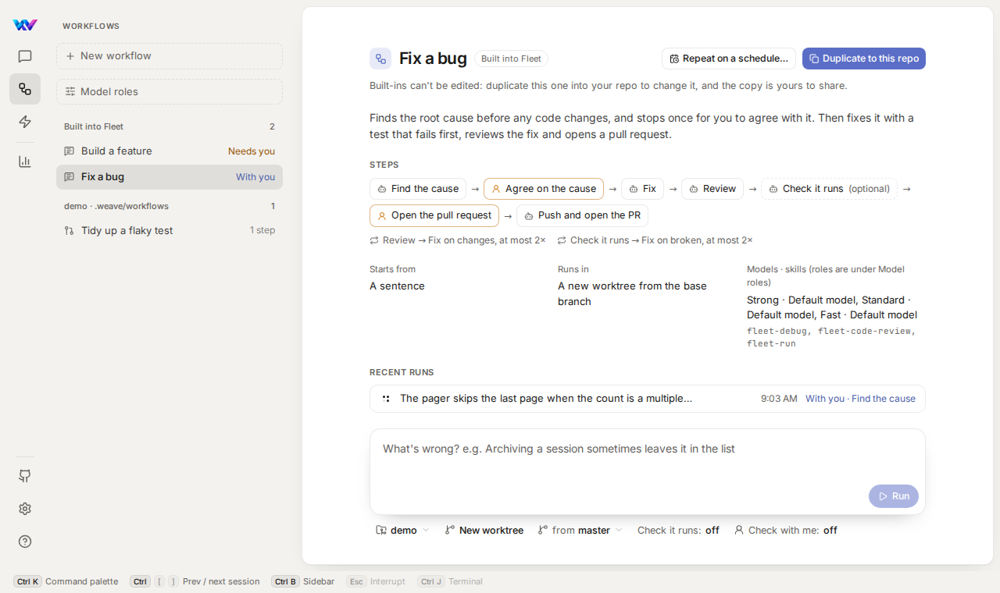
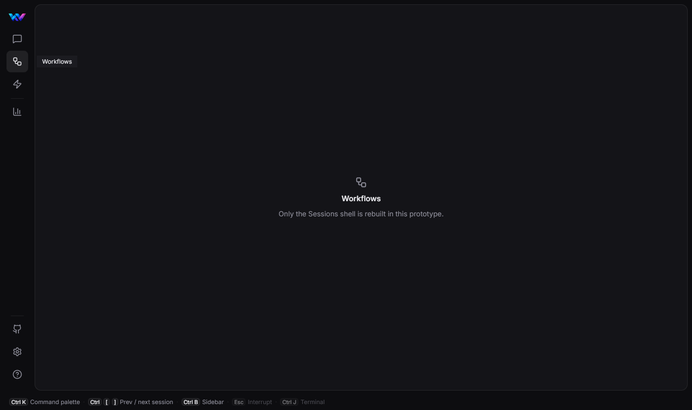
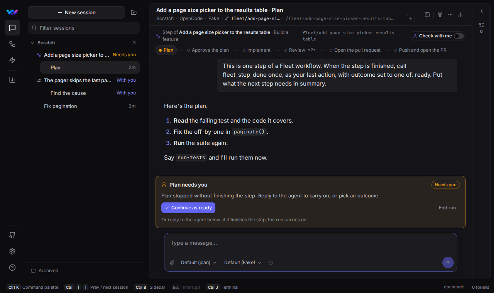
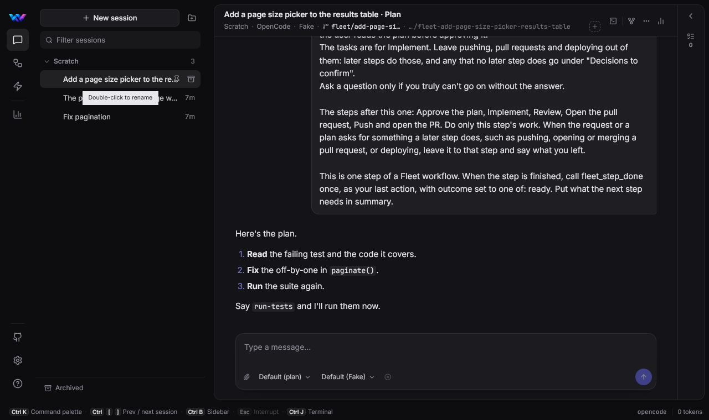
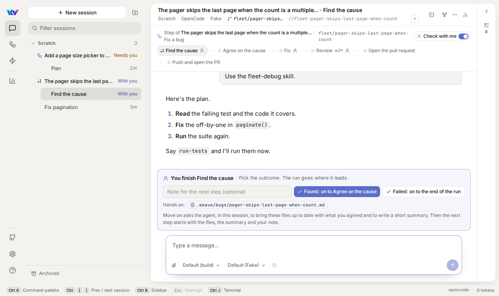
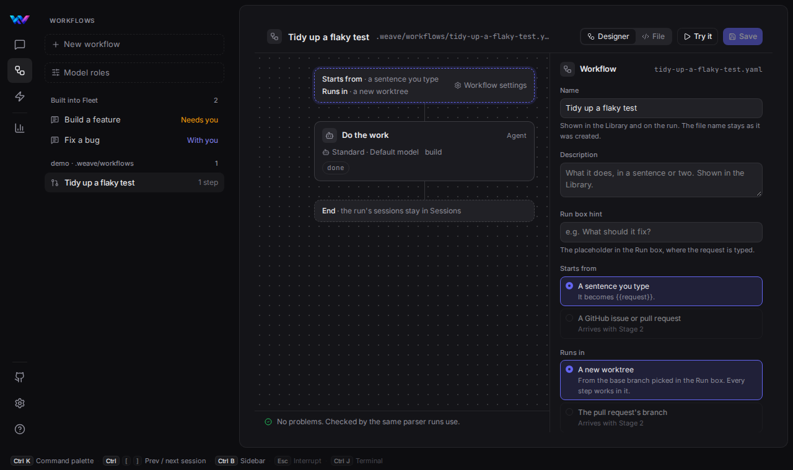
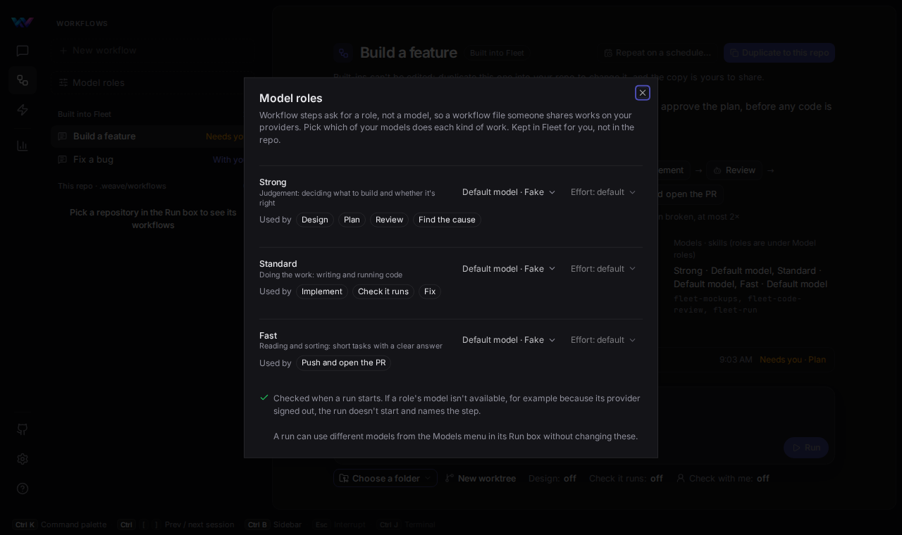

# Component 18: Workflows

The parity checklist for component 18 of `docs/PORT.md`, Workflows: the library, a workflow's steps, recent runs and
the Run box (slice 1, with everything a run shows in Sessions), and the designer that writes a repository's workflow
files (slice 2). It ends with the pieces it is built in.

- **weave-fleet commit read:** `c1a48bd` (`main`, 20 November 2026).
- **Server the live checks run against:** the scratch Fleet's package, which reports **v0.74.0** (`/api/version`; the
  folder is still named v0.72.0). It answered every route of slice 1 the way `main`'s client expects: the library
  (`GET /api/workflows?directory=`), a new file (`POST /api/workflows/files`), opening it (`POST /api/workflows/files/open`),
  the parser (`POST /api/workflows/check`), starting runs (`POST /api/workflows/runs`) and the runs list. Its own client
  draws the same Library, card, finish bar, stepper and designer as `main`'s source (the pictures). Nothing found that
  differs between `main` and that server for this component.
- **Native app read:** `main` at `3ba4418`.
- **Paths** are weave-fleet's under `client/src/` unless they start with `src/`, `docs/` or `server:`. Short names, all
  under `components/workflows/` unless given: WNP `WorkflowsNavPanel.vue`, WDP `WorkflowDetailPanel.vue`, WRB
  `WorkflowRunBox.vue`, PP `ProjectPicker.vue`, WMR `WorkflowModelRoles.vue`, WS `WorkflowStepper.vue`, WRC
  `WorkflowRunCard.vue`, WFB `WorkflowFinishBar.vue`, WRG `WorkflowRunGroup.vue`, WSB `WorkflowStartedBy.vue`, WE
  `WorkflowEditor.vue`, WFE `WorkflowFileEditor.vue`, WC `WorkflowCanvas.vue`, WI `WorkflowInspector.vue`, WCD
  `WorkflowCreateDialog.vue`, WPG `components/pages/WorkflowsPage.vue` + `WorkflowsPane.vue`, FON
  `components/pages/FeatureOffNotice.vue`, LW `lib/workflows.ts`, LWD `lib/workflow-draft.ts`, SW `stores/workflows.ts`,
  UWN `composables/use-workflows-nav.ts`, UWE `composables/use-workflow-editor.ts`, UMR `composables/use-model-roles.ts`,
  UWF `composables/use-workflows-feature.ts`, RT `routes/sessions.$id.tsx`, PG `components/sessions/ProjectGroup.vue`, SI
  `components/sessions/SessionItem.vue`.
- **Row numbers:** 1.x the rail, the switch and the page; 2.x the Library list; 3.x a workflow's detail; 4.x recent runs;
  5.x the Run box; 6.x Model roles; 7.x the stepper; 8.x the run card; 9.x the finish bar; 10.x runs elsewhere in the app;
  11.x the runs store, events and routes; 12.x the editor frame; 13.x the File view; 14.x the canvas; 15.x the inspector;
  16.x New workflow and Duplicate; 17.x drafting a workflow; 18.x out of reach.

The gap, visible in the pictures (each one's other theme is in the same folder): with Workflows on, Fleet's rail opens
`[workflows-list][workflows-detail]`: the built-in workflows and the picked repository's `.weave/workflows`, a workflow's
steps, loops, models and recent runs, and the Run box that starts a run in a new worktree. A run's step sessions group
under one row in Sessions; each step session has the stepper under its header (with Check with me), the run's card
when the run waits on the user there, and the finish bar when the user finishes the step. A repository's workflow opens
in the designer (canvas and inspector, or the file as text) with Save and Try it. The native app has the rail entry,
the Labs switch and the starter that asks for the Run box, and a notice for the rest: "Only the Sessions shell is
rebuilt in this prototype." Fleet's pictures were taken with Playwright at 1280×760 against a scratch Fleet with the
scripted model (two runs started through the API: Fix a bug with Check with me on, Build a feature with it off, whose
Plan step stopped without `fleet_step_done`); the native ones live against the same server at the same size, the light
ones with the theme toggled by the script (Cmd+Shift+L) in a scratch data folder.

## What "done" means

1. Slice 1: with Workflows on (Settings → Labs, the `Workflows` preference), the rail opens the Library and a workflow's
   detail as in Fleet; Turn on from the off notice works; a link (the Fix a bug starter) opens a workflow's Run box in a
   folder.
2. The Run box starts a run with Fleet's choices (folder, base, optional steps, Check with me, harness, project, models
   for this run) and opens the first step's session; it says why it can't run (file errors, no harness, a skill that's
   off, the server's refusal).
3. Model roles maps each role to a model and effort per harness, kept in Fleet's preference.
4. Every step session shows the stepper, the card or the finish bar the way Fleet does, and every answer, Move on, Check
   with me and End run reaches the server; runs follow `workflow_run` events live.
5. Sessions groups a run's steps under its row; the dashboard counts a run waiting on you under Needs you; the
   conversation marks the prompts Fleet sent into a step.
6. Slice 2: a repository's workflow opens in the designer and the File view, checked by the server as it's edited, and
   saves (with the comments ask and the changed-on-disk choice); New workflow, Duplicate, Describe it and Save as
   workflow… make or draft files the way Fleet does.
7. All of it per machine: the view's machine switch picks whose workflows, runs and files these are.
8. Fleet's tests for it pass here under the same names (list below).

## What the native app already has

| Part | State | Where |
|---|---|---|
| The rail entry: Workflows leaves the rail while the preference is off, comes back when on; `/workflows` picks the rail | Done (component 9, piece A) | `src/fleet/rails.rs` (`WORKFLOWS_KEY`, `Features::workflows`), `src/view/rail.rs` |
| No context panel for a Labs rail that is off (`noPanel`) | Done as the rule (`has_panel`); no Workflows panel is drawn on | `src/fleet/rails.rs` |
| The Labs row and switch (`workflows-switch`, "Enable workflows"), saving the preference, the rail following at once | Done (component 16, piece T) | `src/view/settings/labs.rs`, `src/tests_settings_labs.rs` |
| Preferences read and written (`GET /api/preferences`, `PUT /api/preferences/{key}`), per machine for Settings | Done | `src/fleet/prefs.rs`, `s.pickers.prefs` |
| The Fix a bug starter (only with Workflows on, only on the live machine) emits `WorkflowRequest { workflow, folder }` | Done (component 7); read by the Workflows page in `poll` (piece B) | `src/fleet/new_session/starters.rs` |
| The `workflow_run` kind is read off the sessions topic and kept whole as `Event::Other(Kind::WorkflowRun, props)`; `State::subscribe` hands it to whoever listens | Done (component 2); no listener | `src/fleet/events.rs`, `src/fleet/state.rs`, `src/fleet/link.rs` |
| `workflowRunId` on a listed session; moving a session to a project moves its run's steps with it (06's 6.14) | Done | `src/fleet/groups.rs`, `src/fleet/store.rs` |
| `workflowRunId` in each machine's cached list | Done (component 6) | `src/fleet/machine_cache.rs` |
| The row's title takes a step label first (`label || title`), and the row has a `step_note` slot ("With you") | Slots there, nothing fills them | `src/fleet/row_status.rs` `display_title`, `src/view/session_row.rs` `Slots::step_note` |
| The dashboard's Needs you takes a "workflow waiting" test | Wired to `|_| false` (its comment names component 23; it is this one) | `src/fleet/dashboard.rs`, `src/view/dashboard.rs` |
| The machine choice a view with its own switch holds, and the switch chip and menu | Done (component 17, piece N); Workflows has no `MachineChoice` yet | `src/fleet/machine_choice.rs`, `src/view/machine_switch.rs` |
| The row menu's Repeat on a schedule… (a "waiting" toast) | Stub; **Save as workflow… is not in the menu** | `src/fleet/row_menu.rs` |
| The New session strip's chips: folder (FolderPicker), base (BasePicker), harness (HarnessPicker), `ui::chip::Chip` | Done (component 7) | `src/view/folder_menu.rs`, `src/view/base_picker.rs`, `src/view/harness_picker.rs`, `src/view/new_session_strip.rs` |
| The model and effort menus (`SelectorDropdown`, `ModelSelector`'s rows) and the harness catalog per folder | Done (components 5, 7) | `src/view/selector.rs`, `src/fleet/catalog.rs`, `src/fleet/new_session/` |
| The composer frame (`ComposerFrame.vue`) | Done for New session | `src/view/new_session_box.rs` |
| Built-in skills and whether each is on (`/api/skills/built-in`) | Done (component 16, piece AK) | `src/fleet/settings/`, `src/fleet/skills.rs` |
| A confirm dialog (`confirmAction`), alerts, toasts, menus, empty states, error notes, `PageHeader` (Settings' and the dashboard's) | Done | `src/ui/confirm.rs`, `src/ui/dialog.rs`, `src/ui/toast.rs`, `src/ui/menu.rs`, `src/ui/empty_state.rs`, `src/view/settings.rs` `page_header` |
| The status glyphs (`StatusGlyph`: working quad, check, error triangle) | Done | `src/view/parts.rs` |
| A code editor with line numbers, history, brackets, highlighting, find and Ctrl/Cmd+S (the File view's CodeMirror) | Done (component 11, slice 2) | `src/fleet/code_edit.rs`, `src/fleet/code_editing.rs`, `src/view/code_edit.rs`, `src/view/code_view.rs` |
| Opening a file in the content panel's file tab and opening the panel | Done (component 11) | `State::open_file`, `src/fleet/canvases.rs` |
| The `.peer-from` mark above a user bubble (steered, mod marks) | Done (component 3); the workflow-step mark isn't drawn | `src/view/message.rs` |
| Canvas strokes (polylines, dashes as separate strokes), for the designer's loop arcs | Rune has `canvas` + `stroke_path`, no arcs or dash patterns (`docs/RUNE.md`) | `src/view/ring.rs` shows the way |
| Icons `WORKFLOW`, `BOT`, `REPEAT`, `COPY`, `PENCIL`, `SPARKLES`, `GIT_PULL_REQUEST`, `SLIDERS_HORIZONTAL`, `PLAY`, `GIT_BRANCH`, `ROTATE_CCW`, `SEND`, `TRIANGLE_ALERT`, `ARROW_RIGHT`, `FILE_TEXT`, `CHECK`, `CIRCLE_ALERT`, `CIRCLE_CHECK`, `SETTINGS`, `GIT_FORK`, `PLUS`, `TRASH_2`, `ZAP`, `CHEVRON_DOWN`, `CODE` | Generated | `src/icons.rs` |
| `UserRound`, `CalendarClock`, `FileCheck2`, `CornerUpLeft`, `Save`, `Clock`, `Code2` (`code-xml`) | **Missing**: each piece adds the ones it draws with `tools/gen-icons.py` (`MessageSquareText` came with B) | |

## The checklist

### 1. The rail, the switch and the page

| # | Fleet | Source | Native |
|---|---|---|---|
| 1.1 | Workflows is a Labs feature: the user preference `Workflows` (`"true"`/`"false"`, default `"false"`) on the machine the view shows. Off: no rail item, no runner on the server, no panel | UWF; `components/layout/core-rails.ts` 63-76 | Done (B): `State::workflows_feature` reads `Workflows` on the machine the view shows (home's `pickers.prefs`, another machine's `feeds.prefs`, read when the page opens); `None` until they have loaded. Rail and switch were 9A and 16T. `src/fleet/workflows/nav.rs` |
| 1.2 | The runs are loaded (`ensureLoaded`) as soon as Workflows is on, whichever page is open, so Sessions, the dashboard and step sessions know the runs | `components/layout/IconRail.vue` 83-86 | Done (A): `State::workflows_settle` reads the runs for the live machine once the preference is on (at start, after the preferences load, after a Labs save); off, nothing is asked and no event is kept. `src/fleet/workflows/runs.rs` |
| 1.3 | Route `/workflows`: context `[workflows-list][workflows-detail]`, the left panel at the session list's width with its gutter; the list is rebuilt (keyed) when the view's machine changes | `core-rails.ts` 51-57, WPG | Done (B): `view::workflows::page` draws `[workflows-list][gutter][workflows-detail]` (the session list's width and gutter); another machine forgets the state and reads its own library (`forget_machine`). The old notice is gone for Workflows. `src/view/workflows/mod.rs` |
| 1.4 | Off, the page shows `FeatureOffNotice`: "Workflows is off" (`text-2xl` 600), the description "A workflow is a recipe of steps for an agent, like fixing a bug or reviewing a change, that you can run again and again." (`text-sm` muted), **Turn on** (disabled while turning on), "You can change this any time in Settings." (`text-xs` muted); centred, `max-w-2xl`, `p-8` | FON, WPG `WorkflowsPane.vue` | Done (B): `view::feature_off::notice` (shared; component 23 uses it for Board, Jobs and Fleet). Same sizes, wording and centring; disabled while turning on. Picture beside Fleet's, both themes |
| 1.5 | Until the preferences have loaded nothing is drawn (no flash of "is off") | FON `v-if="preferences.hasFetched"` | Done (B): nothing is drawn but the empty sheet until the machine's preferences have loaded (`workflows_feature() == None`) |
| 1.6 | Turn on saves the preference, then loads the library and the runs again (what loaded in the gap was refused) | `WorkflowsPane.vue` `turnOn` | Done (B): `workflows_turn_on` saves the preference on the machine shown (`save_pref_on_machine`, rolled back and read again on a refusal), then asks for the library and the runs again. Gap: for the live machine the runs may already have been asked for in the gap (`workflows_settle` follows the local value); a refused ask is retried by this call only if it had finished |
| 1.7 | On, the pane is the detail panel plus the Model roles dialog | `WorkflowsPane.vue` | Partly (B): on, the pane is the detail (the bare `PageHeader` until C); Model roles sets `roles_open`, E draws the dialog |
| 1.8 | The page opens on the machine you're on (`resetWorkflowsMachine` on every visit); the list's machine switch picks the machine the list and the pane show | WPG; `composables/use-workflows-machine.ts` | Done (B): `enter_workflows` resets the machine choice when the page is entered from another rail; the list's switch (`machine_switch` with testid `workflows`) picks the machine |
| 1.9 | A link `/workflows?workflow=<id>&folder=<path>` sets the Run box's folder (chosen) and opens that workflow; nothing starts; the address goes back to plain `/workflows` | WPG watch; `routes/workflows.tsx` | Done (B): the starter's `WorkflowRequest` is taken in `poll` (`keep_workflows`): the Run box's folder is chosen, the workflow opens, nothing starts. There is no address to clean; taking the request is the same |
| 1.10 | Another machine: nothing of the last one's library, folder, open workflow, run view, create dialog or unsaved mark carries over; the library reloads if one was loaded | UWN machine watch | Done (B): `Nav::forget_machine` drops the library, folder, chosen mark, open workflow, run view and unsaved mark, and reads again if a library was loaded. The create dialog (R) has no state yet |

### 2. The Library list (`[workflows-list]`)

| # | Fleet | Source | Native |
|---|---|---|---|
| 2.1 | Header "WORKFLOWS": 10 px (0.71429rem) 600 uppercase, letter-spacing .05em, muted, padding 14/16/10, row padding-top 4 | WNP `.panel-header` | Done (B) |
| 2.2 | The machine switch under it (`MachineSwitch`, label "Workflows", testid `workflows`), padding 0 12 6, only when another machine is listed | WNP | Done (B): `machine_switch::chip`, label "Workflows", only when another machine is listed |
| 2.3 | **New workflow** (Plus): dashed 1px border, radius btn, padding 6/10, margin 4/8/8, 13 px muted; hover accent-mixed border and text. Disabled (opacity .6, not-allowed) without a repository, title "Pick a repository in the Run box first". Opens the create dialog (16.x) | WNP `.new-workflow` | Drawn (B): dashed border, padding, margin, 13 px muted, disabled with the title when no repository. Press does nothing until R. Gap: Fleet's hover mixes the accent into the border; Rune has no hover border (`docs/RUNE.md`), so only the text takes the hover colour |
| 2.4 | **Model roles** (SlidersHorizontal), same look; opens the Model roles dialog | WNP `.model-roles` | Drawn (B); the press sets `roles_open`, E draws the dialog. Hover as 2.3 |
| 2.5 | Group label "Built into Fleet" with the count right: 11 px 500 muted, padding 12/10/6, space-between | WNP `.group-label` | Done (B) |
| 2.6 | Group label "<repo name> · .weave/workflows" (or "This repo · .weave/workflows" while the picked repo loads or none is picked) with its count, the count hidden while loading | WNP `repoLabel` | Done (B): the name from the library, "This repo" while the picked repository loads or none is picked; the count is hidden while loading |
| 2.7 | A row: min-height 32, gap 9, padding 0 10, radius btn; text 86 % mix; hover 5 % text wash; active 9 % wash, 500, `aria-current=page`. Icon 13 px muted: MessageSquareText for a built-in, GitPullRequest for a repo file, AlertTriangle (error colour) for a file with errors, the working glyph while its latest run runs. Title 13 px ellipsis; meta 12 px at the end | WNP `.workflow-row` | Done (B): `view::workflows::list::item`. `MessageSquareText` (generated for this piece), `GitPullRequest`, `TriangleAlert` in the error colour, the working glyph while the latest run runs. Hover and active washes; the active title is 500 |
| 2.8 | Row meta, first that holds: "Edited" (wait) when it has unsaved edits in the designer; "Can't read" (error) with errors; latest run waiting "Needs you" (`--idle-text`); running with a step the user finishes "With you" (`--accent-text`); running "Running" (`--running-text`); else "N step(s)" (muted 80 %) | WNP `rowMeta` | Done (B): `nav::row_meta`; "Edited" waits for M, which sets `Nav::unsaved` |
| 2.9 | A click opens the workflow (through the leave guard, 12.12) and leaves the run view | UWN `setActiveWorkflow`, `moveTo` | Done (B): `State::set_active_workflow` through `Nav::leave_guard` (a plain `fn(&State) -> bool`, which M fills), then `move_to` leaves the run view |
| 2.10 | While the picked repo loads: a small spinner "Loading this repo's workflows…" (testid `workflows-repo-loading`) in place of its rows | WNP | Done (B): a 14 px spinner (`workflows-repo-loading`) |
| 2.11 | Empty repo part: compact EmptyState "No workflow files in this repo yet", or "Pick a repository in the Run box to see its workflows" with no repository | WNP | Done (B): `ui::empty_state::compact_bare`, both wordings |
| 2.12 | No library yet and loading: a large centred spinner ("Loading workflows…" for readers); a failed load: ErrorNote with the server's words (fallback "Couldn't load the workflows."), margin 12 | WNP | Done (B): a large spinner while the first read is on its way, the server's words in an error note (fallback "Couldn't load the workflows.") |
| 2.13 | The draft row (Sparkles): "New workflow" with "Drafting…" or "Failed", or the drafted name with "Unsaved", meta in wait colour | WNP `draftRow` | None (S) |
| 2.14 | The library is loaded for the Run box's repository (`GET /api/workflows?directory=`), again whenever it changes; a newer load wins (generation); when the open workflow isn't in the new library the first one opens (or Build a feature) | UWN `reload` | Done (B): `workflows_reload`, a generation counter, a read again whenever the repository changes (from any page, as Fleet's watcher does) or after Turn on. With no Fleet the invented library (`mock::workflows`) |
| 2.15 | Opens on `builtin:build-a-feature` | UWN | Done (B): `BUILD_A_FEATURE`; the first workflow opens when the open one isn't in a new library |

### 3. A workflow's detail (read view)

| # | Fleet | Source | Native |
|---|---|---|---|
| 3.1 | The pane: centred column `max-w 760`, gap 20, padding 28/24/40, scrolls | WDP `.wf-detail__inner` | Done (C): `view::workflows::detail::read`: a column at most 760 wide, centred, gap 20, padding 28/24/40, inside the pane's own 24 px (`center__body`); the pane scrolls. `src/view/workflows/detail.rs` |
| 3.2 | `PageHeader`: leading icon box 28×28, radius btn, accent 14 % fill, Workflow icon 15 px accent; title the workflow's name; meta pill "Built into Fleet" (muted, 11 px, 1px border, radius full) or the file path (accent-mixed border, accent text, mono) | WDP | Done (C): the 28 px icon box (accent 14 %), the title (21, 600), the pill ("Built into Fleet" muted, or the file path in mono with the accent-mixed border); the header wraps like `PageHeader`'s (lead basis 16 rem, actions on the right) |
| 3.3 | Action **Repeat on a schedule…** (CalendarClock, outline, sm): disabled without a repository or with file errors; title "Run this workflow on a schedule, as an automation" or "Pick a repository in the Run box first"; opens a new automation with the workflow, the folder and the Run box's request, optional steps, base and harness, and goes to Automations | WDP `repeatOnSchedule`; `use-automations-nav.ts` `startCreateFromWorkflow` | Drawn (C): outline, CalendarClock, off without a repository or with file errors, with Fleet's two titles. The press shows the "Automations is its own component" toast, as the row menu's Repeat does, until component 19 |
| 3.4 | Action **Duplicate to this repo** (Copy, default, sm) for a built-in: disabled without a repository (same title); opens Duplicate (16.x) | WDP | Drawn (C): the default button for a built-in, off without a repository with the same title. The press does nothing until R |
| 3.5 | Action **Edit** (Pencil, outline, sm) for a repo workflow shown in the run view: back to the designer | WDP | None (M) |
| 3.6 | A built-in's hint: "Built-ins can't be edited: duplicate this one into your repo to change it, and the copy is yours to share." (12.5 px muted, margin-top -8) | WDP | Done (C): 12.5 px muted, margin-top -8, only for a built-in |
| 3.7 | The description: 14 px, line-height 1.55, text 85 % | WDP `.wf-detail__blurb` | Done (C): 14 px, line-height 1.55, text at 85 % |
| 3.8 | File errors: a list in a box (error-mixed border, radius card, padding 10/12, mono 12 px, error text), AlertTriangle 13 px per line | WDP `.wf-detail__errors` | Done (C): the box, the lines in the mono error colour, TriangleAlert 13 px per line. The server gives a file it can't read no steps and no description, only the errors (live) |
| 3.9 | "STEPS" section label (11 px 600 uppercase .05em muted, margin-bottom 8); the strip: chips (Bot or UserRound 12 px, padding 4/9, 1px border, radius btn, card bg, 12.5 px) with "→" between (muted 12 px), wrapping; a You step's chip has an idle-mixed border and an idle icon; an optional step is dashed with "(optional)" | WDP `.wf-strip`, `.wf-chip` | Done (C): the "STEPS" label and the strip: Bot or UserRound chips, a You chip with the idle-mixed border and icon, a dashed optional chip with "(optional)", "→" between, wrapping (`flex_wrap`) |
| 3.10 | Loops under the strip (Repeat 12 px): "Review → Fix on changes, at most 2×", 12 px muted, gap 14 | WDP; LW `loopNotes` | Done (C): the loops under the strip, `loop_notes`, Repeat 12 px |
| 3.11 | Facts grid (auto-fit, min 180, gap 12): "Starts from" / "A sentence"; "Runs in" / "A new worktree from the base branch"; "Models · skills (roles are under Model roles)" / "Strong · Opus 5.5, Standard · …" (each role once with its mapped model's short name for the default harness, pinned models as they are) and the skills in mono 11 px muted. `dt` 11.5 px muted, `dd` 13 px | WDP `models`, `skills` | Done (C): "Starts from", "Runs in" and "Models · skills" in wrapping columns of at least 180 that grow; `fleet::workflows::detail::{models, skills}`, the roles read from the machine's `WorkflowModelRoles` preference and the default harness from `defaultHarnessType`. A role without a mapping says "Default model", as Fleet does |
| 3.12 | The Run box at the bottom (section 5) | WDP | None (D) |
| 3.13 | Nothing open (or the library still loading): the pane is a `PageHeader` "Workflows" alone; a failed library: ErrorNote centred `max-w-md` | WDP | Done (B): the bare `PageHeader` "Workflows" while nothing is open or the library loads; a failed library is a centred error note (`max-w` 28 rem) |
| 3.14 | A repo workflow shows the designer instead (section 12) unless the run view is on (Try it); the draft shows the drafting state or the designer | WDP `showEditor` | None (M, S) |

### 4. Recent runs

| # | Fleet | Source | Native |
|---|---|---|---|
| 4.1 | "RECENT RUNS" label; up to 6 runs of this workflow, newest first, in a bordered box (radius card), rows 34 high, padding 0 12, gap 10, 13 px, divided by 1px borders, hover 5 % wash | WDP `.wf-runs` | Done (C): "RECENT RUNS", the newest six of this workflow, in a bordered box, 34 high rows divided by borders, hover wash |
| 4.2 | Row glyph (16 px slot): the working quad while running, an 8 px idle dot ("Needs you") while waiting, AlertTriangle (error text) when failed, Check (running-text) otherwise | WDP | Done (C): the working glyph, an 8 px idle dot, TriangleAlert in the error text colour, Check in the running text colour |
| 4.3 | Title ellipsis; "Started by <b>automation</b>" (Zap, plain text, max 34 %) when an automation started it; the time (`formatTimestamp`, e.g. "9:03 AM"); the status text 12 px: "Needs you · <step>" (idle), "With you · <step>" (accent), "Running · <step>" (running), "Done"/the result, "Ended", "Failed"/the result (error) | WDP `runText`, `runStatusLabel`; WSB `plain` | Done (C): title (ellipsis), "Started by <b>name</b>" with Zap in its plain form (`started_by_plain`; its link form is F/I's), the time (`format_timestamp` of `createdAt`), and `run_text` in the tone of `run_status_label`. Gap: Fleet caps "Started by" at 34 % of the row; Rune has no percentage widths, so it shrinks with the title instead |
| 4.4 | A click opens the session the run waits in, else its newest step's session | WDP `openRun` | Done (C): a click opens the session the run waits in, else its newest step's (`open_workflow_run`: the list's session on this machine, `open_machine_session` on another) and leaves Workflows for Sessions. A session the list doesn't hold opens nothing |
| 4.5 | Before the runs have loaded: a small spinner "Loading recent runs…" (testid `workflow-runs-loading`), not "No runs yet" | WDP | Done (C): a 14 px spinner, `workflow-runs-loading`, until the runs have been read |
| 4.6 | No runs: EmptyState "No runs yet", bordered, compact | WDP | Done (C): "No runs yet" in a dashed bordered compact box, `workflow-runs-empty` |

### 5. The Run box

| # | Fleet | Source | Native |
|---|---|---|---|
| 5.1 | `ComposerFrame` with a 2-row textarea, `aria-label` "What the run should do", placeholder the workflow's `placeholder` or "What should it do?", read-only while starting (testid `workflow-request`) | WRB | None (D) |
| 5.2 | **Run** (Play, or a spinner while starting; `toolbar-lg`, the composer's send place): disabled unless the request has text, a repository is picked, a workflow harness exists, no file errors, no skill off and not starting (testid `workflow-run`) | WRB `canRun` | None (D) |
| 5.3 | Enter runs (not Shift+Enter, not while composing); with no repository Run opens the folder menu instead | WRB `handleKeydown`, `run` | None (D) |
| 5.4 | The strip, wrapping, the New session chips (`ns-chip`): the **folder** chip (repositories only, no "None", Browse unless cloud mode; picking another repo resets the base) | WRB; `FolderPicker.vue` | None (D; 7's folder menu) |
| 5.5 | **New worktree** (GitBranch), static, title "Each run gets its own worktree and branch; every step works in it." | WRB | None (D) |
| 5.6 | The **base** chip with a repository (`BasePicker` without the branch name and Fetch rows), from the repository's detail | WRB | None (D; 7's base picker) |
| 5.7 | One chip per optional step: "<Title>: on/off", pressed state, title its `optionalHint` (testid `workflow-optional-<id>`) | WRB | None (D) |
| 5.8 | **Check with me: on/off** (UserRound, a switch), title "Check with me after each step: every step waits for you to move it on, and you can talk to the agent in between. You can change it later from the run's header." (testid `workflow-check-with-me-start`) | WRB | None (D) |
| 5.9 | The **harness** chip only with more than one harness that has `supportsWorkflowSteps`; the default harness if it's one of them, else the first | WRB `workflowHarnesses`, `harnessType` | None (D) |
| 5.10 | **Project: <name>** chip (`ProjectPicker`): a menu "Project" with Scratch and each user project (Check on the picked one), above the chip; title "Where the run's sessions go"; null is Scratch (testid `workflow-project`) | PP | None (D) |
| 5.11 | **Models** chip (Bot, ChevronDown), "Models · N changed" with overrides; disabled when no enabled step asks for a role. Its popover "Models for this run": a row per role used (Strong, Standard, Fast order) with the model menu (default "Default model", "The composer's default model"; testid `workflow-model-<role>`) or the fixed model name when the harness has no catalog; note "Only for this run. The roles themselves are set under Model roles, in the Workflows list." Picking what the role already maps to is no override | WRB `rolesUsed`, `setOverride` | None (E) |
| 5.12 | Under the strip, the first that holds (`role=alert`, `.wf-run__warn`): "Fix the workflow file first."; "Workflows run on <A, B or C>, and none of them is installed and on." + link "Set one up in Settings → Harnesses" (only once the harness list has loaded); "<Step> uses <skill>, which is off." + link "Turn it on in Settings → Skills & tools"; the start error; else the foot "Runs as a group in Sessions. It stops at each **You decide** step and shows it under Needs you." | WRB | None (D) |
| 5.13 | The folder starts as the New session page's initial folder (a repository) once the repositories are known, unless one was chosen | WRB `applyInitialFolder` | None (D) |
| 5.14 | A different workflow clears the optional steps, the overrides and the start error | WRB watch | None (D) |
| 5.15 | Run sends `POST /api/workflows/runs` `{workflowId, directory, request (trimmed), baseBranch, harnessType, optionalSteps, roleOverrides {role: {model, effort: null}}, checkWithMe, projectId}`, clears the request and opens the first step's session; a refusal shows the server's words ("Couldn't start the run.") | WRB `run`; SW `start` | None (D) |
| 5.16 | `scheduleDraft()` hands Repeat on a schedule the request, optional steps, base and the harness picked here | WRB | None (D keeps the values; 19 reads them) |
| 5.17 | The links open Settings on Harnesses or Skills & tools | WRB | None (D; `settings_nav`) |

### 6. Model roles

| # | Fleet | Source | Native |
|---|---|---|---|
| 6.1 | A dialog (`sm:max-w-2xl`, `max-h 90vh`, scrolls; testid `workflows-roles-card`): title "Model roles", description "Workflow steps ask for a role, not a model, so a workflow file someone shares works on your providers. Pick which of your models does each kind of work. Kept in Fleet for you, not in the repo." | WMR | None (E) |
| 6.2 | A harness segment (`wf-seg`) only with more than one workflow harness; roles are kept per harness | WMR | None (E) |
| 6.3 | Per role (Strong "Judgement: deciding what to build and whether it's right", Standard "Doing the work: writing and running code", Fast "Reading and sorting: short tasks with a clear answer"): name 14 px 500, description 12 px muted; the model menu (default "Default model · <composer default>", description "The model the session composer uses when you don't pick one"; disabled without a catalog or while saving; testid `workflows-role-model-<role>`); the effort menu ("Effort: default" "The model's own effort", then "Effort: <variant>"; disabled with fewer than two); "Used by" with a chip per step title asking for the role across the library, or "no steps yet" | WMR; LW `ROLE_*` | None (E) |
| 6.4 | Picking a model saves `{model, effort: null}`; picking an effort keeps the model | WMR `pickModel`, `pickEffort`; UMR `setChoice` | None (E) |
| 6.5 | The preference `WorkflowModelRoles`: JSON `harness → role → {model, effort}`; unreadable JSON reads as empty | LW `parseModelRoles`; UMR | Parsed (A): `parse_model_roles`, unreadable JSON reads as empty. E writes it. `src/fleet/workflows/mod.rs` |
| 6.6 | Notes: Check "Checked when a run starts. If a role's model isn't available, for example because its provider signed out, the run doesn't start and names the step." and "A run can use different models from the Models menu in its Run box without changing these." | WMR | None (E) |
| 6.7 | No workflow harness on (but some harnesses known): "Workflows run on A, B and C. Turn one of them on in Settings → Harnesses." (or "…Turn it on…" for one; "None of the harnesses here can run workflows yet." for none) | WMR `workflowHarnessesNote` | None (E) |
| 6.8 | Opening it with no library loads it; leaving the page closes it for good (the flag outlives the page) | WMR | None (E) |
| 6.9 | Escape closes an open model menu first (from its filter or its trigger), the dialog on the next press | WMR; `WorkflowModelRolesEscape.test.ts` | None (E) |
| 6.10 | `keyFromPath` / `pathFromKey`: a `provider/model` path and the model picker's selection key | UMR | Done (A): `key_from_path` / `path_from_key`, over `composer::choice`. `src/fleet/workflows/mod.rs` |

### 7. The stepper (under a step session's header)

| # | Fleet | Source | Native |
|---|---|---|---|
| 7.1 | Drawn under `SessionDetailHeader` (before the delegated-session banner) when the session is a step of a known run (08's 4.7) | RT 545; WS | None (F) |
| 7.2 | Padding 8/16/10, gap 6. The run line (12 px, Workflow 12 px): "Step of **<run title>** · <workflow name>", the branch (mono 11 px), "Started by <automation>" (a link, 10.x), then the **Check with me** switch at the end while the run isn't finished | WS `.wf-stepper__run` | None (F) |
| 7.3 | Check with me (UserRound, bold label, a 26 px track): `role=switch`, title "Check with me after each step. Applies to the steps that haven't finished."; `PUT /api/workflows/runs/{id}/check-with-me {on}`; disabled while switching; error "Couldn't change Check with me." under the line | WS `toggleCheckWithMe`; SW `setCheckWithMe` | None (F) |
| 7.4 | The note when the switch differs from how the running step started: "Check with me is on from <next>. This step started on its own, so it still moves on when the agent reports it's done." / "Check with me is off from <next>. You still finish this step, because it started with you." (none for a step whose file says who finishes it) | LW `checkWithMeNote` | Logic done (A): `check_with_me_note`; F draws it |
| 7.5 | The steps that run (enabled), in a wrapping list with 14 px separators: pills (padding 3/8, radius full, 12 px) with Check (done), the working quad (running), else a 7 px dot; the step title; extra "2nd" when visited twice or "≤2×" for a pending loop step (10.5 px); UserRound "You finish this step" while it's the user's and not done or skipped (testid `workflow-step-with-you`). This session's step is marked current (`aria-current=step`); waiting, running and pending look different | WS `.wf-stp*` | None (F) |
| 7.6 | A pill whose step ran in another session opens it; this session's step and steps with no session are disabled; title "<Title>: <outcome>" or the title | WS `open` | None (F) |

### 8. The run card (above the composer)

| # | Fleet | Source | Native |
|---|---|---|---|
| 8.1 | Drawn after the activity stream, before the finish bar, the recap line and the side conversation (15's 1.1), in chat view | RT 652 | None (G) |
| 8.2 | Shown when the run waits on the user in this session (`status=waiting`, `waiting.sessionId`): a card (padding 12/14, gap 8, radius card, idle-mixed), region labelled by the step title (testid `workflow-card`) | WRC | None (G) |
| 8.3 | Top (13.5 px, UserRound 14): the step title for a You step, else "<Step> needs you"; pill "Needs you" (11 px, radius full) | WRC | None (G) |
| 8.4 | The ask (13 px): the server's message, or for a You step its question, then "<a.md and b.html> is/are open on the right." when the step before declares files, then " Then choose how involved you want to be in the rest of the run; you can change it later from the header." when a choice has `involvement` | WRC `ask` | None (G) |
| 8.5 | Choices with `involvement` are offered twice as big options (`wf-opt`, padding 9/11): "<label>, let it run" (Play) with "<A, B and C> go ahead on their own. You're asked again at <next You step>." and the primary "<label>, check with me after each step" (UserRound) with "Each step waits for you to move it on, and you can talk to the agent in between." (testids `workflow-card-let-it-run`, `workflow-card-check-with-me`); they send `checkWithMe` false/true | WRC | None (G) |
| 8.6 | The other choices as sm buttons: the first default (when no involvement choice), the rest outline; icons CornerUpLeft (takes a note), RotateCcw (`retry`), Check (first); label as given for a You step, `retry`, `move-on-anyway`, `without-skill`, else "Continue as <label>"; title "Starts <step>" / "Ends the run" (none for start-failed and skill-off); testid `workflow-card-choice-<index>` | WRC `describe`, `choose` | None (G) |
| 8.7 | A choice that takes a note opens a textarea (min-height 56, 13 px; placeholder "What should change? This goes into <step>'s next prompt."; focused) with "Send back to <step>" (Send; disabled while empty) and Cancel | WRC `noteFor` | None (G) |
| 8.8 | **End run** (ghost, at the end): `POST …/end`; "Couldn't end the run." | WRC `endRun` | None (G) |
| 8.9 | Hints (12 px): "Or reply to the agent below: if it finishes the step, the run carries on." for no-outcome and loop-limit; for skill-off "Turn it on in [Settings → Skills & tools], then retry. Or start the step without it for the rest of this run." | WRC | None (G) |
| 8.10 | Answers send `POST …/answer {choice, note, checkWithMe?}`; a busy spinner on the pressed button, every button disabled meanwhile; the server's refusal under the card (12 px, alert) | WRC `choose`; SW `answer` | None (G) |
| 8.11 | A new wait (another step id) clears the note, its choice and the error | WRC watch | None (G) |
| 8.12 | At a You step whose step before declares files, those files open on the right (kept, not preview) and the right panel opens (unless it's a sheet), once per run, step and visit, even across leaving and coming back | WRC `opened` | None (G; 11's `open_file`) |
| 8.13 | After this session's step, once the run moved on: a resolved line (padding 8/12, 12.5 px, Check 14): "<Step> finished: <outcome>." (plus the result, or "The run is done.", when the run is over); "Files checked: a.md" or "Files checked and committed as <sha>: …" (FileCheck2); "Fleet couldn't commit it/them: <why>" (TriangleAlert, title the error); a link "<next step> →" to the session the run is in now (testid `workflow-card-resolved`) | WRC `movedOn`, `checkedFiles` | None (G) |
| 8.14 | Nothing in a session the run isn't waiting in and that hasn't finished | WRC | None (G) |

### 9. The finish bar (a step the user finishes)

| # | Fleet | Source | Native |
|---|---|---|---|
| 9.1 | Drawn right after the run card, when the run is running and `withYou.sessionId` is this session | RT 653; WFB | None (H) |
| 9.2 | While wrapping up: a status line (working glyph, 12.5 px, padding 9/12): "Wrapping up <step>: the agent is updating its files and writing a summary for <next>. Then Fleet checks the files and starts <next>." (or without files "…writing a summary for <next>. Then Fleet starts <next>.") (testid `workflow-wrapping-up`) | WFB `wrapping` | None (H) |
| 9.3 | The bar (padding 12/14, radius card, testid `workflow-finish-bar`): "You finish <step>" (13.5 px bold, UserRound) "· <subtitle>": one way on and the file says `finish: you` "The agent can't end this step. Keep talking until it's right."; one way on otherwise "You chose to check each step. Keep talking, or move on."; several "Pick the outcome. The run goes where it leads." | WFB `subtitle` | None (H) |
| 9.4 | A note input (13 px, placeholder "Note for <next> (optional)") and a button per way on: the first default, the rest outline; "Move on to <step>" / "Finish the run" (ArrowRight after) for one; "<Outcome>: on to <step>" (Check), "<Outcome>: back to <step> (1 of 2)" (CornerUpLeft), "(2 of 2 used)" when spent; disabled while busy or not allowed; title why not (testid `workflow-move-<outcome>`) | WFB; LW `moveLabel`, `moveBlockedReason` | Logic done (A): `move_label`, `move_blocked_reason`; H draws it |
| 9.5 | Move on sends `POST …/move-on {outcome (null when there's one way), note}` and clears the note; "Couldn't move the run on." | WFB `moveOn`; SW `moveOn` | None (H) |
| 9.6 | A spent loop: "<Step> has sent the work back twice, the most this run allows. Pick another outcome, or [end the run]." (testid `workflow-finish-blocked`, link `workflow-finish-end`) | WFB `blocked` | None (H) |
| 9.7 | "Hands on:" with a chip per file (FileText, mono 11 px), or "This step declares no files. The next step gets its summary, your note, and the branch as it is." | WFB | None (H) |
| 9.8 | The hint: "Move on asks the agent, in this session, to bring these files up to date with what you agreed and to write a short summary. Then <next> starts with the files, the summary and your note." (or the no-files version) | WFB `handOff` | None (H) |
| 9.9 | Another step clears the note and the error; nothing in a step the agent finishes or in another session | WFB | None (H) |

### 10. Runs elsewhere in the app

| # | Fleet | Source | Native |
|---|---|---|---|
| 10.1 | Sessions: a run's step sessions group under one row where its newest session was, steps in the order they ran (`groupRunSessions` on the project's roots); a run the store doesn't know groups by the sessions' `workflowRunId` under the title before " · " and steps named from their titles; another machine's steps don't group (06's 2.103) | PG 102-104; LW `groupRunSessions` | Logic done (A): `group_run_sessions` (+ `RunMember`); I draws it |
| 10.2 | The group's head (min-height 32, gap 9, padding 0 10 0 6, 500): the 14 px caret slot, the working quad while running else Workflow 13 px accent, the title (13 px), the status 12 px ("Needs you" idle, "With you" accent, "Working" running, "Failed"/result error, "Ended", "Done"); hover 5 %; label "<title>, <workflow>, <status>"; a click opens the session the run waits in, else the newest step | WRG | None (I) |
| 10.3 | "Started by <automation>" under the head (padding 0 10 2 42), a link that opens the automation in Automations; not on a run started from the Run box | WRG; WSB | None (I draws; the click is component 19's) |
| 10.4 | Each step row is the session row indented 32 px with its step label as its title ("Implement · 2nd pass") and "With you" as its step note while the user finishes it (06's 3.41, 3.55); rows keep their actions and drag | WRG; LW `stepLabel` | Slots there (I) |
| 10.5 | The dashboard: a session whose run waits on the user in it counts under Needs you (09's 10.8), and its row says what it waits for: the step title in the attention tone, described "<workflow>: <step>" | `components/dashboard/FleetDashboard.vue` 103-116, `DashboardSessionRow.vue` 36-44; `lib/needs-you.ts` | Wired to "never" (I) |
| 10.6 | The conversation: a user message Fleet sent into a step session carries the workflow mark (Workflow icon + "Workflow · step 2 of 6", "… · you finish this step", or "Fleet · you pressed Move on"), found by the session's prompt id, Fleet's footer ("This is one step of a Fleet workflow."), or the wrap-up id (03's 1.54, 2.17; testid `workflow-step-prompt`) | `composables/use-activity-messages.ts` 193-285; `ActivityStream.vue` 702-718; LW `workflowMessageLabel` | Logic done (A): `workflow_message_label`, `workflow_message_key`, `is_step_prompt`; F draws it |
| 10.7 | The Fix a bug starter opens `/workflows` with `workflow=builtin:fix-a-bug` and the page's folder (07's A15.4) | `NewSessionComposer.vue` | Done (B): `keep_workflows` takes the request, enters Workflows, picks the folder and opens the workflow. The starter's "not in the native app yet" toast is gone |
| 10.8 | The row menu's **Save as workflow…** (06's 3.98) | SI 248-255, 562-565, 1014-1021 | None (S) |
| 10.9 | A session moved to a project takes its run's other steps along | `stores/sessions.ts` 79-84 | Done (`src/fleet/store.rs`) |

### 11. The runs store, events and routes

| # | Fleet | Source | Native |
|---|---|---|---|
| 11.1 | The shapes: `Workflow`, `WorkflowStep`, `WorkflowLibrary`, `WorkflowRun` with its steps, sessions, `waiting` (kinds `you`, `no-outcome`, `loop-limit`, `start-failed`, `missing-files`, `wrap-up-failed`, `skill-off`; choices; files; `thenAlone`, `nextYouTitle`), `withYou` (moves), `checkWithMe`, `startedBy`; `isWorkflowRun` guards what an event or answer carries | LW | Done (A): `Workflow`, `Step`, `Library`, `Run` with steps, sessions, `Waiting`, `WithYou`, `Move`, `StartedBy`; `Run::from_json` is `isWorkflowRun`. `src/fleet/workflows/mod.rs` |
| 11.2 | One store per machine: runs by id; an older copy never replaces a newer one (`updatedAt`); newest-first order; session → run; the sessions holding a card that waits on the user | SW | Done (A): `WorkflowRuns` per machine key (`State::workflows`): `upsert` (newer wins), `ordered`, `run_for_session`, `waiting_session_ids`. `src/fleet/workflows/runs.rs` |
| 11.3 | `ensureLoaded`: listen to `workflow_run` on the sessions topic (upsert), and `GET /api/workflows/runs?limit=100` once (a failure leaves the list to fill from events); `isLoading` until it answers, `isLoaded` after | SW | Done (A): `workflow_runs_ensure_loaded` (listen, read `?limit=100` once, a failure leaves it to events and the next call asks again), `loading` / `loaded`. Events reach the store through `State::dispatch` (`on_workflow_event`), because a `subscribe` listener cannot change `State`. Only the live machine's events arrive (see gaps) |
| 11.4 | Requests go to the machine the store is for (the view's machine, or the session's for a card): library, runs and every change; never the live one by mistake | SW; `stores/__tests__/workflows-machine.test.ts` | Done (A): every call goes through `link_for_machine(key)`; `tests_workflow_runs.rs` asks harbor and hears nothing on the live machine |
| 11.5 | Routes (slice 1): `GET /api/workflows[?directory=]`; `GET /api/workflows/runs?limit=100`; `POST /api/workflows/runs`; `POST /api/workflows/runs/{id}/answer`; `POST …/move-on`; `PUT …/check-with-me`; `POST …/end`. Each returns the run, which is upserted at once. Errors read `{error}` through `extractApiError` with Fleet's fallbacks | SW | Done (A): `workflow_library`, `workflow_start`, `workflow_answer`, `workflow_move_on`, `workflow_set_check_with_me`, `workflow_end`; the run that comes back is kept before the caller hears; errors read as `extractApiError` does with Fleet's fallbacks |
| 11.6 | Routes (slice 2): `POST /api/workflows/check` (`{text}` or `{draft}`); `POST /api/workflows/files/open`; `PUT /api/workflows/files` (409 = changed on disk); `POST /api/workflows/files` (new, duplicate, or a drafted file); `POST /api/workflows/drafts/from-session`; `POST /api/workflows/drafts/from-description` | SW | None (L, S) |
| 11.7 | The helpers: `runStatusLabel`, `stepLabel`, `ordinal`, `stepPosition`, `modelShortName`, `skillsInUse`, `loopNotes`, `isStepPrompt`, `workflowMessageLabel`, `workflowMessageKey`, `fileName`, `listFiles`, `moveLabel`, `moveBlockedReason`, `runningStep`, `nextStepTitle`, `checkWithMeNote` | LW | Done (A): every helper, in `src/fleet/workflows/helpers.rs` |

**Piece A's gaps, written down:**

- *Another machine's events.* A `workflow_run` event reaches the store only from the live machine's `sessions` topic: the other
  machines' hubs (`link.rs`, `run`) pass `sessions` events on for the live machine only, so a run on another machine fills from the
  load (`GET /api/workflows/runs?limit=100`) and from the answer to every change made here, not live. Fleet opens a hub per
  machine. Piece I (runs in Sessions) or a hub piece in component 17 decides; the store already keeps one list per machine key.
- *The listener.* `State::subscribe` listeners can't change `State`, so the store follows events through `State::dispatch`
  (`on_workflow_event`, the way Memory, Mods and Progress do), kept only once `workflow_runs_ensure_loaded` has been called.
- *Loaded means loaded once.* Fleet's `ensureLoaded` reads the list again on every call that finds no load in flight; here a
  list that was read is not read again (a failed one is, by the next call). Events keep it current, so nothing differs on screen.
- *`workflows-machine.test.ts` saves a workflow file* as its third request; that route is slice 2 (L), so the port ends a run.
- *A `waiting` card of a kind this client doesn't know* reads as no card (Fleet would draw its message); the seven kinds of Fleet
  today are all read.
- *Pictures.* The piece draws nothing; its pictures show the app unchanged and the test output (the pull request).

### 12. The editor frame (slice 2)

| # | Fleet | Source | Native |
|---|---|---|---|
| 12.1 | A repository's workflow (`repo:` id) opens in the editor (`POST /api/workflows/files/open`); a failed open shows ErrorNote centred | WDP; UWE `open` | None (M) |
| 12.2 | Header (padding 12/16/12/20, gap 10): icon box 24, title (the draft's name or the file name), the file path (mono 12 px, max 280, testid `workflow-file-name`), "Unsaved" with a 6 px dot (11.5 px) while dirty | WE | None (M) |
| 12.3 | A Designer \| File segment (`wf-seg`, Workflow / Code2 icons, testids `workflow-view-designer`, `workflow-view-file`) | WE | None (M) |
| 12.4 | **Try it** (Play, outline): with unsaved edits flashes "Save first: a run uses the file as saved."; else reloads the library and shows the run view (section 3 for that file) with the request focused | WE `tryIt`; WDP `tryIt` | None (M) |
| 12.5 | **Save** (Save icon or a spinner): disabled unless dirty, checked, no errors, not checking or saving; Ctrl/Cmd+S anywhere in the window saves | WE `save`, `onKeydown` | None (M) |
| 12.6 | Saved: a toast for 4 s "Saved <file>. Commit it with your other changes to share it." plus "N run(s) in progress keep(s) the version it/they started with." when runs of it are going; the library reloads | WE `announceSaved` | None (M) |
| 12.7 | Banners (padding 10/16, 12.5 px): the drafted banner (17.x); "**This file has N comment(s).** Saving from the designer writes the file in Fleet's layout, which removes them. Edit in the File view to keep them." + **Edit in File view** (in the designer only); "The designer can't show this file as it is. Fix the errors in the File view to use the designer." (error) | WE; UWE `DESIGNER_BLOCKED_MESSAGE` | None (M) |
| 12.8 | The problems strip under the canvas or file (padding 8/16, 12 px): each error "line N · message" (AlertCircle); or the OK line: File view "No problems. This is exactly what Save writes." (or "No problems. The File view saves your text as it is, comments included." with comments and text edits), designer "No problems. Checked by the same parser runs use."; the runs note while dirty; the save error | WE `.wf-problems` | None (M) |
| 12.9 | The comments confirmation (alert dialog): "Save and remove N comment(s)?", "The designer writes the whole file in Fleet's layout. These comments would be removed:", the list "# text", "To keep them, make this change in the File view instead.", Cancel / **Edit in File view** / **Save and remove them**; asked once per open file | WE; UWE `save`, `confirmRemoveComments`, `keepComments` | None (M) |
| 12.10 | The conflict dialog: "<file> changed on disk", "Someone or something changed the file since you opened it, for example an edit in another editor or a git checkout. Reload to see their version and lose your edits, or keep yours and save over theirs.", Cancel / **Reload** / **Keep mine** (saves with `force`) | WE; UWE `reload`, `keepMine` | None (M) |
| 12.11 | Edit in File view goes back to the text as it was before the designer's edits (comments and all), dropping those edits | UWE `keepComments` | None (L logic, M view) |
| 12.12 | Leaving a dirty workflow (another row, a draft, another machine) asks "Discard your unsaved changes?" (subject the name or file; "Your edits to this workflow are lost."; **Discard changes**, destructive) or, for a draft, "Discard the drafted workflow?" ("It hasn't been saved."; **Discard draft**); with nothing unsaved it moves at once | WDP `setLeaveGuard`; UWN | None (M) |
| 12.13 | The list row says "Edited" while the open workflow is dirty | WDP watch; WNP | None (M) |

### 13. The File view

| # | Fleet | Source | Native |
|---|---|---|---|
| 13.1 | The file's text in CodeMirror: line numbers, history, indent on input, close brackets, the active line, Fleet's editor theme, YAML highlighting (`workflow.yaml`), Tab indents, `aria-label` "Workflow file" | WFE | None (N; component 11's editor) |
| 13.2 | Lines with a parser error are marked (`wf-file__error-line`) | WFE `errorField` | None (N) |
| 13.3 | Mod-S saves; text set from outside (a reload, a save) replaces the document | WFE | None (N) |
| 13.4 | Typing edits the text; the server checks 300 ms after the last key (`CHECK_DELAY_MS`), a newer check cancels an older one; a check failure shows as a save error | UWE `editText`, `scheduleCheck`, `runCheck` | None (L) |
| 13.5 | Switching views checks what's waiting first; to File takes the check's text when the designer was edited last; to Designer takes the check's draft, or refuses with the blocked banner when there's none | UWE `setView`, `flush` | None (L) |
| 13.6 | Opens in the File view when the designer can't show the file (`check.draft` null) | UWE `open` | None (L) |

### 14. The canvas

| # | Fleet | Source | Native |
|---|---|---|---|
| 14.1 | The steps top to bottom (padding 24/0/40), on a dotted background, between the **Starts from** box ("Starts from · a sentence you type", "Runs in · a new worktree", "Workflow settings" with Settings icon; selects the workflow's settings; testid `workflow-canvas-settings`) and the **End** box ("End · the run's sessions stay in Sessions") | WC | None (O) |
| 14.2 | A node (padding 10/12, radius card, 13 px): icon box 24 (UserRound or Bot), title (or "Untitled"), kind "You decide"/"Agent"; a You step shows its question and its choices ("<label> (with a note) → <target>"); an agent step its meta (Bot + model label "Strong · Opus 5.5" or "<model> (pinned)" or "No model", the agent, the skill in mono), badges ("Optional · off", "You finish" with UserRound, "Always the agent", "writes N" with FileText) and outcome chips ("<outcome> → <target> ≤2" for a loop) | WC | None (O) |
| 14.3 | Selected, optional (dashed), You (idle-mixed) and error looks; the step's parser errors in the node (AlertCircle) | WC | None (O) |
| 14.4 | A + connector before every step and after the last (testid `workflow-add-<slot>`): a menu "Agent step" ("A new session with instructions and a model"), "You decide" ("Stop and ask; each choice leads somewhere"), and disabled "In parallel" ("Arrives with Stage 2"), "Wait" ("Arrives with Stage 3"); Escape or a click outside closes it | WC | None (O) |
| 14.5 | + Agent step inserts `newAgentStep` (id `step`, `step-2`…, "New step", agent build, Standard, outcome done, prompt "The request: {{request}}\n\n{{previous.summary}}"); + You decide inserts `newYouStep` (id `ask`…, "Check with you", "Carry on?", Carry on → the next step, Stop here → end); the new step opens in the inspector | WE `insert`; LWD | None (K logic, O view) |
| 14.6 | Loops drawn as dashed arcs (queued colour, 1.5 px, 4/3 dash, an arrow head) from a step's left edge back up to the step it sends work to, one lane each 24 px further left; a self loop is a small hook; red without a max; a label "<outcome> · at most N×" or "· needs a max" at the arc's middle (testid `workflow-loop-label`); redrawn when the canvas changes size | WC `drawLoops` | None (O; Rune draws polylines and no dash pattern, see `docs/RUNE.md`) |
| 14.7 | A removed step that was open leaves the workflow's settings open | WE watch | None (O) |

### 15. The inspector (360 px, padding 14/16/24)

| # | Fleet | Source | Native |
|---|---|---|---|
| 15.1 | The workflow's settings (nothing selected): "Workflow" with its file name tag; Name ("Shown in the Library and on the run. The file name stays as it was created."); Description (placeholder "What it does, in a sentence or two. Shown in the Library."); Run box hint ("e.g. What should it fix?", "The placeholder in the Run box, where the request is typed."); Starts from (on: "A sentence you type" "It becomes {{request}}."; later: "A GitHub issue or pull request" "Arrives with Stage 2"); Runs in (on: "A new worktree" "From the base branch picked in the Run box. Every step works in it."; later: "The pull request's branch"); Steps "N step(s) click one to edit it, or add one with +" | WI | None (P) |
| 15.2 | A step's head: "You decide" / "Agent step" with the id tag; Title (renames without touching the id); Step id, committed when the field is left, with errors "A step needs an id.", "\"end\" is where a run finishes; pick another id.", "Another step has that id." and the help "Lowercase letters, digits and dashes. Changing it changes every loop and choice that leads here, and {{steps.<id>.summary}} and .files in the prompts." | WI `commitId`; LWD `renameStepId` | None (K logic, P view) |
| 15.3 | You decide: Question; Choices, each a label, "Leads to" (→ each step, End the run) and "with a note", removable; "Add a choice" (New choice → end); help | WI | None (P) |
| 15.4 | Agent step "Runs as": agent ("Default agent"), model (roles with their labels, or "Pinned model" with a `provider/model` field, "e.g. github-copilot/gpt-5.4-mini"), skill ("No skill", Fleet's built-in skills), effort ("Effort: default"); help | WI `pickModel` | None (Q) |
| 15.5 | "Who finishes it" radios: "The agent, unless Check with me is on" ("It calls fleet_step_done. Check with me turns it into a step you finish."), "You" ("Only you can move it on. The agent has no fleet_step_done here."), "Always the agent" ("Ignores Check with me, for steps like pushing a branch."); testids `workflow-finish-default`/`-you`/`-agent` | WI `FINISHERS` | None (Q) |
| 15.6 | Instructions (min-height 110, mono 11.5): the variable chips under it (the run's six, then each earlier agent step's `summary` and `files`), a click inserts `{{variable}}` at the caret and keeps focus; help "Include {{request}} so the step sees any constraints in it. A line whose variables are all empty is left out." | WI `insertVariable`; LWD `variablesFor` | None (Q) |
| 15.7 | Outcomes: each a name (renaming carries its route), "Leads to" (Next step, each step, End the run), a max field for a loop (44 px; testid `workflow-outcome-max`), removable; "When N loops share the step: At most N for this step's loops: a and b share it." (testid `workflow-shared-max`); "Add an outcome" (`done`, `outcome-2`…); help. A step with no loop left drops its max; a new loop keeps it empty so the step says it needs one | WI; LWD `renameOutcome`, `removeOutcome`, `newOutcome`, `setRoute`, `loopOutcomes`, `dropUnusedMax` | None (K logic, Q view) |
| 15.8 | Writes: each declared file (removable), "Add a file" (`docs/{{slug}}.md`), the empty help, help | WI | None (Q) |
| 15.9 | Optional radios: "Always runs" / "Off unless switched on for a run" ("Shows as a switch in the Run box"), with "When to switch it on, e.g. For UI and new features" when optional | WI | None (Q) |
| 15.10 | **Remove <title>** (Trash2; testid `workflow-remove-step`) | WI; WE `remove` | None (P) |
| 15.11 | Every edit sends the whole new draft to the editor (`editDraft`), which checks it on the server | WI; UWE | None (L, P, Q) |

### 16. New workflow and Duplicate

| # | Fleet | Source | Native |
|---|---|---|---|
| 16.1 | A dialog (`sm:max-w-md`; testid `workflow-create-dialog`): "New workflow" or "Duplicate <name>"; New's description "Fleet creates the file in this repo's `.weave/workflows/` folder with one agent step, so it's valid from the start, and opens it in the designer."; Duplicate's "Fleet copies it into this repo's `.weave/workflows/` folder and opens the copy in the designer. It's an ordinary file in your checkout: commit it when you're ready to share it." | WCD | None (R) |
| 16.2 | New has two tabs: **Start blank** and **Describe it** (Sparkles) (testids `workflow-create-blank`, `-describe`); Duplicate has none | WCD | None (R; Describe it is S) |
| 16.3 | Name (autofocus, placeholder "e.g. Tidy up a flaky test"; Duplicate starts "<name>, our way"); File "<repo>/.weave/workflows/<slug>.yaml" (mono 12 px, truncated; `slugOf` as the server makes it) | WCD; LWD `slugOf` | None (R) |
| 16.4 | "Pick a repository in the Run box first: the file goes in that repository." without one; the server's refusal as an ErrorNote (a taken name), the dialog stays open | WCD | None (R) |
| 16.5 | Cancel / **Create and open** or **Duplicate and open** (spinner while creating): `POST /api/workflows/files {directory, name, workflowId}`; the new file opens in the designer without being read again, and the library reloads | WCD `create`; WDP `onCreated`; UWE `adopt` | None (R) |

### 17. Drafting a workflow (from a description, from a session)

| # | Fleet | Source | Native |
|---|---|---|---|
| 17.1 | Describe it: "Say what it should do. The model drafts the steps, and the draft opens in the designer unsaved: nothing is written until you save it."; "What should it do?" (4 rows, "e.g. Triage a bug report: reproduce it, find the cause, and fix it after I approve the plan."); "Asks" (a harness that runs workflows and can ask off the record; disabled with fewer than two), "On your Standard model: <model>." or "Describe it needs a harness workflows run on: OpenCode or OpenCode 2."; the cost note "Asks the model once. From a session it reads the conversation from the cache, so it's cheap." (testid `workflow-describe-cost`); Cancel / **Draft it** (Sparkles) | WCD; LWD `DRAFT_COST_NOTE` | None (S) |
| 17.2 | Asking: one at a time (another ask cancels the first), through the leave guard; the draft row appears; the pane shows a centred status (max 420): spinner, "Drafting a workflow from <session>…" / "Drafting a workflow from your description…", "The model is reading the conversation from the cache and writing the steps. It takes up to a minute or two." / "The model is writing the steps. It takes up to a minute or two.", Cancel (testids `workflow-drafting`, `workflow-drafting-cancel`) | UWN `startDraft`; WDP | None (S) |
| 17.3 | A failure: Sparkles (error), the message (alert; testid `workflow-drafting-error`), Close / **Try again** (`workflow-drafting-retry`) | WDP | None (S) |
| 17.4 | Cancel aborts the request and opens the first workflow (or Build a feature) | UWN `cancelDraft` | None (S) |
| 17.5 | The draft comes: its repository becomes the Run box's folder; it opens unsaved, in the designer when it has no errors, else in the File view with them; the file it would make follows the name as it's edited | UWN; UWE `adoptDraft`, `fileName` | None (L, S) |
| 17.6 | The drafted banner: "**Drafted from <session>. Review it before saving.**" (or "…from your description…") "Nothing is saved until you press Save." and the cost "Asked the model once · 3,412 tokens, 3,100 from the cache." (twice: "Asked the model twice: its first answer had errors"; no count when the harness gives none), "It still has errors: fix them in the File view, then save." (testids `workflow-drafted-banner`, `-cost`, `-errors`) | WE; LWD `draftedFrom`, `draftCost` | None (S) |
| 17.7 | Saving a draft creates the file (`POST /api/workflows/files {directory, text|draft}`) under New's rules (a taken name refused with the server's words, the draft stays); after that it is the repository's workflow | UWE `saveDrafted`; UWN `draftSaved` | None (L logic, S flow) |
| 17.8 | Save as workflow… in a session row's menu (Sparkles, right after Repeat on a schedule…, hint the cost note; testid `session-save-as-workflow`): only with Workflows on, on the live machine, not archived, and a harness that reports `supportsOffTheRecordPrompt`; opens Workflows and drafts from the session (`POST /api/workflows/drafts/from-session {sessionId}`) | SI; UWN `draftFromSession` | None (S) |

### 18. Out of reach, and why

| # | Fleet | Why not |
|---|---|---|
| 18.1 | The phone drawer closing when a workflow is picked (`use-close-drawer-on-pick.ts`) | The phone is out of scope (`docs/PORT.md`) |
| 18.2 | `prefers-reduced-motion` on the rows' and buttons' transitions | The native app has no reduced-motion setting yet (component 26) |
| 18.3 | Repeat on a schedule… and Started by's link opening Automations | Component 19 (Automations) owns `startCreateFromWorkflow` and `setActiveAutomation`. Until then the button and link are drawn and say "Automations is its own component of the port", as the row menu's Repeat does today |

## Fleet's tests, and where they go

- `lib/__tests__/workflows.test.ts`, "workflows" (11): "names a step session by its step, with the pass when it ran
  again", "counts a step among the steps that run in this run", "groups a run's sessions under one row where its newest
  session was, in the order they ran", "groups a run the store doesn't know yet by the sessions' run id and titles", "says
  what a run is doing", "lists loops and the skills the enabled steps use", "knows the prompt a step started with by
  Fleet's footer", "says a run with a step the user finishes open is With you, not Needs you", "names the ways to move on
  the way the bar shows them", "marks what Fleet sent into a step session: the first prompt by its id, and the wrap-up",
  "says Check with me changes only the steps after the running one". **Piece A: done** (`src/fleet/tests/workflows.rs`, same names).
- `stores/__tests__/workflows-machine.test.ts`, "asks that machine for the library, the runs and every change, never the
  live one": **A.**
- `components/pages/__tests__/WorkflowsPageOff.test.ts` (3): "says Workflows is off and turns it on from the button",
  "says nothing until the switches have loaded, so a page that's on doesn't flash \"is off\"", "shows the workflows
  themselves once they're on": **B.**
- `components/pages/__tests__/WorkflowsPageMachine.test.ts`, "says Workflows is off for the machine the view shows, and
  follows the switch both ways": **B.**
- `components/pages/__tests__/WorkflowsPage.test.ts` (2): "opens the workflow a link names, in its folder, then drops them
  from the address", "leaves the open workflow and folder alone without a link": **B.**
- `components/workflows/__tests__/WorkflowsLoading.test.ts` (2): "shows the repo's workflows loading, not “Pick a
  repository”, until the picked repo answers": **B**; "says the recent runs are loading, not “No runs yet”, until they've
  been asked for": **C.**
- `composables/__tests__/use-workflows-nav-scope.test.ts`, "keeps following the Run box's repository after the component
  that asked first is gone": **B** (in native the nav state lives on `State`, so the test is that a folder change reloads
  the library with no view drawn).
- `components/workflows/__tests__/WorkflowStartedBy.test.ts`, "Started by an automation" (4) and "Repeat on a schedule… in
  the Library" (2): "shows in the Library's recent runs": **C**; "shows in the run's header above a step's conversation":
  **F**; "shows on the run's group in Sessions, and opens the automation" and "isn't shown on a run started from the Run
  box": **I** (the opening half waits for component 19); "opens a new automation that runs the workflow, with the Run
  box's request, steps, base and harness": D keeps the values, **component 19** ports it; "waits for a repository, and
  for a file without errors": **C** (the button's disabled state).
- `components/workflows/__tests__/WorkflowRunBox.test.ts` (6): "starts a run with Check with me after each step switched
  on", "leaves it off unless it's switched on", "sends no project by default (Scratch)", "sends the chosen project", "says
  no harness that runs workflows is ready, by name, and points to Settings → Harnesses", "says nothing about harnesses
  while one that runs workflows is ready": **D.**
- `components/workflows/__tests__/WorkflowModelRoles.test.ts` (4) and `WorkflowModelRolesEscape.test.ts` (3): **E.**
- `components/workflows/__tests__/WorkflowStepper.test.ts` (5): "marks the steps the user finishes with a person, until
  they're done", "doesn't mark a step whose file says finish: agent, with Check with me on", "switches Check with me from
  the header", "says the change applies from the next step when it differs from the running one", "says nothing when the
  running step already matches, and has no switch once the run is over": **F.**
- `components/workflows/__tests__/WorkflowRunCard.test.ts` (12): "asks the You step's question in the session before it,
  and approves", "sends the plan back with the note the user wrote", "offers two ways to approve, and sends how involved
  the user wants to be", "approves and lets the rest run", "opens the plan next to Approve the plan, once", "offers to move
  on anyway past a missing file", "says the files were checked once the run moved on", "says Fleet committed the files it
  checked", "says why Fleet couldn't commit the files, and the run still moved on", "shows nothing in a session the run
  isn't waiting in", "waits on a step whose skill was turned off, with Try again, Start without it and a way to Settings →
  Skills & tools", "says a skill that's still off, from the server, when Try again is pressed too soon": **G.**
- `components/workflows/__tests__/WorkflowFinishBar.test.ts` (5): **H.**
- `components/workflows/__tests__/WorkflowRunGroup.test.ts` (2): "says With you on the run and on the step the user
  finishes, not Needs you", "says nothing extra on a step the agent finishes": **I.**
- `stores/__tests__/sessions.test.ts`, "moves a workflow run's steps to a project together, and nothing else": done
  (component 6).
- `components/layout/__tests__/rails.test.ts`, "shows the workflows library only while Workflows is on, and no panel
  while it's off": done as the rule (component 9); **B** adds the panel being drawn.
- `components/sessions/__tests__/NewSessionComposer.test.ts`, "offers Fix a bug only with Workflows on, and opens its Run
  box in this folder": done to the request (component 7); **B** finishes it (the Run box's folder is set).
- `components/settings/__tests__/LabsSection.test.ts`: done (component 16, piece T).
- `lib/__tests__/workflow-draft.test.ts` (9): "renames a step id and every reference follows: routes, choices and step
  variables", "leaves a step id that only starts the same alone", "knows a loop: back to an earlier step or itself, not
  forward or to the end", "renames and removes outcomes with where they lead", "drops a max once the step has no loop, and
  keeps it empty for a new loop", "offers the run's variables and the earlier steps' ones", "adds steps with ids no other
  step has", "names targets for people", "makes the same slug as the server": **K.**
- `components/workflows/__tests__/WorkflowEditor.test.ts`, "WorkflowEditor" (10): "shows the parser's error on the step and
  under the canvas, and Save waits until it's fixed": L (state), M (strip), O (the node); "says runs in progress keep the
  version they started with", "warns about comments, and the first save from the designer asks and lists them", "Edit in
  File view keeps the comments: the File view saves the text as it is", "Edit in File view from the confirmation goes
  back to the text with its comments, not the designer's edits", "stays in the File view when the designer can't show the
  text", "offers Reload or Keep mine when the file changed on disk", "Reload takes the file as it is on disk and drops the
  edits", "Try it asks to save first while there are unsaved edits": L (state) and **M**; "adds an agent step and a You
  decide step with +, and greys out what arrives later": **O.**
- `components/workflows/__tests__/WorkflowEditor.test.ts`, "a drafted workflow" (9): their state halves **L**, the rest
  **S**.
- `components/workflows/__tests__/WorkflowInspector.test.ts` (8): "shows the workflow's settings when no step is selected,
  with what arrives later greyed out", "renames a step's title without touching its id", "changes a step's id on purpose,
  and every reference follows", "refuses an id another step has", "edits a You decide step's question and choices": **P**;
  "edits a loop's max, who finishes the step, and inserts a variable chip", "says when two loops share the step's max",
  "points an outcome at another step, and a max goes once there's no loop": **Q.**
- `composables/__tests__/use-workflows-nav-drafts.test.ts`, "useWorkflowsNav: leaving unsaved edits" (4): **M**;
  "useWorkflowsNav: drafting a workflow" (5): **S.**
- `components/workflows/__tests__/WorkflowCreateDialog.test.ts` (5): "New creates the file in the repo and opens it",
  "Duplicate copies the built-in under a new name", "says so when the name is taken, and stays open", "Duplicate has no
  Describe it": **R**; "Describe it asks for what the workflow should do, says what it costs, and hands it on to be
  drafted": **S.**
- `components/__tests__/SessionItemSaveAsWorkflow.test.ts` (4): **S.**
- `composables/__tests__/use-close-drawer-on-pick.test.ts`, "closes the drawer when a workflow is picked": out of reach
  (18.1).

The ported tests read their fakes through `crate::test_http` (AGENTS.md). Fixtures are invented workflows, runs and
repositories (`.weave/workflows/tidy-up-a-flaky-test.yaml`, "The pager skips the last page…"), never a real Fleet's.

## Pieces

In build order. Each is one pull request; each starts from this file. Slice 1 is A to J (running workflows), slice 2
is K to T (designing them). Every piece adds the icons it draws with `tools/gen-icons.py`, its scenes (and their `-light`
twins) to `spec()`, and its rows' state to this file, `docs/PORT.md` and `docs/RUNE.md`. "Live" means against a scratch
Fleet with the scripted model, which never calls `fleet_step_done`: a step it runs stops without an outcome (the
no-outcome card), Check with me gives the finish bar, and Move on gets a wrap-up reply, so every slice 1 state but a
committed file is reachable live. Turn on the built-in skills `fleet-debug` and `fleet-code-review`
(`PUT /api/skills/built-in/<name> {"enabled":true}`) or the built-ins refuse to start ("… uses fleet-debug, which is off").

### Slice 1: running workflows

#### A. The workflows data and the runs store (no view)

- **Rows:** 1.2, 6.5, 6.10, 11.1-11.5, 11.7; the logic of 3.10, 7.4, 9.4, 10.1, 10.6.
- **Files:** new `src/fleet/workflows/mod.rs` (the shapes parsed from JSON with `serde_json::Value` readers as the rest of
  `src/fleet/` does, every helper of 11.7, `group_run_sessions`, `parse_model_roles`, `key_from_path`/`path_from_key`; plain
  Rust, no Rune), new `src/fleet/workflows/runs.rs` (`WorkflowRuns` per machine: upsert newer-wins, ordered, by session,
  waiting sessions, `is_loading`/`is_loaded`; `ensure_loaded` on a thread; the five run calls on threads returning the run;
  the error texts), a `State::subscribe` listener for `Kind::WorkflowRun`, the load when Workflows turns on (and at start
  when it is on) in `src/lib.rs`; tests in `src/fleet/tests/workflows.rs` and `src/tests_workflow_runs.rs` (a `test_http`
  fake server).
- **Depends on:** nothing new.
- **Tests:** `workflows.test.ts` (11), `workflows-machine.test.ts` (1), native: an older event doesn't replace a newer
  run, the list load leaves events' runs alone, Workflows off loads nothing.
- **Pictures:** no view changes. The app still draws the same (a scene and a live picture of the Workflows rail and a step
  session, unchanged), and the test output listing the run store following a live run's `workflow_run` events.

#### B. The page, the off notice and the Library list

**Done (20 November 2026).** Rows 1.1, 1.3-1.10, 2.1-2.12, 2.14, 2.15, 3.13 and 10.7 are marked above; the gaps are written in them (the dashed buttons' hover border, which Rune can't draw; "Edited" and the leave guard's answer, which are M's). Tests: `src/tests_workflows_page.rs` (Fleet's seven under their names, then the native list's), and the starters test now reaches the Run box's folder. The fake server of `tests_workflow_runs.rs` can hold a route (`hold`) so a test sees a request in flight.

- **Rows:** 1.1, 1.3-1.10, 2.1-2.12 (2.3 and 2.4 drawn, opening theirs), 2.14, 2.15, 3.13, 10.7.
- **Files:** new `src/view/feature_off.rs` (shared with component 23); new `src/fleet/workflows/nav.rs` (the Library's
  state on `State`: machine choice, folder and `has_chosen_folder`, library with its generation, `repository_path`,
  built-ins and repo workflows, `is_loading_repository`, active id, `showing_runs`, the leave-guard hook as a plain
  callback slot for M, the reset on another machine); new `src/view/workflows/mod.rs` and `src/view/workflows/list.rs`;
  `src/view.rs` (`Rail::Workflows` gets `list` and `detail` like Settings; the notice goes for it); the starter's
  `WorkflowRequest` read in `poll`; a mock library in `src/mock/`; scenes `workflows`, `workflows-off`,
  `workflows-repo-loading`, `workflows-no-repo`, `workflows-error`.
- **Depends on:** A.
- **Tests:** `WorkflowsPageOff` (3), `WorkflowsPageMachine` (1), `WorkflowsPage` (2), `WorkflowsLoading` "shows the repo's
  workflows loading…", `use-workflows-nav-scope` (1); the starters test reaches the Run box's folder; native: a row click
  opens it, the meta words of 2.8.
- **Pictures:** the Library list beside Fleet's (`fleet-library-*.png` show it), the off notice beside Fleet's, live,
  both themes. The detail pane is the bare `PageHeader` until C.

#### C. A workflow's detail and recent runs

**Done (20 November 2026).** Rows 3.1-3.4 (3.3 and 3.4 drawn, their presses waiting for component 19 and R), 3.6-3.11 and 4.1-4.6 are marked above; the gaps are written in them. Fleet shows a repository's workflow in the designer unless its run view is on (3.14, piece M), so until M the read view is drawn for a repository's file too: Fleet's picture of one is taken after Try it. The Run box and the Edit button are not drawn yet (D, M). Tests: `src/tests_workflow_detail.rs` (Fleet's `WorkflowsLoading` "says the recent runs are loading…", `WorkflowStartedBy` "shows in the Library's recent runs" and "waits for a repository, and for a file without errors", then the native ones). Scenes: `workflow-detail`, `workflow-detail-states`, `workflow-detail-no-repo`, `workflow-detail-errors`, `workflow-detail-repo`, `workflow-runs-loading`, `workflow-runs-empty` and their `-light` twins.

- **Rows:** 3.1-3.4 (3.3 and 3.4 drawn; 3.3's click is the waiting toast), 3.6-3.11, 4.1-4.6.
- **Files:** new `src/view/workflows/detail.rs` (header, hint, blurb, errors, steps strip, loops, facts, recent runs);
  `WorkflowStartedBy` as a small function there (plain form) shared with F and I; scenes `workflow-detail`,
  `workflow-detail-errors`, `workflow-detail-repo`, `workflow-runs-loading`, `workflow-runs-empty`.
- **Depends on:** B.
- **Tests:** `WorkflowsLoading` "says the recent runs are loading…", `WorkflowStartedBy` "shows in the Library's recent
  runs" and "waits for a repository, and for a file without errors"; native: a recent run opens the session it waits in.
- **Pictures:** Fix a bug open with a run beside Fleet's (`fleet-library-*.png`), a repo file with errors, live, both
  themes.

#### D. The Run box

- **Rows:** 3.12, 5.1-5.10, 5.12-5.17 (5.11's chip drawn, its popover is E's).
- **Files:** new `src/view/workflows/run_box.rs` (the frame, the strip, the warnings), new `src/view/workflows/project_picker.rs`,
  new `src/fleet/workflows/run_box.rs` (the box's state: request, optional steps, Check with me, base, harness choice, project,
  starting, error; `can_run`, `no_harness`, `skill_off`, the request built); reuse `view::folder_menu`, `view::base_picker`,
  `view::harness_picker`, `ui::chip`; the start opens the first session; scenes `workflow-run-box`, `workflow-run-box-no-harness`,
  `workflow-run-box-skill-off`, `workflow-run-box-starting`.
- **Depends on:** C.
- **Tests:** `WorkflowRunBox` (6); native: Enter runs, Run with no folder opens the folder menu, another workflow clears
  the box.
- **Pictures:** the Run box beside Fleet's with a folder, an optional step on and Check with me on; the no-harness and
  skill-off warnings; a run started live opening its first step's session; both themes.

#### E. Model roles and the Run box's Models

- **Rows:** 2.4 (opens), 5.11, 6.1-6.4, 6.6-6.9.
- **Files:** new `src/view/workflows/roles.rs` (the dialog), the Models popover in `src/view/workflows/run_box.rs`, the
  preference write in `src/fleet/workflows/mod.rs`; reuse `view::selector`; scenes `workflow-roles`, `workflow-roles-no-harness`,
  `workflow-run-models`.
- **Depends on:** D.
- **Tests:** `WorkflowModelRoles` (4), `WorkflowModelRolesEscape` (3); native: an override equal to the role is none.
- **Pictures:** the dialog beside Fleet's (`fleet-roles-*.png`), the Models popover, live, both themes.

#### F. The stepper and the workflow mark in the conversation

- **Rows:** 7.1-7.6, 10.6.
- **Files:** new `src/view/workflows/stepper.rs`; `src/view/sheet.rs` (under the header); `src/view/message.rs` (the mark,
  in 03's 2.19 order); the run's request calls from A; a mock run on a mock session; scenes `workflow-stepper`,
  `workflow-stepper-note`, `workflow-step-mark`.
- **Depends on:** A (not B to E: it can be built beside them if the orchestrator wants two tracks).
- **Tests:** `WorkflowStepper` (5), `WorkflowStartedBy` "shows in the run's header above a step's conversation".
- **Pictures:** a step session's header with the stepper beside Fleet's (`fleet-card-*.png`, `fleet-finish-*.png`), the
  switch flipped live and its note, both themes.

#### G. The run card

- **Rows:** 8.1-8.14.
- **Files:** new `src/view/workflows/run_card.rs` and `src/fleet/workflows/card.rs` (note, busy, error, the files opened
  once per run, step and visit; `moved_on`); `src/view/sheet.rs`; scenes `workflow-card-you`, `workflow-card-involvement`,
  `workflow-card-note`, `workflow-card-no-outcome`, `workflow-card-skill-off`, `workflow-card-resolved`.
- **Depends on:** F.
- **Tests:** `WorkflowRunCard` (12).
- **Pictures:** the no-outcome card live beside Fleet's (`fleet-card-*.png`), a You step's card with the plan open on the
  right (live, reached with Check with me and Move on), the resolved line, both themes.

#### H. The finish bar

- **Rows:** 9.1-9.9.
- **Files:** new `src/view/workflows/finish_bar.rs`; `src/view/sheet.rs`; scenes `workflow-finish`, `workflow-finish-outcomes`,
  `workflow-finish-blocked`, `workflow-wrapping-up`.
- **Depends on:** G.
- **Tests:** `WorkflowFinishBar` (5).
- **Pictures:** the bar live beside Fleet's (`fleet-finish-*.png`), Move on live and the wrapping-up line, both themes.

#### I. Runs in Sessions and on the dashboard

- **Rows:** 10.1-10.5 (10.3's link opens the waiting toast until component 19).
- **Files:** new `src/view/workflows/run_group.rs`; `src/view/sessions.rs` (entries of sessions and runs on a project's
  roots); `src/view/session_row.rs` (label and step note filled); `src/fleet/dashboard.rs` and `src/view/dashboard.rs`
  (the waiting test from A's store, the row's step status, the comment that named component 23); scenes
  `sessions-workflow-run`, `dashboard-workflow-waiting`.
- **Depends on:** A.
- **Tests:** `WorkflowRunGroup` (2), `WorkflowStartedBy` "shows on the run's group in Sessions…" (the drawing) and "isn't
  shown on a run started from the Run box"; native: another machine's steps don't group, dragging a step row moves the run.
- **Pictures:** Sessions with two runs grouped beside Fleet's (`fleet-card-*.png` shows them), the dashboard's Needs you
  with a waiting run, live, both themes.

#### J. Slice 1 sweep

- **Rows:** every slice 1 row closed or open with its reason; the tests above all accounted for.
- **Files:** whatever the walk finds; this file.
- **Depends on:** A to I.
- **Pictures:** a live walk on a scratch Fleet beside Fleet's own client: Library, Run box, a run through a You step with
  Check with me, the card, the finish bar, End run, the group in Sessions, another machine's Workflows through the switch.

### Slice 2: designing workflows

#### K. The draft model (no view)

- **Rows:** the logic of 14.5, 15.2, 15.6, 15.7; 16.3's `slugOf`; 17.6's words.
- **Files:** new `src/fleet/workflows/draft.rs` (`WorkflowDraft`, `WorkflowCheck`, `WorkflowFile`, `DraftedWorkflow`, every
  edit of `lib/workflow-draft.ts` returning a new draft, `drafted_from`, `draft_cost`, `DRAFT_COST_NOTE`, `slug_of`,
  `variables_for`, JSON out for the server; plain Rust); tests in `src/fleet/tests/workflow_draft.rs`.
- **Depends on:** A.
- **Tests:** `workflow-draft.test.ts` (9).
- **Pictures:** no view changes: the app draws the same (the Library scene and a live picture), and the test output.

#### L. The editor's state and the file routes (no view)

- **Rows:** 11.6 (check, open, save, create), 12.11, 13.4-13.6, 17.5 (the editor half), 17.7 (state); the state halves of
  12.1, 12.5, 12.9, 12.10.
- **Files:** new `src/fleet/workflows/editor.rs` (`use-workflow-editor.ts` as plain state: open, adopt, adopt a draft,
  edit the draft or the text, the 300 ms check with a run number, flush, view switching with the blocked message, save with
  the comments ask, 409 as the conflict, saving a draft, keep comments, reload, keep mine), the calls on threads; the
  timer from the clock in `poll`; tests in `src/tests_workflow_editor.rs` (a `test_http` fake).
- **Depends on:** K.
- **Tests:** the state halves of `WorkflowEditor`'s "WorkflowEditor" and "a drafted workflow" tests (by their names).
- **Pictures:** no view changes: the app draws the same, and the test output against a fake server.

#### M. The editor frame, the run view and the leave guard

- **Rows:** 3.5, 3.14 (repo files), 12.1-12.10, 12.12, 12.13, 2.8's "Edited".
- **Files:** new `src/view/workflows/editor.rs` (header, segment, Try it, Save, banners, problems strip, toast, both alert
  dialogs; the body is a stand-in until N and O); Ctrl/Cmd+S; the leave guard through `ui::confirm`; scenes
  `workflow-editor`, `workflow-editor-comments`, `workflow-editor-conflict`, `workflow-editor-blocked`, `workflow-editor-saved`.
- **Depends on:** L, C.
- **Tests:** `WorkflowEditor` (the eight frame tests, view halves), "useWorkflowsNav: leaving unsaved edits" (4).
- **Pictures:** the frame beside Fleet's (`fleet-designer-*.png`), the comments confirmation, the conflict dialog, a save
  live, both themes.

#### N. The File view

- **Rows:** 13.1-13.3.
- **Files:** `src/view/workflows/editor.rs` (the File body) on component 11's `fleet::code_edit` and `view::code_edit`
  (a buffer that isn't a session file: say in `docs/RUNE.md` what that took), the error-line marks, YAML through
  `conv::file_language`; scenes `workflow-file`, `workflow-file-errors`.
- **Depends on:** M.
- **Tests:** native: typing checks after 300 ms, an error line is marked, Ctrl/Cmd+S in the field saves.
- **Pictures:** the File view beside Fleet's with an error line, live, both themes.

#### O. The canvas

- **Rows:** 14.1-14.7.
- **Files:** new `src/view/workflows/canvas.rs` (nodes, connectors and their menu, the End box, the dotted background, the
  loop arcs as `canvas` polylines from the nodes' measured places, dashes as separate strokes, the labels); scenes
  `workflow-canvas`, `workflow-canvas-loops`, `workflow-canvas-add`, `workflow-canvas-error`.
- **Depends on:** M.
- **Tests:** `WorkflowEditor` "adds an agent step and a You decide step with +, and greys out what arrives later" and the
  node half of "shows the parser's error on the step…"; native: a selection opens the step, Escape closes the menu.
- **Pictures:** Fix a bug duplicated into the repo (two loops) in the designer beside Fleet's, the + menu, both themes.
  Name in `docs/RUNE.md` anything Rune made hard about the arcs.

#### P. The inspector: the workflow, a step's head, You decide

- **Rows:** 15.1-15.3, 15.10, 15.11.
- **Files:** new `src/view/workflows/inspector.rs`; scenes `workflow-inspector`, `workflow-inspector-you`,
  `workflow-inspector-id-error`.
- **Depends on:** O.
- **Tests:** `WorkflowInspector` "shows the workflow's settings…", "renames a step's title…", "changes a step's id on
  purpose…", "refuses an id another step has", "edits a You decide step's question and choices".
- **Pictures:** the workflow's settings beside Fleet's (`fleet-designer-*.png`), a You step selected, both themes.

#### Q. The inspector: an agent step

- **Rows:** 15.4-15.9.
- **Files:** new `src/view/workflows/inspector_agent.rs` (runs as, who finishes it, instructions with the chips inserting
  at the caret, outcomes with loops and the shared max, writes, optional); scenes `workflow-inspector-agent`,
  `workflow-inspector-loops`.
- **Depends on:** P.
- **Tests:** `WorkflowInspector` "edits a loop's max, who finishes the step, and inserts a variable chip", "says when two
  loops share the step's max", "points an outcome at another step, and a max goes once there's no loop".
- **Pictures:** an agent step with a loop beside Fleet's, both themes; a change saved live.

#### R. New workflow and Duplicate

- **Rows:** 2.3 (opens), 3.4 (opens), 16.1-16.5 (16.2's Describe it tab drawn, its form is S's).
- **Files:** new `src/view/workflows/create.rs`; scenes `workflow-create`, `workflow-duplicate`, `workflow-create-taken`.
- **Depends on:** M (the file opens in the editor).
- **Tests:** `WorkflowCreateDialog` "New creates the file in the repo and opens it", "Duplicate copies the built-in under a
  new name", "says so when the name is taken, and stays open", "Duplicate has no Describe it".
- **Pictures:** both dialogs beside Fleet's, a duplicate made live and open in the designer, both themes.

#### S. Drafting: Describe it and Save as workflow…

- **Rows:** 2.13, 10.8, 17.1-17.8.
- **Files:** `src/view/workflows/create.rs` (the Describe it form), `src/view/workflows/detail.rs` (the drafting state),
  `src/view/workflows/editor.rs` (the drafted banner), `src/fleet/workflows/nav.rs` (`start_draft`, cancel, forget,
  saved; one request at a time with a run number), `src/fleet/row_menu.rs` (Save as workflow…, after Repeat); scenes
  `workflow-drafting`, `workflow-drafting-failed`, `workflow-drafted`, `row-menu-save-as-workflow`.
- **Depends on:** R, L.
- **Tests:** `WorkflowCreateDialog` "Describe it asks…", "useWorkflowsNav: drafting a workflow" (5), the view halves of "a
  drafted workflow" (9), `SessionItemSaveAsWorkflow` (4).
- **Pictures:** the drafting state, a failed draft with Try again, a drafted workflow's banner (the scripted model can't
  answer a draft: use a scene for the success path and say so), the row menu item, both themes.

#### T. Slice 2 sweep

- **Rows:** every row closed or open with its reason; all of Fleet's tests above accounted for.
- **Files:** whatever the walk finds; this file.
- **Depends on:** K to S.
- **Pictures:** a live walk: New workflow, edit in the designer and the File view, the comments ask, a conflict made on
  disk, Save, Try it, Duplicate; beside Fleet's own client.

## Seams with other components

- **Component 19 (Automations):** Repeat on a schedule… (3.3) and the Started by link (10.3) open Automations; D keeps
  what the Run box hands on (5.16). Automations' own workflow target (`AutomationWorkflowPicker`, `AutomationRunsList`,
  the composer's workflow mode) reads A's store and `load_library` with a machine.
- **Component 23 (Labs views):** shares B's `view::feature_off`. The dashboard's workflow test is this component's (I),
  not 23's as `src/view/dashboard.rs` says today.
- **Component 6:** the run groups (2.103), labels and step notes (3.41, 3.55) and Save as workflow… (3.98) are built here
  (I, S); 06's rows point here.
- **Component 8:** the stepper (4.7) is F.
- **Component 3:** the workflow-step mark (1.54, 2.17) is F.
- **Component 11:** the File view (N) and the files a You step opens (8.12) use its editor and `open_file`.
- **Component 17:** the view's machine switch and per-machine requests (1.8, 11.4).
