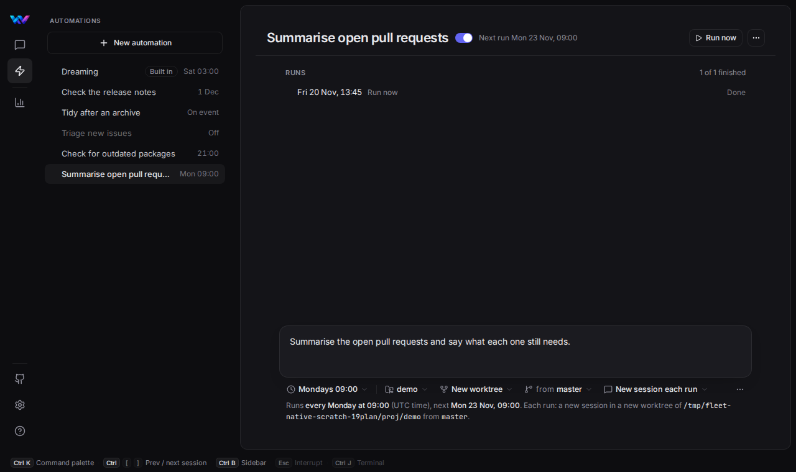
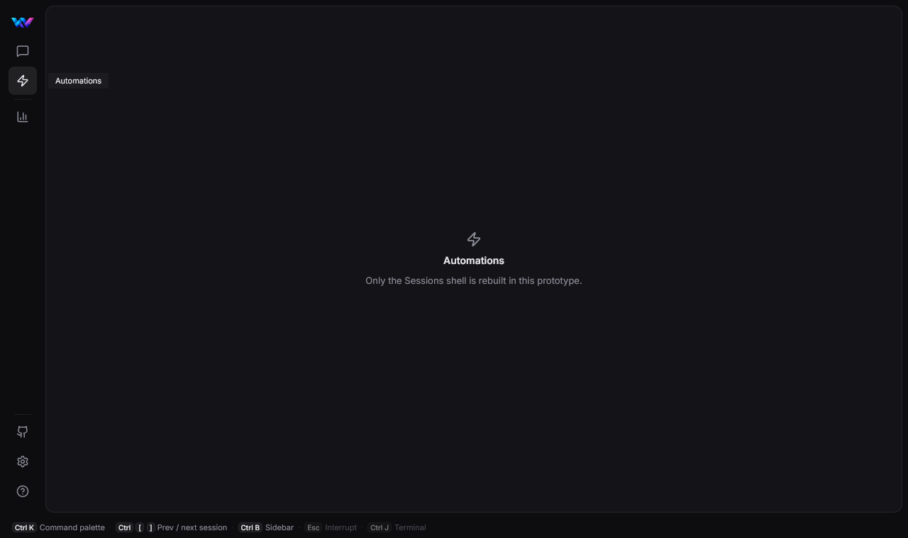
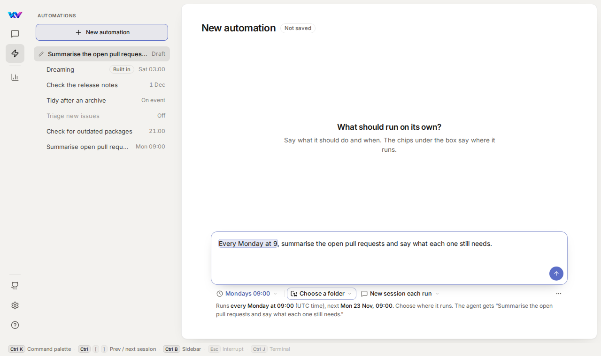
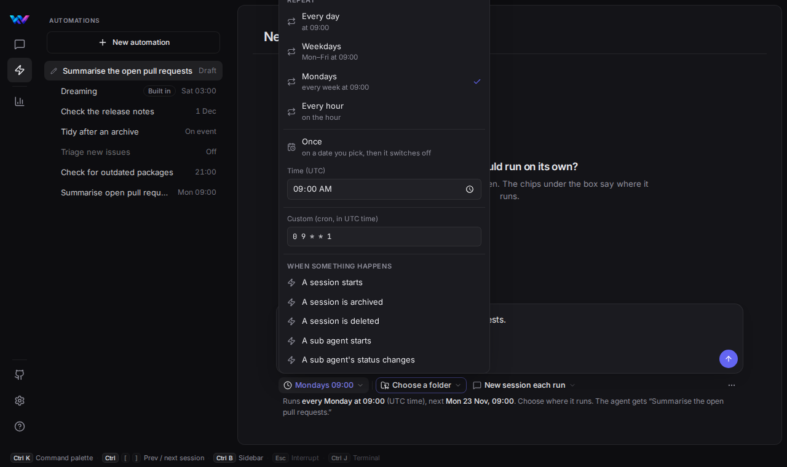
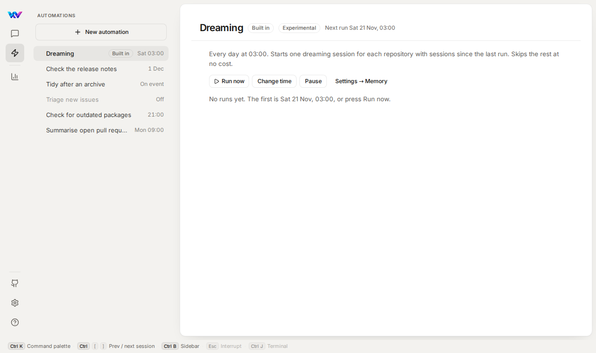
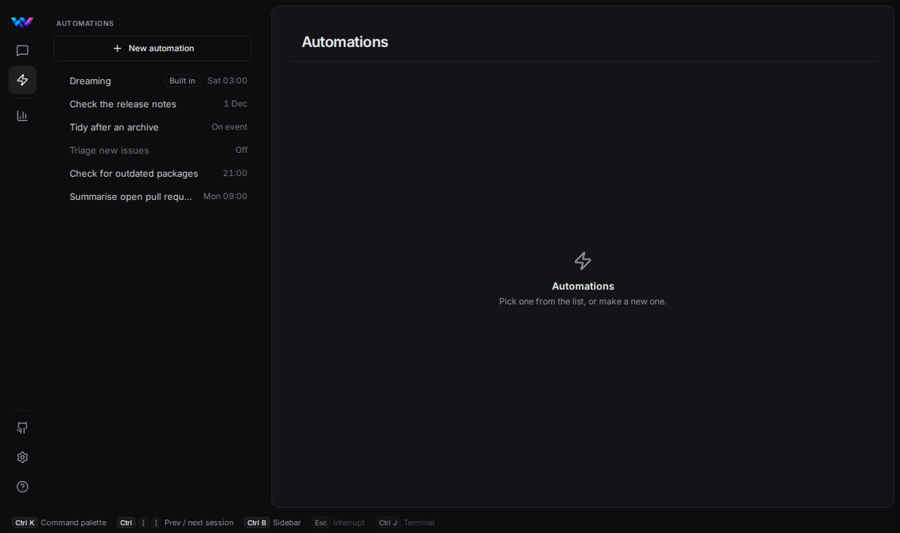

# Component 19: Automations

The parity checklist for component 19 of `docs/PORT.md`, Automations: the list and an automation's detail with its
runs, the built-in Dreaming automation, and the composer that makes and changes one (what it does, when, where, on which
agent and model, on which machine, as a session or a workflow). It ends with the pieces it is built in.

- **weave-fleet commit read:** `c1a48bd` (`main`, 20 November 2026).
- **Server the live checks run against:** the scratch Fleet's package, which reports **v0.74.0** (`fdc072e`; the folder is
  still named v0.72.0). `git diff fdc072e c1a48bd` is empty for every file this component reads (`components/automations`,
  `lib/automations.ts`, `lib/automation-schedule.ts`, `stores/automations.ts`, `composables/use-automations*`,
  `pages/AutomationsPage.vue`, `components/sessions/new-session`, `ComposerFrame.vue` and the server's
  `AutomationEndpoints.cs`), so the client that server serves is `main`'s for this component. Every route below answered
  the way `main`'s client expects (checked live: list, create, disable, run, runs, draft from a session, event catalog,
  the refusals' `{"error": …}` bodies, the nightly dreaming route that makes the built-in automation).
- **Native app read:** `main` at `2c756a7`.
- **Paths** are weave-fleet's under `client/src/` unless they start with `src/`, `docs/` or `server:`. Short names, all
  under `components/automations/` unless given: ANP `AutomationsNavPanel.vue`, ADP `AutomationDetailPanel.vue`, AC
  `AutomationComposer.vue`, AWP `AutomationWhenPicker.vue`, ARL `AutomationRunsList.vue`, BAD
  `BuiltinAutomationDetail.vue`, AMO `AutomationMoreOptions.vue`, ARIP `AutomationRunsInPicker.vue`, ATP
  `AutomationTargetPicker.vue`, AWFP `AutomationWorkflowPicker.vue`, AMS `AutomationMachineScope.vue`, AP
  `components/pages/AutomationsPage.vue`, CR `components/layout/core-rails.ts`, LA `lib/automations.ts`, LAS
  `lib/automation-schedule.ts`, SA `stores/automations.ts`, UA `composables/use-automations.ts`, UAM
  `composables/use-automations-machine.ts`, UAN `composables/use-automations-nav.ts`, SI `components/sessions/SessionItem.vue`,
  WDP `components/workflows/WorkflowDetailPanel.vue`, WSB `components/workflows/WorkflowStartedBy.vue`, DN
  `components/settings/memory/DreamNightly.vue`, NSD `components/sessions/new-session/`, server
  `src/WeaveFleet.Api/Endpoints/AutomationEndpoints.cs`.
- **Row numbers:** 1.x the rail, the page and its state; 2.x the list; 3.x the detail with nothing open; 4.x an
  automation's header and actions; 5.x its runs; 6.x the built-in Dreaming automation; 7.x the composer (box, plan line,
  create and save); 8.x the When chip; 9.x where it runs (folder, workspace, base, runs in, the … chip); 10.x agent, model
  and harness; 11.x another machine; 12.x a workflow target; 13.x ways in from elsewhere; 14.x the schedule logic; 15.x
  the data, the store and the routes; 16.x out of reach.

The gap, visible in the pictures (each one's other theme is in the same folder): Fleet's rail opens
`[automations-list][automations-detail]`: the list (Dreaming first with its Built in pill, then each automation with when
it runs next, On event, Off dimmed, Running or Failed), and an automation's page: its name, an on/off switch and when it
runs next, Run now and Delete, its runs (when, what started it, Done/Failed/Needs you, Open session →), and under them
the same composer that made it, where the schedule is read out of the sentence ("Every Monday at 9" highlighted), the
chips say when, where and how each run starts, and a line in words says what Enter will make. The native app has the rail
entry and a notice: "Only the Sessions shell is rebuilt in this prototype." Fleet's pictures were taken with Playwright at
1280×760 in the UTC zone against a scratch Fleet with the scripted model and five invented automations made through the
API (one switched off, one run started with Run now, nightly dreaming switched on for the built-in); the native ones
live against the same server at the same size, `TZ=UTC`, the light one with the theme toggled by the script
(Cmd+Shift+L) in a scratch data folder.

## What "done" means

1. The Automations rail opens `[automations-list][automations-detail]` as in Fleet, for the machine its switch shows; the
   list loads, says when it's loading or failed, and shows each automation's state in a word.
2. An automation's page switches it on and off, runs it now, deletes it (with the confirm), and lists its runs, which
   follow a running run (every 3 s while one runs, 20 s otherwise) and open the session (or the workflow run's waiting
   session) a run started, on the machine it went to.
3. The built-in Dreaming automation has its compact page: Run now, Change time, Pause/Resume, Settings → Memory.
4. The composer makes and changes an automation the way Fleet does: the schedule read from the sentence (no model), the
   When menu, the folder, worktree and base, new or same session, the name and skipping, agent and model on their harness,
   another machine, a workflow with its optional steps; the plan line says what Enter will make; Save shows only once
   something changed; the server's refusals are shown.
5. Repeat on a schedule… (session row menu, Workflows Library), Started by (a workflow run) and Settings → Memory's
   "Runs as the built-in automation Dreaming" open the right automation or draft.
6. Fleet's tests for it pass here under the same names (list below).

## What the native app already has

| Part | State | Where |
|---|---|---|
| The rail entry (Zap, "Automations", top, order 30), the route `/automations` picking it, the tooltip, the problem report's "Automations" screen | Done (component 9, piece A) | `src/fleet/rails.rs`, `src/view/rail.rs`, `src/fleet/report_form.rs` |
| The rail opens a notice ("Only the Sessions shell is rebuilt in this prototype.") | Replaced (D) | `src/view.rs` `notice` |
| A rail view with its own list and detail, the session list's width and gutter (`Rail::Workflows` does it) | Done for Workflows (18 B); the pattern to follow | `src/view.rs` `root`, `src/view/workflows/mod.rs` |
| The machine choice a view with its own switch holds (`MachineChoice`: `enabled`, `key`, `is_other`, `pick`, `reset`), and the switch chip and menu | Done (component 17, piece N); Automations has no `MachineChoice` yet | `src/fleet/machine_choice.rs`, `src/view/machine_switch.rs` |
| Per-machine requests (`machine_routes`, the token per machine) | Done (component 17) | `src/fleet/machine_routes.rs`, `src/fleet/http.rs` |
| The session row menu's **Repeat on a schedule…** (Repeat, hint, id `session-repeat-on-schedule`, left out for another machine's row) | Done (O) | `src/fleet/row_menu.rs` |
| Settings → Memory's "Runs as the built-in automation Dreaming" (`dream-automation`, only on the live machine) and "Paused in Automations" | Done (component 16, piece S); G makes the link select the automation | `src/fleet/settings/dream_nightly_actions.rs` `open_dream_automation`, `src/view/settings/dream_nightly.rs` |
| The machine's IANA zone (`local_time_zone`: `TZ` or the `/etc/localtime` link; none on Windows) | Done (16 S) for the nightly time; reuse | `src/fleet/settings/dream_nightly.rs` |
| The local offset (`local_offset_secs`, now only; 0 on Windows) and civil dates (`civil`) | Done; the schedule needs the offset **at a given instant** (DST) | `src/conv/time.rs` |
| `regex` (no look-around: Fleet's `(?![\w'])` becomes a check of the next character) | In `Cargo.toml` | |
| A session started by an automation: the header's origin chip, the Context tab's "Started from" row, the panel opening Context for it | Done (components 8, 10) | `src/fleet/context_chips.rs`, `src/fleet/context_tab.rs` |
| Workflows: the runs store (a run's `waiting.sessionId`, its sessions, `startedBy`), the Library per folder and machine, the off preference | Done (18 A, B); Started by and Repeat on a schedule… in the Library are 18's C, D and I, the click into Automations is this component's | `src/fleet/workflows/` |
| The New session strip's chips and menus: folder (`FolderPicker`), workspace, base, machine, harness; `ui::chip::Chip` and `pop` | Done (component 7), but each reads `s.new_draft` directly; 18 D (the Run box) reuses folder, base and harness on its own state. Whichever of 18 D and this component comes first makes them take a host | `src/view/folder_menu.rs`, `src/view/workspace_picker.rs`, `src/view/base_picker.rs`, `src/view/machine_picker.rs`, `src/view/harness_picker.rs`, `src/ui/chip.rs` |
| The composer frame (`ComposerFrame.vue`), the agent and model chips and their `SelectorDropdown`, the harness catalog per folder, `describeDefaults`, the model key ↔ `provider/model` path | Done (components 5, 7) | `src/view/new_session_box.rs`, `src/view/selector.rs`, `src/fleet/catalog.rs`, `src/fleet/new_session/` |
| A text field's highlighted byte range (`text_highlights`) for the schedule words (Fleet's mirror `<mark>`) | Rune has it (`docs/RUNE.md`); no ring, fixed radius | |
| `PageHeader` with `bar`; switch; confirm dialog (`confirmAction`); `ErrorNote` with Try again; compact `EmptyState`; spinner; status glyphs; toasts; menus | Done; `PageHeader` is private to Settings and Workflows today, and only the compact `EmptyState` exists (D adds the full one with icon, description and action) | `src/view/settings.rs` `page_header`, `src/view/workflows/mod.rs`, `src/ui/controls.rs` `switch`, `src/ui/confirm.rs`, `src/ui/empty_state.rs`, `src/view/parts.rs` `status_glyph` |
| Icons `ZAP`, `PLUS`, `PENCIL`, `PLAY`, `ELLIPSIS`, `TRASH_2`, `CIRCLE_ALERT`, `REPEAT`, `MESSAGE_SQUARE`, `MESSAGE_SQUARE_TEXT`, `CHECK`, `CHEVRON_DOWN`, `ARROW_UP`, `GIT_BRANCH`, `WORKFLOW`, `TRIANGLE_ALERT` | Generated | `src/icons.rs` |
| `Clock`, `CalendarClock` | Done (J): `CALENDAR_CLOCK` was generated already; `CLOCK` added to the README's list (generated on a machine with no Python by a line-for-line Node port of `tools/gen-icons.py`, whose output for the old list was byte-identical to `src/icons.rs`) | `src/icons.rs` |

## The checklist

### 1. The rail, the page and its state

| # | Fleet | Source | Native |
|---|---|---|---|
| 1.1 | Rail entry "Automations" (Zap), top, order 30, panel `AutomationsContextPanel`; route `/automations` | CR 79, `routes/automations.tsx` | Done (9 A) |
| 1.2 | Context `[automations-list][automations-detail]`: the list at the session list's width with its gutter; the list is rebuilt (keyed) when the view's machine changes | CR `AutomationsContextPanel`, AP | Done (D, 20 November 2026) |
| 1.3 | The page opens on the machine you're on (`resetAutomationsMachine` on every visit); the list's machine switch picks whose list, runs and changes these are (`MachineScope` keyed by it) | AP, UAM, `composables/use-machine-choice.ts` | Done (D, 20 November 2026): `automations_nav.choice` (a `MachineChoice`), reset by `enter_automations` whenever the rail is entered from another; the list and its switch follow it |
| 1.4 | Nav state, kept across leaving the page: `activeAutomationId`, `viewMode` (`list` / `create` / `edit`), the new automation's `draft` (survives leaving; the draft row shows it), `seedSessionId` | UAN | **Done (D, H, O)**: `activeAutomationId`, `viewMode` and the draft (name, text) are on `State` and survive leaving the page (`fleet::automations::nav::Nav`). The draft's full shape (`ComposerState`) and the edit state are `Nav::draft` and `Nav::edit` (H). `seedSessionId` is `Nav::seed_session` (O, 22 November 2026) |
| 1.5 | `setActiveAutomation(id)` → edit; `startCreate()` → create with no active id; `clearSelection()` → list; `resetDraft()` | UAN | Done (D, 20 November 2026) |
| 1.6 | `startCreateFromSession(id)`: a fresh draft, the seed set, create mode | UAN | Done (O, 22 November 2026): `Nav::start_create_from_session` (the draft fresh, the seed set, create mode); a seed made later by the workflow way in drops it |
| 1.7 | `startCreateFromWorkflow(seed)`: a fresh draft with the Run box's request as the text, the folder as a chosen repository, a new worktree, the base, target `workflow`, the workflow and its optional steps, the harness; create mode | UAN | Done (N, 21 November 2026): `Nav::start_create_from_workflow` with `ComposerState::from_workflow` (`fleet::automations::workflow`), the box holding the request |
| 1.8 | Opening another automation or changing mode clears the form error, the notice, the runs and the unsaved changes (the edit state is the automation as saved), and loads its runs | ADP `watch([activeAutomationId, viewMode])` | **Done (E, F, I, 21 November 2026)**: the notice goes when another automation opens or the mode changes (`Nav::moved`; the same one opened again keeps it); the runs and their load are F's; the form error goes too, and the edit state is made again from the automation as saved (I: `Nav::edit_for` cleared, `keep_automation_composer` calls `reset_edit_state`) |
| 1.9 | The list can arrive after the page opened: the edit state is set from it when the open automation first appears | ADP | **Done (E, 20 November 2026)** for what E draws: the page reads the automation from the list each frame, so the header and note show when it first appears (test). The edit state is `Nav::edit` with `ComposerState::state_for` (H), set when the automation first appears in the list (I, 21 November 2026; test) |
| 1.10 | A narrow window (< 716 px): the header's meta line hides; < 560 px: the body's side padding is 10 | ADP, BAD media queries | n/a (P, 22 November 2026): both are Fleet's narrow-screen rules (the header clears the menu button that replaces the sidebar there), and this window can't be narrower than 720 px (`min_size` in `src/lib.rs`), so neither width is ever reached |

### 2. The list (`[automations-list]`)

| # | Fleet | Source | Native |
|---|---|---|---|
| 2.1 | Header "AUTOMATIONS": 10 px (0.71429rem) 600 uppercase, letter-spacing .05em, muted, padding 14/16/10; the row padding-top 4 | ANP `.panel-header` | Done (D, 20 November 2026) |
| 2.2 | The machine switch under it (`MachineSwitch`, label "Automations", testid `automations`), padding 0 12 6, only when another machine is listed | ANP | Done (D, 20 November 2026): `machine_switch::chip` |
| 2.3 | **New automation** (Plus 16): full width, min-height 36, padding 0 12, gap 8, 1 px border, radius btn, `--bg` fill, 12 px (0.857rem) 500; hover accent border and an 8 % accent wash; in a 0 12 12 box; starts create | ANP `.new-automation-btn` | Done (D, 20 November 2026): the accent wash on hover; gap: no hover border (`docs/RUNE.md`) |
| 2.4 | The list shows while creating, or once loaded with at least one automation: column, gap 1, padding 0 8 12, scrolls | ANP `.automations-nav` | Done (D, 20 November 2026) |
| 2.5 | The draft row while creating (first, active, `aria-current=page`): Pencil 11 muted, the title, "Draft". Title: the name typed, else `autoName(promptFrom(text, hit))` (the hit ignored once the When menu chose), else "New automation" | ANP `draftTitle` | Done (D, H; checked in P, 22 November 2026): the draft row, its title the name typed, else `auto_name` of the prompt with the schedule words left out (ignored once the When menu chose), else "New automation" (`ComposerState::title`; tests in `fleet::tests::automation_composer` and `tests_automations_strip`) |
| 2.6 | A row: min-height 32, gap 9, padding 0 10, radius btn; text 86 % mix; hover 5 % text wash and full text; active (open and in edit mode) 9 % wash, full text, 500; focus ring 2 px accent inset | ANP `.automation-row` | Done (D): height, gap, padding, the 5 % hover wash and the 9 % open wash, the focus ring. Gap: the title stays at 86 % on hover (Rune has no group colour on a plain text here) |
| 2.7 | Off rows (not active) fade to 45 % text | ANP `.automation-row--off` | Done (D, 20 November 2026) |
| 2.8 | The glyph slot (8×8): the working glyph ("Running") or the error glyph ("Its last run failed") from the row status, else empty | ANP | Done (D, 20 November 2026): `parts::status_glyph` |
| 2.9 | Title 13 px (0.929rem) line-height 1.3, ellipsis | ANP | Done (D, 20 November 2026) |
| 2.10 | **Built in** pill (built-ins only): 1 px border, full radius, padding 0 7, 11 px 500 muted (testid `automation-row-builtin`) | ANP | Done (D, 20 November 2026) |
| 2.11 | The machine its runs go to (another machine only): max 7em, coral text, mono 11.5 px, ellipsis (testid `automation-row-machine`); its name now in the machine list, else the last run's `machineName`, else "another machine"; when the view shows another machine, the last run's name or "another machine" | ANP `machineOf` | Done (M, 21 November 2026): `nav::machine_of`, coral mono 11.5 at most 7em; tested by `shows_the_machine_in_the_list_…` |
| 2.12 | The status word (12 px, tabular figures, `--muted` 80 %; working `--running-text`, error `--error-text`) from `automationRowStatus` (14.12): "Running", "Needs you", "Off", "Failed", the next run short (`nextShort`), "On event", or nothing | ANP, LA | Done (D, 20 November 2026): the words come from B's `automation_row_status`; "Needs you" is drawn muted (Fleet gives it no colour class) |
| 2.13 | Order: built-ins first, the rest as the server sent them (stable sort) | ANP `rows` | Done (D, 20 November 2026) |
| 2.14 | The times follow the clock (`useRelativeTime`, a 30 s tick) | ANP | Done (D, 20 November 2026): the app's clock tick |
| 2.15 | A click opens the automation (`setActiveAutomation`) | ANP | Done (D, 20 November 2026) |
| 2.16 | Loading (first load, nothing to show): a large centred spinner, "Loading automations…" for readers | ANP | Done (D, 20 November 2026) |
| 2.17 | A failed load (or retrying): `ErrorNote` "Couldn't load automations." with the server's reason and Try again (spinner while retrying), margin 12, testid `automations-load-error` | ANP | Done (D, 20 November 2026) |
| 2.18 | Empty: compact `EmptyState` "No automations yet", filling the panel | ANP | Done (D, 20 November 2026) |

### 3. The detail with nothing open (list mode)

| # | Fleet | Source | Native |
|---|---|---|---|
| 3.1 | `PageHeader` "Automations" (`bar`) | ADP | Done (D, 20 November 2026) |
| 3.2 | The body: padding 18/24/8, column, scrolls | ADP `.automation-page__body` | Done (D, 20 November 2026) |
| 3.3 | First load with nothing loaded: a large spinner, centred (testid `automation-loading`) | ADP `firstLoad` | Done (D, 20 November 2026) |
| 3.4 | Nothing loaded and the load failed (or retrying): `ErrorNote` "Couldn't load automations." with the reason (or "Trying again…"), Try again, max-width 28rem, centred (testid `automation-load-error`) | ADP `loadFailed` | Done (D, 20 November 2026) |
| 3.5 | Else `EmptyState` (Zap), centred: none yet "No automations yet" / "An automation runs a prompt or a workflow on a schedule, or when something happens in Fleet." with a **New automation** button (sm, Plus; testid `automation-empty-create`); with some "Automations" / "Pick one from the list, or make a new one." and no button | ADP | Done (D, 20 November 2026): the full `EmptyState` (icon, title, description, action) added to `ui::empty_state` |

### 4. An automation's header and actions

| # | Fleet | Source | Native |
|---|---|---|---|
| 4.1 | `PageHeader` (`bar`) with the automation's name | ADP | Done (E, 20 November 2026): `ui::page_header::bar_with` (the title row holds the heading, then the meta, 10 px apart) |
| 4.2 | The switch in the meta (`automation-enabled`, aria-label On/Off), disabled while switching; its off track 22 % text so "off" shows | ADP `.automation-page__switch` | Done (E): `ui::controls::switch_with`; disabled (half opaque) while switching |
| 4.3 | The meta line (12 px muted, ellipsis; testid `automation-header-meta`): off "Off. It won't run until you switch it on." or, for a one-off that ran, "Off. Its one run was <date>."; an event "Runs when <event, lower case>"; else "Next run <Mon 23 Nov, 09:00>" or nothing | ADP `headerMeta` | Done (E, 20 November 2026): `fleet::automations::actions::header_meta`; the under-716 px hiding is 1.10, still open |
| 4.4 | **Run now** (outline sm, Play 14; testid `automation-run-now`) | ADP | Done (E, 20 November 2026) |
| 4.5 | Run now: the run goes to the top of the runs at once; skipped → an error notice with its reason (or "The run was skipped."); else the info notice "Started a run. It shows below and in Sessions."; then the runs reload; a refusal → the error notice (fallback "Couldn't start a run.") | ADP `handleRunNow` | **Done (E, F, 20 November 2026)**: the call, the skipped / started / refused notes and the list reload (E); the run at the top of the runs at once (a skipped one too, as Fleet adds whatever comes back) and the runs read again on the next tick, an answer already on its way dropped (F, `Runs::add_first`); with no server a starting run stands for it |
| 4.6 | The ⋯ button (outline icon-sm, Ellipsis; `automation-more-menu`, aria-label "More") opens a menu aligned to its end, 6 px off, with **Delete** (Trash2, error colour; `automation-delete`) | ADP | Done (E, 20 November 2026): `Open::Menu("automation-more")`; the menu is as wide as its row needs (`menu::fit_width`), Fleet's `ns-pop` width not read |
| 4.7 | Delete asks first: "Delete this automation?", the name as subject, "It stops running. The sessions its runs started stay in Sessions.", **Delete automation** (destructive); confirmed → deleted, back to list mode; a refusal → the error notice (fallback "Couldn't delete the automation.") | ADP `confirmDelete` | Done (E, 20 November 2026): `ui::confirm` with `Call::DeleteAutomation`; the dialog closes at once on Delete (as `confirmAction` with no `run`) and a refusal is the page's error note, not the dialog's |
| 4.8 | The switch: on → `enable`, off → `disable`, then the list reloads (the row dims too); a refusal → "Couldn't switch it on." / "Couldn't switch it off." (or the server's words) | ADP `handleToggleEnabled` | Done (E, 20 November 2026): a refusal always has words here (the server's `error` or `HTTP <status>`), so the fallbacks are in the code but not reachable |
| 4.9 | The notice (testid `automation-action-message`): max-width 760, centred, gap 8, margin-bottom 12, 1 px border, radius card, padding 9/12, 12.5 px line-height 1.5; info muted, gone after 4 s; error in the error colours with CircleAlert, stays | ADP `showNotice`, `.automation-page__notice` | Done (E, 20 November 2026); a note is kept only if the automation it was about is still open when the answer arrives (Fleet shows it whatever is open by then). The note's words carry the key `automation-action-message-text` |
| 4.10 | A workflow automation while Workflows are off: a warning notice (waiting colours, CircleAlert): "This automation runs a workflow, and Workflows are turned off in Settings. Its runs are skipped until they're back on." and the underlined link **Open Settings → Labs** (Settings on Labs) (testid `automation-workflows-off`) | ADP `workflowsOffWarning` | Done (N, 21 November 2026): `view::automations::detail::workflows_off`, one rich text whose underlined link opens Settings on Labs; over the runs, under the action note |
| 4.11 | The form error over the composer (testid `automation-form-error`): error colours, CircleAlert, width 100 % − 48, margin-bottom 8: the server's reason for a refused create or save ("Couldn't create the automation." / "Couldn't save the automation.") or "Couldn't read that session." | ADP | **Done (I, 21 November 2026)** for create and save (`view::automations::detail::form_error`, keyed `automation-form-error`; it goes when another automation opens or the mode changes). "Couldn't read that session." is O's |

### 5. Its runs

| # | Fleet | Source | Native |
|---|---|---|---|
| 5.1 | Loaded on opening (not for a built-in, which loads its own), then polled: every 3 s while a run is starting or running, else every 20 s, each poll also reloading the list; a failed load keeps what was there; a load for an automation no longer open is dropped; the timer stops when the page closes | ADP `loadRuns` | Done (F, 20 November 2026): `fleet::automations::runs` (`keep_automation_runs` from `keep_automations`, each frame): read when an automation opens (a built-in's are not read here), then every 3 s while a run is starting or running, else 20 s; every poll after the first reads the list again; a failed read keeps the list; the answer carries the generation it was asked in and is dropped if another automation was opened since; the page closing ends it. The state is in `runs.rs`, not `nav.rs` |
| 5.2 | No runs once loaded: `EmptyState` (bordered) "No runs yet" with `firstRunHint`: off "Switch it on, or press Run now."; a next run "The first run is <date>, or press Run now."; an event "It runs when its event happens, or press Run now."; else the next run from the trigger, or "Press Run now to try it." (testid `automation-no-runs`) | ADP `firstRunHint` | Done (F): `view::automations::runs::section`, a dashed bordered card (21 px padding, no icon), the hint from `State::first_run_hint` |
| 5.3 | The list (max-width 760, centred): label "RUNS" (11 px 600 .05em uppercase muted, padding 0 10 6) with "<done> of <all> finished" (12 px, normal case) at the right | ARL | Done (F) |
| 5.4 | A run: grid 10 px · 1fr · auto, gap 9, min-height 34, padding 5/10, radius btn; a button (pointer, 5 % hover wash, focus ring) when it has a session, else plain | ARL `.automation-run` | Done (F): the row is a button only with a session (pointer, 5 % wash, focus ring); the 1fr column is a row whose middle grows |
| 5.5 | Its glyph: working while starting or running, waiting ("Needs you") while waiting, error when failed, else none | ARL | Done (F) |
| 5.6 | Its time (13 px tabular): `describeDate(scheduledFor ?? startedAt)`; then, 12 px muted, the trigger in words (14.13; nothing for the schedule) and "on <machine>" in coral mono 11.5 (testid `automation-run-machine`) | ARL | Done (F): the time is tabular (`'tnum'`); the machine is shown from `machineName`; M (21 November 2026) makes runs go to another machine, tested by `shows_the_machine_in_the_list_…` |
| 5.7 | At its end: "Open run →" (a workflow run) or "Open session →" (12 px muted), shown on hover or focus only; the state word (12 px, 85 % muted; working running colour, error error colour, warn `--status-waiting-text`) from `describeRunState` (14.14) | ARL | Done (F): the way in shows on hover through the row's hover group; **open: on keyboard focus** (Rune's group opacity follows the pointer only) |
| 5.8 | Its notes under it (12 px muted; testid `automation-run-note`): the summary, then the error unless the summary says it (a failure always adds its error) | ARL `runNotes` | Done (F): each note in its own keyed row, since Rune wants unique sibling keys |
| 5.9 | A click opens the session: a workflow run's waiting session, else its newest step session, else the run's session; on another machine the session is remembered as that machine's so it opens in place; `instanceId` is passed for a plain run | ADP `openRun`, `sessionOf` | **Partly done (F, M, N; P checked)**: a run on another machine has its session remembered as that machine's (`remember_sessions`) and opens there, in place (M, 21 November 2026); a run's own session opens in Sessions (the rail follows the route). A workflow run opens its waiting session, else its newest step's, else the run's own, from this machine's workflow runs (N, 21 November 2026: `workflow::session_of`). **Done in 26 piece P (22 November 2026):** a session that machine's list doesn't hold opens by its id (`State::open_session_by_id`: `GET /api/sessions/{id}` on that machine, the row filed, "Session not found" on a 404), as GitHub's and Workflows' do (`open_run_session`). `instanceId` isn't needed: the native list row carries its instance |

### 6. The built-in Dreaming automation

| # | Fleet | Source | Native |
|---|---|---|---|
| 6.1 | A built-in (`builtin` set) opens a compact page instead: no composer, no delete, no editing | ADP, BAD | Done (G) |
| 6.2 | Header: the name, pills **Built in** (testid `automation-builtin-pill`) and **Experimental** (1 px border, full radius, padding 1/8, 11.5 px 500 muted), the meta: paused "Paused. It won't run until you resume it.", else "Next run <date>" | BAD | Done (G) |
| 6.3 | The description (13.5 px muted, line-height 1.5; testid `builtin-description`): "Every day at HH:MM." (a cron `m h * * *`) or "On the schedule <cron>.", then "Starts one dreaming session for each repository with sessions since the last run. Skips the rest at no cost." | BAD | Done (G) |
| 6.4 | Actions (wrap, gap 6): **Run now**, **Change time** → a time field (28 px, aria-label "Time each night", `builtin-time`) with **Save** (`builtin-time-save`, disabled while busy or empty) and **Cancel**; **Pause**/**Resume** (`builtin-pause`); **Settings → Memory** (ghost; `builtin-settings`) | BAD | Done (G): the time a text box taking `HH:MM` (Rune has no time field); Save is disabled while busy or empty; Enter in the box saves |
| 6.5 | Change time saves `PUT /api/memory/dreaming/nightly {time, timeZone}` (the browser's zone, else UTC) on the view's machine, then reloads the list; Pause/Resume disable/enable; one action at a time; a refusal shows as the error note (fallbacks "Couldn't start a run.", "Couldn't change it.", "Couldn't change the time.") | BAD `act`, `saveTime` | Done (G): the zone is this computer's IANA zone, else UTC; a time that isn't one is the error note "Use the 24-hour form, like 03:30." and nothing is sent (Fleet's browser field can't make one) |
| 6.6 | Settings → Memory opens Settings on Memory | BAD | Done (G) |
| 6.7 | Runs: loaded and polled as 5.1; none yet "No runs yet. The first is <date or tonight>, or press Run now."; else the runs list (rows don't open) | BAD | Done (G): the rows look as on any automation but a click does nothing (Fleet binds no `open` here); **open:** none |
| 6.8 | A night's summary and a skipped night's reason show under its run (5.8) | ARL | Done (G) |

### 7. The composer (box, plan line, create and save)

| # | Fleet | Source | Native |
|---|---|---|---|
| 7.1 | Create mode: `PageHeader` "New automation" with a **Not saved** pill; the body's centred text "What should run on its own?" (17 px 600, −.01em) over "Say what it should do and when. The chips under the box say where it runs." (13.5 px muted, max 460) | ADP | Done (I, 21 November 2026) |
| 7.2 | The composer: padding 4/24/18, its parts max 760 centred; the `ComposerFrame` with the message box and the toolbar | AC | Done (I, 21 November 2026): the frame's look (14 px radius, card fill, border, the shadow, the accent border while it has focus) as `new_session_box`'s, in `view::automations::composer`; the toolbar is its 4/8/8 padding alone when there's no Save to show, as in Fleet |
| 7.3 | The box: 2 rows, min-height 70, grows to 190 then scrolls; placeholder "What should it do, and when? e.g. “Every Monday at 9, summarise the open PRs”"; read-only while saving; aria-label "What the automation does, and when"; focused on opening a new one | AC | Done (I, 21 November 2026): `auto_grow(field, 2, 8)` with `min_h(70)` (8 lines of 21 px and the padding is 188 px); disabled rather than read-only while saving (Rune's field); New automation focuses it (`tx.focus`) |
| 7.4 | The schedule words in the box are highlighted (16 % accent fill, 1 px 45 % accent ring, radius 4; testid `automation-schedule-highlight`), only while the words decide (not once the When menu chose) | AC mirror | Done (I, 21 November 2026): `text_highlights` at 16 % accent with 1 px pad; gap: no ring, Rune's radius (16.2) |
| 7.5 | Enter creates or saves; Shift+Enter is a new line; nothing while composing (IME) | AC `handleKeydown` | Done (I, 21 November 2026): the field's `on_submit`; Rune's field keeps Shift+Enter and the IME preedit to itself (test) |
| 7.6 | Send: create mode the round arrow (ArrowUp, "Create automation (Enter)"); edit mode a **Save** text button (padding 0 14, 12.5 px 500, "Save changes (Enter)"), shown only once something changed; a spinner while saving; disabled unless `canSubmit` (not busy, a request, dirty) (testid `automation-submit`) | AC `showSend`, `canSubmit` | Done (I, 21 November 2026): a Tab stop only while it can be pressed |
| 7.7 | Submit with no folder chosen opens the folder menu instead of creating | AC `submit` | Done (I, K; 21 November 2026): nothing is sent and the folder menu opens (Fleet's test, in `tests_automations_strip`) |
| 7.8 | The plan line (`automation-plan`, 12 px muted, line-height 1.55, padding 4 11 0, min-height 22): `describeAutomationPlan` (14.15): bold parts in text colour 500, warnings in `--status-waiting-text`, code parts in mono 11.5 text colour; another machine is named first ("On <name>:", coral mono 11.5) | AC | Done (I, M; 21 November 2026): one `rich` text with spans for the strong, warn and code parts; "On <name>:" in coral mono 11.5 first while the runs go to a machine other than this one (`automation_plan_machine`) |
| 7.9 | The ask in the plan: "Every Friday, or just once?" (warn) with **Just once**; after it, **Every Friday instead**; underlined link buttons (testid `automation-plan-ask`) that set or clear `forceOnce` | AC, LA | Done (I, 21 November 2026): the answer is a `Link` in the rich text (id `automation-plan-ask`), underlined at 55 % muted |
| 7.10 | A new schedule phrase clears the "Just once" answer | AC watch | Done (H): `ComposerState::set_text` compares the phrase before and after |
| 7.11 | Create: `POST`, the draft reset, the new automation opened, then the info notice "Created and on. First run <date>." (or "Created and on."); a refusal keeps the text and shows the form error | ADP `handleCreate` | Done (I, 21 November 2026); with no server the invented list takes it |
| 7.12 | Save: `PUT`, the edit state reset from the saved automation, "Saved."; a refusal shows the form error | ADP `handleSave` | Done (I, 21 November 2026): the list is read again before the answer, so the edit state is made from what was saved |
| 7.13 | Editing opens the composer with the automation as saved (`stateFor`): the prompt as the text, its trigger as the When menu's choice (a cron it has no words for as Custom), its folder (a repository when it runs in a worktree or the repository list knows it), worktree or as it is, base, target, workflow and steps, name, skip (`maxConcurrentRuns > 0`), agent, model (as a model key), harness, machine | ADP `stateFor` | Done (H): `ComposerState::state_for` (drawn in I) |
| 7.14 | A folder read before the repository list arrived becomes a repository once the list has it (both the draft and the edit state) | ADP watch | Done (H): `Nav::repositories_changed`; the call when the list arrives is I's/K's |
| 7.15 | The request (a session target): name typed, else the saved name, else `autoName`; the prompt (`promptFrom`); the trigger (`toTrigger`); `maxConcurrentRuns` skip ? max(1, saved) : 0; per-hour and timeout kept (10 and 30 for a new one); the folder (none for "no folder"); model as `provider/model`, agent, harness only with an agent or model; target type; tags kept; the zone; isolation `worktree`/`existing` (null for an older folderless one with still no folder); base only for a worktree; the machine | AC `request` | Done (H): `ComposerState::request` |
| 7.16 | No request (so no Send) without a schedule or a prompt | AC | Done (H) |
| 7.17 | Dirty: any of name, prompt, trigger, folder, isolation (an older one with a folder counts as `existing`), base, target, agent, model, harness, workflow, steps (as a set), the concurrency limit, the machine differs | AC `isDirty` | Done (H): `is_dirty`, `can_submit`, `show_send` |
| 7.18 | The zone: the browser's IANA zone, else UTC; an existing schedule saved in another zone says "Saving moves it from <old> time to <new>." (warn) | LA `browserTimeZone`, `describeAutomationPlan` | Done (H): `composer_time_zone` (`local_time_zone`, else UTC); the warning is B's plan line; with none known (Windows today) everything is computed and saved in UTC, which is correct, only less friendly (16.4) |

### 8. The When chip and menu

| # | Fleet | Source | Native |
|---|---|---|---|
| 8.1 | The chip (`automation-when-chip`): Clock (Zap for an event), `whenChip` ("Mondays 09:00", "Once · Mon 21 Sep", "When?"), chevron; the attention look with no schedule; the label in `--accent-text` while it came from the message | AWP | Done (J, 21 November 2026): Clock (Zap for an event), the label, the chevron; the attention look; the label in `--accent-text` from the message; disabled while saving |
| 8.2 | The menu above the chip, start-aligned, 6 px off, 300 wide, max height min(560, 70 % of the window), scrolls | AWP | Done (J, 21 November 2026): above the chip, start-aligned, 6 px off, 300 wide, at most min(560, 70 % of the window) and scrolling (the intended cap). **Fleet bug:** the scoped `.automation-when` rule doesn't reach the popover (`max-height` computed `none`, checked live at 1280×760), so Fleet's menu is 683 px tall, starts 75 px above the window ("REPEAT" cut off), and is 344 wide (`ns-pop`'s width; the 300 isn't applied either, `fleet-when-*.png`). Reported, not fixed from here |
| 8.3 | From the message: the note "Picked up from your message. Choosing here takes over."; or, when a choice here overrides schedule words in the message, **Use the words in the message** (MessageSquareText; `automation-when-use-message`) | AWP | Done (J, 21 November 2026) |
| 8.4 | "Repeat": **Every day** "at HH:MM", **Weekdays** "Mon–Fri at HH:MM", **<Day>s** "every week at HH:MM" (the schedule's own day, else today), **Every hour** "on the hour"; Repeat icons; a check on the chosen one; the time kept from the schedule (09:00 by default) | AWP `chooseRepeat` | Done (J, 21 November 2026): `Repeat::make`, the check by `Repeat::is` |
| 8.5 | **Once** "on a date you pick, then it switches off" (CalendarClock; `automation-when-once`): the date it had, else tomorrow, at the time; stays open | AWP `chooseOnce` | Done (J, 21 November 2026): the menu stays open and shows the Date box |
| 8.6 | Fields: "Date" (a once) and "Time (<zone>)" (all but events, hours, minutes and cron) (`automation-when-time`); a change keeps the kind (a weekly stops asking "every week or once?"); a time with no schedule yet makes a weekly one on today | AWP `setTime`, `setDate`, LAS `withTime` | Done (J, 21 November 2026): text boxes taking `YYYY-MM-DD` and `HH:MM` (Rune has no date or time field); a whole value applies as it's typed, as a date or time input's `change` does; half a value changes nothing |
| 8.7 | "Custom (cron, in <zone> time)" (mono, placeholder `0 9 * * 1`; `automation-when-cron`), filled with the schedule's cron on opening: Enter or leaving it changed applies it; not five parts → "A cron has five parts: minute hour day month weekday." (error 11.5 px) | AWP `applyCron` | Done (J, 21 November 2026): Enter applies it; "leaving it" is the poll seeing the box lose the keys (Rune has no blur event) |
| 8.8 | "When something happens": one row per event type (Zap; `automation-when-event-<type>`) in words (14.11), from the server's catalog (`GET /api/automations/event-catalog`), the built-in list until it answers or when it fails | AWP | Done (J, 21 November 2026): the catalog read once per machine, with the repositories, when the composer shows; the built-in list until then and after a failure |
| 8.9 | Choosing sets the schedule (which takes over from the words) and clears "Just once"; closing returns focus to the box | AC `setWhen`, `returnFocusToMessage` | Done (J, 21 November 2026): closing (a row, Escape, a press outside) gives the box the keys through the panel's `focus_return` |

### 9. Where it runs (folder, workspace, base, runs in, the … chip)

| # | Fleet | Source | Native |
|---|---|---|---|
| 9.1 | The strip under the box: wrap, gap 2, padding 6/4/0; separators 1×14 border colour, margin 0 3; the … chip pushed to the end | AC `.automation-composer__strip` | Done (I, K; 21 November 2026): the separator after the When chip (the machine's is M's); the … chip in a growing end-justified box, so it sits at the right end of whichever line it wraps onto (a `spacer()` didn't: `docs/RUNE.md`) |
| 9.2 | Folder chip and menu (`FolderPicker`): repositories, recent folders, browse (not in cloud mode), **No folder** (not for a workflow); the chosen one marks `hasChosenFolder`; "folder added" reloads the repositories | AC, NSD `FolderPicker.vue` | Done (K, 21 November 2026): New session's chip and menu with `new_session::host::Host::Automation` (the rail decides which box the pickers work on); the machine's repositories and recent folders, Open a folder…, No folder unless a workflow, no plain folders and no create or clone (Fleet passes neither); a folder opened from the path view reads the repositories again on the composer's machine. Test |
| 9.3 | A new automation starts in the folder New session would (`initialFolder` from the recent folders), not a plain folder in cloud mode, once the repositories have loaded and none was chosen; editing never changes the folder by itself | AC `applyInitialFolder` | Done (H, K; checked in P): `apply_initial_folder` (the caller passes `initial_folder`, readiness and cloud mode); drawn by K (21 November 2026): the folder chip shows it |
| 9.4 | Another folder clears the base; a new automation in a repository gets a new worktree each run unless changed | AC `setFolder` | Done (H): `set_folder` |
| 9.5 | In a repository: the workspace chip (`WorkspacePicker`: current checkout or a new worktree; no existing worktrees offered) and, for a new worktree, the base chip (`BasePicker` without the branch name and without "Fetch origin first") with the repository's branches, default base and current branch | AC | Done (K, 21 November 2026): New session's chips and menus on the composer's workspace and base; no worktrees offered or waited for; the base menu leaves out Fetch origin first and the branch name, as the Run box's does; the repository's branches read by the composer's upkeep when its folder changes. Tests |
| 9.6 | **Runs in** chip (`automation-runs-in-chip`): "New session each run" (MessageSquare; detail "each run starts fresh") or "Same session each run" (Repeat; "later runs continue the first run's session"); an older target ("The most recent session", "The newest session with its tags", detail "how this automation was set up") stays, checked, until changed | ARIP | Done (K, 21 November 2026): the menu is an `ns-pop` (344) above the chip, start-aligned; picking the older row again changes nothing. Test |
| 9.7 | The … chip (Ellipsis; `automation-more-chip`, "Name, skipping"): a popover, end-aligned, with **Name** (placeholder the auto name or "From the first words"; `automation-name`; Enter closes and, when editing, saves) and **Skip a run while the last one is still going** / "So a slow run never piles up behind itself." (`automation-skip`); for a workflow instead the fact "A firing is skipped while the last run is unfinished" / "So a workflow run waiting on you never has another piled up behind it." (`automation-always-skips`) | AMO | Done (K, 21 November 2026): 300 wide (`.ns-more`); the Name field's `TextEdit` is filled from the composer on opening and writes `name` as typed (the draft row follows); the checkbox drawn in the accent colour (13 px, 3 px radius), the words its label. Tests |

### 10. Agent, model and harness

| # | Fleet | Source | Native |
|---|---|---|---|
| 10.1 | With a folder (not for a workflow) and a harness that offers them: the agent and model chips in the toolbar (`automation-agent`, `automation-model`), "Default" labels and descriptions from `describeDefaults`, no recent models | AC | Done (L, 21 November 2026): New session's chips (`view::composer::selector_chip`, keyed `automation-agent` and `automation-model`, off while saving) and its menu, which on the Automations page lists, picks and anchors for the composer; No folder counts as a folder, as in Fleet; the model menu has no Recent section. Tests |
| 10.2 | The harness: the automation's own, else the default harness; the catalog is that harness's for the run's folder | AC `harnessType`, `useHarnessCatalog` | Done (L): the default is the machine's (`resolveDefaultHarness` over its harness list, read with the repositories, and its preference); the catalog is the composer's own feed (New session's `CatalogFeed`), asked when the folder, harness, target or machine changes, with the folder's path as the directory (a new worktree's repository; none for No folder). Test |
| 10.3 | Sent: `model` as `provider/model`, `agent` or null, `harnessType` only when either is set | AC `request` | Done (H's request, L's chips): the composer's context now carries the default harness. Tests |

### 11. Another machine

| # | Fleet | Source | Native |
|---|---|---|---|
| 11.1 | The **Runs on** machine chip (`MachinePicker`, heading "Runs on") first in the strip, then a separator: only with other machines listed, on the live machine at home, and not when the view shows another machine; the menu says which machines answer (polls while shown); "Add a machine" opens Settings on it | AC `showMachineChip` | Done (M, 21 November 2026): New session's `machine_picker` chip and menu on the composer (`target_key` and `pick_machine` ask `picker_host`), heading "Runs on", off while it saves, closing gives the box the keys; the machines are read every 15 s anyway, so no poll of its own |
| 11.2 | Picking a machine: `machineId` (null for this one), and the folder, workspace, base, agent, model, harness, workflow and steps are cleared; an older target becomes "new session" on another machine | AC `pickMachine` | Done (H, M): `ComposerState::pick_machine` behind the chip; the composer's upkeep then reads the new machine's folders, harnesses and events, and the draft takes that machine's New session folder |
| 11.3 | The composer asks the picked machine for folders, repositories, harnesses, agents, models and workflows (`AutomationMachineScope`); when the view shows another machine, that one, whatever the state says | AMS | Done (M, 21 November 2026): `composer_machine` (the state's machine while this machine's list holds it, else the view's; the view's whatever the state says when it shows another machine) behind the folder, workspace, base, harness and catalog reads, each with that machine's own token; create, save and runs stay on the view's machine. Workflows are N |
| 11.4 | The view shows another machine and the automation runs on one: "Runs on **<name>**" (11 px muted, the name coral 500; testid `automation-runs-on`) in place of the chip | AC, ADP `runsOnName` | Done (M, 21 November 2026): `automation_runs_on_name`, 11 px muted with the name coral 500, then a separator |
| 11.5 | The row's machine (2.11), the run's machine (5.6), opening a run on its machine (5.9), "<machine> didn't answer" (14.14) | ANP, ARL, ADP, LA | Done (B, F, M): the six `AutomationMachine.test.ts` cases pass under their names in `src/tests_automations_machine.rs` |
| 11.6 | Another machine's saved folder is read against that machine's repositories | AC watch | Done (M, 21 November 2026): each composer's plain folder is upgraded against the repositories of the machine its runs go to, and an open automation's state is made against them |

### 12. A workflow target

| # | Fleet | Source | Native |
|---|---|---|---|
| 12.1 | **Runs** chip (`automation-target-chip`, with Workflows on or for a workflow automation): "Runs a session" (MessageSquare; "the agent gets your message") or "Runs a workflow" (Workflow; "a workflow from the Library, with your message as its request"; offered only while Workflows are on, or already chosen) | ATP | Done (N, 21 November 2026): `view::automations::workflow::target_chip` and its menu (an `ns-pop`, 344, above the chip); "Runs" is the chip's muted head in the same text, so its gap is a space rather than Fleet's 5 px |
| 12.2 | Switching kind clears agent, model and harness; to a workflow: a new worktree, a plain folder dropped | AC `setTargetKind` | Done (H, N): `set_target_kind` behind the Runs menu (N, 21 November 2026) |
| 12.3 | A workflow: the static **New worktree** chip (GitBranch; title "Each run gets its own worktree and branch; every step works in it."), the base chip in a repository, the workflow chip, one switch chip per optional step ("<title>: on/off", `automation-workflow-step-<id>`, title its hint), the harness chip when more than one harness runs workflows; the Runs in chip is not shown | AC | Done (N, 21 November 2026): `view::automations::strip::chips` in Fleet's order; the step chips are switches (role `switch`, labelled "<title>: on/off"); the harness chip is New session's `HarnessPicker` on the composer (`harness_current`, `harness_names` ask the host) |
| 12.4 | The workflow chip (`automation-workflow-chip`): the workflow's name, else its id without `builtin:`/`repo:`, else "Pick a workflow"; the menu: a note ("Workflows are turned off in Settings.", "Pick the repository it runs in first.", or the load's error) or "Loading the workflows…", then "Built into Fleet" and "This repo · .weave/workflows" groups; a file with errors is disabled with "The file has errors; fix it in the Library first" (AlertTriangle); a check on the chosen one | AWFP | Done (N, 21 November 2026): `view::automations::workflow::workflow_overlay`; a file with errors is a disabled row and a press on it changes nothing |
| 12.5 | The Library is loaded for the folder on the machine the runs go to (a newer load wins); the first workflow without errors is chosen when none is; another workflow clears the steps | AC `loadLibrary` | Done (N, 21 November 2026): `keep_automation_library` with 18's `workflow_library` on the composer's machine, again whenever the kind, repository, machine, composer or the Workflows switch changes, a generation dropping older answers; with no server the invented Library |
| 12.6 | Harnesses: only those that support workflow steps; shown default: the automation's, else the default if it can, else the first | AC `workflowHarness` | Done (N, 21 November 2026): `automation_workflow_harnesses` (the composer machine's enabled harnesses with `supportsWorkflowSteps`) into the `Context`; a pick sets the composer's `harness_type` |
| 12.7 | The request: target `workflow`, model and agent null, the harness (pinned only when the default can't run workflows), isolation `worktree`, `maxConcurrentRuns` at least 1, steps the workflow still offers (kept as they are until the Library loads) | AC `request` | Done (H): `request` with the Library and the workflow harnesses from the `Context`; `workflow_harness` is 12.6's rule |
| 12.8 | The plan for a workflow (14.15) | LA | Done (B; drawn by I's plan line, 21 November 2026); a workflow target is chosen with the Runs chip (N) |
| 12.9 | The warning while Workflows are off (4.10); the workflow runs are kept loaded while Workflows are on, so a run row opens where it is now | ADP | Done (N, 21 November 2026): the warning is 4.10; entering the page asks this machine's workflow runs while Workflows are on (`workflow_runs_ensure_loaded`, as `workflows_settle` does when the switch or preferences change) |

### 13. Ways in from elsewhere

| # | Fleet | Source | Native |
|---|---|---|---|
| 13.1 | The session row menu's **Repeat on a schedule…** (not for another machine's row): a new automation from that session, Automations opened | SI `handleRepeatOnSchedule` | Done (O, 22 November 2026): `State::repeat_session_on_schedule` behind the row menu item (`src/fleet/row_menu.rs`; the "isn't in the native app yet" toast and `menu_waiting` are gone); Automations opens on the machine you're on |
| 13.2 | The seed: `GET /api/automations/draft-from-session/{id}` → `{prompt, folder, isolation}`: the text, the folder (a repository for a worktree), chosen, a new worktree unless it ran in the folder as it was; focus to the box; a failure is the form error "Couldn't read that session." | ADP watch `seedSessionId` | Done (O, 22 November 2026): `automation_draft_from_session` on a thread, the answer into `ComposerState::from_session_draft` (`folderFor`: a repository when it ran in a worktree or the list knows it), the box given the keys; an answer to an earlier seed dropped by generation; a failure is the form error (the server's words, else "Couldn't read that session."). With no Fleet the invented row's first message is the seed |
| 13.3 | The Workflows Library's **Repeat on a schedule…** (18's 3.3, 5.16): `startCreateFromWorkflow` with the Run box's choices | WDP `repeatOnSchedule` | Done (N, 21 November 2026): `repeat_workflow_on_schedule` (the open workflow, the Run box's repository, `run_box_schedule_draft`), Automations opened on the draft with the box taking the keys |
| 13.4 | **Started by <automation>** on a workflow run (18's 10.3, 4.x): opens that automation in edit mode | WSB | Done (18 C, I drew the link and its click; N, 21 November 2026, asserts the edit mode, `tests_workflow_runs_listed`) |
| 13.5 | Settings → Memory's "Runs as the built-in automation Dreaming" selects the Dreaming automation | DN `openAutomation` | Done (G): selects the automation the nightly row names (`automationId`), then opens the page; the rail follows |
| 13.6 | A session an automation started shows its origin chip and Context row | `SessionContextChips.vue`, `SessionContextCanvas.vue` | Done (components 8, 10) |

### 14. The schedule logic (`lib/automation-schedule.ts`, `lib/automations.ts`)

| # | Fleet | Source | Native |
|---|---|---|---|
| 14.1 | `When`: once (time; a weekday, today/tomorrow, or a fixed date), weekly (days, time, `ambiguous`), hours, minutes, monthly (day 1–28, time), cron, event | LAS | **Done (A, 20 November 2026)** `src/fleet/automations/schedule.rs` |
| 14.2 | `parseSchedule`: the eleven patterns in order, first match wins, case-insensitive, with where the words are (start, end) | LAS `PATTERNS` | **Done (A, 20 November 2026)** `src/fleet/automations/schedule.rs` |
| 14.3 | Times: noon, midnight, `H:MM`, `H am/pm`, "at H"; morning 09:00, afternoon 14:00, evening 18:00, night 21:00; else 09:00; out of range is no time | LAS `parseTime`, `timeFrom` | **Done (A, 20 November 2026)** `src/fleet/automations/schedule.rs` |
| 14.4 | `promptFrom`: the text without the schedule words and without "create an automation that…", tidied (spaces, punctuation, a leading "to/and/then"), first letter upper case; nothing taken out → the text as written (trimmed) | LAS | **Done (A, 20 November 2026)** `src/fleet/automations/schedule.rs` |
| 14.5 | `autoName`: the first sentence's first six words, at most 42 characters (40 + "…") | LAS | **Done (A, 20 November 2026)** `src/fleet/automations/schedule.rs` |
| 14.6 | `withTime` | LAS | **Done (A, 20 November 2026)** `src/fleet/automations/schedule.rs` |
| 14.7 | `nextRun` on the local clock: once (date, rel, weekday), weekly, hours (on the hour, a multiple of n), minutes, monthly; none for cron and events | LAS | **Done (A, 20 November 2026)** `src/fleet/automations/schedule.rs` |
| 14.8 | `cronOf`, `toTrigger` (a once fixed to its date as `YYYY-MM-DDTHH:MM`; an event as `{"eventType": …}`), `fromTrigger` (the composer's cron shapes back to their schedules, any other as cron) | LAS | **Done (A, 20 November 2026)** `src/fleet/automations/schedule.rs` |
| 14.9 | Words: `whenChip`, `whenSentence`, `dayName`, `describeDate` ("Mon 21 Sep, 09:00"), `nextShort` ("09:00" today, "Mon 09:00" within a week, "21 Sep" later), `hm`, `dayDate`, `localDate` | LAS | **Done (A, 20 November 2026)** `src/fleet/automations/schedule.rs` |
| 14.10 | `browserTimeZone`, `scheduleTimeZone` (none → UTC) | LA | **Done (B, 20 November 2026)** `src/fleet/automations/words.rs` (`browser_time_zone`, `schedule_time_zone`) |
| 14.11 | `describeEventType` (five event types in words; an unknown one "<type> (never fires)"), `EVENT_TYPES`, `eventTypeOf` | LA | **Done (B, 20 November 2026)** `src/fleet/automations/words.rs` (`describe_event_type`, `event_types`, `event_type_of`) |
| 14.12 | `automationRowStatus`: Running (working) while the last run starts or runs; Needs you while it waits, even off; Off; Failed (error); the next run short; "On event"; nothing | LA | **Done (B, 20 November 2026)** `src/fleet/automations/words.rs` (`automation_row_status`) |
| 14.13 | `describeRunTrigger`: schedule nothing, catch_up "Caught up", once "Once", manual "Run now", else the event in words | LA | **Done (B, 20 November 2026)** `src/fleet/automations/words.rs` (`describe_run_trigger`) |
| 14.14 | `describeRunState`: Starting, Running (working), Needs you (warn), Ended (quiet), Failed (error), Skipped (warn), "<machine or Its machine> didn't answer" (warn), else Done | LA | **Done (B, 20 November 2026)** `src/fleet/automations/words.rs` (`describe_run_state`) |
| 14.15 | `describeAutomationPlan`: the schedule part (no schedule: the two asks; an event; "Runs **<sentence>** (<zone> time), next **<date>**." or ", then it switches off."; the zone move warning; the "on Friday" ask), and the rest (a workflow: pick it, pick the repository, "Each run: <workflow> in a new worktree of `<path>` from `<base>`, with your message as the request. Check with me is off; the run stops only where the workflow asks you."; a session: "Choose where it runs.", no folder (or the first workspace root for an older one), a new worktree of `<path>` from `<base>`, `<path>` as it is, "Later runs continue the first run's session.", and "The agent gets “…”" (110 characters, 108 + "…") or "Say what it should do." (warn) once there is a schedule hit or the word "automation") | LA | **Done (B, 20 November 2026)** `src/fleet/automations/words.rs` (`describe_automation_plan`, `plan_sentence`) |

### 15. The data, the store and the routes

| # | Fleet | Source | Native |
|---|---|---|---|
| 15.1 | `Automation` and `AutomationRun` read from JSON (every field above, optional ones defaulted), `CreateAutomationRequest` written | SA | **Done (B, 20 November 2026)** `src/fleet/automations/model.rs` (`Automation`, `AutomationRun`, `AutomationDraft`, `AutomationRequest`) |
| 15.2 | One store per machine: the list, `isLoading` true until the first load ends (reloads keep the old list), `error`; every change reloads the list | SA | **Done (C, 20 November 2026)** `src/fleet/automations/store.rs` (`Automations`, `MachineAutomations`; `State::automations_of`): `is_loading` starts true, a failed first load ends it and keeps `error`, a reload keeps the list it replaces; each change reloads the list before its answer is handed back, a refused one touches nothing |
| 15.3 | `refresh` shares a load in flight | SA | **Done (C, 20 November 2026)** `State::automations_refresh(machine, tx, then)`: a call made while a load is in flight adds its `then` to that load; one request is sent (test "shares one request between views that load at the same time") |
| 15.4 | Routes: `GET /api/automations` → `{automations}`; `POST` (the created one); `PUT /{id}`; `DELETE /{id}`; `POST /{id}/enable`, `/disable`; `POST /{id}/run` (the run, still starting); `GET /{id}/runs` → `{runs}` newest first; `GET /draft-from-session/{sessionId}`; `GET /event-catalog` → `[types]` | SA, server | **Done (C, 20 November 2026)** `automation_create`, `_update`, `_delete`, `_enable`, `_disable`, `_run`, `_runs`, `_draft_from_session`, `_event_catalog`, each on a thread through the machine's own link (`link_for_machine`), ids escaped; a machine with no link answers "Couldn't reach that machine." |
| 15.5 | A refusal throws the server's `error` (else `HTTP <status>`) | SA `readError` | **Done (C, 20 November 2026)** `read_error`; a request that never reached the machine says what the connection said |
| 15.6 | The list is loaded when a view that shows it opens (the list, the page, the built-in page) | UA | **Done (D, 20 November 2026)**: `keep_automations` reads the list when the page opens and when its machine changes (`enter_automations` makes each visit read again); with no Fleet to ask it fills the invented list. Polling the runs is F's |
| 15.7 | No live events: Fleet doesn't push automation changes; the page polls (5.1) | server, SA | n/a |

### 16. Out of reach, and why

| # | What | Why |
|---|---|---|
| 16.1 | The hover border on New automation (2.3) | Rune has no hover border (`docs/RUNE.md`); the wash only |
| 16.2 | The highlight's 1 px accent ring and 4 px radius (7.4) | `text_highlights` has no border and a fixed radius (`docs/RUNE.md`) |
| 16.3 | Native date and time fields (6.4, 8.6) | Rune has none; text boxes taking `YYYY-MM-DD` and `HH:MM`, 24-hour, as Settings' nightly time |
| 16.4 | The machine's zone on Windows (7.18) | No IANA name there yet (`local_time_zone`, `local_offset_secs` give none and 0): schedules are shown and saved in UTC, which runs at the right time. Windows 10 1903+ ships ICU (`icu.dll`, `ucal_getTimeZoneIDForWindowsID`); a later piece can read the zone from it without a crate |
| 16.5 | The phone drawer closing on a pick (`use-close-drawer-on-pick`), the phone's Enter rule | Out of scope (`docs/PORT.md`): desktop only |
| 16.6 | Screen-reader names and live regions (`aria-live` on the plan line, roles on notices) | Component 26 |
| 16.7 | The status bar on the Automations page with mods (`StatusBar.mods.test.ts`) | Component 22 |

## Fleet's tests, and where they go

- `lib/__tests__/automation-schedule.test.ts` (A): "parseSchedule" "reads %j" (15 cases), "finds nothing in a sentence
  without a schedule", "says where the schedule words are, so they can be highlighted"; "promptFrom" (4): "leaves out the
  schedule words", "leaves out \"create an automation that…\", which is meant for Fleet", "leaves a prompt with nothing to
  take out as it was written", "keeps line breaks in a longer prompt"; "autoName" "takes the first words of the first
  sentence"; "nextRun" (2): "finds the next matching day and time", "puts a one-off on the next such day, or the date it
  was fixed to"; "triggers" "stores %j as the trigger the server reads, and reads it back" (11 cases), "keeps a cron it has
  no words for as Custom"; "words" (2): "labels the When chip and the line under the box", "shortens a sidebar row's next
  run by how far away it is". Fleet's NOW is Tuesday 15 September 2026, 10:00 local; the port fixes the offset to 0.
- `lib/__tests__/automations.test.ts` (B): "describeAutomationPlan" (6): "says when it runs, where each run happens, and
  what the agent gets", "says a one-off switches itself off", "asks about “on Friday”", "describes the folder as it is, no
  folder, and continuing one session", "asks for the schedule, or for what to do", "warns when saving moves a schedule to
  another time zone"; "automationRowStatus" (2): "shows the next run, Running, Failed or Off", "says Needs you while the
  workflow run its latest run started waits on the user, even when it's off"; "describeRunState" (2): "follows a workflow
  run: Needs you while it waits, Ended once it's ended", "says a run's machine didn't answer, rather than Done";
  "describeAutomationPlan for a workflow" (2): "names the workflow, where it runs, and that Check with me is off", "asks
  for the workflow, and for a repository"; "describeRunTrigger" "names what started a run, and nothing for the schedule".
- `stores/__tests__/automations.test.ts` (C): "lists a new automation as soon as it's created", "shows a switch-off
  everywhere the list is shown", "shares one request between views that load at the same time", "throws the server's
  reason when a create is refused", "stops showing the spinner after the first load and keeps it off for reloads"; "an
  automations store of another machine" "asks that machine for everything, and keeps its own list".
- `components/automations/__tests__/AutomationsPage.test.ts`, "Automations screen" (20): D: "shows loading, not “No
  automations yet”, until the first load finishes", "says a failed load failed, not that there are no automations, and
  loads on Try again", "shows each automation's next run, Running, Failed or Off in the sidebar, like session rows". E:
  "shows a switch-off in the sidebar too", "says why a switch-off failed". F: "lists an automation's runs, and Run now
  adds one straight away", "opens the session a run started". I: "reads when it runs out of the sentence, and creates it
  on, in a new worktree each run", "stores “once on a monday” as that Monday's date, and leaves the words to Fleet", "asks
  when it should run, and won't create one without it", "asks whether “on Friday” means every Friday, and can make it just
  once", "says why the server refused a create, and keeps the text", "offers Save only once something changed, and keeps
  the schedule it had", "warns that saving moves an older UTC schedule to your time zone". K: "asks where it runs when no
  folder was used before, and opens the folder menu instead of creating", "renames an automation from the … chip, saving on
  Enter". L: "runs a new automation on the agent and model picked for it, on that harness", "leaves the agent, model and
  harness empty when both are Default", "shows an automation's agent and model, and offers Save once one changes". O:
  "starts “Repeat on a schedule…” from the session's first message and folder".
- `components/automations/__tests__/BuiltinAutomation.test.ts`: "The built-in Dreaming automation" (6, G): "is first in
  the list with a Built in pill, and only it has one", "opens a compact view with its time and no delete or editing",
  "changes the time through the nightly endpoint in the browser's zone", "pauses by disabling the automation", "opens
  Settings → Memory", "shows a night's summary and a skipped night's reason". "Deleting your own automation" (2, E): "asks
  first, naming it, and deletes once confirmed", "deletes nothing when the confirm is cancelled".
- `components/automations/__tests__/AutomationMachine.test.ts`, "An automation that runs on another machine" (6, M): "has
  no Machine chip while this is the only machine", "runs on the machine picked: its folders, harnesses and models, and the
  machine is sent", "goes back to this machine with its own folder", "shows the machine in the list and on its runs, and
  opens a run's session on that machine, in place", "says when a run's machine didn't answer, rather than Done", "shown for
  another machine than the live one: no Runs on chip, the machine an automation runs on is named".
- `components/automations/__tests__/AutomationWorkflowTarget.test.ts`, "An automation that runs a workflow" (8, N):
  "switches the composer to a workflow, lists the folder's Library, and sends the message as the request", "lists the
  repo's own workflows after the built-ins, and a file with errors can't be picked", "doesn't offer a workflow when
  Workflows are off", "warns on an automation that runs a workflow while Workflows are off", "opens a saved workflow
  automation with its choices, and offers Save only once one changes", "says why Run now was skipped, rather than that it
  started", "shows a run that waits on you as Needs you, and opens it", "starts from the Library's Repeat on a schedule…,
  with the Run box's choices".
- `components/workflows/__tests__/WorkflowStartedBy.test.ts`: 18 owns the file (its C and I draw the link); the
  assertions that the click opens the automation in edit mode, and that Repeat on a schedule… makes the draft, are N's
  ("shows on the run's group in Sessions, and opens the automation", "opens a new automation that runs the workflow, with
  the Run box's request, steps, base and harness").
- `components/settings/__tests__/DreamingMemory.test.ts` "says when the automation is paused, and links to it": ported by
  16 S (`src/tests_settings_nightly.rs`); G adds that the link selects the automation.
- Out: `composables/__tests__/use-close-drawer-on-pick.test.ts` "closes the drawer when an automation is picked or a new
  one started" (phone, 16.5); `StatusBar.mods.test.ts`'s Automations case (component 22); `rails.test.ts` and
  `problem-report.test.ts` (done by component 9).

## Pieces

In build order. Each is one pull request; each starts from this file. Every piece adds the icons it draws with
`tools/gen-icons.py`, its scenes (and their `-light` twins) to `spec()`, and its rows' state to this file,
`docs/PORT.md` and `docs/RUNE.md`. "Live" means against a scratch Fleet (`scripts/scratch-fleet.sh` with its own `PORT`,
`LLM` and `WORK`) with invented automations made through the API, as this file's pictures were: a schedule in a worktree,
a nightly one, a switched-off one, an event one, a one-off, Run now on one (the scripted model answers its prompt, so the
run ends Done), and nightly dreaming switched on (`PUT /api/memory {"enabled":true}`, then `PUT
/api/memory/dreaming/nightly {"enabled":true,"time":"03:00","timeZone":"UTC"}`) for the built-in. A refused create is
easy (`"triggerConfig":"bad cron"`). Take Fleet's pictures in the same zone as the native app (`timezoneId: 'UTC'` in
Playwright, `TZ=UTC` for the app). Mock data: `src/mock/automations.rs` (B) holds invented automations and runs, so scenes
and tests need no server.

#### A. The schedule logic (no view)

**Done (20 November 2026).** `src/fleet/automations/schedule.rs` (every row 14.1-14.9; the offset-at-an-instant read is `conv::time::local_offset_at`), tests in `src/fleet/tests/automation_schedule.rs`: all of `automation-schedule.test.ts` under its names (each `it.each` table is one test that names the failing case) plus native cases for a daylight-saving change before the run (New York spring and autumn), the skipped and the repeated hour, hours and minutes in a half-hour zone, and a one-off's local date. Gaps, written down: `ScheduleHit.start/end` are byte offsets, not UTF-16 units (the highlight in I uses bytes); the look-ahead `(?![\w'])` is `\b` plus a check that no `'` follows, and a match refused for that is not retried with a shorter day list ("every Mon, Tue's" finds nothing where Fleet finds "every Mon"); "every 0 hours" / "every 0 minutes" have no next run (Fleet's loop never ends). Fleet's `Date` functions take the instant and a `Tz` (seconds east of UTC at an instant), so a test fixes the zone.

- **Rows:** 14.1-14.9.
- **Files:** new `src/fleet/automations/schedule.rs` (`When`, `ScheduleHit`, `parse_schedule`, `prompt_from`, `auto_name`,
  `with_time`, `next_run`, `cron_of`, `to_trigger`, `from_trigger`, `when_chip`, `when_sentence`, `day_name`,
  `describe_date`, `next_short`, `local_date`; plain Rust, no Rune), new `src/fleet/automations/mod.rs`; a local offset at a
  given instant beside `local_offset_secs` in `src/conv/time.rs` (`localtime_r` of that instant on Unix; 0 elsewhere);
  tests in `src/fleet/tests/automation_schedule.rs` (with its `#[cfg(test)] mod` line).
- **Depends on:** nothing.
- **Tests:** all of `automation-schedule.test.ts` under its names (the `it.each` cases as one test each, or one test
  looping the table with the case named in the failure); native: an offset that changes between now and the next run
  (DST) gives the right local hour.
- **Pictures:** no view changes: the Automations rail drawn as before (a scene), and the test output.

#### B. The automations data and their words (no view)

- **Rows:** 14.10, 14.11-14.15, 15.1.
- **Files:** new `src/fleet/automations/model.rs` (`Automation`, `AutomationRun`, `RunState`, the request written as JSON,
  read with `serde_json::Value` as the rest of `src/fleet/` does), new `src/fleet/automations/words.rs`
  (`describe_event_type`, `EVENT_TYPES`, `event_type_of`, `schedule_time_zone`, `describe_run_trigger`,
  `describe_run_state`, `automation_row_status`, `describe_automation_plan` returning parts with strong/warn/code marks, the
  zone from `dream_nightly::local_time_zone`); new `src/mock/automations.rs`; tests in `src/fleet/tests/automations.rs`.
- **Depends on:** A.
- **Tests:** all of `automations.test.ts` (13) under its names; native: an automation and a run read from a captured
  server answer (this file's scratch Fleet), unknown fields ignored, missing ones defaulted.
- **Pictures:** no view changes (as A).

#### C. The store and the routes (no view)

- **Rows:** 15.2-15.6.
- **Files:** new `src/fleet/automations/store.rs` (`Automations` per machine on `State`: list, `is_loading`, `error`, a
  load in flight shared; create, update, delete, enable, disable, run, runs, draft from a session, event catalog on
  threads through the machine's routes, each handing its answer back to the UI thread; the server's `error` words or
  `HTTP <status>`); tests in `src/tests_automations_store.rs` with a `test_http` fake server.
- **Depends on:** B.
- **Tests:** `stores/__tests__/automations.test.ts` (6) under its names.
- **Pictures:** no view changes (as A), and the test output listing the store against the fake server.

**Done (20 November 2026).** `src/fleet/automations/store.rs`, tests in `src/tests_automations_store.rs` (the six of `stores/__tests__/automations.test.ts` under their names, plus four native: every verb and path with an id escaped and a reload after each change, a run coming back still starting, runs/draft/catalog leaving the list alone, a refusal with no words and a failed first load). Gaps, written down: the answer of a change is handed back *after* the list is read again, as Fleet's `await refresh()` does, so a caller waiting on `done` sees the new list; a read that fails after a good change leaves `error` set and the old list, and the change still reports success (Fleet's `refresh` never throws either); a failed read of a draft, runs or the catalog is the words of the failure, with no "Failed to load automations" fallback (nothing in Fleet's UI reads it); there is no timer here, the page's polling (5.1) is D's and F's.

#### D. The page and the list

**Done (20 November 2026).** `src/fleet/automations/nav.rs` (the nav state, the machine choice, `enter_automations`, `keep_automations`, `automations_retry`, `machine_of`), `src/view/automations/{mod,list}.rs`, the shared `src/ui/page_header.rs` (`bar`) and `ui::empty_state::full`, scenes `automations*`, `automation-new*`, `automation-open*`, tests in `src/tests_automations_page.rs` (the three D cases of `AutomationsPage.test.ts` under their names, plus a row opening, New automation, built-ins first, the machine switch). Gaps, written down: the draft row's title doesn't read the sentence yet (H); an open or new automation's detail is the bar alone until E and H; the `Workflows` page's own `page_header` was left where it is (it has no bar), so `PageHeader` is shared only by the new `bar`; `ErrorNote` is a function in `view::automations` (the other copies in the repository were not touched); Fleet's "Failed" and "Running" rows were made live (a worktree run that can't start), the failed and loading *list* only by answering the request in Playwright (`page.route`), since the scratch Fleet answers every read.

- **Rows:** 1.2-1.5, 1.10 (list), 2.1-2.10, 2.12-2.18, 3.1-3.5, 15.6.
- **Files:** new `src/fleet/automations/nav.rs` (the nav state of 1.4 on `State`, the `MachineChoice`, `enter_automations`
  resetting it, the list loaded on entering and on another machine), new `src/view/automations/mod.rs` (the page: list,
  gutter, detail; the detail's list mode), new `src/view/automations/list.rs`; `src/view.rs` (`Rail::Automations` gets its
  panes; the notice goes for it); `PageHeader` with `bar` made shared (from `src/view/workflows/mod.rs`), the full
  `EmptyState` in `src/ui/empty_state.rs`; scenes `automations`, `automations-empty`, `automations-loading`,
  `automations-error`. The detail of an open automation is its `PageHeader` alone until E; the draft row shows
  "New automation" until H gives the draft its text.
- **Depends on:** C.
- **Tests:** the three D cases of `AutomationsPage.test.ts`; native: a row click opens it (edit mode), New automation
  starts create, the machine switch reloads the list for that machine.
- **Pictures:** the list beside Fleet's (`fleet-list-*.png`), the empty and the failed list, live, both themes.

#### E. An automation's header and actions

**Done (20 November 2026).** `src/fleet/automations/actions.rs` (the actions, `header_meta`; a file of its own rather than `nav.rs`), `src/view/automations/detail.rs`, `ui::page_header::bar_with`, `ui::controls::switch_with`, `Call::DeleteAutomation`, scenes `automation-detail`, `automation-detail-off`, `automation-notice-error`, `automation-more`, `automation-delete` (each with a `-light` twin), pictures under `shots/parity/19e-header/`, tests in `src/tests_automations_header.rs` (the four E cases of Fleet's tests under their names, plus a refused delete, Run now started / skipped / refused with the 4 s rule, a note belonging to its automation, the list arriving late, the header's line). Gaps, written down: with no server (scenes, the app with no Fleet) the switch and Delete change the invented list and Run now only says it started; the under-716 px rule (1.10) has no window width to read yet; the runs, the composer and the form error are F, H and I; 4.10 is N's.

- **Rows:** 1.8 (notes and edit state), 1.9, 4.1-4.9.
- **Files:** new `src/view/automations/detail.rs` (header, switch, meta, Run now, ⋯ menu, notices, the body);
  `src/fleet/automations/nav.rs` (the actions: switch, Run now, delete with `ui::confirm`, the 4 s info notice); scenes
  `automation-detail`, `automation-detail-off`, `automation-notice-error`.
- **Depends on:** D.
- **Tests:** "shows a switch-off in the sidebar too", "says why a switch-off failed", "asks first, naming it, and deletes
  once confirmed", "deletes nothing when the confirm is cancelled"; native: Run now's notices (started, skipped, refused).
- **Pictures:** the header beside Fleet's (`fleet-detail-*.png`'s top), switched off, the Delete confirm, live, both themes.

#### F. The runs list

**Done (20 November 2026).** `src/fleet/automations/runs.rs` (the state, the poll, `first_run_hint`, Run now's run, opening a run; in a file of its own rather than `nav.rs`), `src/view/automations/runs.rs`, `mock::automations::runs_states`, scenes `automation-runs*`, `automation-runs-empty*`, `automation-runs-states*`, pictures under `shots/parity/19f-runs/`, tests in `src/tests_automations_runs.rs` (Fleet's two F cases under their names; the poll quick while a run runs and slow after; an answer for an automation no longer open dropped; a failed read keeping what was there; the empty hint; a run's words and notes). The fake Fleet (`tests_automations_store::Fake`) now keeps the runs Run now makes. Gaps, written down: Open session → shows on hover only (5.7); a session the list doesn't hold yet opens nothing (5.9); the E scenes now draw the invented runs under their header.

- **Rows:** 4.5 (the run in the list), 5.1-5.9 (5.6's machine and 5.9's machine and workflow run are M's and N's).
- **Files:** new `src/view/automations/runs.rs` (shared with G); the runs and their poll (3 s / 20 s, the list reloaded
  with each, a generation per automation) in `src/fleet/automations/nav.rs`; opening a run's session (the Sessions rail,
  that session); scenes `automation-runs`, `automation-runs-empty`, `automation-runs-states` (every state and a note).
- **Depends on:** E.
- **Tests:** "lists an automation's runs, and Run now adds one straight away", "opens the session a run started"; native:
  the poll is quick while a run runs and slow after, an answer for an automation no longer open is dropped.
- **Pictures:** the runs beside Fleet's, a run started live with Run now going from Starting to Done, opening its session;
  both themes.

#### G. The built-in Dreaming automation

**Done (21 November 2026).** `src/fleet/automations/builtin.rs` (the words: `clock`, `description`, `meta`, `no_runs`; the actions, one at a time, each on a thread to the machine the view shows; with no server a change is made on the invented list), `src/view/automations/builtin.rs`, `open_dream_automation` selects the nightly row's `automationId`, the runs poll now also reads the built-in's runs (`runs.rs` no longer skips it), scenes `automation-builtin*`, `automation-builtin-time*`, `automation-builtin-paused*`, pictures under `shots/parity/19g-builtin/` (live against a scratch Fleet with nightly dreaming switched on, beside Fleet's own, both themes: the page, Change time open, paused), tests in `src/tests_automations_builtin.rs` (Fleet's six G cases under their names; the link opens Dreaming; Run now's run first and a refusal's words with the fallbacks; one action at a time; a bad time said and nothing sent, a refused save keeps the box; the runs don't open; the empty words; the words follow the cron). Gaps, written down: the time box is a text box 63 px wide (Fleet's is a 110 px `type=time` with a clock); the scratch Fleet's Dreaming run fails ("Couldn't start the dreaming session", no model behind the scripted harness), so a night with notes changed is shown from scenes only; Fleet's pause button in its picture is hovered, ours is the same when the pointer is over it.

- **Rows:** 6.1-6.8, 13.5.
- **Files:** new `src/view/automations/builtin.rs`; its actions in `src/fleet/automations/builtin.rs` (Run now, Pause,
  Change time through the nightly route on the view's machine, one at a time, the notes); `open_dream_automation` in
  `src/fleet/settings/dream_nightly_actions.rs` selects it; scenes `automation-builtin`, `automation-builtin-time`.
- **Depends on:** F.
- **Tests:** the six "The built-in Dreaming automation" cases; native: Settings → Memory's link opens Dreaming.
- **Pictures:** beside Fleet's (`fleet-builtin-*.png`), Change time open, paused; live, both themes.

#### H. The composer's state and request (no view)

**Done (20 November 2026).** `src/fleet/automations/composer.rs`: `ComposerState` (Fleet's `AutomationComposerState`, with `fresh`, `state_for`, `hit`, `active_hit`, `when`, `prompt`, `highlight`, `name_placeholder`, `title` for the draft row, `plan`, `request` for both targets, `is_dirty`, `can_submit`, `show_send`, `set_text`, `set_when`, `set_force_once`, `set_folder`, `apply_initial_folder`, `upgrade_folder`, `pick_machine`, `set_target_kind`, `set_workflow`, `toggle_workflow_step`, `harness`, `workflow_harness`), a `Context` for what Fleet's component reads from its stores (the automation being changed, zone and clock, default harness, the harnesses that run workflow steps, the Library, default base and current branch), and `composer_time_zone`. D's placeholder `Draft` is gone: `Nav::draft` and `Nav::edit` are `ComposerState`s, the draft row's title reads the sentence, and `Nav::repositories_changed` upgrades both. Tests in `src/fleet/tests/automation_composer.rs` (24): the request bodies of `AutomationsPage.test.ts`'s I and L cases and of `AutomationWorkflowTarget.test.ts`'s "switches the composer to a workflow…" and "opens a saved workflow automation…" under their names, plus native cases for each rule. Gaps, written down: `plan()` builds the `PlanInput` and returns the `Plan`, in place of handing out a `plan_input()`; Fleet's watches (repositories ready, repositories changed, the phrase) are calls here: `set_text` for the phrase, and I/K call `apply_initial_folder` and `Nav::repositories_changed` when the repositories arrive; a base saved on an automation that runs in its folder as it is counts as a change, as in Fleet (the base is only sent for a worktree). Nothing new about Rune (no view).

- **Rows:** 7.10, 7.13-7.18, 9.3 and 9.4 (the rules), 11.2 (the rule), 12.2 (the rule), 12.7.
- **Files:** new `src/fleet/automations/composer.rs` (`ComposerState` as `AutomationComposerState`, `fresh`,
  `state_for(&Automation)`, `when()`, `active_hit()`, `prompt()`, the highlight range, `plan_input()`, `request()` for both
  targets, `is_dirty()`, `set_when`, `set_folder`, `set_target_kind`, `pick_machine`, `initial_folder`, the repository
  upgrade of 7.14; plain Rust, the context passed in: repositories, defaults, harnesses, the library); the draft and the
  edit state on `State` (the draft row of 2.5 then shows its title); tests in `src/fleet/tests/automation_composer.rs`.
- **Depends on:** B (D for where the state lives).
- **Tests:** native cases from `AutomationsPage.test.ts`'s request bodies, ahead of I: a sentence's request (trigger,
  prompt, name, isolation), "once on a monday" fixed to its date, no request without a schedule or a prompt, dirty only
  after a change, the saved schedule kept, an older folderless automation's isolation; a workflow's request.
- **Pictures:** the draft row taking its title from a typed sentence (a scene), beside Fleet's draft row
  (`fleet-new-*.png`).

#### I. The composer: box, plan line, create and save

**Done (21 November 2026).** `src/fleet/automations/submit.rs` (Send and Save: `automation_submit`, create opening the new automation with its note, save with "Saved.", the form error; `keep_automation_composer`: the edit state made when an automation opens or first appears, the repositories read once per machine for 7.14 and for the draft's first folder (`apply_initial_folder` with New session's `initial_folder`, cloud mode never, since this app talks to a machine's own Fleet); `automation_plan_answer`), `Nav::draft_box` and `edit_box` (the boxes' `TextEdit`s, kept equal to the state through `Nav::set_text` and `box_changed`), `src/view/automations/composer.rs` (the frame, the box, Send or Save, the strip with the When chip, the plan line), the create page and the form error in `src/view/automations/{mod,detail}.rs`, scenes `automation-new-ask*`, `automation-new-error*`, `automation-edit-dirty*` (`automation-new-typed*` and the open automation's scenes now draw the composer too), pictures under `shots/parity/19i-composer/`, tests in `src/tests_automations_composer.rs` (Fleet's seven I cases under their names, plus Enter and Shift+Enter, the box focused on New automation, a refused save, nothing sent without a folder, another automation dropping the error and the change, the composer when the list arrives late). The fake Fleet now answers `/api/repositories`, changes an automation on `PUT` and can refuse a save. Gaps, written down: no live create against a scratch Fleet (this Windows machine can't run one: no `opencode`, no Python), so Fleet's side is the planning session's pictures; "warns that saving moves an older UTC schedule" runs the other way round on a machine whose zone is UTC (Windows, 16.4); with no folder nothing is sent, the folder menu opening is K's; the highlight has no ring (16.2); the box is disabled, not read-only, while saving.

- **Rows:** 4.11, 7.1-7.6, 7.8 (not the machine), 7.9, 7.11, 7.12, 8.1 (the label only), 9.1 (the strip with the When
  chip), 12.8 (drawn).
- **Files:** new `src/view/automations/composer.rs` (the frame from `new_session_box`, the box with `text_highlights`, the
  toolbar's Send or Save, the strip, the plan line as `rich` text with the ask's link buttons); create and save wired to
  the store in `src/fleet/automations/nav.rs`; the create page in `src/view/automations/detail.rs`; scenes
  `automation-new`, `automation-new-ask`, `automation-new-error`, `automation-edit-dirty`.
- **Depends on:** H, F.
- **Tests:** the seven I cases of `AutomationsPage.test.ts`; native: Enter creates, Shift+Enter is a new line.
- **Pictures:** a new automation beside Fleet's (`fleet-new-*.png`), the "on Friday" ask, a refused create, an edit with
  Save showing; one created live and opened with its notice; both themes.

#### J. The When chip and menu

**Done (21 November 2026).** `src/fleet/automations/when.rs` (the menu's state on `Nav::when`: the date, time and cron boxes, the cron's error, the blur that applies the cron seen by the poll; what each row makes as plain functions: `Repeat::make` and `is`, `once`, `set_time`, `set_date`, `apply_cron`, `time_of`, `weekly_day`, `once_date`), `src/view/automations/when.rs` (the chip and the menu: the note or Use the words in the message, Repeat, Once, Date and Time, Custom cron and its error, the events), the event catalog read once per machine with the repositories (`Upkeep::events`), `schedule::weekday` and `schedule::tomorrow` (by the calendar, not 24 hours on), `ui::chip::pop_field` and `pop_field_box` (`.ns-field`), icon `CLOCK`, scenes `automation-when*`, `automation-when-once*`, `automation-when-cron-error*`, pictures under `shots/parity/19j-when/`, tests in `src/tests_automations_when.rs` (Fleet has no tests of this picker; 16 native: the rows' rules as functions, then the menu driven on the fake Fleet: a Repeat row taking over and dropping Just once, Use the words in the message, no note without words, Once and its date, a time keeping the kind, the cron's error and Enter, leaving the cron box, an event, the server's catalog, the built-in list with no server and Escape giving the box the keys). Gaps, written down: no live walk against a scratch Fleet (this Windows machine can't run one: no `opencode`, no Python), so Fleet's side is the planning session's `fleet-when-*.png`; the date and time are text boxes (Rune has no date or time field), so there is no picker and no AM/PM; the 300 px width and the height cap are what Fleet means, not what it draws (8.2).

- **Rows:** 8.1-8.9.
- **Files:** new `src/view/automations/when.rs` (chip and menu, the date, time and cron boxes), its state (open, cron
  draft and error, the event catalog loaded once) in `src/fleet/automations/when.rs`; icons `CLOCK`, `CALENDAR_CLOCK`;
  scenes `automation-when`, `automation-when-once`, `automation-when-cron-error`.
- **Depends on:** I.
- **Tests:** native: each Repeat row's schedule, Once with a date, a time change keeps the kind, the cron's five-part
  error, an event chosen, Use the words in the message, the server's catalog replacing the built-in list.
- **Pictures:** the menu beside Fleet's (`fleet-when-*.png`), Once with its date, live, both themes.

#### K. Where it runs: folder, workspace, base, runs in, the … chip

- **Rows:** 7.7, 9.1-9.7.
- **Files:** the New session pickers made to take a host (if 18 D didn't already): folder, workspace and base read and
  write through it, New session's state the first host, the composer's the second; new `src/view/automations/strip.rs`
  (the chips in order, Runs in, the … popover); scenes `automation-strip-repo`, `automation-more`.
- **Depends on:** J.
- **Tests:** "asks where it runs when no folder was used before, and opens the folder menu instead of creating", "renames
  an automation from the … chip, saving on Enter"; native: a folder change clears the base, the older target stays until
  changed, skipping off sends 0. New session's own tests still pass unchanged.
- **Pictures:** the strip beside Fleet's with a repository, a new worktree from a base and Same session, the … popover;
  live, both themes; New session's strip unchanged.

**Done (21 November 2026).** `src/fleet/new_session/host.rs` (`Host`: which box New session's folder, workspace and base
pickers work on, by the rail, with `picker_busy` and `picker_focus_return`; 18 D's `run_box_active` branches became matches
on it, and `strip.rs`, `folder_menu.rs`, `workspace.rs` and the three pickers' views read and write the composer through
it), `src/fleet/automations/strip.rs` (the composer's folder, workspace and base as the pickers set them, the Runs in and
"…" menus, the Name field and Skip), `src/view/automations/strip.rs` (the separator, the chips in Fleet's order, the Runs in
menu, the "…" popover), `automation_submit` opening the folder menu with no folder, the composer's upkeep reading the
chosen repository's branches, scenes `automation-strip-repo*`, `-base*`, `-same*`, `-more*`, `-folder*` (the plan's
`automation-more` was taken by E's ⋯ menu), pictures under `shots/parity/19k-where/`, tests in
`src/tests_automations_strip.rs` (Fleet's two K cases under their names; native: another folder clears the base, the current
checkout has no base chip, an older target stays until changed, skipping off sends 0, the Name names the draft and Enter on a
new one only closes, a workflow always skips and has no No folder). New session's and the Run box's scenes were drawn before
and after and are byte-identical; their tests pass unchanged. Gaps, written down: no live walk against a scratch Fleet
(this Windows machine can't run one: no `opencode`, no Python), so Fleet's side is the planning session's
`fleet-detail-*.png` and `fleet-new-*.png`; Fleet has no picture of the Runs in menu or the "…" popover, so those are native
only; the machine chip and "Runs on" are M's, the target and workflow chips N's.

#### L. Agent, model and harness

- **Rows:** 10.1-10.3.
- **Files:** the agent and model chips in `src/view/automations/composer.rs`'s toolbar (the composer's `SelectorDropdown`
  through a host as in K), the catalog for the run's folder and harness; scene `automation-agent-model`.
- **Depends on:** K.
- **Tests:** the three L cases of `AutomationsPage.test.ts`.
- **Pictures:** the toolbar with an agent and a model picked beside Fleet's, the model menu open; live, both themes.

**Done (21 November 2026).** `src/fleet/automations/agent_model.rs` (`automation_selector`: the agent and model menus are
the composer's while the Automations page is on screen; `automation_default_harness`, `automation_harness`, the catalog key
of the run's folder, `automation_offers_agent_and_model`, the Default labels, lists and chip words, the picks, and
`keep_automation_catalog`, called from the composer's upkeep; with no server the invented catalog), the composer's own
`CatalogFeed` on its upkeep, the machine's harness list (and another machine's preferences) read with the repositories,
`with_composer` filling the context's default harness, `fleet/selector.rs` and `ui/menus.rs` serving the composer on the
Automations page (no Recent section; the menu anchored to the composer's chip), the chips in
`src/view/automations/composer.rs`'s toolbar, scenes `automation-agent-model*` (`-menu*`, `-new*`), pictures under
`shots/parity/19l-agent-model/`, tests in `src/tests_automations_agent_model.rs` (Fleet's three L cases under their names;
native: the catalog asked once for the run's folder, a workflow has no chips and drops the picks, no Recent models, the
machine's default harness and No folder's catalog). The fake Fleet now answers `/api/harnesses` (OpenCode, the default) and
`/api/harnesses/{type}/catalog` (Fleet's test's catalog) and keeps the catalogs asked. New session's and the composer's
chip and menu scenes were drawn before and after and are byte-identical. Gaps, written down: no live walk against a scratch
Fleet (this Windows machine can't run one: no `opencode`, no Python), and the planning session's Fleet pictures
(`fleet-detail-*.png`, `fleet-new-*.png`) show no agent or model chips, because the scratch Fleet's scripted harness lists
none; so the chips and the menu are native only; the catalog is asked of the machine the view shows (the machine runs go to
is M's). Nothing new about Rune.

#### M. Another machine

- **Rows:** 2.11, 5.6 (machine), 5.9 (machine), 7.8 (machine), 11.1-11.6.
- **Files:** the Runs on chip (`machine_picker` through a host) and "Runs on **name**"; the composer's requests (folders,
  repositories, catalog, library) sent to the picked machine; the row's and run's machine; opening a run on its machine
  (`remember_sessions`); scenes `automation-machine`, `automation-machine-fixed`.
- **Depends on:** L.
- **Tests:** the six `AutomationMachine.test.ts` cases.
- **Pictures:** two scratch Fleets (17's setup): the chip and its menu, the row's and the run's machine, the view switched
  to the other machine with "Runs on"; beside Fleet's; both themes.

#### N. A workflow target, and the ways in from Workflows

- **Rows:** 1.7, 4.10, 5.9 (workflow run), 12.1-12.9, 13.3, 13.4.
- **Files:** new `src/view/automations/workflow.rs` (Runs chip, workflow chip and menu, New worktree, step switches, the
  harness chip); the Library per folder and machine from 18 A; `start_create_from_workflow` behind 18's Repeat on a
  schedule… and `set_active_automation` behind its Started by; scenes `automation-workflow`, `automation-workflows-off`.
- **Depends on:** M; component 18's A, C, D, I.
- **Tests:** the eight `AutomationWorkflowTarget.test.ts` cases; the two Automations assertions of
  `WorkflowStartedBy.test.ts`.
- **Pictures:** a workflow automation beside Fleet's (Fix a bug in the demo repository, an optional step on), the off
  warning; a run started live with Run now that waits on you, opened from its row; both themes.

**Done (21 November 2026).** `src/fleet/automations/workflow.rs`: the Runs and workflow menus' state, the composer's
Library (`keep_automation_library` on the machine the runs go to, again whenever the kind, repository, machine, composer
or the Workflows switch changes, older answers dropped by generation; the first workflow without errors chosen when none
is; the notes "Workflows are turned off in Settings." and "Pick the repository it runs in first.", or the load's error),
the workflow harnesses into the composer's `Context`, `session_of` for a workflow run, `WorkflowSeed` with
`ComposerState::from_workflow` and `Nav::start_create_from_workflow`, `repeat_workflow_on_schedule` behind the Library's
button (the toast placeholder goes), the off warning's condition, and scenes `automation-workflow*`,
`automation-workflow-menu*`, `automation-workflows-off*`. `src/view/automations/workflow.rs`: the Runs chip and menu, New
worktree, the workflow chip and menu, the step switches; the strip puts them in Fleet's order and New session's base and
harness chips with them (`harness_current` and `harness_names` ask the host, so the harness menu lists only the harnesses
that run workflows and its pick is the workflow's). `view::automations::detail::workflows_off` draws the warning. Tests:
Fleet's eight `AutomationWorkflowTarget.test.ts` cases under their names and 3 native in
`src/tests_automations_workflow.rs`, against the automations fake, which now serves a harness list, the Library (keeping
each path asked) and the workflow runs; `WorkflowStartedBy.test.ts`'s two Automations assertions in
`tests_workflow_runs_listed` (edit mode) and `tests_workflow_detail` (the draft Repeat on a schedule… makes). The 84
automation, Run box and workflow-detail scenes drawn before and after are byte-identical. Gaps, written down: no live walk
against a scratch Fleet and no Fleet pictures of a workflow automation (this Windows machine can't run one: no `opencode`,
no Python; the planning session's Fleet pictures show none), so the pictures are native only; the Runs chip's "Runs" is a
muted head in the label's text (a space, not Fleet's 5 px gap).

#### O. Repeat on a schedule… from a session

- **Rows:** 1.6, 13.1, 13.2.
- **Files:** `src/fleet/row_menu.rs` (the stub goes); `start_create_from_session` and the seed read on a thread in
  `src/fleet/automations/nav.rs`.
- **Depends on:** K.
- **Tests:** "starts “Repeat on a schedule…” from the session's first message and folder"; native: a failed read is the
  form error, another machine's row has no item (already tested by 6).
- **Pictures:** the row menu, then the draft it makes, beside Fleet's; live, both themes.

**Done (22 November 2026).** `Nav::start_create_from_session` and `Nav::seed_session` (with a generation, so an answer to an earlier seed, or one overtaken by the Library's way in, is dropped); `State::repeat_session_on_schedule` opens Automations, starts the draft and reads `draft-from-session` on a thread; `Nav::take_seed` with `ComposerState::from_session_draft` (Fleet's `folderFor`); the box takes the keys; a failed read is the form error. The row menu's item calls it (the toast stub and `menu_waiting` go); with no Fleet the invented row's first message is the seed (`nav::invented_draft`). Tests: Fleet's O case under its name and 4 native in `src/tests_automations_seed.rs` (the automations fake now serves a settable `draft-from-session` answer); another machine's row having no item stays `tests_machines`'. Scenes `automation-from-session*`, `automation-from-session-error*`. Gaps, written down: no live walk and no new Fleet pictures (this Windows machine can't run a scratch Fleet: no `opencode`, no Python), so the pull request pairs the native pictures with the committed Fleet ones (06's row menu, 19's new draft).

#### P. Sweep

- **Rows:** every row closed or open with its reason; all of Fleet's tests above accounted for.
- **Files:** whatever the walk finds; this file.
- **Depends on:** A to O.
- **Pictures:** a live walk beside Fleet's own client: make one from a sentence, change its When, folder and model, Run
  now, open the run, switch it off, delete it; the built-in; another machine; a workflow automation.

**Done (22 November 2026).** Every row walked: each is Done, n/a, or open with its reason. Closed here: 1.10 (n/a: the window is never under 720 px), 2.5 and 9.3 (done by H and K; their text was behind). Left open with a reason: 2.6 and 5.7 (Rune: no group colour on plain text, group opacity follows the pointer only), 5.9 (opening a session no list holds is missing app-wide; Sessions'), 16.x (out of reach as written). Fleet's tests listed above are all ported under their names or written down as out (the phone drawer, 22's and 9's). The walk (`scripts/automations-walk.json`, the app with no server) found one thing, fixed: with no Fleet a new automation had no next run, so its row and header said nothing about when it runs (`automation_create_now` now gives it the schedule's first run; test `with_no_fleet_a_new_automation_s_row_says_when_it_first_runs`). Also seen and not a bug: with the When menu chosen, the draft's name keeps the schedule words ("Every Monday at 9"), as Fleet's `draftTitle` does; Rune's debug "blocked on the main thread" warnings on the When chip and Run now didn't repeat in three more runs (scheduling noise). Gap: the walk is the native app with invented data, not against a scratch Fleet (this Windows machine can't run one: no `opencode`, no Python), and Fleet's side is the pictures taken in planning and pieces E, F and G.

## Seams with other components

- **Component 18 (Workflows):** its Library's Repeat on a schedule… (3.3, 5.16) and Started by (4.x, 10.3) open
  Automations (N); Automations' workflow target reads 18 A's runs store and Library. 18 D and K here both put the New
  session pickers on another state: whichever comes first makes them take a host, the other uses it.
- **Component 16 (Settings):** the Dreaming link (9.37) selects the automation once G is in; the When menu's and the
  built-in's time boxes follow 16 S's text box; Labs (4.10) and Add a machine (11.1) open Settings pages that exist.
- **Component 6:** the row menu's Repeat on a schedule… (3.97) is O.
- **Component 17:** the view's machine switch and per-machine requests (1.3, 11.x) use its `MachineChoice` and routes.
- **Component 22 (Mods):** the status bar on this page.
