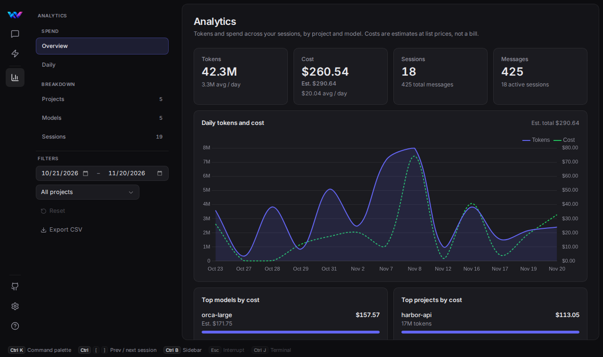
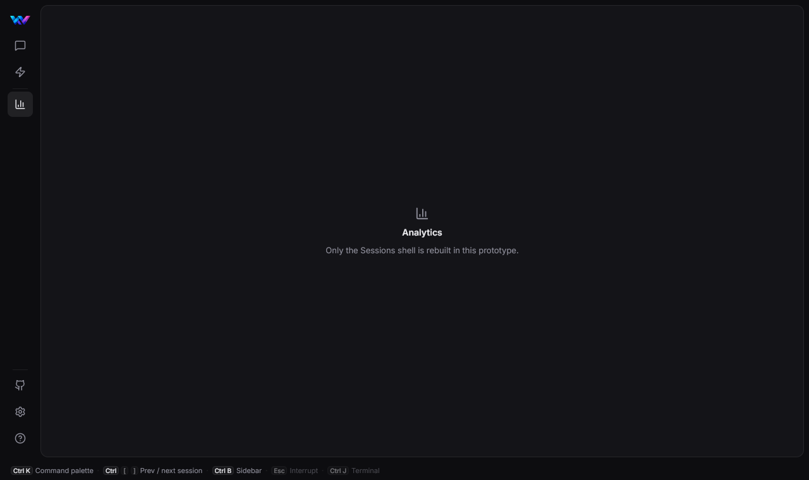
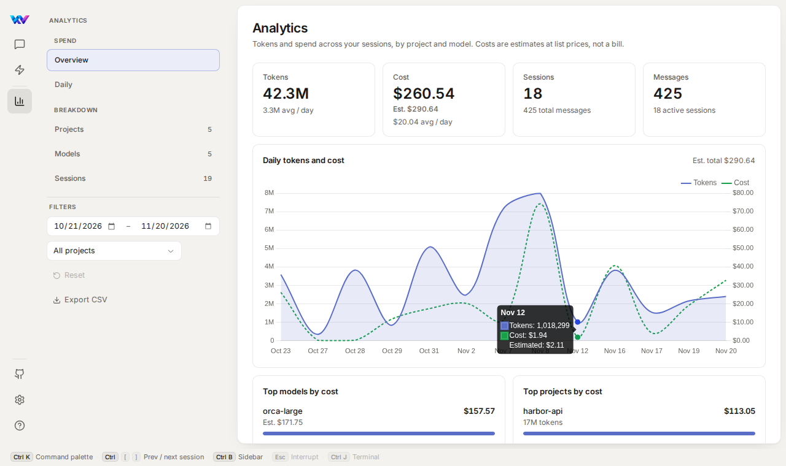
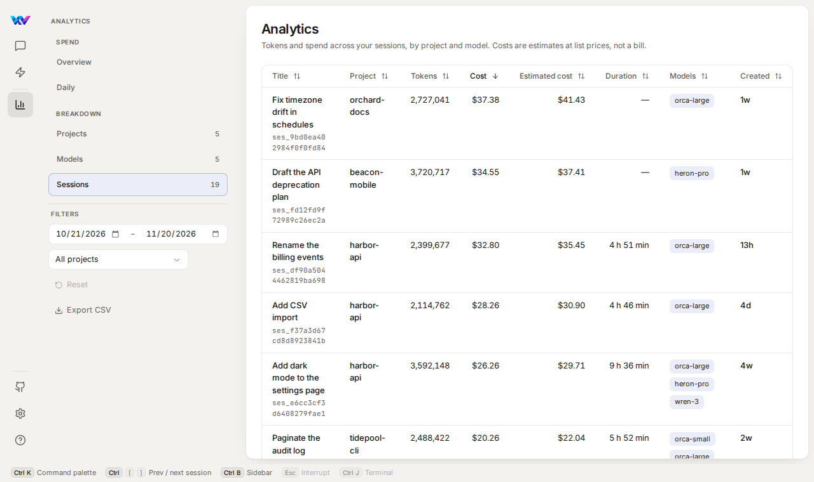

# Component 20: Analytics

The parity checklist for component 20 of `docs/PORT.md`, Analytics: the rail view that shows tokens and spend across
sessions, as `[analytics-menu][analytics-detail]`. The menu lists five sections in two groups (Spend: Overview, Daily;
Breakdown: Projects, Models, Sessions) with counts, the filters (a date range and a project) and Export CSV; each
section is its own route. It ends with the pieces it is built in.

- **weave-fleet commit read:** `c1a48bd` (`main`, 20 November 2026).
- **Server the live checks ran against:** the scratch Fleet's package, which reports **v0.74.0** (`fdc072e`; the folder
  is still named v0.72.0). Every route this component reads answered the way `main`'s client expects (checked live:
  `summary`, `daily`, `models`, `sessions`, `export?format=csv`, each with and without `from`, `to`, `projectId`).
  The client that server serves drew every picture below, so it is `main`'s for this component.
- **Native app read:** `main` at `b358ae8`.
- **Paths** are weave-fleet's under `client/src/` unless they start with `src/`, `docs/` or `server:`. Short names, all
  under `components/analytics/` unless given: AP `AnalyticsPage.vue`, AMP `AnalyticsMachinePanel.vue`, ANP
  `AnalyticsNavPanel.vue`, ASS `AnalyticsSectionStrip.vue`, AC `AnalyticsContent.vue`, AF `AnalyticsFilters.vue`, SC
  `cards/StatCard.vue`, HCB `charts/HorizontalCostBars.vue`, OT `tabs/OverviewTab.vue`, DT `tabs/DailyTab.vue`, PT
  `tabs/ProjectsTab.vue`, MT `tabs/ModelsTab.vue`, ST `tabs/SessionsTab.vue`, LS `lib/analytics-sections.ts`, UAS
  `composables/use-analytics-section.ts`, UAM `composables/use-analytics-menu.ts`, UAF
  `composables/use-analytics-filters.ts`, UAMa `composables/use-analytics-machine.ts`, the four reads
  `composables/use-analytics-{summary,daily,models,sessions}.ts` (USum, UD, UMo, USe), CR `components/layout/core-rails.ts`,
  MS `components/layout/MachineSwitch.vue`, UMC `composables/use-machine-choice.ts`, PH `components/ui/page-header/PageHeader.vue`,
  ES `components/ui/empty-state/EmptyState.vue`, EN `components/ui/error-note/ErrorNote.vue`, LF `lib/format/`,
  server `src/WeaveFleet.Api/Endpoints/AnalyticsEndpoints.cs` (AE) and
  `src/WeaveFleet.Infrastructure/Analytics/AnalyticsRepository.cs` (AR).
- **Row numbers:** 1.x the rail, the route and the page; 2.x the analytics-menu; 3.x the filters; 4.x Export CSV; 5.x
  the reads, the polling and the states they give; 6.x Overview's stat cards; 7.x Overview's chart; 8.x the cost bars
  (Overview's rankings and Models' chart); 9.x Daily; 10.x Projects; 11.x Models; 12.x Sessions; 13.x another machine;
  14.x ways in; 15.x out of reach.

The gap, visible in the pictures (each one's other theme is in the same folder): Fleet's rail opens the analytics-menu
(Spend: Overview, Daily; Breakdown: Projects 5, Models 5, Sessions 19; the From and To dates, All projects, Reset,
Export CSV) beside a page headed "Analytics" whose body is the section the address names: four stat cards, a two-axis
line chart of daily tokens and cost with a tooltip, and the top models and projects by cost (Overview); a table of days,
newest first (Daily); a card per project with its relative spend (Projects); the cost by model and a table of models
(Models); a sortable table of sessions with their models as chips (Sessions). The native app has the rail entry and a
notice: "Only the Sessions shell is rebuilt in this prototype." Fleet's pictures were taken with Playwright at 1280×760
in the UTC zone, en-US, against a scratch Fleet with analytics switched on and invented token events, session snapshots
and daily rollups written into its analytics database (six projects, five models on three providers, 18 sessions over
30 days; the seed script is the session's own, not in the repository); the native ones live against the same server at
the same size, `TZ=UTC`, the light one with the theme toggled by the script (Cmd+Shift+L) in a scratch data folder.

The other pictures in `shots/parity/20-analytics/`, both themes each: `fleet-overview-scrolled` (the rankings),
`fleet-daily`, `fleet-projects`, `fleet-models`, `fleet-models-scrolled` (the details table), `fleet-sessions`,
`fleet-project-select` (the project menu open), `fleet-project-picked` (a project picked: see 3.7, Fleet's bug).

## What "done" means

1. The Analytics rail opens `[analytics-menu][analytics-detail]` as Fleet does, for the machine its switch shows; each
   section is its own address (`/analytics`, `/analytics/daily`, …) and a stale one opens Overview.
2. The menu lists the sections with their counts, marks the open one, and holds the filters and Export CSV; the filters
   persist per machine, open on a range that ends today, and scope every section; Reset goes back to the last 30 days.
3. Every section draws its numbers as Fleet does, with Fleet's words for loading, failed and empty, and keeps them fresh
   (every 30 s while shown, at once on a filter change).
4. Overview's chart is drawn natively (no web view, no chart library): two lines on two axes, the filled area, the
   legend that hides a line, and the tooltip on hover, with Fleet's tokens.
5. Export CSV saves the server's CSV for the current filters to a file the user picks.
6. Fleet's tests for it pass here under the same names (list below).

## What the native app already has

| Part | State | Where |
|---|---|---|
| The rail entry (ChartColumn, "Analytics", the secondary group, order 0, a panel), `/analytics` and `/analytics/models` picking it, the tooltip | Done (component 9, piece A; `rails.test.ts`'s two analytics addresses pass) | `src/fleet/rails.rs`, `src/view/rail.rs`, `src/tests_rails.rs` |
| The rail opens a notice ("Only the Sessions shell is rebuilt in this prototype.") | To replace (C) | `src/view.rs` `notice` |
| "Go to Analytics" in the command palette (`nav-analytics`, "Open analytics and reporting.", keywords reports, metrics, analytics) | Done (component 1); sets the rail only, no section (C makes it open Overview) | `src/ui/commands.rs` |
| The home page's spend sparkline opens Analytics (`openAnalytics`) | Done (9F, `press_rail(Rail::Analytics)`) | `src/view/summary_bar.rs` |
| `GET /api/analytics/daily` for the sparkline: `parse_daily` (date and cost only), `iso_day`, `daily_path`, the mount/unmount poll on a thread, `now_ms` pinned in tests | Done (9F); A reads the whole `DailyAnalytics` beside it, B follows its poll pattern | `src/fleet/summary.rs` |
| The session header's analytics popover (`SessionAnalyticsPopover.vue`): not this component | Done (component 8, piece E) | `src/view/analytics.rs` (that name is taken: this component's views go under `src/view/analytics_page/`) |
| A rail view with its own menu and detail, the panel width and the gutter | Done for Workflows (18 B) and Settings; the pattern to follow | `src/view.rs` `root`, `src/view/workflows/mod.rs` |
| The machine choice a view with its own switch holds (`MachineChoice`: `enabled`, `key`, `entry`, `is_other`, `pick`, `reset`; its comment already names Analytics) and the switch chip and menu | Done (component 17, piece N); Analytics has no `MachineChoice` yet | `src/fleet/machine_choice.rs`, `src/view/machine_switch.rs` |
| Per-machine requests (a target's `get`, the token per machine) | Done (component 17) | `src/fleet/machine_routes.rs`, `src/fleet/http.rs` |
| `formatCount`, `formatTokens`, `formatMoney` ("<$0.01"), en-US | Done (component 5) | `src/composer/format.rs` |
| `formatDuration(ms, { precision: "minutes" })` ("14 s", "1 min", "4 h 51 min", "2 d 03 h") | Done (component 3) | `src/conv/working.rs` `format_duration` |
| `RelativeTime compact` ("1m", "13h", "4d", "2w") and its tooltip | Done (component 6) | `src/ui/age.rs` |
| `formatDate` ("Oct 23"; the year when not this year) | Partly: `row_status::format_date` writes a session row's date; G checks it against LF's `formatDate` for a bare day | `src/fleet/row_status.rs` |
| `PageHeader` (21 px title, the line under it) | Done, private to Settings and the dashboard | `src/view/settings.rs` `page_header`, `src/view/dashboard.rs` |
| `EmptyState` compact; `ErrorNote` (message + reason) | Compact only; ErrorNote copied privately in several views (`dashboard.rs` has message + reason) | `src/ui/empty_state.rs`, `src/view/dashboard.rs` `error_note` |
| The kit's `Select` (trigger and content, checked item) | Done (component 1) | `src/ui/select.rs` |
| A save dialog (`tx.save_file`, headless `rt.resolve_file_dialog`) | Done (used by Export to markdown, component 3) | `src/view/export.rs`, `docs/RUNE.md` |
| What the window remembers between runs (Fleet's `localStorage`) | Done: the settings file | `src/fleet/settings.rs` |
| Drawing: `canvas(Shape)` with `Path::cubic_to`, fills, strokes, `LineCap::Butt` dashes; `on_pointer_move_local` and `on_hover_change` for a hover; `rune::text::measure` for a label's width | Rune has all of it at the pin; used for rings and the terminal | `docs/RUNE.md` |
| Any Analytics data, menu, filters, sections or chart | None | |

## The checklist

Each row: what Fleet does, its source, and the native state (with the piece that owns it).

### 1. The rail, the route and the page

| # | Row | Source | Native |
|---|---|---|---|
| 1.1 | The rail entry Analytics opens `/analytics`; its panel is the analytics-menu (`AnalyticsMachinePanel`) | CR | **Done (C, 21 November 2026)** `view/analytics_page/menu.rs` `panel`; the rail opens it |
| 1.2 | Sections: `overview`, `daily` (group Spend), `projects`, `models`, `sessions` (group Breakdown), with those labels; groups "Spend", "Breakdown" | LS | **Done (A, 20 November 2026)** `src/fleet/analytics/sections.rs` |
| 1.3 | Each section has its own route: Overview is the bare `/analytics`, the others `/analytics/<id>`; the address is read back with a trailing slash; anything else (`/analytics/harness`, `/analytics/`) is Overview; a `$section` that isn't one redirects to `/analytics` | LS, `routes/analytics.*.tsx` | **Done (A, 20 November 2026)** the mapping: `sections.rs` `section_path`, `section_from_path` **C (21 November 2026): the route is `State.analytics_nav`, `open_analytics_address` reads an address** |
| 1.4 | The menu and the page read the section from the address (neither passes it to the other); a reload keeps it | UAS, AC | **Done (C, 21 November 2026)** the section is `State.analytics_nav`; menu and page both read it (`fleet/analytics/nav.rs`) |
| 1.5 | The context: `[analytics-menu][gutter][analytics-detail]`; the menu at the context panel's width (306 at 1280), the left gutter drags it; Ctrl+B hides the menu (the page alone) | AppShell, CR | **Done (C, 21 November 2026)** `view.rs` `root` (`analytics_page::page`): `[menu][gutter][page]`, the menu at the panel width, the shared left gutter, Ctrl+B hides the menu |
| 1.6 | The page sits in the centre sheet with Fleet's page padding (24 px, `.center__body`), scrolling as one; the parts stacked with gap 20 (`.analytics-page`) | `CenterContent.vue`, AC | **Done (C, 21 November 2026)** `analytics_page/mod.rs` `detail`: the centre sheet, 24 px padding, scrolling as one, gap 20 |
| 1.7 | `PageHeader`: "Analytics" (21 px, 600, tight) and "Tokens and spend across your sessions, by project and model. Costs are estimates at list prices, not a bill." (14 px muted, line-height 1.5, margin-top 4) | AC, PH | **Done (C, 21 November 2026)** `ui/page_header.rs` `plain` (lifted from Settings' header, which now uses it) |
| 1.8 | The section's body under the header; switching section swaps it (`:key="activeTab"`: its own scroll and hover state start fresh) | AC | **Done (C, 21 November 2026)** the body is keyed by its section; it is an empty slot until F to J |
| 1.9 | On a phone (≤767 px) the menu is a strip of chips above the section (`AnalyticsSectionStrip`, with a Filters chip that opens the filters inline) | ASS, AC | Out of scope (15.1) |

### 2. The analytics-menu

| # | Row | Source | Native |
|---|---|---|---|
| 2.1 | Header "ANALYTICS": 10 px, 600, upper case, tracking 0.05 em, muted, padding 18/4/10; the panel padding 0/12/12, scrolls when tall | ANP | **Done (C, 21 November 2026)** `menu.rs` `panel` |
| 2.2 | The machine switch under the header (padding 0 12 6) only when another machine is listed: "Analytics for machine" chip, the menu "Analytics for", each machine with its session count, a check on the shown one; testids `analytics-machine-switch`, `analytics-machine-<key>` | ANP, MS | **Done (C, 21 November 2026)** `menu.rs` `SWITCH`, `overlay`; the switch is drawn only when another machine is listed |
| 2.3 | Groups, each `role="group"` labelled: the label (10 px, 600, upper case, tracking 0.05 em, muted, margin 8/0/2, padding 0 12), items with gap 4, group margin-bottom 8 | ANP | **Done (C, 21 November 2026)** `menu.rs` `panel` (groups with `role=group`) |
| 2.4 | An item: a button, 36 tall min, padding 0 12, radius `--radius-btn`, 1 px transparent border, 12 px 500 muted; the label left, the count right (11 px tabular muted) | ANP | **Done (C, 21 November 2026)** `menu.rs` `item` |
| 2.5 | Counts: Projects = the range's top projects (at most 5, see 5.9), Models = the models list's length, Sessions = the sessions list's length (at most 50, 5.10); Overview and Daily have none | UAM | **Done (C, 21 November 2026)** `menu.rs` `count` |
| 2.6 | Hover: `--bg` fill, `--text` ink; the open one: border accent 40%, fill `--panel-bg` 88% + accent 12%, `--text`, `aria-current="page"`; focus ring 2 px accent, offset 2 | ANP | **Done (C, 21 November 2026)** `menu.rs` `item` (focus ring included; Rune has no `aria-current`, so the open one is read from `analytics_nav`) |
| 2.7 | Pressing an item opens its route; pressing the open one does nothing | UAM | **Done (C, 21 November 2026)** `State::open_analytics_section` |
| 2.8 | Below the groups: the Filters block (margin-top 4, padding-top 8, a 1 px `--border` rule above, gap 8): its label "FILTERS" (padding 0 4), the filters stacked (3.x), Export CSV (4.x) | ANP | Partly (D, 21 November 2026): the label, the rule, the block's spacing and the filters are drawn (`filters.rs` `block`); Export CSV: **Done (E, 21 November 2026)** `filters.rs` `export` |
| 2.9 | No "By harness" anywhere (a section Fleet removed) | ANP test | **Done (C, 21 November 2026)** no section is named harness; the test checks it |

### 3. The filters

| # | Row | Source | Native |
|---|---|---|---|
| 3.1 | State `{from, to, projectId}`, persisted (`weave:analytics:filters` for the live machine, `weave:analytics:filters:<key>` for another one) | UAF | **Done (A, 20 November 2026)** `filters.rs` `Filters`; `settings.rs` `analytics_filters` (settings key `analyticsFilters`, one entry per machine key, the live machine under `home`) |
| 3.2 | Defaults: the last 30 days ending today, every project (`from` = today − 30, `to` = today); "today" is the **UTC** day (the server reads a bare date as a UTC day) | UAF | **Done (A, 20 November 2026)** `filters.rs` `defaults` |
| 3.3 | Opening moves a range saved on an earlier day to end today, keeping its length and project; a range with no end is left alone; the default stays the default on a later day; while open, a range is left alone | UAF | **Done (A, 20 November 2026)** `filters.rs` `ending_today`, `opened` |
| 3.4 | `isDefault`: from, to and project are the defaults (nothing to reset) | UAF | **Done (A, 20 November 2026)** `filters.rs` `is_default` |
| 3.5 | The range box: one 32 px row, padding 0 4, 1 px border, radius `--radius-btn`, `--card-bg`; two date fields (12.5 px tabular, padding 0 6, `--text`, a calendar glyph at 55%) with "–" between (12 px muted); in the stacked menu the two spread apart; labels "From", "To" for a screen reader | AF | Partly (D, 21 November 2026): the box, the two typed fields (`MM/DD/YYYY`, placeholder `mm/dd/yyyy`) and the dash are drawn (`filters.rs` `range`); the calendar glyph and its picker: **Done (E, 21 November 2026)** `filters.rs` `date_field` (glyph at 55 %, 24 px wide at the field's right edge), `ui/calendar.rs`. The field takes years of four digits (Chrome allows six) |
| 3.6 | From's max is To and To's min is From, which limit the browser's picker only: a typed date outside them is still sent. A change is sent on `change` (a whole date); emptied clears that end | AF | **Done (D, 21 November 2026)** `fields.rs` `Fields::step`: a whole date typed is sent, one after To too (no limit from the other end), emptying clears that end; a half-typed field is left alone while it has focus and goes back to the last sent date when it is left (the browser's own segments never show half a date) |
| 3.7 | The project select (32 tall, 12.5 px, `--card-bg`, full width in the menu): "All projects" (placeholder and first item), then the range's top projects by name; picking one sets `projectId` to the project's **name** (Fleet's bug: the server filters on the project's id, a GUID, so every section but Models empties; picture `fleet-project-picked`; port as Fleet does, reported) | AF, UAF, AR | **Done (D, 21 November 2026)** `filters.rs` `project_select`, `list`: "All projects" then the range's projects by name, the picked one after them when it isn't listed; picking sets the **name** as Fleet does (Fleet's bug kept, reported). Fleet draws the trigger 220 px wide in the menu (its stacked width rule loses to the later max-width), so this does too |
| 3.8 | Reset: RotateCcw 13 + "Reset", 32 tall, 12.5 px muted, no border; hover 6% text tint; disabled (opacity 0.45) while default; tooltip "Back to the last 30 days, every project" | AF | **Done (D, 21 November 2026)** `filters.rs` `reset`: glyph and "Reset", 6 % tint on hover, faded and inert at the defaults, the tooltip |
| 3.9 | A change refetches every section at once (`refreshAnalytics`) and the menu's counts (`watch` on from, to, project); the range alone refetches the project list | AC, UAM, UAF | **Done (B, 20 November 2026)** `store.rs` `analytics_set_filters`: the four page reads at once, the range alone also the project list (`Kind::Range`); the menu's models and sessions are the page's (5.8) |
| 3.10 | The page's own project list (`scopedTopProjects`) is the scoped summary's top projects plus the picked project when it isn't among them (0 tokens, $0.00) | AC `withSelectedProject` | **Done (A, 20 November 2026)** `mod.rs` `with_selected_project` (F/H use it) |

### 4. Export CSV

| # | Row | Source | Native |
|---|---|---|---|
| 4.1 | The link: Download 13 + "Export CSV", 32 tall, padding 0 10, 12.5 px muted, radius `--radius-btn`; hover 6% text tint and `--text`; focus ring | ANP | **Done (E, 21 November 2026)** `filters.rs` `export`: Download 13 and "Export CSV", 32 tall, hover tint and full ink, focus ring |
| 4.2 | `GET /api/analytics/export?format=csv[&from][&to][&projectId]` saved as `analytics.csv` (the live machine: a download link; another machine: fetched with its key, then saved) | UAM `exportHref`, `exportCsv` | **Done (E, 21 November 2026)** `export.rs`: always fetched on a thread (the machine shown, with its key for another machine), then a save dialog with `analytics.csv` filled in, then the bytes written on a thread (a toast says `Saved analytics.csv`; Fleet's browser says it in its own downloads list). One export at a time |
| 4.3 | A failed export does nothing visible (`if (!response.ok) return`) | UAM | **Done (E, 21 November 2026)** `export.rs` `analytics_exported`: a refused or unreachable export ends there, no dialog and no toast |
| 4.4 | The server's CSV: header `id,event_id,session_id,project_id,project_name,workspace_directory,model_id,provider_id,tokens_input,tokens_output,tokens_reasoning,tokens_cache_read,tokens_cache_write,tokens_total,cost,estimated_cost,created_at`, one row per token event | AE `BuildCsv` | **Done (E, 21 November 2026)** the server's: written as text exactly as it came |

### 5. The reads, the polling and the states they give

| # | Row | Source | Native |
|---|---|---|---|
| 5.1 | Five reads: `summary` (from, to, project), `daily` (from, to, project), `models` (from, to; the client sends project, the server ignores it), `sessions` (from, to, project, sortBy, sortDir; the server ignores sort and returns at most 50, newest first) and the menu's range-only `summary` (from, to: the project list and Projects' count) | USum, UD, UMo, USe, UAF, AE | **Done (B, 20 November 2026)** `store.rs` `Kind`, `analytics_ask`: the five reads, each through the machine's target on its own thread; paths from `mod.rs` |
| 5.2 | Shapes: `AnalyticsSummary` {totalTokens, totalCost, totalEstimatedCost, sessionCount, messageCount, topModels[], topProjects[] of {name, tokens, cost}}; `DailyAnalytics` {date, tokens, cost, estimatedCost, sessions, messages}; `ModelAnalytics` {modelId, providerId, tokens, cost, estimatedCost, messageCount, avgCostPerMessage}; `SessionAnalytics` {sessionId, title?, projectId?, projectName?, tokens, cost, estimatedCost, models[], durationSeconds?, createdAt} | `api/client.ts` | **Done (A, 20 November 2026)** `mod.rs` `parse_summary`, `parse_days`, `parse_models`, `parse_sessions`; `summary::parse_daily` reads through `parse_days` |
| 5.3 | Each read polls every 30 s while Analytics is shown, and at once when the window shows again; nothing while hidden | the four reads | **Done (B, 20 November 2026)** `store.rs` `keep_analytics`: every 30 s while the rail is Analytics, at once when the window shows again (`quiet.visible`), nothing while hidden or behind another rail |
| 5.4 | Numbered requests: an answer a newer one overtook is dropped; a success clears the error; a failure keeps the data and sets the error | the four reads | **Done (B, 20 November 2026)** `store.rs` `Read::take`: request numbers per read; a dropped answer still settles its batch |
| 5.5 | Error words are the client's own, not the server's: "Failed to fetch analytics summary", "Failed to fetch daily analytics", "Failed to fetch model analytics", "Failed to fetch session analytics" (a 503 "Analytics is disabled." reads the same) | the four reads, AE | **Done (B, 20 November 2026)** `store.rs` `Kind::failure` |
| 5.6 | `isLoading` is true until the first answer (success or failure); `isRefreshingAnalytics` is true while a filter change's refetch of all four runs (a later one wins); `isRefreshingSessions` while a sort change's refetch runs | the reads, AC | **Done (B, 20 November 2026)** `store.rs` `Read::is_loading`, `refreshing_all()` (a later batch wins), `refreshing_sessions()` |
| 5.7 | Per section, loading = its read's `isLoading` or a refresh in flight: Overview's chart (daily), its model bars (models or summary), its project bars (summary); Daily (daily); Projects (summary); Models (models); Sessions (sessions, or a sort refresh) | AC | **Done (B, 20 November 2026)** `store.rs` `daily_loading`, `models_bars_loading`, `projects_loading`, `models_loading`, `sessions_loading` (F-J use them) |
| 5.8 | The menu and the page each run their own reads in Fleet (duplicate requests); here one store feeds both, same answers | UAM, AC | **Done (B, 20 November 2026)** `store.rs`: one `Analytics` on `State` feeds the page and the menu |
| 5.9 | `topProjects` and `topModels` are the top 5 by cost (server `LIMIT 5`): Projects never lists more than five | AR | Server's |
| 5.10 | `/sessions` defaults to 50 rows, so Sessions' count and table stop at 50 | AE | Server's |
| 5.11 | Daily rows exist only for days with events: the chart's x axis and Daily's table skip empty days | AR | Server's (G, H draw what comes) |

### 6. Overview: the stat cards

| # | Row | Source | Native |
|---|---|---|---|
| 6.1 | Overview's body: stat cards, the chart panel, the two rankings; gap 12 | OT | None (F) |
| 6.2 | The cards: a grid `repeat(auto-fit, minmax(140px, 1fr))`, gap 12 (four across at 1280) | OT | None (F) |
| 6.3 | A card: padding 14/16, gap 4, 1 px border, `--radius-card`, `--card-bg`; the label (12 px 500 muted); the value (24 px 600, tracking −0.01 em, line-height 1.2, tabular) with an optional secondary beside it (12 px 500 muted, wraps under it when narrow); the detail (12 px muted) | SC | None (F) |
| 6.4 | Tokens: `formatTokens(total)` ("42.3M"); detail "<avg> avg / day" (total ÷ number of daily rows) or "No daily token breakdown available" | OT | None (F) |
| 6.5 | Cost: `formatMoney` (negative, NaN as $0.00) of the total; secondary "Est. <estimated>"; detail "<avg> avg / day" or "No daily cost breakdown available" | OT | None (F) |
| 6.6 | Sessions: `formatCount(sessionCount)`; detail "<messages> total messages", or "Derived from the daily activity trend" with no summary | OT | None (F) |
| 6.7 | Messages: `formatCount(messageCount)`; detail "<sessions> active sessions", or "Derived from the daily activity trend" | OT | None (F) |
| 6.8 | With no summary (loading or failed) the totals are summed from the daily rows | OT | None (F) |

### 7. Overview: the chart

| # | Row | Source | Native |
|---|---|---|---|
| 7.1 | The panel (`analytics-overview-daily-trend`): padding 16, gap 12, 1 px border, `--radius-card`, `--card-bg`; the head: "Daily tokens and cost" (13 px 600) left, "Est. total <estimated>" (12 px muted tabular) right, baseline aligned | OT | None (F: the panel and its states; G: the chart) |
| 7.2 | States in order: rows → the chart (300 tall); else loading → Spinner + "Loading daily analytics…" (`analytics-loading`, 13 px muted, centred, padding 24); else error → ErrorNote "Unable to load analytics." with the reason; else EmptyState bordered, min-height 210, the empty words (5.x, 9.3) | OT | None (F) |
| 7.3 | Two datasets on one x axis of days (`formatDate`: "Oct 23"): Tokens on the left axis (`--accent`, 2 px, filled to zero at 14% alpha) and Cost on the right (`--running`, 2 px, dashed 4/3, no fill); curves with tension 0.35 (Chart.js's spline control points, clamped to the chart area); no points until hovered | OT | None (G) |
| 7.4 | The left axis: from zero, Chart.js's "nice" ticks (the count from the axis height: at most 11, about one per 40 px), labels `formatTokens` (11 px muted), grid lines `--border`, no axis line | OT | None (G) |
| 7.5 | The right axis: from zero, its own nice ticks, labels `formatMoney`, no grid, no axis line | OT | None (G) |
| 7.6 | The x axis: labels 11 px muted, never rotated, skipped evenly when they don't fit (`autoSkipPadding: 16`), no grid, its line in `--border` | OT | None (G) |
| 7.7 | The legend: top, right-aligned, "Tokens" and "Cost" (12 px muted), each with a 16 px line of its colour (the cost one dashed); pressing one hides that line and strikes its label through (Chart.js's default); pressing again shows it | OT | None (G) |
| 7.8 | Hover anywhere over the chart area picks the nearest day (`mode: "index", intersect: false`): both points grow to radius 4, and a tooltip shows the day as its title, then "Tokens: <formatCount>" and "Cost: <formatMoney>" each with its colour box, then "Estimated: <formatMoney>"; it sits beside the points, flipping side near an edge; leaving the chart hides it | OT | None (G) |
| 7.9 | The chart follows the panel's width (responsive, `maintainAspectRatio: false`) and the theme (the palette re-read when the theme changes) | OT | None (G) |
| 7.10 | A screen reader gets "Line chart of daily tokens and cost, <first day> to <last day>. The numbers follow in a table." and a hidden table (Day, Tokens, Cost; `analytics-daily-trend-table`) | OT | None (G: the label; the table as the chart's accessible children) |
| 7.11 | Chart.js's entry animation (about 1 s) and the tooltip's fade | Chart.js defaults | Gap (G: drawn at once; 15.3) |

### 8. The cost bars (Overview's rankings, Models' chart)

| # | Row | Source | Native |
|---|---|---|---|
| 8.1 | Overview's rankings: "Top models by cost" and "Top projects by cost", each a panel as 7.1 with its title; a grid `repeat(auto-fit, minmax(min(100%, 320px), 1fr))`, gap 12 (two across at 1280) | OT | None (F) |
| 8.2 | Model bars: the models read (name `modelId`, detail "Est. <estimated>"), or with none the summary's top models (no detail); max = the largest cost | OT | None (F) |
| 8.3 | Project bars: the page's project list (3.10), or the summary's top projects; detail "<formatTokens> tokens" | OT | None (F) |
| 8.4 | `HorizontalCostBars`: sorted by cost, then name; each item gap 6: the name (13 px 500, one line, ellipsis) and the detail (12 px muted; default "<cost> of <max>") left, the cost (13 px 600 tabular) right, gap 16; under them a 6 px track (8% text tint, full radius) with the accent fill at cost ÷ max (0 for zero, negative or not a number; at most 100%); items gap 14 | HCB | None (F) |
| 8.5 | States: items → the list; else loading → Spinner + "Loading…" (`analytics-loading`); else error → ErrorNote "Unable to load analytics." + reason; else EmptyState compact with the empty words (Overview's model bars wait for both the models and the summary) | HCB, AC | None (F) |
| 8.6 | The fill eases to its width (300 ms ease-out; none with reduced motion) | HCB | None (F: a round-capped 6 px canvas stroke with `live_trim` is the same pill and can ease; else drawn at once, a gap) |
| 8.7 | A bar's track is `role="img"`, "<name> cost bar at <n> percent" | HCB | None (F) |

### 9. Daily

| # | Row | Source | Native |
|---|---|---|---|
| 9.1 | A table in a box (1 px border, `--radius-btn`, `--card-bg`, scrolls sideways): Day, Tokens, Cost, Sessions, Messages; numbers right-aligned | DT | None (H) |
| 9.2 | Rows newest first; Day is the raw date ("2026-11-20"); tokens, sessions, messages `formatCount`; cost `formatMoney`; cells 12.5 px tabular, padding 8/12, a 1 px rule under each but the last; the head 11 px 500 muted | DT | None (H) |
| 9.3 | Empty words: "No daily analytics matched the selected date range." or, with a project, "No daily analytics matched the selected date range and project." | AC | The words done (A): `mod.rs` `daily_empty`. The rest: None (A, the words; H) |
| 9.4 | States: rows → table; else loading → Spinner + "Loading daily analytics…"; else ErrorNote "Unable to load analytics."; else EmptyState bordered | DT | None (H) |

### 10. Projects

| # | Row | Source | Native |
|---|---|---|---|
| 10.1 | A grid of cards `repeat(auto-fit, minmax(240px, 1fr))`, gap 12 (three across at 1280), sorted by cost then name | PT | None (H) |
| 10.2 | A card (the kit's Card, no shadow, padding 16, gap 16, full height): the name (14 px 600, wraps anywhere) and the cost (14 px 600 tabular) on top; two stats "Tokens" / "Cost" (labels 11 px muted, values 18 px 600 tabular, `formatCount`, `formatMoney`); at the bottom "Relative spend" and "<n>%" (11 px 500 muted) over a 6 px accent bar (cost ÷ the largest; eases 0.2 s) | PT | None (H) |
| 10.3 | Its source is the page's project list (3.10): the scoped summary's top 5 | AC | None (H) |
| 10.4 | Empty words: "No project analytics matched the selected date range." or "No projects matched the selected date range and project."; states as 9.4 with "Loading project analytics…" and EmptyState bordered min-height 157.5 | AC, PT | The words done (A): `mod.rs` `projects_empty`. The rest: None (H) |

### 11. Models

| # | Row | Source | Native |
|---|---|---|---|
| 11.1 | Sorted by cost, then estimated cost, then tokens (all descending), then model id | MT | None (I) |
| 11.2 | "Cost by model": a panel (as 7.1) with the cost bars; detail "<provider> · <formatCount> messages · Est. <estimated>" | MT | None (I) |
| 11.3 | "Model details": a panel with no side padding, its title padded 16; a table (at least 720 wide, scrolls sideways): Model, Provider, Tokens, Cost, Estimated cost, Messages, Avg cost/msg; the head 12 px 500 muted, padding 8/16, a rule under it; cells 13 px, line-height 1.5, padding 10/16; model and provider 500 `--text`, wrapping anywhere; numbers right, tabular; rows ruled between; hover 3% text tint | MT | None (I) |
| 11.4 | States: loading **first** ("Loading model analytics…" in a dashed box, min-height 280, 13 px `--text`), so a filter change blanks the section while it refetches; then no models and an error → ErrorNote "Unable to load model analytics."; then no models → EmptyState bordered, min-height 245, "No model analytics matched the selected date range." (or "… date range and project.") | MT, AC | The words done (A): `mod.rs` `models_empty`. The rest: None (I) |
| 11.5 | A project filter doesn't change Models (the server ignores it, 5.1) | AE | Server's |

### 12. Sessions

| # | Row | Source | Native |
|---|---|---|---|
| 12.1 | A box (1 px border, `--radius-card`, `--card-bg`, clipped) holding a table at least 820 wide that scrolls sideways | ST | None (J) |
| 12.2 | Columns, each a sort button: Title (asc first), Project (asc), Tokens (desc, right), Cost (desc, right), Estimated cost (desc, right), Duration (desc, right), Models (asc), Created (desc); the head 12 px 500 muted, padding 8/16, gap 8, the icon 12 px: ArrowUpDown when not sorted, ArrowUp/ArrowDown on the sorted one, whose label is `--text`; hover `--text`; `aria-sort` | ST | None (J) |
| 12.3 | Pressing the sorted column flips its direction; another column takes its default direction; the sort is held by the page (default Created, desc) and survives the poll | ST, AC | None (J; the sort on the store from B) |
| 12.4 | A sort change refetches the sessions (`isRefreshingSessions`) and, since loading is checked first, shows "Loading session analytics…" until it answers (Fleet's flash) | AC, ST | None (J; as Fleet) |
| 12.5 | Sort rules: titles and projects compared case-insensitively (`localeCompare`, base sensitivity); numbers; duration with missing ones last whichever the direction; models by their joined list; created by time | ST | The comparisons done (A): `sessions_sort.rs` `compare_sessions`, `sorted`. The rest: None (A: `compare_sessions`; J) |
| 12.6 | A row: title (13 px 500; "Untitled session" for none or blank) with the session id under it (11 px mono muted, breaks anywhere, margin-top 2); project (500; the name, else the id, else "Unassigned"); tokens `formatCount`; cost and estimated `formatMoney`; duration `formatDuration(minutes)` or "—"; models as chips (min 22 tall, padding 2/8, radius 6, `--accent-dim`, 11 px `--text`, wrap, gap 6) or one muted chip "Unknown model" (6% text tint, muted); created as `RelativeTime compact` (500) with the exact time as its tooltip | ST | None (J) |
| 12.7 | Cells padding 10/16, 13 px, line-height 1.5, top-aligned; rows ruled between; hover 3% text tint | ST | None (J) |
| 12.8 | States: loading first ("Loading session analytics…", min-height 280, 13 px `--text`); then no rows and an error → ErrorNote "Unable to load session analytics."; then no rows → EmptyState (not bordered) min-height 245, "No sessions matched the current analytics filters" | ST | The words done (A): `mod.rs` `SESSIONS_EMPTY`. The rest: None (J) |

### 13. Another machine

| # | Row | Source | Native |
|---|---|---|---|
| 13.1 | Analytics shows the machine its switch picked; every read and the export go to that machine with its key; the live machine's reads are untouched | UAMa, AP, AMP, test | **Done (B, 20 November 2026)** `store.rs` `analytics.choice` (`MachineChoice`) picks the machine; every read goes to it; its filters are saved under its key |
| 13.2 | Switching machine rebuilds the page and the menu (`MachineScope :key`): that machine's own filters (3.1), fresh reads, loading states | AP, AMP | **Done (B, 20 November 2026)** `store.rs` `mount`: a new machine starts over with its own filters and loading reads **C (21 November 2026): the page reads the machine's own reads, so it follows** |
| 13.3 | Moving between sections keeps the pick; leaving Analytics forgets it, so the next visit opens on the machine you're on | AP | **Done (C, 21 November 2026)** `enter_analytics` resets the pick when coming from another view, not from a section |

### 14. Ways in

| # | Row | Source | Native |
|---|---|---|---|
| 14.1 | The rail entry's address is `/analytics`, so it always opens Overview, not the section last shown | CR | **Done (C, 21 November 2026)** `press_rail(Rail::Analytics)` opens Overview |
| 14.2 | "Go to Analytics" (command palette) opens `/analytics` | `use-commands.ts` | **Done (C, 21 November 2026)** `nav-analytics` calls `enter_analytics` |
| 14.3 | The home page's spend sparkline opens `/analytics` | `SummaryBar.vue` | **Done (C, 21 November 2026)** the sparkline presses the rail, so it opens Overview |

### 15. Out of reach, and why

| # | Row | Why |
|---|---|---|
| 15.1 | The phone strip (`AnalyticsSectionStrip`: chips, the Filters chip) | The phone layout is out of scope (`docs/PORT.md`, "Out of scope") |
| 15.2 | The browser's date picker (`<input type="date">`'s own calendar and its segmented `mm/dd/yyyy` editing) | Rune has no date field (as 19's 16.3). D draws a text field in the same `MM/DD/YYYY` form taking a typed date; E adds a calendar popover from Rune elements under the glyph: **Done (E, 21 November 2026)** `ui/calendar.rs` (Sunday first, today ringed, the picked day filled, days outside From's max (To) or To's min (From) dimmed and inert, Escape or a press outside closes it, picking closes it). Keyboard stepping of one segment with the arrows is not ported |
| 15.3 | Chart.js's entry animation and tooltip fade | Drawn at once; a canvas could animate it, but nothing else in the app animates a chart and it isn't worth the code |
| 15.4 | Live numbers as events arrive | Fleet doesn't either: it polls every 30 s (5.3) |

## Fleet's bugs found while reading (reported, not fixed here)

1. **The project filter never matches** (3.7): the summary's top projects carry the project's name (`COALESCE(project_name,
   project_id)`), the client sends that name as `projectId`, and every query filters `project_id = @ProjectId`, where a
   project's id is a GUID. Picking a project empties Overview, Daily, Projects and Sessions (only Models, which ignores
   the project, keeps its numbers). Checked live: `projectId=<name>` gives 0 sessions, `projectId=<id>` gives the
   project's. Picture: `fleet-project-picked-*.png`. The port sends what Fleet sends, so it fails the same way until
   Fleet is fixed and a catch-up moves this.
2. **Models ignores the project** (11.5): `/api/analytics/models` takes no `projectId`, so the Models section and its
   count don't follow the project filter, while the empty words say "…and project".
3. **Daily's sessions over-count** (server): the per-day session count sums `COUNT(DISTINCT session_id)` over each
   project-model-provider group, so a session that used two models that day counts twice.

## Fleet's tests, and where they go

| Fleet test file | Cases | Piece |
|---|---|---|
| `lib/__tests__/analytics-sections.test.ts` | 4: "gives every section its own route, Overview being the bare /analytics", "reads the section back from its route, trailing slash included", "opens Overview for an address that isn't a section", "groups Spend (Overview, Daily) apart from Breakdown (Projects, Models, Sessions)" | A |
| `composables/__tests__/use-analytics-filters.test.ts` | 6: "opens on the last 30 days, ending today", "opens ending today when Fleet has been open since an earlier day", "moves a range saved on an earlier day to end today, keeping its length and project", "keeps the default range the default on a later day", "leaves a range alone while Analytics stays open", "leaves a range with no end alone" | A |
| `composables/__tests__/use-analytics-machine.test.ts` | 1: "asks only that machine and keeps its own filters" | B |
| `components/analytics/__tests__/AnalyticsNavPanel.test.ts` | 4: "lists Spend (Overview, Daily) and Breakdown (Projects, Models, Sessions) with counts", "marks the section the address is on", "opens a section by its own route, and does nothing for the one already open" (C); "has the From / To / Project filters and Export below the sections, and no By harness" (**done, E**: `tests_analytics_export.rs` under its name) | C, E |
| `components/analytics/__tests__/AnalyticsTabsErrorOrEmpty.test.ts` | "analytics tabs with nothing to show": "%s shows the load error, not the empty state, when the load failed" × DailyTab, ProjectsTab (H), HorizontalCostBars (F); "SessionsTab keeps its own words for both" (J); "analytics tabs before their first answer": "%s says it's loading, not that nothing matched" × DailyTab, ProjectsTab (H), HorizontalCostBars (F) | F, H, J |
| `components/analytics/__tests__/AnalyticsContentLoading.test.ts` | "the %s section says it's loading, not that nothing matched" × overview (F), daily, projects (H) | F, H |
| `components/layout/__tests__/rails.test.ts` | the two analytics addresses | Done (9 A) |

An `it.each` row is ported as one test per row, named with the row (`..._daily_tab`, `..._projects_tab`), or one test
looping the table that names the failing case.

## Pieces

In build order. Each is one pull request a fresh session can do from this file alone. The logic goes in
`src/fleet/analytics/` (plain Rust, no Rune), the views in `src/view/analytics_page/` (`src/view/analytics.rs` is the
session header's popover, component 8). Pictures go under `shots/parity/20-analytics/<piece letter>-…`, native beside
Fleet's own client: the same scratch Fleet with analytics on and invented data seeded into its analytics database (the
recipe in "The gap" above: `Fleet__AnalyticsEnabled=true`, rows written to `~/.weave/fleet-analytics.db` under the
scratch HOME with `user_id` `local-user`, the daily rollups recomputed with the server's own query), 1280×760, UTC,
en-US, both themes. `scripts/scratch-fleet.sh` switches analytics off; a piece runs its own copy with it on.

#### A. Sections, filters and the data (no view)

- **Rows:** 1.2, 1.3 (the mapping), 3.1-3.4, 3.10, 5.2, the words of 9.3, 10.4, 11.4, 12.8, 12.5 (the comparisons).
- **Files:** new `src/fleet/analytics/mod.rs` (`Summary`, `TopItem`, `Daily`, `ModelRow`, `SessionRow` read from
  `serde_json::Value` as the rest of `src/fleet/` does; the query strings for each read and the export path; the
  empty-state words per section with and without a project; `with_selected_project`), new
  `src/fleet/analytics/sections.rs` (`Section`, `Group`, `SECTIONS`, `GROUPS`, `is_section_id`, `section_path`,
  `section_from_path`), new `src/fleet/analytics/filters.rs` (`Filters`, `defaults(today)`, `ending_today`,
  `is_default`, the UTC day from `summary::iso_day`, kept per machine key in the settings file), new
  `src/fleet/analytics/sessions_sort.rs` (`SortBy`, `SortDir`, the columns with their default directions,
  `compare_sessions`, `title_label`, `project_label`, `models_label`); `src/fleet/settings.rs` (the filters per machine);
  tests in `src/fleet/tests/analytics.rs` (with its `#[cfg(test)] mod` line). `summary::parse_daily` may move to read
  the whole row; the sparkline keeps working.
- **Depends on:** nothing.
- **Tests:** all of `analytics-sections.test.ts` (4) and `use-analytics-filters.test.ts` (6) under their names, the
  clock pinned; native: each shape read from this file's scratch Fleet's answers (captured as fixtures, invented data),
  unknown fields ignored, nulls defaulted; the sessions comparisons (blank title as "Untitled session", missing duration
  last both ways); the filters saved and read back per machine key.
- **Pictures:** no view changes: the Analytics rail drawn as before (a scene), and the test output.

**Done (20 November 2026).** Left open, with reasons:
- Text comparison (`locale_compare`) is a stand-in for ICU's `localeCompare` with base sensitivity: case and Latin accents don't
  matter and punctuation sorts before digits before letters, but other scripts compare by code point. Right for the titles and names
  a session has; a real collation table would be a new crate (`icu_collator`).
- A `created_at` that doesn't parse ties with every row (Fleet's `NaN` comparison does the same); the server always writes ISO text.
- The query builder sends the project trimmed on every read, as the menu does (the page itself trims it too, `normalizedProjectId`).
- `Filters::opened` takes the clock in milliseconds; B reads the real one (`now_ms` pinned in tests).

#### B. The store and the reads (no view)

- **Rows:** 3.9, 5.1, 5.3-5.8, 13.1, 13.2 (the reads).
- **Files:** new `src/fleet/analytics/store.rs` (`Analytics` on `State`: the machine it was read for, the five reads each
  with data, `is_loading`, `error` and a request number; `refreshing_all`, `refreshing_sessions`; the sessions sort;
  `keep_analytics(now, tx)` in the `poll` hooks, after `keep_summary`'s pattern: mount while the rail is Analytics, read
  at once, every 30 s, at once on a filter or machine change, the sessions alone on a sort change, unmount when left;
  every read on a thread through the machine's target, handed back to the UI thread; the client's error words); mock
  data in `src/mock/analytics.rs` (the same invented projects and models as the pictures) for scenes and tests with no
  server; tests in `src/tests_analytics_store.rs` with a `test_http` fake server.
- **Depends on:** A.
- **Tests:** `use-analytics-machine.test.ts` (1) under its name (another machine's reads go only to it; its filters are
  saved under its key, the live key untouched); native: an answer overtaken by a newer one is dropped; a failure keeps
  the data and sets the client's words; the 30 s poll; a filter change refetches all five and sets `refreshing_all` until
  the last answers; a sort change refetches only sessions; leaving the rail stops the polls.
- **Pictures:** no view changes (as A), and the test output against the fake server.

**Done (20 November 2026).** Left open, with reasons:
- The reads go through `Target::get`, which turns any non-2xx answer into an error; the client's words replace whatever the server said, as in Fleet.
- Fleet's `fetch*` skips a request while the document is hidden and nothing makes it ask again but the next tick or `visibilitychange`; here a change made while hidden waits and goes out when the window shows.
- Scenes and tests with no server get the same invented answers whatever the filters (`src/mock/analytics.rs`); a filter change still sets the flags.
- The menu's models and sessions reads are the page's (5.8), so a poll asks five reads, not Fleet's eight.
- `MachineChoice::reset` on entering Analytics (13.3) is C's.

#### C. The page and the menu

- **Rows:** 1.1, 1.3 (the route on `State`), 1.4-1.8, 2.1-2.7, 2.9, 13.2 (the rebuild), 13.3, 14.1-14.3.
- **Files:** new `src/fleet/analytics/nav.rs` (the open section on `State`, `open_section`, `enter_analytics`
  resetting the machine choice, the address `/analytics[/<id>]` read and written as the other rails do), new
  `src/view/analytics_page/mod.rs` (the context: menu, gutter, page; the page sheet with Fleet's 24 px padding, scrolling;
  the section's body: an empty slot until its piece), new `src/view/analytics_page/menu.rs` (header, machine switch,
  groups, items with counts), new `src/ui/page_header.rs` (lifted from Settings' and the dashboard's, both switched to
  it); `src/view.rs` (`Rail::Analytics` routed like Workflows), `src/ui/commands.rs` and `src/view/summary_bar.rs` (open
  Overview); scenes `analytics-menu`, `analytics-menu-light`, `analytics-menu-models` (another section open),
  `analytics-machines` (the switch shown) in `spec()`; tests in `src/tests_analytics_page.rs`.
- **Depends on:** B.
- **Tests:** `AnalyticsNavPanel.test.ts`'s first three under their names; native: the rail, the palette command and the
  sparkline all open Overview; a stale `/analytics/harness` opens Overview; Ctrl+B hides the menu; leaving and coming back
  forgets the machine pick.
- **Pictures:** the menu and the header beside Fleet's, Overview and Models open, both themes (the section bodies are
  still blank: say so).

**Done (21 November 2026).** Pictures: `shots/parity/20-analytics/C-page-menu/` (native), beside A's Fleet pictures
(`fleet-overview-*`, `fleet-models-*`). Left open, with reasons:
- The Filters block (2.8), and with it Export CSV, is not drawn: D and E own it. The menu ends after Sessions.
- The section bodies are blank, as the brief says (F to J).
- Fleet's Sessions count in the pictures is 19 and the native scene's 18: the scratch Fleet has one more session than the invented list.
- Another machine's switch is shown from a scene only; a second live Fleet was not run for this piece.
- Row 1.9 (the phone strip) stays out of scope (15.1).

#### D. The filters

- **Rows:** 2.8 (the block, its label), 3.5 (typed fields), 3.6-3.8.
- **Files:** new `src/view/analytics_page/filters.rs` (the range box with two date fields showing `MM/DD/YYYY`, typed,
  checked against the other end, sent when a whole date is entered or the field is left; the project select from the
  kit's `Select`; Reset with its tooltip and disabled look); `src/fleet/analytics/filters.rs` (parse and write the
  field's form); the kit's text field as it stands; scenes `analytics-filters`, `analytics-project-open`, both themes;
  tests in `src/tests_analytics_filters.rs`.
- **Depends on:** C.
- **Tests:** native: a whole typed date is sent (one after To too, as the browser's field sends it), a partial one
  isn't, an emptied field clears that end, a project pick sets the name and refetches, Reset is disabled at the defaults and restores them, the
  filters survive a restart (the settings file).
- **Pictures:** the filters block and the open project menu beside Fleet's `fleet-project-select`, both themes; the
  project-picked state beside `fleet-project-picked` (Fleet's bug reproduced, 3.7).

**Done (21 November 2026).** Pictures: `shots/parity/20-analytics/D-filters/` (native), beside A's `fleet-project-select-*` and
`fleet-project-picked-*`. Left open, with reasons:
- The calendar glyph in each field and the picker are E's, so the native fields are 112 px wide and empty on the right where Fleet's glyph sits.
- Export CSV (2.8's last part) was E's: done.
- Fleet's `fleet-project-picked` (every section but Models empties) can't be shown from a scene: the native page has no section bodies until F to J. The
  request carries the name (`projectId=<name>`), a test checks it.
- The first row of the open list is not lit as Fleet's is (it lights on pointer or arrow keys here).

#### E. The calendar and Export CSV

- **Rows:** 3.5 (the calendar), 4.1-4.4, 15.2's calendar.
- **Files:** new `src/ui/calendar.rs` (a month grid popover under a date field's glyph: the month and year, previous and
  next, weekday initials, the days, today marked, the picked day filled, days outside min/max dimmed; Escape and a press
  outside close it; a kit piece the Automations date field can use too); new `src/fleet/analytics/export.rs` (the fetch
  on a thread through the machine's target, the save dialog with `analytics.csv`, the bytes written on a thread; a
  failure does nothing visible, as Fleet); `src/view/analytics_page/filters.rs` (the glyph opens it; Export CSV under
  the filters); scenes `analytics-calendar`, both themes; tests in `src/tests_analytics_export.rs`.
- **Depends on:** D.
- **Tests:** `AnalyticsNavPanel.test.ts`'s fourth ("has the From / To / Project filters and Export below the sections,
  and no By harness") under its name; native: Export asks the export path with the current filters, the save dialog is
  offered `analytics.csv`, the file holds the server's bytes (a fake server, a temporary folder); another machine's
  export goes to it; a refused export writes nothing; a day picked in the calendar sets the field and refetches.
- **Pictures:** the calendar open (no Fleet twin: Chrome's own picker is outside the page, so the native one beside
  Fleet's closed field), and the saved CSV's first lines.

**Done (21 November 2026).** Pictures: `shots/parity/20-analytics/E-calendar-export/` (`analytics-calendar*`, `analytics-calendar-limits*` native, both themes; `fleet-filters-export-*` Fleet's own client with the closed fields, the glyph and Export CSV, beside `analytics-filters*`, which now draw them). Left open, with reasons:
- Chrome's own calendar is drawn outside the page, so Fleet's picker has no twin; the native one is a Rune element popover in Fleet's colours. Keyboard stepping of one segment with the arrows is not ported.
- The saved CSV's first lines can't be pictured from the scratch Fleet: it runs with analytics off and answers the export 503. A test holds the server's bytes against what is written.
- The scratch Fleet shows the real day's range (22 October to 21 November) and the native scenes the invented day (21 October to 20 November).

#### F. Overview: the cards, the panels and the cost bars

- **Rows:** 6.1-6.8, 7.1 (the panel), 7.2, 8.1-8.7.
- **Files:** new `src/fleet/analytics/overview.rs` (the card values and details, the bar items for models and projects
  with their fallbacks, `relative_width`), new `src/view/analytics_page/overview.rs` (cards, the chart panel with its
  states and an empty 300 px slot for G, the rankings), new `src/view/analytics_page/cost_bars.rs` (shared with I), new
  `src/ui/error_note.rs` (lifted from `view/dashboard.rs`: message, reason, the alert glyph, `--error` tint) and a bordered
  `EmptyState` in `src/ui/empty_state.rs`; mock scenes `analytics`, `analytics-light`, `analytics-loading`,
  `analytics-error`, `analytics-empty`; tests in `src/tests_analytics_overview.rs`.
- **Depends on:** C (D and E can be built after it, or before).
- **Tests:** `AnalyticsTabsErrorOrEmpty.test.ts`'s two HorizontalCostBars rows and `AnalyticsContentLoading.test.ts`'s
  overview row under their names; native: the card details with and without daily rows and without a summary; bars
  sorted by cost then name, widths clamped, the model bars falling back to the summary's.
- **Pictures:** Overview beside `fleet-overview` and `fleet-overview-scrolled`, both themes (the chart area empty: say
  so), and the loading and error states.

#### G. Overview: the chart

- **Rows:** 7.3-7.11.
- **Files:** new `src/fleet/analytics/chart.rs` (pure geometry, no Rune: Chart.js 4.5's linear-scale tick generation
  (`niceNum`, the tick count from the axis length and the 11 cap), the chart area from the measured label widths and
  Chart.js's paddings, the x labels' even skipping with `autoSkipPadding`, the points, the spline control points with
  tension 0.35 clamped to the area, the nearest index for a pointer x, the tooltip's box and side), new
  `src/view/analytics_page/chart.rs` (a `canvas` of the area fill, the token line, the cost line in 4/3 dashes, the grid
  lines; tick labels and the legend as Rune text placed over it, measured with `rune::text::measure`; the width from
  `on_layout`; hover from `on_pointer_move_local` and `on_hover_change`; the tooltip as an absolutely placed box; the
  legend press hiding a line); `formatDate` for a bare day if `row_status::format_date` doesn't already write "Oct 23";
  a `docs/RUNE.md` note on what was learned; tests in `src/fleet/tests/analytics_chart.rs` and
  `src/tests_analytics_chart.rs`.
- **Depends on:** F.
- **Note:** `rune::text::measure` measures a fallback face in a headless test (`docs/RUNE.md`, line "A headless test has
  no fonts"), so the geometry takes the label widths as an input and its tests give them; only the view measures.
- **Tests:** native: ticks for the pictures' data equal Chart.js's (0, 1M … 8M on the left, $0.00 … $80.00 on the right
  at 300 px), for one day, all zeros, and a tiny cost; labels skipped at 31 and 90 days as Chart.js does; the nearest
  index at each edge; control points never leave the area; a hidden line's axis keeps its labels as Chart.js does.
- **Pictures:** the chart beside `fleet-overview`, and the tooltip on Nov 12 beside `fleet-overview-hover`, both themes;
  the legend with Cost hidden beside Fleet's with the same press.

#### H. Daily and Projects

- **Rows:** 9.1-9.4, 10.1-10.4.
- **Files:** new `src/view/analytics_page/daily.rs`, new `src/view/analytics_page/projects.rs`; scenes `analytics-daily`,
  `analytics-projects` and their empty states, both themes; tests in `src/tests_analytics_tables.rs`.
- **Depends on:** F (the shared states and `ErrorNote`).
- **Tests:** `AnalyticsTabsErrorOrEmpty.test.ts`'s DailyTab and ProjectsTab rows (4) and `AnalyticsContentLoading.test.ts`'s
  daily and projects rows under their names; native: newest day first; project cards sorted by cost then name with the
  percent rounded as `toFixed(0)`.
- **Pictures:** Daily beside `fleet-daily`, Projects beside `fleet-projects`, both themes.

#### I. Models

- **Rows:** 11.1-11.5.
- **Files:** new `src/view/analytics_page/models.rs` (the bars from F, the details table, sideways scroll under 720);
  `src/fleet/analytics/mod.rs` (the sort); scenes `analytics-models`, `analytics-models-loading`, both themes; tests in
  `src/tests_analytics_tables.rs`.
- **Depends on:** F.
- **Tests:** native: the four-key sort; loading shown first even with rows (a refresh blanks it, as Fleet); the error
  only with no rows.
- **Pictures:** Models beside `fleet-models` and `fleet-models-scrolled`, both themes.

#### J. Sessions

- **Rows:** 12.1-12.8.
- **Files:** new `src/view/analytics_page/sessions.rs` (the head of sort buttons with their icons, the rows, the model
  chips, the relative time with its tooltip, sideways scroll under 820); the sort on the store (B); scenes
  `analytics-sessions`, `analytics-sessions-sorted`, `analytics-sessions-empty`, both themes; tests in
  `src/tests_analytics_sessions.rs`.
- **Depends on:** F (A's comparisons, B's sort).
- **Tests:** `AnalyticsTabsErrorOrEmpty.test.ts`'s "SessionsTab keeps its own words for both" under its name; native:
  pressing a column sorts by its default direction, pressing it again flips it, a sort refetches and shows the loading
  words until the answer; "Untitled session", "Unassigned", "Unknown model", "—".
- **Pictures:** Sessions beside `fleet-sessions` and `fleet-sessions-sorted`, both themes.

#### K. The sweep

- **Rows:** every row: closed or open with its owner; Fleet's tests accounted for; `docs/PORT.md`'s row marked done.
- **Files:** this file, `docs/PORT.md`, `shots/parity/20-analytics/K-*`.
- **Depends on:** A-J.
- **Tests:** none new unless the sweep finds a gap.
- **Pictures:** a live walk against a scratch Fleet with seeded data: every section, a filter change, a sort, the
  calendar, an export, a second machine if one can be paired, beside Fleet's own client in the same states, both themes.

## Seams with other components

- **8 (session header):** its analytics popover is `src/view/analytics.rs`; this component doesn't touch it.
- **9 (app frame):** the rail entry, the palette command and the summary bar's sparkline are 9's; C only changes where
  they land (Overview).
- **17 (machines):** the switch and `MachineChoice` are 17's; C gives Analytics its own choice.
- **19 (Automations):** E's calendar is a kit piece its date field (19's piece J, row 8.6) may use instead of a text box.
