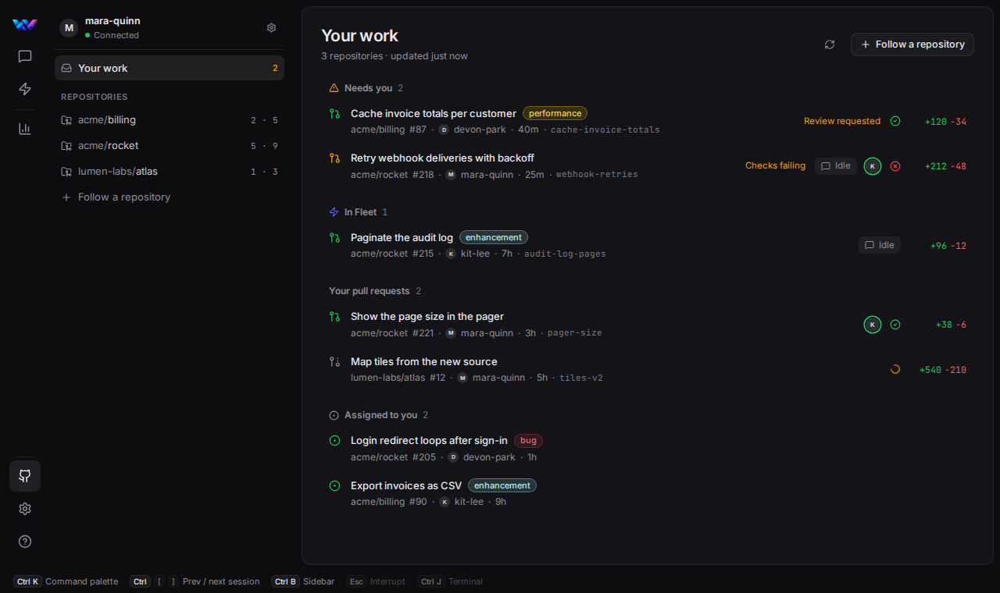
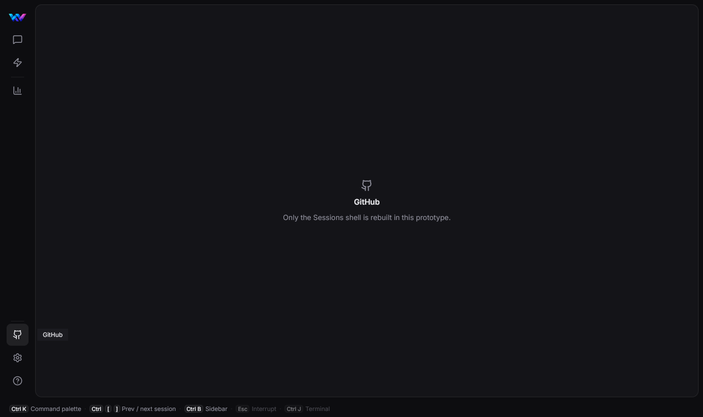
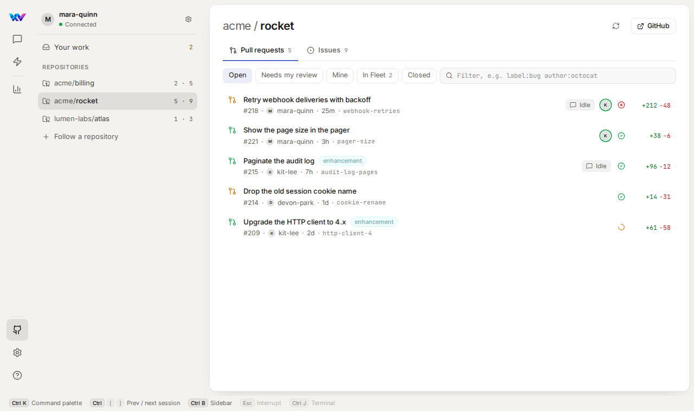
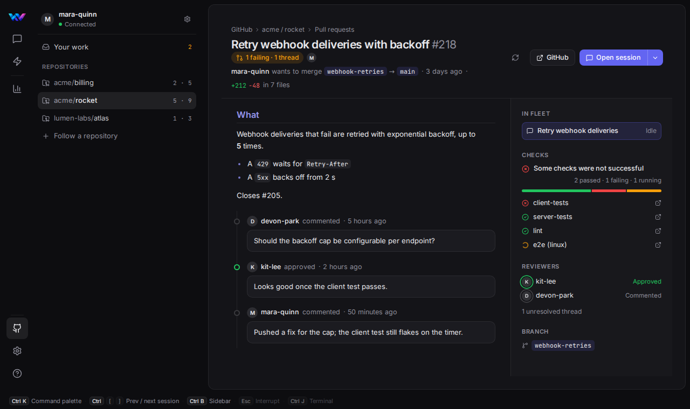
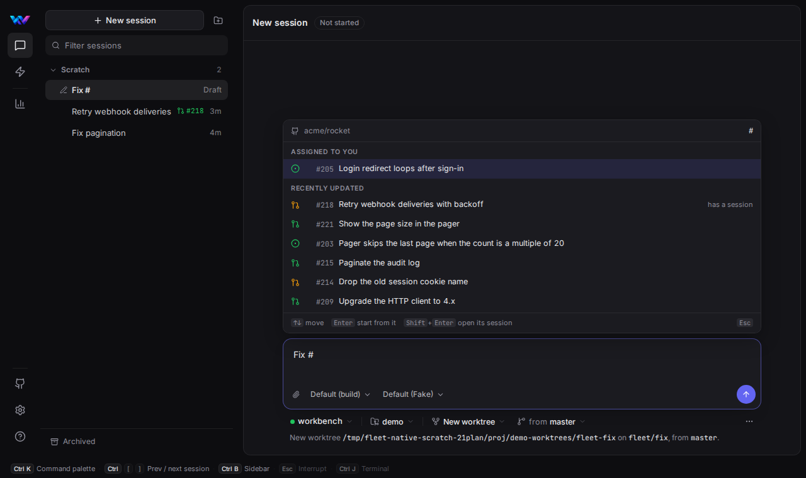
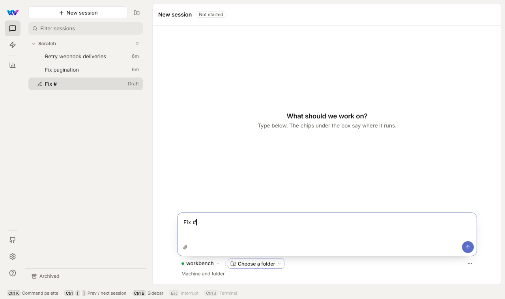

# Component 21: GitHub

The parity checklist for component 21 of `docs/PORT.md`, GitHub: the GitHub rail's panel (the account, Your work, the
repositories you follow), the Your work page with its connect state, a repository's pull requests and issues with their
filters, a pull request's or issue's page, Follow a repository, the `#` picker in the New session box, and the repository
cache the folder picker's Clone view and Settings use. It ends with the pieces it is built in.

- **weave-fleet commit read:** `c1a48bd` (`main`, 20 November 2026).
- **Server the live checks run against:** the scratch Fleet's package, which reports **v0.74.0** (`fdc072e`; the folder is
  still named v0.72.0). `git diff fdc072e c1a48bd` is empty for every file this component reads (`plugins/builtin/github`,
  `components/github`, `lib/github-items.ts`, `lib/github-reference.ts`, `lib/github-session-source.ts`, `lib/pr-state.ts`,
  `composables/use-github-*`, `components/sessions/new-session/GitHubItemPicker.vue`, `plugins/registry.ts`, `slots.ts`,
  `types.ts` and the server's `Plugins/BuiltIn/GitHub/`), so the client that server serves is `main`'s for this component.
- **Native app read:** `main` at `477b096`.
- **No real GitHub, ever.** The server reads GitHub with the token it stores, from `https://api.github.com` (hard-coded in
  `GitHubApiProxy.cs`, `GitHubService.cs`), so a scratch Fleet with no token answers every GitHub route with 401. Fleet's
  pictures here were taken with Playwright answering `/api/integrations/github/*` and `/api/smart-links` itself
  (`page.route`) from invented data: owners `acme` and `lumen-labs`, repositories `acme/rocket`, `acme/billing`,
  `lumen-labs/atlas`, people `mara-quinn` (the signed-in user), `devon-park`, `kit-lee`, and two real scratch sessions linked
  to `acme/rocket#218` and `#215`. The demo project got the remote `https://github.com/acme/rocket.git` for the `#` picker,
  and the machine was renamed `workbench` (`PUT /api/machine {"name":…}`) so its host name shows nowhere. Piece C turns this
  into a stand-in both clients can use (`scripts/github-standin.py`, below). Never the owner's account or token, never a real
  owner, repository, issue or person.
- **Paths** are weave-fleet's under `client/src/` unless they start with `src/`, `docs/` or `server:`. Short names, all under
  `plugins/builtin/github/` unless given: IDX `index.ts`, CON `contributions.ts`, GP `GitHubPanel.vue`, GS `GitHubSettings.vue`,
  GBP `pages/GitHubBrowserPage.vue`, GRP `pages/GitHubRepoPage.vue`, GWD `pages/GitHubWorkItemDetailPage.vue`, GIR
  `components/GitHubItemRow.vue`, GSC `components/GitHubSessionChip.vue`, ARD `components/AddRepositoryDialog.vue`, IFB
  `components/IssueFilterBar.vue`, FEF `components/FilterExpressionField.vue`, LF/AUF/MF/ASF/SC
  `components/filters/LabelFilter.vue`, `AuthorFilter.vue`, `MilestoneFilter.vue`, `AssigneeFilter.vue`, `SortControl.vue`,
  GT `composables/github-types.ts`, UGA `composables/use-github-auth.ts`, UGB `composables/use-github-bookmarks.ts`, UGR
  `composables/use-github-repos.ts`, UGM `composables/use-github-metadata.ts`, IFQ `lib/issue-filter-query.ts`, FE
  `lib/filter-expression.ts`. Core files GitHub reads: GI `lib/github-items.ts`, GSS `lib/github-session-source.ts`, GR
  `lib/github-reference.ts`, UGW `composables/use-github-work.ts`, UGS `composables/use-github-search.ts`, UGSE
  `composables/use-github-sessions.ts`, UGP `composables/use-github-picker.ts`, GIP
  `components/sessions/new-session/GitHubItemPicker.vue`, NSC `components/sessions/NewSessionComposer.vue`, SL
  `lib/smart-links.ts`, SLS `stores/smart-links.ts`, PRS `lib/pr-state.ts`, the small parts under `components/github/`
  (`CheckIcon`, `ChecksSummary`, `DiffStat`, `GitHubItemIcon`, `GitHubLabel`, `PrBadge`, `PrStatePill`, `ReviewerAvatar`),
  `routes/github*.tsx`. Server: GEM `src/WeaveFleet.Infrastructure/Plugins/BuiltIn/GitHub/GitHubEndpointMappings.cs`.
- **Row numbers:** 1.x the plugin and its places; 2.x the rail panel; 3.x Follow a repository; 4.x Your work: connecting;
  5.x Your work: the page; 6.x an item's row and its session chip; 7.x Fleet's side (a GitHub item's sessions, opening,
  starting); 8.x a repository's page; 9.x the issue filter bar; 10.x an item's page: states, header and actions; 11.x an
  item's page: body and conversation; 12.x an item's page: the side rail; 13.x the `#` picker; 14.x the data, the stores and
  the routes; 15.x rows handed in by other components; 16.x out of reach.

The gap, visible in the pictures (each one's other theme is in the same folder, with more states: `fleet-connect-*`,
`fleet-repo-issues-*`, `fleet-repo-label-menu-*`, `fleet-repo-hover-*`, `fleet-issue-*`, `fleet-pull-menu-*`,
`fleet-follow-*`): Fleet's GitHub rail opens `[github-panel][github-page]`: the panel names the account, counts what needs
you and lists the repositories you follow with their open pull requests and issues; the page is Your work (what needs you
and why, what Fleet's sessions are on, your pull requests, what's assigned to you), a repository's pull requests and issues
with filters, or one item's page with its conversation, checks, reviewers and the sessions working on it, and a button
that starts a session from it, opens it, or sends it the failing checks. In the New session box, `#` lists the folder's
repository's open items. The native app has the rail entry and a notice ("Only the Sessions shell is rebuilt in this
prototype."), and `#` stays text. Pictures at 1280×760, `TZ=UTC`; Fleet's with Playwright, the native ones live against the
same scratch Fleet (the light ones with the theme toggled by the script in a scratch data folder).

## What "done" means

1. The GitHub rail opens `[github-panel][github-page]` as in Fleet: the panel (account, Your work with its count, the
   repositories you follow with their counts, Follow a repository, Stop following, the settings gear) and the page the
   panel picked.
2. Your work shows the connect state when GitHub isn't connected (device flow on the page, the PAT link into Settings),
   and once connected Needs you, In Fleet, Your pull requests and Assigned to you, each row with its state, checks,
   reviewers, diff and the session working on it; Refresh and Follow a repository.
3. A repository's page lists its pull requests (Open, Needs my review, Mine, In Fleet, Closed, a typed filter) and issues
   (the expression field, Open/Closed, Label, Author, Milestone, Assignee, Sort), pages with Load more, and says when it's
   loading, failed or empty, in Fleet's words.
4. An item's page shows its state, branches, description and conversation, its sessions, checks, reviewers, linked pull
   requests, labels, assignees and branch, and its button starts a session from it (the New session page with the item
   attached), opens the session on it, or sends that session the failing checks and open threads.
5. `#` in the New session box lists the folder's repository's items, keys and all; picking one attaches it.
6. **The plugin seam holds** (the owner's rule, Fleet memory 83782aa9): nothing outside `src/plugins/` names the GitHub
   plugin; it fills places core offers (rail item and panel, page, settings page, `#` picker, repository source, board
   source), registered in one place, and a test fails a core file that imports it.
7. Fleet's tests for it pass here under the same names (list below).

## The plugin seam (how native keeps the owner's rule)

Fleet's core never imports the GitHub plugin except in `main.ts`, which registers its manifest
(`pluginRuntime.registerPlugins([githubPluginManifest, …])`). The manifest (IDX) contributes a sidebar item and panel, a
config page, a repository source and a board source; the routes `/github/*` are files that import the plugin's pages.
Fleet's core *does* carry GitHub code of its own: `lib/github-items.ts`, `use-github-work`, `use-github-search`,
`use-github-sessions`, `use-github-picker` and `GitHubItemPicker.vue` live in core folders and `NewSessionComposer.vue`
imports them (component 7's B10 note). Native is stricter, as component 7 decided: **all of that is the plugin's**.

- **Core's places** (new `src/fleet/places.rs`, piece A): a registry on `State` (`State.places`) of what plugins add, by
  plugin id: a rail item (`Rail::Plugin(id)` with label, icon, path, order, placement), the rail panel and the page as
  `fn(&State, &Theme) -> El`, the Settings page body (`fn(&State, &Theme) -> El`, replacing `plugin_page.rs`'s
  `if p.id == "github"`), the manifest row Settings › Plugins lists (descriptor and `Added` list, out of
  `fleet/settings/plugins.rs`'s fixed table), a `keep` hook run from `State::poll` (`fn(&mut State, f64, &mut Tx) -> bool`,
  replacing `keep_github`), and the existing `ItemPickers` (component 7, `places.rs`) and `RepositorySources` (`clone.rs`)
  plus a board-source slot (component 23 reads it). A plugin's own state is a `Box<dyn Any + Send>` in its entry; the
  plugin's handlers reach it with `s.places.state_mut::<GitHub>("github")`.
- **The plugin** is `src/plugins/github/` (logic) and `src/plugins/github/view/` (its screens). Its views live with it,
  not under `src/view/`, because core never imports it; AGENTS.md's "one file per panel under `src/view/`" holds inside the
  plugin's own `view/` folder (piece A says so in AGENTS.md).
- **The composition root** is `src/plugins/mod.rs` `register(&mut State)`, called once from `State`'s constructor: the
  only line outside `src/plugins/` that names a plugin, as `main.ts` is in Fleet.
- **The guard** (piece A): a test in the style of `test_http::tests::fakes_read_requests_through_test_http` reads every
  `.rs` file under `src/` outside `src/plugins/` and fails one that names `plugins::github` (the composition root's one
  call excepted).
- **What stays core**, as in Fleet: smart links and their store, `pr_state`, the PR pill and popover, the Context tab's
  links, the small parts under `src/view/gh/` (Fleet's `components/github/`, built by component 8 and used by both), the New
  session box's `#` trigger, preset chip and `GitHubPreset` (component 7 M), `connect_github` (it opens Settings › Plugins ›
  GitHub by id, as Fleet navigates to `/settings/plugins/github`).
- **Moved into the plugin** (piece A): `src/fleet/settings/github_auth.rs`, `src/view/settings/github_connect.rs`,
  `src/view/settings/github_scene.rs`, `src/tests_settings_github.rs` and `SettingsNav.github` (Fleet's GS and UGA are the
  plugin's).

## What the native app already has

| Part | State | Where |
|---|---|---|
| The rail entry (Github icon, "GitHub", `/github`, placement plugin, order 100, gone while `plugins.disabled` holds `github`) | Done (component 9 A, 16) as core's `Rail::GitHub`; A makes it the plugin's | `src/fleet/rails.rs`, `src/view/rail.rs` |
| The rail opens a notice ("Only the Sessions shell is rebuilt in this prototype.") | To replace (A routes it to the plugin; D and G draw it) | `src/view.rs` `notice` |
| A rail view with its own list and detail at the session list's width and gutter | Done for Workflows (18) and Automations (19); the pattern | `src/view.rs` `root`, `src/view/workflows/mod.rs` |
| Settings › Plugins (the list, the switch, the plugin page) and GitHub's connection page (device flow, PAT, disconnect; `Github` state with `keep_github` polling) | Done (16 AB-AF) in core; A moves GitHub's part into the plugin | `src/fleet/settings/plugins.rs`, `src/view/settings/plugin_page.rs`, `src/fleet/settings/github_auth.rs`, `src/view/settings/github_connect.rs` |
| The repository cache row on the connection page ("No repositories cached yet.", Refresh does nothing) | Placeholder (16, row 11.38) | `src/view/settings/github_connect.rs` |
| `GET /api/plugins` statuses every 30 s | Done | `src/fleet/plugin_poll.rs`, `src/fleet/rails.rs` `PluginStatuses` |
| Smart links: wire parsing, header links per session (`header_links_loaded`, `sessions_for`, `header_links`), `link_number`, `link_title`, `link_href`, labels, reviewers, diff, `summarize_checks`, `ci_status`, `check_state`, `review_threads`, `format_fix_prompt`, the `smart_link.updated` feed | Done (component 8) | `src/fleet/smart_links.rs`, `src/fleet/smart_link_feed.rs` |
| `pr_state`: `PrFacts`, `pr_state`, `pr_words`, `pr_state_label`, `checks_from_rollup`, `checks_from_counts`, `review_decision`, `parse_reviewers`, `reviewer_words`, `CheckCounts` | Done (component 8) | `src/fleet/pr_state.rs` |
| The small parts: `check_icon`, `checks_summary`, `diff_stat`, `item_icon` (+ `tone`), `label`, `pr_state_pill`, `reviewer_avatar` (initial only) | Done (component 8 F); a `gh-parts` scene | `src/view/gh/` |
| Send to agent (`SendToAgent`: sending, sent, error per session and key; `FIX`) | Done (component 8) | `src/fleet/send_to_agent.rs` |
| The `#` place: `ItemPicker` trait (sync `search(folder, query)`), `ItemPickers`, `find_hash_trigger`, `remove_trigger`, `pick_item`, `repository_for_preset`; the attached item's chip and removal; the initial source a page hands the New session page (`set_initial_source`, `take_initial_source`) | Done (component 7 M); inert with nothing registered. M grows the trait (groups, loading, error, the popup) | `src/fleet/new_session/places.rs`, `refs.rs`, `draft.rs`, `src/view/new_session_refs.rs` |
| A repository's remotes with the server's `github {owner, repo}` | Done (component 7 C) | `src/fleet/new_session/feeds.rs` |
| `RepositorySources` (the Clone view's suggestions) | Done (component 7 H), inert until C registers GitHub's | `src/fleet/new_session/clone.rs` |
| Session rows' status (`row_status`, `status_glyph`), the sessions list, opening a session, the Sessions rail and panel | Done (components 2, 6) | `src/fleet/row_status.rs`, `src/view/parts.rs` |
| `RelativeTime` compact (`ui::age`), long form (`format_relative`) | Done | `src/ui/age.rs`, `src/fleet/row_status.rs` |
| Markdown (Fleet's `.md-content`) | Done (component 3) | `src/view/prose.rs` |
| Dialog, menus, select, the palette's search-and-list (`score`), toasts, spinner, `EmptyState` (compact and full), `ErrorNote` | Done; `PageHeader` with a trail and actions exists privately in Settings, Workflows and Automations: the first piece here that needs one shares it in `src/ui/` | `src/ui/` |
| Opening a URL in the browser (`tx.open_url`) | Done | Rune |
| Theme: `pr_tone`, `pr_tone_text`, `check_pass/fail/pending`, `accent_dim`, `status_waiting_text`, `wash`, `primary_fg` | Done | `src/theme.rs` |
| Icons `GITHUB`, `FOLDER_GIT_2`, `SETTINGS`, `X`, `PLUS`, `COPY`, `EXTERNAL_LINK`, `REFRESH_CW`, `TRIANGLE_ALERT`, `ZAP`, `CIRCLE_DOT`, `CIRCLE_CHECK`, `GIT_PULL_REQUEST`, `SEARCH`, `CHECK`, `STAR`, `MESSAGE_SQUARE`, `CHEVRON_DOWN`, `GIT_BRANCH`, `SPARKLES` | Generated | `src/icons.rs` |
| `Inbox`, `Tag`, `User`, `UserCheck`, `Milestone`, `ArrowUpDown`, `Lock` | **Missing**: the piece that draws one adds it with `tools/gen-icons.py` | |

## The checklist

### 1. The plugin and its places

| # | Fleet | Source | Native |
|---|---|---|---|
| 1.1 | Descriptor: id `github`, "GitHub", built-in, front end and back end, "Pull requests, issues and checks beside your sessions." | IDX | Done (A): the plugin's own `entry()` in `src/plugins/github/mod.rs`; core lists it from `Places::manifests` |
| 1.2 | Sidebar item `{viewId github, label GitHub, icon Github, defaultPath /github, order 100}`; sidebar panel `GitHubPanel` order 100 | IDX | Rail item: done (A), the plugin's through `places` (`Rail::Plugin("github")`); the panel: D draws it (until then the rail shows the notice) |
| 1.3 | Config page "GitHub integration", nav label "GitHub", icon Github, `GitHubSettings` | IDX, GS | Done (A): the connection page is the plugin's `settings` place (`src/plugins/github/view/connect.rs`) |
| 1.4 | Repository source `github` (Github icon): your repositories `{id, fullName, name}` for the Clone view, loading only when the view asks (`autoLoad: false`) | CON | None (C) |
| 1.5 | Board source `github`: the description, the empty hint (16's 11.56), your bookmarks with `isLoading`, `error`, `refresh` | CON | None (N registers it once component 23 offers the place) |
| 1.6 | Routes: `/github` (Your work), `/github/$owner/$repo` (a repository), `/github/$owner/$repo/pulls/$number`, `/github/$owner/$repo/issues/$number` | `routes/github*.tsx` | Done (A): `Where` (Home, Repo, Item) with `parse`/`path` in `src/plugins/github/where_.rs`; the pages that follow it are D-L |
| 1.7 | Switched off (`plugins.disabled` holds `github`): rail, panel, settings page, Clone suggestions and board source are gone (`registry.ts isPluginEnabled`) | `plugins/registry.ts` | Done (A) for rail, page, settings page and `keep` (the places skip an off plugin; test "a plugin switched off adds nothing"); Clone suggestions (C) and the board source (N) skip it when they register |
| 1.8 | Core never imports the plugin; `main.ts` registers it | `main.ts` | Done (A): `src/plugins/mod.rs` `register`, and `plugins::tests_seam` "core never imports the GitHub plugin" (with a planted-import twin) |

### 2. The rail panel (`[github-panel]`)

| # | Fleet | Source | Native |
|---|---|---|---|
| 2.1 | Panel: column, gap 1, padding 4 6, full height | GP `.github-panel` | None (D) |
| 2.2 | Account row: gap 9, margin-bottom 6, padding 6 6 10, bottom border. Avatar 24 (`ReviewerAvatar`) when the work answer has a login, else a 24 px circle at 10 % text | GP `.panel-account` | None (D) |
| 2.3 | Name: the login or "GitHub", 12.5 px 600, ellipsis. Status under it: 11 px muted, a 6 px dot (`--error`, `--running` when connected), "Connected" / "Not connected" | GP | None (D) |
| 2.4 | Gear: 22×22 icon button, radius 5, muted, hover 8 % wash and text; Settings 13; title "GitHub settings"; opens Settings › Plugins › GitHub | GP `openSettings` | None (D) |
| 2.5 | **Your work** row (`github-panel-home`, Inbox 14): opens `/github`; current while there. Count (hot, `--pr-blocked-text`) = `needsYou(work).length`, title "{n} need you", hidden at 0 | GP | None (D) |
| 2.6 | Rows: min-height 32, gap 8, padding 0 8, radius btn, 13 px, text 86 %; hover 5 % wash and text; current 9 % wash, text, 500; focus ring 2 px accent inset; icon muted; name ellipsis | GP `.panel-row` | None (D) |
| 2.7 | The rest only when connected. Heading "REPOSITORIES": margin 12 8 4, muted 80 %, 11 px 600, letter-spacing .06em, uppercase | GP `.panel-heading` | None (D) |
| 2.8 | Loading (no bookmarks yet and loading): the spinner (16) centred, padding 12, label "Loading the repositories you follow…" (`github-bookmarks-loading`) | GP | None (D) |
| 2.9 | Failed (no bookmarks, an error): compact `ErrorNote` "Couldn't load the repositories you follow." with the reason, margin 0 12 (`github-bookmarks-error`) | GP | None (D) |
| 2.10 | Empty: compact `EmptyState` "Follow a repository to see its pull requests and issues here" | GP | None (D) |
| 2.11 | A followed repository: FolderGit2 14, `owner/` muted then the name, title the full name, opens `/github/owner/name`; current when the path is it or under it (not a repository whose name only starts the same) | GP `isCurrent` | None (D) |
| 2.12 | Its counts "{open pull requests} · {open issues}" (mono 11, tabular, muted; title "Open pull requests · open issues"), from the work answer's `repos`, matched ignoring case | GP `countsFor` | None (D) |
| 2.13 | **Stop following** (X 11, 22×22, absolute right 5, title/label "Stop following {full name}"): shown on the row's hover or its own focus, the counts hidden meanwhile; removes the bookmark, then reloads the work | GP `.bookmark-remove`, `handleRemove` | None (D) |
| 2.14 | **Follow a repository** (Plus 14, muted row, `github-panel-add`): opens the dialog (3.x); its `added` reloads the work | GP | None (D, E) |
| 2.15 | Loads the work when mounted connected, and when it becomes connected | GP | None (D) |
| 2.16 | The panel is the session list's width with its gutter, and Ctrl/Cmd+B hides it, as every rail's | `AppShell.vue` | None (D): the rail view pattern |

### 3. Follow a repository (`AddRepositoryDialog`)

| # | Fleet | Source | Native |
|---|---|---|---|
| 3.1 | Dialog titled "Follow a repository"; a command list with the search "Search your repositories…" (filters as you type, cmdk's matching) | ARD | None (E) |
| 3.2 | Opening it reloads the repository cache (`refresh()`, kept if fresh: 15 min) | ARD `watch(open)` | None (E) |
| 3.3 | Lists the cached repositories not already followed. A row: Github 14, the full name (ellipsis), Lock 12 muted when private, the language as a pill (padding 1 6, full radius, 7 % wash, muted, 11 px), Star 10 and the count (muted 11) when starred | ARD | None (E) |
| 3.4 | Nothing to show: "Loading repositories…" with a small spinner while loading, else "No repositories found." | ARD `CommandEmpty` | None (E) |
| 3.5 | Picking one follows it (`POST …/bookmarks {repo}`), closes, emits `added` (the panel and Your work reload the work) | ARD `add` | None (E) |
| 3.6 | Keys: the command list's Up/Down/Enter; Esc and the close button shut it | `components/ui/command`, `dialog` | None (E): the palette's keys |

### 4. Your work: connecting

| # | Fleet | Source | Native |
|---|---|---|---|
| 4.1 | While the status loads and it isn't known to be connected, nothing; not connected: the connect section (`github-connect`): a 440 px column, centred, 12 vh from the top, gap 12, centred text | GBP `.gh-connect` | None (G) |
| 4.2 | Github 34 muted; "Connect GitHub" 20 px 600; "See which pull requests need you, watch each session's checks and reviews, and start a session from any issue." muted, line-height 1.5 | GBP | None (G) |
| 4.3 | **Connect with GitHub** (`github-connect-start`, primary, 34 high, Github 14, a spinner instead while starting, disabled while starting): starts the device flow (16's `github_connect_device`) | GBP | None (G); the flow is done (16 AF) |
| 4.4 | Waiting box (card, padding 16, gap 10, centred): "Enter this code at {address without https://}" (the address mono, a link), the code (mono 24, 500, letter-spacing .2em), **Copy code** (Copy 13) and **Open GitHub** (ExternalLink 13) buttons, a spinner with "Waiting for you to approve it (the code works for {n} more minutes)…" (the minutes rounded, the bracket left out at 0), **Cancel** (a link button) | GBP | None (G); the countdown on the clock |
| 4.5 | After a failed try: TriangleAlert 14 with "The code expired. Start again for a new one.", "GitHub says the request was denied." or the error's message, `--error-text` 12.5 px, above the button | GBP | None (G) |
| 4.6 | **Use a personal access token instead** (link button, muted 12.5, hover text): opens Settings › Plugins › GitHub | GBP `openSettings` | None (G) |
| 4.7 | Connecting loads the work at once (`load(true)`); leaving the page stops the device polling (UGA `onUnmounted`) | GBP, UGA | None (G) |

### 5. Your work: the page (`/github`)

| # | Fleet | Source | Native |
|---|---|---|---|
| 5.1 | Page: column, gap 22, max-width 1080, centred | GBP `.gh-home` | None (G) |
| 5.2 | `PageHeader` "Your work"; the line under it: "Everything you're involved in" with no bookmarks, else "{n} repository/repositories", then " · updated {relative time}" once loaded (ticks) | GBP `scope` | None (G) |
| 5.3 | Actions: **Refresh** (ghost icon button, RefreshCw 14, a spinner while loading, disabled while loading, title "Refresh") forces a reload; **Follow a repository** (Plus 14) opens the dialog | GBP | None (G) |
| 5.4 | Buttons: 30 high, padding 0 11, 1 px border, radius btn, card fill, 12.5 px 500; disabled at 70 %; ghost: no border, no fill, muted; primary: accent, `--primary-foreground`; focus ring 2 px accent offset 1 | GBP `.gh-home__btn` | None (G) |
| 5.5 | An error: TriangleAlert 14 and the message, `--error-text` 13 px | GBP | None (G) |
| 5.6 | First load: the spinner (16) and "Asking GitHub what needs you…" muted | GBP | None (G) |
| 5.7 | A bucket: grid gap 2; its title 12 px 600 muted, padding 0 10, margin-bottom 4, gap 7, an icon, then the count (mono, muted 75 %, 400) | GBP `.gh-home__bucket*` | None (G) |
| 5.8 | **Needs you** (`github-needs-you`, TriangleAlert 13 in `--pr-blocked`): review requests ("Review requested"), then your pull requests something blocks, each with why (`prWords`) | GBP, GI `needsYou` | None (G; B for the list) |
| 5.9 | **In Fleet** (`github-in-fleet`, Zap 13 accent): items a session's header links point at, open (`!isTerminal`), resolved, not already under Needs you, with a live session; one row per item, newest update first; the row built from the link (`summaryFromLink`), no request to GitHub | GBP `inFleet` | None (G; B for `summary_from_link`) |
| 5.10 | **Your pull requests** (no icon): yours that nothing blocks, not listed above | GBP, GI `yourPullRequests` | None (G) |
| 5.11 | **Assigned to you** (CircleDot 13): not listed above | GBP | None (G) |
| 5.12 | Rows show the repository (`show-repo`); a row opens the item's page, its Start session starts one, its session chip opens the session (6.x, 7.x) | GBP | None (G) |
| 5.13 | Nothing in any bucket: `EmptyState` (Github) "Nothing needs you", "No review requests, open pull requests or assigned issues." (" in the repositories you follow" before the full stop when following any), padding 48 0 | GBP | None (G) |
| 5.14 | Loads once when opened connected (kept for 60 s, shared with the panel) | GBP, UGW | None (G; C for the store) |

### 6. An item's row and its session chip

| # | Fleet | Source | Native |
|---|---|---|---|
| 6.1 | Row (`github-row`, a button, focusable): grid 18 / 1fr / auto, gap 2 10, padding 8 10, radius btn; hover or focus within: 5 % wash; focus ring 2 px accent inset; Enter or Space opens it | GIR | None (F) |
| 6.2 | Its title and label: "{Pull request/Issue} #{n}: {title}", then " · {prWords}" for an open pull request, then " · {n} comment(s)" | GIR `description` | None (F) |
| 6.3 | Icon (15, spanning both lines, margin-top 2): `GitHubItemIcon` by kind and state (`prState` for a pull request; open/closed for an issue) | GIR | None (F): `gh::item_icon` |
| 6.4 | First line: the title (13 px 500, ellipsis), then up to 3 labels (`GitHubLabel`); clicking a label emits `label` (the repository page filters by it) and doesn't open the row | GIR | None (F) |
| 6.5 | Second line (muted 12, gap 6, no wrap): `owner/repo` (with `show-repo`), `#n`, then "·" avatar 14 and the author, "·" the update time (compact), "·" the head branch (mono 11, muted 85 %, ellipsis) | GIR `.gh-row__meta` | None (F) |
| 6.6 | Right side, at rest (gap 12, muted): the reason ("Review requested", `--pr-blocked-text` 11.5), the session chip, up to 3 reviewers who approved or asked for changes (avatars 16 with their ring), the check icon (14) for failing/pending/passing, the diff (min-width 72, right-aligned) | GIR `.gh-row__signals` | None (F) |
| 6.7 | On hover or focus within, the right side swaps to the actions (gap 4): **Open session** (MessageSquare 12) when a session is on it, else **Start session** (`github-row-start`, primary, Plus 12); **Open on GitHub** (ghost, ExternalLink 12, a link) | GIR `.gh-row__actions` | None (F) |
| 6.8 | Action buttons: 24 high, padding 0 8, radius 6, 1 px border, card fill, 12 px 500; primary accent; ghost muted | GIR `.gh-row__btn` | None (F) |
| 6.9 | Session chip (`github-session-chip`): 22 high, padding 0 8, radius 6, 6 % wash, muted 11.5; working: `--accent-dim` and text; waiting for input: `--status-waiting` 14 % and its text. The live session's `StatusGlyph`, else MessageSquare 12; the words "Needs you" (waiting for input), the working description, or "Idle"; "+{n}" for more sessions; title "In Fleet: {names, 'Untitled session' for none}"; a click opens the first | GSC | None (F) |

### 7. Fleet's side: a GitHub item's sessions

| # | Fleet | Source | Native |
|---|---|---|---|
| 7.1 | `sessionsFor("owner/repo#n")`: the sessions whose header links point at it (smart links, ignoring case), not archived, most recently active first | UGSE, SLS `sessionsFor` | None (F): `smart_links::sessions_for` and the session list |
| 7.2 | The pages load the active sessions list and the header links when mounted (the list isn't on screen) | UGSE | None (F) |
| 7.3 | Open a session: `/sessions/$id` on its machine (`instanceId`) | UGSE `openSession` | None (F) |
| 7.4 | Start a session from an item: the panel opens, the rail goes to Sessions, *then* the item becomes the New session page's initial source and the page opens (`itemSessionPreset(item, body)`: the body only from an item's page) | UGSE `startSession`, GI | None (F): `set_initial_source` exists |

### 8. A repository's page (`/github/$owner/$repo`)

| # | Fleet | Source | Native |
|---|---|---|---|
| 8.1 | Page: column, gap 12, max-width 1080, centred. Loads the work (for the counts) | GRP | None (I) |
| 8.2 | `PageHeader`, title "{owner} /" (muted, 400) then the name; actions **Refresh** (ghost, spinner while the list loads, disabled then) and **GitHub** (ExternalLink 13, a link to the repository) | GRP | None (I) |
| 8.3 | Tabs (tablist "Pull requests and issues"): **Pull requests** (GitPullRequest 14) and **Issues** (CircleDot 14), each with its open count from the work (mono 11, muted 80 %); 8 12 padding, 13 px 500 muted, a 2 px accent underline on the selected, hover text; bottom border under the row | GRP `.gh-repo__tab*` | None (I) |
| 8.4 | Pull request filters (chips 28 high, padding 0 10, 1 px border, radius btn, muted 12.5; pressed: no border, `--accent-dim`, text): **Open** (`is:open`), **Needs my review** (`is:open review-requested:@me`), **Mine** (`is:open author:@me`), **In Fleet** (with the count of linked pull requests), **Closed** (`is:closed`); `github-pull-filter-{id}` | GRP `PULL_FILTERS` | None (I) |
| 8.5 | The filter box: Search 13, mono 12 input, placeholder "Filter, e.g. label:bug author:octocat", label "Filter pull requests", flex 1, min 220, 30 high, 3 % wash; disabled under In Fleet | GRP `.gh-repo__search` | None (I) |
| 8.6 | The pull request query: `repo:{o}/{r} is:pr {qualifier} {typed} sort:updated-desc`, spaces collapsed; none on the Issues tab or In Fleet | GRP `pullQuery` | None (I; H for the search) |
| 8.7 | In Fleet: the pull request numbers of this repository any session's header links point at, newest number first, fetched by number (`items?numbers=`); a new set of numbers reloads, a stale answer is dropped; error "GitHub didn't answer." by default | GRP `fleetNumbers`, `fleetPulls` | None (I) |
| 8.8 | Issues tab: the filter bar (9.x) and its query `repo:{o}/{r} is:issue {issueFilterQuery}` | GRP `issueQuery`, IFQ | None (I; J for the bar) |
| 8.9 | Clicking a label in a row: on Pull requests it adds or removes `label:x` (quoted when it has a space) in the typed filter; on Issues it toggles the label in the filter | GRP `toggleLabel` | None (I) |
| 8.10 | The list (grid gap 1): first load, a spinner, centred, padding 40 16; an error: TriangleAlert 14 (`--error`), the message (text colour) and **Try again**; nothing: the words by filter: Issues "No issues match.", Needs my review "Nobody is waiting on your review here.", Mine "You have no open pull requests here.", In Fleet "No session is working on a pull request here.", Closed "No closed pull requests match.", else "No open pull requests match." (muted 13) | GRP | None (I) |
| 8.11 | Rows without the repository; a row opens the item's page; Start session and the session chip as 6.x | GRP | None (I) |
| 8.12 | **Load more** (centred, margin-top 8, padding 6 12, muted 12.5, hover wash) while there are more; "Loading…" and disabled meanwhile | GRP | None (I) |
| 8.13 | Refresh and Try again reload the list on screen (nothing for In Fleet's); the tab, filter and text are kept while on the page, reset when another repository opens | GRP | None (I) |

### 9. The issue filter bar

| # | Fleet | Source | Native |
|---|---|---|---|
| 9.1 | Bar: column, gap 8, padding 10 0 4; the expression field, then a row of controls (gap 2, wraps) | IFB | None (J) |
| 9.2 | Expression field: 32 high, padding 0 28 0 30, 1 px border (accent when focused), radius btn, card fill, mono 12; Search 13 at left 8 (a small spinner while searching); placeholder "Filter issues… e.g. is:open label:bug author:octocat" | FEF | None (J) |
| 9.3 | It shows the filter serialised (`serializeFilterExpression`); focusing starts an edit from it; Enter commits (parse, then blur), Esc drops the edit, leaving the field commits | FEF | None (J) |
| 9.4 | Clear (X 11 in a 20×20 button at right 4, label "Clear filters") while the serialised filter isn't empty: back to the defaults | FEF | None (J) |
| 9.5 | **Open** (CircleDot 12) and **Closed** (CircleCheck 12): the `filter` button look (transparent, muted 11 px, hover `--main-bg` and text; active `--accent-dim` and `--accent-text`), `sm`: 28 high (`h-8`), padding 0 8.75 with an icon, gap 5.25 | IFB, `ui/button` `filter` | None (J) |
| 9.6 | A 1×16 separator (`--border`, margin 0 4) | IFB | None (J) |
| 9.7 | **Label** (Tag 12): a popover (256 wide, no padding) with "Filter labels…", a checkbox (14, radius 3; checked accent with Check 10) and a 10 px dot in the label's colour per label; many at once; the badge counts them (16 high, `--accent-text` on accent 20 %, 10 px 600) | LF | None (J) |
| 9.8 | **Author** (User 12): popover 224 wide, "Filter authors…", "Clear selection" first while one is chosen, rows Check 13 (shown on the chosen one), a 16 px avatar, the login; choosing the chosen one clears; the popover closes on a choice; badge "1" | AUF | None (J) |
| 9.9 | **Milestone** (Milestone 12): as Author, plus "No milestone" (`none`) and under each title "{open} open · {closed} closed"; "Filter milestones…" | MF | None (J) |
| 9.10 | **Assignee** (UserCheck 12): as Author, plus "Unassigned" (`none`); "Filter assignees…"; uses the repository's assignees (Author does too) | ASF | None (J) |
| 9.11 | In each popover: a small spinner while loading with nothing yet; "No labels found." / "No users found." / "No milestones found." / "No assignees found." when there are none | LF, AUF, MF, ASF | None (J) |
| 9.12 | **Sort** (right-aligned; ArrowUpDown 12, the current label, 28 high, 11 px): a menu (192 wide) of radio items Recently updated, Least recently updated, Newest, Oldest, Most commented | SC | None (J) |
| 9.13 | Each change re-asks GitHub (the search waits 250 ms after the last change) | GRP, UGS | None (J; H) |

### 10. An item's page: states, header and actions (`/github/$owner/$repo/pulls|issues/$number`)

| # | Fleet | Source | Native |
|---|---|---|---|
| 10.1 | Page: column, full height, scrolls; `aria-busy` while loading or refreshing; a new owner, repository or number loads again, a stale answer dropped | GWD | None (K) |
| 10.2 | Loading: spinner and "Loading the {pull request/issue}…" (padding 24 28, muted) | GWD | None (K) |
| 10.3 | A bad link: "That isn't a GitHub {noun} link."; a failure: the message (`Connect GitHub in Settings to see this.` for 401, the server's words, or "GitHub didn't answer (HTTP n)."), TriangleAlert 16 (`--error`), **Try again** (RefreshCw 13) | GWD, GI `getJson` | None (K) |
| 10.4 | `PageHeader` (`bar`) with the trail **GitHub › {owner} / {repo} › Pull requests (or Issues)**: the first two go to Your work and the repository | GWD `trail` | None (K): `PageHeader` with a trail |
| 10.5 | Title: the item's title and " #{n}" (muted, 400) | GWD | None (K) |
| 10.6 | Actions: **Refresh** (ghost; spinner while refreshing); **GitHub** (ExternalLink 13, the item's URL); the split button | GWD | None (K) |
| 10.7 | Buttons as 5.4 plus: hover border 18 % text (not on primary); primary hover the accent 88 % toward white | GWD `.gh-btn` | None (K); Rune has no hover border (`docs/RUNE.md`) |
| 10.8 | Split primary (`github-item-primary`): with a session on it and something to fix on an open pull request: Sparkles 13 "Fix failing checks" / "Address review" / "Fix checks and address review" (failing runs from the session's link's CI; its open threads), then "Sent to the session", disabled while sending or once sent, a spinner while sending; with a session and nothing to fix: MessageSquare 13 **Open session**; with none: Plus 13 **Start a session on this branch** (an open pull request) or **Start a session** | GWD `primary`, `fixLabel` | None (K) |
| 10.9 | Fixing sends `formatFixPrompt(link, failing runs, threads)` to the first session as `fix` (`useSendToAgent`); a failure shows under the header (`--error-text` 12) | GWD `sendFix`, `use-send-to-agent.ts` | None (K): `SendToAgent` and `format_fix_prompt` exist |
| 10.10 | The chevron half (label "More ways to work on this", padding 0 7, a 25 % `--primary-foreground` divider): a menu (256 wide): with sessions, "In Fleet" then each session (MessageSquare, name or "Untitled session") opening it, a separator; then Plus **Start another session** (with sessions) or the primary's label | GWD | None (K) |
| 10.11 | The line under the title (wraps, gap 6, muted 12.5; names in text 500): the state pill (`PrStatePill`: kind, state, label = `prWords` for an open or blocked pull request, else `prStateLabel`; issues "Open"/"Closed"), the author's avatar, then "{author} wants to merge {head} → {base}" ("merged" when merged) for a pull request with a branch, else "{author} opened this"; "· {created, long form}"; for a pull request with a diff: "·" the diff and "in {n} file(s)" | GWD `.gh-item__by` | None (K) |
| 10.12 | Branch names: padding 1 6, radius 5, `--accent-dim`, text, mono 11.5, break anywhere | GWD `.gh-branch` | None (K) |

### 11. An item's page: body and conversation

| # | Fleet | Source | Native |
|---|---|---|---|
| 11.1 | Body: grid `1fr 300px`; the main column padding 20 28 32, gap 18 | GWD `.gh-item__body`, `__main` | None (K) |
| 11.2 | Description: Markdown (max 78ch, 13.5 px) of the body without HTML comments (`visibleBody`); none: "No description." muted italic | GWD, GI `visibleBody` | None (K): `view::prose` |
| 11.3 | Conversation (`ol`, label "Conversation"): a 1 px left rule, padding-left 18; each entry padding 9 0, gap 6, an 11 px ring dot at left −24 top 14 (2 px; approved `--check-pass`, changes requested `--pr-blocked`, merged `--pr-merged`, closed `--pr-closed`, else 18 % text; panel fill) | GWD `.gh-timeline*` | None (K) |
| 11.4 | Entry head (wraps, gap 6, muted 12.5): avatar 20, the author ("Someone" with none) in text 500, the words: commented / approved / requested changes / had a review dismissed / reviewed / merged this / closed this / reopened this / marked this ready for review / marked this as a draft / mentioned this in; "· {when}" | GWD `timelineWords`, `timelineTone` | None (K) |
| 11.5 | A mention: a link with the item's icon (12) and "#{n} {title}"; in this repository it opens Fleet's page for it, else GitHub | GWD `openReference` | None (K) |
| 11.6 | A comment's or review's body (not a mention's): Markdown in a card (padding 9 12, 1 px border, radius card, card fill, 13 px, max 78ch) | GWD | None (K) |

### 12. An item's page: the side rail

| # | Fleet | Source | Native |
|---|---|---|---|
| 12.1 | Rail ("Details"): grid gap 20, padding 20 20 32, a left border, 2 % text wash; sections gap 8; headings 11 px 600 uppercase, letter-spacing .06em, muted | GWD `.gh-item__rail`, `.gh-rail__*` | None (L) |
| 12.2 | **IN FLEET**: each session (`github-item-session`): a button (padding 6 8, 30 % accent border, `--accent-dim`, 12.5 px) with its `StatusGlyph` (live) or MessageSquare 12, its name (500, ellipsis), and "Needs you" / its working words / "Idle" (muted 12); opens it. None: "No session is working on this yet." | GWD | None (L) |
| 12.3 | **CHECKS** (pull requests with checks): `ChecksSummary` of the counts, then each check (min 24 high, 12.5 px): `CheckIcon` 13, the name (title "{workflow} / {name}"), a link to it (ExternalLink 12, label "Open {name} on GitHub") | GWD | None (L): `gh::checks_summary` |
| 12.4 | **REVIEWERS** (a pull request with reviewers or open threads): avatar with its ring, the login, the verdict (`reviewerWords`, right, 11.5; approved `--check-pass-text`, changes requested `--pr-blocked-text`); "{n} unresolved thread(s)" | GWD | None (L) |
| 12.5 | **LINKED PULL REQUESTS** (mentions by pull requests): a link row (padding 4 0) with the icon (13, by the mention's state) and "#{n} {title}"; same-repository ones open in Fleet. **Fleet bug seen** (`fleet-issue-*`): a long title runs past the rail's edge instead of ending in an ellipsis (the `li` in the grid `ul` keeps its content's width); reported, not fixed here; native follows whatever Fleet's fix does | GWD `linkedPullRequests` | None (L) |
| 12.6 | **LABELS** (wrap, gap 6) and **ASSIGNEES** (avatar and login rows) | GWD | None (L) |
| 12.7 | **BRANCH** (a pull request with a head): GitBranch 12 and the branch | GWD | None (L) |
| 12.8 | Narrower than 820 px: one column, the rail first with a bottom border instead of the left; narrower than 520: the main column's side padding 16 | GWD `@container` | None (L): the measured width (`docs/RUNE.md`, container query) |

### 13. The `#` picker (from component 7)

Component 7 holds the full rows: **A6.2-A6.10, A6.3** (repository from the remotes), **B10.1-B10.21** (the popup: placement,
roles, head, notes, groups, rows, "has a session", footer, hover, pick) in `docs/parity/07-new-session-and-first-run.md`.
Done there (7 M): A6.1 (the trigger), A6.11, A6.12, A7.x (the preset chip), the `ItemPicker` place. This component's:

| # | Fleet | Source | Native |
|---|---|---|---|
| 13.1 | Registers GitHub's host in core's `ItemPicker` place; core's trait grows what Fleet's picker needs: groups with labels, loading, an error, the repository it searched, and whether an item has a session | NSC, UGP | None (M) |
| 13.2 | The repository: the folder's remotes, `origin` first, the server's `github {owner, repo}`, else the URL read by `parseGitHubRemote` (`github.com[:/]owner/repo(.git)`) | NSC, GR | None (M): the server's part read (7 C); the URL fallback is M's |
| 13.3 | Nothing typed: `repo:{o}/{r} is:open assignee:@me sort:updated-desc` (first 5) and `… is:open sort:updated-desc` (first 8, minus those) as "Assigned to you" and "Recently updated"; a number: that item by number, then a search (first 8) without it, as "Matches"; words: a search (first 10) as "Matches"; empty groups dropped | UGP | None (M) |
| 13.4 | Opening asks at once; typing waits 200 ms; a newer question drops the older answer; no repository or no query asks nothing and clears | UGP | None (M) |
| 13.5 | The popup and its keys (B10.4-B10.20, A6.6-A6.10): drawn by the host above the box, keys routed by core | GIP, NSC | None (M) |

### 14. The data, the stores and the routes

| # | Fleet | Source | Native |
|---|---|---|---|
| 14.1 | `GitHubItemSummary` (kind, owner, repo, number, title, url, state, isDraft, author, avatar, created, updated, comments, labels, head, base, additions, deletions, checks, reviewDecision, mergeable, reviewers, assignees), `GitHubItemPage`, `GitHubCheck`, `GitHubTimelineEntry`, `GitHubItemDetail`, `GitHubRepoCounts`, `GitHubWork`; reviewers normalised wherever they appear | GI | None (B) |
| 14.2 | Errors: 401 "Connect GitHub in Settings to see this."; else the server's `error`, else "GitHub didn't answer (HTTP {status})." | GI `getJson` | None (B) |
| 14.3 | `visibleBody`, `itemResourceId` (`owner/repo#n`), `checkCounts` (skipped and neutral pass), `itemPrFacts` (counts from a page's checks when it has any), `itemSessionPreset`, `summaryFromLink`, `needsYou`, `yourPullRequests`, `itemRoute` | GI | None (B) |
| 14.4 | `issueFilterQuery`; `parseFilterExpression` (tokens with quoted values; is, label (no repeats), milestone, assignee, author, type, sort `field-dir`; anything else kept as search words) and `serializeFilterExpression` (defaults left out, values with space, `"` or `:` quoted and escaped, search last); `DEFAULT_ISSUE_FILTER` | IFQ, FE, GT | None (B) |
| 14.5 | Work: one copy shared by the panel and Your work, kept 60 s, one request in flight, `refresh` forces; the error's message or "Couldn't load your GitHub work." | UGW | None (C) |
| 14.6 | Bookmarks: shared; loaded once when first used (one request in flight); sorted by full name; add (`POST {repo}`, no-op when present), remove (`DELETE …/bookmarks/{owner}/{repo}`, "Invalid bookmark name." for a bad one), replace (`PUT {bookmarks}`); errors from `error`, `message` or the fallbacks ("Failed to fetch bookmarks from server.", "Failed to add bookmark.", "Failed to remove bookmark.", "Failed to sync bookmarks."); the answer may be a list or `{bookmarks}` | UGB | None (C) |
| 14.7 | Repository cache: `GET …/repos?page=N&per_page=100&sort=updated` until a page is short; kept 15 min; one request in flight; a generation drops an answer after `clear`; `clear` on disconnect; error "Failed to fetch repositories." | UGR | None (C) |
| 14.8 | Search: a page of 30 (`first`), `after` cursor; the first query goes at once, later ones after 250 ms; a newer query drops the older answer; null clears; `loadMore` appends; error "GitHub search failed." | UGS | None (H) |
| 14.9 | By number (`…/repos/{o}/{r}/items?numbers=a,b`, empty list for none) and one item (`…/items/{n}`) | GI | None (H) |
| 14.10 | Labels, milestones, assignees per repository (`…/repos/{o}/{r}/labels|milestones|assignees`): shared per repository, kept 5 min, one request in flight per repository, a generation per repository; errors "Failed to fetch {name}." | UGM | None (H) |
| 14.11 | Server routes (GEM): `GET /auth/status`, `GET|PUT|POST /bookmarks`, `DELETE /bookmarks/{owner}/{repo}`, `GET /repos`, `GET /repos/{o}/{r}/labels|milestones|assignees`, `GET /search?q&first(1-50)&after` (400 "q is required."), `GET /work` (scope: followed repositories, all of yours with none; counts per followed one), `GET /repos/{o}/{r}/items?numbers` (up to 50; unknown numbers left out), `GET /repos/{o}/{r}/items/{n}`; all under `/api/integrations/github`; `GET /api/smart-links` (every session's header links) | server GEM, `SmartLinkEndpoints.cs` | Auth routes done (16 AF); smart links done (8); the rest None (C, H) |
| 14.12 | Requests go to the machine the app is connected to (the plugin is the home machine's) | `lib/api-client` | None (C, H) |

### 15. Rows handed in by other components

| From | Rows | Here |
|---|---|---|
| 7 (New session) | A6.2-A6.10, B10.1-B10.21, A21.46-A21.51 (tests), A21.206 (`parseGitHubRemote`); the clone suggestions | 13.x (M); 1.4 (C) |
| 16 (Settings) | 11.38, 11.39 (the repository cache row and the request), 11.49 (the panel's gear), 11.55's panel body, 11.56 (repository source, board source) | 14.7 and the row (C), 2.4 (D), 2.x (D), 1.4 (C), 1.5 (N) |
| 8 (header and context) | None: the small parts are built and must not need a change here | uses `src/view/gh/` |
| 23 (board) | The board's GitHub source reads the bookmarks | 1.5 (N), or 23 registers it if it comes later |

### 16. Out of reach, and why

| # | What | Why | Instead |
|---|---|---|---|
| 16.1 | Avatars as pictures (`avatarUrl`, the filter rows' ``) | Nothing fetches images over the network yet (`reviewer_avatar` shows the initial, as Fleet does while the picture is missing) | The initial; an image cache on a thread is its own work, not in this component |
| 16.2 | Hover underlines on links (Use a personal access token instead, mentions) and hover borders on buttons | Rune: no hover underline, no hover border (`docs/RUNE.md`) | Colour only; fill on hover |
| 16.3 | Browser history (Back between GitHub pages) | Native has no route history | The trail (10.4) and the panel are the ways back |
| 16.4 | `@media (hover: none)` (touch: the row's actions hidden) | Desktop only | n/a |
| 16.5 | The bookmarks' and repository cache's old browser copies (`weave:github:repos`, `…repos-cache`) | No such copies exist natively | n/a |
| 16.6 | Live checks against GitHub itself | Never the owner's account; the server can't be pointed at another GitHub | The stand-in (C) in front of the scratch Fleet |

## Fleet's tests, and where they go

- `lib/__tests__/github-items.test.ts` (B): "reads a row's pull request facts", "lists review requests, then the user's
  blocked pull requests, as what needs them", "builds a row from a session's link", "hides HTML comments, as GitHub does",
  "routes to Fleet's page for the item".
- `plugins/builtin/github/__tests__/issue-filter-query.test.ts` (B): "turns the issue filter bar's choices into search
  qualifiers". Fleet has no test for `filter-expression.ts`: B writes native ones from its doc comment (every qualifier,
  quoted values, an unclosed quote, unknown qualifiers kept, round trip, defaults left out).
- `plugins/builtin/github/__tests__/GitHubPanel.test.ts` (D): "says the repositories you follow are loading, not to follow
  one, until they've loaded", "says a failed load failed, not to follow a repository", "marks only the repository on screen,
  not one whose name it starts with", "shows bookmarked repos and navigates on click", "removes a bookmark on X click",
  "shows empty state when no bookmarks", "shows the account, what needs you and each repository's open counts".
- `plugins/builtin/github/__tests__/GitHubBrowserPage.test.ts` (G): "puts review requests and blocked pull requests under
  Needs you, each with why", "starts a session from a row", "explains what connecting gets you and connects from the page".
- `plugins/builtin/github/__tests__/GitHubRepoPage.test.ts` (I): "lists open pull requests first, with their checks, and
  filters to mine", "shows the pull requests Fleet sessions are on under In Fleet", "opens the pull request's page from its
  row".
- `plugins/builtin/github/__tests__/GitHubWorkItemDetailPage.test.ts`: "waits for the sessions panel switch before setting
  the preset and navigating" (F, through `start_session`), "shows the conversation, labels and assignees of an issue" (K, L),
  "sends a pull request's failing checks to the session working on it" (K), "says why it couldn't load" (K).
- `composables/__tests__/use-github-picker.test.ts` (M): "offers items assigned to the user, then recent ones, when nothing
  is typed", "puts the item with a typed number first, and waits for typing to pause", "asks nothing without a repository".
- `lib/__tests__/github-reference.test.ts` (A21.206): "finds # at the start or after a space, up to the caret" and "drops
  the #query without leaving two spaces" are done (7 M, `tests_places.rs`); "ignores # inside a word, after a space was
  typed, or away from the caret" is half there (the word case); "reads the repository from a GitHub remote" is M's.
- `components/sessions/__tests__/NewSessionComposer.test.ts`, `# picker` (M; A21.46-A21.51): "opens on # and asks the
  folder's repository", "Enter attaches the item, drops the #query and starts in a new worktree", "Esc closes it and leaves
  the message alone", "Enter waits while GitHub is still answering", "Enter sends the message when there's nothing to pick",
  "stays shut for # inside a word". `GitHub preset` (A21.52-55) is done (7 M) over a fake; M runs them over GitHub's host.
- No Fleet test for `GitHubSettings.vue`, `use-github-auth.ts` (16 AF wrote native ones), `use-github-work.ts`,
  `use-github-bookmarks.ts`, `use-github-repos.ts`, `use-github-metadata.ts`, `use-github-search.ts`, `use-github-sessions.ts`,
  `AddRepositoryDialog.vue`, `GitHubItemRow.vue`, `IssueFilterBar.vue` and its filters: each piece writes native tests for
  what it builds (listed per piece).

## Pieces

In build order, two slices: **slice 1** is A-G (the plugin, its data and stores, the panel, Follow, the rows, Your work);
**slice 2** is H-N (search and items, the repository page, the filters, the item page, the `#` picker, the sweep). Each is
one pull request; each starts from this file. Every piece adds the icons it draws with `tools/gen-icons.py`, its scenes
(and their `-light` twins) to `spec()`, and its rows' state to this file, `docs/PORT.md` and `docs/RUNE.md`.

**Mock data:** `src/plugins/github/mock.rs` (B) holds the invented items, work, bookmarks, repositories, details, labels,
milestones and people of this file's pictures (owners `acme`, `lumen-labs`; people `mara-quinn`, `devon-park`, `kit-lee`),
so scenes and tests need no server.

**Live:** from C on, `scripts/github-standin.py` (C, Python standard library only, no new crate) listens on its own port in
front of a scratch Fleet: it answers `GET|POST|PUT|DELETE /api/integrations/github/*` and `GET /api/smart-links` from a
JSON fixture of invented data (`scripts/github-standin.json`, the same data as `mock.rs`, keeping bookmarks in memory), and
passes every other request through untouched, a WebSocket or event stream included (after an `Upgrade`, it splices the two
sockets). Both clients go through it: the native app with `--server http://127.0.0.1:<standin>`, Fleet's own client loaded
from the same address in Playwright, so both see the same GitHub. Map the fixture's smart links to real scratch sessions by
id (the script takes `--link <session-id>=<owner/repo#n>`). Rename the scratch machine first (`PUT /api/machine
{"name":"workbench"}`): its host name shows on the New session page.

#### A. The plugin's home and its places (no new view)

- **Rows:** 1.1-1.3, 1.6 (the plugin's `Where`: Home, Repo, Item), 1.7, 1.8; the guard.
- **Files:** new `src/fleet/places.rs` (`Places` on `State`: per plugin id a rail item, `panel` and `page` fns, a settings
  page fn, a `keep` fn, the manifest row, its `Box<dyn Any + Send>` state; `state`/`state_mut`; skips a plugin that's off);
  `Rail::GitHub` becomes `Rail::Plugin(&'static str)` (`src/lib.rs`, `src/fleet/rails.rs`, `src/view/rail.rs`,
  `src/view.rs`, `src/fleet/report_form.rs`, `src/tests_rails.rs`); `src/view.rs` draws a plugin rail's
  `[panel][page]` from `places` (the notice stays until D and G give GitHub's); `src/view/settings/plugin_page.rs` and
  `src/fleet/settings/plugins.rs` read the manifest and settings page from `places`; new `src/plugins/mod.rs` (`register`)
  and `src/plugins/github/mod.rs` (manifest, `GitHub` state with `Where`, registration); move `github_auth.rs` to
  `src/plugins/github/auth.rs`, `github_connect.rs` and `github_scene.rs` to `src/plugins/github/view/`, the tests to
  `src/plugins/github/tests_auth.rs`; `keep_github` becomes the plugin's `keep`; AGENTS.md's conventions say where a
  plugin's views live; the guard test.
- **Depends on:** nothing.
- **Tests:** every test that existed for the rail, the plugin list and the connection page still passes, renamed only
  where its path moved; native: "core never imports the GitHub plugin" (the guard, and that it fails on a planted
  `use crate::plugins::github` in a temp copy of one file's text), "a plugin switched off adds nothing" (rail, page,
  settings page), "the GitHub rail opens the plugin's panel and page".
- **Pictures:** the app draws as before: the GitHub rail (the notice) and Settings › Plugins › GitHub (connected and
  idle), both themes, from scenes, beside the same scenes on `main`.

#### B. Items and their words (no view)

- **Rows:** 14.1-14.4.
- **Files:** new `src/plugins/github/items.rs` (the types read with `serde_json::Value` as `src/fleet/` does, unknown
  fields ignored, missing ones defaulted; `error_words(status, body)`; `visible_body`, `item_resource_id`, `check_counts`,
  `item_pr_facts`, `item_session_preset` (to core's `GitHubPreset`), `summary_from_link`, `needs_you`,
  `your_pull_requests`, `Where::of_item`), new `src/plugins/github/filter.rs` (`IssueFilter`, `DEFAULT`,
  `issue_filter_query`, `parse_filter_expression`, `serialize_filter_expression`), new `src/plugins/github/mock.rs`; tests in
  `src/plugins/github/tests_items.rs`, `tests_filter.rs`.
- **Depends on:** A.
- **Tests:** `github-items.test.ts` (5) and `issue-filter-query.test.ts` (1) under their names; native: the filter
  expression (above); an item, a page, a detail and the work read from a captured answer of this file's stand-in.
- **Pictures:** no view changes: the GitHub rail drawn as before (a scene) and the test output.

#### C. Work, bookmarks and the repository cache (stores, no new page)

- **Rows:** 1.4, 14.5-14.7, 14.11 (those routes), 14.12; 16's 11.38, 11.39 (the cache row on the connection page:
  "Loading repositories…", the error, "No repositories cached yet.", "{n} repos loaded · updated {relative}", Refresh with
  "Refreshing…").
- **Files:** new `src/plugins/github/work.rs`, `bookmarks.rs`, `repos.rs` (each on a thread through the home machine's
  routes, handing the answer back to the UI thread; one request in flight; the TTLs on the app's clock; a generation for
  the cache; `clear` on disconnect from `auth.rs`); GitHub's `RepositorySource` registered in core's place; the row in
  `src/plugins/github/view/github_connect.rs`; new `scripts/github-standin.py` and `scripts/github-standin.json`; tests in
  `src/plugins/github/tests_stores.rs` with `test_http` fakes.
- **Depends on:** B.
- **Tests:** native: the work shared and kept 60 s, a forced refresh, one request for two callers; bookmarks sorted, add is
  a no-op when present, remove's bad name, each fallback message, the `{bookmarks}` answer; the cache's pages until short,
  kept 15 min, a cleared generation dropping a late answer; the Clone view's suggestions from GitHub's source.
- **Pictures:** the connection page's cache row beside Fleet's (Settings › Plugins › GitHub, connected, both themes) and
  the Clone view suggesting a repository from the stand-in, live.

#### D. The rail panel

- **Rows:** 2.1-2.16 (2.14's dialog is E: the row is drawn and opens nothing until then).
- **Files:** new `src/plugins/github/view/panel.rs`; the plugin's panel registered; Inbox icon; scenes `github-panel`
  (connected with counts), `github-panel-loading`, `github-panel-error`, `github-panel-empty`, `github-panel-off`
  (not connected), each with `-light`; tests in `src/plugins/github/tests_panel.rs`.
- **Depends on:** C.
- **Tests:** `GitHubPanel.test.ts` (7) under their names.
- **Pictures:** the panel beside Fleet's (connected with counts; not connected; loading, failed and empty from scenes),
  both themes, live through the stand-in.

#### E. Follow a repository

- **Rows:** 3.1-3.6, 2.14.
- **Files:** new `src/plugins/github/view/follow.rs` (the dialog on `ui::dialog`, the search and list on the palette's
  matching and keys); Lock icon; scenes `github-follow`, `github-follow-loading`, `github-follow-empty` (+ `-light`); tests in
  `src/plugins/github/tests_follow.rs`.
- **Depends on:** D.
- **Tests:** native: opening reloads a stale cache, followed repositories left out, typing filters, Enter follows and
  closes and reloads the work, Esc closes, the loading and empty words.
- **Pictures:** the dialog beside Fleet's (`fleet-follow-*`), both themes, live.

#### F. An item's row, its session chip, and Fleet's side

- **Rows:** 6.1-6.9, 7.1-7.4.
- **Files:** new `src/plugins/github/view/row.rs` (`item_row` with `show_repo`, `reason`, the hover swap kept in the
  plugin's state), `src/plugins/github/view/session_chip.rs`, new `src/plugins/github/sessions.rs` (`sessions_for`,
  `open_session`, `start_session`); a `github-rows` scene (every kind and state, a reason, a chip in each tone, hovered) and
  `-light`; tests in `src/plugins/github/tests_rows.rs`.
- **Depends on:** B (C for live).
- **Tests:** "waits for the sessions panel switch before setting the preset and navigating" (from
  `GitHubWorkItemDetailPage.test.ts`, through `start_session`); native: the row's label words, Enter opens, a label click
  doesn't open, the actions replace the signals on hover, the chip's words and tones, sessions ordered and archived ones
  left out.
- **Pictures:** the rows scene beside Fleet's rows (`fleet-repo-hover-*` for the hover), both themes.

#### G. Your work

- **Rows:** 4.1-4.7, 5.1-5.14.
- **Files:** new `src/plugins/github/view/home.rs` (`PageHeader` shared into `src/ui/` here if no earlier piece did);
  the plugin's page for `Where::Home`; scenes `github-home`, `github-home-loading`, `github-home-error`,
  `github-home-empty`, `github-connect`, `github-connect-waiting`, `github-connect-expired` (+ `-light`); tests in
  `src/plugins/github/tests_home.rs`.
- **Depends on:** C, F.
- **Tests:** `GitHubBrowserPage.test.ts` (3) under their names; native: In Fleet leaves out what Needs you lists and
  terminal links, the scope words, leaving the page stops the device polling.
- **Pictures:** Your work and the connect page beside Fleet's (`fleet-home-*`, `fleet-connect-*`), both themes, live;
  the device code box from a scene.

#### H. Search, items and repository metadata (stores, no view)

- **Rows:** 14.8-14.10, 14.11 (those routes).
- **Files:** new `src/plugins/github/search.rs` (`Search` per query: debounce on the app's clock, generation, cursor, load
  more), `src/plugins/github/item.rs` (by number, one item), `src/plugins/github/metadata.rs` (per repository, 5 min);
  tests in `src/plugins/github/tests_search.rs` with `test_http` fakes.
- **Depends on:** C.
- **Tests:** native: the first query at once and later ones after 250 ms, a newer query drops the older answer, load more
  appends with the cursor, null clears, the error words; by number with none asks nothing; metadata shared per repository
  and kept 5 min.
- **Pictures:** no view changes: the panel drawn as before and the test output.

#### I. A repository's page

- **Rows:** 8.1-8.13.
- **Files:** new `src/plugins/github/view/repo.rs`; the plugin's page for `Where::Repo`; scenes `github-repo` (pull
  requests), `github-repo-fleet`, `github-repo-loading`, `github-repo-error`, `github-repo-empty`, `github-repo-more`
  (+ `-light`); tests in `src/plugins/github/tests_repo.rs`.
- **Depends on:** F, H. (The Issues tab shows the list under an empty bar until J.)
- **Tests:** `GitHubRepoPage.test.ts` (3) under their names; native: each filter's query and empty words, a label click on
  each tab, Load more.
- **Pictures:** the page beside Fleet's (`fleet-repo-pulls-*`; In Fleet), both themes, live.

#### J. The issue filter bar

- **Rows:** 9.1-9.13.
- **Files:** new `src/plugins/github/view/filters.rs` (the field, the toggles, four popovers on `ui::select`/the palette's
  search-and-list, the sort menu on `ui::menu`); Tag, User, UserCheck, Milestone, ArrowUpDown icons; scenes
  `github-issues`, `github-issues-label-menu`, `github-issues-author-menu`, `github-issues-milestone-menu`,
  `github-issues-sort-menu` (+ `-light`); tests in `src/plugins/github/tests_filters.rs`.
- **Depends on:** I.
- **Tests:** native: the field shows the serialised filter, Enter commits, Esc drops, Clear resets; Label toggles many;
  Author, Milestone, Assignee pick one, re-picking clears, "Clear selection", "No milestone", "Unassigned"; the badge;
  sort; each change re-asks after 250 ms.
- **Pictures:** the Issues tab and its menus beside Fleet's (`fleet-repo-issues-*`, `fleet-repo-label-menu-*`), both
  themes, live.

#### K. An item's page: header, actions, body and conversation

- **Rows:** 10.1-10.12, 11.1-11.6.
- **Files:** new `src/plugins/github/view/item.rs`; the plugin's page for `Where::Item`; scenes `github-pull`,
  `github-pull-fix` (a session with failing checks), `github-pull-menu`, `github-issue`, `github-item-loading`,
  `github-item-error` (+ `-light`); tests in `src/plugins/github/tests_item.rs`.
- **Depends on:** F, H.
- **Tests:** "shows the conversation, labels and assignees of an issue" (its conversation half), "sends a pull request's
  failing checks to the session working on it", "says why it couldn't load", under their names; native: the primary's
  four labels, the menu, a mention in this repository opens Fleet's page, the by-line words.
- **Pictures:** a pull request and an issue beside Fleet's (`fleet-pull-*`, `fleet-pull-menu-*`, `fleet-issue-*`), both
  themes, live; the fix state from a scene (the stand-in's link carries failing CI).

#### L. An item's page: the side rail

- **Rows:** 12.1-12.8.
- **Files:** new `src/plugins/github/view/item_rail.rs`; the narrow layout from the page's measured width; scenes
  `github-pull-narrow`, `github-issue-narrow` (+ `-light`); tests in `src/plugins/github/tests_item_rail.rs`.
- **Depends on:** K.
- **Tests:** "shows the conversation, labels and assignees of an issue" (its labels and assignees half); native: each
  section shown only when it has something, a session row opens its session, the narrow layout puts the rail first.
- **Pictures:** the rail beside Fleet's in the same pages, both themes; the narrow page beside Fleet's at a narrow window.

#### M. The `#` picker

- **Rows:** 13.1-13.5; 7's A6.2-A6.10, A6.3, B10.1-B10.21.
- **Files:** `src/fleet/new_session/places.rs` (the trait grows: the host keeps its own list and answers on its own thread;
  core draws nothing GitHub: it places the host's popup above the box and routes Up/Down/Enter/Tab/Shift+Enter/Esc to it),
  `src/fleet/new_session/refs.rs` (the keys, `dismissed_at`), new `src/plugins/github/picker.rs` (the three query shapes,
  200 ms, `parse_github_remote`), new `src/plugins/github/view/picker.rs` (the popup); scenes `new-session-hash`,
  `new-session-hash-loading`, `new-session-hash-no-repo` (+ `-light`); tests in `src/plugins/github/tests_picker.rs`.
- **Depends on:** F, H.
- **Tests:** `use-github-picker.test.ts` (3), `github-reference.test.ts`'s "reads the repository from a GitHub remote" and
  the rest of "ignores # inside a word, after a space was typed, or away from the caret", NewSessionComposer's `# picker`
  (6) under their names; A21.52-55 again over GitHub's host.
- **Pictures:** the popup beside Fleet's (`fleet-hash-*`), both themes, live (the demo project with an `acme/rocket`
  remote).

#### N. The sweep

- **Rows:** 1.5 (the board source, when component 23 offers the place; else written down for 23), and every row of this
  file done or open with its reason and owner.
- **Files:** this file, `docs/PORT.md`, `docs/RUNE.md`; fixes the walk finds.
- **Depends on:** A-M.
- **Tests:** all of Fleet's above accounted for; the guard still passes.
- **Pictures:** a live walk through the stand-in (panel, Your work, a repository's pull requests and issues with a filter,
  a pull request with a session, Follow a repository, `#`), both themes, in `shots/parity/21n-sweep/`.

## Seams with other components

- **Component 7 (New session):** the `#` place grows in M; core keeps the trigger, the preset chip and the initial source.
  The Clone view's suggestions come from C's repository source.
- **Component 8 (header and context):** the small parts under `src/view/gh/` and the smart links store are core's; this
  component uses them and changes neither.
- **Component 16 (Settings):** A moves GitHub's connection page into the plugin and makes Settings › Plugins read the
  places; C fills the cache row.
- **Component 23 (board):** the board's GitHub source is the plugin's bookmarks through a board-source place.
- **Component 22 (Mods):** none here; mods add to Fleet's own places, not GitHub's.
