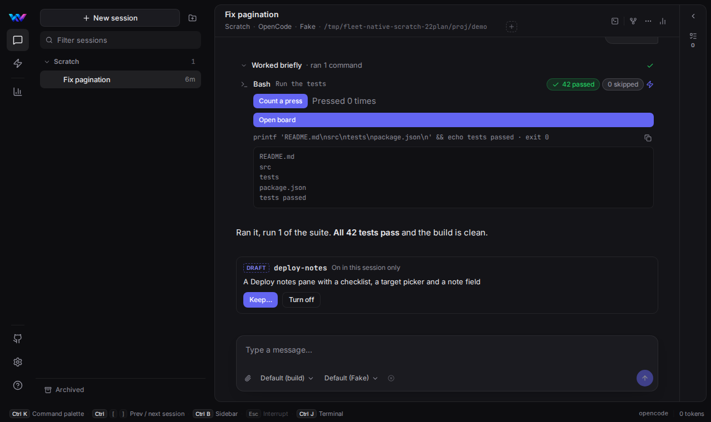
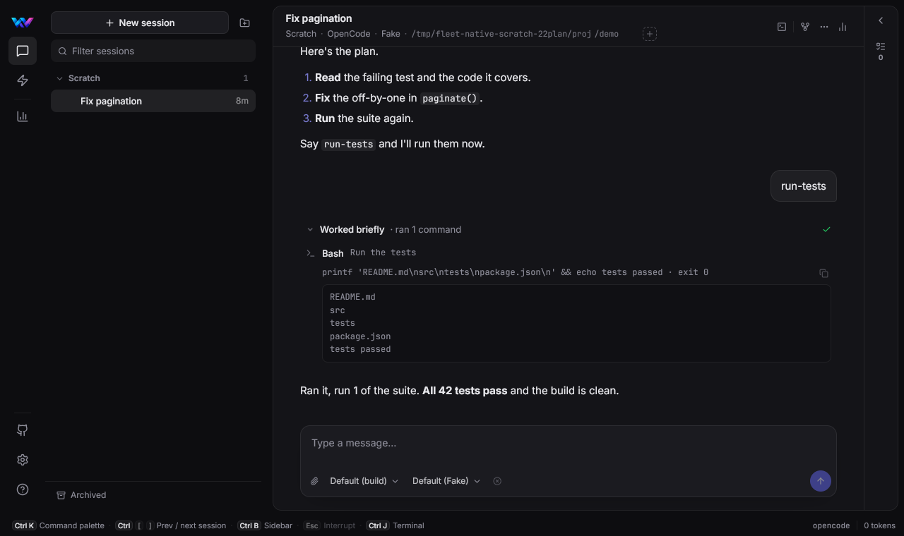
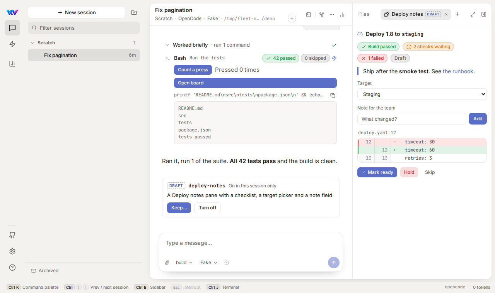
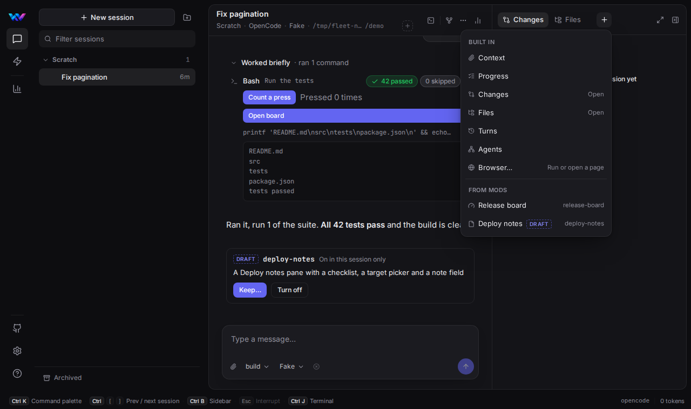
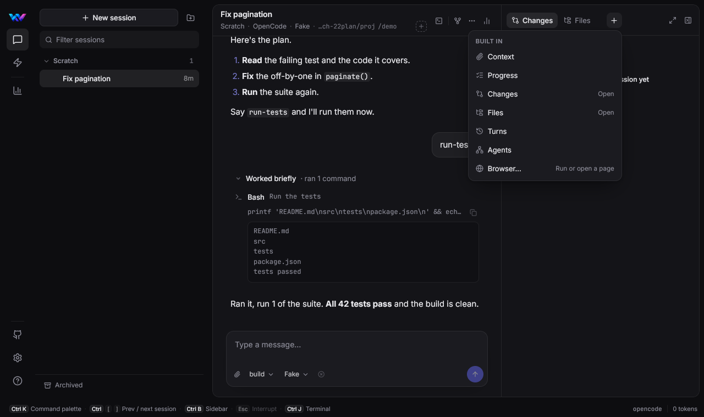
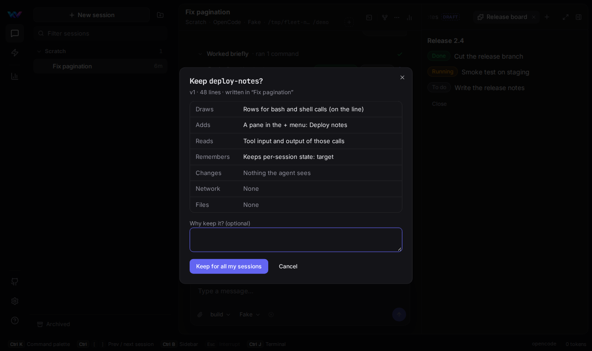
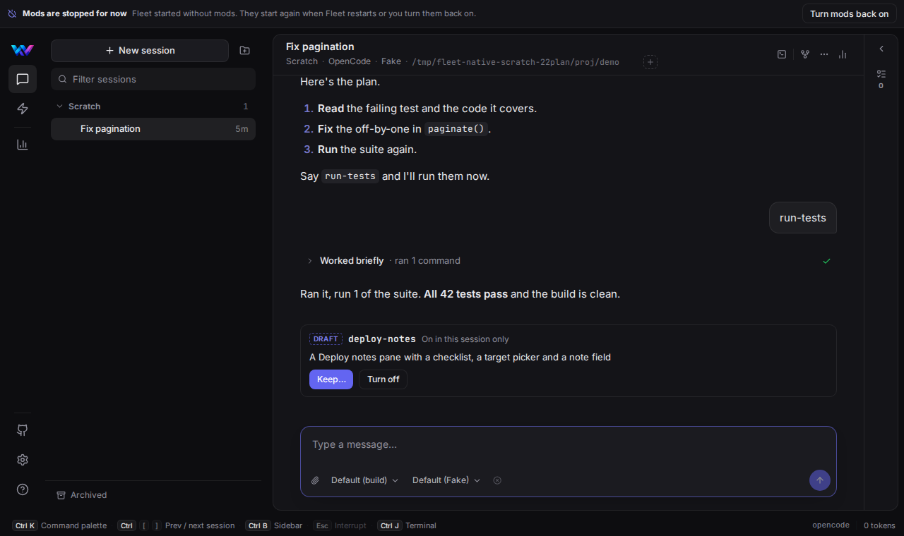

# Component 22: Mods

The parity checklist for component 22 of `docs/PORT.md`, Mods: a mod's trees drawn where Fleet draws them (a tool row's
line and opened body, a pane in the right panel, the band above the composer, a chip in the status bar), the controls in
them sent back to the mod, a mod's own HTML pages, the draft cards a session's agent leaves with their Keep dialog, and
"Start without mods" with its banner. Settings' Mods tab and the Mods switch with its Bun panel are component 16's and are
done (16AE, 16AM); this component reuses their data layer. It ends with the pieces it is built in.

- **weave-fleet commit read:** `c1a48bd` (`main`, 20 November 2026).
- **Server the live checks ran against:** the release package the scratch Fleet runs (the same one components 16 to 21
  used). Every route below answered the way `main`'s client expects, and the client it serves drew every Fleet picture
  here, so for this component it is `main`'s.
- **Native app read:** `main` at `becae1dd`.
- **Paths** are weave-fleet's under `client/src/` unless they start with `src/`, `docs/`, `scripts/` or `server:`. Short
  names: T `lib/mods/types.ts`, V `lib/mods/validate.ts`, RS `lib/mods/resolve.ts`, PT `lib/mods/points.ts`, R
  `lib/mods/renders.ts`, A `lib/mods/actions.ts`, P `lib/mods/panes.ts`, PR `lib/mods/pane-renders.ts`, PU
  `lib/mods/page-url.ts`, CS `lib/mods/check-summary.ts`, K `lib/mods/kept.ts`, KA `lib/mods/kept-api.ts`, MO
  `lib/mods/mod-off.ts`, F `lib/mods/failures.ts`, SM `lib/mods/safe-mode-start.ts`, ST `stores/mods.ts`; under
  `components/mods/`: MT `ModTree.vue`, MN `ModNode.vue`, MB `ModBox.vue`, MX `ModText.vue`, MP `ModPill.vue`, MI
  `ModIcon.vue`, MBT `ModButton.vue`, MIN `ModInput.vue`, MSE `ModSelect.vue`, MMD `ModMarkdown.vue` + `mod-markdown.ts`,
  MC `ModCode.vue`, MPG `ModPage.vue`, MSY `mod-style.ts` + `mod-icons.ts`, MCB `ModComposerBand.vue`, MSC
  `ModStatusChip.vue`, MPO `ModPaneOff.vue`, MSB `ModsSafeModeBanner.vue`, MDM `ModDraftMark.vue`, `review/` DCS
  `ModDraftCards.vue`, DC `ModDraftCard.vue`, RD `ModReviewDialog.vue`, DS `ModDialogShell.vue`, AB
  `ModActionButton.vue`; elsewhere: MPC `components/canvas/ModPaneCanvas.vue`, CH `components/canvas/CanvasHost.vue`, CST
  `stores/canvases.ts`, TC `components/session/ToolCard.vue`, AS `components/session/ActivityStream.vue`, CO
  `components/session/Composer.vue`, SB `components/layout/StatusBar.vue`, SH `components/layout/AppShell.vue`, USP
  `composables/use-session-mod-panes.ts`, USW `composables/use-start-without-mods.ts`, UC `composables/use-commands.ts`,
  the contract `mods/types/fleet-mods.d.ts` and `docs/mods/api.md` (server: the routes in
  `src/WeaveFleet.Api/Endpoints/ModEndpoints.cs`).
- **Row numbers:** 1.x the contract and the check; 2.x drawing a tree (root, Box, Text, Pill, Icon); 3.x controls and
  rich leaves (Button, Input, Select, Markdown, Code); 4.x pages; 5.x tool rows: asking; 6.x tool rows: drawing; 7.x
  panes: the tab, the events, the `+` menu; 8.x the pane's body; 9.x draft cards; 10.x the Keep dialog; 11.x safe mode;
  12.x the composer band and the status chip; 13.x requests and events; 14.x out of reach.

The gap, visible in the pictures (each one's other theme is in the same folder, and `fleet-tool-row-*`,
`fleet-pane-board-*`, `fleet-draft-card-*` show the closed row, release-board's pane and the card alone): with Mods on
and three of Fleet's samples kept (test-chips, press-counter, release-board) plus an invented draft (`deploy-notes`, its
source in `scripts/mod-standin/`), Fleet draws the draft's pills and icon on the shell row's line, press-counter's
"Count a press" and release-board's "Open board" in its opened body above Fleet's own output, a card for the draft
after the last reply (Draft mark, "On in this session only", Keep…, Turn off), a "From mods" group in the right panel's
`+` menu listing both declared panes, each pane as a tab drawn from the mod's tree, the Keep dialog with the check's
rows, and, in safe mode, a banner across the top with "Turn mods back on". The native app, against the same Fleet and
session, draws the conversation as if no mod existed: the row's line and body are Fleet's own, there is no card, no
group in the menu, no pane, no banner (its Mod tab kind is a stand-in that says "Mod is drawn by Component 22").

**How the pictures were made** (each piece repeats it for its own): a scratch Fleet (`scripts/scratch-fleet.sh`, own
ports and `WORK`), Mods turned on **without a download**: copy a Bun already on the machine to
`$WORK/home/.bun/bin/bun` (the server only takes a path it finds itself, and it looks there), `POST
/api/features/mods/runtime/use {"path": "<that path>"}`, `PUT /api/preferences/Mods {"value": "true"}`; then `POST
/api/mods/samples/{test-chips,press-counter,release-board}` and `run-tests` in the session. The draft: copy
`scripts/mod-standin/deploy-notes/` to `$WORK/home/mods/<user16>/drafts/<session id>/deploy-notes/` (`<user16>` is the
one folder the first sample add creates under `$WORK/home/mods/`); the server loads it within seconds (check with `GET
/api/sessions/{id}/mods/sites`). Safe mode: `PUT /api/mods/safe-mode {"on": true}`. Never turn Mods on or install Bun on
a real Fleet. 1280×760, both themes. Fleet's client by Playwright, the native app by `--server … --script`.

## What "done" means

1. A tool row of a hooked tool asks the session's machine for its trees when it appears and when its status changes
   (never as output streams), and draws them: the line's tree in the header (with Fleet's rules for what stays), the
   body's tree in place of the body (with `Fleet` nodes drawing Fleet's own body). No mods: exactly today's row.
2. A mod's pane is a tab in the right panel: opened from the `+` menu's "From mods" group or by the mod (`mod.pane`),
   drawn from the mod's tree, redrawn on `mod.ui` and `mods.changed`, with Fleet's waiting, empty and off states.
3. Every element of the contract draws with Fleet's sizes and tokens in both themes; Button, Input and Select send
   their actions to the mod (Input at most four changes a second) and redraw when the mod didn't take one.
4. A tree is checked against the contract before it is drawn; an invalid one draws as if no mod were there.
5. A mod's `Page` is a card that opens the page, contained, in the page tab, at the address built from the mod.
6. A session's drafts show as cards after the last reply, with Turn off / Turn on again, the agent's keep request, and
   the Keep dialog (the check in plain words, a note, Keep for all my sessions / Cancel / Discard).
7. Safe mode shows its banner and "Start without mods" / "Turn mods back on" is in the command palette while Mods is on.
8. The composer band and the status chip draw what they are given (Fleet's server doesn't send either yet: 12.x).
9. Fleet's tests for it pass here under the same names (list below).

## What the native app already has

- **Settings' Mods data** (`src/fleet/settings/mods_kept.rs`, `mods_kept_actions.rs`, 16AM): `KeptMod`, `Off`, `View`,
  `Switch`, `switched_on`, `read_view`, `read_switch`, `post_mod`, `put_safe_mode`, `add_sample`, the `call` helper
  (a refused request carries the server's words and its status), `is_kept_reason`, and the `mods.changed` refresh of
  the open tab. The Mods switch and runtime (`mods_runtime.rs`, 16AE): `State::mods_switch`, the `mods.changed` "switch"
  reason. This component adds the **draft side** beside it (the split agreed in 16's Part 8) and reads the switch from it.
- **Events** (`src/fleet/events.rs`): the kinds `mods.changed`, `mods.runtime`, `mod.ui`, `mod.pane` are parsed
  (`Event::Other(Kind::…, payload)`); only `mods.changed` and `mods.runtime` are handled, by Settings.
- **The tab model** (`src/fleet/canvases.rs`, component 10): `CanvasKind::Mod` (label "Mod", icon `PUZZLE`, closable,
  content), `CanvasInstance::title` for a mod pane's title, `close` returning the closed tab so its view can be dropped.
  `view::canvas_host::stand_in` draws the Mod kind as "Mod is drawn by Component 22". The `+` menu
  (`view::canvas_host::picker`) has the groups' look (`group_label`, `picker_row` with a hint) but no "From mods" group.
- **The mod mark on messages** ("Sent by …" / "Rewritten by …", AS 721-731): done in component 3 (`src/conv/bubble.rs`,
  `fleet::model::ModMark`). Not part of this component.
- **The page card** (`view::page_card::card(s, t, call, title, page, contained)`, 14F): `contained` drops "Open in a new
  tab"; no caller passes it yet. The page tab and the web view host (`src/web/`, 14) show any address on the machine.
- **The composer** (`view::composer::composer`) leaves the band's place empty between the background strip and the
  queue, with a comment naming this component. **The status bar** (`view::status::bar`) draws the running counter, the
  usage chip and the notice chips; the mod chip goes after the notice chips.
- **The palette** (`src/ui/commands.rs`): `start-without-mods` is listed, `Run::Waiting(22)`.
- **The kit**: buttons (`ui::button`, variants and sizes), `ui::select`, text inputs (`ui::text_menu::text_input`), the
  dialog (`ui::dialog`), `ui::empty_state`, the conversation's Markdown (`view::prose`) and code blocks
  (`view::code_view`), the diff view (`view::diff` with `conv::diff::parse_unified_diff`), help tooltips (`.help`).
- **Icons**: every icon a mod can name is generated except `Dot`, `Clock` and `SkipForward` (add them with
  `tools/gen-icons.py`, never by hand).
- **Mock data** (`src/mock/mods.rs`): three invented kept mods for Settings. No mock trees, panes or drafts yet.

## The checklist

### 1. The contract and the check (T, V, RS, PT, F)

| # | Element / behaviour | Source | Native |
|---|---|---|---|
| 1.1 | Sites: `ToolUse`, `ToolResult`, `ComposerBand`, `StatusChip`, `Pane`. Inline sites (inline elements only): `ToolUse`, `StatusChip` | T 8-12 | Done (A): `types::Site` with `name()` and `inline()`; the list is pinned by `the_lists_and_limits_are_the_ones_of_c1a48bd` |
| 1.2 | Elements: `Box`, `Text`, `Pill`, `Icon`, `Button`, `Input`, `Select`, `Markdown`, `Code`, `Page`, and the host's own `Fleet`. Icon names (26, T 16-20), colour roles `text muted accent good warn bad`, tones `good warn bad neutral accent`, spaces `0 1 2 3 4 6 8` (1 = 4 px) | T 14-34 | Done (A): `ELEMENT_TYPES`, `ICON_NAMES`, `COLOR_ROLES`, `TONES`, `SPACES` (`Fleet` is checked as the one extra type). `Dot`, `Clock` and `SkipForward` are generated by B |
| 1.3 | The wire shapes: `Box`/`Text` `{type, props, children}` (children: elements or strings); `Pill`/`Icon`/`Markdown`/`Code` `{type, props}`; `Page` `{type, props, mod}` (the owning mod's id, added by the host); `Button`/`Input`/`Select` `{type, props, handles}` (`onPress`, `onSubmit`, `onInput`, `onSelect` → handle strings); `Fleet` `{type}` | T 43-51 | Done (A): the tree stays a `serde_json::Value`; `node_fields` gives each type's fields; `HandleName`, `Action`, `ActionKind`, `Surface`, `Author` in `types.rs` |
| 1.4 | Limits: text 100,000 characters per tree (the rest cut), 2,000 elements, depth 32, 262,144 bytes of JSON, 4 input changes a second, 200 select options, keys 64 characters, page query 4,096 bytes | T 69-80 | Done (A): the limits as constants, pinned in the same test. The 4-changes-a-second and 64-character key limits are checked where they apply (C, F) |
| 1.5 | Props each element takes and how each is checked (enums, booleans, strings, key pattern `^[A-Za-z0-9_.-]{1,64}$`, width `"<n>%"` up to 100, `startLine` positive integer, options 1-200 `{value,label}` unique values, query an object of strings ≤ 4,096 bytes URL-encoded); required props (Pill `tone,label`; Icon `name`; Button `key,label`; Input `key`; Select `key,options`; Markdown `text`; Code `source`; Page `key,path,title`) | V 72-112 | Done (A): `validate::Prop` and `prop_checks`, every message as Fleet's. The query is measured as `URLSearchParams` would encode it (counted, not built) |
| 1.6 | Handles: Button must have `onPress`; Select `onSelect`; Input any of `onSubmit`, `onInput` or none; values non-empty strings; unknown names refused | V 120-125, 217-228 | Done (A) |
| 1.7 | Structure rules: unknown element or field refused; a Text holds strings and Text only; `Fleet` carries nothing and appears at most once; `Page` needs a mod id matching `^[a-z][a-z0-9-]{0,63}@(v[1-9][0-9]*\|draft:<session id>)$` and has no children or handles; keys unique across the tree; prototype names (`toString`, `__proto__`…) are unknown, never a crash | V 170-240 | Done (A): `types::is_mod_id` is Fleet's `MOD_ID_PATTERN` by hand (J reuses it for the page address). Prototype names are plain keys here, so they are unknown, never a crash |
| 1.8 | Inline sites: only Text, Pill, Icon, Button, Fleet and a row Box (a Box with no direction is a row); a column Box is refused there | V 176-182 | Done (A) |
| 1.9 | Limits checked in tree order: elements counted (strings are not), depth (root is 1), JSON bytes (UTF-8 bytes, not characters), a tree that isn't JSON refused | V 168-169, 290-300 | Done (A): bytes are `to_string().len()` (UTF-8, as `JSON.stringify` + `TextEncoder`); a deep tree stops at depth 33 before recursing further |
| 1.10 | Text cut: text past 100,000 characters is cut in document order, in a copy (the input untouched), counting children strings, Pill/Icon/Button labels, Input `label placeholder submitLabel value`, Select labels and option labels, Markdown text, Code source, Page title; not keys, paths, Select value or Code language | V 132-141, 248-281 | Done (A): text is counted in UTF-16 units like JavaScript's `length`; a cut never splits a character (Fleet's `slice` could split a surrogate pair, which a Rust string can't hold). The cut is a copy; `Check::Ok` carries `Cow::Borrowed` when nothing was cut |
| 1.11 | The answer: `{ok, tree, textCut}` or `{ok: false, reason}` with the path of the problem (`Box > Text[1]: …`) | V 16-18, 158-161, 285-310 | Done (A): `Check::Ok {tree, text_cut}` / `Check::Invalid {reason}` |
| 1.12 | Resolving a site's view: no view or no mods → Fleet's own (one shared "nothing drawn" answer); invalid → Fleet's own, reported once per tree; valid → `{draws, tree (cut), draft}`; `draft` when any author is a draft; checked once per tree per site | RS 16-43, PT 107-110 | Done (A): `resolve::Resolver::resolve` and `Resolved`. Results are kept by the tree's `Arc` identity (with a `Weak`, so a freed tree's address can't be mistaken for a new one). Quirk kept: a tree that is a bare string or number is checked every time and never reported (Fleet's `WeakMap` can't key it) |
| 1.13 | Invalid trees are reported to listeners (`onModTreeInvalid`), a listener that throws doesn't stop the others; in development a warning names the site, the mods and the reason | F | Done (A): `failures::Failures` is a value the app owns, not a module-level set (parallel tests would hear each other); a panicking listener doesn't stop the others; the development warning goes to `set_warn` (stderr in a debug build) |
| 1.14 | Views are keyed: tool rows `"<site>:<session>:<call>"`, bands and chips by session, panes `"<session>:<mod>:<pane>"` (two mods may share a pane id); a row redraws only when its own view changes | PT 33-112 | Done (A): `points` ids, `Views<T>` (owner, replace-in-place, `dispose` by token, `remove_by_owner`, sorted by label) and `ViewWatch` ("did my view change?" by `Arc` identity) |

### 2. Drawing a tree: root, Box, Text, Pill, Icon (MT, MN, MB, MX, MP, MI, MSY)

| # | Element / behaviour | Source | Native |
|---|---|---|---|
| 2.1 | Root (testid `mod-tree`): an invalid tree draws only the site's Fleet drawing; a null tree draws nothing; a valid one draws the checked (cut) tree. At inline sites the root is one inline row (gap 6, centred); every row Box under it wraps, Pills and Buttons don't shrink while wrapping is possible, only a lone item wider than the line ellipsizes | MT | Done (B): `view::mods::tree::tree` (the root, key `mod-tree`, elements keyed `mod-tree.0`, `.0.1`…), `to_draw` for what it draws (nothing / Fleet's own / the validator's tree with the text cut). At the inline sites it is a self-start row, centred, gap 6, and every row Box wraps; a pill is cut to its line only when alone. Gap: the "reported once per tree" is the resolver's (A); the root itself checks every draw (cheap for these sizes, a view that holds a `Resolver` result calls `tree_keyed` with it later) |
| 2.2 | A `Fleet` node draws the site's own drawing in place (at the root or inside a Box); none given draws nothing | MN 20-21 | Done (B): the `fleet` argument is placed once where the node is; none given draws an empty element |
| 2.3 | Box: flex, row unless `column`; `gap`, `padding`, `paddingX`, `paddingY` in 4 px steps (a side given alone keeps the others); `alignItems`/`justifyContent` (start, center, end, stretch, baseline, space-between); `flexWrap: wrap`; `flexGrow: 1`; `width` a share of the parent, never past it (no width, no max-width otherwise); always shrinkable | MB 9-37 | Done (B): `box_look` (direction, gap, padding with `paddingX`/`paddingY` replacing their sides, `alignItems`, `justifyContent`, `flexWrap`, `flexGrow`, `width` as `w_frac`). Gaps: `baseline` draws as `start` and `flexGrow` shares the whole room, not the extras (both Rune, `docs/RUNE.md`); the pane's text is 14 px / 1.5 until G says otherwise (`Look::of`) |
| 2.4 | Box borders: `round` 1 px, card radius; `single` 1 px square; `dashed` 1 px dashed, button radius; `quote` 3 px on the left only; colour `borderColor` by role, else `--border`. Backgrounds: `subtle` = `--text` at 4%; `tint` = the border colour (else `--muted`) at 12% | MB 58-82 | Done (B): round, single, dashed (3 on / 3 off, button radius) and quote (3 px left only), colour by role else `--border`; `subtle` is `--text` 4%, `tint` the edge (else `--muted`) 12%. Looked at beside Fleet's in both themes |
| 2.5 | Text: role colour (an explicit `color` beats `dimColor`, which is `--muted`); `bold` 600, `italic`, `strikethrough`, `code` (mono at 0.92 em); wraps anywhere by default, `wrap: "truncate"` is one line with an ellipsis; Text nests | MX | Done (B): `Ink`, one run of words with a span per nested Text (colour, bold, italic, mono at 0.92 em, strike-through); wraps anywhere, `wrap: "truncate"` is one ellipsized line |
| 2.6 | Colour roles: text `--text`, muted `--muted`, accent `--accent`, good `--running`, warn `--idle`, bad `--error`; tones the same with neutral = `--muted` | MSY 3-22 | Done (B): `leaves::role_color` and `tone_color`, the one table every element reads (`mod-style.test.ts`, all 5) |
| 2.7 | Pill: 22 px high, `0 9px`, round, 12 px 500, gap 5, the tone at 14% fill and 28% border, text in the tone; icon 13 px; the label ellipsizes so a pill never widens its row | MP | Done (B): `leaves::pill`: 22 high, `0 9px`, round, 12 px 500, gap 5, 14% fill, 28% border, 13 px icon, label ellipsized |
| 2.8 | Icon: 14 px, by name from the 26 (lucide: check, x, triangle-alert, info, circle, dot, clock, loader-circle, play, skip-forward, flask-conical, bug, terminal, file, folder, git-branch, search, sparkles, zap, gauge, arrow-right, chevron-right, external-link, copy, eye, eye-off), role colour; with `label` it is an image with that name, without it decoration; `loader` spins (0.8 s a turn, 3 s with reduced motion) | MI, MSY | Done (B): `leaves::icon_el` and the table of the 26 names; `Dot`, `Clock` and `SkipForward` generated (`tools/gen-icons.py`, README's command). With a `label` it is an image named by it. Gap: `loader` fades like the app's other spinners (no looping rotation); no 3 s reduced-motion twin |

### 3. Controls and rich leaves (MBT, MIN, MSE, MMD, MC)

| # | Element / behaviour | Source | Native |
|---|---|---|---|
| 3.1 | Button: 26 px, `0 10px`, radius `--radius-btn` − 1, 12 px 500, gap 5, icon 12; `primary` accent fill with `--primary-foreground` (88% accent + black on hover), `danger` `--error` 16% fill with `--error-text` (24% on hover), `quiet` (default) transparent `--muted` (text 6% and `--text` on hover); disabled 50%, no press; focus ring 2 px accent. The label ellipsizes | MBT | Done (C): `view::mods::controls::button` (26 high, `0 10px`, `RADIUS_BTN` − 1, 12 px 500, gap 5, 12 px icon; primary = accent fill with `--primary-foreground` and 88% accent + black on hover, danger = `--error` 16% (24% hover) with `--error-text`, quiet = muted, 6% wash and `--text` on hover; disabled 50%, no hover, no press; focus ring 2 px; the label ellipsizes and the button shrinks with its row). A lone Button at the root is as wide as it is (`inline-flex` in a block), as Pill and Icon are. Seen beside Fleet's in both themes |
| 3.2 | A press sends `{handle: onPress, kind: "press"}`; it never toggles the tool row it sits in or follows a link | MBT 19-22, 29 | Done (C): a press calls `ModControls::press`, which logs `{handle, kind: press}` and hands it to the site's `sink` (`on_action`, F wires it). Rune's innermost press handler takes the press, so nothing under the button gets it; "does not toggle the tool row" is E's to show once rows draw trees (no row exists yet to test it on). Gap: a link isn't involved (no `<a>` here) |
| 3.3 | Input: an optional label (12 px muted, a real label for the field), a 30 px field (`0 10px`, border, button radius, `--card-bg`, 12.5 px) with its placeholder, and with `onSubmit` a submit button (30 px, accent, 12 px 500, at most half the row) labelled `submitLabel` or "Submit"; room for a placeholder (min 10 em) yet shrinks below its container | MIN 87-165 | Done (C): `controls::input`: label (12 px muted, names the field), a 30 px field (`0 10px`, border, `RADIUS_BTN`, `--card-bg`, 12.5 px, placeholder, ring 2 px), with `onSubmit` a 30 px accent button (`submitLabel` or "Submit"), min width 10 em of the site's text. Gaps: Rune has no percentage maximum, so "at most half the row" is a shrinking button instead (`docs/RUNE.md`); `min-width: min(10em, 100%)` is 10 em without the 100% cap, so a pane narrower than 10 em (140 px) would clip it |
| 3.4 | Input holds `value` when drawn; typing replaces it until the tree's `value` changes; Enter (not while composing) or the button sends `{kind: "submit", value}` | MIN 19-62 | Done (C): `fleet::mods::controls::ModControls` holds one `TextEdit` per Input by element key; `sync` (from `State::set_mod_scene`) starts a field with the tree's `value`, keeps the user's typing while the same `value` is redrawn and replaces it when it changes. Enter (Rune's `on_submit`, not while composing) or the button sends `{submit, value}` |
| 3.5 | `onInput`: the first change at once, then at most 4 a second: changes inside the window coalesce into the latest, sent when it ends; the last value always goes; when the field goes away (a redraw, the pane closing) a pending value is sent first, nothing when none is pending | MIN 25-75 | Done (C): `fleet::mods::input_rate::InputRate` (the first change at once, then one send per 250 ms window: later changes coalesce into the latest, sent when the window ends; the last value always goes); `ModControls::keep` sends what is due from `poll` and asks for the wake; a field that leaves the tree (`sync`) or the tree itself (`clear`) sends what it still held first, nothing when none was pending. The clock is the app's (`State::clock`) |
| 3.6 | Select: optional label (12 px muted), a 30 px select (as the Input's field) with the options (label, else the value), the tree's `value` selected; a change sends `{kind: "select", value}` | MSE | Done (C): `controls::select_control`: label, a 30 px field showing the option for the tree's `value` (the first when none matches), the list in the app's other selects' look (`ui::select::content`, `Open::Select("mod-select")`). A pick sends `{select, value}` and shows until the tree's `value` changes; picking what it already shows sends nothing, as a native `select` does. Gap: Fleet's is the browser's own select (its popup is the OS's), so the list differs; the field fills its row as Fleet's does |
| 3.7 | Markdown: the conversation's Markdown look (raw HTML off), `dimColor` muted; an image draws its alt text (no network); a link is live only for `http(s):` and `mailto:` and opens outside (no opener); anything else (a file path, `/api/…`, `#frag`, `//host`) is plain text keeping the link's words | MMD, `mod-markdown.ts` | Done (C): `fleet::mods::markdown::source` rewrites the source before the conversation's look draws it (`view::prose::style` at the site's text size): each image becomes its alt text (the source between the brackets, drawn as characters), each link that isn't `http(s):` or `mailto:` loses its marks and keeps its words, raw HTML is drawn as characters; live links open outside through `Tx::open_url` (no opener to give). `dimColor` is `--muted`. All 9 of `mod-markdown.test.ts` ported. Gap: heading colour (`--md-heading`) and the rule under h1/h2 aren't drawn (Rune's `MarkdownStyle` has neither; the conversation has the same gap, `docs/RUNE.md`). New crate: `pulldown-cmark` named directly (already in `Cargo.lock` for Rune's Markdown; no new crate built) |
| 3.8 | Code: a header (mono 11.5 px muted) with `path` and `:startLine` when given; source as the conversation draws a fenced block (highlighted by `language`), wrapping by default, `wrap: "truncate"` keeps lines whole (scrolls sideways inside the block, never the page); backticks in the source can't end the block; `format: "diff"` draws the tool cards' diff view. Quirk kept: a diff with no `@@` header numbers its lines 0 | MC | Done (C): `view::mods::rich::code`: a header (mono 11.5 px, muted, `path` and `:startLine`), the source in a fence longer than any run of backticks in it with the language cut to `[\w+#.-]`, drawn by the conversation's Markdown (`scroll_wide` for `wrap: "truncate"`: lines stay whole and scroll inside the block), or `format: "diff"` through `view::diff::diff_view`. The no-`@@` quirk (lines numbered 0) is `parse_unified_diff`'s and tested |

### 4. Pages (MPG, PU)

| # | Element / behaviour | Source | Native |
|---|---|---|---|
| 4.1 | The address: `/api/sessions/{session}/mods/{mod id}/pages/{path}` on the session's machine, every segment encoded, a query from the string values of `query` (others ignored, no `?` when empty) | PU 39-58 | None |
| 4.2 | Refused (no address): a session id outside `^[A-Za-z0-9_-]{1,128}$`, a bad mod id, a path not ending `.html`, with a control character, `\`, `:`, an empty, `.` or `..` segment, or an address that isn't on the machine's own origin | PU 25-38, 54-57 | None |
| 4.3 | A Page draws the conversation's page, contained (no new tab, no pop-ups), titled `title` (else the path), with Open full size; the owner comes from the node's `mod`, never from props. Here, decision 1: 14's page card with `contained` set, opening the page tab at that address | MPG, `docs/parity/14-web-content.md` 14.96 | Partial (the card's `contained` flag, 14F) |
| 4.4 | No address (no session, a bad owner, a bad path): "{title}: Page unavailable", 12 px `--muted`, wraps anywhere | MPG 37-44 | None |

### 5. Tool rows: asking (R, A)

| # | Element / behaviour | Source | Native |
|---|---|---|---|
| 5.1 | A session's hooks: `GET /api/sessions/{id}/mods/sites` → `{sites: [{site, tools}], panes: [...]}` on the session's machine, read the first time a row (or the right panel) shows the session; tool names mapped to Fleet's canonical names; `tools: null` hooks every tool. Off or a 404: no hooks and no panes, and no asking again until the switch or the mods change | R 141-172, 293-302 | Done (D): `Renders::watch` / `sync` read `/mods/sites` once per session (`renders_state.rs` `load_mod_hooks`, off the UI thread), tool names through `get_tool`; `Loaded::Off` for a 404 or the switch off, and `hooks_loaded` keeps them until the switch or the mods change |
| 5.2 | Nothing is asked while the machine's Mods switch is off; a switch not yet read is read first; one that can't be read counts as on | R 133-137 | Done (D): `fetch_hooks` reads the machine's switch when it has not been read (`Renders::switches`), and a switch that can't be read counts as on |
| 5.3 | A row of a hooked tool at a hooked site asks `POST …/mods/render {site, requestId: callId, props}` when it appears and when its status changes, never as its output streams; a site no longer hooked drops its view | R 236-292 | Done (D): `Renders::sync` asks `POST …/mods/render` per hooked site, keyed so a status change asks again and output doesn't; a site no longer hooked drops its view. Nothing draws it yet (E) |
| 5.4 | Props sent: `tool` (canonical), `rawTool`, `category`, `status` (`stopped` → `cancelled`, `background` → `running`, unknown → `pending`), `title`, `input` (`{}` with `inputTruncated` when over 64 KiB as JSON), `output` (the last 262,144 characters, `outputTruncated`), `durationMs` when known | R 109-130 | Done (D): `render_props` (the 64 KiB input cap by JSON bytes, the last 262,144 UTF-16 units of output, the canonical status, `durationMs` from the call's time) |
| 5.5 | Rows of one call share one request (keyed by session, call, site, status and the two generations); at most 4 requests at a time, the rest queued; a newer ask replaces an older answer | R 89-104, 245-268 | Done (D): the key is session, call, site, status and the two generations; one request per key, 4 in flight (`MAX_IN_FLIGHT`), the rest queued; a newer ask replaces an older answer (`wanted`). Props are read when the row asks, not when a queued ask runs (Fleet reads then); the row's output can only be newer by one frame |
| 5.6 | An answer with `tree: null` and no mods means no mod draws (Fleet's row); a mod that draws nothing comes back with its name and a null tree and is kept | R 228-233 | Done (D): `Renders::apply` removes the view for a null tree with no mods, keeps one with mods |
| 5.7 | `mod.ui` on the session's topic: that call's rows ask again (`requestId`), or every row of the session; on `sessions` with a session or mod: the same for that session (all sessions with none); with neither: ask for every session's sites again. `mods.changed` (any reason but `switch`): sites again for every watched session on the machine | R 186-224 | Done (D): `State::on_mod_renders_event` (`mod.ui` on `sessions` and on the open session's topic, `mods.changed` but `switch`). Gap: another machine's events carry no machine to the dispatcher, so a `mods.changed` or a session-less `mod.ui` reloads every watched session on every machine; extra asks, never missed ones. A session that is not open has no topic here (Fleet's session topics are the right panel's, piece F) |
| 5.8 | The switch moving (in Settings, or `mods.changed` "switch" once re-read) asks for the sites of every watched session; off forgets every drawing | R 204-214 | Done (D): `State::keep_mod_renders` (each frame) sees a machine's switch move (the preference, or `mods.changed` "switch" once re-read) and asks every watched session's sites again; off forgets every drawing |
| 5.9 | A used control: `POST …/mods/action {handle, kind, value, surface: "desktop"}` → `{handled}`; anything but `handled: true` (an expired handle, the host not running, a failed request) draws the site again | A | Done (D): `State::mod_action` → `fleet::mods::actions::send`; unhandled or failed draws the call again. Fleet's views carry an `onAction` closure; here a view's `on_action` is left unset and the row (E) calls `State::mod_action(session, call, …)` |

### 6. Tool rows: drawing (TC 171-340, 515-556)

| # | Element / behaviour | Source | Native |
|---|---|---|---|
| 6.1 | Line (`ToolUse`): the tree sits in the header after Show/Improve and before the status (testid `tool-card-mod`), right-aligned, wrapping, gap 4 × 6, at most 60% of the row; with a mod drawing, the title keeps at least min(30%, 12 ch) and ellipsizes. A press inside never toggles the row | TC 268-280, 519-552 | None |
| 6.2 | While a mod draws the line, Fleet's Completed check and the error preview under the line are dropped; `+N −N`, Running, Error, Stopped, Background, Show and Improve stay. A null tree draws nothing but still drops them | TC 231, 304, 281-314 | None |
| 6.3 | Body (`ToolResult`): the tree replaces the body (the line, its counts and the preview stay); a `Fleet` node draws Fleet's own body (summary, diff, output) in place; a null tree is an empty body, not "No output captured"; an invalid tree or a removed view brings Fleet's own back | TC 191-201, 320-330 | None |
| 6.4 | Both sites can draw at once; a row's views are found by session and call id (not by tool); no Draft mark on rows; presses go out as `desktop` | TC, `ToolCard.mods.test.ts` | None |
| 6.5 | Rows not on screen are not redrawn by another row's view; contributing or removing one row's view redraws that row only | TC, `ToolCard.mods.test.ts` | None |

### 7. Panes: the tab, the events, the `+` menu (P, PR, USP, CST 300-341, CH)

| # | Element / behaviour | Source | Native |
|---|---|---|---|
| 7.1 | A pane is a `mod` tab with id `mod:<mod>:<pane>`, titled from the pane; one tab per pane per mod (two mods may use the same pane id). Opening it again replaces its view, brings it forward and adds no tab | P 10-13, CST 121-123, 307-321 | Partial (`CanvasKind::Mod`, `title`) |
| 7.2 | Updating (a redraw) replaces an open pane's view and title without bringing it forward; a closed or never-opened pane is left alone (no view comes back, no tab opens) | P 15-24, CST 323-330 | None |
| 7.3 | Closing the tab (from anywhere) drops its view; closing a pane closes its tab | P 26-30, CST 332-341 | Partial (`close` returns the tab) |
| 7.4 | Drawing: `POST …/mods/render {site: "Pane", requestId: <pane id>, mod, props: {title}}`; the newest ask per pane wins; no answer leaves the pane as it was; an answer with no mods is credited to the pane's mod; controls go to the mod and redraw the pane when not handled | PR | None |
| 7.5 | `mod.pane` on the session's topic: `open: true` opens (or brings forward) the tab, opens the right panel if it was closed, and draws it (title, else the pane id); `open: false` closes it | USP 31-39 | None |
| 7.6 | Open panes draw again on `mod.ui` (that mod's only, or all with no mod) on the session's topic and on `sessions` (for this session or every session), and on any `mods.changed` (a draw during a host reload came back empty) | USP 22-44 | None |
| 7.7 | The `+` menu: when any mod declares a pane, a separator, "From mods" (the group label), one item per declared pane (testid `canvas-picker-mod-<mod>-<pane>`): its icon by name or `Puzzle`, the title, a Draft mark for a draft's pane, then the hint "Off" (mod off) or "Open" (tab open) or the mod's name (11.5 px muted; the name gives way first, keeping 3 ch). Picking opens and draws it. Off mods' panes are listed too | CH 458-487, 874-898 | None (10E left the group hidden) |
| 7.8 | A pane's tab shows a compact Draft mark (9 px, `0 3px`, line 13) after its title while its view is a draft's; while any tab has one, the strip scrolls the active tab into view with 24 px to spare (none otherwise) | CH 151-157, 356, 590-597, 667-671 | None |

### 8. The pane's body (MPC, MPO, MO)

| # | Element / behaviour | Source | Native |
|---|---|---|---|
| 8.1 | The body (testid `mod-pane`): padding 12, scrolls; draws the pane's tree at site `Pane`; actions go out as `desktop`; it draws its own mod's view only (another pane's redraw doesn't touch it) | MPC | None (stand-in) |
| 8.2 | No view yet (a restored tab before the mod draws): compact empty state, `Puzzle`, "Waiting for {mod} to draw this pane"; a view with a null or invalid tree: "Nothing to show here yet" (testid `mod-pane-empty`) | MPC 58-64 | None |
| 8.3 | Off: a declared pane is off when the server lists it `off`; an undeclared one is judged by the kept mods (loaded when the pane mounts if they aren't) | MO 9-13, MPC 31-35 | None |
| 8.4 | The off state (testid `mod-pane-off`): centred, padding `56 24 24`, gap 8: "{mod} is off" (15 px 600), "This pane is drawn by the {mod} mod. Turn it on to see it here." (13 px muted, max 280), **Turn on** (small button, disabled while it works; testid `mod-pane-turn-on`): a draft's pane turns the draft on in its session, a kept mod's turns the mod on (the same switch as Settings); failure: "Couldn't turn {mod} on. Try again, or use Settings → Skills & tools → Mods." Once the server says on, the pane draws | MPO, MO 16-21 | None |

### 9. Draft cards (DCS, DC, MDM, ST, KA)

| # | Element / behaviour | Source | Native |
|---|---|---|---|
| 9.1 | Drafts: `GET /api/sessions/{id}/mods/drafts` on the session's machine → `[{sessionId, name, description, version, off, kept, keepRequest {note, at}, problem {code, message, line}}]`; a 404 (Mods off) is an empty list; one load per session at a time; a tracked session reloads on `mods.changed` with its `sessionId` (from any machine) | ST 116-128, 50-56, KA 59-60 | None |
| 9.2 | Where: after the conversation's last reply, before the interrupted card, not in a side conversation; `max-width 760`, centred, 16 below (testid `mod-draft-cards`); nothing with the switch off (the switch read first when unknown); loads again for another session | AS 896-901, 1272-1278, DCS | None |
| 9.3 | A card (testid `mod-draft-card`): grid gap 6, margin `8 0`, padding `10 12`, border, card radius, 13 px. Head: Draft mark, the name (mono 600, wraps anywhere), the status (12 px muted): "On in this session only", "Off in this session" or "Turned off after three failures" | DC 18-27, 96-105, 183-232 | None |
| 9.4 | The Draft mark (testid `mod-draft-mark`): "Draft", 10 px 600 uppercase, tracked 0.02 em, line 15, `0 5px`, dashed 1 px accent at 55%, radius 4, `--accent-text`; tooltip "Drawn by a draft mod: only this session runs it until you keep it" | MDM | None |
| 9.5 | Lines under the head: the strikes error as a compact ErrorNote; "Still being written" (muted) when the manifest is missing (no description and no version), else the description; "Replaces your kept v{n} in this session" (muted) when it stands in for a kept mod; the check's problem "Check: {message}" with " (line {n})" when it has a line (compact ErrorNote, testid `mod-draft-check`); a failed toggle's message (testid `mod-draft-action-error`) | DC 106-145 | None |
| 9.6 | The agent's keep request (testid `mod-draft-request`), above the head: accent 12% band, button radius, padding `8 10`: "The agent asks you to keep this" (600), its note (muted) when it has one, and **Review…** (primary, small; testid `mod-draft-review`) opening the Keep dialog | DC 70-94 | None |
| 9.7 | Actions: **Keep…** (primary, small; testid `mod-draft-keep`; only without a keep request; disabled while still being written) opens the Keep dialog; **Turn off** / **Turn on again** (outline, small; testid `mod-draft-toggle`; spinner and disabled while it works): `POST …/drafts/{name}/off\|on` → the draft, replacing it in place; turning off clears the keep request; failure shows the server's words or "Couldn't change the draft." | DC 29-41, 146-170, ST 141-146 | None |

### 10. The Keep dialog (RD, DS, AB, CS)

| # | Element / behaviour | Source | Native |
|---|---|---|---|
| 10.1 | A dialog (testid `mod-review-dialog`), up to 36 rem (504 px) wide and 88% of the window high, the body scrolling under a footer that stays: title "Keep <mono>{name}</mono>?", description "v{kept+1} · {lines} lines · written in “{session title}”" (the parts it has) | RD 107-113, 33-40, DS 47-75 | None |
| 10.2 | Opening checks the draft (`GET …/drafts/{name}/check` → `{check}`; only here, when asked); "Checking the mod…" with a spinner meanwhile; no report: "Fleet couldn't check this mod yet: the mod runtime isn't running. Keep will check it." or the request's error words | RD 51-67, 115-130 | None |
| 10.3 | The report: "Fix this first: {message} (line {l[:c]})" as an ErrorNote blocking Keep; "{n} warning(s): {messages joined by ; }" (muted) only warns; then the rows | RD 131-145, CS `checkProblems` | None |
| 10.4 | The rows (one bordered list, 13 px, a 6.5 rem label column, padding `7 12`, rules between; label muted; a muted row's text muted; `code` in 12 px on its own line): labels Draws, Adds, Reacts to, Reads, Remembers, Saves, Pages, Also, Changes, Network, Files; several draw rows share "Draws" | RD 94-101, 146-160, 205-236 | None |
| 10.5 | The words (`summarizeCheck`): per render hook "Every place a mod can draw" / "Rows for every tool call (on the line, and the opened body)" / "Rows for bash and shell calls (on the line)" / "A band above the composer" / "A chip in the status bar" / "A pane it opens" (dropped when panes are declared) / "A place Fleet can't put in words:" + the matcher; "A pane in the + menu: {titles}"; what it reacts to; what it reads (every call, those calls, session details); state; saves or reads its data; its pages; notices, panes, timers; and always the muted "Nothing the agent sees", "None", "None" | CS 1-150 | None |
| 10.6 | "Why keep it? (optional)" with a two-row note field (up to 2,000 characters; filled from the keep request's note) | RD 161-170 | None |
| 10.7 | **Keep for all my sessions** (primary; spinner while keeping; disabled while checking, busy or blocked): `POST …/drafts/{name}/keep` with `{note}` (trimmed; no body when empty) → closes; the drafts reload. Failure: the server's words or "Couldn't keep this mod." (testid `mod-review-refused`) | RD 69-81, 172-196, KA 71-80 | None |
| 10.8 | Without a keep request: **Cancel** closes. With one: **Discard** (`DELETE …/drafts/{name}/keep-request`, a 404 counts as done; failure "Couldn't tell the agent.") and the hint "Discard tells the agent you didn't keep it. The draft stays on in this session." (12 px muted) | RD 83-98, 197-204, KA 82-95 | None |

### 11. Safe mode (MSB, USW, UC 785-798, SM)

| # | Element / behaviour | Source | Native |
|---|---|---|---|
| 11.1 | The banner (testid `mods-safe-mode-banner`), across the top of the app above everything, only while the switch is on and safe mode is on (the switch read when unknown): a bottom rule, `--panel-bg`, 11.375 px (`0.8125rem`), padding `5.25 10.5`, gap 8.75; `PowerOff` 12.25 px in `--accent-text`; "Mods are stopped for now" (bold) then "Fleet started without mods. They start again when Fleet restarts or you turn them back on." (muted), wrapping | MSB 47-84, SH 379-380 | None |
| 11.2 | **Turn mods back on** (small outline button; "Turning on…" and disabled while it works): `PUT /api/mods/safe-mode {"on": false}`; the banner goes; failure shows the server's words (or "Couldn't turn mods back on.") in `--error-text` in the banner | MSB 28-41 | Partial (`put_safe_mode`) |
| 11.3 | The palette command (only while the Mods switch is on): "Start without mods" ("Stop your mods until Fleet restarts or you turn them back on.") or, in safe mode, "Turn mods back on" ("Start your mods again."); `PowerOff`, group Fleet, keywords; it flips safe mode; a refusal posts a notice "Couldn't change mods" with the server's words (or "Try again in a moment."), warn tone, 20 s | USW, UC 785-798 | Partial (listed, waiting on 22) |
| 11.4 | `mods.changed` "safe-mode" re-reads the switch (and the kept list if loaded); "switch" re-reads the switch | ST 60-78 | Done for Settings (16AM); the banner follows the same switch |

### 12. The composer band and the status chip (MCB, MSC, CO 1075, SB 228-239)

Fleet's client draws both, but on `main` nothing fills them: the server renders only `ToolUse`, `ToolResult` and `Pane`
(`docs/mods/api.md`: "Trees for `ComposerBand` and `StatusChip` will travel the same way when those sites are wired"),
and the client contributes to them only from its mock-mode test API. They are built here so the slots exist, drawn from
mock data in scenes and tests; there is nothing to check live until Fleet sends them.

| # | Element / behaviour | Source | Native |
|---|---|---|---|
| 12.1 | Band (testid `mod-composer-band`): after the background strip, before the queue; only with a valid non-null tree (nothing at all otherwise, not even a wrapper); its own session's only; padding `6 12`, border, card radius, `--card-bg`, 12 px, max 760 centred, 6 below; the tree grows, a Draft mark at the end for a draft (none for a kept mod); actions as `desktop` | MCB | None (the place is left empty) |
| 12.2 | Chip (testid `mod-status-chip`): after the notice chips, before the session's part of the bar, only while a session is on screen (not on New session or another route); inline, gap 6, at most 260 px, clipped; a Draft mark for a draft; nothing for a null or invalid tree; actions as `desktop` | MSC, SB 80-86, 236-239 | None |

### 13. Requests and events

All on the **session's machine** unless said: `GET /api/sessions/{id}/mods/sites`; `POST /api/sessions/{id}/mods/render`
`{site, requestId, props, mod?}` → `{tree, mods: [{name, draft}]}` (`mod` is required for `Pane`); `POST
/api/sessions/{id}/mods/action` `{handle, kind, value?, surface}` → `{handled}`; `GET /api/sessions/{id}/mods/drafts`;
`POST …/drafts/{name}/on|off` → the draft; `GET …/drafts/{name}/check` → `{check: CheckReport|null}`; `POST
…/drafts/{name}/keep` `{note}?` → the kept mod; `DELETE …/drafts/{name}/keep-request`; pages at `GET
/api/sessions/{id}/mods/{mod id}/pages/{path}` (served with `Content-Security-Policy: sandbox`). The **live machine**
(the Mods switch, kept mods, safe mode; already in `mods_kept.rs`): `GET /api/features/mods`, `GET /api/mods`, `POST
/api/mods/{name}/on|off|undo`, `PUT /api/mods/safe-mode`. Errors: the server's words (`extractApiError`), else "Couldn't
reach Mods (N)."; a 404 means Mods are off.

Events: `mods.changed` `{name?, reason, sessionId?}` on `sessions` (reasons `kept version undone on off strikes
draft-off draft-on safe-mode switch draft-written keep-requested`); `mod.ui` `{sessionId?, site?, requestId?, mod?}` on
the session's topic or `sessions`; `mod.pane` `{sessionId, mod, id, title?, open}` on the session's topic. No
preferences or local keys besides the `Mods` preference (16's).

### 14. Out of reach, and why

| # | What | Why |
|---|---|---|
| 14.1 | The phone: `ModPaneSheet`, `PhoneToolRun`'s mod rows, the phone draft card and sheets, the banner's phone look | Out of scope (`docs/PORT.md`) |
| 14.2 | `?mods=off` on the address (SM) | The native app has no address. Its purpose, stopping a mod that breaks the page before anything loads, doesn't apply: a tree here is data checked before it is drawn, and a page is inside a web view. The palette command (11.3) is the way in. Its tests (`safe-mode-start.test.ts`) are not ported |
| 14.3 | The mock-mode test API (`window.__FLEET_MODS_TEST_API`, `test-api.ts`) | Native scenes and tests draw invented trees from `src/mock/` directly; nothing to expose. Its four `panes.test.ts` cases are not ported |
| 14.4 | `mod-types-drift.test.ts` (reads `mods/types/fleet-mods.d.ts` from weave-fleet) | CI here has no weave-fleet checkout. Piece A pins the lists to `c1a48bd` in a test instead; the catch-up session between milestones diffs the `.d.ts` by hand |
| 14.5 | A live Page inside a list (a pane or a tool body) | Decision 1: a web view can't scroll or clip inside a Rune list; a card opening the page tab instead (4.3) |
| 14.6 | Live checks of the band and the chip | Fleet's server doesn't send those sites yet (12.x) |

## Fleet's bugs and quirks found while reading (reported, not fixed here)

- **The band and the chip are never filled** on `main` (12.x): the client's slots are reachable only from mock mode.
  Not a bug, a site not wired yet; worth knowing before anyone tries to see one live.
- **A diff with no `@@` header numbers every line 0** in a mod's `Code` (`parseUnifiedDiff`; seen live with the first
  version of the invented draft). Ported as is (3.8).
- **The pane's "Turn on" and the off test use the home machine's mods store** (MO uses `useModsStore()` with no machine,
  where the drafts use the session's machine): for a session on another machine, an undeclared pane may be judged by,
  and turned on in, the wrong machine's kept mods. Not checked live (no second machine); piece F follows the session's
  machine for both and says so.

## Fleet's tests, and where they go

| File | Cases | Piece |
|---|---|---|
| `lib/mods/__tests__/validate.test.ts` | all 68 (an `it.each` counts once) | A |
| `lib/mods/__tests__/resolve.test.ts` | all 11 | A |
| `lib/mods/__tests__/failures.test.ts` | all 3 | A |
| `lib/mods/__tests__/points.test.ts` | all 9 (ids, per-session bands and chips, draft, notify per id) | A |
| `lib/mods/__tests__/mod-types-drift.test.ts` | none (14.4); a pinned-lists test instead | A |
| `components/mods/__tests__/mod-style.test.ts` | all 5 | B |
| `components/mods/__tests__/ModTree.test.ts` | "ModTree root", Box, Text, Pill, Icon, "inline sites wrap" | B |
| `components/mods/__tests__/ModTree.test.ts` | Button, Input, onInput, Select, Markdown, Code | C |
| `components/mods/__tests__/mod-markdown.test.ts` | all 9 | C |
| `components/mods/__tests__/ModTree.test.ts` | Page (5) | J |
| `lib/mods/__tests__/page-url.test.ts` | all 10 | J |
| `lib/mods/__tests__/renders.test.ts` | all 23 (the phone case as "shares the call" between two rows) | D |
| `components/session/__tests__/ToolCard.mods.test.ts` | all 22 (names in `docs/parity/03-conversation-parts-tests.md`) | E |
| `lib/mods/__tests__/panes.test.ts` | "mod panes" (9) | F |
| `composables/__tests__/use-session-mod-panes.test.ts` | all 5 | F |
| `components/canvas/__tests__/CanvasHost.mods.test.ts` | all 5 | F |
| `components/canvas/__tests__/CanvasHost.paneMenu.test.ts` | "lists each declared pane with its mod's name, a Draft mark for a draft, and Off for a mod that is off" and "opens the pane's tab and asks its mod to draw it; the row then says Open" (10E ported the third) | F |
| `components/canvas/__tests__/ModPaneCanvas.test.ts` | all 6 | G |
| `components/canvas/__tests__/ModPaneCanvas.off.test.ts` | all 4 | G |
| `stores/__tests__/mods.test.ts` | loading, setDraftOn, keep and dismissKeepRequest, mods.changed (the kept cases were 16AM's) | H |
| `lib/mods/__tests__/kept-api.test.ts` | fetchDrafts, setDraftOn, check/keep/dismiss, errors (the kept cases were 16AM's) | H |
| `components/mods/review/__tests__/ModDraftCards.test.ts` | all 4 | H |
| `components/mods/review/__tests__/ModDraftCard.test.ts` | all but "on the phone" (14) | H |
| `lib/mods/__tests__/check-summary.test.ts` | all 12 | I |
| `components/mods/review/__tests__/ModReviewDialog.test.ts` | all 8 | I |
| `components/mods/__tests__/ModsSafeModeBanner.test.ts` | all but the phone case | K |
| `components/layout/__tests__/StatusBar.mods.test.ts` | all 6 | K |
| `components/__tests__/Composer.mods.test.ts` | all 6 | K |
| `lib/mods/__tests__/safe-mode-start.test.ts`, `components/phone/**` mods tests, `PhoneToolRun.mods.test.ts` | none (14.1, 14.2) | |

## Pieces

In build order. Each is one pull request a fresh session can do from this file alone. The logic goes in a new
`src/fleet/mods/` (plain Rust, no Rune; requests on threads as `mods_kept.rs` does), the views in a new `src/view/mods/`
(one file per panel; each names the Vue components it ports in its first comment). Invented trees, panes and drafts for
scenes and tests go in `src/mock/mods.rs` (or a `src/mock/mod_trees.rs` beside it). Every new test module gets its own
`#[cfg(test)]` line in `src/lib.rs`. Pictures go under `shots/parity/22-mods/<piece letter>-…`, native beside Fleet's
own client in the same state (the recipe in "How the pictures were made"), 1280×760, both themes; a piece with no view
shows a scene that proves nothing moved, and its test output.

#### A. The contract and the check (no view)

**Done** (22A): `src/fleet/mods/` (`types`, `validate`, `resolve`, `failures`, `points`), tests in
`src/fleet/tests/mods_validate.rs` and `mods_resolve.rs`. All of `validate.test.ts` (68), `resolve.test.ts` (11),
`failures.test.ts` (3) and `points.test.ts` (9) are ported under their names, except what a `serde_json::Value` can't
hold: a prop that is `undefined` or a function, a cyclic tree, a `BigInt`, an object that only inherits `onPress`
(their Rust twins don't exist; the names every object has are tested as plain keys). `useModView`'s reactivity is
`ViewWatch`'s `changed`. `the_lists_and_limits_are_the_ones_of_c1a48bd` replaces the drift test (14.4). Nothing draws
yet, so the picture is a scene that still draws a tool row as before.

- **Rows:** 1.1-1.14.
- **Files:** new `src/fleet/mods/mod.rs`, `types.rs` (the sites, inline sites, element types, icon names, roles, tones,
  spaces, limits; the wire tree kept as `serde_json::Value` or a small enum, whichever reads Fleet's tests more
  directly), `validate.rs` (`validate_tree(&Value, Site) -> Check` with the path in each reason, the limits, the text cut
  in a copy), `resolve.rs` (`resolve(view, site)`, checked once per tree per site, reported once; the views keyed as
  1.14 in a small `Views<T>` map with per-id change detection so a row asks "did my view change?"), `failures.rs` (the
  listeners). Tests in `src/fleet/tests/mods_validate.rs`, `mods_resolve.rs`.
- **Depends on:** nothing.
- **Tests:** `validate.test.ts`, `resolve.test.ts`, `failures.test.ts`, `points.test.ts`, all under their names; a test
  pinning every list and limit of 1.1-1.4 to `c1a48bd` (14.4).
- **Pictures:** no view: a scene with a tool row drawn as before, and the test output.

#### B. Drawing a tree: root, Box, Text, Pill, Icon

**Done** (22B): `src/view/mods/` (`tree.rs`: the root, Box, Text, the inline rule; `leaves.rs`: Pill, Icon, the role and tone tables),
`src/mock/mod_trees.rs` (the scene's tree is `scripts/mod-standin/elements-demo/tree.json`, also Fleet's pane for the pictures),
scenes `mods-elements` and `-light`, which draw it in a Mod tab (`State::mod_scene`, a stand-in until F draws real panes), tests in
`src/tests_mods_tree.rs`: all 5 of `mod-style.test.ts` and the Root, Box, Text, Pill, Icon and "inline sites wrap" cases of
`ModTree.test.ts` under their names (the ones that read CSS read what lays out instead; "says why once" is the resolver's). Pictures:
`shots/parity/22-mods/B-elements-{native,fleet}-{dark,light}.png`. Seen against Fleet's: every state matches except the `flexGrow`
Boxes' widths (Rune's `grow` has no basis, so four share the room equally) and the pane's left edge, 3 px further in Fleet (the pane's own
padding is G's). Not drawn live: the inline sites (a tool row's line, the status chip), which Fleet draws only with E and K; their
rules are tested.

- **Rows:** 2.1-2.8.
- **Files:** new `src/view/mods/tree.rs` (`tree(s, t, &Value, Site, fleet: Option<El>) -> El`: the root, the node switch,
  Box, Text, the inline rule), `src/view/mods/leaves.rs` (Pill, Icon, the role and tone colours, the 4 px steps, the icon
  table); `src/theme.rs` only if a token is missing (with its CSS name); `tools/gen-icons.py` for `Dot`, `Clock`,
  `SkipForward` (regenerate `src/icons.rs`); invented trees in `src/mock/`; a scene `mods-elements` (and `-light`)
  drawing a pane-wide tree of every Box, Text, Pill and Icon variant.
- **Depends on:** A.
- **Tests:** `mod-style.test.ts`; `ModTree.test.ts`'s "ModTree root", "Box", "Text", "Pill", "Icon", "inline sites
  wrap" (read element sizes and colours from the laid-out tree, as `src/tests.rs` does).
- **Pictures:** the scene beside Fleet's own client drawing the same tree in a pane (the invented draft's pane, edited
  to the scene's tree), both themes.

#### C. Controls and rich leaves: Button, Input, Select, Markdown, Code

**Done** (22C): `src/view/mods/controls.rs` (Button, Input, Select), `src/view/mods/rich.rs` (Markdown, Code; the brief named `leaves.rs`, which would have passed
500 lines), `src/fleet/mods/input_rate.rs`, `controls.rs` (what the controls remember: the text of each Input, the open Select, what was sent; `State::mods_ui`)
and `markdown.rs` (the source rules and the fence), the `mods-controls` scenes (`scripts/mod-standin/controls-demo` is the same tree as Fleet's pane),
`scripts/mods-controls.json` (typing, Enter, a press and a pick, the log of actions), tests in `src/tests_mods_controls.rs`: the Button, Input, "onInput", Select,
Markdown and Code cases of `ModTree.test.ts` and all of `mod-markdown.test.ts` under their names (those that read jsdom's CSS read what lays out; "does not bubble or
follow" waits for E, which has the row). Pictures: `shots/parity/22-mods/C-controls-*` (top) and `C-controls-bottom-*` (scrolled), native beside Fleet's, both themes;
`C-run-*` the scripted run. Seen against Fleet's: every control matches in size and colour; open gaps are the heading tint and rule (Rune), the pane's left edge
(3 px, G's), and Fleet's select being the browser's own. Actions go to `ModControls::sink`, which F sets to the site's `on_action`; until then they are only logged.

- **Rows:** 3.1-3.8.
- **Files:** new `src/view/mods/controls.rs` (Button, Input, Select; each sends an `Action {handle, kind, value}` up
  through the tree's `on_action`), new `src/fleet/mods/input_rate.rs` (the 4-a-second coalescing with the app's clock,
  and the flush when a field goes away), `src/view/mods/leaves.rs` (Markdown with the mod-only link and image rules,
  Code with the header, the fence and the diff); `view::prose` gains a "mod" mode if it can't already drop images and
  dead links; the `mods-elements` scene gets the controls.
- **Depends on:** B.
- **Tests:** `ModTree.test.ts`'s "Button", "Input", "onInput", "Select", "Markdown", "Code"; `mod-markdown.test.ts`.
- **Pictures:** the scene beside Fleet's own client drawing the invented draft's pane (`fleet-pane-draft-*` is that
  pane), both themes; a scripted run typing into the field and pressing a button (the actions in the log).

#### D. Tool rows: asking the server (no view)

- **Rows:** 5.1-5.9 (and 13 for these routes).
- **Files:** new `src/fleet/mods/renders.rs` (per session: hooks and declared panes from `/mods/sites`; per row: the ask
  key, the two generations, the shared answer per key, at most 4 in flight, the props with their caps, the canonical
  status; `mod.ui`, `mods.changed` and the switch moving), new `src/fleet/mods/actions.rs` (`POST …/mods/action`, redraw
  when not handled); `State` keeps a `Mods` (hooks, declared panes, tool row views) fed from `poll`; the event dispatch
  (`fleet/events.rs` handlers) routes `mod.ui` here; the switch through `mods_kept::switched_on`.
- **Depends on:** A.
- **Tests:** `renders.test.ts`, all 23, against a fake Fleet through `crate::test_http`; the phone case as two rows of one
  call sharing a request.
- **Pictures:** no view: the live log of asks for the scratch session's shell row (sites, one render per status), and
  a scene proving rows draw as before.

#### E. Tool rows: drawing the trees

- **Rows:** 6.1-6.5.
- **Files:** `src/view/toolrow.rs` / `src/view/toolcard.rs` (the line's slot with its 60% cap and the title's floor; the
  dropped check and preview; the body replaced, with Fleet's own body passed as the tree's `Fleet` drawing); presses
  stop at the slot (no row toggle); a mock session whose shell row has a line tree and a body tree; scenes
  `mods-tool-row`, `mods-tool-body` (and `-light`).
- **Depends on:** B, C, D.
- **Tests:** `ToolCard.mods.test.ts`, all 22.
- **Pictures:** native beside `fleet-tool-row-*` and `fleet-tool-body-*` (live: the scratch Fleet with the three
  samples and the invented draft), both themes.

#### F. Panes: the tab, the events, the `+` menu

- **Rows:** 7.1-7.8.
- **Files:** new `src/fleet/mods/panes.rs` (open, update, close against `Canvases`; the pane views; `draw_pane` with the
  newest ask winning; `mod.pane` open and close, opening the right panel; redraws on `mod.ui` and `mods.changed`);
  `src/fleet/canvases.rs` (`CanvasInstance` gets the pane's `mod` and pane id; `close` drops the view);
  `src/view/canvas_host.rs` (the "From mods" group from D's declared panes; the tab's compact Draft mark; the strip's
  scroll padding); the Draft mark itself in `src/view/mods/draft_mark.rs` (9.4, both sizes); a scene `mods-pane-menu`.
  The body stays the stand-in until G.
- **Depends on:** D (declared panes), B (the mark's look only).
- **Tests:** `panes.test.ts` "mod panes" (9), `use-session-mod-panes.test.ts` (5), `CanvasHost.mods.test.ts` (5), the two
  "From mods" cases of `CanvasHost.paneMenu.test.ts`.
- **Pictures:** native beside `fleet-pane-menu-*` (live), both themes; the tab with its Draft mark.

#### G. The pane's body

- **Rows:** 8.1-8.4.
- **Files:** new `src/view/mods/pane.rs` (the body: tree, waiting, nothing yet, off with Turn on), replacing the Mod
  stand-in in `view::canvas_host`; `src/fleet/mods/panes.rs` (`is_mod_off` from declared panes, else the kept mods
  loaded on demand; `turn_mod_on` through the draft's switch (H's call, or a direct `POST …/drafts/{name}/on` if H isn't
  in yet) or `mods_kept::post_mod`), on the session's machine (Fleet's bug above); scenes `mods-pane`,
  `mods-pane-waiting`, `mods-pane-off` (and `-light`).
- **Depends on:** C, F.
- **Tests:** `ModPaneCanvas.test.ts` (6), `ModPaneCanvas.off.test.ts` (4).
- **Pictures:** native beside `fleet-pane-draft-*` and `fleet-pane-board-*` (live), and the off state beside Fleet's
  (turn release-board off with `POST /api/mods/release-board/off`), both themes.

#### H. Draft cards

- **Rows:** 9.1-9.7.
- **Files:** new `src/fleet/mods/drafts.rs` (the `ModDraft` reading, `fetch_drafts`, `set_draft_on`, `check_draft`,
  `keep_draft`, `dismiss_keep_request` with `mods_kept::call`; the per-session list with one load at a time; the
  `mods.changed` reload of tracked sessions); new `src/view/mods/draft_card.rs` (the cards after the last reply, from
  `view::conversation`); Keep… and Review… open I's dialog (until I lands they set the open flag and nothing draws);
  mock drafts (on, off, strikes, still writing, replacing v2, with a check problem, with a keep request with and without
  a note); scenes `mods-draft-cards` (and `-light`).
- **Depends on:** F (the Draft mark).
- **Tests:** `mods.test.ts`'s draft cases, `kept-api.test.ts`'s draft cases, `ModDraftCards.test.ts` (4),
  `ModDraftCard.test.ts` (14).
- **Pictures:** native beside `fleet-draft-card-*` (live), both themes; the request band beside Fleet's (a keep request
  needs the agent's `fleet_mod_keep`: intercept `GET …/mods/drafts` in Playwright with an invented request, and the
  native side from the mock draft).

#### I. The Keep dialog

- **Rows:** 10.1-10.8.
- **Files:** new `src/fleet/mods/check_summary.rs` (`summarize_check`, `check_problems`, the labels); new
  `src/view/mods/review.rs` (the dialog on `ui::dialog`, the note field on the kit's text input, the footer);
  `src/fleet/mods/drafts.rs` (keep and discard flows); scenes `mods-review`, `mods-review-blocked`,
  `mods-review-unchecked` (and `-light`).
- **Depends on:** H.
- **Tests:** `check-summary.test.ts` (12), `ModReviewDialog.test.ts` (8).
- **Pictures:** native beside `fleet-review-*` (live), both themes; a blocked one (a draft with a syntax error) beside
  Fleet's.

#### J. Pages

- **Rows:** 4.1-4.4.
- **Files:** new `src/fleet/mods/page_url.rs` (`mod_page_url`); `src/view/mods/leaves.rs` (Page → `page_card::card` with
  `contained`, opening the page tab at the address on the session's machine; the "Page unavailable" line); the
  `mods-elements` scene gets a Page; `scripts/mod-standin/deploy-notes/` gains a page (`ui/notes.html`, invented) for the
  live check.
- **Depends on:** C (the tree), 14F (the card), 14's page tab.
- **Tests:** `page-url.test.ts` (10), `ModTree.test.ts`'s "Page" (5), `ConversationPage.test.ts`'s "does not when it is
  contained" half (left by 14F, `src/tests_page_cards.rs`).
- **Pictures:** the card in the pane beside Fleet's frame, and the page open in the page tab (Xvfb, the web view), both
  themes.

#### K. Safe mode, the band and the chip

- **Rows:** 11.1-11.4, 12.1-12.2.
- **Files:** new `src/view/mods/safe_mode.rs` (the banner, drawn by the app frame above the rail, `src/view/shell.rs` or
  wherever the frame is composed); `src/ui/commands.rs` (`start-without-mods` runs: label and description by safe mode,
  hidden while Mods is off, the refusal notice); new `src/view/mods/band.rs` and `chip.rs` (from views put in `State` by
  tests and mock data only; the composer's and the status bar's places); scenes `mods-safe-mode`, `mods-band`,
  `mods-chip` (and `-light`).
- **Depends on:** B (trees), F (the Draft mark).
- **Tests:** `ModsSafeModeBanner.test.ts` (desktop cases), `StatusBar.mods.test.ts` (6), `Composer.mods.test.ts` (6).
- **Pictures:** the banner beside `fleet-safe-mode-*` (live), both themes; the band and the chip from mock data (Fleet
  can't show them live, 12.x), with the palette showing "Start without mods".

## Seams with other components

- **16 (Settings)** owns the Mods tab, the switch and the Bun panel, and `mods_kept.rs`. H adds the draft side next to it
  in `src/fleet/mods/`, reusing its `call` and error shape; neither changes the other's views.
- **10 (Content panel)** owns the tab strip and the `+` menu; F fills the "From mods" group and the Mod kind's body
  (with G) where 10 left them.
- **3 (Conversation parts)** owns the tool row; E adds the slots without changing a row no mod draws. The mod mark on
  messages is 3's and done.
- **14 (Web content)** owns the page card and the page tab; J is the first caller with `contained`.
- **5 (Composer)** and **9 (App frame)** own the places the band, the chip and the banner go; K only fills them.
