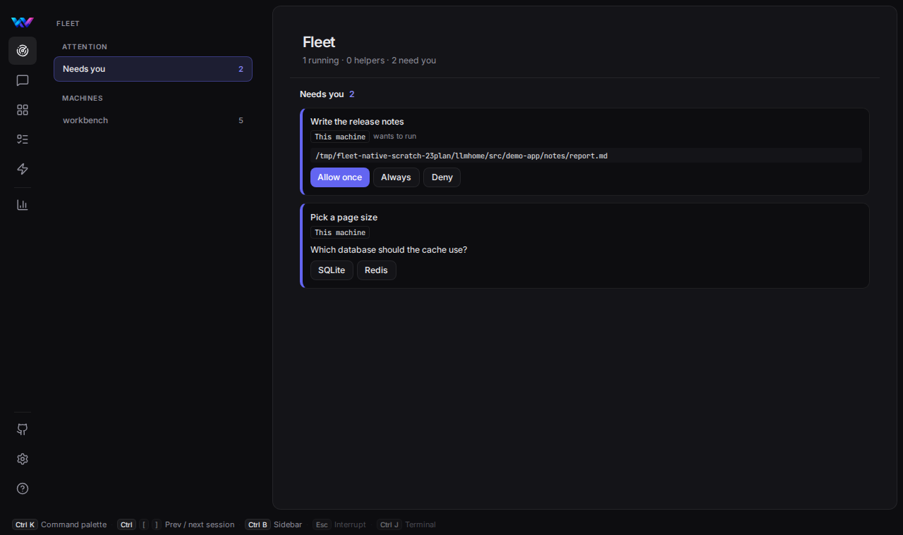
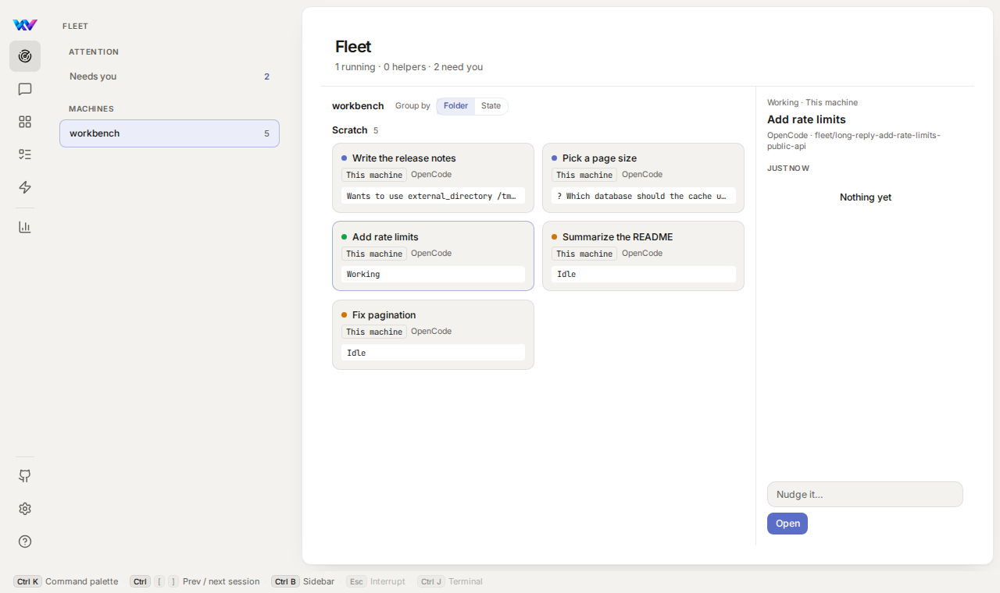
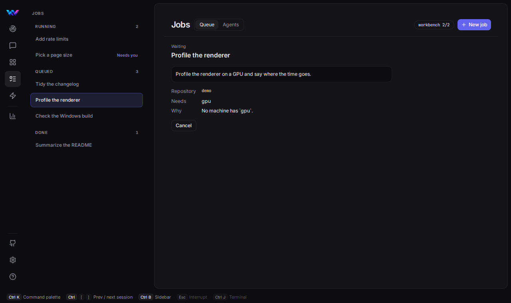
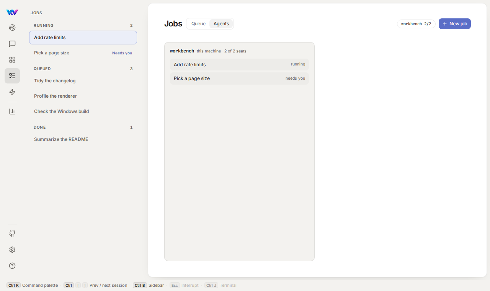
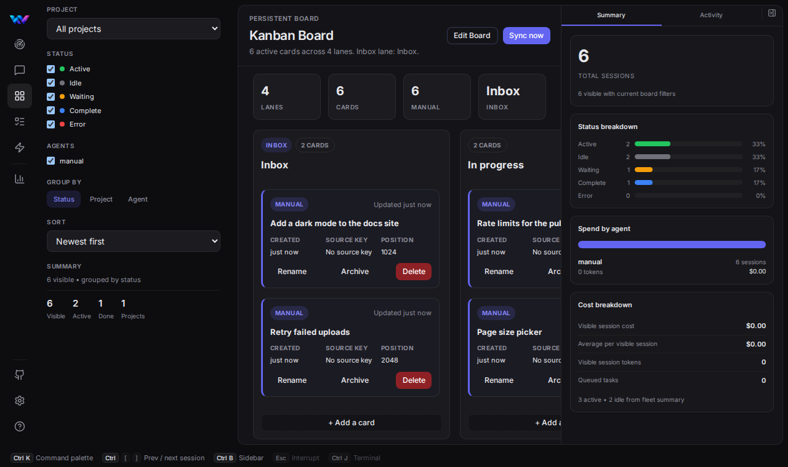
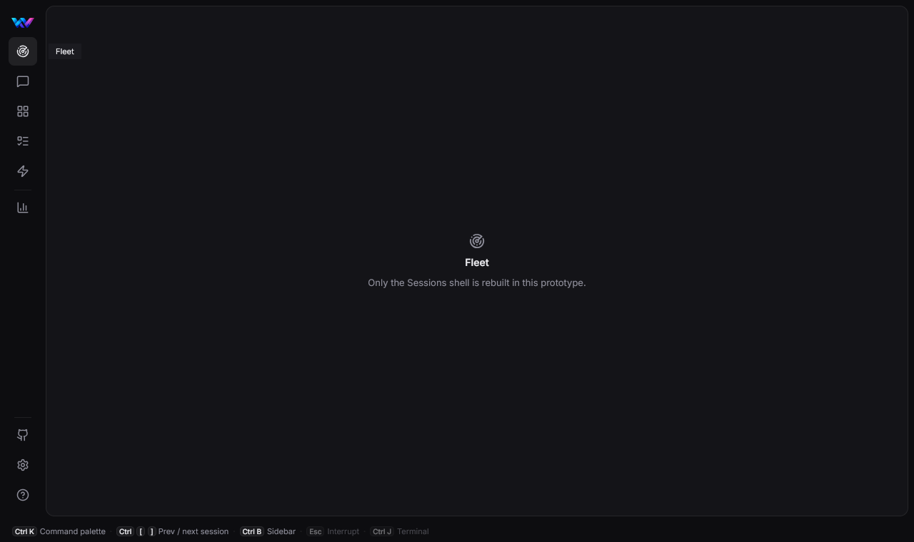

# Component 23: Labs views

The parity checklist for component 23 of `docs/PORT.md`, Labs views: three rail views that Fleet keeps behind switches
in Settings → Labs, each off until the user turns it on.

- **Fleet** (mission control), `[fleet-menu][fleet-detail]`: the fleet-menu lists **Needs you** first, then one entry
  per machine; Needs you (`/fleet`) is every machine's asks as cards answered in place; a machine
  (`/fleet/machines/{id}`) is its working and waiting sessions as tiles, grouped by folder or state, with a peek panel and
  a nudge box.
- **Jobs**, `[jobs-list][jobs-detail]`: one queue of jobs that the home Fleet starts on whichever machine has a free seat;
  the list groups them Running, Queued, Done; a job is `/jobs/{id}`; the page has a Queue and an Agents tab, the seats
  per machine and New job. Seats and labels are set on each machine's card in Settings → Machines.
- **Board** (`/board`), `[board-controls][board][board-panel]`: a persistent Kanban board of lanes and cards (manual cards and cards a
  source such as GitHub fills), with filters and grouping on its left and a Summary and Activity panel on its right.

It is built in two slices: **slice 1** is Fleet and Jobs (with the frame all three share), **slice 2** is the Board. It
ends with the pieces each slice is built in.

- **weave-fleet commit read:** `c1a48bd` (`main`, 20 November 2026).
- **Server the live checks ran against:** the scratch Fleet's package, which reports **v0.74.0** (the folder is still
  named v0.72.0). With the three switches on it answered every route this component reads the way `main`'s client
  expects (checked live: `GET/POST /api/jobs`, `GET /api/jobs/repositories`, `GET /api/sessions/now`, the sessions list,
  permissions and messages, `GET/POST /api/boards`, lanes, cards). With Jobs off, `/api/jobs` answers 404 "Jobs are
  turned off in Fleet's Settings." The client that server serves drew every picture below.
- **Native app read:** `main` at `64ae560a`.
- **Paths** are weave-fleet's under `client/src/` unless they start with `src/`, `docs/` or `server:`. Short names:
  - Fleet: MCS `components/mission-control/MissionControlScreen.vue`, FNP `FleetNavPanel.vue`, FVS `FleetViewStrip.vue`,
    NYC `NeedsYouColumn.vue`, ST `SessionTile.vue`, PP `PeekPanel.vue` (all four under `components/mission-control/`),
    MCP `components/pages/MissionControlPage.vue`, LMC `lib/mission-control.ts`, LMP `lib/mission-peek.ts`, LMR
    `lib/mission-control-requests.ts`, LFV `lib/fleet-views.ts`, UMC `composables/use-mission-control.ts`, USMC
    `use-shared-mission-control.ts`, UFM `use-fleet-menu.ts`, UFV `use-fleet-view.ts`, UMCF
    `use-mission-control-feature.ts`, IF `lib/phone/inbox-feed.ts`, IN `lib/phone/inbox.ts`, MF `lib/machine-feed.ts`,
    NY `lib/needs-you.ts`, PA `lib/push/answer.ts`.
  - Jobs: JS `components/jobs/JobsScreen.vue`, JNP `JobsNavPanel.vue`, JD `JobDetail.vue`, JA `JobsAgents.vue`, NJD
    `NewJobDialog.vue`, JST `JobsStrip.vue`, JP `components/pages/JobsPage.vue`, LJ `lib/jobs.ts`, SJ `stores/jobs.ts`,
    UJM `composables/use-jobs-menu.ts`, UJF `use-jobs-feature.ts`, MJS `components/settings/MachineJobSeats.vue`, MPg
    `components/settings/MachinePage.vue`.
  - Shared: CR `components/layout/core-rails.ts`, IR `components/layout/IconRail.vue`, FON
    `components/pages/FeatureOffNotice.vue`, PH `components/ui/page-header/PageHeader.vue`, ES
    `components/ui/empty-state/`, EN `components/ui/error-note/`, UC `composables/use-commands.ts`, LS
    `components/settings/LabsSection.vue`, RI `routes/index.tsx`.
  - Board: the short names in section 15.
- **Row numbers:** 1.x the frame the three share (switches, rails, routes, the off notice, ways in); 2.x-8.x Fleet; 9.x-14.x
  Jobs; 15.x-24.x the Board; 25.x what is out of reach.

The gap, visible in the pictures (each one's other theme is in the same folder): Fleet's rail, with the three switches
on, has Fleet first, then Sessions, Board, Jobs (Workflows is off here); Fleet opens the fleet-menu (ATTENTION: Needs you
2; MACHINES: workbench 5) beside a page headed "Fleet" with "1 running · 0 helpers · 2 need you" and the asks as cards
(Allow once, Always, Deny; the question's two options as buttons); a machine's view is tiles grouped under "Scratch 5"
with Group by Folder / State and a peek with Just now, the nudge box and Open. Jobs opens the jobs-list (RUNNING 2,
QUEUED 3, DONE 1, "Needs you" on the job that asks) beside the page: Queue / Agents, the seat chip "workbench 2/2", New
job, and the open job (Waiting, the title, the ask, Repository, Needs, Why, Cancel). The Board opens its controls
(Project, Status, Agents, Group by, Sort, Summary) beside the lanes and cards, with Summary and Activity on its right.
The native app has the three rail entries and the same notice for each: "Only the Sessions shell is rebuilt in this
prototype."

**How the pictures were made** (each piece repeats it for its own): a scratch Fleet (`scripts/scratch-fleet.sh` with
its own ports and `WORK` under `/tmp`; start the scripted model with `HOME` set to a scratch folder whose `src/demo-app`
links to `$WORK/proj/demo`, because its file tools write under `$HOME/src/demo-app`); rename the machine (`PUT
/api/machine {"name":"workbench"}`, or pictures show this computer's name); turn the switches on with `PUT
/api/preferences/Jobs`, `/api/preferences/features.mission-control.enabled` and `/api/preferences/features.board.enabled`,
each `{"value":"true"}`; set `PUT /api/preferences/PermissionLevel {"value":"ask"}` before starting a session with
`ask-permission` (a permission ask) and post jobs with `POST /api/jobs` (`{"title","ask","repository":"demo","labels",
"pinnedMachineId"}`): an ask with `long-reply` keeps its job running, `ask-me` makes it need you, a third waits for a
seat (the machine has 2 by default), `labels: ["gpu"]` waits with "No machine has `gpu`.", a pinned id that isn't listed
waits with "It's pinned to a machine that isn't in the list.". The board: `POST /api/boards {"name":"Kanban Board"}`,
four `POST /api/boards/{id}/lanes`, `PATCH` the first `{"isInbox":true}`, cards with `POST /api/boards/{id}/cards
{"laneId","title"}`. Fleet's client by Playwright at 1280×760, UTC, en-US, the theme set with `localStorage
weave:theme`; the native app live by `--server … --script` (the theme toggled by Cmd+Shift+L in a scratch data folder).
Never turn Labs switches on in a real Fleet.

## What "done" means

1. With a switch off, its rail entry is gone and its address shows Fleet's off notice with Turn on, and the app asks the
   server nothing for that view (Fleet's tests say so for each).
2. **Fleet**: the fleet-menu and the page, both reading the view from the address; every machine's sessions as tiles,
   kept live while the view is shown (one feed per machine, the now lines every 4 s); every ask answered in place on the
   session's own machine; the peek and the nudge (steered into the turn where the harness steers, queued otherwise).
   The first `/` of a start lands on `/fleet` when Mission control is on (component 9's rule, wired here).
3. **Jobs**: the jobs-list and the page, the open job in the address; the queue polled every 3 s while shown; New job,
   Cancel, Open session (on the machine that took the job); the Agents tab; seats and labels on each machine's card in
   Settings → Machines with Jobs on.
4. **Board**: the board as Fleet draws it, with its controls, lanes, cards, edit mode, drag and drop, sources and the
   right panel (section 15 on).
5. Fleet's tests for them pass here under the same names (list below).

## What the native app already has

| Part | State | Where |
|---|---|---|
| The three switches' preference keys (`features.mission-control.enabled`, `features.board.enabled`, `Jobs`), the rails Fleet (Radar, order -10), Board (LayoutGrid, 10), Jobs (ListTodo, 25) leaving the rail while off, `/fleet`, `/fleet/…`, `/jobs/…`, `/board` picking their rail, Fleet highlighted (not Sessions) on `/fleet`, the panel only while on | Done (component 9, piece A; `rails.test.ts`) | `src/fleet/rails.rs`, `src/view/rail.rs`, `src/tests_rails.rs` |
| Each of the three rails opens a notice: "Only the Sessions shell is rebuilt in this prototype." | To replace (A) | `src/view.rs` `notice` |
| `FeatureOffNotice` ("<title> is off", the description, Turn on, "You can change this any time in Settings."), its comment already naming component 23 | Done (component 18, piece B) | `src/view/feature_off.rs` |
| Settings → Labs: the Jobs and Mission control rows with their switches, "↳ Adds:" lines and Open links (to `/jobs`, `/fleet`); "Keep every machine live" drawn and saved only | Done (component 16, piece T) | `src/view/settings/labs.rs`, `src/tests_settings_labs.rs` |
| The landing rule (the first `/` of a start goes to `/fleet` with Mission control on, `home-landing.test.ts`) | The rule is done (9C, `dashboard::Landing`); it only records `landed` until Fleet exists (A wires it) | `src/fleet/dashboard.rs`, `src/fleet/home.rs` |
| "Go to Board" in the palette (`nav-board`, "Open the fleet board view.") | Listed as "waiting on component 23" (`Run::Waiting(23)`); its keywords are `board`, `mission control`, Fleet's are `kanban`, `overview`, `board` (A fixes both) | `src/ui/commands.rs` |
| `sessionBucket`, `isTopLevel`, `sessionUpdatedAt`, `countsWithoutArchiving` (`lib/needs-you.ts`); the archive queue's pending ids | Done (component 9, the dashboard; component 6) | `src/fleet/dashboard.rs`, `src/fleet/archive_queue.rs` |
| `askPreviewWording` (the one-line preview of a permission ask, "Wants to run `git push`"), ported for this component | Done (component 4, piece A) | `src/asks/wording.rs` `ask_preview_wording` |
| Permission asks read from `GET /api/sessions/{id}/permissions` (`toPermissionAsk`); the permission and question answer requests and their bodies; pending questions read from a question tool part | Done (component 4) for the open session on its machine; mission control's reads are of any session on any machine | `src/asks/`, `src/fleet/asks.rs`, `src/fleet/questions.rs` |
| The machines list (home and each machine, names, keys, tokens, per-machine requests `machine_routes::get_on`, `remember_sessions` before opening a session elsewhere), every machine polled every 15 s, a hub per machine kept once one of its sessions is open, subscribed to the `sessions` topic (events read for home only) | Done (component 17) | `src/fleet/machines.rs`, `machine_poll.rs`, `machine_routes.rs`, `routing.rs`, `link.rs` |
| `RunningWorkItem` and `GET /api/sessions/{id}/work` (the peek's helpers) | Done (component 3) | `src/fleet/work.rs` |
| Sending a prompt, `delivery: "steer"`, the queue (`/queue`), a harness's `supportsSteering` | Done (component 5) | `src/composer/`, `src/lib.rs` |
| `PageHeader` with `bar` (title, meta, actions, the rule under it); no description line in the bar yet (D adds it) | Done (component 19) | `src/ui/page_header.rs` |
| `EmptyState` (full and compact), the kit's Button, Dialog, Select, text field and textarea, a spinner | Done (component 1 and later) | `src/ui/` |
| `ErrorNote` | Copied privately in several views (`view/settings/kit.rs` `error_note`, `view/dashboard.rs`) | |
| The machine card in Settings → Machines | Done (component 17); no job seats row (14.x) | `src/view/machine_card.rs`, `src/fleet/machine_card.rs` |
| The Board's Labs switch in Settings ("Enable Board feature", `board-switch`, saves `features.board.enabled`) | Done (component 16) | `src/view/settings/general.rs`, `src/fleet/settings/switches.rs` |
| The board's right-panel fold kept out of the session choices (`right_collapsed(None)`, `sidebar.test.ts` "keeps the board's right panel out of the session choices"); the right panel's width rules (360, min 280, the inline room) and its gutter | Done for the session panel (component 10) | `src/fleet/settings.rs`, `src/fleet/right_panel.rs`, `src/view/right_rail.rs` |
| `confirmAction` (title, subject, body, label, destructive) | Done | `src/ui/confirm.rs` |
| `formatRelative` in words, `formatDateTime`, `formatTime`; `formatMoney`, `formatTokens` | Done | `src/fleet/smart_links.rs`, `src/fleet/row_status.rs`, `src/composer/format.rs` |
| `GET /api/fleet/summary` read and polled every 30 s while shown | Done for the home page (component 9) | `src/fleet/summary.rs` |
| A pointer drag with drop targets found by key (`Tx::element_at`) | Done for session rows (component 6) | `src/fleet/row_drag.rs` |
| Places core offers to plugins; GitHub's bookmarks store; GitHub's manifest listing the area "Board" | Done (component 21, pieces A and C); **no board-source place yet** (21's row 1.5 waits on P) | `src/fleet/places.rs`, `src/plugins/github/` |
| A checkbox look | Private copies only (Q lifts one into the kit) | `src/view/session_row.rs`, `src/view/file_find.rs` |
| Any mission control data, feed, menu or page; any jobs data, store, list, page or dialog; any board data or view | None | |

## The checklist

Each row: what Fleet does, its source, and the native state (with the piece that owns it).

### 1. The frame the three share

| # | Row | Source | Native |
|---|---|---|---|
| 1.1 | Three server preferences of the live machine, each `"true"` / `"false"`, off by default: Mission control `features.mission-control.enabled`, Jobs `Jobs`, Board `features.board.enabled` | UMCF, UJF, `composables/use-board-feature.ts`, LMC 12, LJ 2 | **Done** (component 9): `rails.rs` `FLEET_KEY`, `JOBS_KEY`, `BOARD_KEY` |
| 1.2 | Rails: Fleet (Radar, `/fleet`, top, order -10, panel FleetNavPanel), Board (LayoutGrid, `/board`, 10, BoardControlsPanel), Jobs (ListTodo, `/jobs`, 25, JobsNavPanel); each `hidden` and `noPanel` while its switch is off | CR 62-78 | **Done** (component 9) |
| 1.3 | `/fleet` and `/fleet/…` highlight Fleet, not Sessions; `/board` highlights Board | IR 89-112 | **Done** (component 9) |
| 1.4 | Routes: `/fleet/` and `/fleet/machines/$machineId` both render `MissionControlPage`; `/jobs/` and `/jobs/$id` both render `JobsPage`; `/board` renders `BoardPage`. The page reads which view from the address | `routes/fleet.*.tsx`, `routes/jobs.*.tsx`, `routes/board.tsx` | **Done (A)**: `fleet/labs.rs` keeps `fleet_view` and `job` on `State`, opened by `open_fleet_address` / `open_jobs_address`; the Board has one address |
| 1.5 | Off, each page shows `FeatureOffNotice` with Turn on (it saves the preference `"true"`): Mission control "One screen for every running agent on every machine: what needs you, what each is doing right now, and a nudge box."; Jobs "Post jobs to one queue. Fleet starts each on whichever of your machines has a free seat."; Board "The board lays your sessions out in columns by status, so you can see what's running, waiting or done at a glance." | MCP, JP, `routes/board.tsx`, FON | **Done (A)**: `view/labs_frame.rs`, the three descriptions in `Feature::description`, Turn on saves the key on the live machine; nothing is drawn until the preferences load |
| 1.6 | Off, no view asks the server anything (no feeds, no `/api/jobs`, no `/api/boards`) | MCP test, JS test | **Done (A)** for the frame: off, nothing is asked (tests against a fake Fleet); each store piece keeps it |
| 1.7 | On, the page is a `section` filling the context's detail (`flex h-full flex-col overflow-hidden`) beside the view's own panel, with the left gutter between; Ctrl+B hides the panel (the page alone) | MCP, JP, AppShell | **Done (A)**: `[panel][gutter][page]` shells with empty bodies; Ctrl+B hides the panel (tested); D, G and the board pieces fill them |
| 1.8 | Landing: the first `/` of a start, once the preferences have loaded, goes to `/fleet` when Mission control is on (replace); a deep link never lands | RI 20-43 | **Done (A)**: the landing opens Fleet's Needs you (`landing_check`); tested for prefs first, `/` first, off, and a deep link |
| 1.9 | Settings → Labs' Open links go to `/jobs` and `/fleet` | LS 119-133 | **Done (A)**: Open opens the bare address (`enter_labs`) |
| 1.10 | Palette: `nav-board` "Go to Board", "Open the fleet board view.", LayoutGrid, Navigation, keywords `kanban`, `overview`, `board`, opens `/board` (it is listed with the Board off too, and opens the off notice). There is no palette command for Fleet or Jobs (`nav-fleet` is "Go to Sessions") | UC 344-361 | **Done (A)**: `nav-board` runs with Fleet's keywords; opens the off notice while off |
| 1.11 | On a phone (≤767 px) each view's panel is a strip of chips above the page (`FleetViewStrip`, `JobsStrip`) | FVS, JST, MCS 185-196 | Out of scope (last section) |

### 2. Fleet: the fleet-menu

| # | Row | Source | Native |
|---|---|---|---|
| 2.1 | `section` "Fleet navigation": padding 0/12/12, scrolls when tall; header "FLEET" (10 px, 600, upper case, tracking 0.05 em, muted, padding 18/4/10) | FNP 1-23, 75-92 | None (D) |
| 2.2 | `nav` "Fleet views" with two groups, each `role="group"`: **Attention** (label "ATTENTION") holding Needs you, and **Machines** ("MACHINES"); group gap 4, margin-bottom 8; label 10 px 600 upper case, tracking 0.05 em, muted, margin 8/0/2, padding 0 12 | FNP 16-70, 94-109 | None (D) |
| 2.3 | An item: a button, min-height 36, padding 0 12, gap 10, 1 px transparent border, radius `--radius-btn`, 12 px 500 muted, left-aligned; the label grows; hover `--bg` fill and `--text`; focus ring 2 px accent, offset 2; the open one: border accent 40%, fill `--panel-bg` 88% + accent 12%, `--text`, `aria-current="page"` | FNP 111-142 | None (D) |
| 2.4 | Needs you's count: the waiting tiles (needs you **or** error, 3.6), 11 px tabular muted; while above 0 it is 600 `--accent-text` (`fleet-nav__count--alert`) | FNP 36-40, 161-170, UFM 26-27 | None (D) |
| 2.5 | One entry per machine in the machines store's order (home first), labelled with its name (ellipsis when long); its count = that machine's tiles (working, waiting, error and idle in the last day); "offline" (10 px muted) before the count when its feed is unreachable | FNP 44-68, 144-160, UFM 29-35 | None (D) |
| 2.6 | Pressing an item opens its route (`/fleet` for Needs you, `/fleet/machines/<id encoded>` for a machine); pressing the open one does nothing | UFM 41-44, LFV | None (B the paths, D the press) |
| 2.7 | The menu and the page read the view from the address (`fleetViewFromPath`), so neither passes it to the other; a reload keeps it | UFV, LFV | Address half **done (A)** (`State.labs.fleet_view`); the menu and page reading it are D's |

### 3. Fleet: the data (no view)

| # | Row | Source | Native |
|---|---|---|---|
| 3.1 | `fleetViewPath` / `fleetViewFromPath`: Needs you is the bare `/fleet`; a machine is `/fleet/machines/<encoded id>`; a trailing slash is dropped; anything else (stale, malformed encoding) is Needs you; `isSameFleetView` | LFV | **Done (A)** (moved from B): `fleet_view_path`, `fleet_view_from_path`, `is_same_fleet_view`, with `decode_component` |
| 3.2 | A tile per machine session: key `<machine id>:<session id>`, machine id and name, session id, title (trimmed, else "Untitled session"), folder (`sessionFolder`: the project's name, else the workspace's display name, else the last part of the source or workspace path), branch (trimmed or none), state, harness in words (`opencode` OpenCode, `opencode2` OpenCode 2, `claude-code` Claude Code, `copilot` GitHub Copilot, `pi` Pi, else the type as is), the harness type, the model id (`selectedModel.modelID`), the now line, todos (`progress` with total above 0: done/total), helpers (`runningWorkCount`, 0 when absent), the ask, updated-at, stale (the machine's feed is unreachable) | LMC 38-127, IN `sessionFolder` | **Done (B)**: `mission::Tile`, `build_tiles`; the folder is the project name, else the workspace display name, else the last part of `workspaceDirectory` (the list rows here keep no `sourceDirectory`, which Fleet reads first: a gap only for a session whose project and workspace have no name) |
| 3.3 | Tile state: `sessionStatus` error → error; else the bucket (`sessionBucket`): needs-you (waiting_input), working (active), else idle | LMC 84-88, NY | **Done (B)**: `state_of`, over `dashboard::session_bucket` |
| 3.4 | The now line: needs-you with an ask → the ask's line (a question: `? <question>`; a permission: `askPreviewWording`'s lead and detail, joined by a space); working with a machine now line → its text; idle whose now line is a `reply` → its text; else the state in words: "Needs you", "Working", "Idle", "Stopped with an error" | LMC 75-102 | **Done (B)**: `now_line`, with `asks::wording::ask_preview_wording` |
| 3.5 | `buildTiles`: every machine's top-level sessions (no parent, not hidden), not archived, not being archived (the archive queue's pending ids), dropping idle ones quiet for more than a day (`FINISHED_FOR_MS` 24 h; the clock is the relative-time clock); newest first by updated-at | LMC 129-144, UMC 42 | **Done (B)**: `build_tiles(machines, now, quiet_for, archiving)`; the caller passes the archive queue's pending ids |
| 3.6 | `needsYou`: the tiles that are needs-you or error, in the tiles' order | LMC 146-149 | **Done (B)**: `needs_you` |
| 3.7 | `groupTiles` by folder ("No folder" for none, key "" ), machine (by id, its name) or state (the state's words); folder and machine groups sorted by label (`localeCompare`), state groups in the order needs-you, error, working, idle; tiles keep their order inside a group | LMC 151-168 | **Done (B)**: `group_tiles`; `localeCompare` is a case-folded compare (no ICU: differs only for accents and punctuation) |
| 3.8 | `summarize`: running = working tiles, helpers = the sum of the tiles' helpers, needYou = `needsYou`'s length | LMC 170-177 | **Done (B)**: `summarize` |
| 3.9 | `peekEvents(messages, 6)`: the assistant's tool calls and text parts, oldest first, the newest 6; a tool's line is its name lower-cased, then ` · ` and the first of `command`, `pattern`, `filePath`, `file_path`, `path`, `url`, `description`, `query` that is a non-blank string, cut to its first line and 90 characters (`…`); a text part's first line, cut the same way; the user's words left out; key `<message id>:<part index>` | LMP | **Done (B)**: `mission::peek::peek_events`; times are ms (`Msg.created_at`), not ISO text |
| 3.10 | `nudgeRequest`: to a working session whose harness steers, `POST /api/sessions/{id}/prompt` `{text, userMessageId, delivery: "steer"}`; to a working one that doesn't, `POST /api/sessions/{id}/queue` `{text}`; to one not working, `POST …/prompt` `{text, userMessageId}`; each to the session's own machine with its token | LMR 13-25 | **Done (B)**: `mission::requests::nudge_request` as plain data (method, path, body); `Request::send(base)` runs it on a thread, the machine's token coming from `auth` by address |
| 3.11 | Answers: `POST /api/sessions/{id}/permissions/{requestId}` `{reply: once/always/reject}` (on the **ask's** session id, which may be a sub-agent's) and `POST /api/sessions/{id}/questions/{requestId}/answer` `{answers: [[label]]}`, each to the tile's machine | PA 31-56, UMC 108-111 | **Done (B)**: `permission_answer_request`, `question_answer_request`, each on the ask's own session; `machine_key` picks the tile's machine (the live answer calls are D's) |
| 3.12 | An answer's outcome (`sendAnswer`): ok; 404 or 409 → gone, "Already answered."; another status → the body's `error`, `detail` or `title`, else "It answered <status>."; no answer → "Couldn't reach the machine." A tile whose machine left the list → "That machine isn't in the list any more." | PA 79-103, UMC 99-106 | **Done (B)**: `outcome` (ok, gone, error words) and `MACHINE_GONE` |
| 3.13 | Whether a harness steers: the machine's `GET /api/harnesses`, the entry of the tile's harness type, `capabilities.supportsSteering === true`; a failed read says no | UMC 113-123 | **Done (B)**: `steers(harnesses body, harness type)`; C reads the body |

### 4. Fleet: keeping it live (no view)

| # | Row | Source | Native |
|---|---|---|---|
| 4.1 | One mission control for the menu and the page together: its feeds open with the first reader and close when the last goes (leaving the Fleet rail closes them) | USMC | None (C: open while the Fleet view is shown) |
| 4.2 | A feed per machine in the machines store, opened for each new entry and closed for one that left or whose key, address or token changed (a rename alone keeps the feed) | UMC 47-77 | None (C) |
| 4.3 | A feed's read: `GET /api/sessions?limit=100&offset=0`; for each `waiting_input` session (at most 12), its ask: the first permission from `GET /api/sessions/{id}/permissions`, else the newest pending question tool call in `GET /api/sessions/{id}/messages?limit=6` (`findPendingQuestion`: `{requestId, question, more}`); a refused read says "It answered <status>." (401: "This phone's key for this machine stopped working.") | IF 32-70 | None (C) |
| 4.4 | A feed's life: read at once, then connect the machine's event hub and subscribe to the `sessions` topic; each `sessions` event re-reads 300 ms later (a burst is one read; an event during a read reads again after it); while the hub is down, read every 15 s; with a live hub, read every 60 s anyway | MF 117-181, 201-211 | None (C; the native link already subscribes to `sessions` for every machine it holds, `link.rs` 478, but only acts on home's events) |
| 4.5 | A feed's status: `connecting` until the first answer, `live` with the hub, `polling` without it, `unreachable` when a read fails (keeping the last sessions and asks, with the reason); `lastHeardAt` set by each good read | MF 18-35, 213-229 | None (C) |
| 4.6 | Now lines: `GET /api/sessions/now` on each machine when its feed opens and every 4 s while the page is visible; a 404 (a machine too old), a failed read or no answer gives no lines and no error; the first call turns the machine's bookkeeping on, so it answers `{}` once | UMC 12-13, 67-82, LMR 27-38 | None (C) |
| 4.7 | After an answer or a nudge the tile's machine is read again at once (the card goes when the machine says the ask is gone) | UMC 103-104 | None (C) |
| 4.8 | Opening a tile's session remembers it on its machine first (`rememberSessions`), then opens `/sessions/<id>` | MCS 48-51 | None (D; `remember_sessions` is done) |

### 5. Fleet: the page

| # | Row | Source | Native |
|---|---|---|---|
| 5.1 | `PageHeader` with `bar`: "Fleet" and the description "<running> running · <helpers> helpers · <needYou> need you" (the summary, 3.8, plural words never change: "1 running", "0 helpers") | MCS 72-76, PH | None (D; the bar gains its description line) |
| 5.2 | Needs you (`/fleet`): the Needs you column, wide (fills the page), its items the waiting tiles; `loading` while every machine is still asked (no answer yet and not unreachable) | MCS 79-92, 31-40 | None (D) |
| 5.3 | A machine's view whose machine isn't in the list: "That machine isn't in the list any more." (padding 16, 14 px muted) | MCS 93-99 | None (E) |
| 5.4 | A machine's view: a scrolling section (padding 16): a row (12 px muted, gap 8, margin-bottom 12): the machine's name (14 px 600 `--text`, margin-right 8), "Group by", and a segmented control (`role="group"` "Group by", radius card, 1 px border): **Folder**, **State** (padding 10/4, 12 px; the picked one `bg-accent-dim` 500 `--accent-text`, the others muted, `--text` on hover; `aria-pressed`). Folder is the default; the choice is shared by every machine and kept while the app runs, not saved | MCS 100-129, 43-46, UMC 30 | None (E) |
| 5.5 | No tiles while asking the machine: a large spinner, "Asking <name> for its sessions…" (centred, padding 24) | MCS 130-140 | None (E) |
| 5.6 | No tiles and the machine unreachable: `ErrorNote` "Couldn't reach <name>." | MCS 141-145 | None (E) |
| 5.7 | No tiles otherwise: `EmptyState` bordered, Radar, "No sessions are working or waiting on this machine", "Start one from Sessions." | MCS 146-152 | None (E) |
| 5.8 | Groups: each a heading (14 px 600 `--text`, margin-bottom 8) with its count (12 px normal muted, margin-left 4), margin-bottom 20; tiles in a grid, one column, two from 1280 px wide (`xl`), gap 12 | MCS 153-172 | None (E) |
| 5.9 | Pressing a tile picks it (the peek opens beside the list); the pick is kept by tile key while the view stays, dropped when that tile goes | MCS 23, 41, 164-170 | None (E) |

### 6. Fleet: the Needs you column

| # | Row | Source | Native |
|---|---|---|---|
| 6.1 | `aside` "Needs you": padding 16, gap 12, scrolls; heading "Needs you" (14 px 600) with the count beside it (14 px 600 `--accent-text`, baseline, gap 8) | NYC 41-53 | None (D) |
| 6.2 | Loading with nothing yet: a large spinner "Asking your machines what's waiting…" (centred, padding 16) | NYC 54-64 | None (D) |
| 6.3 | Empty: `EmptyState` bordered compact "Nothing is waiting on you" | NYC 65-70 | None (D) |
| 6.4 | A card per waiting tile: radius card, 1 px border, a 4 px accent left border, `--main-bg`, padding 12; the title (14 px 500); under it (12 px muted, gap 6, margin-top 4) the machine chip (mono, 1 px border, radius 4, padding 6/1, `--text`) and, for a permission, "wants to run" | NYC 71-83 | None (D) |
| 6.5 | A question: its text (14 px, margin-top 8); a single-choice question with no more questions after it gets its options as small outline buttons (gap 6, each titled with the option's description), which answer `[[label]]`; a multiple-choice one, or one with more questions, gets one small outline button "Open to answer" that opens the session | NYC 85-114 | None (D) |
| 6.6 | A permission: the ask's title, else its tool, in a code box (mono 12 px, `--panel-bg`, radius 4, padding 8/4, breaks anywhere), then small buttons **Allow once** (default), **Always**, **Deny** (outline), answering once, always, reject | NYC 116-143 | None (D) |
| 6.7 | Any other waiting tile (an error, or waiting with no ask found): its now line (14 px muted) and a small outline **Open** | NYC 145-157 | None (D) |
| 6.8 | While a card's answer is on its way its buttons are disabled; after it, an outcome that is neither ok nor gone shows a compact `ErrorNote` under the card with the outcome's words (else "It didn't go through."); a later good answer clears it | NYC 18-38, 159-164 | None (D) |
| 6.9 | The card leaves when the machine's next read no longer has the ask | UMC 103-104 | None (C, D) |

### 7. Fleet: a tile

| # | Row | Source | Native |
|---|---|---|---|
| 7.1 | A button, full width, radius card, 1 px border (`--border`, accent when picked, accent 50% on hover), `--main-bg`, padding 12, left-aligned; a stale tile (its machine unreachable) at 60% opacity | ST 14-20 | None (E) |
| 7.2 | First line (14 px 500): a 8 px dot (needs-you accent, working `--running`, idle `--idle`, error `--error`) and the title, cut with an ellipsis | ST 5-10, 21-28 | None (E) |
| 7.3 | Second line (12 px muted, gap 6, margin-top 4, wraps): the machine chip (mono, as 6.4) and "<harness>" or "<harness> · <model>" | ST 29-35 | None (E) |
| 7.4 | The now line: mono 12 px `--text` in a `--panel-bg` box (radius 4, padding 8/4, margin-top 8), one line cut with an ellipsis | ST 36-41 | None (E) |
| 7.5 | With todos or helpers, a line (12 px muted, gap 12, margin-top 8): "<done>/<total>" and "<n> helper" / "<n> helpers" | ST 42-48 | None (E) |
| 7.6 | The now line follows the machine's now line every 4 s (Fleet's test: "bash · pnpm test webhooks" becomes "edit · src/sync/rules.ts") | UMC, MCP test | None (C, E) |

### 8. Fleet: the peek and the nudge

| # | Row | Source | Native |
|---|---|---|---|
| 8.1 | `aside` "Peek" (`aria-live` polite): 320 wide (`w-80`), a 1 px left border, padding 16, gap 16, scrolls | PP 79-85 | None (E) |
| 8.2 | Head: "<state words> · <machine>" (12 px muted; the state's words as 3.4's), the title (16 px 600, margin-top 4), "<harness> · <model> · <branch>" with the missing ones left out (12 px muted, margin-top 4) | PP 86-97 | None (E) |
| 8.3 | **Just now** (10 px 600 upper case, wide tracking, muted): the peek events (3.9), each one line of mono 12 px, cut, gap 6; none: compact `EmptyState` "Nothing yet" | PP 99-120 | None (E) |
| 8.4 | **Helpers**, only with running work: each helper in a bordered box (radius card, padding 8/6, 12 px): its title (600) and its label (muted, margin-left 4) | PP 122-142 | None (E) |
| 8.5 | The reads: `GET /api/sessions/{id}/messages?limit=6` and `GET /api/sessions/{id}/work` (the running items) on the tile's machine, when the tile is picked and again whenever its now line or helper count changes; an answer for a tile no longer picked is dropped; a failed read is nothing | PP 29-53 | None (E: on a thread) |
| 8.6 | At the bottom: the nudge field (radius card, 1 px border, `--main-bg`, padding 12/8, 14 px; placeholder "Nudge it…", label "Nudge this session"); Enter sends the trimmed text (not while sending, not blank) | PP 144-154, 60-75 | None (E) |
| 8.7 | After a nudge: sent → the field clears and "Sent." (12 px muted); queued → "Queued: it goes when the turn ends."; failed → a compact `ErrorNote` with the outcome's words (else "It didn't go through."); picking another tile clears the field, the line and the error | PP 54-58, 155-166 | None (E) |
| 8.8 | **Open** (small, default) opens the session (4.8) | PP 167-172 | None (E) |
| 8.9 | Steering: a working tile's nudge asks the machine's harness list first (3.13); Fleet's test: a working session whose harness steers gets `POST …/prompt` and "Sent." | UMC 125-133, MCP test | None (C, E) |

### 9. Jobs: the data and the store (no view)

| # | Row | Source | Native |
|---|---|---|---|
| 9.1 | A job: `id`, `title`, `ask`, `repository`, `labels`, `pinnedMachineId`, `state` (waiting, running, needs_you, done, failed), `machineId`, `machineName`, `sessionId`, `whyWaiting` (the server's words, e.g. "It starts on the next check.", "No machine has a free seat.", "No machine has \`gpu\`.", "It's pinned to a machine that isn't in the list."), `error`, `createdAt` | LJ 6-23 | None (F) |
| 9.2 | A job machine: `id`, `name`, `isLocal`, `seats`, `used`, `labels`, `status` ("online" or not); a repository for New job: `name`, `repository` (the origin remote, else the folder name), `machines` (names) | LJ 25-46 | None (F) |
| 9.3 | `jobGroups`: Running (running and needs_you), Queued (waiting), Done (done and failed), each in the server's order | LJ 79-87 | None (F) |
| 9.4 | `jobPath` (`/jobs/<encoded id>`) and `jobIdFromPath` (none on `/jobs` or `/jobs/`) | LJ 89-98 | **Done (A)** (moved from F): `job_path`, `job_id_from_path`; a bad escape names no job (Fleet's throws) |
| 9.5 | `parseLabels("mac, gpu")`: split on commas, trimmed, no blanks, no repeats (case-insensitive, the first spelling kept) | LJ 100-109 | None (F) |
| 9.6 | `MAX_JOB_SEATS` 16 | LJ 4 | None (F) |
| 9.7 | `jobColumns` (Waiting, Running, Needs you, Done with failed): exported and nothing on `main` uses it (a board of jobs that was taken out) | LJ 56-71 | Not ported: dead on `main` |
| 9.8 | The store asks the **home** Fleet, whichever machine is live, and nothing until something loads it (only the Jobs page and Settings → Machines, only with Jobs on) | SJ 128-133 | None (F) |
| 9.9 | `load`: `GET /api/jobs` → jobs and machines, `isLoaded`, the error cleared; refused → the server's error (`extractApiError`) else "Couldn't load the jobs."; no answer → "Couldn't reach Fleet." (the last list stays) | SJ 141-157 | None (F) |
| 9.10 | `watch`: load now and every 3 s (`JOBS_POLL_MS`) while anything watches; several watchers share one timer; the last one to stop stops it | SJ 116-117, 159-175 | None (F: while the Jobs view is shown) |
| 9.11 | `post`: `POST /api/jobs` `{title, ask, repository, labels, pinnedMachineId}`, then load; refused → the server's error, else "Couldn't post the job." | SJ 187-190 | None (F) |
| 9.12 | `cancel` (a waiting job only): `DELETE /api/jobs/{id}`, then load; refused → "Couldn't cancel the job." | SJ 192-196 | None (F) |
| 9.13 | `saveMachine`: `PUT /api/jobs/machines/{id}` `{seats?, labels?}` (a field left out stays), the answer replaces that machine; refused → "Couldn't save the seats." | SJ 198-203 | None (F) |
| 9.14 | `loadRepositories`: `GET /api/jobs/repositories`; refused → "Couldn't list the repositories." | SJ 205-209 | None (F) |

### 10. Jobs: the jobs-list

| # | Row | Source | Native |
|---|---|---|---|
| 10.1 | `section` "Jobs navigation": padding 0/12/12, scrolls; header "JOBS" (as 2.1) | JNP 9-16, 58-75 | None (G) |
| 10.2 | The three groups in order, each `role="group"` with its label (Running, Queued, Done): the label row (as 2.2's label, with the count on the right, tabular) and the group's jobs; a group with no jobs still shows its label and 0 | JNP 18-28, 77-98 | None (G) |
| 10.3 | A job: a button as 2.3 (`justify-content: space-between`); its title cut with an ellipsis; a needs_you job's flag "Needs you" (10 px `--accent-text`), a failed job's "Failed" (10 px muted) | JNP 29-47, 99-149 | None (G) |
| 10.4 | Pressing a job opens `/jobs/<id>`; the open one does nothing; the one the address names is marked (`aria-current`) | UJM, JNP 34-38 | None (G) |
| 10.5 | Loaded and every group empty: compact `EmptyState` "No jobs yet" | JNP 50-54 | None (G) |
| 10.6 | The list watches the queue while it is shown (9.10) | UJM 18-29 | None (F, G) |

### 11. Jobs: the page

| # | Row | Source | Native |
|---|---|---|---|
| 11.1 | `PageHeader` `bar` "Jobs"; in its meta slot a tab list (radius btn, 1 px border, padding 2, 14 px): **Queue**, **Agents** (lower-case names drawn capitalised; padding 12/4; the picked `bg-border/60` `--text`, the other muted, `--text` on hover; `role="tab"`, `aria-selected`); Queue first; the tab is kept while the page stays, not in the address | JS 24, 69-92 | None (G) |
| 11.2 | In the actions slot: a chip per machine with seats above 0 (pill, 1 px border, padding 12/4, mono 12 px `--text`): "<name> <used>/<seats>", at 50% opacity when its status isn't "online"; then **New job** (small, Plus 16) | JS 32, 93-116 | None (G) |
| 11.3 | The store's error under the header: `ErrorNote` (margin 20/8) | JS 119-124 | None (G) |
| 11.4 | Queue: a scrolling column: the open job's detail (12.x); else, loaded with no jobs, `EmptyState` ListTodo "No jobs yet", "Post one with New job, and Fleet starts it on a machine with a free seat."; else, loaded, `EmptyState` ListTodo "Pick a job from the list"; before the first load, nothing | JS 127-153 | None (G) |
| 11.5 | Agents: the seats per machine (13.x) | JS 155-160 | None (H) |
| 11.6 | A failed Cancel's words under the page: `ErrorNote` (margin 20/8); a good Cancel goes back to `/jobs` | JS 53-61, 163-167 | None (G) |
| 11.7 | The page watches the queue too (9.10; with the list, one timer) | JS 34-38 | None (F, G) |

### 12. Jobs: a job's detail

| # | Row | Source | Native |
|---|---|---|---|
| 12.1 | `aside`, full width up to 672 (`max-w-2xl`), padding 20, gap 16 | JD 10-13 | None (G) |
| 12.2 | The state line (12 px muted): with a machine, "<Needs you / Done / Failed / Running> on <machine>"; without, "Waiting"; the title under it (18 px 600, margin-top 4) | JD 14-21 | None (G) |
| 12.3 | The ask as written (keeps its line breaks): radius card, 1 px border, `--main-bg`, padding 12, 14 px | JD 23-25 | None (G) |
| 12.4 | A two-column list (gap 16/8, 14 px; names muted): **Repository** (mono 12 px, breaks anywhere); **Needs** the labels joined ", " (only with labels); **Run on** the pinned machine's name, else "A machine that is no longer listed" (only when pinned); **Why** the job's `whyWaiting`, else its `error` (only with one) | JD 27-61 | None (G) |
| 12.5 | Buttons at the bottom (gap 8): **Open session** (small) with a session; **Cancel** (small outline) only while waiting | JD 63-81 | None (G) |
| 12.6 | Open session: remembers the session on the machine that took the job (home when that machine is this one, else its id), then opens `/sessions/<id>` | JS 44-51 | None (G) |

### 13. Jobs: the Agents tab

| # | Row | Source | Native |
|---|---|---|---|
| 13.1 | A scrolling grid (padding 20, gap 16; two columns from 1024 px wide, `lg`) of a card per job machine (every one, seats or not) | JA 14-24 | None (H) |
| 13.2 | A card: radius card, 1 px border, `--main-bg`, padding 16; 60% opacity with no seats; head: the name (mono 14 px 600) and "this machine · " (when local) "<holding> of <seats> seats" (12 px muted) | JA 7-11, 18-32 | None (H) |
| 13.3 | Its labels as chips (mono 12 px muted, 1 px border, radius 4, padding 6/1, gap 6, margin-top 8) | JA 33-42 | None (H) |
| 13.4 | No seats: "Takes no jobs. Give it seats in Settings → Machines." (12 px muted, margin-top 12) | JA 43-48 | None (H) |
| 13.5 | Else the jobs it holds (running or needs_you on that machine): a row each (radius btn, `bg-border/30`, padding 12/8, 14 px): the title and "running" / "needs you" (12 px muted); then a dashed row per free seat (seats minus holding, never below 0): "Free · takes the next job that fits" (12 px muted) | JA 49-70 | None (H) |

### 14. Jobs: New job and the seats in Settings

| # | Row | Source | Native |
|---|---|---|---|
| 14.1 | New job: the kit's Dialog (max width 512): title "New job", description "Fleet starts it on a machine with a free seat. The ask goes to the agent as you write it." | NJD 66-73 | None (H) |
| 14.2 | Fields (gap 16; labels 14 px 500): **Title** (placeholder "Add rate limits"), **Ask** (textarea, 4 rows, "What the agent should do"), **Repository** (a select: "<name> · <machine names joined ', '>"; the first picked when the dialog opens); under it, with no repositories, "No machine that takes jobs has a repository yet. Give a machine seats in Settings → Machines." (12 px muted); in two columns, **Needs** (placeholder "mac, gpu") and **Run on** (a select: "Any machine that fits", then every job machine by name) | NJD 75-163 | None (H) |
| 14.3 | Opening reads the repositories (9.14); a failure shows its words in the `ErrorNote` above the footer | NJD 28-41 | None (H) |
| 14.4 | Footer: **Cancel** (outline, closes) and **Post job** (submit; a spinner while posting), enabled only with a title, an ask (both non-blank) and a repository, not while posting; Enter in a field submits | NJD 26, 43-61, 169-188 | None (H) |
| 14.5 | Post sends the trimmed title and ask, the repository, `parseLabels(needs)` and the pinned id or null (9.11), then closes; a refusal keeps it open with the error | NJD 43-61 | None (H) |
| 14.6 | Closing clears every field and the error | NJD 28-33 | None (H) |
| 14.7 | Settings → Machines, only with Jobs on: under each machine card that the home Fleet's job machines list (home's card is the local one, another card is its id), a row (margin-top 8, gap 12, 14 px muted): "Seats for jobs" with a number field (w 64, 0..16) and "Labels" with a text field (w 160, placeholder "none"), both from the store (the store loads once if not loaded); each saves on change: seats truncated and clamped to 0..16, labels through `parseLabels`; a refusal shows a compact `ErrorNote` ("Couldn't save." when the server gave no words). A machine the home Fleet doesn't list draws nothing | MJS, MPg 16-37, 329-333 | None (H; component 16 handed it here, its 12.18) |
| 14.8 | With Jobs off, Settings → Machines draws as before and asks nothing about jobs | `MachinesSectionJobsOff.test.ts` | None (H: the test) |

### The Board, in short

A Labs view: a persistent Kanban board of **cards in lanes**, kept by the Fleet server (`/api/boards`), not of sessions.
It is behind the preference `features.board.enabled` (default `"false"`, UBF 4-12). Off, the rail has no Board entry, the
address `/board` still opens, and `FeatureOffNotice` fills the whole context ("Board is off", RB 15-19; no left or right
panel, CR 75, AS 121-123). On, the context is `[board-controls][gutter][kanban][gutter][board-right-panel]`: the left panel
is `BoardControlsPanel` (Project, Status, Agents, Group by, Sort, Summary), the centre is `KanbanBoard` (a `PageHeader` bar
"PERSISTENT BOARD" / the board's name / a counting subtitle, Edit Board and Sync now; four summary tiles; the lanes as 320 px
columns of cards; a lane composer per column), and the right is `BoardRightPanel` with two tabs, Summary (counts derived
from the cards, plus the live fleet summary) and Activity (an invented demo feed). The user owns one board (the first the
server lists; "My Board" is created on the first lane or card). Two modes: **work** (default; add, rename, archive, delete
and drag cards) and **manage** ("Edit Board" or Cmd/Ctrl+Shift+E: lane actions, add lanes, rename the board, and the
Sources form that syncs GitHub issues into the inbox lane from the GitHub plugin's bookmarks). Nothing is live: no hub
event, no poll, except the fleet summary (30 s) and the fake activity timer (2.5 s). The left panel's filters, Group by and
Sort change only the counts in the side panels, never the board (FB3).

**Short names for the Board's sources:** KB `components/board/KanbanBoard.vue`, KC
`components/board/KanbanColumn.vue`, KCa `components/board/KanbanCard.vue`, BSC `components/board/BoardSourceConfig.vue`, BCP
`components/board/BoardControlsPanel.vue`, BRP `components/board/BoardRightPanel.vue`, BSP
`components/board/BoardSummaryPanel.vue`, BAP `components/board/BoardActivityPanel.vue`, BS `stores/board.ts`, BA
`lib/board-api.ts`, UBF `composables/use-board-feature.ts`, RB `routes/board.tsx`, FON `components/pages/FeatureOffNotice.vue`,
CR `components/layout/core-rails.ts`, AS `components/layout/AppShell.vue`, RPT `components/layout/RightPanelTabs.vue`, PH
`components/ui/page-header/PageHeader.vue`, ES `components/ui/empty-state/EmptyState.vue`, KBS `stores/keybindings.ts`, UKS
`composables/use-keyboard-shortcut.ts`, UFS `composables/use-fleet-summary.ts`, UC `composables/use-commands.ts`, PTy
`plugins/types.ts`, PSl `plugins/slots.ts`, GHC `plugins/builtin/github/contributions.ts`, LFT `lib/format/time.ts`, SB
`stores/sidebar.ts`; on the server, from weave-fleet's root: BE `src/WeaveFleet.Api/Endpoints/BoardEndpoints.cs`, BSS
`src/WeaveFleet.Infrastructure/Boards/BoardSyncService.cs`, BR `src/WeaveFleet.Infrastructure/Data/Repositories/BoardRepository.cs`.

### 15. Board: the route, the switch and the frame

| # | Row | Source | Native |
|---|---|---|---|
| 15.1 | Off: notice "Board is off" / "The board lays your sessions out in columns by status, so you can see what's running, waiting or done at a glance." / Turn on (disabled while saving; saves `features.board.enabled`=`"true"`) / "You can change this any time in Settings."; nothing until prefs fetched | RB 12-19, FON 18-50, UBF 9-19 | **Done (A)**: the Board's notice and Turn on (`features.board.enabled`) |
| 15.2 | Off: no left panel (`noPanel`), no right panel (`showBoardPanel` needs the feature) | CR 75, AS 121-123 | **Done (A)**: off, no panel; the right panel does not exist yet (R) |
| 15.3 | On: `[BoardControlsPanel][gutter][KanbanBoard][gutter][BoardRightPanel]`; Ctrl+B hides the left panel | CR 75, AS 121-125, 400-435 | None (L) |
| 15.4 | KanbanBoard fills the centre sheet edge to edge (`margin: -24px` cancels `.center__body`'s 24 padding); column flex, `overflow: hidden`: only the lanes row and each lane's cards scroll | KB 687-694 | None (L) |
| 15.5 | Right panel: width 360 (shared drag with Sessions' `rightPanelWidth`), min 280, `min(inlineRoom, width)`; border-left `--border`; narrower than 480+280 it becomes a sheet (see 25.2) | AS 187-239, BRP 50-53, 78-85 | Width rules done (`right_panel.rs`); board panel None (R) |
| 15.6 | Collapsed (`rightPanelCollapsed`, the last choice anywhere): the panel is not drawn and has **no collapsed rail**; the right gutter still draws (FB8); Ctrl/Cmd+Shift+B (`toggle-right-panel`) or the palette brings it back | BRP 50, AS 412-418, SB 93-100, UC 661-668 | Fold state done; view None (R) |
| 15.7 | Palette "Go to Board" sets the rail to board (works while off: shows the notice) | UC 141-147, 354-360 | **Done (A)** |
| 15.8 | The board store is one per app: created (and `loadBoard` run once) when a board view first mounts; returning to Board never reloads (FB9) | BS 314, 803-805 | None (K) |

### 16. Board: requests and data (`lib/board-api.ts`, server BE)

| # | Row | Source | Native |
|---|---|---|---|
| 16.1 | Types: Board `{id,name,createdAt,updatedAt}`; Lane `{id,boardId,name,position,isInbox,createdAt,updatedAt}`; Source `{id,boardId,providerType,config(string JSON),lastSyncAt?,createdAt,updatedAt}`; Card `{id,boardId,laneId,title,sourceType?,sourceKey?,metadata?(string),position,archivedAt?,createdAt,updatedAt}`; SyncResult `{sourcesProcessed,issuesFetched,cardsCreated,cardsUpdated,cardsMarkedStale,syncedAt}` | BA 3-51, BE 600-640 | None (J) |
| 16.2 | `GET /api/boards` → Board[] (user's, oldest first); `POST /api/boards {name}` → 201 Board (400 "Board name is required."); `PATCH /api/boards/{id} {name}` → Board; `DELETE /api/boards/{id}` → 204 | BA 205-219, BE 21-84, BR 33 | None (J) |
| 16.3 | `GET …/{id}/sources`; `POST …/sources {providerType, config}` → 201 (400 "Source providerType is required.", "Source config must be a JSON object.", "Source config is invalid JSON: …"); `PATCH …/sources/{sid}` (unused by the client); `DELETE …/sources/{sid}` → 204 | BA 221-245, BE 86-186 | None (J) |
| 16.4 | `POST …/{id}/sync {}` → SyncResult; errors: 400 "Board must have an inbox lane before syncing.", "Board source provider '{p}' is not supported.", "GitHub board sources require a 'repository' value in the form 'owner/repo'."; 401 empty body with no GitHub token | BA 247-254, BE 188-199, BSS 31-64, 176-178, 241-262 | None (J) |
| 16.5 | Lanes: `GET …/lanes` (position, createdAt, id); `POST …/lanes {name, position?}` → 201 (appended at max+1024); `PATCH …/lanes/{lid} {name?, position?, isInbox?}` (isInbox true clears the others); `DELETE …/lanes/{lid}` → 204, **409 "Cannot delete a lane that still contains cards."** (archived ones count); `PATCH …/lanes/reorder {laneIds}` → 204 (positions rebalanced (i+1)*1024) | BA 256-292, BE 201-319, BR 205-260, 786, 860-890 | None (J) |
| 16.6 | Cards: `GET …/cards` (archived included, after active per lane); `POST …/cards {laneId,title,position?}` → 201; `PATCH …/cards/{cid} {title?,laneId?,position?}` (409 "Archived cards cannot be moved or reordered."); `DELETE …/cards/{cid}` → 204; `POST …/cards/{cid}/archive {}` → Card (idempotent); `POST …/cards/{cid}/move {laneId, position}` → Card (position = target **index**, clamped; 409 "Archived cards cannot be moved.", 400 "Position must be zero or greater.", 404 "Lane not found.") | BA 294-336, BE 321-496, BR 400-420, 588-650, 956-960 | None (J) |
| 16.7 | Error text: the body's `error`, else `detail`, else `title` (each if non-blank), else the raw trimmed body if not JSON, else the call's fallback ("Failed to load boards.", "Failed to create board.", "Failed to update board.", "Failed to delete board.", "Failed to load board sources.", "Failed to create board source.", "Failed to update board source.", "Failed to delete board source.", "Failed to sync board.", "Failed to load board lanes.", "Failed to create board lane.", "Failed to update board lane.", "Failed to delete board lane.", "Failed to reorder board lanes.", "Failed to load board cards.", "Failed to create board card.", "Failed to update board card.", "Failed to delete board card.", "Failed to archive board card.", "Failed to move board card.") | BA 141-168 | None (J) |
| 16.8 | Requests go to the live machine (`apiFetch`); no machine switch for the board; JSON bodies with `Content-Type: application/json`; CSRF header on home | BA 1, 179-203, `lib/api-client.ts` 77-100 | None (J; the machine's target) |
| 16.9 | Synced cards: `sourceType` **"github-issue"**, `sourceKey` "github:{owner/repo}#{n}", `metadata` JSON `{number,state,labels[],assignee,html_url,updated_at}` (+ `stale:true` when gone from the source); new ones land in the inbox lane | BSS 80-125, 354-404, 429-433, `SessionSourceContracts.cs` 33 | None (J, mock data) |

### 17. Board: the store (`stores/board.ts`)

| # | Row | Source | Native |
|---|---|---|---|
| 17.1 | Load: `isLoading`, `error` null; list boards; keep the current board's id if still listed, else the first; none → board null, lanes/cards empty, `isLoaded`; else lanes and cards together; failure → `error` = message or "Failed to load board."; one load in flight (`loadPromise`) | BS 523-567 | None (K) |
| 17.2 | `reloadBoard` (Try again): drops the in-flight guard and loads again | BS 569-572 | None (K) |
| 17.3 | Every mutation counts `pendingMutations` (`isMutating`), clears `error` first, sets it to the message or "Board request failed." on failure | BS 508-521 | None (K) |
| 17.4 | Sorting: lanes by position then createdAt; cards by laneId, position, createdAt; `cardsByLaneId`/`lanesWithCards` hold active cards only, each lane's by position then createdAt | BS 114-136, 342-372 | None (J) |
| 17.5 | `createLane` / `createCard` call `ensureBoard` ("My Board" created when there is none), then refetch lanes / cards | BS 599-621, 643-650, 700-707 | None (K) |
| 17.6 | `updateLane` / `updateCard`: refetch when position/isInbox/laneId changed, else patch in place; `renameLane`, `setInboxLane`, `renameCard`, `renameBoard` | BS 623-630, 652-673, 709-726 | None (K) |
| 17.7 | `deleteLane`, `deleteCard` drop locally after 204; `archiveCard` patches the returned card (it leaves the lane, `archivedAt` set) | BS 675-681, 728-743 | None (K) |
| 17.8 | `reorderLanes(ids)`: optimistic (positions (i+1)*1024, unlisted lanes after), request, refetch; rollback on failure | BS 170-181, 683-698 | None (K) |
| 17.9 | `moveCard(id,{laneId,position=index})`: optimistic (remove, insert at clamped index, renumber source and target lanes (i+1)*1024), request, refetch; rollback on failure | BS 183-223, 745-761 | None (K) |
| 17.10 | `syncBoard`: as a mutation; on success refetch lanes and cards, return the result; on failure the board stays as it was | BS 574-581 | None (K) |
| 17.11 | Mode: `boardMode` "work" (default) / "manage"; `toggleBoardMode`, `setBoardMode` | BS 326, 795-801 | None (K) |
| 17.12 | Cards as "sessions" for the side panels: status from the lane (archived → completed; inbox or `inbox|todo|backlog|queued` → idle; `review|approval|approve|qa` → waiting_input; `done|complete|completed|shipped` → completed; `error|failed|blocked` → error; else active); project = board name (else "Board"); agent = `sourceType ?? "manual"`; tokens and cost 0 | BS 225-308 | None (J) |
| 17.13 | Filters: project ("all" or the board's name; reset to "all" when gone), status (all five on), agents (each on; added/removed as agents come and go); `filteredSessions` (all cards, archived included); `sortedSessions`/`groupedSessions` (status in option order, else by label) | BS 323-334, 379-442, 460-488 | None (K) |
| 17.14 | `quickStats {total, visible, active, completed, projects}`; `filterSummary` "{visible} visible • grouped by {status|project|agent}" | BS 444-458 | None (K) |
| 17.15 | Status options: Active `--running`, Idle `#71717a`, Waiting `#f59e0b`, Complete `--complete`, Error `--error`; sort options "Newest first", "Oldest first", "Title (A–Z)" | BS 86-98 | None (J) |

### 18. Board: the header and the page states (KanbanBoard)

| # | Row | Source | Native |
|---|---|---|---|
| 18.1 | `PageHeader bar`: eyebrow "Persistent board" (10.5 px, 600, upper case, tracking 0.05em, muted, margin-bottom 6); title = board name or "Kanban Board" (21 px 600 tight); description (12.25 px muted, lh 1.5, mt 4); padding 14 / 17.5; rule under; actions right, gap 8 | KB 396-403, 73, PH 121-207 | Bar done without eyebrow/description (L) |
| 18.2 | Subtitle: loading first time "Loading your persisted board…"; no board "Create your first lane to start a persistent board for manual and API-backed cards."; with inbox "{n} active cards across {m} lanes. Inbox lane: {name}."; without "{n} active cards across {m} lanes. Choose an inbox lane to capture manual work quickly." (no singulars, FB10) | KB 75-89 | None (L) |
| 18.3 | Mode button (outline sm, border accent 24% over `--border`): "Edit Board" / "Save" in manage; `aria-pressed`; disabled until loaded; stays enabled while mutating | KB 117, 443-453, 727-729 | None (L) |
| 18.4 | Cmd/Ctrl+Shift+E toggles the mode while the board rail is active and loaded, not from a text field; off if another command was bound to it (`board-toggle-mode`); not in the palette | KB 118-122, 137-139, 161-167, KBS 14-19, 79-87, UKS 85-101 | None (L) |
| 18.5 | Manage header: background accent 8%, bottom border accent 30% over `--border`, inset 0 -1px 0 accent 22%, 150 ms | KB 696-704 | None (N) |
| 18.6 | "Sync now" (default sm, `kanban-sync-button`) only with a board; "Syncing…" while running; disabled while loading first time or mutating; a press while syncing does nothing | KB 116, 246-261, 455-465 | None (L) |
| 18.7 | Sync toast (`role=status`, `kanban-sync-feedback`): "Board synced" (12 px 700) and "{created} added, {updated} updated, {stale} stale" (12 px), `#dbeafe`; margin 12 24 0, padding 12 14, border `rgba(96,165,250,.4)`, fill `rgba(30,64,175,.2)`, radius-card; "Dismiss" ghost sm (`aria-label` "Dismiss sync feedback"); gone after 5 s, a new sync restarts the timer | KB 148-159, 241-244, 549-573, 805-833 | None (L) |
| 18.8 | Error banner (`role=alert`): the store's error (12 px `#fecaca`), "Try again" (default sm, reloads the board, 17.2) and "Dismiss" (outline sm, clears); margin 12 24 0, padding 12 14, border `rgba(248,113,113,.4)`, fill `rgba(127,29,29,.22)`; shown for load **and** mutation errors (FB11) | KB 229-239, 575-601, 793-803, 835-840 | None (L) |
| 18.9 | Loading (first load only): "Loading board…" (20 px 700) and "Fetching lanes and cards from the persisted board store." (13 px muted, lh 1.6, max 460), centred, padding 32 24, gap 12 | KB 114, 603-614, 842-866 | None (L) |
| 18.10 | Empty (loaded, no lanes; also no board): full `EmptyState` LayoutGrid 28, "No lanes yet", "Click Edit Board to unlock lane management, then add your first board column."; in manage mode its action "Create first lane" (default sm) opens the lane creator | KB 115, 616-637, ES | `empty_state::full` (L; the action N) |
| 18.11 | A failed first load (not loaded, not loading): neither loading nor empty: the subtitle says "Create your first lane…", mode disabled, banner, an empty lanes row | KB 114-115, 639 | None (L) |
| 18.12 | Summary tiles (`aria-label` "Board summary"): 4 columns gap 12, padding 12 24 0; each padding 12, border, radius-card, `--card-bg`, gap 4: value (20 px 700 `--text`) over label (10 px 600 upper case tracking .05em muted): Lanes {n}, Cards {active}, Manual {sourceType null}, Inbox {lane name or "Unset"} | KB 91-112, 491-503, 731-760 | None (L) |
| 18.13 | Long board name: wraps anywhere (`overflow-wrap:anywhere`); a long inbox name in its tile is not clipped in Fleet (check the picture) | PH 185-190 | None (L) |

### 19. Board: lanes (KanbanColumn)

| # | Row | Source | Native |
|---|---|---|---|
| 19.1 | Lanes row: gap 16, padding 16 24, scrolls sideways, not down; each lane 320 wide (min=max), full height | KB 868-876, KC 442-448 | None (M) |
| 19.2 | Surface: padding 12, gap 12, border, radius-card, fill `rgba(255,255,255,.03)`; `aria-label` "{name} column" | KC 236-240, 450-460 | None (M) |
| 19.3 | Eyebrow row (gap 6): "Inbox" pill on the inbox lane (`--accent-dim` fill, `--accent-text`) and the count pill "{n} card"/"{n} cards" (1 px border, muted); both min-h 24, padding 0 8, round, 10 px 700 upper case tracking .04em | KC 58, 243-251, 499-521 | None (M) |
| 19.4 | Title: the lane name, 16 px 700 `--text` | KC 268-273, 478-483 | None (M) |
| 19.5 | Cards area: grows, min-h 180, scrolls down, padding-right 4; empty: "Inbox is empty." (inbox) / "Drop a card here or add one below." (11 px muted, centred, padding 18 14, dashed border, radius-card, fill `rgba(255,255,255,.02)`) | KC 59, 339-387, 523-559 | None (M) |
| 19.6 | Composer: "+ Add a card" (outline sm, dashed, disabled while mutating) in both modes; opens the form: input (max 240, placeholder "Add a card title", padding 9 10, `--card-bg`, radius-btn; Esc cancels), "Add card" (default sm, disabled empty/mutating), "Cancel" (outline sm); submit sends the trimmed title and closes at once | KC 70-77, 176-187, 389-436, 561-575 | None (M) |
| 19.7 | Manage only, actions row (gap 6, wraps) of ghost sm buttons: "←" / "→" (disabled at the ends or mutating; swap with the neighbour, 17.8), "Rename" / "Save", "Make inbox" / "Inbox" (disabled on the inbox lane), "Delete" (destructive sm) | KC 276-336, KB 298-317, 385-387 | None (N) |
| 19.8 | Rename lane: the title becomes an input (max 120, no placeholder, Esc cancels, Enter or "Save" submits); empty or unchanged closes without a request; leaving manage mode cancels it | KC 62-68, 79-87, 189-201, 253-266 | None (N) |
| 19.9 | Delete lane asks: "Delete this lane?", subject the name, body "Its cards are removed too, unless the server moves them to another lane." (with cards) / "The lane is empty, so no cards are lost.", "Delete lane", destructive; cancel keeps it | KC 203-220 | `ui::confirm` (N; FB2) |
| 19.10 | Lane creator (manage, after "Add lane" / "+ Add another lane" / "Create first lane"): padding 12 24 0; a card form (padding 12, gap 10, wraps): input (flex 240, max 120, placeholder "Add a lane name"), "Save lane" (default sm, disabled empty/mutating), "Cancel" (outline sm); success closes; leaving manage mode cancels and clears it; Esc does nothing (FB12) | KB 169-184, 200-212, 510-547, 762-791 | None (N) |
| 19.11 | Header "Add lane" (default sm, manage, disabled only while first loading); "+ Add another lane" after the last lane (outline sm dashed, min-w 220, full height, disabled while mutating) | KB 478-487, 667-681, 878-887 | None (N) |
| 19.12 | "Rename board" (outline sm; manage, with a board, not while renaming; disabled loading/mutating) swaps the title for a form: input (min(100%,360), max 120, placeholder "Rename board", padding 10 12, Esc cancels), "Save board" (default sm, disabled empty/mutating), "Cancel"; empty or same name closes without a request; leaving manage cancels | KB 186-198, 214-227, 404-441, 467-476, 706-725 | None (N) |

### 20. Board: cards (KanbanCard)

| # | Row | Source | Native |
|---|---|---|---|
| 20.1 | Card: padding 12, gap 10, border, radius-card, `--card-bg`; manual: 3 px left border `--accent`, fill card-bg 92% + accent-dim 8%; synced: 3 px left border muted 55% over border, fill card-bg 94% + muted 6% | KCa 88-93, 387-412 | None (M) |
| 20.2 | Hover: lifts 2 px, shadow `0 12px 24px rgba(0,0,0,.18)`, 200 ms; cursor grab | KCa 395-402 | None (M) |
| 20.3 | Meta row: source pill "Manual" (accent 18%, `--accent-text`) or "{Source} sync" (muted 30%, `--text`; "GitHub" for `github`, else first letter upper: "Github-issue sync" for real synced cards, FB1), 10 px 700 upper case, padding 4 8, round | KCa 76-99, 201-205, 435-456 | None (M) |
| 20.4 | GitHub only (`sourceType === "github"`): pill (Github 12) "Issue #{n}" / "GitHub issue"; "Stale" pill (TriangleAlert 12, amber 18%, `#fbbf24`, `aria-label` "Sync is stale") when `stale` | KCa 96, 102-120, 206-227, 458-482 | None (M; dead on main, FB1) |
| 20.5 | "Updated {formatRelative words}" (11 px muted) with `formatDateTime` tooltip | KCa 133, 229-234, 484-490 | None (M) |
| 20.6 | Title h3 13 px 700 lh 1.4, wraps | KCa 252-257, 492-498 | None (M) |
| 20.7 | GitHub block (padding 10, gap 10, border 84%, radius-btn, fill card-bg 90% + muted 10%): link (Github 14, "Issue #{n}", ExternalLink 12; `aria-label` "Open Issue #{n} on GitHub"; opens `html_url` in the browser; hover border accent 24%); details State / Assignee / "GitHub updated" (relative, tooltip); label chips (accent-dim 55%, 10 px, padding 4 8) | KCa 259-319, 500-547 | None (M; dead on main) |
| 20.8 | Details grid (3 columns, gap 8): "Created" (relative words, tooltip), "Source key" (or "No source key"), "Position" (the raw server number, FB13); dt 10 px 700 upper case, dd 11 px `--text` mt 4 | KCa 132, 321-334, 562-584 | None (M) |
| 20.9 | Metadata that isn't a JSON object shows as text (11 px muted, lh 1.5) | KCa 125-131, 336-341 | None (M) |
| 20.10 | Actions (ghost sm, both modes, disabled while mutating): "Rename" / "Save", "Archive" (no confirm; the card leaves the board), "Delete" (destructive sm) | KCa 343-382 | None (M) |
| 20.11 | Rename: title becomes an input (max 240, padding 8 10, Esc cancels, Enter/"Save" submits); empty cancels; unchanged sends nothing | KCa 136-158, 237-250 | None (M) |
| 20.12 | Delete asks: "Delete this card?", subject the title, "It's removed from the board. Archive it instead to keep it out of the way.", "Delete card", destructive | KCa 160-173 | `ui::confirm` (M) |
| 20.13 | Long title / long source key / many labels wrap inside the 320 lane | KCa 419-433 | None (M) |

### 21. Board: dragging cards

| # | Row | Source | Native |
|---|---|---|---|
| 21.1 | A card drags (not while mutating) in both modes; the dragged card fades to .45 and turns 1° | KCa 179-197, 414-417, KB 343-352 | None (O) |
| 21.2 | Drop slots before each card and after the last (8 px, margin 4 0, round); the one under the pointer grows to 18 px, `rgba(59,130,246,.35)`, 200 ms; over the cards area with no slot: the end | KC 89-164, 230-232, 347-379, 537-548 | None (O) |
| 21.3 | The lane under a drag tints `rgba(59,130,246,.06)`, radius-card | KC 339-345, 532-535 | None (O) |
| 21.4 | Drop: same lane below its own place counts one less; same place is no request; else `moveCard` (17.9) to that lane and index; drag end clears | KB 354-383 | None (O) |
| 21.5 | A failed move puts the card back and shows the banner | BS 757-760, KB 378-382 | None (O) |

### 22. Board: sources (BoardSourceConfig, manage only)

| # | Row | Source | Native |
|---|---|---|---|
| 22.1 | Section (`aria-label` "Board source configuration"), padding 12 24 0, gap 12; eyebrow "Sources" (10 px 600 upper case), title "Sync board cards from bookmarked repositories" (18 px 700), the source's description (12 px muted) | KB 505-508, BSC 259-278, 439-477 | None (P) |
| 22.2 | Core offers a board-source place; the board uses the **first** one: `id` (also the stored `providerType`), `description`, `emptyHint`, repositories `{fullName}[]`, `error`, `isLoading`, `refresh`; a switched-off plugin offers none | BSC 40-52, PTy 112-130, PSl 51-53 | None (P; `places.rs`) |
| 22.3 | GitHub's: "github", "Add GitHub issue sources from your bookmarks, optionally narrowing sync to matching labels.", "Bookmark a repository in the GitHub panel to add it as a board source.", the bookmarks store | GHC 20-29 | Bookmarks done (21 C); registration None (P or 21 N) |
| 22.4 | Sources load when the board id is known (no board: empty); "Loading configured sources…"; failure "Failed to load board sources." (or the server's) | BSC 100-134, 382-387 | None (P) |
| 22.5 | No board: compact EmptyState "Create a board lane first to enable source syncing" (`board-source-no-board`) instead of the form and list | BSC 297-302 | None (P) |
| 22.6 | Form (only with a source; card, grid 1.4fr 1fr .9fr auto, gap 12, aligned to the bottom): "Bookmarked repository" select (first option "Loading bookmarks…"/"Select a repository", bookmarks by full name); "Label filter (optional)" input (placeholder "bug, priority:high"); toggle "Assigned to me" + "Only sync issues assigned to you." (min-h 42, padding 10 12, border, radius-btn, checkbox 16 accent); "Add source"/"Adding…"; labels upper case 10 px 600 | BSC 305-367, 479-557 | None (P) |
| 22.7 | Disabled: select while bookmarks/sources load, adding or removing; inputs while sources load, adding or removing (.6 opacity); submit unless board, repo picked, idle and not a duplicate | BSC 91-98, 317, 340, 350, 552-557 | None (P) |
| 22.8 | Add: config `{repository, labels?: "a, b" (trimmed, comma-joined), assignee?: "@me"}` as a JSON string; on success the source is appended, label and toggle reset (the repository stays, so the duplicate line shows); failure "Failed to create board source." | BSC 167-191, 209-237 | None (P) |
| 22.9 | Helper (12 px muted): the source's empty hint when it has no repositories and isn't loading; else "This repository and label filter is already configured." for a duplicate (repo, labels, assignee, case-insensitive) | BSC 77-89, 369-380 | None (P) |
| 22.10 | List (card, gap 10): each row (padding 12, border, radius 10, fill `rgba(255,255,255,.02)`): provider pill (upper case 10 px 700) + repository (13 px 600; "Unknown repository"; `owner`/`repo` accepted), meta "Labels: {l}"/"No label filter" • "Assignee: {a}"/"Any assignee" • "Last sync: {formatDateTime}"/"Not synced yet"/"Unknown sync time"; sorted by repository; "Remove"/"Removing…" (ghost sm, disabled while that one is removing or adding) | BSC 60-75, 136-165, 193-199, 388-426, 569-619 | None (P) |
| 22.11 | Remove: `DELETE`, then dropped; failure "Failed to remove board source." | BSC 239-255 | None (P) |
| 22.12 | No sources: compact bordered EmptyState "No configured sources yet" (`board-source-empty`) | BSC 427-433 | None (P; bordered compact) |
| 22.13 | Banner (border `rgba(248,113,113,.4)`, fill `rgba(127,29,29,.22)`, `#fecaca`): the source error, else the bookmarks' error with "Try loading bookmarks again" (ghost sm, refreshes) | BSC 280-295, 559-567 | None (P) |
| 22.14 | Leaving manage mode unmounts it (its form and error reset); "Last sync" doesn't refresh after Sync now until it mounts again (FB7) | KB 505-508 | None (P) |

### 23. Board: the left panel (BoardControlsPanel)

| # | Row | Source | Native |
|---|---|---|---|
| 23.1 | No header; padding 0 12 12, scrolls; sections margin-bottom 16; labels 10 px 600 upper case tracking .05em muted, margin-bottom 6; `aria-label` "Board controls panel" | BCP 52-56, 200-217 | None (Q) |
| 23.2 | "Project": select (`aria-label` "Filter by project"; full width, `--card-bg`, border, radius-btn, padding 7 10): "All projects", then the board's name | BCP 56-76, 219-226 | `ui::select` (Q) |
| 23.3 | "Status": a checkbox row per status (11 px `--text`, gap 8, padding 3 0) with an 8 px dot in its colour: Active, Idle, Waiting, Complete, Error | BCP 78-99, 228-243 | None (Q) |
| 23.4 | "Agents": a checkbox per agent (`manual`, `github-issue`, …, sorted) | BCP 101-117 | None (Q) |
| 23.5 | "Group by": filter-variant sm buttons "Status", "Project", "Agent" (`role=radiogroup` "Group board cards by"; active: accent-dim fill, accent border, `--accent-text`; `aria-pressed`) | BCP 119-142, 245-254 | `Variant::Filter` (Q) |
| 23.6 | "Sort": select (`aria-label` "Sort board cards"): "Newest first", "Oldest first", "Title (A–Z)" | BCP 144-161 | `ui::select` (Q) |
| 23.7 | "Summary": the filter summary (11 px muted); quick stats row (border-top, padding-top 10, margin-top 8, gap 12): value 15 px 600 over label 10 px muted: "Visible", "Active", "Done", "Projects" | BCP 163-196, 256-287 | None (Q) |
| 23.8 | None of it changes the lanes (FB3): only 23.7 and the Summary tab follow it | BS 387-458, KB 643-665 | None (Q) |

### 24. Board: the right panel (BoardRightPanel, Summary, Activity)

| # | Row | Source | Native |
|---|---|---|---|
| 24.1 | Tabs row (border-bottom): "Summary", "Activity" (flex 1, padding 8 0, 10 px 500 muted; hover `--text`; active `--text` with a 2 px accent underline; 150 ms); Summary first each mount; pressing the open tab does nothing | BRP 24-43, RPT 33-113 | None (R) |
| 24.2 | Collapse button (toolbar-icon, PanelRightClose 14, 34 wide, border-left; `aria-label` "Collapse right panel") folds the panel (15.6) | RPT 57-68, 115-118, BRP 45, 60 | None (R) |
| 24.3 | Body: padding 14 14 20, scrolls; Summary is cards gap 12 (padding 12, border, radius 10, fill `rgba(255,255,255,.02)`) | BRP 93-104, BSP 353-364 | None (R) |
| 24.4 | Card 1: total (28 px 700), "Total sessions" (10 px upper case .05em muted, mb 14), "{visible} visible with current board filters" (10 px muted) | BSP 226-236, 366-387 | None (R) |
| 24.5 | "Status breakdown" (11 px 600 `--text`, mb 12): per status a row (10 px, gap 8, mb 6): label (46 w), count (30 w, right), an 8 px track `rgba(255,255,255,.04)` radius 4 with its fill (max(share, 6% when any)), percent (30 w, right, rounded) | BSP 143-155, 238-261, 397-446 | None (R) |
| 24.6 | "Spend by agent": a 12 px stacked bar (radius 6, track `.04`), one segment per agent by cost share (by session share when no cost: always, FB5), colours cycling accent, running, `#f59e0b`, complete, `#a855f7`; tooltip "{agent}: {money}"; label "Share of {spend|sessions} by agent: {agent} {n}%, …" / "No spend by agent yet"; then rows: name (11 px 600) over "{tokens} tokens", right "{n} sessions" (FB10) over money (10 px) | BSP 157-206, 263-303, 448-519 | None (R) |
| 24.7 | "Cost breakdown": rows (padding 6 0, rule `rgba(255,255,255,.04)`): "Visible session cost", "Average per visible session" (money), "Visible session tokens" (tokens), "Queued tasks" (when the fleet summary has answered) | BSP 127-141, 208-210, 305-328, 521-528 | `formatMoney`/`formatTokens` done (R) |
| 24.8 | Footnote (10 px muted, mt 10): "{active} active • {idle} idle from fleet summary" / "Loading live fleet summary…" / "Live fleet summary unavailable: {error}" (`#fca5a5`); `GET /api/fleet/summary` every 30 s while shown and visible | BSP 212-218, 330-347, UFS | Summary read done (`fleet/summary.rs`) (R) |
| 24.9 | Activity: an **invented** feed (FB4): 8 seeds on 4 made-up sessions ("JWT Auth Module" API Platform, "Board Activity Feed" Fleet UI, "CI Workflow Cleanup" DX, "Retry Failed Webhooks" Billing); 4 newest shown, then one more every 2.5 s, newest first, max 40; each: time `formatTime` with seconds (`#52525b`), title (500 `--text`), the action in its tone (running `--accent-text`, complete `--complete-text`, error `--error-text`, queued `--queued-text`, muted), project (`#52525b`); 10 px, lh 1.5, padding 8 0, rule `.03`; none: compact "Waiting for activity events" | BAP 30-50, 111-183, 186-281 | None (R; decision D1) |

### 25. Out of reach, and why

| # | Row | Why |
|---|---|---|
| 25.1 | Phone layout (the header's `phone-menu-lane`, actions on their own row, summary in 2 columns under 960) | Phone is out of scope (`docs/PORT.md`); the ≤960 two-column rules also hit a narrow desktop window: port the 4-column one only and note it |
| 25.2 | The right panel as a sheet over a narrow window | Owned by component 10's sheet for the session panel; the board follows whatever 10 did |
| 25.3 | HTML drag-and-drop: the browser's drag ghost image, `dropEffect`, auto-scroll of the lanes row near its edge | Rune has no drag-and-drop with targets: a pointer drag with `Tx::element_at` (as `row_drag.rs`); draw the card under the pointer instead of the ghost; edge auto-scroll only if cheap |
| 25.4 | `aria-live`, `role=alert/status/radiogroup`, `aria-pressed` | Rune's accessibility tree is limited (`docs/RUNE.md`); keep labels and keys |
| 25.5 | Native `<select>` / checkbox look | Drawn with the kit's `Select` and a kit checkbox (lift one from `session_row.rs`) |
| 25.6 | On a phone (≤767 px) the fleet-menu and the jobs-list are chip strips above the page (1.11) | Phone is out of scope (`docs/PORT.md`) |
| 25.7 | The tile grid's two columns from 1280 px (`xl`) and the Agents grid's from 1024 px (`lg`) are the browser window's width | Not out of reach: the native window's width stands in; noted so a piece doesn't hunt for a media query |
| 25.8 | `document.visibilityState`: the now lines and the feeds' reads pause while the page is hidden | The window being on screen stands in (as `machine_poll.rs` does) |
| 25.9 | The phone's device grant (`onUnauthorized`: asking for a new key once when a machine turns the token away) | Mission control never passes it on desktop (UMC 55-61); not ported |

## Fleet's bugs and quirks found while reading (reported, not fixed here)

Slice 1:

- **A tile keeps the machine name its feed opened with** (seen live: the tiles and the Needs you cards say "This
  machine" while the menu says "workbench"). Home's entry is named "This machine" until home's identity loads
  (`stores/machines.ts` 500), and `sameMachine` (UMC 47-49) compares only key, address and token, so the feed opened
  before that keeps the old entry and its name. Native names tiles by the machine's current name, as the menu does
  (B, D), and says so.
- **Needs you's count includes sessions stopped with an error** (UFM 26-27 counts `waiting`, which is needs-you or error,
  LMC 146-149), though the composable's comment says "the asks waiting". Ported as Fleet counts.
- **`jobColumns` is dead on `main`** (LJ 56-71): nothing but its export uses it. Not ported (9.7).
- **New job's Run on lists every job machine, seats or not** (NJD 146-154): a job pinned to a machine with 0 seats waits
  for ever. Ported as is.

Slice 2 (the Board; FB numbers are used in the rows):

- **FB1, synced cards never get the GitHub look.** The server stores `sourceType` "github-issue"
  (`src/WeaveFleet.Application/SessionSources/SessionSourceContracts.cs` 33, written by BSS 90 and 111), the card checks
  `=== "github"` (KCa 81, 96): real synced cards show "Github-issue sync", no issue pill, link, details, labels or Stale,
  and their JSON metadata is hidden. Only the tests' fixtures use "github". Ported as Fleet unless the owner says
  otherwise (decision D2).
- **FB2, the delete-lane confirm is wrong.** The server refuses a lane with any card, archived included (409 "Cannot
  delete a lane that still contains cards.", BE 296), but the confirm says its cards are removed; an archive-only lane
  is "empty" to the client yet refused.
- **FB3, the left panel filters nothing on the board.** Project, Status, Agents, Group by and Sort only feed `quickStats`,
  `filterSummary` and the Summary tab; `groupedSessions` and `sortedSessions` are read by no view (only a test). "Group
  by" changes one word ("grouped by agent").
- **FB4, the Activity tab is invented demo data** (fixed made-up sessions, a 2.5 s timer, BAP 30-58, 157), shown to every
  user on `main`. Decision D1.
- **FB5, cost and tokens are always 0** (cards carry none): Spend by agent is by card count, every money row "$0.00".
- **FB6, the off notice describes something else**: "lays your sessions out in columns by status"; the board holds cards
  in lanes, and the Summary says "Total sessions".
- **FB7, Sources' "Last sync" goes stale** after Sync now (sources are read only on mount or board change).
- **FB8, folding the right panel leaves its gutter** and offers no collapsed rail to bring it back (only Cmd/Ctrl+Shift+B
  or the palette).
- **FB9, the board never reloads** once loaded (no poll, no event): a change from another window doesn't show.
- **FB10, no singulars**: "1 active cards across 1 lanes", "1 sessions".
- **FB11, Try again after a failed change reloads the board instead of retrying the change** (and drops the error).
- **FB12, Esc doesn't close the lane creator** (every other inline form takes Esc).
- **FB13, "Position" shows the server's raw number** (1024, 2048…), a debug field.
- **FB14, "Save" only switches mode**: every edit is already saved.
- **FB15, rebalanced times lose their zone**: the repository writes `updated_at = datetime('now')` (BR 786, 874, 910),
  which the browser reads as local time, so "Updated …" is off by the zone offset after a move or reorder.
- **FB16, dark-only literals**: surfaces `rgba(255,255,255,.02-.06)`, the toast's `#dbeafe`, the banner's `#fecaca`,
  `#52525b`: in light the bar tracks vanish and the toast and banner text are pale on pale. Ported as tokens named after
  their class, both themes as Fleet draws them.
- **FB17, a failed first load shows neither the loading nor the empty state** (18.11), just the banner over an empty row.
- **FB18, unused on `main`**: `updateBoardSource`, `removeBoard`, `reorderCard`, `archivedCards`, `isEmpty`,
  `getCardsForLane` (tests only); there is no way to see or unarchive an archived card.

## Decisions for the owner

Neither blocks a piece: each piece follows Fleet as it is until the owner says otherwise.

- **D1, the Board's Activity tab** (FB4): port Fleet's invented demo feed as it is (parity), or draw the tab's empty state
  ("Waiting for activity events") until Fleet feeds it real events. Default: as Fleet (piece R).
- **D2, the GitHub look of synced cards** (FB1): port Fleet's check as it is (the look unreachable for real cards), or
  also match "github-issue" (a difference from Fleet until Fleet is fixed). Default: as Fleet (piece M).
- **"Keep every machine live"** (16's decision 6, 17.25/17.26) stays the owner's and does not block this component:
  mission control opens a feed per machine **while its view is shown**, whatever that switch says (UMC 21-24), so piece C
  builds that feed. If the owner later says yes to live feeds everywhere, 17's sweep reuses C's feed for the session
  list.

## Fleet's tests, and where they go

| File | Cases | Piece |
|---|---|---|
| `lib/__tests__/fleet-views.test.ts` | both: "round-trips a view through its route", "shows Needs you for the bare route and for anything stale" | A |
| `lib/__tests__/jobs.test.ts` | "round-trips a job through its route" | A |
| `lib/__tests__/jobs.test.ts` | "groups every state exactly once" | F |
| `routes/__tests__/home-landing.test.ts` | ported in 9C; A adds a native case: the landing opens Fleet's Needs you | A |
| `components/mission-control/__tests__/MissionControlPage.test.ts` | "with the switch off only says how to turn it on, and asks no machine for anything" | A |
| `components/jobs/__tests__/JobsScreen.test.ts` | "Jobs switched off" › "shows how to turn it on and asks Fleet nothing about jobs" | A |
| `lib/__tests__/mission-control.test.ts` | all 8: "leaves out a session archived a moment ago", "makes a tile for every machine's working and waiting session, newest first, and drops what's old, archived or a helper", "shows the machine's now line while working, the question while it waits, and the state when it knows nothing", "names the harness, the model, the todos and the helpers", "marks tiles of a machine that stopped answering", "groups by folder across machines, alphabetically", "groups by machine, and by state with what needs you first", "lists what waits on the user and counts what runs" | B |
| `lib/__tests__/mission-peek.test.ts` | all 5: "reads tool calls and replies of the assistant, oldest first, and leaves the user's words out", "keeps only the newest few", "goes into the running turn where the harness steers", "waits in the queue where it doesn't", "is just a prompt for a session that isn't working" | B |
| `lib/__tests__/machine-feed.test.ts` | the hub cases 17 left: "reads once for a burst of events, and again for an event that came in during a read", "only reads on the safety refresh while the hub is live", "closes a hub that finished connecting after the feed stopped, and reads no more" (17 ported the other three) | C |
| `lib/phone/__tests__/inbox-feed.test.ts` | "reads sessions and what the waiting ones wait on, with the phone's token and no cookies" (as "… with the machine's token"), "re-reads when the sessions topic says something changed", "polls when the hub won't connect", "keeps the last list when the machine stops answering", "findPendingQuestion" › "ignores answered questions"; not "uses the cookie for home" (native has no cookie: home takes its own token, as every native request does) nor "asks for a new key once…" (25.9) | C |
| `components/mission-control/__tests__/MissionControlPage.test.ts` | "follows each machine's now line every few seconds" (the 4 s read; E checks the tile shows it) | C, E |
| `components/mission-control/__tests__/FleetNavPanel.test.ts` | all 3: "lists Needs you first, then one entry per machine, with counts", "marks Needs you on /fleet and a machine on its own route", "opens a view by its own route, and does nothing for the one already open" | D |
| `components/mission-control/__tests__/MissionControlPage.test.ts` | "shows the asks of every machine on Needs you, and only those", "says it's asking, not that nothing is waiting on you, until the machines answer", "answers a question and a permission in place, each on its own machine" | D |
| `components/mission-control/__tests__/MissionControlPage.test.ts` | "lists one machine's sessions with their now lines, and regroups them", "says it's asking a machine, not that nothing is working or waiting on it, until it answers", "says a machine that can't be reached can't, not that it has no sessions", "says so for a machine that isn't in the list", "peeks at a tile and sends a nudge to its machine, steering where the harness does" | E |
| `stores/__tests__/jobs.test.ts` | all 6: "asks nothing until something loads it", "loads the jobs and the machines' seats from the home Fleet", "says what Fleet said when it refuses", "asks again every few seconds while watched, and stops with the last watcher", "posts a job and loads the queue again", "keeps a machine's saved seats and labels" | F |
| `components/jobs/__tests__/JobsNavPanel.test.ts` | both: "groups jobs Running, Queued and Done, a job that needs you staying Running and a failed one Done", "opens a job at its own route and marks the one the address names" | G |
| `components/jobs/__tests__/JobsScreen.test.ts` | "says what to do when nothing is queued", "shows each machine's seats, leaving out one that takes no jobs", "asks for a job to be picked when some exist and none is open", "shows the job the address names, and cancels only a waiting one" | G |
| `components/jobs/__tests__/JobsScreen.test.ts` | "shows each machine's seats on the Agents tab" | H |
| `components/settings/__tests__/MachineJobSeats.test.ts` | all 3: "shows this machine's seats on the home card and saves a change", "gives another machine labels, trimmed and without repeats", "draws nothing for a machine the home Fleet doesn't list" (16 handed them here) | H |
| `components/settings/__tests__/MachinesSectionJobsOff.test.ts` | "renders as it always did and asks nothing about jobs" (as a view test: no jobs request and no seats row with Jobs off) | H |
| `lib/__tests__/board-api.test.ts` | all 6: "lists board sources with typed results", "creates a board source with the expected request body", "updates a board source with the expected request body", "deletes a board source", "syncs a board and returns typed sync counts", "surfaces API errors for source operations" | J |
| `stores/__tests__/board.test.ts` | all 7: "loads the persisted board and derives board session stats", "defaults to work mode and updates board mode through store actions", "creates a board, lane, and card through the mocked board API", "optimistically reorders lanes and rolls back when the API rejects", "optimistically moves cards and restores the previous state on failure", "syncs the board and refreshes lanes and cards from the API", "surfaces sync errors without clearing the current board state" | K |
| `components/__tests__/KanbanBoard.test.ts` | "disables the mode toggle until the board finishes loading", "keeps the mode toggle available during mutations", "renders work mode by default and exposes manage controls only in manage mode", "syncs the board, shows feedback, and refreshes cards" | L |
| `components/__tests__/KanbanBoard.test.ts` | "creates a card from the lane composer with mocked API responses" | M |
| `components/__tests__/KanbanBoard.test.ts` | "creates, renames, and assigns an inbox lane through the board UI", "cancels manage-only forms when switching back to work mode" | N |
| `components/__tests__/KanbanBoard.test.ts` | "shows structural controls and keeps card drag-and-drop working in manage mode", "keeps card drag-and-drop working in work mode" | O |
| `components/__tests__/KanbanBoard.test.ts` | "starts its header clear of the phone's floating menu button" | none (25.1) |
| `components/__tests__/KanbanColumn.test.ts` | "hides manage-only lane actions in work mode while still allowing card creation" | M |
| `components/__tests__/KanbanColumn.test.ts` | "shows lane management controls in manage mode", "cancels lane rename state when switching from manage mode back to work mode", "asks before deleting a lane, says its cards go too, and deletes once confirmed", "keeps the lane when the confirm is cancelled" | N |
| `components/__tests__/KanbanCard.test.ts` | "Delete" › "asks first, naming the card, and deletes once confirmed", "keeps the card when the confirm is cancelled"; "renders the card summary and metadata", "renders synced GitHub card treatment with outbound link", "shows stale indicator for stale synced cards" | M |
| `components/__tests__/KanbanCard.test.ts` | "applies drag and manual styling" | O |
| `components/__tests__/BoardSourceConfig.test.ts` | all 6: "adds a repo source, lists it, and removes it", "adds an assigned-to-me source with assignee in config json", "offers no way to add a source when no plugin contributes a board source", "lists the bookmarked repositories by name in the repository select", "points at the GitHub panel when there are no bookmarks, and says so while they load", "shows a bookmark error with a retry that refreshes the bookmarks" | P |
| `plugins/__tests__/plugin-runtime.test.ts`, `plugin-switch.test.ts` | the board-source cases: "reads repository sources and board sources that plugins contribute, and drops them with the plugin", and a switched-off plugin's board sources being gone | P |
| `components/layout/__tests__/rails.test.ts`, `stores/__tests__/sidebar.test.ts` | the board rail, "shows no panel for Board while Board is off…", "shows the board controls for Board while Board is on", "keeps the board's right panel out of the session choices" | Done (9A, 10) except the panel being drawn (A draws the shell) |

## Pieces

In build order, slice 1 (A to I) then slice 2 (J to S). Each is one pull request a fresh session can do from this file
alone. Logic goes in plain Rust with no Rune: `src/fleet/labs.rs` (the frame), `src/fleet/mission/`, `src/fleet/jobs/`,
`src/fleet/board/`; requests on threads, answers handed back with `Post::update`, as `fleet/analytics/store.rs` does.
Views go in `src/view/mission/`, `src/view/jobs/`, `src/view/board/` (one file per panel; each names the Vue components it
ports in its first comment). Invented machines, sessions, asks, jobs and boards for scenes and tests go in
`src/mock/mission.rs`, `src/mock/jobs.rs`, `src/mock/board.rs`. Every new test module gets its own `#[cfg(test)]` line
in `src/lib.rs`. Fake servers read requests through `crate::test_http`. Pictures go under
`shots/parity/23-labs-views/<piece letter>-…`, native beside Fleet's own client in the same state (the recipe in "How
the pictures were made"), 1280×760, both themes; a piece with no view shows a scene that proves nothing moved, and its
test output.

### Slice 1: Fleet and Jobs

#### A. The frame: switches, addresses, off notices, shells, ways in

- **Rows:** 1.4-1.10, 2.7 (the address half), 3.1, 9.4, 15.1, 15.2, 15.7.
- **Files:** new `src/fleet/labs.rs` (`FleetView`, `fleet_view_path`, `fleet_view_from_path`, `is_same_fleet_view`;
  `job_path`, `job_id_from_path`; the three features as `Option<bool>` (None until the preferences are fetched) and their
  Turn on, as `workflows/nav.rs` does; the view's address kept on `State`, opened from an address); new
  `src/view/mission/mod.rs`, `src/view/jobs/mod.rs`, `src/view/board/mod.rs`, each `page(s, t) -> Vec<El>`: the off
  notice (`view::feature_off`, Fleet's three descriptions) or the shell `[panel][gutter][detail]` with empty bodies;
  `src/view.rs` (the three rail arms; the `notice` function loses them); `src/fleet/home.rs` (a landing opens `/fleet`);
  `src/ui/commands.rs` (`nav-board` runs, Fleet's keywords); `src/view/settings/labs.rs` (Open goes to the bare
  addresses). Scenes `fleet-off`, `jobs-off`, `board-off` and `-light`.
- **Depends on:** nothing.
- **Tests:** `fleet-views.test.ts` (2), `jobs.test.ts` "round-trips a job through its route", MissionControlPage "with
  the switch off only says how to turn it on, and asks no machine for anything", JobsScreen "Jobs switched off" (both
  against a fake server that counts requests); native: the landing opens Fleet; Ctrl+B hides each panel; `nav-board`
  opens the Board.
- **Pictures:** the three off notices beside Fleet's (the switches off on the scratch Fleet), both themes.
- **Size:** about 450 lines.

#### B. Mission control's data (no view)

- **Rows:** 3.2-3.13.
- **Files:** new `src/fleet/mission/mod.rs` (`Tile`, `TileState`, `Grouping`, `build_tiles`, `needs_you`, `group_tiles`,
  `summarize`, the harness names, `session_folder`; uses `dashboard::{session_bucket, is_top_level, updated_at}` and the
  archive queue's pending ids), `peek.rs` (`peek_events`), `requests.rs` (`nudge_request`, the answer requests for any
  machine's target, `AnswerOutcome` from a status and body, `steers` from a harness list; uses
  `asks::wording::ask_preview_wording`). Tests in `src/fleet/tests/mission.rs`.
- **Depends on:** A (the view type).
- **Tests:** `mission-control.test.ts` (8), `mission-peek.test.ts` (5); native: the outcome words for 404, 409, a body
  with `detail`, no answer.
- **Pictures:** no view: an unchanged scene and the test output.
- **Size:** about 550 lines.

#### C. Mission control kept live (no view)

- **Rows:** 4.1-4.7.
- **Files:** new `src/fleet/mission/feed.rs` (one machine's feed as a state machine with no threads in it: status,
  `last_heard_at`, the 300 ms fold, an event during a read, the 15 s poll while the hub is down, the 60 s safety read; the
  read itself, sessions then asks, on a thread through the machine's target as `machine_routes::get_on` does), new
  `src/fleet/mission/store.rs` (`Mission` on `State`: a feed per machine in the machines list, synced when the list
  changes; opened while the Fleet rail is shown, closed when it isn't; the now lines every 4 s while the window is on
  screen; answers and nudges sent on threads, then the machine read at once); `src/fleet/link.rs` (a machine's `sessions`
  topic events reach that machine's feed, not only home's); `src/fleet/routing.rs` (a link per machine while Fleet is
  shown).
- **Depends on:** B.
- **Tests:** machine-feed's three hub cases and inbox-feed's five (table above), MissionControlPage "follows each
  machine's now line every few seconds" (the reads); native: a rename keeps the feed, a new address replaces it, leaving
  the rail closes every feed and stops the 4 s reads.
- **Pictures:** no view: an unchanged scene, the test output, and a log of a live run against the scratch Fleet showing
  the feed going `connecting` → `live` and a re-read 300 ms after a prompt.
- **Size:** about 700 lines.

#### D. Fleet: the fleet-menu and Needs you

- **Rows:** 2.1-2.6, 4.8, 5.1, 5.2, 6.1-6.9.
- **Files:** new `src/view/mission/menu.rs` (FleetNavPanel), `page.rs` (MissionControlScreen's header and the view
  switch), `needs_you.rs` (NeedsYouColumn, the busy and error per card on `Mission`); `src/ui/page_header.rs` (`bar`
  takes a description line); a shared `ui::error_note` (lift the private copies' shape, message and compact); new
  `src/mock/mission.rs` (two invented machines, one away; a permission ask, a single-choice question, a multiple-choice
  one, an error). Scenes `fleet-needs-you`, `fleet-needs-you-empty`, `fleet-needs-you-loading`,
  `fleet-needs-you-failed` (an answer refused) and `-light`.
- **Depends on:** C.
- **Tests:** FleetNavPanel (3); MissionControlPage "shows the asks of every machine on Needs you, and only those", "says
  it's asking, not that nothing is waiting on you, until the machines answer", "answers a question and a permission in
  place, each on its own machine" (two fake machines through `test_http`).
- **Pictures:** Needs you beside Fleet's (`fleet-needs-you-*` here is that state), both themes; a scripted live run that
  answers the question and allows the write on the scratch Fleet, the cards leaving.
- **Size:** about 700 lines.

#### E. Fleet: a machine's view and the peek

- **Rows:** 5.3-5.9, 7.1-7.6, 8.1-8.9.
- **Files:** new `src/view/mission/machine.rs` (the head, Group by, the states, the groups), `tile.rs` (SessionTile),
  `peek.rs` (PeekPanel: the reads on a thread through `Mission`, the nudge field and its outcome). Scenes
  `fleet-machine`, `fleet-machine-state`, `fleet-machine-peek`, `fleet-machine-asking`, `fleet-machine-unreachable`,
  `fleet-machine-empty`, `fleet-machine-gone` and `-light`.
- **Depends on:** D.
- **Tests:** MissionControlPage "lists one machine's sessions with their now lines, and regroups them", "says it's asking
  a machine, …", "says a machine that can't be reached can't, …", "says so for a machine that isn't in the list", "peeks
  at a tile and sends a nudge to its machine, steering where the harness does", and the view half of "follows each
  machine's now line every few seconds".
- **Pictures:** a machine's view with a tile picked beside Fleet's (`fleet-machine-peek-*`), both themes; a live nudge to
  a working session ("Sent.") and to one whose harness doesn't steer ("Queued: …").
- **Size:** about 750 lines.

#### F. Jobs' data and store (no view)

- **Rows:** 9.1-9.3, 9.5-9.14, 10.6, 11.7.
- **Files:** new `src/fleet/jobs/mod.rs` (`Job`, `JobState`, `JobMachine`, `JobRepository`, `NewJob`, `job_groups`,
  `parse_labels`, `MAX_JOB_SEATS`), `store.rs` (`Jobs` on `State`: home only, nothing until loaded, the 3 s poll while
  the Jobs view or a seats row is shown, post, cancel, save a machine, list repositories, each on a thread, the error
  words). Tests in `src/fleet/tests/jobs.rs`.
- **Depends on:** A.
- **Tests:** `jobs.test.ts` "groups every state exactly once"; `stores/jobs.test.ts` (6).
- **Pictures:** no view: an unchanged scene and the test output.
- **Size:** about 450 lines.

#### G. Jobs: the jobs-list, the page and a job

- **Rows:** 10.1-10.5, 11.1-11.4, 11.6, 12.1-12.6.
- **Files:** new `src/view/jobs/list.rs` (JobsNavPanel), `page.rs` (JobsScreen: header, tabs, seat chips, New job's
  button, the Queue body, the errors), `detail.rs` (JobDetail); new `src/mock/jobs.rs` (one of each state, a long title,
  a pinned job, two machines, one with no seats). Scenes `jobs`, `jobs-empty`, `jobs-pick`, `jobs-waiting`,
  `jobs-running`, `jobs-error` and `-light`.
- **Depends on:** F.
- **Tests:** JobsNavPanel (2); JobsScreen "says what to do when nothing is queued", "shows each machine's seats, leaving
  out one that takes no jobs", "asks for a job to be picked when some exist and none is open", "shows the job the
  address names, and cancels only a waiting one".
- **Pictures:** a waiting job and a running one beside Fleet's (`fleet-jobs-waiting-*` here), both themes; a live Cancel
  and Open session on the scratch Fleet.
- **Size:** about 650 lines.

#### H. Jobs: the Agents tab, New job and the seats in Settings

- **Rows:** 11.5, 13.1-13.5, 14.1-14.8.
- **Files:** new `src/view/jobs/agents.rs` (JobsAgents), `new_job.rs` (NewJobDialog with the kit's dialog, fields and
  selects), new `src/fleet/jobs/new_job.rs` (the form's state, `can_post`, the request), new
  `src/view/machine_job_seats.rs` (MachineJobSeats), called from `src/view/machine_card.rs`. Scenes `jobs-agents`,
  `jobs-new`, `jobs-new-no-repos`, `settings-machines-job-seats` and `-light`.
- **Depends on:** G.
- **Tests:** JobsScreen "shows each machine's seats on the Agents tab"; MachineJobSeats (3); MachinesSectionJobsOff (1).
- **Pictures:** the Agents tab and New job beside Fleet's (`fleet-jobs-agents-*`, `fleet-jobs-new-*` here), Settings →
  Machines with seats beside Fleet's, both themes; a job posted live that starts on the scratch Fleet.
- **Size:** about 700 lines.

#### I. Slice 1 sweep

- Every row of sections 1-14 closed, or open with its owner and reason; every slice 1 test in the table accounted for.
- A live walk beside Fleet's client on the scratch Fleet: Needs you (answer, allow), a machine's view (group, peek,
  nudge), Jobs (post, wait for a seat, needs you, done, cancel, Agents, seats in Settings), both themes. If it can be
  done, a second scratch Fleet as another machine (token required) for the "offline" note and an answer on another
  machine.
- `docs/PORT.md`'s row says what is done.

### Slice 2: the Board

The Board's pictures need a board with lanes and cards (the recipe above) and, for synced cards, the GitHub stand-in
(`scripts/github-standin.py`, component 21) with a bookmarked repository and a token the stand-in accepts.

#### J. The Board's data and requests (no view)

- **Rows:** 16.1-16.9, 17.4, 17.12, 17.15; the card's metadata reading (KCa 39-131) and the sources' config reading and
  duplicate check (BSC 60-199).
- **Files:** new `src/fleet/board/mod.rs` (the types, parsing), `api.rs` (paths, bodies, the error words in Fleet's order,
  on the live machine), `order.rs` (the sorts, moving a card, reordering lanes), `cards.rs` (a card's status from its
  lane's name, metadata, the source label), `sources.rs` (config, signature); `src/theme.rs` for the board's literals
  (FB16) with their class names; new `src/mock/board.rs`.
- **Depends on:** A.
- **Tests:** `board-api.test.ts` (6) against a fake server; native: the error words' order, the move maths, the status
  patterns, "Github-issue sync".
- **Pictures:** no view: an unchanged scene and the test output.
- **Size:** about 600 lines.

#### K. The Board's store (no view)

- **Rows:** 15.8, 17.1-17.3, 17.5-17.11, 17.13, 17.14.
- **Files:** new `src/fleet/board/store.rs` (one load in flight, on a thread; the pending count; the optimistic move and
  reorder with rollback; "My Board" made on first use; the two modes), `filters.rs`; `Board` on `State`.
- **Depends on:** J.
- **Tests:** `board.test.ts` (7) against a fake server.
- **Pictures:** no view: an unchanged scene and the test output.
- **Size:** about 600 lines.

#### L. The Board: the page, the header and its states

- **Rows:** 15.3, 15.4, 18.1-18.4, 18.6-18.13.
- **Files:** `src/view/board/mod.rs` (the page in the shell from A), new `header.rs` (eyebrow, subtitle, mode button, Sync
  now, the toast, the banner, the tiles); `src/ui/page_header.rs` (`bar`'s eyebrow); Cmd/Ctrl+Shift+E in the window's
  keys (`board-toggle-mode`), ignored in a text field and before the board loads. Scenes `board-loading`, `board-empty`,
  `board-error`, `board-synced` and `-light`.
- **Depends on:** K.
- **Tests:** KanbanBoard's four (table); native: the toast gone after 5 s, the shortcut ignored in a field.
- **Pictures:** the empty board beside Fleet's ("No lanes yet"), the synced toast, both themes.
- **Size:** about 650 lines.

#### M. The Board: lanes and cards (work mode)

- **Rows:** 19.1-19.6, 20.1-20.13.
- **Files:** new `src/view/board/lane.rs` (KanbanColumn), `card.rs` (KanbanCard); `src/ui/confirm.rs` (delete a card).
  Scenes `board`, `board-cards` (manual, the GitHub fixture, stale, long text), `board-card-rename` and `-light`.
- **Depends on:** L.
- **Tests:** KanbanCard's five (table), KanbanColumn "hides manage-only lane actions in work mode while still allowing
  card creation", KanbanBoard "creates a card from the lane composer with mocked API responses".
- **Pictures:** the board with lanes and cards beside Fleet's (`fleet-board-*` here is that state), both themes.
- **Size:** about 700 lines.

#### N. The Board: manage mode

- **Rows:** 18.5, 18.10's action, 19.7-19.12.
- **Files:** new `src/view/board/manage.rs` (lane actions, the lane creator, "+ Add another lane", Rename board);
  `lane.rs`; `src/ui/confirm.rs` (delete a lane, with Fleet's words, FB2). Scenes `board-manage`, `board-lane-new`,
  `board-rename` and `-light`.
- **Depends on:** M.
- **Tests:** KanbanColumn's four manage cases, KanbanBoard "creates, renames, and assigns an inbox lane through the board
  UI", "cancels manage-only forms when switching back to work mode".
- **Pictures:** manage mode beside Fleet's, both themes.
- **Size:** about 500 lines.

#### O. The Board: dragging cards

- **Rows:** 21.1-21.5, 25.3.
- **Files:** new `src/fleet/board/drag.rs` (the drop index from the slot under the pointer; keys `board-slot-<lane>-<i>`,
  `board-lane-<id>`; a pointer drag with `Tx::element_at` as `row_drag.rs` does); hooks in `lane.rs` and `card.rs`. Scene
  `board-dragging` and `-light`.
- **Depends on:** M (N for the manage-mode case).
- **Tests:** KanbanBoard's two drag cases, KanbanCard "applies drag and manual styling"; native: a drop in the same
  place sends nothing, a refused move puts the card back.
- **Pictures:** a card mid-drag over a slot beside Fleet's (a Playwright drag held before the drop), both themes.
- **Size:** about 400 lines.

#### P. The Board: sources and the board-source place

- **Rows:** 22.1-22.14; component 21's row 1.5.
- **Files:** `src/fleet/places.rs` (a board-source place on `Entry`: id, description, empty hint, repositories, error,
  loading, refresh; `board_sources(prefs)`, none from a plugin that is off), new `src/fleet/board/source_form.rs`, new
  `src/view/board/sources.rs`; `src/plugins/github/mod.rs` registers GitHub's source from its bookmarks (the plugin fills
  the place; `plugins::tests_seam` stays green). Scenes `board-sources`, `board-sources-empty`, `board-sources-error`
  and `-light`.
- **Depends on:** N.
- **Tests:** BoardSourceConfig (6), the plugin board-source cases.
- **Pictures:** the sources form beside Fleet's with the GitHub stand-in's bookmarks, both themes; a live Sync now that
  adds the stand-in's issues to the inbox.
- **Size:** about 650 lines.

#### Q. The Board: the left panel

- **Rows:** 23.1-23.8.
- **Files:** new `src/view/board/controls.rs` (BoardControlsPanel); a kit checkbox in `src/ui/controls.rs` (lifted from
  the private copies). Scene `board-controls` and `-light`.
- **Depends on:** L.
- **Tests:** native: unchecking a status changes the counts, not the lanes (FB3); Group by changes the summary's word.
- **Pictures:** the panel beside Fleet's, both themes.
- **Size:** about 350 lines.

#### R. The Board: the right panel

- **Rows:** 15.5, 15.6, 24.1-24.9.
- **Files:** new `src/view/board/right_panel.rs` (the tabs, the fold, the gutter shared with Sessions), `summary.rs`
  (BoardSummaryPanel; the fleet summary from `fleet/summary.rs`), `activity.rs` (BoardActivityPanel, as decision D1
  says). Scenes `board-summary`, `board-activity`, `board-panel-folded` and `-light`.
- **Depends on:** L.
- **Tests:** native: the shares from the mock board, "No spend by agent yet", the fold kept as `right_collapsed(None)`.
- **Pictures:** Summary and Activity beside Fleet's, both themes.
- **Size:** about 600 lines.

#### S. Slice 2 sweep

- Every row of sections 15-25 closed, or open with its owner and reason; every Board test in the table accounted for.
- A live walk beside Fleet's client: lanes, cards, the inbox, a drag, archive, delete, a source and a sync against the
  GitHub stand-in, both themes.
- `docs/PORT.md`'s row says the component is done.

## Seams with other components

- **Component 9 (app frame):** the landing rule is 9's (9C); A makes it open Fleet. The rail entries are 9's (done).
- **Component 16 (Settings):** the Labs rows and their Open links are 16's (done); A points the links at the views. The
  job seats row on a machine card (16's 12.18) is H's, called from 17's `machine_card.rs`.
- **Component 17 (machines):** the machines list, the per-machine targets and links are 17's; C opens a link per machine
  while Fleet is shown and lets each machine's `sessions` events reach its feed. 17.25/17.26 (live feeds everywhere)
  stay the owner's decision; C's feed is the piece they would reuse.
- **Component 4 (questions and permissions):** the answer requests, `toPermissionAsk` and `askPreviewWording` are 4's;
  B makes the requests take any machine.
- **Component 21 (GitHub):** the board-source place (21's row 1.5) is offered by P, and GitHub registers into it there.
- **Component 10 (content panel):** the Board's right panel as a sheet on a narrow window follows 10's sheet (25.2).
- **Component 1 (kit):** `nav-board` leaves the "waiting on component 23" list (A); the kit gains a shared ErrorNote (D)
  and a checkbox (Q).
