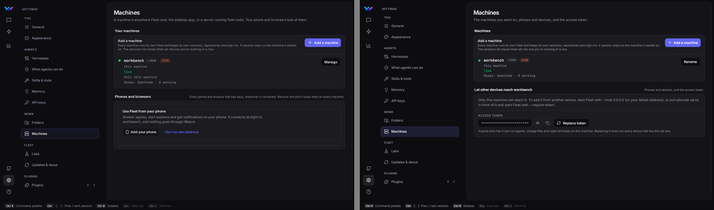
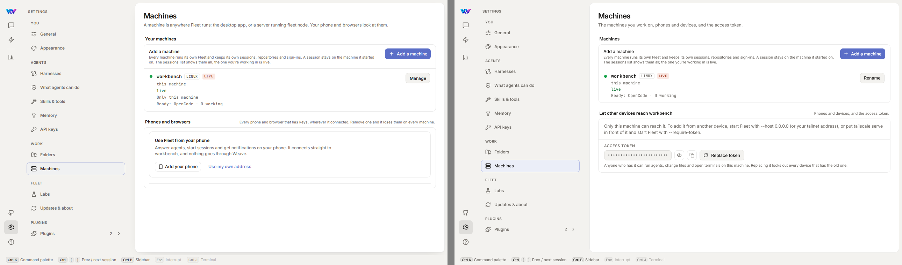
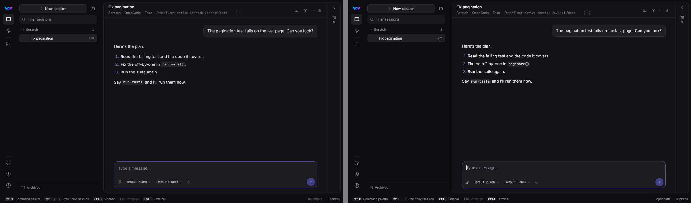
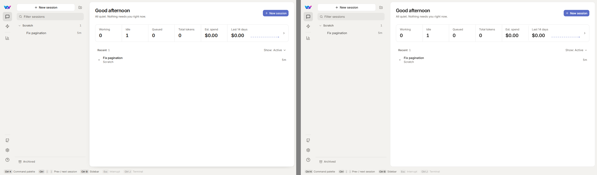

# Component 26: Parity audit

The checklist for component 26 of `docs/PORT.md`: every screen beside Fleet's once more, a keyboard pass and a
screen-reader pass, catching up with Fleet's latest, and at the end a report for the owner on whether the native app
can replace the Electron one. It is planned from the other 25 checklists, not from one area of Fleet's client.

- **weave-fleet commit read:** `0f832ca` (`main`, 22 November 2026). The last change under `client/` or `desktop/` is
  `542a7cc` (#1102, 20 November 2026); #1103 to #1106 touch the server and the OpenCode 2 plugin only.
- **Latest release:** v0.74.0 (`fdc072e`, 20 November 2026). The scratch Fleet the pictures were taken against
  reports it (`/api/version`). Everything in Part 1 is in v0.74.0 except #1099 and #1102 (after it). `docs/PORT.md`
  still says "Tracks weave-fleet v0.72.0"; piece A moves that line.
- **Native app read:** `main` at `d2fa2b6a` (22 November 2026: 25F, 22K and 18Q merged).
- **Still finishing while this was written:** components 18 (Workflows: pieces S, T), 22 (Mods: piece J and its
  sweep), 23 (Labs views: slice 2, the Board) and 25 (Packages: pieces E, G, H). Their own unbuilt pieces are theirs,
  not 26's. Rows below that come from them are the ones their checklists already hand on, leave without an owner, or
  call out of reach. Each piece here that touches those areas starts by reading their checklist as it stands then.
- **Paths** are weave-fleet's under `client/src/` unless they start with `src/`, `docs/` or `desktop/`. A source
  "06 3.72" means row 3.72 of `docs/parity/06-session-list.md`, which names Fleet's file.
- **Row numbers:** 1.x catching up with Fleet, 2.x rows gathered from components 1 to 25 (by area), 3.x the keyboard
  pass, 4.x the screen-reader pass, 5.x motion, 6.x every screen once more, 7.x stale rows to close, 8.x out of reach
  (Rune), 9.x the owner's decisions.

The other theme of each pair is in the same folder. All six are 1280 × 760, Fleet's own client on the left (Playwright)
and the native app on the right (`--server`, `--snap`), both live against one scratch Fleet with the scripted model.
The gap they show: the home dashboard and a session look the same as Fleet's (the work of components 2 to 9); the
Machines page doesn't, because Fleet rebuilt it in #1073 to #1094 after component 17 was planned. Fleet's page has
"Your machines" with a reach line ("Only this machine") and **Manage**, and "Phones and browsers"; the native page
still has **Rename** inline and the "Let other devices reach workbench" card with the token. That rebuild is the
largest piece of catching up (Part 1, pieces E to K).

## What "done" means

1. Every change in Fleet's client and desktop app since each checklist's commit is ported or written down with its
   reason (Part 1), and `docs/PORT.md` tracks v0.74.0 or later.
2. Every row of components 1 to 25 that was left open without an owner, or handed to 26, is done or written down as out
   of reach with its reason (Part 2), and every checklist's stale rows are closed (Part 7).
3. Keyboard: every one of Fleet's 36 palette commands and every key a Fleet view handles does the same here, and Tab
   reaches every control Fleet's Tab reaches, in the same order (Part 3).
4. Screen readers: every control has a name and the role Fleet gives it; status lines and errors are announced the
   way Fleet's live regions are; what Rune can't expose is in `docs/RUNE.md` (Part 4).
5. Motion: reduced motion is honoured everywhere Fleet honours it; spinners turn where Rune can turn them (Part 5).
6. Every screen and state worth looking at has a picture beside Fleet's own client, same state, same size, both themes,
   taken in this component, and every difference seen is fixed or written down (Part 6).
7. The report "Ready to replace Electron?" is written for the owner (piece AJ).

## What the native app already has

| Part | State | Where |
|---|---|---|
| Components 1 to 17, 19 to 21, 24 | Done, each with its sweep and pictures | `docs/parity/01` to `24` |
| Components 18, 22, 23, 25 | Finishing (see above) | their checklists |
| 35 of Fleet's 36 palette commands listed; `board-toggle-mode` is the Board's (23) | Listed. Five still toast "isn't in the native app yet": Refresh sessions, Show inline tool diffs, Show all sessions, Zoom in and Zoom out, and the file commands (`Run::Waiting(2, 3, 6, 9, 11)`) | `src/ui/commands.rs:159, 163, 356, 358, 397-398` |
| Names and roles on elements: 850 `.label(..)`, 557 `.role(..)` (226 buttons, 66 alerts, 28 status, 21 dialogs, 19 comboboxes, 12 listboxes, 11 tab lists) | Written as each view was built; never read back as a whole; only 2 tests read `accessibility_json` | `src/view/`, `src/ui/` |
| Rune's accessibility at the pin: AccessKit on Windows (UIA), macOS (NSAccessibility) and Linux (AT-SPI); `live_region`, `Tx::announce`, `checked`, `active_descendant`, `position_in_set`, `shortcut_hint`, `--tree` and `Runtime::accessibility_json` | Available, mostly unused | Rune's `crates/rune/README.md`, "Accessibility" |
| Rune's reduced motion at the pin: `cx.system_reduced_motion()`, `cx.is_reduced_motion()` | Available, not read anywhere (0 uses in `src/`); `docs/RUNE.md` still says Rune can't read it | Rune's `runtime/cx.rs` |
| Rune's `.rotate(radians)` (a spinner can turn) | Available; 23's spinner turns, the others still fade | Rune's README |
| A secure text field (`TextEdit` secure), `border_dash` | Used by 16 AO and L, and `src/view/drop_zones.rs`; several rows still call them impossible | |
| Non-Latin layouts: Ctrl/⌘ chords read as the US key (Rune's `map_key_event`, off macOS) | Matches Fleet #1071 for the commands checked (B, N, P, F, G, J, Ctrl+Shift+C/V); not checked on a Mac | Rune |
| New kit parts Fleet added on 14-15 November (EmptyState, ErrorNote, Confirm, PageHeader, RelativeTime) | Done | `src/ui/empty_state.rs`, `error_note.rs`, `confirm.rs`, `page_header.rs`, `age.rs` |

## The checklist

### 1. Catching up with Fleet

Every change to `client/` and `desktop/` from each checklist's commit to `0f832ca` that changes behaviour, look,
wording or keys. Test-timing and phone-only changes are left out (#1006, #1008, #1069, #1081, #1082, #1085, #1091 to
#1093). Components 18 to 25 read `c1a48bd` or later: nothing changed for them except what is listed under 23 and 24.

#### 1a. Colours and words (component 1 and 3, the kit and the conversation)

| # | Fleet | Source | Native |
|---|---|---|---|
| 1.1 | Per-theme status text tokens; light `--running` #16A149, `--idle` #D27306 | #1010 `assets/main.css` | Done (piece B, 22 Nov 2026): light `--running` #16A149, `--idle` #D27306 in `src/theme.rs`; the other tokens of the `592ade13`..`0f832ca` diff were already there. Only the default dark and light themes exist here, so the other six themes' new values (Nord, Dracula, Solarized, Monokai, GitHub) have no home yet (component 16, Appearance) |
| 1.2 | Light `--muted` #6E6A65 → #67645F (muted words at 4.5:1 on tinted panels) | #1022, #1012 `main.css` | Done (piece B): `muted` #67645F |
| 1.3 | Active filter button and a checked menu item's check use `--accent-text` | #1013 `button/index.ts`, `*CheckboxItem.vue` | Done (piece B): `Variant::Filter` active ink and a checkbox row's check use `accent_text` (`src/ui/button.rs`, `menu.rs`). The retention filter's end check is a different row and stays `--text` |
| 1.4 | Palette shortcut chip loses its fill; footer "toggle" full strength; destructive menu rows, a danger toolbar button's hover and the picker's error use `--error-text` | #1016 `CommandPalette.vue`, `menu-classes.ts`, `button/index.ts`, `DirectoryPickerPopover.vue` | Done (piece B): palette shortcut chip without its fill, the footer "toggle" at full strength, destructive menu rows and the danger toolbar button's hover in `error_text`. Open: the picker's error line has no state in `src/ui/directory_picker.rs` (a fixed tree of invented folders), so `--error-text` has nothing to colour there; Settings' Folders browse already uses `error_text` |
| 1.5 | Code colours lifted to 4.5:1 under every theme, each only as far as it needs | #1018 `main.css` (syntax tokens) | Done (piece B, checked): `main.css` has no syntax token in `592ade13`..`0f832ca`; the lift is `readablePalette` (`code-themes.ts`), which `src/fleet/settings/code_themes.rs` already ports (`reads` at 4.5:1 on the surfaces and the 4% tint). `markdown.css`'s link colour is now `--accent-text` (not drawn here: links in running text, see 03) |
| 1.6 | A failed call's preview cut at 79 characters plus "…" (was 77 plus "...") | #1032 `lib/activity-stream-tool-card.ts` | Done (piece B): `build_preview` cuts at 79 characters plus "…". Open: no view draws the preview line under a failed row yet (`build_preview` is only called by `ToolBody`); Fleet shows "└ File … not fo…" there (picture `rows-and-failed-call-*`) |
| 1.7 | A tool row's shell time: "0.1 s", "34 s", "2 min 05 s" (`formatCallDuration`) | #1026 `lib/tool-row.ts` | Done (piece B): `format_call_duration` is `format_duration_tenths`: "0.1 s", "3.4 s", "34 s", "2 min 05 s" |
| 1.8 | HydraFusion pass time through `formatDuration` | #1029 `tools/registry.ts` | Done (piece B): a pass's time goes through the same function: "18 s", "43 s" |
| 1.9 | OpenCode 2's `<background-result kind="shell\|subagent" …>` notices read like `<shell>` / `<subagent>` (`looksLikeBackgroundNotice`) | #1102 `lib/background-work.ts`, `use-activity-messages.ts` (+ test) | Done (piece B): `parse_background_notice` reads `<background-result kind="shell|subagent" …>` closed by `</background-result>`; image, video and codemode stay text; `looks_like_background_notice` is the cheap test |

#### 1b. Sending a prompt (components 2, 5, 7, 8)

| # | Fleet | Source | Native |
|---|---|---|---|
| 1.20 | `tidyPrompt`: a sent prompt keeps its first line's indent (leading blank lines dropped, the end trimmed), for prompts, queued prompts and the reconcile match | #1062 `lib/prompt-text.ts`, `use-send-prompt.ts`, `Composer.vue` | Done (piece C): `prompts::tidy_prompt` drops blank lines before the first line and the end, keeps its indent; used by `Prompts::add`, `show_sent`, the text the link sends, the reconcile match and `body_of` (and the composer's send and queue paths in `src/lib.rs`). **Open, not this piece's:** Fleet draws a user bubble whose first line has a 4-space indent as a Markdown code block (a grey chip around `run-tests`); native draws the indent as plain text. Pictures `shots/parity/26c-prompts/indent-*`. Owner: the conversation's Markdown look (piece after M) |
| 1.21 | The same for a new session's first message and its sent bubble; the test "trims the message" renamed and reworded | #1067 `lib/new-session-request.ts` (+ test) | Done (piece C): `build_create_session_request` uses `tidy_prompt`, so the first message and its bubble keep the indent; the test is renamed as Fleet's |
| 1.22 | A refused prompt, queued prompt, side question, shell command or `/` command puts its text back **in front of** whatever was typed meanwhile (`draftAfterRefusal`) | #1072 `lib/refused-draft.ts`, `use-send-prompt.ts`, `use-send-command.ts`, `use-composer-actions.ts` | Done (piece C): `prompts::draft_after_refusal`, used by `on_prompt_refused`, the queue, side question, shell and `/` command refusals. Not a Fleet path: a refused prompt for a session that isn't open still isn't put back |
| 1.23 | A sent prompt stays on screen until delivered even with earlier history: user messages seen before the send are a baseline the by-text match ignores | #1035 `use-send-prompt.ts` `reconcileSentPrompts` (+ test) | Done (piece C): `Prompts::baseline` (user message ids seen while no prompt was in flight) is left out of the by-text match; the id match still sees every message |
| 1.24 | An Enter that confirms an input method's composition never sends, answers, renames or picks (one capture listener app-wide) | #1061 `lib/ime-enter-guard.ts`, `main.ts` (+ test) | Done (piece C): Rune routes Return to a composing field before any key handler (README, "Key routing" 1), so no Enter field acts on it; one test drives the composer. Not tested per field: question answers, rename fields, pickers (all Rune text fields, same routing) |

#### 1c. Terminal codes and terminal sessions (components 2, 4, 6, 8, 16)

| # | Fleet | Source | Native |
|---|---|---|---|
| 1.30 | A question's header, text, options and answered/skipped rows drop terminal (ANSI) codes | #1036 `QuestionCard.vue` (+ test) | Done (piece D, 22 Nov 2026): `view::question` draws the heading, sub-headings, text, the choices' group name, option names and descriptions and the answered/skipped rows through `plain_terminal_text`; a pick still sends the label as the agent wrote it (Fleet's `toggleOption` too). Test `shows_a_question_built_from_coloured_shell_output_as_words_without_the_codes` and the answered/skipped one (`src/tests_questions.rs`); scenes `question-coloured`, `question-coloured-answered` |
| 1.31 | A permission card's title and folder, session titles in the header and the list, and peer messages drop terminal codes (`plainTerminalText`) | #1041 `PermissionCard.vue`, `SessionDetailHeader.vue`, `SessionItem.vue`, `lib/session-messages.ts` (+ tests) | Done (piece D) except peer messages: `plain_terminal_text` now lives in `conv::output` as `parse_tool_output(raw).plain` (Fleet's own definition; canvases re-export it); `row_status::display_title` strips then trims, so the list, the header, the dashboard, other machines' rows and the confirms all show the plain title; the permission card strips its title and folder before the heading is made (`askTitle`, `askDirectory`). Tests: the two `PermissionCard terminal codes` cases (`src/tests_asks.rs`), `lists_a_session_whose_title_has_terminal_codes_without_them` (`src/tests_rows.rs`), `a_title_with_terminal_codes_is_listed_without_them`. Open: peer messages, because `<fleet-session-message>` isn't parsed here at all yet (03, row 1.57); its port calls `plain_terminal_text` on the title and the text |
| 1.32 | New event `session_terminal {sessionId, inTerminal}` on the `sessions` topic | #1099 `lib/domain-events.ts`, `use-session-terminal-updates.ts`, `AppShell.vue` | Done (piece D): `Kind::SessionTerminal` (the union is 65 types; the fixture has its frame) and `RowPatch::Terminal` sets the row's `in_terminal` without a list reload. Tests `a_terminal_opening_or_letting_go_of_a_session_reaches_its_row`, `the_union_has_65_event_types_…` |
| 1.33 | A session row shows an **In terminal** chip (SquareTerminal 11, 18 px, `--text` 8 %) while a terminal holds the session, then a muted **From terminal** marker (`spawnKind: "terminal"`); hidden while the row is hovered | #1099 `SessionItem.vue` | Done (piece D): `session_row::tail`, in Fleet's order (step note, In terminal, kind label, From terminal while the word is empty or quiet, the word); both give way to the row's buttons; From terminal's tooltip "Started in a terminal. Updated …". Another machine's rows get them too (same `tail`). The icon keeps Lucide's own stroke, not 2.25 (`docs/RUNE.md`, icon stroke width). Tests: SessionItem.test.ts's three "a session from a terminal" cases (`src/tests_rows.rs`); scenes `terminal-rows`, `terminal-rows-light` |
| 1.34 | Another machine's session cache keeps `inTerminal` | #1099 `stores/machines.ts` | Done (piece D): `machine_cache::trim_session` keeps `inTerminal` beside `spawnKind`. Test `another_machines_cache_keeps_in_terminal_and_where_the_session_started` |
| 1.35 | Labs row "Claude Code sessions from a terminal" (preference `TerminalSessions`, off; adds "Terminal sessions in the session list"; Open → `/`) | #1095 `LabsSection.vue`, `lib/terminal-sessions.ts` (+ test) | Done (piece D): second row of Experiments, `switches::TERMINAL_SESSIONS`; Open goes to Sessions. Test `offers_claude_code_sessions_from_a_terminal_off_and_saves_the_choice` and the wording, adds and Open tables in `src/tests_settings_labs.rs`; scene `settings-labs-on` |

#### 1d. Machines, "Your Fleet" (components 7, 9, 16, 17, 23, 24)

Fleet rebuilt Settings → Machines between 19 and 20 November and released it in v0.74.0. No checklist covers it.
Files (all under `client/src/`): `components/settings/` MachinesSection.vue (rewritten), MachinePage.vue (new),
FoundMachinesCard.vue, NewServerCard.vue, ReachDialog.vue, TailscaleCheckNote.vue, DevicesList.vue, AddPhonePanel.vue,
SettingsPage.vue; `composables/` use-machine-page.ts, use-machine-lines.ts, use-home-access.ts, use-machine-reach.ts,
use-join-prompt.ts; `lib/` machine-reach-line.ts, reach-api.ts, reach-choices.ts, phone-readiness.ts, devices-api.ts,
phone-reach.ts; `components/onboarding/FirstRunFleet.vue`.

| # | Fleet | Source | Native |
|---|---|---|---|
| 1.40 | The page's line: "A machine is anywhere Fleet runs: the desktop app, or a server running fleet node. Your phone and browsers look at them." | #1075 SettingsPage.vue | None: old line (`src/fleet/settings_nav.rs`) |
| 1.41 | Group "Your machines": the Add a machine row as before; after an add, "Added &lt;name&gt;. Its sessions are in the sessions list." | #1088 MachinesSection.vue | Partial: group named "Machines" |
| 1.42 | Each machine (`machine-card`, padding 12/16, gap 12): 8 px dot, name mono 13.5/600, OS chip, Live tag; location ("this machine", the base URL, "Over SSH as &lt;dest&gt;"); the state line as before | #1088 MachinesSection.vue, use-machine-lines.ts | Done for these parts (`src/view/machine_card.rs`) |
| 1.43 | The **reach line** (`machine-reach-line`, error colour when out): "Off since HH:MM", "Not reachable", "Only this machine", "Reaches your phone at &lt;address&gt;", "…on the home network", "Only on Tailscale", "…over Tailscale and the home network", "…over Tailscale", "…by its own address" | #1088 `lib/machine-reach-line.ts` (+ 5 tests) | None Data done (26 E): `fleet/machines/reach.rs` `reach_line` (5 tests); drawn in F. |
| 1.44 | The capability line "Ready: … · N working · N need you", harness versions as its tooltip | #1088 use-machine-lines.ts | Done (piece 17) |
| 1.45 | Buttons: **Work here** (not on the live machine) and **Manage** (aria-label "&lt;name&gt;'s page"), which replaces the section with the machine's page. Rename, New token, agent work, Forget, the address list, Details and job seats leave the list | #1088 MachinesSection.vue | None: inline Rename and the rest (`machines_page.rs`, `machine_card.rs`, `machine_addresses.rs`) |
| 1.46 | A machine's page: title the machine's name, line "Everything about this machine: how it is reached, and what it keeps.", trail "Machines" back | #1088 MachinePage.vue, use-machine-page.ts, SettingsPage.vue | None |
| 1.47 | "About this machine": the list's lines plus the route line ("Connected over Tailscale…", "Tailscale isn't answering"); agent work (Ask, Always, Never and "Work there runs under &lt;name&gt;'s level: &lt;level&gt;."); job seats with Jobs on (23 14.7, 17.69); a Details fold with the diagnosis and Try again; Work here, Rename (inline, 64), Forget (not on home) | #1088 MachinePage.vue | Partial: the parts exist inline on the list Data done (26 E): the route line's words wait for F; the reach line (`reach_line`) and Fleet-wide Remove words are in `fleet/machines/`. |
| 1.48 | "Key and addresses" (not home; hint "What this browser uses to reach the machine."): the address list; "This browser holds a key for &lt;name&gt;. If it stopped working, give it a new one." with New token and a masked "Paste the new token" field | #1088 MachinePage.vue | Partial: inline, token shown as typed (17 J(2), K(2)) |
| 1.49 | "Who can reach it" (home only): reach off "Reachable from **this machine only**. Turn it on to use &lt;name&gt; from your phone or another machine." + **Let others reach &lt;name&gt;**; reach on "Reachable from other devices: **&lt;label&gt;**. Each one needs its own key." + Change; the Tailscale note; addresses with a kind chip and Copy; the access token (24 bullets, Show/Hide, Copy, Replace token) | #1088 MachinePage.vue, use-home-access.ts | Partial: the token card exists as "Let other devices reach &lt;name&gt;" (`machines_page.rs:199`) Data done (26 E): `reach::load`/`save`, `ReachState`, `State::load_reach`/`set_reach`; the page is H/J. |
| 1.50 | Forget, Fleet-wide: "Forget &lt;name&gt; on every machine in your Fleet?" / "Every machine drops it from its list and its keys stop working, even on machines that are off now: they hear when they're back. Its sessions stay on &lt;name&gt;. To use it again, add it again with its pairing code." / **Forget &lt;name&gt;**; an SSH machine keeps the old words; the page closes when the machine leaves | #1087 MachinesSection.vue, MachinePage.vue | None: old words (`src/fleet/machine_actions.rs:360`) |
| 1.51 | Add a machine: four tabs "How to add the machine", opening on **Found**; Set it up from here (SSH, unchanged); On a new server; Paste a pairing link. Cancel reads "Close" while an SSH set-up runs | #1084, #1089 MachinesSection.vue | None: the link form only (`src/view/add_machine.rs`); SSH is owner decision 5 |
| 1.52 | **Found**: `GET /api/machines/found` every 4 s; intro "On the other machine, run `fleet node up` (or `fleet node pair`)…"; "Looking on Tailscale and your home network…"; empty state "No machine is waiting" with "Paste a pairing link instead"; rows "&lt;name&gt; · &lt;OS&gt;" and "On Tailscale. Waiting to join." / "On your home network. Waiting to join."; the code field "Check the code in &lt;name&gt;'s terminal" (hint "ABCD-" + 4 more, or the whole code if it starts with the hint); **Add &lt;name&gt;** / "Checking…"; errors with the diagnosis panel | #1084 FoundMachinesCard.vue (+ 5 tests) | None Data done (26 E): `found.rs` `load_found` (every `LOOK_EVERY` = 4 s, timer waits for the view), `FoundMachine::code_for`, labels; the card is H. |
| 1.53 | **On a new server**: `POST /api/machines/join-code`; "Making a join code…"; the `curl … install.sh \| sh -s -- --join '<target>'` line with Copy; the warning "Works once, for 30 minutes. Anyone who has the line can add a machine to &lt;name&gt;, so treat it like a password."; "Waiting for a machine to join… The code expires &lt;countdown&gt;." (reads `/api/machines` every 3 s; a new id closes the form with its name); "This code has expired." + Make a new code; "Couldn't make a join code." | #1089 NewServerCard.vue (+ 8 tests) | None Data done (26 E): `found.rs` `make_join_code`, `JoinState`; the countdown, the 3 s read of `/api/machines` and the card are H. The v0.74.0 scratch Fleet answers 400 ("only listens on this machine") until reach is on. |
| 1.54 | Paste a pairing link: placeholder port 6262 (was 2113); the hint "Fleet can't set up &lt;name&gt; from here. On &lt;name&gt;, run `fleet node up` and paste the link it prints." | #1073, #1084 MachinesSection.vue, `lib/pairing-link.ts` | None: 2113 in `add_machine.rs`, `pairing.rs` and their tests |
| 1.55 | "Phones and browsers" (id `phones`): hint "Every phone and browser that has keys, wherever it connected. Remove one and it loses them on every machine."; rows from `GET /api/machine/screens` (else `/devices`): "Connected through &lt;name&gt;, added &lt;date&gt; · last seen &lt;relative&gt;"; "&lt;a, b&gt; aren't answering, so what they hold isn't shown."; Remove (`DELETE /api/machine/screens/{id}`) "Remove &lt;name&gt; on every machine in your Fleet?" / "It loses its keys on every machine at once, even on machines that are off now: they hear when they're back. It isn't given new ones." | #1088, #1090, #1087 DevicesList.vue, devices-api.ts, use-home-access.ts | None (16 AN, owner decision 1, was waiting for the old device list) Data done (26 E): `screens.rs` `load` (Fleet-wide, else own list), `remove`, `State::remove_screen`; rows, dates and the confirm are I. |
| 1.56 | Add your phone, redesigned: "Use Fleet from your phone" card; "Your phone will reach &lt;name&gt;" with a line per way in; **Add your phone** and **Use my own address**; the code card with the QR, "Works once, for 10 minutes…", the countdown, "&lt;name&gt; is connected." | #1080, #1075 AddPhonePanel.vue, phone-readiness.ts | None; the QR card is owner decision 1 (16 AN) |
| 1.57 | The reach dialog "Let others reach &lt;name&gt;?" (only when `GET /api/machine/reach` says `available`, the desktop app's own Fleet): Tailscale and home network (recommended with a tailnet address), Home network only, My own address (with "Point your tunnel or proxy at 127.0.0.1:&lt;port&gt;. That port always asks for a key."); Turn off, Cancel, Turn on / Save | #1077 ReachDialog.vue, reach-api.ts, reach-choices.ts, use-machine-reach.ts (+ 5 + 4 tests) | None. Open question: does the native app's own Fleet (24, 25) answer `available`? Check live Data done (26 E): `reach::reach_choices` (4 tests), `ReachMode`, `save`. Checked live: a scratch Fleet started from a terminal answers `available: false` and refuses a change (409); whether the native app's own Fleet (24, 25) answers `available` is still to check, in J. |
| 1.58 | The Tailscale note: the server's headline and detail, **Turn on** (only the listener is missing) or **Check again**; on home's page and in the dialog | #1083 TailscaleCheckNote.vue, phone-reach.ts (+ 3 tests) | None Data done (26 E): `TailscaleCheck` is read with `reach::load` (`can_turn_on`, `covered`); the note and Turn on / Check again are J. A scratch Fleet answers `tailscale: null`, so the note is shown from a scene. |
| 1.59 | The join notice: every screen looks for waiting machines every 20 s; "&lt;name&gt; wants to join your Fleet" / "It is waiting on Tailscale (your home network). Check the code it shows, then add it."; chip "&lt;name&gt; wants to join"; **Add &lt;name&gt;** (Settings → Machines → Add → Found) and Not now. Always on since #1094 | #1086, #1094 use-join-prompt.ts, AppShell.vue (+ 2 tests) | None |
| 1.60 | The desktop's first run, once (`fleet.first-run-fleet.v1`): "Found your Fleet" (the Found card and Not now), then "Where should new sessions run?" with a button per machine ("This machine (&lt;name&gt;)" for the live one) | #1086 FirstRunFleet.vue (+ 3 tests) | None |
| 1.61 | The setup wizard's ready step: "A machine is anywhere Fleet runs…" and the "Use Fleet from your phone" card with Add your phone → Settings → Machines | #1075 HarnessSetupWizard.vue (+ 1 test) | None |
| 1.62 | Labs "Your Fleet" row added then removed (always on); test "has no Your Fleet switch: it is always on" | #1079 → #1094 LabsSection.vue | Done (no row); the test isn't ported |

#### 1e. The desktop app (component 24)

| # | Fleet | Source | Native |
|---|---|---|---|
| 1.70 | "Fleet already runs on this computer" page; Use it reads `fleet.machine.json` and signs in; `requiresToken` in the instance file | #1076 `desktop/src/instance.ts`, `main.ts` | Done (24 piece D) |
| 1.71 | A port another process holds on 0.0.0.0 counts as taken | #1078 `desktop/src/server.ts` | Done (24.13) |
| 1.72 | Let others reach the desktop app's Fleet (the reach dialog, 1.57); the desktop side is a comment | #1077 | See 1.57 |
| 1.73 | 24's checklist says its four PRs are "the same as v0.72.0"; they first shipped in v0.74.0 | 24 header | Wording: piece A |

### 2. Rows gathered from components 1 to 25

Every row a checklist left open without an owner, handed to 26, or handed to a component that has since closed. One
line per group of rows of the same kind; the source checklist row holds Fleet's file and line. Rows a still-finishing
component (18, 22, 23, 25) owns itself are left out. Screen-reader, keyboard and motion rows are in Parts 3 to 5;
Rune's limits are in Part 8.

#### 2a. The palette

| # | What | Source | Native |
|---|---|---|---|
| 2.1 | Refresh sessions | 01 palette, 06 1.63 | `Run::Waiting(2)` |
| 2.2 | Show inline tool diffs, and a switch for `State.inline_diffs` anywhere (Settings has none) | 01, 03 3.15 | `Run::Waiting(3)` |
| 2.3 | Show all sessions (`toggle-activity-filter`) | 01, 06 1.62 | `Run::Waiting(6)` |
| 2.4 | Zoom in / Zoom out (Ctrl = / Ctrl -) step the interface scale; Fleet's zoom and Appearance's font size are one setting | 01, 06 decision 12, 24.104 | `Run::Waiting(9)` |
| 2.5 | Go to file, Find in files from the palette | 01 | `Run::Waiting(11)` (`commands.rs:163`); check whether 11/12 replaced them |
| 2.6 | "Start without mods" wraps its description as Fleet's does | 22 11.3 | Cut to one line |

#### 2b. The conversation (components 3 and 4)

| # | What | Source | Native |
|---|---|---|---|
| 2.10 | A folded turn's "edited N" and whole-file write counts from the session's diff (`with_file_stats` never called) | 03 1.33 | Open |
| 2.11 | "&lt;machine&gt; isn't answering" line (`quiet_machine` set by scenes only) | 03 1.81 | Open |
| 2.12 | Amber `waiting_input` glyph on a page call waiting for a pick | 03 3.6 | Open (`ToolGlyph::WaitingInput` unused) |
| 2.13 | `workStatus` (Background, Stopped) wired into the list (`src/conv/background.rs` is written, unwired) | 03 3.7, later-notes | Open |
| 2.14 | The background strip's fold kept across restarts | 03 4.4 | Open (lasts the run) |
| 2.15 | A sub-agent row's model suffix; opening a sub-agent's session (the list drops `parentSessionId` rows) | 03 4.12, 4.18, 4.45 | Open |
| 2.16 | `SubagentPromptLine`: the note that replaces the composer in a sub-agent's session that can't take prompts | 03 4.31, 05 15.9 | Open |
| 2.17 | The peer chip ("From &lt;session&gt; · machine", outcome, link) | 03 1.57, 1.58, 2.18 | Open |
| 2.18 | A screenshot from another machine is fetched with that machine's token | 03 piece N | Open (`src/fleet/images.rs`) |
| 2.19 | Find in a side conversation is disabled as Fleet's is | 03 6.4 | Open (`fleet/find.rs` always enables) |
| 2.20 | Markdown `
` keeps its fold while streaming | 03 2.7 | Not checked |
| 2.21 | View clusters by `ListMessage::cluster`, not the neighbour's role; the fold plan measured on 2,000 messages | 03 piece G, H | Open |
| 2.22 | The interrupted card: 12 px under the stream (not 30), the column cap | 03 piece I | Open |
| 2.23 | Decoded pictures evicted when off screen | 03 piece N | Open |
| 2.24 | Find: a clear button; thinking searched and marked; read-run rows marked; aim inside an output box | 03 6.12, piece Q | Open |
| 2.25 | The live cursor (`last_event_id`) read correctly (0 and negative numbers) | 02 4.3 | Open, nothing reads it |
| 2.26 | A denied edit's rejected text wraps in its box | 04 G | Open |
| 2.27 | With two cards waiting, number keys act on the focused one | 04 3.14 | Open |
| 2.28 | Fleet's test names: focus-prompt (1), page cards (5), Improve (3), row labels (2), `page-choice.test.ts` (8), peer-machine (2) | 03 tests, 04 tests | Behaviour built; cases not under Fleet's names |

#### 2c. Composer, new session and first message (components 5, 7)

| # | What | Source | Native |
|---|---|---|---|
| 2.30 | `@` sessions come from the session's own machine (`link_for`, not `self.link`); `Composer.other-machine.test.ts` (3) | 05 tests | Open |
| 2.31 | The new-session composer's `plainTokens` | 05 7.2 | Open |
| 2.32 | Tabular figures for the context size and the ring's text (`.features("'tnum' 1")` exists now) | 05 3.8, 13.3 | Open |
| 2.33 | The offer pill overhangs the frame by 14 px each side | 05 11.8 | Open |
| 2.34 | Pickers shift left against a dialog's clip (`shift_left`) | 05 3.4 | Open |
| 2.35 | The composer's `disabled` from the row's lifecycle | 05 1.9 | Partial (`can_prompt` fallback) |
| 2.36 | Ring popover: meter transitions, `max-width: 100vw - 16`, the foot's 2 px drift | 05 piece H | Open |
| 2.37 | `@` references and pictures in the first sent bubble of a new session (`SentPrompt` has no refs or images) | 07 A8.12, A9.7 | Open |
| 2.38 | The setup rows show the update strip and sign-in panel in place, not a hand-off to Settings; the Copilot strip too | 07 C13.46, 48, 83, 84; 16 K | Partial |
| 2.39 | Fix (another machine) picks that machine first (`machines.setCurrent`); test "sends a harness that isn't set up there to that machine's Harnesses" | 07 A14.7, A21.105 | Open |
| 2.40 | A folded group unfolds when a draft lands in it; a new-in-folder row shows at once (upsert) | 07 A3.10, A2.6 | Open |
| 2.41 | Harness list and catalogs kept across restarts (`weave:saved:harnesses`) | 07 piece C | Open |
| 2.42 | Option rows 48 px (line-height 1.5); menu heights `min(…, 50vh / 36vh)`; the path view's small differences (`//`, separators, spinner row, location hint); Repositories empty-state icon size | 07 piece I, B2.84, B2.121, B2.116-136, piece P | Open |
| 2.43 | The live machine row's "Working here" checked live | 07 piece K | Open |

#### 2d. Session list and header (components 6, 8)

| # | What | Source | Native |
|---|---|---|---|
| 2.50 | A run's or a link's session that no list holds opens and loads (Automations, Workflows, GitHub) | 19 5.9, 18, 21 | Open |
| 2.51 | "Session not found" when the open session disappears | 02 7.2 | Falls back to the first row |
| 2.52 | After a delete, go home (`/`), as Fleet does | 08 5.12 | Opens another session |
| 2.53 | The filter box's clear button; the filter resets when the rail changes (Fleet resets) | 06 piece E, 1.30 | Open |
| 2.54 | Esc clears the filter as well as picked rows; focus returns to a row moved by Alt+Up/Down | 06 1.52, 3.72 | Open |
| 2.55 | Lifecycle `error` counts as live (`LIVE_STATUSES`) | 06 piece C | Open |
| 2.56 | Draft row in the Archived view; a child row in rename keeps its layout; the draft row sorts first (21 N) | 06 piece K, M; 21 N sweep 3 | Open |
| 2.57 | Open in: tool list cached across menus | 06 piece N | Open |
| 2.58 | `isAnyActionPending` counts every action; a drop over its own family keeps a nested session | 06 3.65, 2.125 | Open |
| 2.59 | Fork: the form restarts when the source title changes; the new session is put in the list at once | 08 7.3, 7.5 | Open |
| 2.60 | Abort disabled when the session has no instance | 08 5.2 | Open |
| 2.61 | Retry note ticks every second | 08 1.12 | Not checked |
| 2.62 | Progress strip heading capped at 45 %; header 0.8 px short | 08 9.2, piece B | Open |
| 2.63 | Copy folder path row's tooltip; the ⋯ menu not modal | 08 5.7, 5.6 | Open |
| 2.64 | The header's own buttons, the Send button and the filter field use the kit's elements | 01 shell use | Not checked again |

#### 2e. Other machines (component 17 and its seams)

| # | What | Source | Native |
|---|---|---|---|
| 2.70 | When a machine comes back, its open sessions reconnect at once | 17.17 | Open |
| 2.71 | An open hub follows a new address pick; the address pick kept between runs | 17 H(2), H(3) | Open |
| 2.72 | Another machine's tree: lineage lines, sub-agent rows, drag | 17 C, 06 M, 06 S | Open |
| 2.73 | `fleet node pair` and `fleet node up` drawn as code chips | 17 K(3) | Open |
| 2.74 | Started-by pill and Back to parent open a parent on another machine | 08 1.11, 4.6 | Open |
| 2.75 | Another machine's `workflow_run` events update live; its runs load without opening Workflows first | 18 A, F/I gaps | Open |
| 2.76 | Token fields masked (secure `TextEdit`) | 17 J(2), K(2); 16 12.22 | Open |
| 2.77 | Another machine's Session recap and Memory preferences read | 16 AQ | Open |
| 2.78 | The "can't list machines" message for an old home: close it (Fleet doesn't hide the row either) | 17.67 | Close |
| 2.79 | Private CAs and the system's certificate store trusted | 17 I | Owner's call |

#### 2f. Content panel, files, changes, web, terminal, side (10 to 15)

| # | What | Source | Native |
|---|---|---|---|
| 2.80 | Turns list as virtual rows; re-derive on a stream into an older message; its own `/diffs` for whole-file writes | 10 4.15, 4.62, 4.63 | Open |
| 2.81 | Agents: the parent row opens when the list doesn't hold the parent; the detail follows the child's hub topic, not a 3 s poll | 10 5.12, 5.28-5.34 | Open |
| 2.82 | Files: other occurrences of the selected word; find starts from the caret; Save all and quit | 11 5.9, 12.1, 13.10 | Open |
| 2.83 | Files: completion anchored at the caret, type icons, deep files; an agent's edit keeps undo | 11 13.11, 13.12 | Open |
| 2.84 | Plain-text user messages get file links; a Markdown link to a file looks like a file link | 11 11.2 | Open |
| 2.85 | Changes: header actions wrap in a narrow panel; split widths from the font; find-in-files line cut at the edge | 12 6.4, 7.7, 14.9 | Open |
| 2.86 | Markdown look across the app: accent headings, a rule under h1/h2, smaller type, accent list markers (Document tab, file preview, review, What's new, messages, mods) | 14.83, 11 7.4, 12 Q, 16 X, 03 piece T, 22 3.7 | Open; first check whether `MarkdownStyle` at the pin can |
| 2.87 | A Markdown Document tab can be annotated | 14.85 | Open |
| 2.88 | Anchored menus hide the web view by overlap, not whole; an elsewhere tab's address; the dialog focuses its first control; a focused web view counts as the window focused | 14.4, H, J; 02 6.6 | Open |
| 2.89 | Terminal: the last replay behind the failed panel; a one-column-too-long prompt after the fit; dashed box lines; drag-scroll on a timer; scrollbar fade and track click; bubble at column 0; a drag on a link selects | 13 J, I, 13.11, 13.66, 13.7, 13.69, 13.75 | Open |
| 2.90 | Side conversation: open mask and `improvable` on its rows; side asks answerable by keys; its cards' element keys distinct; focus on the tab's × shows the peek | 15 3.2, 3.6, 6.1 | Open |

#### 2g. Settings and the frame (9, 16)

| # | What | Source | Native |
|---|---|---|---|
| 2.100 | "Fleet updated to v&lt;x&gt;" title (`updated_to` always None) | 09 8.1 | Open |
| 2.101 | The report's "Subscribed" and "Open session" facts | 09 9.6 | Open |
| 2.102 | `maxlength` applied while typing (report 10,000/2,000/200, Improve note 2,000, mods note 2,000, memory) | 09 9.4, 12.2; 22 10.6; 16 8.80 | Open |
| 2.103 | The report's screenshot box drawn ticked and disabled when there is none | 09 9.5 | Open |
| 2.104 | Continue all / Dismiss all send in one go; a hidden chip doesn't shift the status bar | 09 N(3), M(1) | Open |
| 2.105 | Save as file asks where (a save dialog) | 09 piece P | Open (`~/Downloads`) |
| 2.106 | Usage reset column clipped; the running popover's height before the first resize | 09 6.7, 5.4 | Open |
| 2.107 | SkillDiff wraps long lines; the hand edit has colours | 09 12.4, 12.5 | Open |
| 2.108 | Dashed borders where Fleet has them (Profiles, Weave, own-file box, empty state) with `border_dash` | 16 H, Y, Z; 09 10.7 | Open |
| 2.109 | Locations spinner before the list re-read; Appearance columns follow the zoomed width; plugins held until known | 16 AA, F, AD 11.6 | Open |
| 2.110 | Turning a plugin off removes its picker and board sources too | 16 AD 11.3, 11.33 | Open (the board source is 23's) |
| 2.111 | The 22 Settings test cases "not confirmed one by one" | 16 AQ | Open |
| 2.112 | The palette, menus and scroll bars: Fleet's thin scroll bar | 01 scroll-area | Open |

#### 2h. Rail views (18 to 21, 23)

| # | What | Source | Native |
|---|---|---|---|
| 2.120 | Workflows: a refused runs ask retried; menu height capped to its side; Try it waits for the library; abort an overtaken check; an unknown `waiting` kind draws its message; Leads to as a select; suggestion lists for Agent, Skill, Effort; resize handles | 18 1.6, E, 12.4, L, A, 15.3, 15.4, 15.6 | Open |
| 2.121 | Automations: "every Mon, Tue's" finds "every Mon"; ⋯ menu width; the action note; the Runs head's 5 px | 19 A, 4.6, 4.9, 12.1 | Open |
| 2.122 | Analytics: x labels skip as Chart.js's; equal columns on a wrapped row; Daily rows 28 px; content-sized columns; lines clipped to the chart; ErrorNote height; 6-digit years | 20 K sweep, 9.1, 11.3, 12.1, G, H, 3.5 | Open |
| 2.123 | GitHub: pressing the rail again goes to Your work; the sort menu's radio dot; the label menu's 6 px; the `#` popup's light shadow; body widths from the font | 21 2.16, J(4), N 1-2, K(4) | Open |
| 2.124 | Avatars as pictures (GitHub people, reviewers) | 21 16.1, 08 11.3 | Open |
| 2.125 | Labs: the nudge field's accent border on mouse focus; a tile's `sourceDirectory`; group sort collation | 23 8.6, 3.2, 3.7 | Open |

#### 2i. Desktop and packages (2, 24, 25)

| # | What | Source | Native |
|---|---|---|---|
| 2.130 | Right-click Copy on tool output, shell commands, the start page's log, the code view; a link menu on terminal and file links | 24.112, 24.110 | Open |
| 2.131 | "You're on the latest version (&lt;v&gt;)" and "Couldn't check for updates" words; the "Updating restarts Fleet, which stops them." warning | 24.108, 24.76 | Open (24.76 waits for 9 V, owner decision) |
| 2.132 | Use it focused when the card opens; the Windows toast's icon | 24.34, 24 F | Open |
| 2.133 | Notifications switch taking effect without a restart | 24 J | Open |
| 2.134 | A stale instance file off Unix (a real process check on Windows) | 02 1.8 | Open |
| 2.135 | A failed swap restarts the app's own Fleet; Settings → Apps shows the new version; an old AppImage's one manual download; the Windows installer closes a running app | 25.31, 25.32, 25.35, 25 C | Open (25 is finishing: take what its sweep leaves) |

#### 2j. Time and language

| # | What | Source | Native |
|---|---|---|---|
| 2.140 | Clock times follow the system's 12/24-hour setting (Fleet follows the browser's locale) | 03 H, I; 05 3.17, 13.13; 09 6.6, 8.3; 10 3.27 | en-US 12-hour everywhere |
| 2.141 | Message times local on Windows (`localtime_r` is Unix only) | 03 2.13 | UTC on Windows |
| 2.142 | An IANA time zone on Windows for schedules and Nightly | 19 16.4, 16 S 9.32 | UTC on Windows |
| 2.143 | Sorting names as `localeCompare` does (accents, case, punctuation) | 07 B2.63, 20 A, 23 3.7 | Case-folded compare |
| 2.144 | Dates in other locales ("Last scan", analytics) | 07 C16.3 | en-US |

### 3. The keyboard pass

Fleet's keys come from three places: the command registry (`lib/command-ids.ts`, 36 commands, with default keys in
`composables/use-commands.ts` and per-user overrides in `stores/keybindings.ts`; Fleet has no screen to change them),
each view's own handlers (12 files listen for keys), and the browser's Tab order. The pass walks all three.

| # | What | Source | Native |
|---|---|---|---|
| 3.1 | A table of every command: id, Fleet's default keys on Windows/Linux and macOS, what it does, native's keys, a test that presses it | `use-commands.ts` 400-760 | To write; 35 listed, 5 stubs (Part 2a) |
| 3.2 | A table of every view key (find bars, pickers, menus, cards, terminal, Files editor, Board), the same columns | the 12 handler files | To write |
| 3.3 | Tab order on every screen matches Fleet's, from the rail through the context; every control Fleet's Tab reaches is reachable | browser order | Not walked; 06 1.64, 1.23 |
| 3.4 | Focus on open: a dialog focuses its first control (the setup wizard, the web dialog); a destructive confirm focuses Cancel | 07 C12.9; 14 J; 06 4.33 | Open / not checked |
| 3.5 | Menus: Right/Left open and close submenus; Home/End and type-ahead (tested); the hint footer follows keyboard focus where Rune allows | 01 menu; 06 3.100, 3.99; 07 piece I | Open |
| 3.6 | Changes: Left/Right scroll a focused hunk region | 12 7.10 | Open |
| 3.7 | Analytics: arrow keys step a date segment; the project list's first row lit on open | 20 15.2, D | Open |
| 3.8 | Permission and question keys answer the focused card, the side's too | 04 3.14, 15 3.6 | Open |
| 3.9 | Ctrl+F reaches the find bar from any focused element in the conversation; the lightbox focuses Close and returns to the thumbnail | 03 piece P, N | Open |
| 3.10 | Ctrl+[ / ] follow Fleet's order (`store.sessions`) | 06 1.61 | Check |
| 3.11 | IME-confirming Enter never acts (1.24) on every Enter field | #1061 | Part 1b |
| 3.12 | Mac keys: ⌘C, ⌘V and Option in the terminal; every ⌘ chord, on a real Mac | 13.63 | Not run on a Mac |

### 4. The screen-reader pass

Rune exposes an AccessKit tree on all three systems: roles from ARIA names, labels, `checked`, `expanded`, `disabled`,
`live_region` (polite or assertive; `status` and `log` are polite and `alert` assertive by default), `Tx::announce`,
`active_descendant`, `position_in_set`, `shortcut_hint`, and `Runtime::accessibility_json` for tests. Many rows in
components 4 to 23 were written before those were known or available and say "Rune has no accessibility tree / no
aria-live"; the pass reads each against the pin.

| # | What | Source | Native |
|---|---|---|---|
| 4.1 | A check over every scene's tree (`--tree` or `accessibility_json`): every focusable element has a name; icon-only buttons have a label; no two siblings share a name where Fleet's differ; a test fails a new unnamed control | Fleet's UI crawl with axe (#1024, #1028) | None |
| 4.2 | The frame: rail (`aria-current` → the nearest Rune gives, and a label), status bar chips, hints (`aria-keyshortcuts` → `shortcut_hint`), notices (`role=status`, `aria-live`) | 09 out of reach; #1024 | Partial |
| 4.3 | The session list: aside and section labels, `role=group` for children, `role=toolbar`, the glyph's spoken status, pressed and current states, drag and move announcements (polite) | 06 2.95, 3.126, 1.13, 1.54, 3.33, 3.8, 1.88, 2.132 | Partial |
| 4.4 | The header: the status span (`role=status`), "Folder path copied" announced, the chips as a list "Session context" | 08 1.4, 3.5, 3.6 | Open |
| 4.5 | Asks: `radiogroup`/`group`, `radio`/`checkbox` with checked, `role=alert`, the card's label | 04 1.6, 1.7, 1.13, 3.1 | Open |
| 4.6 | Composer and pickers: `listbox`, `option`, `combobox`, `aria-activedescendant` (`active_descendant`), `alert`, `group`, `aria-busy`; `picker-screen-reader.test.ts` (2 of 3); the `#` and `@` popups | 05 5.15, tests; 07 A4.14, A4.15, B2.30, B2.115 | Partial |
| 4.7 | The setup wizard's description | 07 C12.6 | Open |
| 4.8 | Content panel: `tablist`/`tab`/selected/`tabpanel`; Widen pressed; Progress, Turns, Agents labels, hidden text, `role=status`/`alert` | 10 1.26, frame, 3.71, 4.65, 5.24 | Open |
| 4.9 | Changes: `role=search`, the count announced, hunk regions, pressed buttons | 12 out of reach | Open |
| 4.10 | Terminal drawer: toggle pressed, region "Terminal", the grip as a separator, its tab list | 13 (no row) | Open |
| 4.11 | Settings: Mods panel announcement, `role=switch`, `aria-live`, current page | 16 AE, Part 8 | Open |
| 4.12 | Workflows, Automations, Analytics, GitHub, Labs: optional-step chips pressed, Check with me a switch, the stepper's current step, live plan line, notices' roles, `aria-sort` (in the label), `aria-busy`, Group by pressed, Peek live | 18 5.7, 5.8, 7.6; 19 16.6; 20 2.6, 12.2; 21 10.1; 23 2.3, 5.4, 8.1, 10.4, 25.4 | Open |
| 4.13 | The palette's list labelled "Commands", a disabled command `aria-disabled` | #1024, #1012 | Open |
| 4.14 | A live check with a real screen reader: Orca on Linux (if it can run here), Narrator or NVDA on Windows, VoiceOver on a Mac (the owner) | | Never done |
| 4.15 | `shell-font-scale.test.ts`: the interface scales with the font size setting | 09 tests | Open (with 2.4) |

### 5. Motion

| # | What | Source | Native |
|---|---|---|---|
| 5.1 | Read reduced motion (`cx.system_reduced_motion()`) into the state; every fade, slide, pulse, flash, shimmer and drain Fleet stops under `prefers-reduced-motion` stops here | 10 1.19; 15 11.2; 08 12.10; 18 18.2; 24.30; 05 13.17; 04 5.2; 16 F | None (0 uses) |
| 5.2 | Spinners turn (`.rotate`), with Fleet's 3 s turn under reduced motion, everywhere one fades now | 02 6.4; 03 spinners; 05 H; 08 11.1; 10 4.11; 18 8.10; 21 L(3); 22 2.8 | 23's turns; the rest fade |
| 5.3 | Entrances and leaves Rune can draw: the ask card's rise (180 ms, 4 px), the Undo toast's leave (180 ms), bars easing to their width (Analytics, Progress, ring meters), the tab toast's fade and rise | 04 3.1; 15 7.7; 20 8.6, 10.2; 05 H; 11 4.9; 13.6 | Open |

### 6. Every screen once more

Each walk runs a scratch Fleet (v0.74.0 or the latest release then) with the scripted model, Fleet's own client and the
native app side by side at 1280 × 760, both themes, every state the scripted model can make (`run-tests`, `ask-me`,
`show-page`, `slow-task`, `long-reply`, `spawn-agent`, `background-work`, `ask-permission`, `write-file`,
`edit-file`), and writes each difference into this file with a fix or a reason.

| # | What | Source | Native |
|---|---|---|---|
| 6.1 | Sessions: list, header, conversation with every keyword's result, composer and its pickers, asks, side conversation | 02 to 08, 15 | Not walked together since each component's sweep |
| 6.2 | New session, home dashboard, first run and harness setup, Repositories | 07, 09 | |
| 6.3 | The content panel's tabs: Progress, Turns, Agents, Files, Changes, a page and the browser, the Document tab; the terminal drawer | 10 to 14 | 11's Files tree never walked live (later-notes) |
| 6.4 | Every Settings page, including the new Machines area once built | 16, 17, Part 1d | |
| 6.5 | Automations (never walked live on Linux: 19's walk was headless on Windows), Workflows, Analytics, GitHub, Fleet, Jobs, the Board, mods' places | 18 to 23 | |
| 6.6 | The desktop app on all three systems: start, one instance, tray, menus, notifications, deep links, window place, update; Windows on a Windows machine, macOS from CI or the owner | 24, 25 | Linux and CI only |

### 7. Stale rows to close

Rows built since their checklist was written, or whose text is out of date. No code; the checklists change.

- 03: rows given to components that have since built them (find the code before closing each).
- 06: 1.8, 1.11 (08's 1.2), 1.17, 1.18, 2.24 (component 7), 4.31 (`can_delete` is read), 2.103 (18's 10.1-10.5),
  1.133-1.138 (10); 3.98 Save as workflow is 18's piece S, not 12's.
- 10: 1.22, 2.21, 5.69-5.71, 6.7, 6.15, 6.17, 6.18, 1.12, 1.30 (all built; the rows still say an owner).
- 12: 14.12 (`opened_at` is gone).
- 16: piece E (code theme in Files and diffs is done, `src/view/code_view.rs:84`), the Mods safe-mode band (22 K),
  S's "Runs as the built-in automation" (selects it now), 11.38-11.39 (21 C); 12.22 and H/Y/Z say "Rune has no
  password field / dashed line": both exist now (2.76, 2.108).
- 17: 17.40's text, 17.44 (the header chip), 17.49, 17.68 (16 W), 17.69 (23 H drew the seats inline; Part 1d moves them).
- 18: 3.3, 18.3, 5.16 test (Repeat on a schedule is built: `repeat_workflow_on_schedule`).
- 22: 2.8 (a spinner can turn now).
- 24: the header's "same as v0.72.0" (1.73); 24.3 and 24.50 once 25 A-D are merged.
- `docs/RUNE.md`: "Rune can't ask for the system's reduced-motion setting" (line 2108), "no aria-live", "no password
  field", "no dashed line", "spinners can't turn": each read against the pin and corrected.
- `docs/PORT.md`: "Tracks weave-fleet v0.72.0"; component 26's row.

### 8. Out of reach (Rune)

Gathered for the report, not for pieces. Each is in its checklist with its reason; piece AJ re-reads each against the
pin of the day, since several "can't" rows turned out to be possible (Part 7).

- **Hover looks:** hover borders and underlines on buttons and links (01, 03, 04, 09, 16, 18, 19, 21), a hovered
  message raised over the next (03 1.6).
- **Eases Rune has no curve for:** the 150 ms colour and border eases, `tw-animate-css` curves (springs instead), the
  focus-border ease (05 1.2), the shown-message ring's fade (03 1.7).
- **Text:** `dir="auto"` (05 1.6, 08 1.6, 06), `text-wrap: balance` (10 3.33), glyph gradients (the Working shimmer),
  text about 1-5 % wider than Chromium's, baseline alignment (20 6.3), wrapping at any character (20 12.6), selecting
  rendered Markdown blocks by click (11 7.5, 12 9.2), inline chips in Markdown (`@` and `$`: 03 2.25, 2.26).
- **Layout:** percentage maxima and widths (18 4.3, 22 3.3, 6.1, 24.34), CSS grid (23 12.4, 13.1), scroll padding
  (22 7.8), sideways `scroll_center` (12 11.7), column-scoped selection (12 12.1).
- **Fields:** a read-only (not disabled) field (18 5.1, 19 7.3), native date, time and select controls (19 16.3, 16 9.33,
  07 B2.94), syntax colours while typing in plain boxes (16 5.134), select-all on press (12 4.5), a field change hook (04
  1.12), blur callbacks (21 M(1)), spell check (24.56).
- **The system:** cancelling a window close or a system quit (11 13.10, 24.73), reading the window back (09 9.12,
  24.143), a tray host's presence (24.84), Wayland window size and file drops (24.58, 05 1.4), clipboard failure (03 2.9,
  11 8.6), network-change events (02), an application keypad and Shift+drag in the terminal (13.61, 13.66), the input
  method's preedit in the terminal (13.64).
- **Web views (decision 1):** live pages in lists and panes (14, 22 14.5), anything drawn over a web view, `alert`/
  `confirm`/`prompt` on Linux and macOS (14.12), keys taken back from a page on a no-focus press (14.7), X11 at 150 %.
- **Highlighter:** folding, the `.env` lexer, colours past 128 KiB, keywords in completion (11 5.3-5.11, 13.11).
- **Accessibility:** `aria-current` and `aria-pressed` have no field of their own (`checked` is the nearest); confirmed
  or lifted by the screen-reader pass.

### 9. The owner's decisions

Open now, each with the default the port follows until the owner says otherwise.

| # | Decision | Where | Default |
|---|---|---|---|
| 9.1 | Phones: Add your phone (QR), the device list, a public address. Fleet's v0.74.0 Machines page puts "Phones and browsers" and Add your phone on the page itself, so this now shows on every Machines picture | 16 AN, 17.70, Part 1d 1.55-1.56 | Piece I builds the list and Remove (no QR); the QR card waits |
| 9.2 | Set it up from here (SSH) | 16 AP, 17.71 | Not built; the tab shows Fleet's words and hands off |
| 9.3 | Desktop notifications delivery | 16 2.11-2.13 | Saved only |
| 9.4 | Keep every machine live | 16 4.2, 17.25, 17.26 | Saved only |
| 9.5 | The self-updater on the restart notice card | 09 V, 24.76 | Status-bar item |
| 9.6 | A typed sign-in token kept on disk | 09 11.4 | For the run only |
| 9.7 | The browser tab keeps its view and history across tab switches (a hidden web view per tab) | 14.68 | One view per wanted tab |
| 9.8 | Packages: the tool, what an update replaces, Windows/Linux arm64, signing | 25 decisions | The planner's defaults |
| 9.9 | A crate for locale-aware times and collation (ICU's `icu_datetime`/`icu_collator`; the lock has other `icu_*` crates already) | Part 2j | 12/24-hour read from the system without a crate; collation stays |
| 9.10 | Licence | PORT.md decision 5 | Still the owner's |

## Pieces

In build order. Each is one pull request a fresh session can do from this file alone; each takes its pictures beside
Fleet's own client (same scratch Fleet, same state, 1280 × 760, both themes) unless it says otherwise, and ticks its rows
here. "Tests" are Fleet's, ported under their names. Read the source checklist row named in Part 2 before building a
Part 2 row. Pieces B to K catch up with Fleet and come first; then the gathered rows (L to X), then the passes (Y to AD),
then the walks (AE to AI), then the report.

### A. The ledger (docs only)

- **Rows:** Part 7, 1.73.
- **Files:** `docs/parity/03, 06, 10, 12, 16, 17, 18, 22, 24*.md` (close or correct the rows), `docs/RUNE.md` (the
  stale "can't" lines, each read against the pin's README and source), `docs/PORT.md` (tracks v0.74.0; 26's row).
- **Depends on:** nothing.
- **Pictures:** the app still draws the same: `session` and `home` pairs from this file's folder retaken.
- **Done (22 November 2026):** the Part 7 rows for 06, 10, 12, 16, 17, 18, 22, 24 (and a few in 03) are closed in their checklists; `docs/RUNE.md`'s reduced-motion, password-field, dashed-border and spinner lines are marked out of date (the live-region lines are in 06); `docs/PORT.md` tracks v0.74.0. Left open on purpose: 06's 3.98 (18 S), 12.22 (wiring the secure field), 22's loader wiring, 03's 1.81, 1.91, 6.4 (not confirmed in code).

### B. Catch-up: colours and words

- **Built** (22 November 2026): rows 1.1-1.9, with the two gaps named in rows 1.4 and 1.6 and the other themes' new tokens in 1.1.
- **Rows:** 1.1-1.9.
- **Files:** `src/theme.rs` (diff `client/src/assets/main.css` from `592ade13` to `0f832ca`, token by token, both
  themes), `src/ui/button.rs`, `src/ui/menu.rs`, `src/ui/palette.rs`, `src/conv/card.rs`, `src/conv/tools.rs`,
  `src/conv/tools.rs` (`format_call_duration`, the pass time), `src/conv/background.rs`.
- **Tests:** `tool-row.test.ts`'s `formatCallDuration` cases; `background-work.test.ts`'s `background-result` cases;
  `activity-stream-tool-card` preview case.
- **Pictures:** light theme: the palette, a menu with a destructive row, a session row (status colours), a failed tool
  call, before and after, beside Fleet's.

### C. Catch-up: sending a prompt

- **Rows:** 1.20-1.24.
- **Files:** `src/fleet/prompts.rs` (`tidy_prompt`, the baseline in `reconcile`), `src/fleet/state.rs`
  (`on_prompt_refused` puts text in front), `src/fleet/modes.rs` (side, shell, command refusals),
  `src/fleet/new_session/request.rs`, the Enter paths of the composer, question card, rename fields and pickers
  (`is_composing`).
- **Tests:** `prompt-text.test.ts`, `refused-draft.test.ts`, `use-send-prompt.test.ts`'s baseline case,
  `new-session-request.test.ts` (renamed case), `ime-enter-guard.test.ts`.
- **Pictures:** live: a prompt sent with an indented first line (`    run-tests`) shows indented in the bubble on both;
  a refused send with text typed meanwhile (an invented refusal from a scene if the scratch Fleet won't refuse).

### D. Catch-up: terminal codes and terminal sessions

- **Built** (22 November 2026): rows 1.30-1.35, except 1.31's peer messages (not parsed here yet, 03 row 1.57). Pictures in `shots/parity/26d-terminal/` are scenes: a scratch Fleet can't make a terminal session here (they come from Claude Code's `fleet mcp`, and this machine has no OpenCode for a scratch Fleet's sessions), so Fleet's side is not beside them.
- **Rows:** 1.30-1.35.
- **Files:** `src/asks/question.rs`, `src/view/question.rs`, the permission card (`src/view/permission.rs`), `src/fleet/row_status.rs`
  (`display_title` strips), `src/fleet/events.rs` (`session_terminal`), `src/fleet/sessions.rs` and the machine cache
  (`inTerminal`, `spawnKind`), `src/view/session_row.rs` (the chip and the marker), Settings → Labs (the row).
- **Tests:** `QuestionCard.test.ts` and `PermissionCard.test.ts` terminal-code cases, `SessionsPanel.test.ts`'s, the
  `session_terminal` reducer and row cases, `LabsSection.test.ts`'s terminal sessions case.
- **Pictures:** a row with In terminal and one with From terminal (scenes, since the scratch Fleet's OpenCode can't
  start a terminal Claude Code session), the Labs row, both beside Fleet's client showing the same invented rows (seed
  them through the API if the server takes them, else say so).

### E. Machines 1: the data (no view)

- **Rows:** the requests and words behind 1.43, 1.47, 1.49, 1.52, 1.53, 1.55, 1.57, 1.58: `GET /api/machines/found`,
  `POST /api/machines/join-code`, `GET /api/machine/screens`, `DELETE /api/machine/screens/{id}`,
  `GET/PUT /api/machine/reach`, the Tailscale check; `machine-reach-line`, `reach-choices`, `phone-readiness`
  `reachLines`, `use-machine-lines`, `use-home-access`.
- **Files:** new `src/fleet/machines/reach.rs`, `found.rs`, `screens.rs` (or beside `src/fleet/machine_actions.rs`),
  each request on a thread, on home's link.
- **Depends on:** nothing.
- **Tests:** `machine-reach-line.test.ts` (5), `reach-choices.test.ts` (4), `phone-readiness.test.ts` (5),
  `use-home-access-screens.test.ts` (2).
- **Pictures:** none of its own (no view): the Machines page still draws as today, with a test log of the requests
  against the scratch Fleet.
- **Done (26 E):** `src/fleet/machines/{reach,found,screens,data}.rs`, `src/tests_machines_data.rs` (the 16 Fleet cases under their names, plus the requests against a fake and one `--ignored` live test). Pictures and the live log: `shots/parity/26e-machines-data/`. Words not here: `reach_lines` (phone-readiness) is built and tested but nothing draws it before the phone card (I); the join notice is K.

### F. Machines 2: the list

- **Rows:** 1.40, 1.41, 1.43, 1.45 (the list's half), 1.50 (the words), 1.62's test.
- **Files:** `src/view/machines_page.rs`, `src/view/machine_card.rs` (the reach line, Work here, Manage),
  `src/fleet/settings_nav.rs` (the line), `src/fleet/machine_actions.rs` (Forget words).
- **Depends on:** E.
- **Tests:** MachinesSection's "gives every machine a line on how a phone reaches it, and takes out 'Let other devices
  reach'", "forgetting a machine, saying it reaches every machine".
- **Pictures:** this file's `machines-*` pair retaken: the list matching Fleet's, both themes; a second machine (a second
  scratch Fleet) for Work here.

### G. Machines 3: a machine's own page

- **Rows:** 1.46-1.49, 1.45 (Manage opens it), 2.76 (the masked token fields), job seats moved here (23 14.7, 17.69).
- **Files:** new `src/view/machine_page.rs`; `src/view/machine_addresses.rs`, `src/view/machine_job_seats.rs` (moved
  in); the page's route in Settings (a trail back to Machines).
- **Depends on:** F.
- **Tests:** "keeps the token and addresses off the list, on the machine's own page"; `use-machine-page` cases.
- **Pictures:** home's page and another machine's page, both themes.

### H. Machines 4: Add a machine

- **Rows:** 1.51-1.54.
- **Files:** `src/view/add_machine.rs` (the tab strip), new `src/view/found_machines.rs`, `src/view/new_server.rs`;
  `src/fleet/pairing.rs` (6262).
- **Depends on:** E, F.
- **Tests:** `FoundMachinesCard.test.ts` (5), `NewServerCard.test.ts` (8), MachinesSection's "opens on Found…", "On a
  new server shows the line to paste…", "shows the pasted link's field on the Paste a pairing link tab".
- **Pictures:** each tab, both themes; Found with a machine waiting (a second scratch Fleet running `fleet node up`
  against the first, if it can; else the empty state and a scene).

### I. Machines 5: Phones and browsers

- **Rows:** 1.55, 1.56 up to the code card (the card with the QR waits for 9.1).
- **Files:** new `src/view/devices_list.rs`, `src/view/add_phone.rs` (the first card only).
- **Depends on:** E, F.
- **Tests:** `DevicesList.test.ts` (6), `AddPhonePanel.test.ts` (the cases before the code), MachinesSection's "lists
  the phones and browsers with keys…", "says removing a phone or browser reaches every machine".
- **Pictures:** the group with a browser listed (Fleet's own client counts as one), both themes.

### J. Machines 6: the reach dialog and the Tailscale note

- **Rows:** 1.57, 1.58, 1.49's Let others reach / Change.
- **Files:** new `src/view/reach_dialog.rs`, `src/view/tailscale_note.rs`.
- **Depends on:** E, G.
- **Tests:** `ReachDialog.test.ts` (5), `TailscaleCheckNote.test.ts` (3).
- **Pictures:** the dialog against the native app's own Fleet (desktop mode, component 24), if it answers `available`;
  if it doesn't, say so and draw it from a scene.

### K. Machines 7: the join notice and the first run

- **Rows:** 1.59, 1.60, 1.61.
- **Files:** a notice source in `src/fleet/` (the 20 s look while the window is shown), `src/view/first_run_fleet.rs`,
  the setup wizard's ready step (`src/view/harness_setup.rs`).
- **Depends on:** E, H (the Found card).
- **Tests:** `use-join-prompt.test.ts` (2), `FirstRunFleet.test.ts` (3), the wizard's ready-step case.
- **Pictures:** the notice, both first-run steps, the wizard's ready step.

### L. The palette's last five

- **Rows:** 2.1-2.6, 4.15.
- **Files:** `src/ui/commands.rs`, the interface scale (Appearance's font size), Settings' inline diffs switch if Fleet
  has one (else the palette only).
- **Tests:** `shell-font-scale.test.ts`; the palette cases for each command.
- **Pictures:** zoomed in and out beside Fleet's at the same zoom; "Show all sessions" on.

### M. Conversation 1: sub-agents and running work

- **Rows:** 2.13-2.16, 2.21.
- **Files:** `src/conv/background.rs` (wire `work_status`), the sub-agent rows, `src/fleet/sessions.rs` (keep
  `parentSessionId` rows reachable), new `src/view/subagent_prompt_line.rs`, the work strip's fold in the settings file.
- **Tests:** `SubagentPromptLine.test.ts`, the sub-agent row cases named in 03.
- **Pictures:** live with `spawn-agent` and `background-work`: the row, the opened sub-agent session with the prompt line.

### N. Conversation 2: the rest

- **Rows:** 2.10-2.12, 2.17-2.20, 2.22-2.28.
- **Files:** `src/fleet/state.rs` (`with_file_stats`), `src/view/message.rs` (peer chip), `src/fleet/images.rs`
  (another machine's token), `src/fleet/find.rs`, the interrupted card, the asks' keys.
- **Tests:** the test names in 2.28 (move or rename to Fleet's names), peer-machine (2).
- **Pictures:** live: a folded turn with "edited 1" after `edit-file`; the interrupted card; a peer chip from a scene.

### O. Composer and new session

- **Rows:** 2.30-2.43.
- **Files:** `src/fleet/autocomplete.rs` (`link_for`), `src/view/ring.rs`, `src/view/composer.rs`, `src/fleet/prompts.rs`
  (refs and images on `SentPrompt`), `src/view/harness_setup_rows.rs`, `src/fleet/new_session/`.
- **Tests:** `Composer.other-machine.test.ts` (3), A21.105's case.
- **Pictures:** a first message with an `@` file and a picture beside Fleet's; the setup rows' update strip.

### P. Session list and header

- **Rows:** 2.50-2.64.
- **Files:** `src/fleet/sessions.rs` (open by id), a "Session not found" view, `src/view/sessions.rs`,
  `src/fleet/fork.rs`, `src/view/header.rs`.
- **Tests:** Fleet's cases for each row as named in 06 and 08.
- **Pictures:** Session not found; the filter's clear button; after a delete, home.

### Q. Other machines

- **Rows:** 2.70-2.78 (2.79 waits for the owner).
- **Files:** `src/fleet/machines.rs`, `machine_routes.rs`, `machine_poll.rs`, `machine_tree.rs`, `machine_cache.rs`,
  `src/view/machine_group.rs`, the parent links, the workflow events.
- **Depends on:** a second scratch Fleet for the pictures.
- **Pictures:** another machine's tree with a sub-agent; a parent on another machine opened from Back to parent.

### R. Panel, files and changes

- **Rows:** 2.80-2.85, 2.87, 2.88.
- **Files:** `src/view/turns.rs`, `src/view/turn_detail.rs`, `src/view/agents*.rs`, `src/fleet/code_edit*`, `src/view/changes.rs`,
  `src/view/document_tab.rs`, `src/web/`.
- **Pictures:** Files with the word's other occurrences marked; the Document tab annotated.

### S. Terminal and side conversation

- **Rows:** 2.89, 2.90.
- **Files:** `src/term/`, `src/view/terminal*.rs`, `src/view/side.rs`, `src/fleet/side.rs`.
- **Pictures:** the terminal's scrollbar and selection bubble; a side ask answered by keys.

### T. The Markdown look

- **Rows:** 2.86.
- **Files:** wherever `MarkdownStyle` is built (`src/view/conversation.rs`, `compaction.rs`, `src/view/mods/rich.rs`;
  `src/view/prose.rs`). First check the pin: if
  `MarkdownStyle` can't give headings a colour and a rule, write the smallest case into `docs/RUNE.md`, move the row to
  Part 8, and stop with a picture of what is drawn today.
- **Pictures:** a message, the Document tab and What's new with headings and lists, beside Fleet's.

### U. Settings and the frame

- **Rows:** 2.100-2.112.
- **Files:** `src/fleet/restart_notice.rs`, `src/view/report.rs`, `report_review.rs`, `src/view/improve_skill.rs`, the settings pages
  named in 16, `src/view/dashboard.rs`, `src/ui/` (scroll bar).
- **Tests:** the 22 Settings cases (2.111), each confirmed or ported.
- **Pictures:** the report dialog; Profiles' dashed empty state; Updated to v&lt;x&gt;.

### V. Rail views

- **Rows:** 2.120-2.123, 2.125.
- **Files:** `src/view/workflows/`, `src/view/automations/`, `src/view/analytics_page/`, `src/plugins/github/`,
  `src/view/labs_frame.rs`.
- **Pictures:** Analytics Daily over 21 days; GitHub's sort menu; the Automations list.

### W. Pictures from the web: avatars

- **Rows:** 2.124.
- **Files:** a picture cache on a thread (`src/fleet/avatars.rs`), `src/plugins/github/`, the reviewer chips.
- **Pictures:** GitHub's issue list with avatars (from a fake server: the scratch Fleet has no GitHub sign-in).

### X. Desktop and packages

- **Rows:** 2.130-2.135 (2.131's warning waits for 9.5).
- **Files:** `src/desktop/`, `src/update/`, the right-click menus (`src/ui/menu.rs` context), `packaging/`.
- **Pictures:** right-click Copy on a tool's output; the update words.

### Y. Time and language

- **Rows:** 2.140-2.144 (2.143, 2.144 only if 9.9 says yes).
- **Files:** one time module (beside `src/ui/age.rs`): local time on Windows, the system's 12/24-hour
  setting (Windows `GetLocaleInfoEx`, macOS `NSLocale`/defaults, Linux `LC_TIME`), the IANA zone on Windows. Say in the
  pull request what each system was checked on.
- **Pictures:** a 24-hour system's clock beside Fleet's in a 24-hour browser locale.

### Z. Motion

- **Rows:** 5.1-5.3.
- **Files:** `State` gets the reduced-motion flag from `cx`; every animation named in 5.1 reads it; one spinner element
  that turns; the entrances.
- **Tests:** a headless test with reduced motion forced on (Rune's `cx.reduced_motion(true)`) that runs the clock and
  sees no movement.
- **Pictures:** a frame mid-entrance; a spinner at two times (a short video if it helps).

### AA. Keyboard 1: the tables, the frame and sessions

- **Rows:** 3.1, 3.2, 3.3 (rail, session list, header, conversation, composer), 3.4, 3.8-3.11.
- **Files:** `docs/parity/26-parity-audit.md` (the two tables), tests that press every command
  (`src/tests_keyboard.rs`, `#[cfg(test)]` in `src/lib.rs`).
- **Pictures:** focus rings walked by Tab beside Fleet's (a short video or a strip of frames).

### AB. Keyboard 2: panels, dialogs and rail views

- **Rows:** 3.3 (the rest), 3.5-3.7, 3.12 (on a Mac if one is available; else written down).
- **Files:** `src/ui/menu.rs` (submenu keys), `src/view/changes.rs`, `src/view/analytics_page/`.
- **Pictures:** a submenu opened by Right; Tab through Settings.

### AC. Screen reader 1: the check and the frame

- **Rows:** 4.1-4.7, 4.13.
- **Files:** a test over every scene's tree (new `src/tests_a11y.rs`), labels and roles in `src/view/` for the frame,
  session list, header, asks, composer, palette; `docs/RUNE.md` for what can't be set.
- **Pictures:** the tree of a session (`--tree`, shown as text in the pull request) beside Fleet's (Chromium's
  accessibility tree from Playwright's `accessibility.snapshot()`).

### AD. Screen reader 2: panels, Settings, rail views, and a real reader

- **Rows:** 4.8-4.12, 4.14.
- **Files:** labels and roles across the panel, Settings, rail views.
- **Pictures:** as AC; and a recording or log of a real reader reading a session (Orca here if it runs; Narrator on
  the Windows machine).

### AE. Walk 1: sessions

- **Rows:** 6.1. **Pictures:** every keyword's state, Fleet beside native, both themes, under
  `shots/parity/26-parity-audit/walk-sessions/`. Fixes up to about 300 lines; the rest written down with owners.

### AF. Walk 2: new session, home, Settings

- **Rows:** 6.2, 6.4. As AE.

### AG. Walk 3: the content panel and the terminal

- **Rows:** 6.3 (the Files tab live included). As AE.

### AH. Walk 4: rail views

- **Rows:** 6.5 (Automations live on Linux included). As AE.

### AI. Walk 5: the desktop on three systems

- **Rows:** 6.6. Windows on a Windows machine, Linux here, macOS from CI's run on `main` or the owner. Pictures of each.

### AJ. Ready to replace Electron?

- **Rows:** "What done means" 7; Part 8 re-read against the pin; Part 9 restated.
- **Files:** new `docs/REPORT.md` (or a section here): what is at parity (by component, with links to the walks), what
  isn't and why (Rune, the owner's decisions, Fleet bugs found on the way), the numbers (slice A's measurement on real
  hardware was never run: run it, or say so), what each system was checked on, what changed in Fleet since the last
  catch-up, and the question for the owner. `docs/PORT.md` 26's row.
- **Pictures:** one sheet of every main screen, Fleet beside native, both themes.

## Fleet bugs seen on the way

None new in this planning pass. Those already reported in other checklists stay there (20's three analytics bugs,
21's empty dialog and filter Enter, 23's "This machine" tile name).
