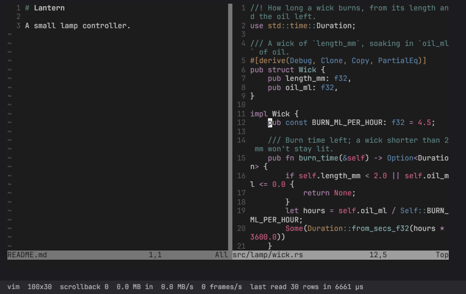
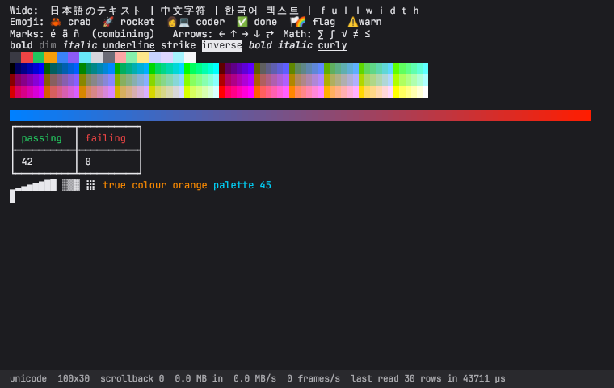
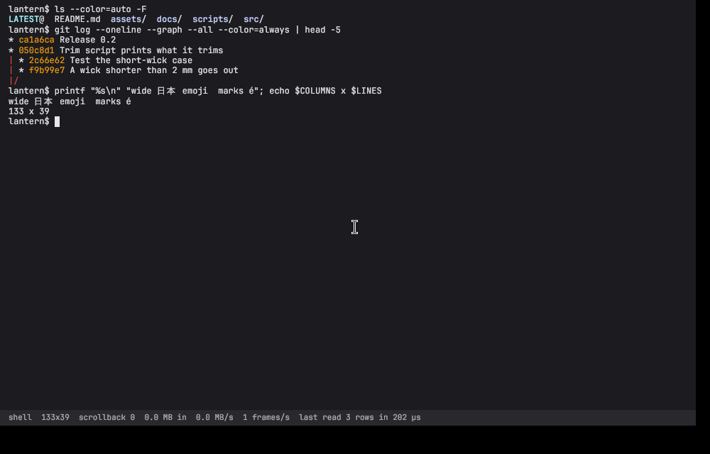
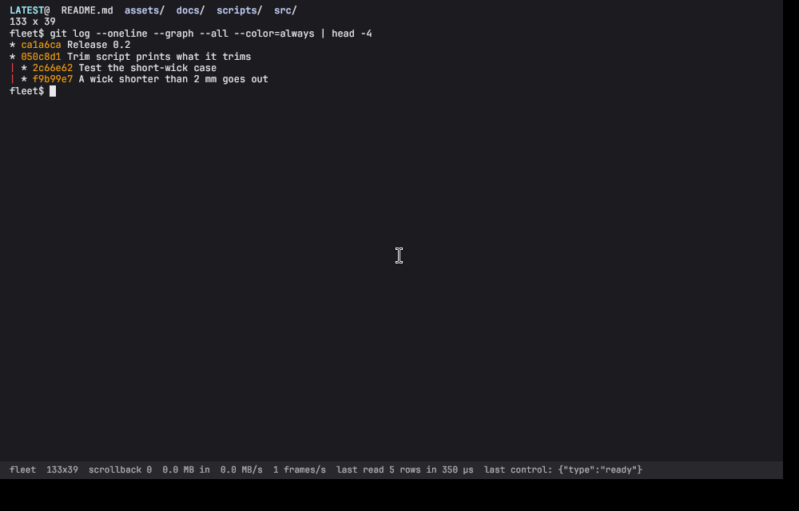
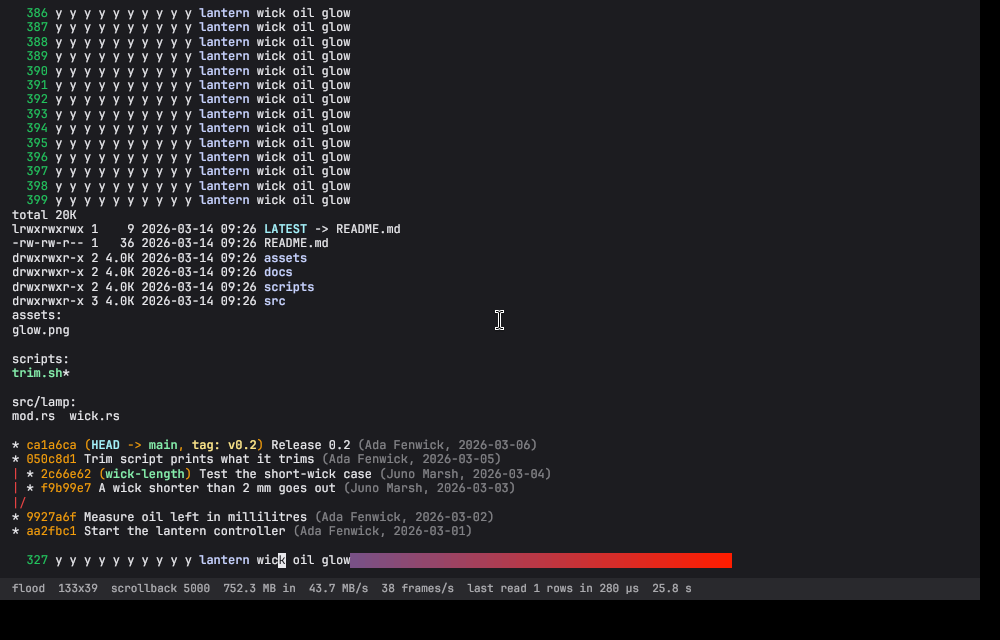

# Research: a terminal in fleet-native

For open decision 2 in `docs/PORT.md` ("Terminal"). Done on 14 November 2026 against weave-fleet
`5e793dc` (v0.72.0 plus a day) and Rune `f1f54ce8` (the pin in `Cargo.toml`). The spike is on the
branch [`spike/terminal`](https://github.com/pgermishuys/fleet-native/tree/spike/terminal)
(`spikes/terminal/`), never to be merged. To try it on Windows, download `terminal-spike-windows-x64`
from [its last run](https://github.com/pgermishuys/fleet-native/actions/runs/43609204637) and run
`terminal-spike.exe` (a local shell; alacritty starts PowerShell there), `terminal-spike.exe --flood 500`
(a flood through the parser), or `terminal-spike.exe --fleet http://127.0.0.1:<port>` (a Fleet's setup
terminal on this machine; don't point it at the Fleet you work in, it ends that Fleet's setup terminal).

Each claim is marked **tried** (run here) or **read** (docs or source only).

## The answer

Yes, and it is the easy kind of yes: `alacritty_terminal` keeps the terminal's state (parser,
grid, scrollback, modes, selection) and Rune, at the pinned commit, already has a terminal grid
element (`rune::grid`, added on 13 November 2026) that draws it a row at a time, so the spike drew
vim, `git log --graph`, colours, wide characters and emoji correctly on Linux, Windows and macOS
and ran a live shell and a scratch Fleet's real terminal socket in a window. A flood didn't freeze
the window: the parser took 30 to 120 MB/s depending on the machine while frames kept coming, a
frame that redraws a whole 200 x 60 screen costs 4 to 7 ms of CPU on GitHub's runners and one
changed row about 0.3 ms. What remains is ordinary work (reconnects, the drawer, links, mouse
reporting), estimated at about 2,900 lines in 6 pull requests, and nothing in it needs Rune's pin
moved.

## What Fleet's client needs

The pty lives on the Fleet server; the client draws and sends keys. (all **read**, from the files
named; the protocol was also **tried** against a scratch Fleet v0.72.0, below)

### The wire protocol

| Thing | Value | Where |
|---|---|---|
| List a session's terminals | `GET /api/sessions/{id}/terminals` → `[{id, title, status: "running" \| "stopped", createdAt}]`, oldest first | `src/WeaveFleet.Api/Endpoints/TerminalEndpoints.cs`, `client/src/lib/terminal-api.ts` |
| Open one | `POST /api/sessions/{id}/terminals {cols, rows}` → 201 with the same shape; 409 at the limit | same |
| Close one | `DELETE /api/sessions/{id}/terminals/{terminalId}` (ends the shell, deletes its scrollback) | same |
| The setup terminal | `POST` / `DELETE /api/setup/terminals[/{id}]`: a shell in the user's home outside any session, where Fleet types a harness's installer for the user to run. Opening one ends the last. | same |
| Attach | WebSocket `GET …/terminals/{terminalId}/socket?cols=&rows=` | `TerminalEndpoints.cs`, `client/src/lib/terminal-socket.ts` |
| Server → client, binary | Output bytes. First the saved scrollback (in 16 KiB frames), then live output. | `src/WeaveFleet.Api/Endpoints/TerminalSocket.cs` |
| Server → client, text | `{"type":"ready"}` after the scrollback; `{"type":"cleared"}`; `{"type":"exit","exitCode":0}` (`null` when Fleet ended it) | same |
| Client → server, binary | Input bytes, any fragmenting | same |
| Client → server, text | `{"type":"resize","cols":120,"rows":30}`, `{"type":"clear"}`; at most 4 KiB | same |
| Close codes | 1000 after `exit` or when detached elsewhere: don't reconnect. 4001 "fell behind the terminal's output": reconnect, the scrollback comes again. 1001 when Fleet is stopping: reconnect. | same |
| Who may attach | A request with no `Origin` (a native client) is let in, then authenticated as any other request: loopback is trusted, other machines need the token. Browsers must come from Fleet's own page. | `TerminalSocket.IsOriginAllowed` |
| Live events | `terminal.opened` and `terminal.closed` on `session:{id}`, payload `{sessionId, terminalId, title, exitCode?}`; the client adds and removes tabs from them, and lists again after a reconnect. | `src/WeaveFleet.Domain/Events/TerminalEvents.cs`, `client/src/stores/terminals.ts`, `client/src/composables/use-session-terminals.ts` |

What the server does that a client must fit:

- One shell has one size. Another client attaching resizes it for everyone, so the client that
  takes focus sends its size again (`TerminalView.vue`, `onFocus`).
- The scrollback it replays is the last 5,000 lines or 2 MiB, cut on a line break
  (`FleetOptions.cs` `MaxHistoryLines`, `MaxHistoryBytes`; `TerminalHistory.cs`). Queries and their
  answers are stripped from what it saves (`TerminalReplaySanitizer.cs`), so a replay never makes
  the client answer again.
- Each client has a queue of 64 frames; a client whose queue fills is dropped with 4001
  (`LiveTerminal.cs`, `ClientQueueFrames`, `Publish`). **Tried**: a 50 MB `yes` through the
  spike's socket client was dropped this way after 4 to 12 MB. A client that can't keep up with a
  flood is expected to reconnect; Fleet's own does.
- The shell's environment: Fleet's own minus its secrets, with `TERM=xterm-256color`,
  `COLORTERM=truecolor`, `TERM_PROGRAM=WeaveFleet`, `LANG=C.UTF-8` when unset
  (`TerminalEnvironment.cs`). The pty is Porta.Pty (`src/WeaveFleet.Infrastructure/Terminals/`).
- Limits: 8 terminals a session, 32 live (`FleetOptions.cs`).

What the client does around the socket (`terminal-socket.ts`): reconnects after 250, 500, 1000,
2000, 4000, 8000 ms; gives up after 5 attempts in a row that never reached `ready`; keeps up to
4 KiB of typing while reconnecting; resets the terminal on every (re)connect before the replay.

### What the view does (`client/src/components/terminal/`, 1,206 lines)

- **xterm.js 6** (`@xterm/xterm ^6.0.0`) with two addons only: **fit** (cols and rows from the
  box) and **web-links** (URLs open in a new window). No WebGL or canvas renderer addon, no
  search, no Unicode 11 or grapheme addon, no clipboard (OSC 52), image or serialize addon.
- Options (`TerminalView.vue`): `fontSize: 12`, `lineHeight: 1.2`, `scrollback: 5000`,
  `cursorBlink: true`, `allowTransparency: true`, font `--font-mono-stack` (JetBrains Mono).
- Theme (`client/src/lib/terminal-theme.ts`): text, cursor and selection from Fleet's tokens; red,
  green, yellow, blue and magenta from its status colours; the other ANSI colours from a light or
  dark palette picked by how bright `--panel-bg` is. The background is the drawer's:
  `--terminal-bg`, `--panel-bg` with 4% `--text` mixed in sRGB (`TerminalDrawer.vue`).
- Keys (`client/src/lib/terminal-keys.ts`): everything goes to the shell (Esc, Ctrl K, Ctrl B
  included) except Fleet's two pass-through shortcuts (toggle terminal, `Mod+J`; toggle right
  panel) and, off a Mac, Ctrl+Shift+C and Ctrl+Shift+V for copy and paste.
- Selecting lines shows a bubble: "Add lines 9–11 to message" (the lines, numbered from the top
  of the scrollback, wrapped rows joined, go into the composer as a fenced block,
  `client/src/lib/format-terminal-context.ts`) and "Copy".
- The drawer (`TerminalDrawer.vue`, `client/src/stores/terminals.ts`): tabs named by the server
  ("bash", "bash 2"), new, close, clear, a height gutter (272 px by default, 140 at least,
  remembered), views kept mounted while the session is open so switching tabs doesn't reconnect.
- `initialInput`: text typed once into a new shell without Enter (the setup terminal's installer
  command).

## The candidates

| Crate | What it is | Licence | Maintained, last release | Used in real apps by | Build cost here | Platforms |
|---|---|---|---|---|---|---|
| **alacritty_terminal** | A whole terminal state: vte parser, grid with scrollback and reflow on resize, alternate screen, every mode xterm.js has (application cursor, bracketed paste, mouse modes, focus events), selection (plain, block, word, line), regex search, damage tracking, OSC 8 links, OSC 52, title, cursor styles. Also brings a pty and an I/O loop (not optional). | Apache-2.0 | Yes. 0.26.0 on 6 April 2026, 0.25.1 in October 2025; 1.6 million downloads in 90 days | Alacritty; Zed (its own fork); `iced_term`, `egui_term`, `gpui-terminal` (97 crates depend on it) | 9 crates beyond what Rune brings: `vte`, `regex-automata`, `regex-syntax`, `aho-corasick`, `home`, `rustix-openpty`, `signal-hook`, `miow`, and itself (**tried**: lock file diff). Compile time not measured. | Linux, Windows, macOS (**tried**: built and ran on all three in CI) |
| **vt100** | Parser plus screen: scrollback, alternate screen, wide characters, 256 and true colour, modes reported (application cursor, bracketed paste, mouse protocol). No reflow (a resize cuts rows), no selection, no search, no damage tracking, no links. | MIT | Yes. 0.18.1 on 19 October 2026 | 365 crates: `tui-term`, `reedline`, `presenterm`, `indicatif` … mostly testing TUIs and recording | 2 crates (`vt100`, `vte`) | all three (**tried**: built in CI for the bench) |
| **vte** | The parser only (a state machine and an `ansi::Handler` trait). The grid is yours to write. | Apache-2.0 or MIT | Yes. 0.15.0, February 2025 | alacritty_terminal, vt100, Zed | 1 crate | all |
| **termwiz** | WezTerm's terminal library: escape parsing, a surface-and-changes model and input decoding for writing TUIs. Not an emulator by itself; WezTerm's emulator (`wezterm-term`) isn't on crates.io (git only, or a third-party fork, `tattoy-wezterm-term 0.1.0-fork.5`). | MIT | Slow: 0.23.3 in March 2025 | WezTerm; 49 crates | About 30 dependencies (`pest`, `phf`, `sha2`, `terminfo`, `nix`, `fancy-regex`, `wezterm-*`) | all (**read**) |
| **libghostty-vt** | Rust bindings to Ghostty's VT library (Zig): terminal, render state, key and mouse encoders. | MIT or Apache-2.0 | Young: 0.2.2 in September 2026 | Its own examples | Its build script clones Ghostty at a pinned commit and builds it with **Zig**: a Zig toolchain and the network at build time, on three systems | Ghostty's (**read**) |
| **avt** | asciinema's virtual terminal, for recording and playing back. | Apache-2.0 | Yes. 0.20.0 on 4 November 2026 | asciinema, `skim`, `iocraft` | 1 crate | all (**read**; not checked for modes and scrollback) |

All of the above: **read** from crates.io and their sources unless marked.

Two were built for real, as the budget allowed: **alacritty_terminal** (the spike) and **vt100**
(parse speed only, in `--bench`).

### Who draws one of these on a GPU, and how (all **read**)

| App | State | How the grid becomes draw calls |
|---|---|---|
| **Zed** (GPUI) | alacritty_terminal, Zed's fork at a pinned rev | `crates/terminal_view/src/terminal_element.rs`, each frame: walk the visible cells; batch runs of cells with the same style on a line into one text run starting at a column (`BatchedTextRun`), shaped with the glyph advance forced to the cell width; merge background colours into rectangles across lines (`BackgroundRegion`); draw block elements (▀ ▄ █ …) as rectangles so they join. GPL-3.0: read it, don't copy it. |
| **iced_term** | alacritty_terminal | iced canvas: one `fill_text` per cell, background rectangles batched per row. Simple, and the slow end. |
| **egui_term** | alacritty_terminal | egui painter: a text shape per cell plus rectangles. |
| **Rio** | its own `rio-vt` / `rio-backend` | its own wgpu renderer, `sugarloaf`. |
| **Ghostty** | its own (Zig) | its own Metal and OpenGL renderers; the state is now `libghostty-vt`. |
| **Warp** | closed source | not checked. |

What made Zed fast is what Rune's `grid` now does inside Rune: one shaped line per row instead of
a glyph per cell, background runs instead of a rectangle per cell, and nothing re-shaped for a row
that didn't change. Rune's changelog entry (`changelog/unreleased/2026-11-13-grid.md` at the pin)
gives its own numbers for a 200 x 60 screen, headless, CPU per frame: a full redraw went from
62.5 ms (built from elements) to 2.5 ms with `grid`, one changed row from 9.5 to 0.4 ms. (**read**)

## How it maps onto Rune

| Need | In Rune at the pin | Mark |
|---|---|---|
| Rows as text with colour, bold, italic, underline | `GridRow::new(text, spans, style)`: the row's narrow cells as one line, `Span`s for colour, weight, italic, underline | tried |
| Every glyph on its column | `grid(cols, cell_w, cell_h, rows)` sets narrow cells on the grid; `GridRow::cell(col, width, …)` pins a wide or fallback glyph to its column so it can't push the rest. The app decides what to pin: the spike pins any non-ASCII character whose advance (`rune::text::advance`) isn't the cell's. CJK, emoji, combining marks, box drawing and braille landed right on all three systems. | tried |
| Background runs, selection | `GridRow::fill(start, end, colour)` | tried |
| Strikethrough, curly and double underlines, box drawing as vectors | `GridRow::shape(Shape)`, a vector layer over the row | read (the spike draws plain underlines only) |
| A row that didn't change costs nothing | Hand back the same `Rc<GridRow>`: Rune keeps its shaped line and last drawing | tried |
| Cell size | `rune::text::advance` of the mono face; Fleet's 12 px JetBrains Mono at line height 1.2 | tried |
| Cursor | An element drawn by the app over the grid (block, bar, underline); `.grid_caret(col, row)` tells screen readers where it is | tried (drawn); read (screen reader) |
| Scrollback | No `virtual_rows` needed: the screen is always `rows` lines, and the wheel moves alacritty's display offset (`.on_wheel`) | tried |
| Select and copy | `.on_drag` to alacritty's `Selection`, `tx.copy` | tried (Linux, X11 clipboard) |
| Paste | Root `.on_paste`, `tx.request_paste()` from Ctrl+Shift+V; bracketed when the program asks | tried (Linux) |
| Keys to bytes | `AppSpec::on_key` with nothing focused sees every key before focus navigation, so Tab and Esc too (read); the spike maps them to xterm sequences, with application cursor mode (`keys.rs`, 100 lines) | tried (Linux: typing, Return, Ctrl+C, arrows in tests) |
| Ctrl+Break on Windows | Arrives as `Key::Pause` with Ctrl (changelog 2026-11-12) | read |
| Option as Meta on macOS | `El::ime_option_as_alt(true)` beside `.ime_cursor()` | read |
| Input methods (CJK, dead keys, emoji picker) | `.ime_cursor()` on the drawn cursor and `App::on_ime` | built, not checked (no input method under Xvfb) |
| Resize from the box | `.on_layout` gives the box; cols and rows from the cell size, sent to the pty or as `{"type":"resize"}` | tried (pty and Fleet socket) |
| Mouse reporting (vim, htop, an agent's TUI clicking) | `on_press`, `on_drag`, `on_pointer_move`, `pointer_buttons` give cell positions; alacritty says which mode is on; the bytes are ours to encode | read, not built |
| Links (Fleet's web-links addon) | alacritty finds URLs by regex and keeps OSC 8 links; hover, underline and open are ours | read, not built |
| Accessibility | `grid` reads as a terminal with a line per row (changelog 2026-11-14) | read |

What Rune lacks for this: nothing that blocks. Two small things the app works around: a `Span`'s
background is rounded and padded for inline code, so backgrounds are `fill`s instead; and the line
can't force a glyph's advance to the cell (Zed's way), so glyphs of other widths are pinned.

## What the spike showed

Sources: a recorded byte stream for each scene (`ls --color`, `git log --graph --color`, vim with
a vertical split and true colour, `less -N`, and a Unicode and colour test), recorded by
`spikes/terminal/streams/record.sh` from an invented project at 100 x 30. No `htop`: it would have
recorded the real machine's processes. A live local shell (the spike only: Fleet's client needs
no pty), `--flood`, and `--fleet <url>` for a scratch Fleet's setup terminal.

### Pictures (Linux, software Vulkan, `--snap`, scale 1)

vim, two windows, true colour and its status lines (**tried**):

Wide CJK, emoji, combining marks, attributes, the 256 colours, a true-colour ramp, box drawing,
blocks and braille. Strikethrough and the curly underline aren't drawn (the vector layer isn't
used yet), and ZWJ emoji (👩‍💻, 🏳️‍🌈) come out as two glyphs: alacritty doesn't join graphemes,
and neither does Fleet's xterm.js without the addon it doesn't load. The block bottom left is the
cursor (**tried**):

The same scene drawn by CI on [Windows](https://github.com/pgermishuys/fleet-native/raw/4df23b9cd1449b6627896cd945f98a0e84ebedd8/shots/research-terminal/ci-windows-unicode.png)
and [macOS](https://github.com/pgermishuys/fleet-native/raw/4df23b9cd1449b6627896cd945f98a0e84ebedd8/shots/research-terminal/ci-macos-unicode.png)
(scale 2): the same layout, each with its system emoji font (**tried**).

`git log --graph` ([picture](https://github.com/pgermishuys/fleet-native/raw/4df23b9cd1449b6627896cd945f98a0e84ebedd8/shots/research-terminal/scene-git-log.png)),
`ls --color` ([picture](https://github.com/pgermishuys/fleet-native/raw/4df23b9cd1449b6627896cd945f98a0e84ebedd8/shots/research-terminal/scene-ls.png)),
`less` ([picture](https://github.com/pgermishuys/fleet-native/raw/4df23b9cd1449b6627896cd945f98a0e84ebedd8/shots/research-terminal/scene-less.png)),
and vim in Fleet's light theme ([picture](https://github.com/pgermishuys/fleet-native/raw/4df23b9cd1449b6627896cd945f98a0e84ebedd8/shots/research-terminal/scene-vim-light.png)) (**tried**).

### A real window (Linux, Xvfb, software Vulkan, release build, typed into with xdotool)

A local shell in a scratch home: typing, colours, a resize from 133 x 39 to 97 x 26 that the shell
sees, and vim (**tried**):

[After the resize](https://github.com/pgermishuys/fleet-native/raw/4df23b9cd1449b6627896cd945f98a0e84ebedd8/shots/research-terminal/live-shell-resized.png),
[vim](https://github.com/pgermishuys/fleet-native/raw/4df23b9cd1449b6627896cd945f98a0e84ebedd8/shots/research-terminal/live-shell-vim.png),
[the wheel back through the scrollback](https://github.com/pgermishuys/fleet-native/raw/4df23b9cd1449b6627896cd945f98a0e84ebedd8/shots/research-terminal/live-scrollback.png),
[a drag selection](https://github.com/pgermishuys/fleet-native/raw/4df23b9cd1449b6627896cd945f98a0e84ebedd8/shots/research-terminal/live-selection.png),
and [Ctrl+Shift+C then Ctrl+Shift+V into the prompt](https://github.com/pgermishuys/fleet-native/raw/4df23b9cd1449b6627896cd945f98a0e84ebedd8/shots/research-terminal/live-copy-paste.png) (**tried**).

The same, against **a scratch Fleet v0.72.0's real terminal socket** (`--fleet`, its setup
terminal, loopback, an empty home): the shell, vim, and a resize the shell sees as 97 x 26
(**tried**):

[vim over the socket](https://github.com/pgermishuys/fleet-native/raw/4df23b9cd1449b6627896cd945f98a0e84ebedd8/shots/research-terminal/fleet-socket-vim.png),
[after the resize](https://github.com/pgermishuys/fleet-native/raw/4df23b9cd1449b6627896cd945f98a0e84ebedd8/shots/research-terminal/fleet-socket-resized.png),
and [the 4001 close during a flood](https://github.com/pgermishuys/fleet-native/raw/4df23b9cd1449b6627896cd945f98a0e84ebedd8/shots/research-terminal/fleet-socket-flood-4001.png)
(the status line shows the close frame: "closed 4001 Fell behind the terminal's output").

### Floods

`--flood 1000` parses a gigabyte of mixed output (the recordings and numbered lines) on a thread,
in 64 KiB chunks under the terminal's lock, as a socket reader would, while the window draws:

| Run (Linux, i3-8109U laptop, 4 cores shared with other builds, release, Xvfb + software Vulkan) | Result | Mark |
|---|---|---|
| `--flood 1000` in a 980 x 600 window | 752 MB in 25.8 s: **29 MB/s** on average (44 MB/s at that moment), the window drawing 15 to 38 frames a second throughout, each read of the screen's rows about 1 ms | tried |
| Rune's commits during that flood (`RUNE_COMMIT_BUDGET_MS=0.01`) | **0.3 ms** each: view 0.0, layout 0.2 (text 0.1), apply 0.1. The rows are shaped when the grid paints, which isn't in the commit; the bench below counts it. | tried |
| `time (yes … \| head -c 50000000)` in the live shell | **4.5 s** (11 MB/s), the window drawing ([picture](https://github.com/pgermishuys/fleet-native/raw/4df23b9cd1449b6627896cd945f98a0e84ebedd8/shots/research-terminal/live-pty-flood-done.png)). The same 50 MB through `script` to `/dev/null`, no terminal at all: 1.9 to 4.3 s. The pty is most of it. | tried |
| Ctrl+C during a 2 GB flood | The shell stopped it and the prompt was back within the second ([picture](https://github.com/pgermishuys/fleet-native/raw/4df23b9cd1449b6627896cd945f98a0e84ebedd8/shots/research-terminal/live-pty-flood-ctrl-c.png)) | tried |
| The same 50 MB `yes` over Fleet's socket | Fleet dropped the client with 4001 after 4 to 12 MB, as designed: the server reads the pty with no back-pressure from the client. The spike doesn't reconnect; Fleet's client does. | tried |

Frame rates under a software renderer say nothing about speed on a GPU; they show only that
input and drawing carry on during a flood.

### The bench (`terminal-spike --bench`, release, wall time on one thread, no GPU)

Parsing into a 200 x 60 terminal with 5,000 lines of scrollback, 64 KiB chunks, MB/s:

| | Linux laptop (loaded) | GitHub Windows runner | GitHub macOS runner (arm64) |
|---|---|---|---|
| alacritty_terminal, recorded streams | 70 | 79 | 121 |
| alacritty_terminal, plain lines | 44 | 64 | 100 |
| vt100, recorded streams | 25 | 70 | 96 |
| vt100, plain lines | 12 | 23 | 10 |

A frame of the spike's view at 200 x 60 (a headless Rune runtime: layout, scene and paint lists,
no GPU), p50, with p90 in brackets:

| | Linux laptop (loaded) | Windows runner | macOS runner |
|---|---|---|---|
| Every row changes | 7.7 ms (13.6) | 6.5 ms (7.7) | 4.0 ms (5.1) |
| One row changes | 0.78 ms (0.87) | 0.35 ms (0.40) | 0.25 ms (0.49) |
| Nothing changes | 0.30 ms (0.34) | 0.13 ms (0.15) | 0.09 ms (0.11) |
| Reading the rows from alacritty (all changed / one) | 1.0 / 0.6 ms | 1.3 / 0.25 ms | 0.6 / 0.17 ms |

Reading the rows hashes every visible cell to find the ones that changed; alacritty's own damage
tracking (`Term::damage`) would skip that and is the obvious next step. The laptop's numbers moved
by half between runs while other sessions built Rust beside it: trust the runners'. (all **tried**)

### What the spike is

`spikes/terminal/`, 1,198 lines of Rust: the view, state and scenes (`main.rs`, 367), reading
alacritty's grid into `GridRow`s with Fleet's theme (`screen.rs`, 292), the terminal and its
sources (`engine.rs`, 203), keys (`keys.rs`, 107), the bench (`bench.rs`, 102) and the Fleet socket
(`fleet.rs`, 127, a hand-written WebSocket client over `std` so the spike adds no network crate).
That is about 400 over the 800 budgeted: the bench and the Fleet socket (the stretch) are 229 of
it. Four headless tests (`cargo test`), seven scenes, and a CI workflow that builds and tests it,
runs the bench and draws every scene on Windows and macOS and uploads a Windows `.exe`.

## The recommended route, and the runner-up

**Recommended: alacritty_terminal for the state, `rune::grid` to draw it.** It is the most
complete state there is on crates.io (reflow, selection, search, damage, every mode Fleet's xterm.js
uses), it is what Zed and most Rust GPU terminals use, it was the fastest parser here on every
system, and Rune's `grid` was evidently built for exactly this. Its pty module comes along but is
small, and Fleet's client never calls it.

**Runner-up: vt100.** Two crates instead of nine, and MIT (only its parse speed was tried here);
but it can't reflow on resize (Fleet's drawer resizes all the time), has no selection, search
or damage, and parsed plain lines at a third to a tenth of alacritty's speed. The app
would end up writing what alacritty already has.

Not recommended: writing a grid on `vte` (months of what alacritty has), termwiz/wezterm-term
(not published, heavy), libghostty-vt (a Zig toolchain on three build machines).

## What it would take as lane 7 in `docs/PORT.md`

Lane 7's demo sentence stands: "The drawer opens a working terminal on the session's folder." It
needs slice B (HTTP, WebSocket, the hub) and lane 5 (tabs, buttons, menus). Three slices:

| Slice | Demo sentence | Lines | PRs |
|---|---|---|---|
| 7a. The terminal view | A recorded vim, `git log` and Unicode stream look as they do in Fleet's drawer at the same size, in both themes; typing, paste, selection and copy, the wheel and a resize work against a scripted byte source; a flood keeps the window drawing. | ~1,200 | 2 |
| 7b. Fleet's terminals | With `--server`, opening the drawer lists the session's terminals, a new tab starts a shell in the session's folder, `terminal.opened` and `terminal.closed` add and remove tabs, and a 50 MB flood ends with the client reconnected and the scrollback replayed. | ~800 | 2 |
| 7c. The drawer | Tabs, new, close and clear, the height gutter, `Mod+J`, Fleet's key routing, "Add lines to message", links that open, and mouse reporting for TUIs that ask for it. | ~900 | 2 |

About 2,900 lines in 6 pull requests. New crates: `alacritty_terminal` and its 8 (the WebSocket
crate comes with slice B). Rune: nothing it lacks, no pin move. Recorded streams become the scenes
and test fixtures, as in the spike; `record.sh` shows how to make them without real data.

## Risks

- **alacritty_terminal is pre-1.0**: a minor release (0.25 in February 2025, 0.26 in April 2026)
  may change its API, and Zed carries a fork rather than track releases. A pin and a wrapper module keep it contained.
- **Rune's `grid` is a day old at the pin.** Its API may change on the next pin move; the code that
  builds `GridRow`s is about 150 lines.
- **Floods over the socket end in reconnects** by Fleet's design. Each reconnect resets the view and
  replays up to 2 MiB, so a user scrolled back in a flood loses their place. Fleet's xterm.js client
  presumably has the same behaviour (not checked).
- **Graphemes.** ZWJ emoji draw as their parts, as in Fleet's xterm.js today. If Fleet ever loads
  xterm's grapheme addon, alacritty can't follow.
- **Fonts.** Wide and emoji glyphs come from the system's fallback fonts: Segoe UI Emoji, Apple
  Color Emoji, and whatever a Linux machine has (a Linux box without Noto CJK or emoji fonts will
  show boxes; not checked).
- **Licence.** alacritty_terminal is Apache-2.0: shipping it means its licence text with the app.
  Zed's terminal code is GPL-3.0: read it, never copy it. (Decision 5, this repository's own
  licence, is still open.)
- **Speed on real hardware is unmeasured.** The CPU numbers say a full redraw fits in a 60 Hz frame
  on a runner; GPU frame time and a 120 Hz display are unknown.

## What I couldn't check

- The window on Windows and macOS. CI built, tested and drew the scenes there; nobody has typed
  into it. The Windows `.exe` from the last spike run is there to try (above).
- Input methods (CJK, dead keys, the emoji picker) and macOS Option as Meta: built, never driven.
  Non-ASCII typed with xdotool under Xvfb never arrived, which says nothing either way.
- A screen reader on the grid.
- Session terminals (only the setup terminal was opened), a token on another machine, and how
  Fleet's own Electron client copes with the same 50 MB flood over the socket.
- Mouse reporting and links: not built.
- How long the 9 new crates add to a clean build.
- Frame times on a real GPU.
