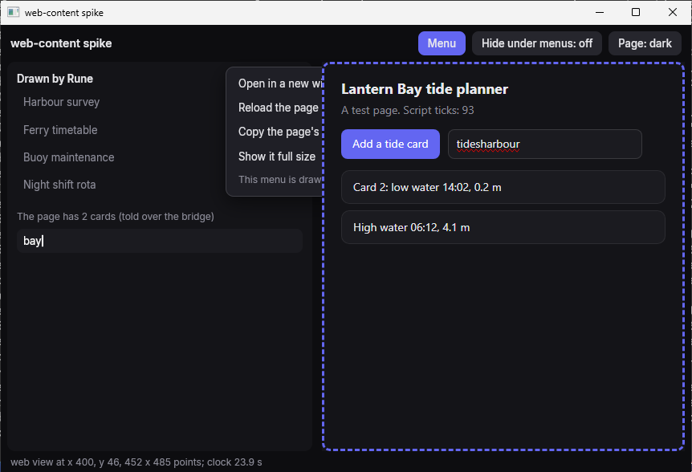
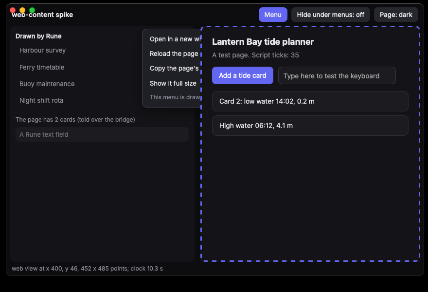
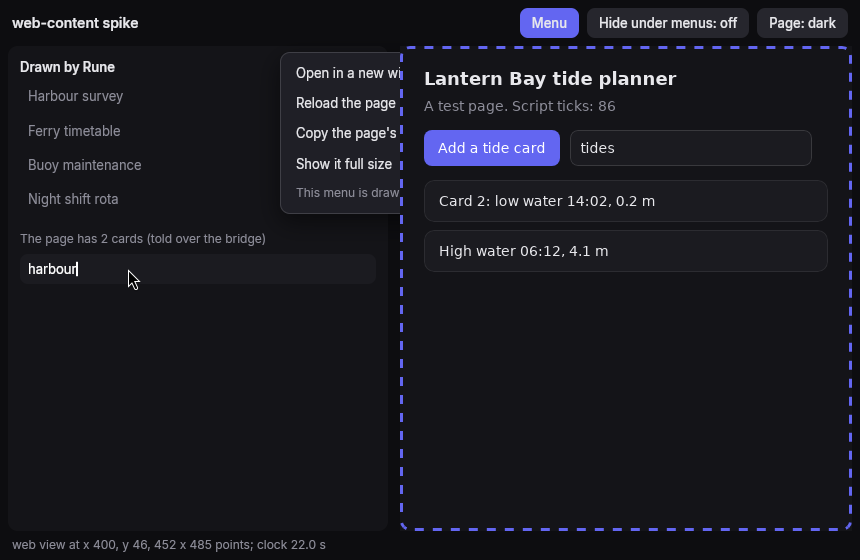
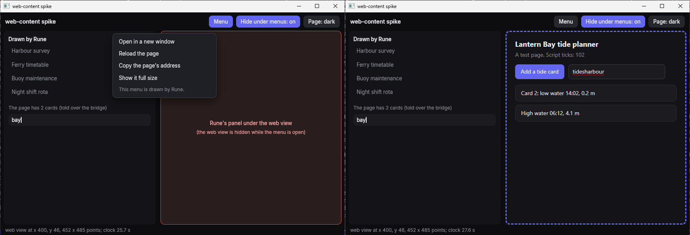
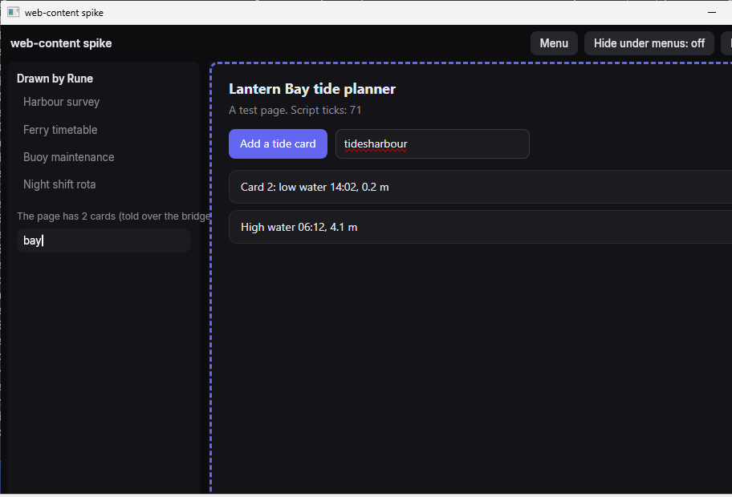
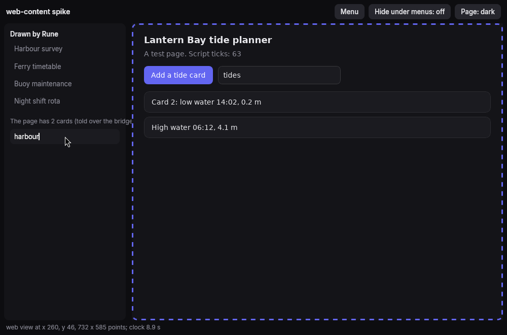
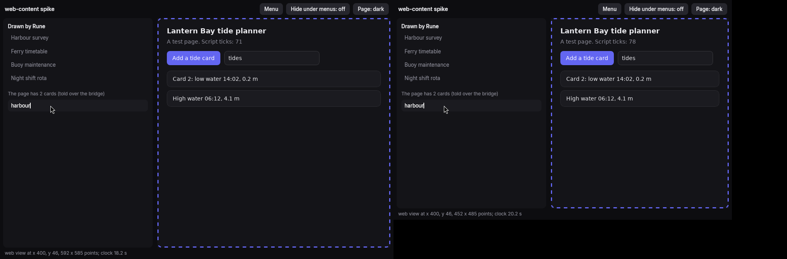
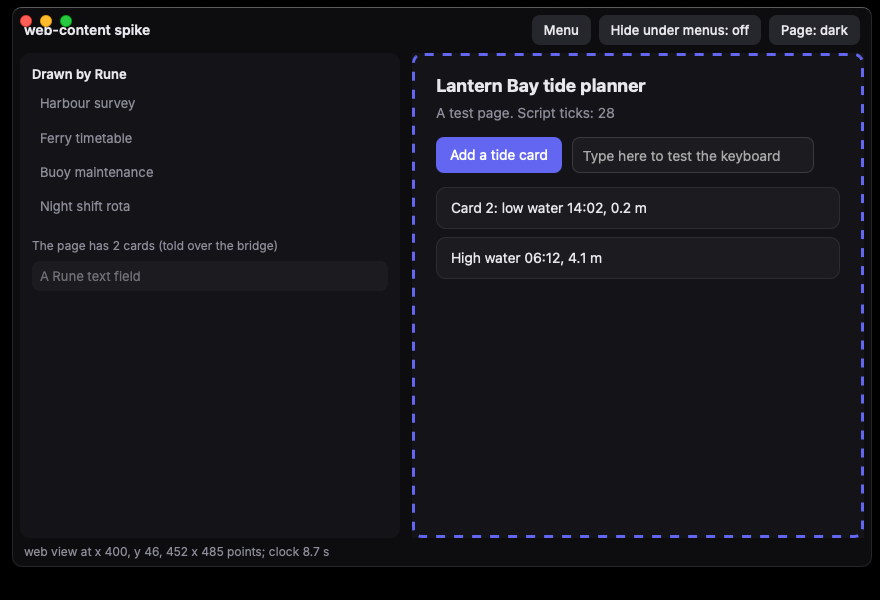
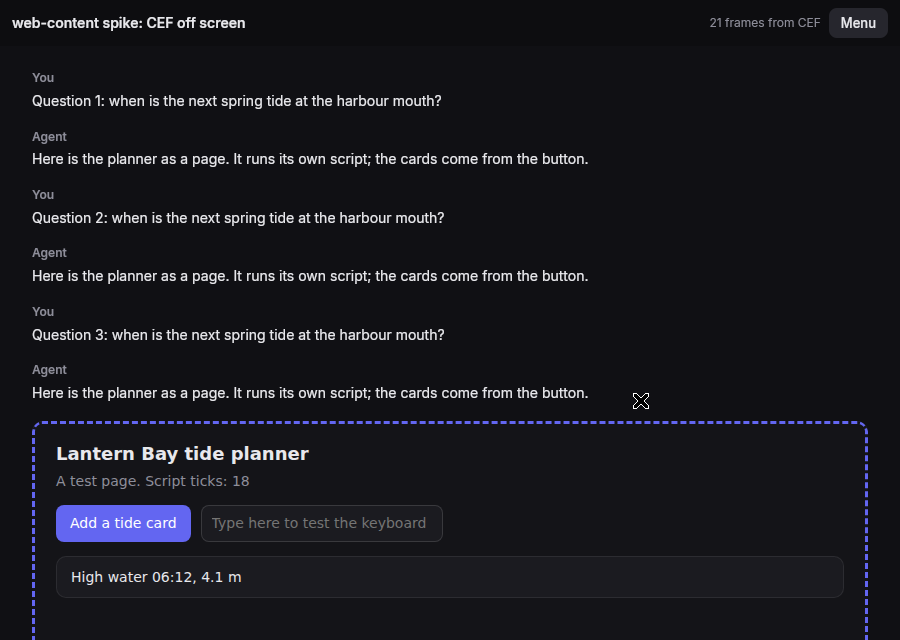
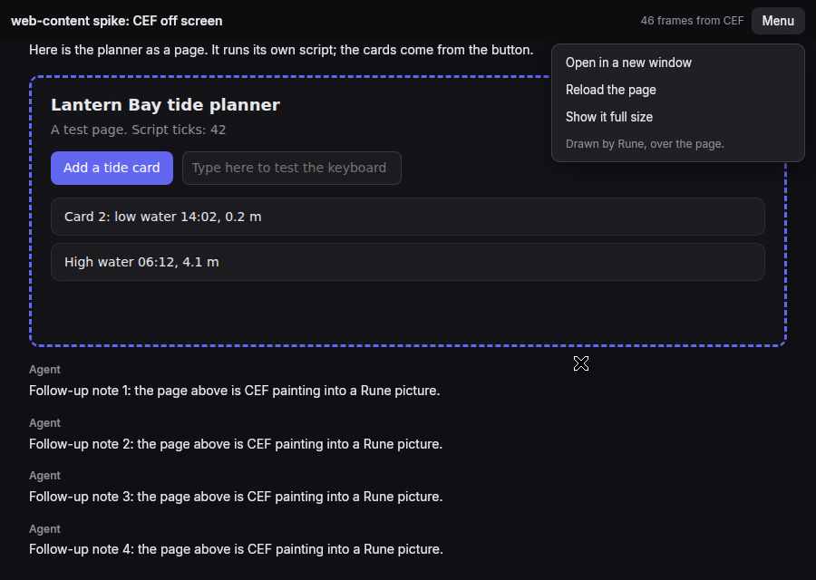

# Web content in fleet-native

Research for `docs/PORT.md`'s open decision 1, 14 November 2026, at Rune `f1f54ce8` and weave-fleet
v0.72.0. The spike is on the branch `spike/web-content` (`spikes/web-content/`), never merged.

Each claim is marked **tried** (ran it) or **read** (docs or source only).

## The answer

Yes, Rust has this: the `wry` crate puts the system's own web view (WebView2, WKWebView,
WebKitGTK) inside a Rune window today with no change to Rune, and the spike shows a page whose
script runs, whose button changes it and tells the app, kept exactly over its panel through gutter
drags and window resizes, on Windows, macOS and Linux (tried). But it is a native window on top
of everything Rune draws: a Rune menu or popover that reaches it is cut off, it can't scroll or
clip inside a Rune list, keyboard focus behaves differently on each system, and on Linux it needs
X11 or XWayland (tried; Wayland read). Chromium painting off screen into a Rune picture (CEF)
removes all of those limits, and the second spike shows a live page scrolling inside a
conversation under a Rune menu (tried, Linux), but it adds about 380 MB to the app and makes the
app pass on every input event itself; so the recommendation is wry for the places that are whole
tabs, and CEF only if the owner decides live pages inside the conversation are worth that size.

## What Fleet's client needs

From weave-fleet's `client/` at v0.72.0 (read). Every place is an `<iframe>` today; there is no
`<webview>` and no other engine.

| Place | Source | Scripts | Talks to Fleet | Where it sits | Hardest need |
|---|---|---|---|---|---|
| Pages agents show (`fleet_page_show`), in a tab | `components/canvas/PageCanvas.vue` | Yes: `allow-scripts allow-forms allow-popups allow-popups-to-escape-sandbox allow-modals allow-downloads`, opaque origin, and the same list again as a `Content-Security-Policy: sandbox` header from the server | Yes: `fleet:page-hello`, `fleet:page-state`, `fleet:page-reply`, `fleet:page-choice` (`lib/page-bridge.ts`), `fleet:theme` pushed in; `window.fleet.choose()` from the injected bootstrap | A whole content-panel tab, with Fleet's toolbar above and its choice bar below | A bridge both ways; menus and dialogs from the rest of the app opening over it |
| Pages inside the conversation | `components/session/ConversationPage.vue` | Same sandbox | Height reports (`ui/notifications/size-changed`, MCP Apps' shape, from a `ResizeObserver` the server injects) and the theme | **Inside the scrolling conversation** (not virtualised), sized to its content up to 2,000 px, with a hover toolbar over its top-right corner and a full-size modal (z-index 9999) that opens a second frame | Scrolling with the list, being clipped by it, and things drawn over it |
| Mod pages | `components/mods/ModPage.vue` (a `ConversationPage` with `contained`) | `allow-scripts allow-forms allow-modals allow-downloads` | Height and theme | In the conversation, in mod panes (`ModPaneCanvas.vue`, `overflow:auto`) | As above. The server route it points at (`/api/sessions/{id}/mods/{mod}/pages/...`) doesn't exist yet |
| HTML previews | `components/visual-renderers/HtmlRenderer.vue` | **No**: `sandbox="allow-same-origin"` only, `srcdoc` | No | In tool cards in the conversation (`ToolCard.vue`), the Document tab (`VisualCanvas.vue`), the file viewer's rendered `.html` (`FileCanvas.vue`), and the review list (`ChangesReview.vue`) | Static HTML and CSS, inside scrolling lists |
| The browser canvas | `components/canvas/BrowserCanvas.vue` | Yes: `allow-scripts allow-same-origin allow-forms allow-popups allow-modals allow-downloads` | Yes: the preview bridge (`lib/preview-bridge.ts`: `hello`, `location`, `update`, `open`; `nav` back in) | A whole tab | A **live** page from the user's own app, through the server's preview gateway (`src/WeaveFleet.Api/Browser/PreviewGateway.cs`), with hot reload over WebSockets. A real browser engine, nothing less |
| The agent's browser | `components/canvas/AgentTabView.vue` | n/a | n/a | Over the browser canvas | Already pictures: a JPEG the server's headless browser makes, polled every 700 ms. **Rune can draw this today** with `ImageCache`; no web view needed |

The page server (`src/WeaveFleet.Api/Endpoints/PageEndpoints.cs`) serves `/pages/{id}/...` with the
sandbox CSP, `nosniff` and `no-referrer`, and `src/WeaveFleet.Application/Pages/PageTheme.cs` injects
the theme variables (21 `--fleet-*`), the height reporter and `window.fleet.choose` into every page.
Those are the server's, so any engine that loads the page URL gets them for free; a native client
only has to answer the messages.

What this means for the routes:

- **Tabs** (pages, the browser canvas): a rectangle that stays put under a toolbar. An OS web view
  laid over the window is good enough, if nothing has to open over it.
- **Pages in the conversation and mod panes**: a page that scrolls with a list, is clipped by it,
  and has a toolbar and menus over it. An OS web view can only follow the scroll by being moved
  every frame and clipped by hand, and nothing Rune draws can go over it.
- **HTML previews**: no scripts, so an HTML/CSS renderer without JavaScript would do.
- **The agent's browser**: pictures, already.

## The candidates

Versions and dates as of 14 November 2026, from crates.io and each project's repository (read,
unless marked tried).

| Route | Crate | What it does | Licence | Maintained? Last release | Used in a real app | Build and size | Platforms | Composites with Rune |
|---|---|---|---|---|---|---|---|---|
| **System web view, child of the window** | `wry` 0.57.2 | WebView2 (Windows), WKWebView (macOS), WebKitGTK (Linux) as a child window or view of any `raw-window-handle` window | MIT or Apache-2.0 | Yes, 10 Nov 2026; Tauri's | Tauri apps; gpui-component's `gpui-webview` (fork); Freya's `freya-webview`; `iced_wry` | Small: the engine is the OS's. Linux needs `libwebkit2gtk-4.1` at build and run time. **Tried**: the spike's Windows release exe is 23.9 MB (10.0 MB zipped; the shell app's is 10.7 MB zipped with its fonts), so wry itself adds little; Linux debug build added about a minute over Rune | Windows, macOS, Linux on **X11 only** (and XWayland) | **No.** A native child over Rune's surface: always on top of anything Rune draws, moved with `set_bounds`, can't be clipped by a scroll view or rounded |
| **System web view, its own window** | `wry` + `tao` 0.37.2 | The same engine in a separate top-level window | MIT or Apache-2.0 | Yes | Tauri | As above, plus tao | All, Wayland included (GTK owns the window) | Not inline at all. tao and winit both want the main thread's event loop, so in one process it's wry's `build` on a second **winit** window that Rune opens (`App::window`), not tao |
| **Chromium off screen** | `cef` 156.4.0 (`tauri-apps/cef-rs`) | CEF's windowless mode: Chromium paints into a buffer (`on_paint`) or a shared GPU texture (`on_accelerated_paint`, imported into **wgpu 30** with the `accelerated_osr` feature); the app forwards input | Bindings MIT or Apache-2.0; CEF BSD-3-Clause; Chromium's own (BSD and many third-party) | Yes, 8 Nov 2026, follows Chromium releases | CEF is embedded by many desktop apps; in Rust, `egui_chromite` and `iced_webview_v2` | **Large**: on Linux the archive is 333 MB, `libcef.so` is 1.5 GB as shipped and 278 MB stripped, plus 102 MB of resources: **about 380 MB** added to the app (tried, Linux). `build.rs` downloads CEF and builds its C++ wrapper with cmake. Each platform needs CEF's helper processes and resources shipped beside the app | Windows, macOS, Linux (x64, arm64) | **Yes.** The page is a picture: it scrolls, clips, rounds and sits under menus like any `El::pixels` |
| **Servo** | `servo` 0.8.0 | A whole browser engine in Rust (SpiderMonkey for JS) with an embedding API; renders through OpenGL (surfman), off screen or to a window | MPL-2.0 | Yes, monthly since 0.1.0 (13 Apr 2026); an LTS line | Servo's own demo browser; `iced_servo` | Very heavy: about 2,000 crates, SpiderMonkey built from C++ source, 10–15 GB of `target/`, around 150 MB binary (others' figures) | Windows, macOS, Linux | Yes, in principle: read the frame back (`SoftwareRenderingContext`, `take_screenshot`) or share a GL texture with wgpu through interop. Compatibility with real pages is still behind WebKit and Chromium |
| **HTML/CSS without JavaScript** | `blitz-dom`/`blitz-html`/`blitz-paint` 0.3.0-beta.4 | Stylo (Firefox's CSS) + Taffy + Parley layout, painted through `anyrender` (Vello on wgpu, or CPU) | MIT or Apache-2.0 (Stylo MPL-2.0) | Yes, 16 Oct 2026; beta | Dioxus Native | Medium: Stylo is large; no JS engine. Shares Rune's family of crates (Parley, Taffy, AccessKit, wgpu 30) | Anywhere wgpu runs | Yes: it can paint into any `anyrender::PaintScene`, or a CPU image Rune shows with `Pixels` |
| **Snapshots of the system web view** | none: `wry`'s escape hatches to `ICoreWebView2::CapturePreview`, `WKWebView takeSnapshot`, WebKitGTK `webkit_web_view_get_snapshot` | A still picture of the live web view | as above | | | Small | All three | A still picture can stand in for the live view while a Rune menu or dialog is over it |
| Others looked at and set aside | Ultralight (`ul-next`), `litehtml`, Verso | Ultralight: closed SDK with a licence fee above a revenue cap, bindings stale since 2024. litehtml: C++ layout only, weak CSS. Verso: archived October 2025 | | | | | | |

What other Rust GPU apps did (read):

- **Zed** has no web view. Its markdown, SVG and CSV previews are drawn by GPUI; an HTML preview is
  an open request (#10533, #21208). Forks that added wry found it always draws over GPUI.
- **gpui-component** ships a `WebView` on a fork of wry. Its README says plainly that the native
  view covers GPUI's popovers, dialogs, menus and tooltips and can't be clipped. An opt-in mode on
  macOS and Linux moves the web view into the window's compositor so overlays can go above it;
  on Windows that is "not yet". Wayland is unsupported.
- **Freya** (`freya-webview`) and **Iced** (`iced_wry`) use wry as a child window, X11 only on
  Linux. Iced also has CEF, Servo and Blitz variants in `iced_webview_v2`.
- **Slint** has no web view; its maintainers' plan is a browser engine rendering into a texture
  (Servo), tracked in slint#3930.
- **Tauri** is wry plus tao, and gets Wayland by letting GTK own the window.
- Rune's own issue #412 (9 Nov 2026, open) asks for a native web view element. It says Rune
  doesn't give out its window's handle; at the pinned commit it does (`App::on_window` and
  `WindowHandle::with_raw_handle`), which is what the spike uses.

## What the spikes showed

Two binaries in `spikes/web-content/` (735 lines of Rust, plus a 44-line test page, 68 lines of
input and screenshot helpers for CI, and the manifest). The page is invented: a "tide planner"
with a script that counts ticks, a button that adds a card and posts a message to the app, a text
field, and a dashed border that shows where the page's own edges are.

### Spike 1: the system web view as a child window (`wry`)

How it works: `App::on_window` gets the native window once it exists; `WindowHandle::with_raw_handle`
lends its handle to `WebViewBuilder::build_as_child`; the panel's `El::on_layout` calls
`WebView::set_bounds` with its rect in points. On Linux the app calls `gtk::init()` and turns GTK's
main loop from `poll` every 16 ms. The page talks to the app through wry's IPC
(`window.ipc.postMessage` → `AppHandle::update`), and the app talks to the page with
`evaluate_script` (the **Page: dark/light** button pushes `--fleet-*` variables, as Fleet does).

`--demo` walks eight steps and takes a picture of the whole screen after each. In CI that ran on
GitHub's Windows and macOS runners (with real OS mouse clicks and key presses on Windows, through
PowerShell); here it ran on Linux under Xvfb with real X input (XTest).

| Step | Windows (WebView2) | macOS (WKWebView) | Linux X11 (WebKitGTK 2.52) |
|---|---|---|---|
| The page loads; its script runs | tried: yes | tried: yes | tried: yes |
| A real click on the page's button changes the page and reaches the app over the bridge | tried: yes | tried with a script click only (no input tool on the runner) | tried: yes |
| Drag the gutter: the web view follows the panel | tried: yes | tried: yes | tried: yes |
| Resize the window: it follows | tried: yes | tried: yes | tried: yes |
| Open a Rune menu that overlaps it | tried: **the menu is cut off at the web view's edge** | tried: same | tried: same |
| Hide the web view while the menu is open | tried: works | tried: works | tried: works, but see the next row |
| Show it again | tried: comes back with its state | tried: same | tried: **comes back black** with `set_visible`; moving it out of the window instead of hiding it works, state kept |
| Click the page's field and type, then click Rune's field and type | tried: the page gets both words; **clicking Rune doesn't take the keyboard back**. After `focus_parent()`, Rune gets the keys | not tried (no input tool on the runner) | tried: the page gets the first word, Rune the second; then `focus_parent()` **loses the keyboard** (the third word goes nowhere) |
| Processes and memory (debug build, software rendering, rough) | not measured | not measured | tried: 3 processes, about 390 MB resident |

The Rune menu, cut off where the web view starts (Windows, then macOS, then Linux):

The workaround, on Windows: the web view hidden while the menu is open (Rune's red panel shows
through), then shown again with the page as it was:

After a real click on **Add a tide card** (Windows): the page added a card, and the Rune panel on
the left heard "2 cards" over the bridge:

Keyboard focus on Windows: "tides" was typed into the page, then Rune's field was clicked and
"harbour" typed, which still went to the page; "bay" went to Rune only after `focus_parent()`:

The same on Linux, where the click does move the keyboard ("harbour" landed in Rune):

Dragging the gutter, then resizing the window (Linux):

And after resizing on macOS:

More pictures, one per step and system, are in
[`shots/research-web-content/`](https://github.com/pgermishuys/fleet-native/tree/80c46079342fd99a823659bbe8726a649f671076/shots/research-web-content).

### Spike 2: Chromium off screen into a Rune picture (CEF)

How it works: CEF runs windowless. Its `on_paint` gives a BGRA buffer, which the spike swaps to
RGBA and hands to a `rune::Pixels`; an element in a scrolling conversation draws it with
`El::pixels`. `poll` turns CEF's message loop (`do_message_loop_work`) every 16 ms. Mouse presses
on the element go to CEF with `send_mouse_click_event` at the element's local coordinates. CEF
starts its helper processes as copies of the app, so `main` hands them to `execute_process` before
Rune starts.

| Step | Linux (CEF 156, software rendering) |
|---|---|
| The page loads and its script runs | tried: yes; CEF paints only when the page changes (46 frames in 12 s with a 4-a-second ticker) |
| A click forwarded from Rune presses the page's button | tried: yes |
| The page scrolls with the conversation and is clipped by it | tried: yes |
| A Rune menu opens **over** the page | tried: yes |
| Keyboard, IME, wheel, cursor shapes, text selection, drag | not built: each is another forwarding call (`send_key_event`, `send_mouse_wheel_event`, ...) |
| A bridge to the app | not built: CEF's is a message router across processes, more work than wry's IPC |
| Processes and memory (debug build, rough) | tried: 8 processes, about 870 MB resident |
| Windows and macOS | not built (budget): CEF's helper bundles and macOS's app layout make these real work |

The page inside a conversation, clipped at the bottom of the scroll view:

Scrolled, after a forwarded click added a card, with a Rune menu over the page:

Building it took two tries: `download-cef` 3.0.0 fails because CEF's download index is now larger
than its HTTP client's 10 MB limit; downloading the archive by hand, checking its SHA-1 against the
index, and pointing `CEF_PATH` at it worked. `cef-dll-sys` also needs cmake and a C++ compiler for
CEF's wrapper library.

### What Rune had for it

At the pinned commit `f1f54ce8`.

| A web view needs | Rune has | Mark |
|---|---|---|
| The window's native handle | `App::on_window(|handle| ..)` runs on the UI thread each time the native window is made (again after a Wayland close or a GPU release); `WindowHandle::with_raw_handle` lends a `raw-window-handle` 0.6 handle, which `wry::WebViewBuilder::build_as_child` takes as it is | tried |
| The panel's rectangle, and when it changes | `El::on_layout` gives `[x, y, w, h]` in window points after its first layout and whenever it moves or resizes by more than half a point (every frame while it scrolls); `El::on_screen_layout` gives screen points; `Cx::window_layout(key)` reads it in a view. Points are wry's logical pixels | tried |
| Knowing that something Rune draws is over the web view | Nothing. The app knows its own menus and dialogs because they are its state, so it has to hide the web view (or swap in a snapshot) itself whenever one opens. Rune's native menus (`tx.popup_menu`, macOS and Windows) are OS windows and so do open over a web view; Linux has none | tried (hide); read (native menus) |
| Drawing over a native view | No "overlay slot". Rune's own research note (`research/11-platform-shells.md`) plans `NativeOverlay`/`NativeUnderlay` slots on macOS; nothing exists yet. A transparent Rune overlay window (`App::overlay`, `WindowOptions::overlay`) above the main window could host popovers, but that is a second window to keep in place | read |
| Showing frames from another renderer | `rune::Pixels`: a thread-safe RGBA image a producer replaces with `set(w, h, rgba)`; `El::pixels` draws it clipped to the element's corners, with no view rebuild when it changes and one upload per frame however often it's set. CPU copy each frame | tried (OSR spike) |
| Drawing a GPU texture without a CPU copy | The compositor hook (`App::compositor`): effect slots (`El::effect(mark)`) call the app back in painter order with the device, the encoder, the slot's rect and its clip, so an imported texture (CEF's `on_accelerated_paint`, which the `cef` crate already imports into wgpu 30) can be drawn in place, under later Rune content. `NativeSurface` does zero-copy import, but only of CoreVideo buffers on macOS | read |
| Keyboard focus moving between Rune and the page | No API. Rune doesn't learn that the OS gave the keyboard to the child window, and it has no "pointer went down anywhere in Rune" hook to take it back. wry has `focus()` and `focus_parent()`, which behave differently per platform ("What the spikes showed") | tried (Windows, Linux) |
| Accessibility | A native web view brings its own accessibility tree to the OS (UIA, NSAccessibility, ATK); Rune's AccessKit tree doesn't know it's there. Off-screen pages have none unless the app bridges CEF's accessibility events into AccessKit | read |

## Recommended route, and the runner-up

**Recommended: wry, for the places that are whole tabs; a card for the places inside lists.**

| Fleet place | With wry |
|---|---|
| Pages agents show, in the content panel's tab (`PageCanvas.vue`) | A child web view over the tab's body, loading the page's URL from the Fleet server. Hidden (on Linux: moved out of the window) while any Rune menu, popover, dialog or the command palette is open over it. The choice bar under it is Rune's |
| The browser canvas (`BrowserCanvas.vue`) | The same, loading the preview gateway's URL. This one needs a real engine whatever happens; wry is the cheap way to have one |
| Pages inside the conversation and mod pages (`ConversationPage.vue`, `ModPage.vue`) | **Not live inline.** A card in the conversation with the page's title and an Open button that shows it in the page tab (or full size, as Fleet's modal does). A still snapshot from the platform's API on the card is possible later. This differs from Fleet, so it is the owner's decision |
| HTML previews (`HtmlRenderer.vue`) | The Document tab and the file viewer's rendered view: a web view, as pages. In tool cards and the review list: the same card. Blitz could draw these inline later, since they have no scripts |
| The agent's browser (`AgentTabView.vue`) | Not web content: a JPEG the server makes. Rune draws it with `ImageCache` |

Why: it costs almost nothing in size, uses the engine each system already keeps up to date,
brings the system's accessibility and input methods for free, and the spike shows it works on all
three systems with what Rune has today. Its limits fall on the places inside lists, which a card
avoids.

**Runner-up: CEF off screen, everywhere.** The only route that matches Fleet exactly, live pages
inside the scrolling conversation included, with Rune's menus over them. Choose it if inline live
pages are a must. The price: about 380 MB more per platform, a Chromium to keep updated for
security in every release, helper processes to bundle and sign (macOS's are separate app bundles),
and every input event, IME composition, cursor and accessibility node passed on by hand. A middle
way is possible: wry for the tabs now, and CEF later only for inline pages, if the cards turn out
not to be enough.

Not recommended: Servo (heavy to build, GL rather than wgpu, still behind on real pages), Blitz on
its own (no JavaScript; Fleet's pages need scripts), a separate window (it loses the panel layout
and gains nothing over the child web view, except on Wayland).

## As a lane in `docs/PORT.md`

> **Web content.** The page tab shows an agent's page from a scratch Fleet: its script runs,
> **fleet.choose** reaches the choice bar, the theme follows the app, a Rune menu opened over it
> works, and the browser canvas shows a running app's preview; on Windows, macOS and Linux (X11).

| | |
|---|---|
| Owns | `src/web/` (new): the host (one web view per tab, placed from `on_layout`, hidden under Rune overlays, focus hand-back, Linux's GTK loop), the page bridge, the preview bridge; the page tab and browser canvas views under `src/view/content/` with lane 6 |
| Lines | About 1,500 with tests: host 500, bridges 500 (Fleet's page messages are posted to `window.parent`; a small injected script maps them to wry's IPC), views 300, tests and scenes 200. Scenes and headless tests can't show a web view, so they draw the placeholder and test the bridge as plain functions |
| Pull requests | 3: the host and the page tab; the bridges; the browser canvas and packaging notes |
| New crates | `wry` (and `gtk` on Linux, which wry already needs). Linux packages: `libwebkit2gtk-4.1-dev` to build, `libwebkit2gtk-4.1-0` to run. Windows: the WebView2 runtime, present on Windows 11 and current Windows 10; installers should carry Microsoft's bootstrapper |
| Needs | Decision 1; lane 5's overlays (the host must know when one opens); lane 6's tabs |

What Rune would need, none of which blocks the lane:

1. **A way to take the keyboard back.** A hook when a press lands anywhere in Rune, or when a Rune
   element takes focus, so the app can call `focus_parent()` on Windows. Today the app has to wrap
   every focusable thing. (Not needed on Linux, where it does harm; untested on macOS.)
2. **A layer above native views**, so popovers could draw over a web view instead of hiding it:
   on Windows a second DirectComposition target made with `topmost = true` (Rune's own target is
   made below child windows, `platform/win32/dcomp_handover.rs`); on macOS a layer above the
   WKWebView. Rune's research note `research/11-platform-shells.md` plans this as
   `NativeOverlay`; it doesn't exist.
3. **Wayland**: wry can't make a child web view on a winit Wayland window. Rune would have to hand
   out its `wl_surface` for a subsurface and wry would have to support it (it doesn't), or the app
   runs through XWayland. Today the app can choose X11 by starting with `WAYLAND_DISPLAY` unset.
4. **GTK's main loop without a 16 ms timer** on Linux: a way to add GLib's file descriptor to
   winit's loop, so an idle app doesn't wake 60 times a second.

## Risks

- **Overlays.** Every Rune overlay that can open over a page tab (menus, selects, tooltips,
  dialogs, toasts, the command palette, drag previews) has to hide the web view. Miss one and it
  is cut off, as in the pictures. Tooltips near a web view's edge are the likely miss.
- **Keyboard shortcuts.** While a page has the keyboard, Fleet's shortcuts go to the page, not to
  Rune (read; not tested). The host would forward them with a small script and the bridge.
- **Focus differs per system**, as the table shows; each needs its own handling and test.
- **Linux**: Wayland only through XWayland (blurry on fractional scaling); WebKitGTK must be
  installed; re-showing a hidden view needs the move-away trick; GTK's loop costs a timer.
- **Scale**: every run here was at 100%. `set_bounds` takes logical sizes and wry converts them;
  at 150% on Windows and on Retina this is untested.
- **Rune moves fast**: `on_window` and `with_raw_handle` are the two calls the host stands on; a
  pin move could change them.
- **Fleet's pages expect a parent frame.** They post to `window.parent` and read `window.name`
  for the theme (`PageTheme.cs`). In a top-level web view both have to be stood in for by a script
  the host injects; the spike didn't load a real Fleet page.
- **For CEF**, if chosen: size, the Chromium update cadence, bundling and signing helpers, and
  losing the system's accessibility and IME unless bridged.

## What couldn't be checked

- **The owner's Windows machine.** The Windows build is an artifact of the spike's CI run; the
  pictures above are from GitHub's Windows Server runner.
- **macOS input.** The runner has no tool for real clicks or key presses, so on macOS the button
  was clicked from script and keyboard focus wasn't tested.
- **Wayland.** No compositor here; the claim that wry's child web view doesn't work there is from
  wry's docs and source (`build_as_child` returns `UnsupportedWindowHandle` for a Wayland handle).
- **Linux was checked with a WebKitGTK unpacked without root**: 24 Ubuntu 26.04 packages (21 libraries, 3 `-dev`)
  (`libwebkit2gtk-4.1-0` 2.52.6 and its missing dependencies) in a private folder, with its
  helper-process path patched in the library to point there, stand-in `pkg-config` files for the
  GTK stack, under Xvfb with software rendering and no window manager. Real X input needed the
  input helper to focus the clicked window as a window manager would; without that even the
  control run (no web view) took no keys. Nothing was added to the shared build sysroot except
  `.so` links in its `lib` folder.
- **CEF on Windows and macOS**, CEF's GPU path (`accelerated_osr`), and any speed numbers: this
  machine has no GPU, and the numbers above are from debug builds on a software renderer.
- **Blitz and Servo** were not built (budget: two candidates).
- **A real Fleet page** from a scratch Fleet server wasn't loaded; the bridge was tested with
  wry's IPC and an invented page.
